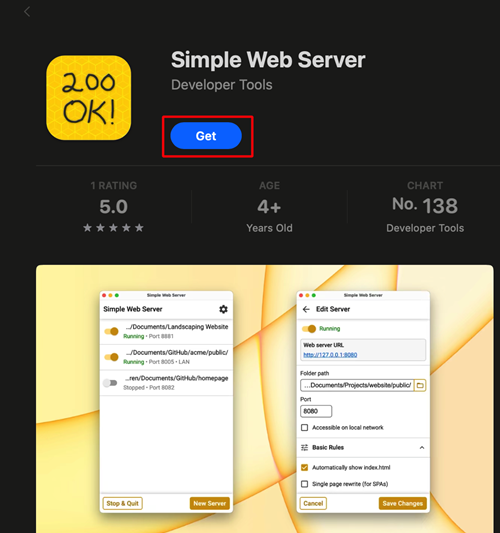
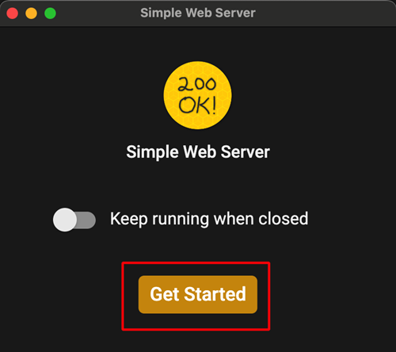
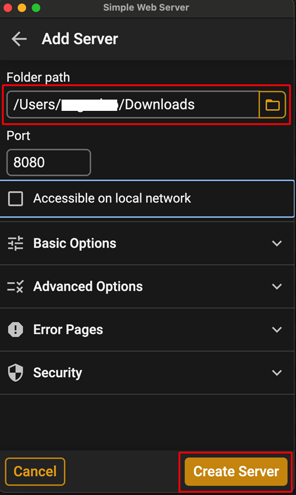

(aaps-ci-option2-computer)=

# Mulighed 2 · Computer – Upload dit eksisterende keystore

```{note}
[Mulighed 2](BrowserBuildO2.md) (upload et eksisterende keystore) på en **computer** (Windows / Mac / Linux).
```

## 1. Download forberedelsesfilen

:::{include} BrowserBuildDownloadPrep.md
:::

## 2. Start en lokal server, og upload keystoret

Brug en computer (Windows/Mac/Linux understøttes)

<!--crowdin: exclude-->
<div align="center" style="max-width: 360px; margin: auto; margin-bottom: 2em;">
  <div style="position: relative; width: 100%; aspect-ratio: 9/16;">
    <iframe
      src="https://geo.dailymotion.com/player/x9rdyc6.html?video=x9rdyc6&loop=true&mute=true"
      loading="lazy"
      style="position: absolute; top: 0; left: 0; width: 100%; height: 100%;"
      frameborder="0"
      allowfullscreen>
    </iframe>
  </div>
</div>

Installer Simple Web Server<br/><br/> Hvis du bruger Windows eller Mac, kan du installere den fra Microsoft Store eller Mac App Store. Hvis din browser spørger, om den skal åbne butiksappen, så tillad det.<br/><br/> <br/><br/>

Eksempel på Mac:

- get → install → open<br/><br/> <br/><br/>

- Klik på Get Started<br/><br/> <br/><br/>

- Klik på New Server<br/><br/> <br/><br/>

- Vælg i Folder Path den mappe, hvor aaps-ci-preparation.html ligger, og klik derefter på Create Server.<br/><br/> <br/><br/>

- Når du ser denne skærm, er serveren startet.<br/><br/> <br/><br/>

- Luk ikke Simple Web Server. Skift til din browser, og åbn<br/><br/> [http://127.0.0.1:8080/aaps-ci-preparation.html](http://127.0.0.1:8080/aaps-ci-preparation.html)<br/><br/>

- Se videoen nedenfor fra 2 minutter og 18 sekunder for de næste trin.<br/><br/>
  <!--crowdin: exclude-->
  <div align="center" style="max-width: 360px; margin: auto; margin-bottom: 2em;">
    <div style="position: relative; width: 100%; aspect-ratio: 9/16;">
      <iframe
        src="https://geo.dailymotion.com/player/x9rdvt0.html?video=x9rdvt0&startTime=138&loop=true&mute=true"
        loading="lazy"
        style="position: absolute; top: 0; left: 0; width: 100%; height: 100%;"
        frameborder="0"
        allowfullscreen>
      </iframe>
    </div>
  </div>

----

**Næste: [Trin 3 – Giv adgang til Google Drive](BrowserBuildGoogleDrive.md) →**
