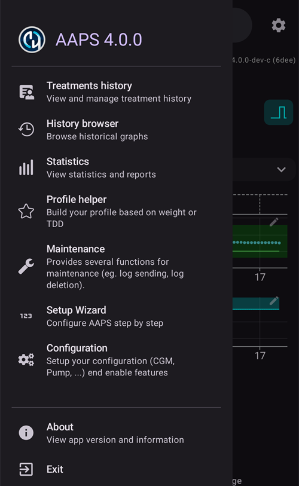

# Ændringer i din AAPS-konfiguration

Når du har gennemført **[Opsætningsguide](../SettingUpAaps/SetupWizard.md)**, behøver du ikke køre hele guiden igen, hvis du kun vil ændre dele af din **AAPS**-konfiguration.

Der er tre veje til at ændre **AAPS**-konfigurationen. Hvilken vej du vælger, er kun et spørgsmål om, hvad der er nemmest for dig, eller hvad du foretrækker. Alle veje fører til de samme indstillinger.

De er:

1. Skærmen **Konfiguration**,
2. Skærmen **Indstillinger** eller
3. Et plugins **Indstillinger**, åbnet fra dets kategori i **Konfiguration**.

Her forklarer vi, hvilken mulighed der er mest praktisk i hver situation:

## Konfiguration

Åbn **menuen** (☰) øverst til venstre på hovedskærmen, og vælg **Konfiguration**:

**Konfiguration** bruges til at **vælge, hvilke plugins der er aktive** — din CGM, pumpe, APS-algoritme, detektering af følsomhed, synkronisering og mere, ordnet efter kategori. Det er den samme skærm, som opsætningsguiden konfigurerede for dig.

Dokumentationen for skærmen Konfiguration findes [her](../SettingUpAaps/ConfigBuilder.md).

## Indstillinger

Tryk på ikonet **Indstillinger** (tandhjul) øverst til højre på hovedskærmen. Det åbner indstillingerne for **alle aktiverede plugins samlet ét sted**, ordnet i afsnit, som du kan folde ud:

Denne vej er god, hvis du ikke helt ved, hvor du skal lede efter en indstilling. Men den kan være lidt besværlig, hvis du ved, at du kun vil ændre indstillingerne for ét bestemt plugin.

Dokumentationen for indstillingerne findes [her](../SettingUpAaps/Preferences.md).

## Et plugins indstillinger

Åbn en kategori i **Konfiguration**, og tryk på »**Indstillinger**« under det aktive plugin. Du kommer direkte til indstillingerne for **kun dette plugin**:

Denne vej er f.eks. god, hvis du ved, at du vil ændre indstillingerne for din pumpe: Åbn **Konfiguration → Pumpe**, og tryk derefter på »**Indstillinger**« under den valgte pumpe.

Det er en »genvej« til de samme indstillinger, som vises på den generelle skærm **Indstillinger**.
