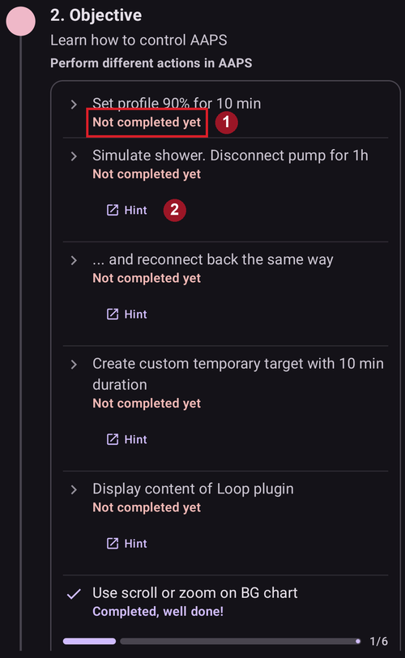
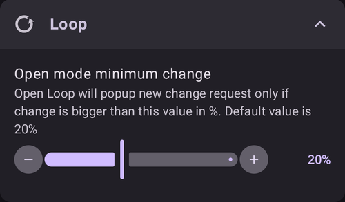
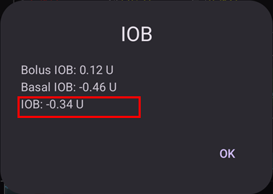
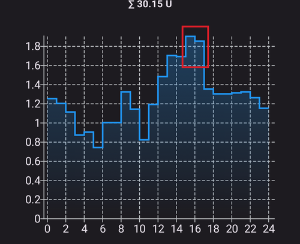
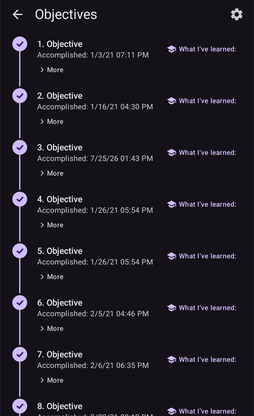
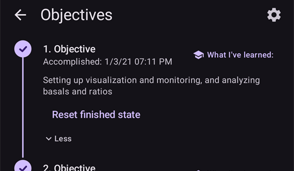
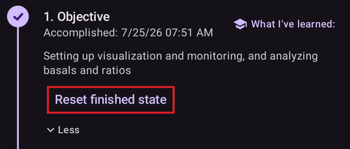

# Gennemførelse af læringsmålene

**AAPS** har en række **læringsmål**, som du skal gennemføre. De hjælper dig fra et enkelt åbent loop til et hybrid lukket loop og alle funktioner i **AAPS**. Når du gennemfører **læringsmålene**, sikrer du, at du har:

* sat alt rigtigt op i din **AAPS**-opsætning;
* lært de vigtigste funktioner i **AAPS**; og
* en grundlæggende forståelse af, hvad dit system kan, så du får tillid til **AAPS**, når du bruger det.

Når **AAPS** installeres første gang, skal hvert læringsmål gennemføres, før du kan gå videre til det næste. Nye funktioner bliver låst op lidt efter lidt, efterhånden som du gennemfører hvert **læringsmål**.

**Læringsmål 1 til 8** fører dig fra opsætning af **AAPS** på din smartphone til et »grundlæggende« hybrid lukket loop. Det tager omkring 6 uger. Du kan nå op til **læringsmål 5** med en virtuel pumpe (og i mellemtiden give insulin på en anden måde). **Læringsmål 9 og 10** skal teste mere avancerede funktioner i **AAPS**, så du får bedre styr på din diabetes. De tager op til 3 måneder at gennemføre, måske længere. Du kan finde flere detaljer om, hvor lang tid det forventes at tage, her: [Hvor lang tid vil det tage?](#preparing-how-long-will-it-take)

Ud over at gå frem gennem **læringsmålene** kan du også, om nødvendigt, fjerne dine fremskridt og [gå tilbage til et tidligere læringsmål](#CompletingTheObjectives-go-back-in-objectives).

## Sikkerhedskopier dine indstillinger

```{admonition} Note
:class: note

Det anbefales at eksportere dine **AAPS**-indstillinger, hver gang du har gennemført et **læringsmål**!
```

Det anbefales stærkt, at du [eksporterer dine indstillinger](../Maintenance/ExportImportSettings.md), hver gang du har gennemført et læringsmål, så du ikke mister dine fremskridt i **AAPS**. Eksporten laver en **indstillingsfil** (.json), som du skal gemme som sikkerhedskopi et eller flere sikre steder (f.eks. Google Drive, harddisk, vedhæftet fil i en e-mail _osv._). Så er dine fremskridt i **AAPS** gemt. Hvis du mister din telefon, eller hvis du ved en fejl sletter dine fremskridt, kan du indlæse json-filen i **AAPS** igen ved at importere en nyere indstillingsfil. Du skal også have en sikkerhedskopi af **indstillingsfilen**, hvis du af en eller anden grund får brug for en ny **AAPS**-smartphone (opgradering/mistet/ødelagt telefon _osv._)

**Indstillingsfilen** gemmer ikke kun dine fremskridt i **læringsmålene**, men også alle dine **AAPS**-indstillinger, f.eks. **maks. bolus** _osv._

Hvis du ikke har en sikkerhedskopi af dine indstillinger, og der sker noget med din **AAPS**-smartphone, skal du starte forfra med **læringsmålene**. Det tager tid at gennemføre **læringsmålene**, og du vil helst undgå at skulle gøre det hele igen, f.eks. fordi du har mistet din smartphone.

(objectives-objective1)=
## Læringsmål 1: Opsætning af visning og overvågning, analyse af basaler og forhold

I **læringsmål 1** skal du lave den grundlæggende tekniske opsætning i **AAPS**. Du kan ikke komme videre, før dette trin er gennemført.

- Vælg den rigtige CGM/FGM i [Konfiguration → BS-kilde](#Config-Builder-bg-source). Se [BS-kilde](../Getting-Started/CompatiblesCgms.md) for mere information.
- Vælg den rigtige pumpe i [Konfiguration → Pumpe](#Config-Builder-pump), så din pumpe kan kommunikere med **AAPS**. Vælg **Virtuel pumpe**, hvis du bruger en pumpemodel uden **AAPS**-driver til loop, eller hvis du vil gennemføre de første **læringsmål**, mens du bruger et andet system til insulintilførsel. Se [insulinpumpe](../Getting-Started/CompatiblePumps.md) for mere information.
- Hvis du bruger Nightscout:
  - Følg vejledningen på siden [Nightscout](../SettingUpAaps/Nightscout.md), så **Nightscout** kan modtage og vise data fra **AAPS**.
  - Bemærk, at URL'en i **NSClientV3** skal være **_uden_ "/api/v1/"** til sidst - se [Indstillinger → NSClientV3](#Preferences-nsclient).
- Hvis du bruger Tidepool:
  - Følg vejledningen på siden [Tidepool](../SettingUpAaps/Tidepool.md), så **Tidepool** kan modtage og vise data fra **AAPS**.

Bemærk: *Du skal måske vente på den næste sensorglukose-måling, før **AAPS** registrerer det.*

(objectives-objective2)=
## Læringsmål 2: Lær at styre AAPS

I **læringsmål 2** skal du udføre flere »opgaver«, som vist på skærmbilledet nedenfor. Hver opgave viser sin status (**1**): det orange »**Ikke afsluttet endnu**« skifter til »**Fuldført, godt klaret!**«, så snart **AAPS** har registreret handlingen. Tryk på **Tip** (**2**) under en opgave for at åbne den tilhørende dokumentation, hvis du ikke kender en bestemt handling endnu.



Opgaverne i **læringsmål 2** er:
- Sæt din **profil** til 90% i 10 min.
  - _Tip_: Tryk på dit profilnavn på hovedskærmen for at åbne skærmen **Profil**, brug derefter knappen **Aktiver** (▶), og indstil procent og varighed. Mere information i [Profilskift og profilprocent](../DailyLifeWithAaps/ProfileSwitch-ProfilePercentage.md).
  - _Bemærk_: **AAPS** accepterer ikke basalrater under 0,05 E/t. Hvis din **profil** har rater på 0,05 E/t eller lavere, skal du lave en midlertidig **profil** med højere basalrater, før du gennemfører denne opgave. Skift tilbage til din normale **profil**, når du har gennemført denne opgave.
- Lad som om du »tager et brusebad« ved at [afbryde din pumpe](#AapsScreens-loop-status) i **AAPS** i 1 time.
  - _Tip_: tryk på loop-ikonet på hovedskærmen for at åbne Loop-dialogen, og vælg derefter en varighed under **Afbryd pumpe**.
- Afslut »at tage et brusebad« ved at genforbinde din pumpe.
  - _Tip_: tryk på ikonet »forbindelse afbrudt« for at åbne Loop-dialogen igen, og vælg **Genforbind pumpe**.
- Sæt et brugerdefineret [**midlertidigt mål**](../DailyLifeWithAaps/TempTargets.md) i 10 min.
  - _Tip_: tryk på målområdet på hovedskærmen for at åbne skærmen for midlertidigt mål.
- Vis indholdet af **Loop**-pluginet.
  - _Tip_: åbn **Konfiguration → Loop**, og tryk på »**Åbn plugin**«.
- Rul eller zoom i BS-grafen for at se længere eller kortere tidsrum.


(objectives-objective3)=
## Læringsmål 3: Bevis din viden

I **læringsmål 3** skal du bestå en eksamen med multiple choice. Den tester din viden om **AAPS**.

Nogle brugere synes, at **læringsmål 3** er det sværeste læringsmål at gennemføre. Læs **AAPS**-dokumentationen sammen med spørgsmålene. Hvis du virkelig sidder fast efter at have søgt i **AAPS**-dokumentationen, så søg efter »Objective 3« i gruppen på [Facebook](https://www.facebook.com/groups/AndroidAPSUsers) eller [Discord](https://discord.gg/4fQUWHZ4Mw) (dit spørgsmål er sandsynligvis allerede stillet - og besvaret af gruppen). Disse grupper kan give venlige tips eller henvise dig til den rigtige del af **AAPS**-dokumentationen.

I mellemtiden:
- For at få færre notifikationer / beslutninger (midlertidige basalrater), mens du er i åbent loop, så sæt et bredt målområde i din **profil**, _f.eks._ 90 - 150 mg/dl eller 5,0 - 8,5 mmol/l.
- Du kan sætte en højere øvre grænse om natten, eller endda slå åbent loop fra om natten.

For at fortsætte med **læringsmål 3** skal du trykke på en spørgsmålslinje for at åbne den. Læs hvert spørgsmål grundigt, og vælg dit svar (eller dine svar).

Der kan være mere end ét rigtigt svar på hvert spørgsmål! Hvis du vælger et forkert svar, bliver spørgsmålet låst i 1 time, før du kan gå tilbage og svare igen. Vær opmærksom på, at rækkefølgen af svarene kan være ændret, næste gang du svarer. Det skal sikre, at du læser dem grundigt og virkelig forstår, om hvert svar er rigtigt eller ej.

```{admonition} __What happens if new question(s) are added to an Objective when I update to a newer version of AAPS?__
:class: note
Fra tid til anden kommer der nye funktioner i **AAPS**, som kan kræve, at der tilføjes et nyt spørgsmål til **læringsmålene**, især **læringsmål 3**. Derfor bliver hvert nyt spørgsmål i **læringsmål 3** markeret som »ikke fuldført«, fordi **AAPS** kræver, at du svarer på det. Bare rolig: hvert **læringsmål** er uafhængigt, så du **mister ikke de funktioner i AAPS, du allerede har**, så længe de andre **læringsmål** stadig er gennemført.
```

## Læringsmål 4: Start med et åbent loop

Formålet med **læringsmål 4** er at se, hvor ofte **AAPS** vurderer brugerens basalrate i forhold til glukosen og anbefaler ændringer af den midlertidige basalrate. I dette **læringsmål** aktiverer du åbent loop for første gang. Du skal acceptere 20 foreslåede ændringer af midlertidig basalrate og om nødvendigt indstille dem manuelt på din pumpe. Du skal også se virkningen af [**midlertidige mål**](../DailyLifeWithAaps/TempTargets.md). Hvis du endnu ikke ved, hvordan du ændrer den midlertidige basalrate i **AAPS**, så se pumpehandlingerne i arket **Administrer** ([Hvor er fanen Handlinger blevet af?](#screens-action-tab)).

Mindste tid for at gennemføre dette læringsmål: **7 dage**. Det er en ventetid, du ikke kan springe over. Du kan ikke gå videre til næste **læringsmål**, heller ikke selvom alle ændringer af basalraten allerede er udført.

- Vælg åbent loop ved at trykke på [loop-ikonet](#AapsScreens-loop-status) på hovedskærmen og vælge **Åbent loop** som loop-tilstand.
- Udfør mindst 20 af forslagene til midlertidig basalrate manuelt over en periode på 7 dage; indtast dem på din (fysiske) pumpe, og bekræft i AAPS, at du har accepteret dem. Sørg for, at disse ændringer af basalraten vises i **AAPS** og **Nightscout**.
- Brug [**midlertidige mål**](../DailyLifeWithAaps/TempTargets.md), når det er nødvendigt. Når du har behandlet en hypo, så brug det foruddefinerede midlertidige mål »Hypo«, så systemet ikke overkorrigerer, når blodsukkeret stiger igen.
- Hvis du stadig er i [Simpel tilstand](#preferences-simple-mode) nu, er det sikkert et godt tidspunkt at slå den fra.

For at få færre foreslåede ændringer af basalraten, mens du er i åbent loop, kan du stadig bruge rådene i [**læringsmål 3**](#objectives-objective3). Du kan også ændre den mindste procent for anbefalede ændringer af basalraten med indstillingen »**Mindste ændring i åbent loop**« i **Indstillinger → Loop**. Jo højere værdi, jo færre notifikationer om ændringer får du.



```{admonition} Note
:class: note

Du behøver ikke at udføre hver eneste anbefaling fra systemet!
```
(objectives-objective5)=
## Læringsmål 5: Forstå dit åbne loop, herunder dets anbefalinger om midlertidig basal

I **læringsmål 5** begynder du at forstå, hvordan anbefalingerne om midlertidig basal bliver beregnet. Det omfatter [logikken bag beslutningen om basal](#aaps-screens-how-predictions-become-a-dosing-decision), at se virkningen ved at følge [prognoselinjerne i **AAPS-oversigten**](#aaps-screens-prediction-lines) (eller Nightscout) og at se på de detaljerede beregninger på skærmen for pluginet **OpenAPS SMB** (**Konfiguration → APS → Åbn plugin**).

Forventet tid for at gennemføre dette læringsmål: **7 dage**.

I dette **læringsmål** skal du finde og indstille din værdi for »Maks. basalrate« (max-basal), som beskrevet i [OpenAPS-funktioner](#Open-APS-features-max-u-h-a-temp-basal-can-be-set-to). Denne værdi kan indstilles i [Indstillinger → OpenAPS SMB](#Preferences-openaps-smb-settings). I [simpel tilstand](#preferences-simple-mode) sætter **AAPS** denne værdi automatisk, og du behøver ikke at ændre den. Hvis du stadig bruger en virtuel pumpe, så sørg for, at denne sikkerhedsindstilling er sat både i **AAPS** og på din insulinpumpe.

Du kan sætte dit [BS-mål i **profilen**](#profile-glucose-targets) højere end normalt, indtil du er tryg ved beregningerne og indstillingerne i **AAPS**. Du kan prøve at sætte dit **BS-mål** i din **profil** i et smallere område (f.eks. 1 mmol/l eller mindre [20 mg/dl eller mindre] bredt) og se, hvad der sker.


```{admonition} If you have been using a virtual pump, change to a real insulin pump now!
:class: note

Hvis du kører åbent loop med en virtuel pumpe, så **stop her**. Tryk først på **Bekræft** til sidst i dette **læringsmål**, når du er skiftet til en »rigtig« pumpe, som giver insulin.

```


(objectives-objective6)=
## Læringsmål 6: Begynd at lukke loopet med Stop ved lavt BS


```{admonition} Closed loop will not correct high **BG** values in **Objective 6** as it is limited to **Low Glucose Suspend** only!
:class: note
Du skal stadig selv korrigere høje BS-værdier (manuelt med korrektioner via pumpe eller pen)!
```

I **læringsmål 6** lukker du loopet og aktiverer tilstanden **Stop ved lavt BS** (LGS), mens [maks. IOB](#Open-APS-features-maximum-total-iob-openaps-cant-go-over) er sat til nul. Du skal blive i LGS-tilstand i 5 dage for at gennemføre dette **læringsmål**. Brug denne tid til at tjekke, om dine **profil**-indstillinger er rigtige, og at LGS ikke sker for ofte.

Mindste tid for at gennemføre dette læringsmål: **5 dage**. Det er en ventetid, du ikke kan springe over. Du kan ikke gå videre til næste **læringsmål**, før denne tid er gået.

Det er meget vigtigt, at din nuværende **profil** (basal, ISF, IC) er godt testet, før du lukker dit loop i **LGS**-tilstand. Forkerte **profil**-indstillinger kan give dig hypoer, som du skal behandle manuelt. En præcis **profil** hjælper med at mindske behovet for at behandle lavt blodsukker i perioden på 5 dage.

**Hvis du stadig ser hyppige eller alvorlige episoder med lavt blodsukker, så overvej at justere [din insulintypes DIA](#Config-Builder-insulin-dia), basal, ISF og kulhydratforhold.** Se gruppen på [Facebook](https://www.facebook.com/groups/AndroidAPSUsers) eller [Discord](https://discord.gg/4fQUWHZ4Mw), hvor der er meget diskussion om dette.


Under **læringsmål 6** sætter **AAPS** indstillingen maxIOB til nul. **Dette ophører, når du går videre til læringsmål 7.**

Det betyder, at når du er på **læringsmål 6**, og sensorglukosen falder, vil **AAPS** sænke din basale insulintilførsel for dig. Men hvis sensorglukosen stiger, vil **AAPS** kun hæve basalraten over værdien i din **profil**, hvis **basal IOB** er negativ på grund af en tidligere **LGS**. Ellers vil **AAPS** ikke hæve basalen over den aktuelle værdi i din profil, heller ikke hvis glukosen stiger. Denne forsigtighed skal undgå hypoer, mens du lærer at bruge **AAPS**.

**Derfor skal du selv behandle høje glukoseværdier med manuelle korrektionsboluser.**

- Hvis din IOB er negativ (se skærmbilledet nedenfor), kan der i **læringsmål 6** blive startet en midlertidig basalrate (TBR) > 100%.



- Sæt dit målområde lidt højere, end du plejer, for en sikkerheds skyld og for at få en sikkerhedsmargin.
- Aktiver tilstanden »Stop ved lavt BS« ved at trykke på loop-ikonet på hovedskærmen og vælge **Stop ved lavt BS** som loop-tilstand.
- Se aktive midlertidige basaler i den turkise basaltekst på skærmen OVERSIGT eller i den turkise basal i grafen i OVERSIGT.
- Du kan i en periode opleve stigninger efter behandlede hypoer, fordi basalen ikke kan hæves, når blodsukkeret stiger igen.

(objectives-objective7)=
## Læringsmål 7: Justering af det lukkede loop, maxIOB hæves over 0, og BS-mål sænkes gradvist

For at gennemføre **læringsmål 7** skal du lukke dit loop og hæve din [maxIOB](#Open-APS-features-maximum-total-iob-openaps-cant-go-over). **maxIOB** blev automatisk sat til nul i **læringsmål 6** på grund af tilstanden Stop ved lavt BS. Det er ikke længere tilfældet. **AAPS** begynder at bruge din indstillede maxIOB-værdi til at korrigere høje glukoseværdier. I [simpel tilstand](#preferences-simple-mode) sætter **AAPS** maxIOB automatisk, og du behøver ikke at ændre den.

Mindste tid for at gennemføre dette læringsmål: **1 dag**. Det er en ventetid, du ikke kan springe over. Du kan ikke gå videre til næste **læringsmål**, før denne periode er gået.

- Vælg **Lukket loop** ved at trykke på [loop-ikonet](#AapsScreens-loop-status) på hovedskærmen og vælge **Lukket loop** som loop-tilstand. Bliv i **Lukket loop** i en periode på 1 dag.

- Hæv langsomt din »Maks. IOB for SMB« (i OpenAPS kaldet 'max-iob') over 0, indtil du finder de indstillinger, der virker bedst for dig.

Standardanbefalingen for denne indstilling er »**gennemsnitlig måltidsbolus + 3x maks. daglig basal**«, hvor »maks. daglig basal« er den højeste timeværdi i noget tidsrum af døgnet.



Denne anbefaling er kun et udgangspunkt. Hvis du bruger denne regel, men oplever, at AAPS giver for meget insulin, når glukosen stiger, skal du måske:
* sænk værdien »Maks. IOB for SMB«;
* gennemgå dine **profil**-indstillinger og kun ændre én ting ad gangen.

Hvis du er meget insulinresistent, kan du i stedet hæve **maxIOB**-værdien meget forsigtigt.

Når du er sikker på, hvor meget **maxIOB** passer til dit loop, så sænk dine **BS-mål** til det ønskede niveau.

(objectives-objective8)=
## Læringsmål 8: Juster basaler og forhold om nødvendigt, og aktiver derefter Autosens

I dette **læringsmål** ser du igen på, hvor godt din **profil** virker, og du bruger funktionen [Autosens](#Open-APS-features-autosens) som tegn på forkerte indstillinger.

Mindste tid for at gennemføre dette læringsmål: **7 dage**. Det er en ventetid, du ikke kan springe over. Du kan ikke gå videre til næste **læringsmål**, før denne periode er gået.

Aktiver [Autosens](../DailyLifeWithAaps/KeyAapsFeatures.md) i en periode på 7 dage (i [simpel tilstand](#preferences-simple-mode) er det aktiveret som standard), og se [den hvide linje i grafen i **Oversigt**](#AapsScreens-section-g-additional-graphs), der viser, om din insulinfølsomhed stiger eller falder på grund af motion, hormoner osv. Hold øje med skærmen for pluginet **OpenAPS SMB** (**Konfiguration → APS → Åbn plugin**), som viser, hvordan **AAPS** justerer følsomhed, basaler og mål.

Det er et godt tidspunkt at gennemgå dine indstillinger for [Detektering af følsomhed](#Config-Builder-sensitivity-detection). Du kan se din følsomhed på hovedskærmen i en [ekstra graf](#AapsScreens-section-g-additional-graphs).

Du kan også bruge [Autotune](#autotune-how-autotune-calculates-adjustments) én gang for at tjekke, at dine basaler stadig er rigtige, eller lave en traditionel basaltest.

(objectives-objective9)=
## Læringsmål 9: Aktivering af flere oref1-funktioner til brug om dagen, f.eks. super micro bolus (SMB)

I **læringsmål 9** arbejder du med og bruger **»Super Micro Bolus (SMB)«** som en central funktion. Når du har læst den obligatoriske litteratur, vil du godt forstå, hvad SMB er, hvordan det virker, og hvorfor basalen sættes midlertidigt til nul, efter at SMB er givet (nul-basal).

Mindste tid for at gennemføre dette læringsmål: **28 dage**. Det er en ventetid, du ikke kan springe over. Du kan ikke gå videre til næste læringsmål, før denne tid er gået.

- [Afsnittet om SMB i denne dokumentation](#Open-APS-features-super-micro-bolus-smb) og [afsnittet om oref1 i openAPS-dokumentationen](https://openaps.readthedocs.io/en/latest/docs/Customize-Iterate/oref1.html) skal du læse for at forstå **SMB** og princippet bag **nul-basal**.
- Når det er gjort, kan du [hæve maxIOB](#Open-APS-features-maximum-total-iob-openaps-cant-go-over), så **SMB** virker bedre. maxIOB omfatter nu al **IOB**, ikke kun opsamlet basal. Denne grænse sætter **SMB** på pause, indtil IOB falder under denne værdi (_f.eks._ er **maxIOB** sat til 7 IE, og der gives en bolus på 8 IE til et måltid: SMB sættes på pause og gives ikke, før **IOB** falder under 7 IE). En god start er at sætte **maxIOB** = **gennemsnitlig måltidsbolus + 3x maks. daglig basal**, hvor »maks. daglig basal« er den højeste timeværdi i noget tidsrum af døgnet. Se [læringsmål 7](#objectives-objective7) som reference.
- Vurder din kulhydratabsorption, og overvej at ændre parameteren »min_5m_carbimpact« i [Indstillinger → Indstillinger for absorbering → min_5m_carbimpact](#Preferences-min_5m_carbimpact), hvis du synes, den er for langsom eller for hurtig.

(objectives-objective10)=
## Læringsmål 10: Automatisering

**Automatisering** bliver tilgængelig, når **læringsmål 10** er startet.

Mindste tid for at gennemføre dette læringsmål: **28 dage**. Det er en ventetid, du ikke kan springe over. Du kan ikke gå videre til næste læringsmål, før denne tid er gået.

Læs først dokumentationssiden [Automatisering](../DailyLifeWithAaps/Automations.md).

Lav den mest enkle automatiseringsregel; f.eks. en Android-notifikation om nogle minutter:
- Åbn **Administrer → Automatisering**, og tryk på knappen **+** (**Tilføj regel**).
- Skriv et **Opgavenavn**, f.eks. »Min første automatiseringsnotifikation«.
- Under **Betingelse** skal du trykke på »**REDIGER**«.
  - Tryk på »**Tilføj udløser**«, og vælg »**Tid**«. **AAPS** laver en post for i dag på det aktuelle tidspunkt.
  - Ændr tidspunktet, så den udløses om nogle minutter.
  - Tryk på ikonet **Gem** (øverst til højre) for at gå tilbage til reglen.
- Under **Handling** skal du trykke på »**TILFØJ**« og vælge »**Notifikation**«.
  - Skriv en besked i handlingskortet, f.eks. »Min første automatisering«.
- Tryk på ikonet **Gem** (øverst til højre), og sørg for, at reglen er **Aktiveret**.
- Vent, indtil tidspunktet udløser notifikationen (bemærk, at den alt efter din telefon kan komme et par minutter for sent)

Derefter kan du prøve at lave en mere nyttig **automatisering**. Dokumentationssiden giver nogle eksempler, og du kan søge efter skærmbilleder med »Automation« i gruppen på [Facebook](https://www.facebook.com/groups/AndroidAPSUsers). Der er også en særlig kanal i fællesskabet på [Discord](https://discord.gg/4fQUWHZ4Mw).

Hvis du f.eks. spiser det samme til morgenmad på samme tid hver morgen før skole/arbejde, kan du lave en **automatisering** som »mål-før-morgenmad«, der sætter et lidt lavere **midlertidigt mål** 30 minutter før morgenmaden. I så fald vil din betingelse sikkert omfatte »Tilbagevendende tid«, hvor du vælger bestemte ugedage (mandag, tirsdag, onsdag, torsdag, fredag) og et bestemt tidspunkt (06:30). Handlingen vil være »Start midlertidigt mål« med en lavere målværdi end normalt og en varighed på 30 minutter.

## Når alle læringsmål er gennemført

Når du har gennemført alle **læringsmålene**, viser listen hvert af dem med et flueben og datoen, hvor det blev gennemført. Punktet **Mål** forsvinder fra navigationen i bunden; du kan stadig åbne listen med **Konfiguration → Begrænsninger → Mål → Åbn plugin**.



Tryk på »**Mere**« under et læringsmål for at se dets opgaver igen:



(CompletingTheObjectives-go-back-in-objectives)=
## Gå tilbage i læringsmålene

Hvis du af en eller anden grund vil gå tilbage i **læringsmålene**, så åbn det gennemførte **læringsmål** med »**Mere**«, og tryk på »**Nulstil færdig tilstand**«:



På samme måde kan du starte det **læringsmål**, du arbejder på nu, forfra med »**Nulstil startet tilstand**«.
