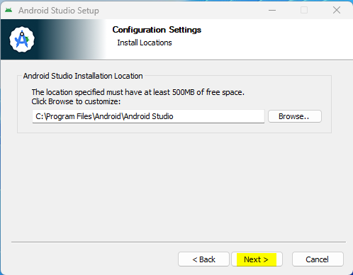
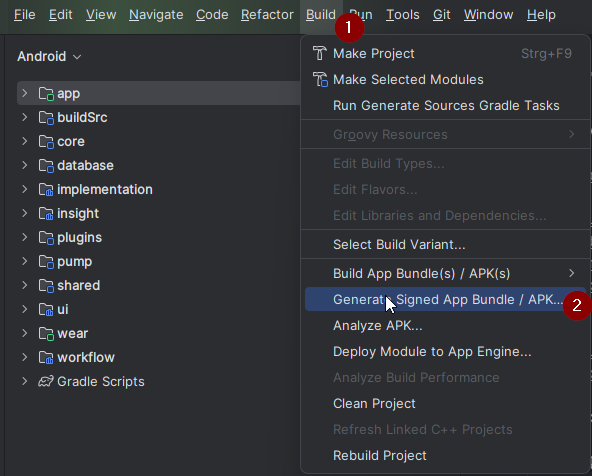
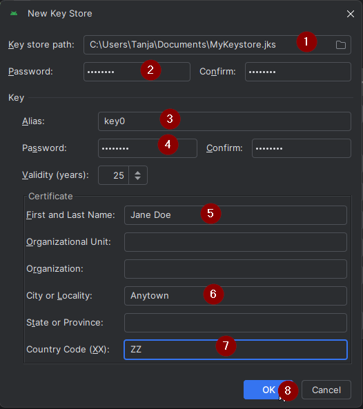

<!-- Android Studio Build, FKA Computer Build. Preserve filenames to avoid breaking URLs. -->

# Build med Android Studio

Dette er den traditionelle metode til at bygge din AAPS-app.

Du kan bygge appen uden en computer med metoden [Build i browseren](./BrowserBuild.md).

## Byg selv i stedet for at downloade

**AAPS-appen (en apk-fil) kan ikke downloades på grund af reglerne for medicinsk udstyr. Det er lovligt at bygge appen til eget brug, men du må ikke give en kopi til andre!**

Se [Ofte stillede spørgsmål for loopere](../UsefulLinks/FAQ.md) for detaljer.

---

(Building-APK-recommended-specification-of-computer-for-building-apk-file)=
## Krav til computer og software for at bygge AAPS

* Der kan være brug for en bestemt version af **[Android Studio](https://developer.android.com/studio/)** for at bygge apk'en. Se tabellen nedenfor:

| AAPS-version            | Foretrukken<br/>Android Studio-<br/>version | Alternativ<br/>Android Studio-<br/>version | Gradle | JVM |
| ----------------------- | ------------------------------------------------------- | ------------------------------------------------------ | ------ |:--- |
| 2.6.2                   | 3.6.1                                                   |                                                        | 5.6.4  | 11  |
| 2.8.2.1                 | 4.1.1                                                   |                                                        | 6.1.1  | 13  |
| [3.1.0.3](#version3100) | 2020.3.1                                                | testet op til Quail 4                                  | 7.3.3  | 17  |
| [3.2.0.4](#version3204) | Hedgehog (2023.1.1)                                     | testet op til Quail 4                                  | 8.2    | 17  |
| [3.3.1.3](#version3300) | Ladybug Feature Drop (2024.2.2)                         | testet op til Quail 4                                  | 8.10   | 21  |
| [3.3.2](#version3300)   | Meerkat (2024.3.1)                                      | testet op til Quail 4                                  | 8.11.1 | 21  |
| [3.3.2.1](#version3321) | Narwhal (2025.1.2)                                      | testet op til Quail 4                                  | 8.13   | 21  |
| [3.4.2.6](#version3426) | Panda 2 (2025.3.2)                                      | testet op til Quail 4                                  | 9      | 21  |
| [4.0.0](#version400)    | Rabbit 2 (2026.2.2)                                     | Nyeste                                                 | 9.8    | 21  |

Den »foretrukne version« leveres med den rigtige JVM-version. Den foretrukne version er også den laveste version, du kan bruge til at bygge **AAPS**. Du kan **IKKE** bygge med en version, der er ældre end den »foretrukne«. Hvis du bruger en anden version, kan du få problemer med JVM-versionen. Se siden [Fejlfinding i Android Studio](#troubleshooting_androidstudio-uncommitted-changes) for hjælp til at løse disse problemer. Hvis din nuværende version af Android Studio ikke står i tabellen, skal du først opdatere den.

Gradle-versionen hænger sammen med kildekoden. Du får altid den rigtige Gradle-version, når du downloader eller opdaterer kildekoden. Den står her kun til orientering. Du behøver ikke gøre noget ved den.

* [32-bit Windows-systemer](#troubleshooting_androidstudio-unable-to-start-daemon-process) understøttes ikke af Android Studio. Husk, at både **64-bit CPU og 64-bit styresystem er et krav.** Hvis dit system IKKE opfylder dette krav, skal du skifte den berørte hardware eller software eller hele systemet.

<table class="tg">
<tbody>
  <tr>
    <th class="tg-baqh">Styresystem (kun 64 bit)</th>
    <td class="tg-baqh">Windows 10 eller nyere</td>
    <td class="tg-baqh">macOS 12 eller nyere</td>
    <td class="tg-baqh">Enhver Linux-distribution, der understøtter Gnome, KDE eller Unity DE;&nbsp;&nbsp;GNU C Library (glibc) 2.31 eller nyere</td>
  </tr>
  <tr>
    <th class="tg-baqh"><p align="center">CPU (kun 64 bit)</th>
    <td class="tg-baqh">x86_64-CPU fra 2017 eller nyere (Intel Core i5 8. generation, AMD Ryzen eller nyere) med <a href="https://developer.android.com/studio/install" target="_blank" rel="noopener noreferrer">understøttelse af virtualisering</a> (Intel VT-x eller AMD-V) slået til i BIOS</td>
    <td class="tg-baqh">Apple Silicon (M1 eller nyere) eller Intel Core 6. generation eller nyere (understøttelsen af Intel-Mac'er er ved at blive udfaset)</td>
    <td class="tg-baqh">x86_64-CPU fra 2017 eller nyere (Intel Core i5 8. generation, AMD Ryzen eller nyere) med understøttelse af virtualisering (Intel VT-x eller AMD-V) slået til i BIOS</td>
  </tr>
  <tr>
    <th class="tg-baqh"><p align="center">RAM</th>
    <td class="tg-baqh" colspan="3"><p align="center">16 GB eller mere (8 GB er det absolutte minimum for Android Studio alene, 32 GB anbefales)</td>
  </tr>
  <tr>
    <th class="tg-baqh"><p align="center">Disk</th>
    <td class="tg-baqh" colspan="3"><p align="center">Mindst 32 GB ledig plads. SSD anbefales.</td>
  </tr>
  <tr>
    <th class="tg-baqh"><p align="center">Opløsning</th>
    <td class="tg-baqh" colspan="3"><p align="center">Mindst 1280 x 800 (1920 x 1080 anbefales)<br></td>
  </tr>
  <tr>
    <th class="tg-baqh"><p align="center">Internet</th>
    <td class="tg-baqh" colspan="3"><p align="center">Bredbånd</td>
  </tr>
</tbody>
</table>

**Det anbefales stærkt (men er ikke et krav) at bruge en SSD (Solid State Disk) i stedet for en HDD (harddisk), fordi det tager kortere tid at bygge AAPS-apk-filen.**  Du kan stadig bruge en HDD, når du bygger **AAPS**-apk-filen. Hvis du gør det, kan byggeprocessen tage lang tid. Men når den først er startet, kan du lade den køre uden opsyn.

## Hjælp og support, mens du bygger

Hvis du får problemer, mens du bygger **AAPS**-appen, er der et særligt afsnit, [**Fejlfinding i Android Studio**](../GettingHelp/TroubleshootingAndroidStudio.md). Se det først.

Hvis du synes, at noget i byggevejledningen er forkert, mangler eller er forvirrende, eller hvis du stadig har problemer, så kontakt andre **AAPS**-brugere i gruppen på [Facebook](https://www.facebook.com/groups/AndroidAPSUsers) eller [Discord](https://discord.gg/4fQUWHZ4Mw). Hvis du selv vil ændre noget (opdatere skærmbilleder _osv._), så indsend en [pull request (PR)](../SupportingAaps/HowToEditTheDocs.md).

## Trin-for-trin-vejledning til at bygge AAPS-appen

```{admonition} WARNING
:class: warning
Hvis du har bygget AAPS før, behøver du ikke at gøre alle de følgende trin igen.
Gå direkte til [Opdatering til en ny version eller gren](../Maintenance/UpdateToNewVersion.md)!
```

```{contents} The overall steps for building the **AAPS** apk file
:depth: 1
:local: true
```

I denne vejledning finder du _eksempler_ på skærmbilleder af, hvordan du bygger APK-filen til **AAPS**. **Android Studio** – det program, vi bruger til at bygge APK'en til **AAPS** – bliver opdateret jævnligt. Derfor er skærmbillederne måske ikke helt ens med din installation, men du bør stadig kunne følge dem.

Da **Android Studio** kører på Windows, Mac OS X og Linux, kan der også være små forskelle i trinene på de forskellige platforme.

(install-git-if-you-dont-have-it)=
### Installer Git

```{admonition} Why Git? 
:class: dropdown

Git er et såkaldt »_versionsstyringssystem_« (Versioning Control System, VCS).\
Git er et program, som du kan bruge til at følge ændringer i kode og til at samarbejde med andre. Du bruger Git til at lave en kopi af kildekoden til **AAPS** fra GitHub-websiden til din lokale computer. Derefter bruger du Android Studio på din computer til at bygge **AAPS**-applikationen (APK). 
```

(BuildingAaps-steps-for-installing-git)=
#### Trin til installation af Git

1.  Kontroller, at du ikke allerede har **Git** installeret. Det kan du gøre ved at skrive »git« i søgefeltet i Windows. Hvis du ser **»Git bash«** eller en anden form for Git, er det allerede installeret, og du kan gå direkte videre til [installation af Android Studio](#Building-APK-install-android-studio):


2. Hvis du ikke har Git installeret, så hent og installer den nyeste version til dit system fra afsnittet »Download« [**her**](https://git-scm.com/downloads). Enhver nyere version af Git bør virke. Vælg den rigtige version til dit system, enten Mac, Windows eller Linux.

**Bemærkning til Mac-brugere:** Websiden for Git vil også guide dig til at installere et ekstra program, der hedder »homebrew«, som hjælper med installationen. Hvis du installerer Git via homebrew, behøver du ikke at ændre nogen indstillinger.

(Make_a_note_of_Git_path)=

* Når du under installationen bliver spurgt om »select destination location« (vælg placering), så skriv ned, _hvor_ Git bliver installeret (»**installationsstien**«). Du skal kontrollere den i næste trin. Den vil ligne »C:\Program Files\Git\cmd\git.exe«

*  Når du går gennem de forskellige trin i installationen af Git, så accepter bare alle standardvalgene.

*  Hvis du efter installationen har glemt at skrive ned, hvor Git blev installeret, kan du finde det sådan: Skriv »git« i søgefeltet på din pc, højreklik på »Git bash«, vælg »Åbn filplacering« (open file location), og hold musen over ikonet »Git bash«. Så kan du se, hvor det er installeret.

* Genstart din computer før næste trin.

(Building-APK-install-android-studio)=
### Installer Android Studio

- **Du skal være online hele tiden under de følgende trin, da Android Studio henter flere opdateringer**

```{admonition} What is Android Studio?
:class: dropdown
Android Studio er et program, der kører på din computer. Med det kan du hente kildekode fra internettet (med Git) og bygge apps til smartphones (og smarture). Du kan ikke »ødelægge« en nuværende version af **AAPS**, som du måske kører med loop på en smartphone, ved at bygge en ny eller opdateret app på din pc med Android Studio. Det er to helt adskilte processer. 
```

Noget af det vigtigste, når du installerer Android Studio, er: **Vær tålmodig!** Under installation og opsætning henter Android Studio mange ting, og det tager tid.

```{admonition} Different UI
:class: warning
Vigtigt: Android Studio har ændret sin brugerflade i de seneste udgaver. Denne vejledning viser trinene med den *nye brugerflade*. Skærmbillederne er taget med »Ladybug«, så nyere versioner kan se lidt anderledes ud. Hvis du stadig bruger den gamle brugerflade, kan det være en god idé først at skifte Android Studio til den nye brugerflade ved at følge [denne vejledning](#computerbuild-NewUI).
```

Versionen af Android Studio er meget vigtig. Se [vejledningen ovenfor](#Building-APK-recommended-specification-of-computer-for-building-apk-file) for at vælge den rigtige version af Android Studio.

Download den [nuværende version af Android Studio](https://developer.android.com/studio) eller en ældre version fra [**arkivet**](https://developer.android.com/studio/archive), og accepter aftalerne for download.


Når download er færdig, så start det hentede program for at installere det på din computer. Du skal måske acceptere/bekræfte nogle advarsler fra Windows om hentede apps!

Installer Android Studio ved at klikke på »Next« (Næste), som vist på de følgende skærmbilleder. Du behøver **ikke** at ændre nogen indstillinger!


Hvis du vil spare plads på harddisken, kan du fjerne fluebenet ved Android Virtual Device: Det bruges ikke til at bygge **AAPS**.




Klik nu på »Install« (Installer):


Når det er færdigt, så tryk på »Next«


I det sidste trin skal du klikke på »Finish« for at starte Android Studio for første gang.


Du bliver spurgt, om du vil hjælpe med at forbedre Android Studio. Vælg, hvad du har lyst til. Det gør ingen forskel for de følgende trin.


Velkomstskærmen byder dig velkommen til installationen af Android Studio. Tryk på »Next«.


Vælg »Standard« som installationstype.


Bekræft indstillingerne ved at klikke på »Next« igen.


Nu skal du acceptere licensaftalerne. Der er to afsnit (1 + 3) i venstre side, som du skal vælge et ad gangen, og for hvert af dem skal du vælge »Accept« (2 + 4) i højre side.

Derefter kan du klikke på knappen »Finish« (5).


Nu bliver nogle Android-pakker hentet og installeret. Vær tålmodig, og vent.

Når det er færdigt, ser du den følgende skærm, hvor du igen kan vælge »Finish«.


Nu ser du velkomstskærmen i Android Studio.


(Building-APK-download-AAPS-code)=
### Hent koden til AAPS

```{admonition} Why can it take a long time to download the AAPS code?
:class: dropdown

Første gang **AAPS** bliver hentet, forbinder Android Studio sig via internettet til GitHub-websiden for at hente kildekoden til **AAPS**. Det tager ca. 1 minut. 

Derefter bruger Android Studio **Gradle** (et udviklingsværktøj til Android-apps) til at finde de andre komponenter, der skal bruges for at bygge appen på din computer. 
```

Kontroller på velkomstskærmen i Android Studio, at »**Projects**« (1) er markeret i venstre side.

Klik derefter på »**Clone Repository**« (2) i højre side:


Nu fortæller vi Android Studio, hvor koden skal hentes fra:


* »Repository URL« skal være valgt (som standard) i venstre side (1).
* »Git« skal være valgt (som standard) som versionsstyring (2).
* Kopier nu denne URL:
    ```
    https://github.com/nightscout/AndroidAPS.git
    ```
    og indsæt den i URL-feltet (3).

* Kontroller, at standardmappen til den klonede kode ikke allerede findes på din computer (4). Du kan ændre den til en anden mappe, men husk, hvor du har gemt den!
* Klik nu på knappen »Clone« (5).

```{admonition} INFORMATION
:class: note
Skriv mappen ned. Det er her, din kildekode er gemt!
```

Nu ser du en skærm, der fortæller, at dit repository bliver klonet:


På et tidspunkt lukker Android Studio og starter igen. Du bliver måske spurgt, om du stoler på projektet. Klik på »Trust project« (Stol på projektet):

  


Kun for Windows-brugere: Hvis din firewall beder om tilladelse, så giv adgang:

 

Når dit repository er klonet, åbner Android Studio det klonede projekt.

(computerbuild-NewUI)=
```{admonition} New UI
:class: note
Android Studio har for nylig ændret sin brugerflade. Nye installationer af Android Studio bruger den nye brugerflade som standard!

Kun hvis din Android Studio ser anderledes ud, skal du måske skifte til den nye brugerflade:
Klik på hamburgermenuen øverst til venstre, og vælg **Settings** (eller **Preferences** på Apple-computere).
Gå til **New UI** under **Appearance & Behavior**, og sæt flueben i **Enable new UI**. Genstart derefter Android Studio for at begynde at bruge den.

Hvis du ikke kan finde indstillingen **New UI**, så bare rolig: Du bruger den allerede!
```


Når Android Studio er åbnet, så vent tålmodigt (det kan tage nogle minutter), og vigtigst af alt: Opdater **ikke** projektet, som pop op-vinduet foreslår.

Android Studio starter automatisk en »Gradle project sync« (synkronisering af Gradle-projektet), som tager et par minutter. Du kan se, at den (stadig) kører:


```{admonition} NEVER UPDATE GRADLE!
:class: warning

Android Studio anbefaler måske, at du opdaterer Gradle-systemet. **Opdater aldrig Gradle!** Det giver problemer.
```

Kun på Windows-computere: Du får måske en notifikation om, at Windows Defender kører: Klik på **Automatically**, og bekræft. Så kører buildet hurtigere!


Du kan lade Gradle-synkroniseringen køre og allerede følge de næste trin.

(Building-APK-set-git-path-in-preferences)=
### Angiv stien til Git i indstillingerne i Android Studio

Nu fortæller vi Android Studio, hvor det kan finde Git, som du installerede [tidligere](#install-git-if-you-dont-have-it).

* Kun for Windows-brugere: Sørg for, at du har genstartet din computer efter [installationen af Git](#install-git-if-you-dont-have-it). Hvis ikke, så genstart nu, og åbn Android Studio igen

Øverst til venstre i **Android Studio** skal du åbne hamburgermenuen og gå til **File** > **Settings** (på Windows) eller **Android Studio** > **Preferences** (på Mac). Det åbner det følgende vindue. Klik for at folde rullelisten **Version Control** (1) ud, og vælg **Git** (2)


Kontroller, om **Android Studio** automatisk kan finde den rigtige **Path to Git executable** (sti til Git-programmet) ved at klikke på knappen »Test« (1):


Hvis den automatiske indstilling lykkes, vises din nuværende version af **Git** ved siden af stien.

   


Hvis **git.exe** ikke bliver fundet automatisk, eller hvis et klik på »Test« giver en fejl, kan du enten
* indtaste den sti manuelt, som du skrev ned [tidligere](#BuildingAaps-steps-for-installing-git), eller
* klikke på mappeikonet (1) og manuelt gå til den mappe, hvor **git.exe** blev installeret [tidligere](#BuildingAaps-steps-for-installing-git)
* Kontroller dine indstillinger med knappen **Test**!

  

(Building-APK-generate-signed-apk)=
### Byg den »signerede« APK til AAPS

```{admonition} Why does the AAPS app need to be "signed"?
:class: dropdown

Android kræver, at hver app er _signeret_. Så kan den senere kun opdateres fra den samme betroede kilde, som udgav den oprindelige app. Du kan læse mere om emnet [via dette link](https://developer.android.com/studio/publish/app-signing.html#generate-key). 

For os betyder det bare, at vi laver en signeringsfil, et såkaldt »keystore«, og bruger den, når vi bygger **AAPS**-appen.
```


**Vigtigt: Sørg for, at Gradle-synkroniseringen er færdig uden fejl, før du fortsætter!**


Klik på hamburgermenuen øverst til venstre for at åbne menulinjen. Vælg **Build** (1), og vælg derefter **Generate Signed App Bundle / APK** (2)



Vælg »APK« (1) i stedet for »Android App Bundle«, og klik på »Next« (2):


På den næste skærm skal du sikre dig, at »Module« er sat til »AndroidAPS.app« (1). Delen før ».app« er navnet på den mappe, du har klonet koden ind i.

(Building-APK-wearapk)=
```{admonition} INFORMATION!
:class: note
Hvis du vil lave APK'en til dit ur, skal du nu vælge AndroidAPS.wear!
```


Klik på »Create new...« (2) for at begynde at oprette dit keystore.

```{admonition} INFORMATION!
:class: note
Du skal kun oprette dit keystore én gang.
Hvis du har bygget AAPS før, så opret IKKE et nyt keystore, men vælg dit eksisterende, og skriv dets adgangskoder!
```

**_Bemærk:_** Et keystore er en fil, hvor oplysningerne til signering af appen er gemt. Den er krypteret, og oplysningerne er beskyttet med adgangskoder.



* Klik på symbolet »mappe« (1) for at vælge en sti på din computer til dit keystore.

  Brug **ikke** mappen, hvor du har gemt din kildekode, men en mappe, som du også ville flytte med til en ny computer.

```{admonition} WARNING!
:class: warning
Sørg for at skrive ned, hvor dit keystore er gemt. Du skal bruge den, når du bygger den næste opdatering af AAPS!
```

* Vælg nu en enkel adgangskode (og skriv den ned), skriv den i feltet til adgangskoden (2), og bekræft den (2).

  Adgangskoderne til keystore og nøgle behøver ikke at være avancerede. Hvis du senere mister din adgangskode, så se [Geninstallation af AAPS med et nyt keystore](#reinstall-aaps).

```{warning}
**Undgå specialtegn i dine adgangskoder.** Brug kun bogstaver og tal til adgangskoderne til keystore og nøgle. Brug især ikke `$`, en backtick, `"` eller `\`. Hvis du senere skifter til [Build i browseren](#aaps-ci-option2) og genbruger dette keystore, kan disse tegn få signeringstrinnet til at fejle, se [Build i browseren: fejlfinding](#aaps-ci-password-special-characters).
```

* Standardaliaset (3) for din nøgle er »key0«. Lad det være uændret.

* Nu skal du bruge en adgangskode til din nøgle. Hvis du vil gøre det enkelt, kan du bruge den samme adgangskode som til dit keystore ovenfor. Skriv en adgangskode (4), og bekræft den.

```{admonition} WARNING!
:class: warning
Skriv disse adgangskoder ned! Du skal bruge dem, når du bygger den næste opdatering af AAPS!
```

* Gyldigheden er som standard 25 år. Lad den være, som den er.

* Skriv dit fornavn og efternavn (5). Du behøver ikke at tilføje andre oplysninger, men du må gerne (6-7).

* Klik på »OK« (8) for at fortsætte:


På siden **Generate signed App Bundle or APK** vises nu stien til dit keystore. Skriv nu igen adgangskoden til keystore (Key Store password) (1) og adgangskoden til nøglen (Key password) (2), og sæt flueben i feltet (3) for at huske adgangskoderne. Så behøver du ikke at skrive dem igen, næste gang du bygger APK'en (dvs. når du opdaterer til en ny version af AAPS). Klik på »Next« (4):


På den næste skærm skal du vælge build-varianten »fullRelease« (1) og klikke på »Create« (3). Husk den destinationsmappe, der vises ved (2), for der finder du senere din færdige APK-fil!

   

Android Studio bygger nu APK'en til **AAPS**. Nederst til højre vises »Gradle Build running« (2). Processen tager noget tid, afhængigt af din computer og din internetforbindelse, så **vær tålmodig!** Hvis du vil følge med i, hvordan buildet går, så klik på den lille hammer »build« (1) nederst i Android Studio:


Nu kan du følge med i, hvordan buildet går:


Android Studio viser beskeden »BUILD SUCCESSFUL«, når buildet er færdigt. Du ser måske en pop op-notifikation, hvor du kan klikke for at vælge »locate«. Hvis du ikke når at se den, så klik på notifikationsikonet (1) for at vise notifikationerne, og derefter på **locate** (2):


**_Hvis buildet ikke lykkedes, så se afsnittet [Fejlfinding i Android Studio](../GettingHelp/TroubleshootingAndroidStudio.md)._**

I feltet med notifikationer skal du klikke på det blå link »locate«:

 Din filhåndtering åbner og viser den APK-fil, som du lige har bygget.

   

Tillykke! Nu har du bygget APK-filen til **AAPS**. I næste afsnit af dokumentationen skal du overføre filen til din smartphone.

```{tip}
Hvis du tror, at du måske vil bruge et Android Wear-smartur i fremtiden, er det nu det bedste tidspunkt at bygge Wear-APK'en til AAPS. Så er du sikker på, at den passer til din AAPS-APK.
```

Gå videre til næste trin: [Overførsel og installation af **AAPS** på din telefon](../SettingUpAaps/TransferringAndInstallingAaps.md).


