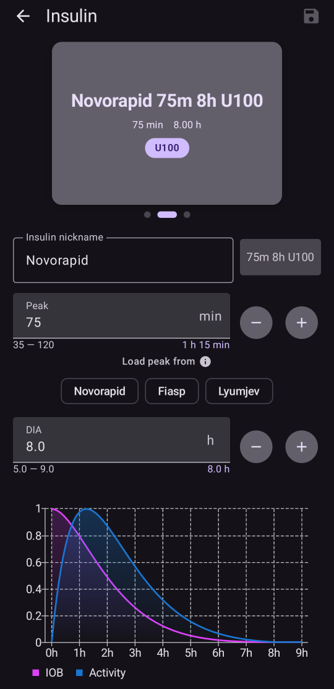
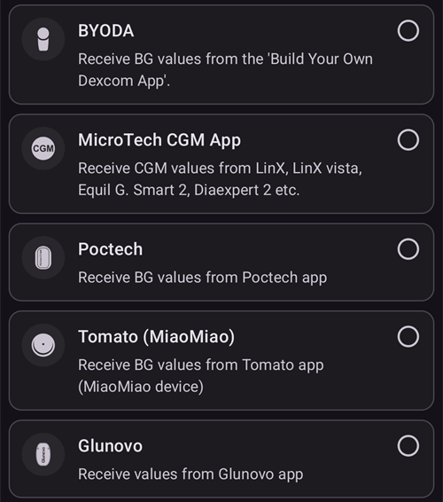
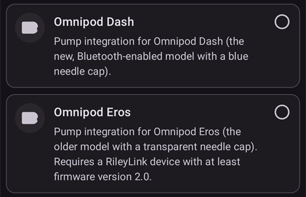
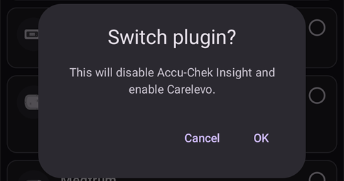

# Konfiguration (Config Builder)

```{admonition} Coming from AAPS v3?
:class: note
**Config Builder** hedder nu **Konfiguration** og findes i **menuen** (☰). Se [Hvad er ændret i AAPS v4](#v4-changes).
```

I **Konfiguration** vælger du, hvilke plugins der er aktive (CGM, pumpe, APS-algoritme, følsomhed, synkronisering, …) og åbner hvert plugin og dets indstillinger. [Gennemgangen](#configuration-v4) står nedenfor; resten af siden beskriver hvert afsnit i detaljer.

(configuration-v4)=
## Konfiguration i AAPS v4

I **AAPS** v4 trykker du på **menuen** (☰) i **øverste venstre** hjørne af hovedskærmen og vælger **Konfiguration** (_»Opsæt din konfiguration (CGM, pumpe, ...) og aktiver funktioner«_).


Plugins er grupperet i **kategorier** — f.eks. _Udjævning_, _Kalibrering_, _Detektering af følsomhed_, _APS_, _Kommunikation_ og _Generelt_. Hver række viser kategoriens navn og det **aktuelt aktive** plugin (f.eks. _APS → OpenAPS SMB_). Tryk på en række for at åbne en kategori.


I en kategori ser du de plugins, der findes til den. I kategorier med ét valg vælger du det aktive plugin; nogle kategorier tillader flere valg (_»Vælg hvad der gælder«_). Hvert plugin har to handlinger:

- **Åbn plugin** — åbner pluginets egen skærm.
- **Indstillinger** — åbner pluginets indstillinger (indstillingerne kan være samlet i afsnit, som kan foldes ud).


(configuration_sync_icon)=
### Mobilikonet — »synkroniseret fra hovedenheden«

Et lille **mobilikon (telefon)** ved siden af en kategori eller indstilling betyder, at punktet **synkroniseres fra hovedenheden** — dets værdi/valg leveres til denne enhed via NSClientV3-kanalen (Nightscout).

På en **klient** (**AAPSClient**) holdes disse punkter **synkroniseret med hovedenheden**. Ikonet vises kun på en klient, så det ses ikke på skærmbilledet ovenfor, som er taget i hovedappen **AAPS**. På en klient vises det typisk ved _Udjævning_, _Kalibrering_, _Detektering af følsomhed_ og _APS_. Præcis hvordan hovedenheden og klienterne holdes ens – og hvilke indstillinger du kan ændre fra hver side – står under [Styring mellem hovedenhed ↔ klient](#client-master-config-prefs).

Det samme ikon vises også **inde i indstillingerne**, ved siden af de enkelte indstillinger, der synkroniseres. I eksemplet nedenfor har _Absorptionsgrænse_ ikonet; indstillinger uden ikonet indstilles på hver enhed for sig:


Punkter **uden** ikonet indstilles **på hver enhed for sig**. Det vigtigste eksempel er selve forbindelsen **NSClientV3 (Kommunikation)** – **Nightscout URL**, **adgangstoken** og **websockets** indstilles på hver telefon for sig, så de viser **ikke** mobilikonet.

---

(Config-Builder-tab-or-hamburger-menu)=
## Sådan åbner du en plugin-skærm

Hver plugin-skærm åbnes på en af disse måder (fanerne og øje-afkrydsningsfeltet fra **AAPS** v3 findes ikke længere, se [Hvad er ændret i AAPS v4](#v4-changes)):

- **Konfiguration** → pluginets kategori → **Åbn plugin**,
- arket **Administrer** i navigationen nederst, til de skærme, du bruger mest (Profil, Insulinindstillinger, Pumpe, Automatisering, Mad...),
- en [Hurtigstart](../DailyLifeWithAaps/QuickLaunch.md)-knap, som du selv tilføjer,
- **søgelinjen** på hovedskærmen.

```{contents}
:backlinks: entry
:depth: 2
```

(ConfigBuilder_Profile)=

## Profil

Dette modul kan ikke deaktiveres, da det er en central del af **AAPS**.

Se [Din AAPS-profil](../SettingUpAaps/YourAapsProfile.md) for en grundlæggende forståelse af, hvad din **profil** indeholder.

(insulin)=
(Config-Builder-insulin)=
## Insulin


I **AAPS** 4 er insulinen ikke længere et plugin, som vælges i **Konfiguration**. Åbn **Administrer → Insulinindstillinger** for at opsætte den insulin, du bruger.

Med insulineditoren kan du:

- udfyld **Insulinens kaldenavn**, så insulinen er let at genkende,
- indstil **Spids** (tid til maksimal insulinvirkning, i minutter) og **DIA** (varighed af insulinvirkning, i timer), enten ved at skrive værdien eller med knapperne **–** / **+**,
- tryk på en forudindstillet knap under **Hent spids fra** — **Novorapid** (75 min), **Fiasp** (55 min) eller **Lyumjev** (45 min) — for at udfylde standardspidstiden for den insulin i ét trin.

De tilladte intervaller er de samme, uanset hvilken insulin du bruger:

- **DIA**: 5 til 9 timer (5 til 10 timer, hvis patienttypen er sat til **Graviditet**). Se [Varighed af insulinvirkning (DIA) og spids](#Config-Builder-insulin-dia) for at vælge en værdi.
- **Spids**: 35 til 120 minutter.

Kurverne **IOB** (insulin om bord) og **Aktivitet** nederst i editoren opdateres, når du ændrer værdierne, så du straks kan se, hvordan dine indstillinger former insulinvirkningen.

Mere information om insulinprofilen, som den vises i **AAPS**, finder du [her](#AapsScreens-insulin-profile).

(Config-Builder-insulin-change-active)=
### Skift af den insulin, du bruger (DIA eller spids)

Den insulin, der er markeret med **AKTIV**, er den, som din kørende profil bruger. Dens felter er grå: du kan ikke redigere eller slette den. Så passer insulinnavnet i din aktive profil altid til de indstillinger, der faktisk bruges.

Sådan ændrer du den DIA eller spids, du bruger:

1. Åbn **Administrer → Insulinindstillinger**. Hvis skærmen åbner skrivebeskyttet (en **✏️ blyant** i den øverste linje), så tryk på blyanten og lås dine indstillinger op.
2. Tryk på **+** (_Tilføj ny insulin_). **AAPS** opretter en kopi af den insulin, der vises på skærmen.
3. Indstil den nye **Spids** og/eller **DIA**, og tryk derefter på gem-ikonet (øverst til højre).
4. Tryk på **▶** (_Aktiver insulin_), og bekræft. Den nye insulin bliver **AKTIV**.

```{admonition} The name includes peak and DIA
:class: note
**AAPS** tilføjer automatisk spids, DIA og koncentration til insulinens navn (f.eks. _Fiasp 55m 8h U100_), så du hurtigt kan skelne dine konfigurationer fra hinanden.
```

Du kan slette den gamle insulin, når den ikke længere er aktiv.

### Forudindstillingerne under »Hent spids fra«

I **AAPS** 4 er der ingen liste over insulintyper at vælge imellem. Alle insuliner bruger den samme eksponentielle aktivitetskurve; kun deres **Spids** og **DIA** er forskellige. Forudindstillingerne under **Hent spids fra** i insulineditoren udfylder den anbefalede spids for de mest almindelige insuliner med ét tryk (det lille ⓘ ved siden af **Hent spids fra** viser dem med deres spidsværdier). Du kan stadig justere **Spids** og **DIA** bagefter.

Ændr kun spidsen fra den anbefalede værdi, hvis du forstår, hvad det betyder. [Grafen over insulinkurven](#AapsScreens-insulin-profile) hjælper dig med at forstå kurverne.

#### Novorapid



- anbefales til Humalog, Novolog og Novorapid (hed _Rapid-Acting Oref_ i **AAPS** v3)
- Spids = 75 minutter efter injektion

#### Fiasp


- anbefales til Fiasp (hed _Ultra-Rapid Oref_ i **AAPS** v3)
- Spids = 55 minutter efter injektion

(Config-Builder-lyumjev)=
#### Lyumjev


- anbefales til Lyumjev
- Spids = 45 minutter efter injektion

#### Brugerdefineret spids

- Der er ingen separat insulintype »Free-Peak Oref« i **AAPS** 4: Indtast en hvilken som helst **Spids** (35 til 120 minutter) direkte i [insulineditoren](#Config-Builder-insulin) uden at bruge en forudindstilling.
- En brugerdefineret spids er nyttig, hvis du bruger en insulin, der ikke er på listen, eller en blanding af forskellige insuliner.

(Config-Builder-insulin-dia)=
### Varighed af insulinvirkning (DIA) og spids

```{warning}
Når du looper, vil en lavere DIA eller spids altid øge den givne insulin. DIA virker anderledes i AAPS end i kommercielle AID-systemer, og ændringer af disse indstillinger uden omtanke kan ændre insulindoseringen meget mere eller mindre end forventet.
```

AAPS beskriver insulinvirkningens forløb over tid med en matematisk formel, som indstilles med **DIA** og den tæt forbundne indstilling **spids**. DIA er den teoretiske tid, indtil IOB når nul, og spidsen er det tidspunkt, hvor insulinens virkning er stærkest. Det giver en IOB-kurve og en aktivitetskurve, som blot er **hastigheden**, hvormed IOB falder.

Husk, at det er normalt med perioder med [nul-basal](#Open-APS-features-super-micro-bolus-smb), når AAPS looper. Denne manglende basalinsulin trækkes helt fra IOB, og det forklarer, hvorfor IOB i praksis når nul mange timer før den indstillede DIA. Du kan se [bolus-IOB og basal-IOB](#aaps-screens-iob-cob-basal-sens) hver for sig på hovedskærmen.

For at indstille DIA og spids skal du trykke på **Administrer** på hovedskærmen og derefter på **Insulinindstillinger**. AAPS viser den aktive insulinkonfiguration sådan her:


I dette eksempel er spidsen 55 minutter, DIA er 8 timer, og [insulinkoncentrationen](#Insulin-Concentration) er standarden 100 IE/ml.

På grund af virkningen af nul-basal, som er forklaret ovenfor, og den formel, AAPS bruger til nedbrydning af IOB, indstiller de fleste brugere en klart højere DIA end i kommercielle systemer. Generelt oplever mange, at en **DIA** på 9 timer virker godt for dem. Når du har mere erfaring med AAPS og en godt justeret profil, kan du prøve at finde personlige indstillinger for DIA og spids med oplysningerne nedenfor.

````{admonition} Details on the impact of DIA and peak configuration
:class: dropdown

Da basalraten har en indirekte indflydelse på, hvordan IOB falder i AAPS, kan for høje basalrater skjule en for høj DIA, og omvendt. Det giver mening først at justere basalraterne omhyggeligt, før du justerer DIA og spids. Husk også, at indstillingerne DIA og spids påvirker hinanden: virkningen af DIA afhænger af spidsen, og omvendt.

Disse diagrammer viser præcis, hvordan DIA og spids påvirker IOB-kurverne inden for hele området af tilladte værdier.

Justering af DIA:

```{image} ../images/Profile/iob_remaining_static_peak.png
:width: 400px
```

Justering af spids:

```{image} ../images/Profile/iob_remaining_static_dia.png
:width: 400px
```

Til sidst en sammenligning, hvor DIA og spids justeres samtidig. Tanken er, at begge værdier justeres med samme relative mængde, så `49/35 ~ 7/5`. Eller tilsvarende `120/93 ~ 9/7`. Intervallerne vil være de samme uanset grundværdien for DIA eller spids, så længe den relative ændring er den samme for begge.

```{image} ../images/Profile/iob_remaining_uniform.png
:width: 400px
```

Bemærk, at når DIA og spids justeres på denne måde, flyttes hvert punkt på kurven med den samme relative mængde.

````

#### Mere at læse om indstilling af DIA og spids

- [Tekniske detaljer og historisk baggrund fra forgængeren til AAPS, OpenAPS](https://openaps.readthedocs.io/en/latest/docs/While%20You%20Wait%20For%20Gear/understanding-insulin-on-board-calculations.html#understanding-the-new-iob-curves-based-on-exponential-activity-curves).
- [Why we are regularly wrong in the duration of insulin action (DIA) times we use, and why it matters…](https://www.diabettech.com/insulin/why-we-are-regularly-wrong-in-the-duration-of-insulin-action-dia-times-we-use-and-why-it-matters/) på Diabettech.
- [Exponential Insulin Curves + Fiasp](https://web.archive.org/web/20220630154425/http://seemycgm.com/2017/10/21/exponential-insulin-curves-fiasp/) på See My CGM (arkiv).
- [Revised Humalog model in a closed loop](https://bionicwookiee.com/2022/04/13/revised-humalog-model-in-a-closed-loop/) og andre artikler på Bionic Wookie, som anbefaler en DIA på 9 timer til Lyumjev, Fiasp, NovoRapid og Humalog.

(Config-Builder-bg-source)=
## BS-kilde
Vælg den blodsukkerkilde, du bruger. Se siden [BS-kilde](../Getting-Started/CompatiblesCgms.md) for flere oplysninger om opsætning.


Rul ned for at se de andre kilder:




- [xDrip+ BG](../CompatibleCgms/xDrip.md) - også til kompatible apps som [Juggluco](../CompatibleCgms/Juggluco.md)
- [NSClient BG](../CompatibleCgms/CgmNightscoutUpload.md) - kun hvis du ved, hvad du gør, se [Kompatible CGM'er](../Getting-Started/CompatiblesCgms.md).
- [MM640g](../CompatibleCgms/MM640g.md)
- Glimp - kun version 4.15.57 og nyere understøttes
- [BYODA (Build Your Own Dexcom App)](#DexcomG6-if-using-g6-with-build-your-own-dexcom-app).
- MicroTech CGM App - til Aidex / LinX CGM
- [Poctech](../CompatibleCgms/PocTech.md)
- Tomato (MiaoMiao) - Tomato-appen til MiaoMiao-enheden
- [Glunovo](https://infinovo.com/) - Glunovo-appen til Glunovo CGM-systemet
- Intelligo - Intelligo-appen
- Syai/Ottai - til Syai- og Ottai-apperne (se [Syai Tag](../CompatibleCgms/SyaiTagX1.md) og [Ottai](../CompatibleCgms/OttaiM8.md))
- SI App - patchet SI App eller Sibionics-appen til Sibionics CGM
- Sino App - patchet app til Sinocare CGM
- Notifikationslæser - læser glukoseværdier fra de notifikationer, som officielle CGM-apps viser (Dexcom, Medtronic, Eversense osv.)
- Instara - Instara-appen
- Tilfældigt BS - laver tilfældige BS-data til test. Den kan kun aktiveres i et engineering-build (udvikler-build) med **Virtuel pumpe**, så i en normal **AAPS**-installation kan den ikke bruges.

## Smoothing


Se [Udjævning af blodsukkerdata](../CompatibleCgms/SmoothingBloodGlucoseData.md).

## Kalibrering

Vælg, hvordan **AAPS** behandler de værdier, den modtager fra din sensor:

- **Ingen kalibrering**: Sensorværdierne bruges, som de er. Brug denne, når sensoren allerede er fabrikskalibreret og præcis. Dette er standard.
- **Lineær kalibrering**: **AAPS** retter sensorværdierne med en hældning og en forskydning, som den beregner ud fra dine fingerprik-målinger.

Sådan bruger du **Lineær kalibrering**:

1. Vælg **Lineær kalibrering** i kategorien **Kalibrering**.
2. Når du sætter en ny sensor i, skal du registrere sensorskiftet: brug **Registrer sensorskift** på kalibreringsskærmen, eller indtast en indsættelse af CGM-sensor i Careportal. Det fortæller **AAPS**, hvornår sensorsessionen startede. Hvis **AAPS** ser et hul på mere end 30 minutter i målingerne, kan den bede dig om at markere et sensorskift; denne forespørgsel vises kun på hovedenheden, ikke på en klient.
3. Åbn pluginet, og tryk på **Tilføj kalibrering**. Indtast din fingerprik-værdi. **AAPS** parrer den med sensorværdien fra de sidste 10 minutter.

En kalibrering accepteres kun, når:

- et sensorskift er registreret, og der er gået mindst **2 timer** siden (opvarmning),
- din glukose er stabil. Hvis den ændrer sig for hurtigt, fortæller dialogen dig det og viser grænsen,
- der er en CGM-måling fra de sidste 10 minutter,
- den gælder for det aktuelle tidspunkt. Du kan ikke indtaste ældre fingerprik-værdier.

Sådan virker korrektionen:

- **AAPS** trækker en ret linje gennem værdiparrene for den aktuelle sensor: `corrected value = slope × sensor value + offset`.
- Nyere par tæller mere end ældre: Et par, der er 2 dage gammelt, tæller ca. 37%, et par, der er 4 dage gammelt, ca. 14%. Linjen følger derfor din sensor, når den driver.
- Der kræves mindst **2 par**.
- Hvis parrene ligger tæt (mindre end 54 mg/dl / 3 mmol/l fra hinanden), forskydes kun værdierne (forskydning, ingen hældning).
- Hældningen holdes mellem 0,55 og 1,6. En hældning uden for dette område begrænses til den nærmeste værdi.
- Sikkerhedsgrænse: Hvis korrektionen ved 100 mg/dl (5,5 mmol/l) ville være mere end ±30 mg/dl (1,7 mmol/l), bruges der ingen korrektion. Det beskytter dig mod en forkert indtastning.

Hvad det ændrer:

- Den korrigerede værdi bruges overalt: BS på hovedskærmen, grafen og loopet. Selve sensormålingerne ændres ikke. Korrektionen lægges ovenpå, også på de tidligere målinger fra den nuværende sensor.
- Et nyt sensorskift starter helt forfra. Par fra tidligere sensorer tæller ikke længere.
- På grafen vises en kalibrering som en markør ved fingerprik-værdien.
- Kalibreringer synkroniseres via Nightscout, så dine klienter viser de samme korrigerede værdier.

Kontroller og fjern målinger:

- **Åbn plugin** viser status (f.eks. _Hældning 0,85, korrektion midt i området -0,4_), et diagram over dine par med linjen og listen over målinger.
- Hvis en måling er forkert (f.eks. fordi du havde sukker på fingeren), så tryk på skraldespandsikonet ved siden af den. Linjen beregnes igen med det samme.

```{admonition} Using xDrip+ as BG source?
:class: note
xDrip+ har sin egen kalibrering. Kalibrer kun ét sted, så sensorværdierne ikke bliver korrigeret to gange.
```

```{admonition} Calibrate with care
:class: warning
En forkert fingerprik-værdi giver forkerte glukoseværdier og dermed forkert insulindosering. Vask hænderne før du måler, og kalibrer ikke, mens din glukose ændrer sig hurtigt.
```


(Config-Builder-pump)=
## Pumpe
Vælg den pumpe, du bruger. Se siden [Kompatible pumper](../Getting-Started/CompatiblePumps.md) for mere information om opsætning.


Rul ned for at se alle pumpedrivere:




Når du vælger en anden pumpe, beder **AAPS** dig bekræfte skiftet:



- [Dana R](../CompatiblePumps/DanaR-Insulin-Pump.md)
- Dana R Korean (til den koreanske DanaR-pumpe)
- Dana Rv2 (DanaR-pumpe med uofficiel firmwareopgradering)
- [Dana-i/RS](../CompatiblePumps/DanaRS-Insulin-Pump.md)
- [Accu Chek Insight](../CompatiblePumps/Accu-Chek-Insight-Pump.md)
- [Accu Chek Combo](../CompatiblePumps/Accu-Chek-Combo-Pump-v2.md)
- Omnipod til [Omnipod Eros](../CompatiblePumps/OmnipodEros.md)
- Dash til [Omnipod DASH](../CompatiblePumps/OmnipodDASH.md)
- [Medtronic](../CompatiblePumps/MedtronicPump.md)
- [Diaconn G8](../CompatiblePumps/DiaconnG8.md)
- [EOPatch2](../CompatiblePumps/EOPatch2.md)
- [Medtrum](../CompatiblePumps/MedtrumNano.md)
- [Equil 5.3](../CompatiblePumps/Equil5.3.md)
- [Carelevo](../CompatiblePumps/CareLevo.md)
- [AP550](../CompatiblePumps/AP550-Insulin-Pump.md)
- Virtuel pumpe: åbent loop - kun forslag fra **AAPS**
  - når du tager dine første skridt med **AAPS**, under de første [læringsmål](../SettingUpAaps/CompletingTheObjectives.md)
  - til pumper, der endnu ikke har en driver

(config-builder-wrong-pump-data)=
### Besked: »Data kommer fra en anden pumpe«

**AAPS** husker den pumpe, den er forbundet med (pumpetype og serienummer). Hvis den modtager data fra en anden pumpe, f.eks. efter at din pumpe er blevet udskiftet med en ny af samme model, viser den denne besked og ignorerer data fra den pumpe:


For at bruge den nye pumpe skal du skifte pumpedriver: Vælg **Virtuel pumpe**, bekræft, og vælg derefter din pumpe igen. **AAPS** registrerer så den pumpe, den er forbundet med nu.

(Config-Builder-sensitivity-detection)=

## Detektering af følsomhed


Vælg typen af detektering af følsomhed. For flere detaljer om de forskellige modeller kan du [læse videre her](../DailyLifeWithAaps/SensitivityDetectionAndCob.md). Den analyserer løbende de historiske data og justerer, hvis den ser, at du reagerer mere følsomt (eller omvendt mere resistent) på insulin end normalt. Flere detaljer om, hvordan selve følsomhedsforholdet beregnes, finder du i [Vigtige AAPS-funktioner > Autosens](#Open-APS-features-autosens).

Du kan se din følsomhed på hovedskærmen i en [ekstra graf](#AapsScreens-section-g-additional-graphs) ved at vælge SENS% og følge den hvide linje. Bemærk, at du skal være i [læringsmål 8](#objectives-objective8), før Detektering af følsomhed/[Autosens](#Open-APS-features-autosens) automatisk kan justere mængden af insulin, der gives. Før du når dette læringsmål, vises Autosens-procenten / linjen i din graf kun til information.

### Indstillinger for absorbering
Hvis du bruger Oref1 med **SMB**, skal du ændre **min_5m_carbimpact** til 8. Værdien bruges kun under huller i **CGM**-målingerne, eller når fysisk aktivitet »bruger« hele den blodsukkerstigning, som ellers ville få **AAPS** til at nedskrive COB. På tidspunkter, hvor [kulhydratabsorptionen](../DailyLifeWithAaps/CobCalculation.md) ikke kan beregnes dynamisk ud fra dit blodsukkers reaktion, nedskrives dine kulhydrater med en standardværdi. Grundlæggende er det en sikkerhedsforanstaltning.

(Config-Builder-aps)=
## APS


Vælg den APS-algoritme, du ønsker til justering af behandlingen. Du kan se de aktuelle detaljer for den valgte algoritme med **Åbn plugin**.
- OpenAPS AMA
  - Advanced Meal Assist: ældre algoritme, som ikke længere anbefales.
  - Kort sagt: Når du har givet dig selv en måltidsbolus, kan systemet hurtigere sætte en høj midlertidig basal, HVIS du indtaster kulhydrater pålideligt.
- [OpenAPS SMB](#Open-APS-features-super-micro-bolus-smb)
  - Super Micro Bolus: den nyeste algoritme, som anbefales til alle brugere.
  - I modsætning til AMA bruger SMB ikke midlertidige basalrater til at styre glukoseniveauet, men hovedsageligt små **Super Micro Boluses**.
  - Bemærk: Det anbefales at bruge denne algoritme fra begyndelsen, selv om du først rent faktisk får givet SMB'er fra [læringsmål 9](#objectives-objective9).
- [Auto ISF](#Open-APS-features-auto-isf)
  - Eksperimentel algoritme til avancerede brugere. Den vises først på listen, når læringsmålene er gennemført.

Hvis du skifter fra AMA- til SMB-algoritmen, skal _min_5m_carbimpact_ ændres manuelt til **8** (standardværdi for SMB) i [Indstillinger → Indstillinger for absorbering](#Preferences-min_5m_carbimpact).

## Loop

Dette modul kan ikke deaktiveres, da det er en central del af **AAPS**.


## Begrænsninger


### Mål

**AAPS** har et læringsprogram (en række læringsmål), som du skal gennemføre trin for trin. Den guider dig sikkert gennem opsætningen af et lukket loop-system.

Se siden [Gennemførelse af læringsmålene](../SettingUpAaps/CompletingTheObjectives.md) for mere information.

## Kommunikation

I denne kategori (som hed **Synkronisering** i **AAPS** v3) vælger du, om og hvor **AAPS** skal sende dine data hen.


Rul ned for at se resten af listen:


### NSClientV3

Kan bruges som [rapporteringsserver](../SettingUpAaps/SettingUpTheReportingServer.md) og/eller til [fjernovervågning](../RemoteFeatures/RemoteMonitoring.md) og [fjernstyring](../RemoteFeatures/RemoteControl.md).

Se [Synkronisering med rapporteringsserveren](#SetupWizard-synchronization-with-the-reporting-server-and-more) for at opsætte synkronisering med NSClientV3.

### Tidepool

Kan bruges som [rapporteringsserver](../SettingUpAaps/SettingUpTheReportingServer.md).

Se [Tidepool](../SettingUpAaps/Tidepool.md).

### xDrip

Bruges til at **sende** data som glukoseværdier og behandlinger til xDrip+ på samme telefon. Dets indstillinger indeholder også **Send status til xDrip+**, en statuslinje med IOB og COB, som xDrip+ og nogle ledsagerapps til ure viser.

### Open Humans

Se [Open Humans](../SupportingAaps/OpenHumans.md).

(Config-Builder-wear)=
### Ur
Overvåg og styr **AAPS** fra et Wear OS-ur. Opsætning af uret er forklaret på [Opsæt AAPS på dit Wear OS-ur](../WearOS/WearOsSmartwatch.md). Når pluginet er aktiveret, så vælg dets muligheder i [Indstillinger > Ur](#preferences-wear). Brug af uret er forklaret på [Betjening af AAPS med dit Wear OS-smartur](../RemoteFeatures/RemoteControlWearOS.md).

(external-companion-apps)=
### Eksterne ledsagerapps

Udsender **AAPS**-statusdata på telefonen, så andre apps, der er installeret på den, kan vise dem — f.eks. ledsagerapps til ure eller widgets. Broadcastet indeholder glukose og trend, IOB, COB, basal og midlertidig basal, profilnavn, loop-status, telefonens og pumpens batteri, reservoirniveau og bolusfremskridt. Aktiver det kun, hvis en ledsager-app, du bruger, beder om disse data.

Apps, som vides at læse disse udsendelser, er [WatchDrip+](https://bigdigital.home.blog/) (Xiaomi- og Amazfit-ure), [GlucoDataHandler](https://github.com/pachi81/GlucoDataHandler) (Wear OS-komplikationer og widgets samt Android Auto via GlucoDataAuto) og appen G-Watch. Opsætningen af dem er beskrevet på [Smarture og AAPS](#watches-external-companion-apps). Nogle af dem bruger også **Send status til xDrip+** fra pluginet **xDrip** ovenfor til en statuslinje med IOB og COB.

I tidligere versioner hed dette plugin **Samsung Tizen** efter [G-Watch-appen til Samsung Tizen-ure](#Watchfaces-tizen), som det først blev lavet til.

### Garmin

Forbindelse til Garmin-enhed (Fenix, Edge ...)
## Behandlinger
Åbn **menuen** (☰), og vælg [Behandlingshistorik](#aaps-screens-treatments) for at se de behandlinger, der er registreret. Hvis du vil rette eller slette en post (f.eks. hvis du spiste færre kulhydrater end forventet), så vælg 'Fjern', og indtast den nye værdi (ret tidspunktet om nødvendigt) via **Behandlinger → Kulhydrater** i navigationen nederst (se [Kulhydrater](#screens-bolus-carbs)).

## Generelt

I **AAPS** 4 viser kategorien **Generelt** i **Konfiguration** kun **Autotune**. De andre funktioner, der beskrives nedenfor, er altid tilgængelige og skal ikke længere aktiveres her; hvert afsnit fortæller, hvor du finder dem.


### Oversigt

[Hovedskærmen](#AapsScreens-the-homescreen) i **AAPS** er ikke længere et plugin og har ingen egne indstillinger i **Konfiguration**. De muligheder, der før var her, findes nu i **Indstillinger** (tandhjulsikonet): [Vis notater i dialoger](#Preferences-show-notes-field-in-treatments-dialogs), [Statuslys](#Preferences-status-lights) og [Bolusprocent](#Preferences-deliver-this-part-of-bolus-wizard-result), som bolusberegneren bruger. Superbolus-muligheden fra **AAPS** 3.x er [ikke tilgængelig som indstilling](#Preferences-advanced-settings-overview) i **AAPS** 4.

(Config-Builder-actions)=
### Handlinger

Fanen Handlinger fra **AAPS** 3.x findes ikke længere. Dens knapper findes nu i arket **Administrer** — se [Hvor blev fanen Handlinger af?](#screens-action-tab).

### Automatisering

Med **Administrer → Automatisering** kan du administrere dine [automatiseringer](../DailyLifeWithAaps/Automations.md), fra og med [læringsmål 10](#objectives-objective10).

(Config-Builder-sms-communicator)=
### SMS-kommunikator
Giver omsorgspersoner mulighed for at fjernstyre nogle **AAPS**-funktioner via SMS. Se [SMS-kommandoer](../RemoteFeatures/SMSCommands.md) for mere information om opsætning.

### Mad
**Administrer → Mad** viser de madforudindstillinger, der er defineret i Nightscouts maddatabase. Se [Nightscout Readme](https://github.com/nightscout/cgm-remote-monitor#food-custom-foods) for mere information om opsætning.

Bemærk: Posterne kan ikke bruges i **AAPS**-beregneren. (Kun visning)

(Config-Builder-autotune)=
### Autotune

Du kan aktivere Autotune, se [her](../AdvancedOptions/Autotune.md).

### Vedligeholdelse

Åbn **menuen** (☰), og vælg **Vedligeholdelse** for at eksportere / importere indstillinger og administrere logfiler.


### Konfiguration

Hedder nu **Konfiguration**: denne side.