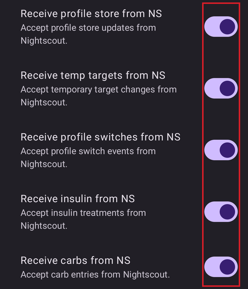
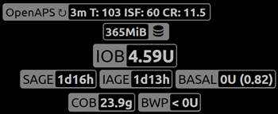

# Nightscout

(Nightscout-security-considerations)=

## Sikkerhedsovervejelser

Nightscout er rapporterings- og overvågningsserveren for **AAPS**: **AAPS** uploader dine data til den, og du eller dine omsorgspersoner ser dem på Nightscout-hjemmesiden eller i følger-apps. Den indeholder dine medicinske data, profiler og behandlinger, så det er en god idé at tænke over, hvordan du beskytter din Nightscout-hjemmeside.

I **AAPS** 4 går fjernstyring ikke gennem Nightscout-hjemmesiden. Mens klientstyring er slået til ([hærdet tilstand](#client-master-control-hardened-mode)), bliver behandlinger eller mål, der indtastes direkte i Nightscout, **ikke udført** af **AAPS**. Fjernkommandoer kommer i stedet fra en parret **AAPSClient** - se [Styring mellem hovedenhed ↔ klient](#client-master-control).

Vær meget forsigtig, hvis du bruger Nightscout som BS-kilde i AAPS.

### Nightscout-indstillinger

Du kan forhindre offentlig adgang til din Nightscout-side ved at bruge [godkendelsesroller](https://nightscout.github.io/nightscout/security): sørg for kun at dele din URL med en `readable`-token, aldrig med en `admin`-token.

Nightscout `API_SECRET` er hovedadgangskoden til din side: del den ikke offentligt.

(Nightscout-aaps-settings)=

### AAPS-indstillinger

At modtage data fra Nightscout (profilændringer, behandlinger, ...) er valgfrit og slået fra som standard. Kontakterne, der er beskrevet nedenfor, er skjult, mens klientstyring er slået til (hærdet tilstand), og i [simpel tilstand](#preferences-simple-mode).

* Du åbner indstillingerne for **Synkronisering** i NSClientV3-pluginet enten via 1) **Indstillinger** (tandhjulsikonet på hovedskærmen) -> **NSClientV3** -> **Synkronisering**, eller 2) **Konfiguration** (menuen ☰) -> **Kommunikation** -> »**Indstillinger**« under NSClientV3.
* Aktiver »Upload data til NS«.
* »Upload BS-data til NS« findes i indstillingerne for din BS-kilde (**Konfiguration → BS-kilde → Indstillinger**). Aktiver den, medmindre din BS-kilde i AAPS er Nightscout: i så fald må du **ikke** aktivere den.
* Aktiver ikke »Modtag CGM-data fra NS«, medmindre Nightscout er din BS-kilde.

#### Synkroniser ikke fra Nightscout

Når alle mulighederne »Modtag … fra NS« er deaktiveret, er du sikker på, at AAPS ikke bruger nogen ændringer fra Nightscout:

#### Accepter ændringer fra Nightscout

Når du aktiverer disse muligheder, kan du ændre indstillinger i AAPS gennem Nightscout, f.eks. ændre og skifte profiler, indstille midlertidige mål og tilføje kulhydrater, som AAPS så tager med i beregningen. De vises kun, når klientstyring og simpel tilstand er slået fra.  
Bemærk, at insulinbehandlinger kun bruges til beregninger ligesom »Giv ikke bolus, registrer kun«.

### Flere sikkerhedsindstillinger

Hold din telefon opdateret som beskrevet under [sikkerhed først](#preparing-safety-first).

(Nightscout-manual-nightscout-setup)=

## Manuel opsætning af Nightscout

Det forudsættes, at du allerede har en Nightscout-side. Hvis ikke, så besøg siden [Nightscout](http://nightscout.github.io/nightscout/new_user/) for en komplet vejledning i opsætningen. Vejledningen nedenfor beskriver de indstillinger, du også skal tilføje på din Nightscout-side. Din Nightscout-side skal mindst have version 15, så tjek, at du kører den [nyeste version](https://nightscout.github.io/update/update/#updating-your-site-to-the-latest-version), ellers får du en fejlmeddelelse i AAPS-appen.

* [Rediger dine variabler](https://nightscout.github.io/nightscout/setup_variables/#nightscout-configuration)

* Tilføj eller rediger variablerne sådan:
  
  * `ENABLE` = `careportal boluscalc food bwp cage sage iage iob cob basal dbsize pushover pump openaps`
  * `DEVICESTATUS_ADVANCED` = `true`
  * `SHOW_FORECAST` = `openaps`
  * `PUMP_FIELDS` = `reservoir battery clock`
  * Der kan indstilles forskellige alarmer til [overvågning af pumpen](https://github.com/nightscout/cgm-remote-monitor#pump-pump-monitoring), især batteri i % anbefales: 
    * `PUMP_WARN_BATT_P` = `51`
    * `PUMP_URGENT_BATT_P` = `26` 

* Gem ændringerne. Din Nightscout-side burde nu kunne vise »pillerne«. Du kan tvinge dem til at blive vist som standard ved at tilføje dem i `SHOW_PLUGINS`.
  
  * `SHOW_PLUGINS` = `careportal boluscalc food bwp cage sage iage iob cob basal dbsize pushover pump openaps`
  
  

## Nightscout som betalt SaaS (Software as a Service)

Brug udbyderens webbrugerflade til at indstille variablerne. Kontakt udbyderens support, hvis det er nødvendigt.