# Indstillinger

I **AAPS** v4 finder du indstillingerne på skærmen **Indstillinger**. Der er tre veje til dem - se [Ændringer i din AAPS-konfiguration](../SettingUpAaps/ChangeAapsConfiguration.md) for detaljer:

1. Tryk på ikonet **Indstillinger** (tandhjul) i øverste højre hjørne af hovedskærmen: alle indstillinger, samlet i sektioner, der kan foldes ud.
2. Under **Konfiguration** skal du trykke på »**Indstillinger**« under et aktivt plugin: kun indstillingerne for det plugin.
3. Brug **søgelinjen** øverst på hovedskærmen: begynd bare at skrive en del af den tekst, du leder efter. Den finder enkelte indstillinger (også dem, der ikke er synlige på skærmen Indstillinger), dialoger og dokumentation.

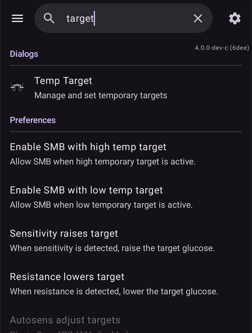

- **Sektioner** åbnes og lukkes ved at trykke på dem. Hvilke sektioner du ser, afhænger af de plugins, du har aktiveret, og af [simpel tilstand](#preferences-simple-mode).

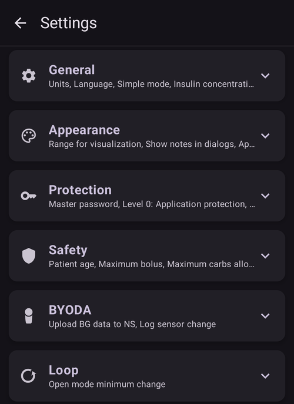

```{contents}
:backlinks: entry
:depth: 2
```

(Preferences-general)=
## Generelt

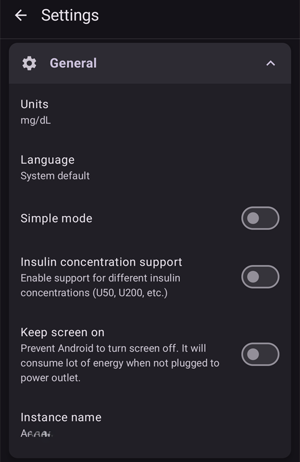

**Enheder**

- Indstil enhederne til mmol/l eller mg/dl, alt efter hvad du foretrækker.

**Sprog**

- Som standard følger **AAPS** telefonens sprog (anbefales).

- Hvis du vil have **AAPS** på et andet sprog end telefonen, så vælg det her. På Android 13 og nyere registrerer **AAPS** det som sit eget appsprog i Android, så alle dens skærme, hovedskærmen, widgets og den måde, tal skrives på, følger det.
- The setting is always called **Language**, and each language is listed in its own name (for example *Deutsch*, *Français* or *Polski*). So you can find your language again, even when **AAPS** is set to a language you cannot read.

- Når du skifter sprog, skifter teksterne i **AAPS** straks til det nye sprog. Hvis nogle tekster stadig vises på det gamle sprog, så genstart **AAPS**.
- På Android 12 vises denne indstilling ikke: **AAPS** bruger altid telefonens sprog.
- Indstillingen er skjult i [simpel tilstand](#preferences-simple-mode).

(preferences-simple-mode)= **Simpel tilstand**

**Simpel tilstand** er aktiveret som standard, når du installerer **AAPS** første gang. I **simpel tilstand** er mange indstillinger skjult, og indstillingerne er erstattet af forudindstillede værdier. Du bør slå simpel tilstand fra, når du er blevet fortrolig med brugerfladen og indstillingerne i **AAPS**.

**Understøttelse af insulinkoncentration**

- Aktiverer understøttelse af forskellige insulinkoncentrationer (U50, U200, ...). Aktiver kun dette, hvis du virkelig bruger en anden koncentration end U100, og læs advarslerne grundigt.
- Indstillingen er skjult i [simpel tilstand](#preferences-simple-mode).

**Hold skærmen tændt**

- Tvinger Android til altid at holde skærmen tændt. Det er nyttigt til præsentationer osv. Men det bruger meget batteri. Derfor anbefales det at slutte telefonen til en oplader.

**Navn på instans**

- Navnet på den person, der bruger denne telefon. Det skelner denne **AAPS**-instans fra andre i rapporter og synkronisering, f.eks. hvis to børn med type 1-diabetes i din familie bruger **AAPS**.
- Bruges i navnene på eksporterede indstillingsfiler.
- Vises på [urskiven Dual](../WearOS/WearOsSmartwatch.md).

(Preferences-skin)=
### Skin

Valget af skin fra **AAPS** 3.x (Original, Low resolution, Large display ...) findes ikke længere i **AAPS** 4. Den nye brugerflade tilpasser sig automatisk til din skærm, og farveskemaet kan ændres under [Udseende](#preferences-appearance).

(preferences-appearance)=
## Udseende

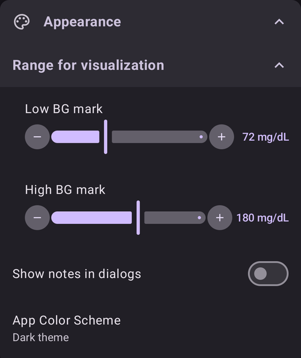

(Preferences-range-for-visualization)=
### Område for visualisering

Vælg den øvre og nedre grænse for BS-grafen på hovedskærmen i **AAPS** og på smarturet. Det er kun visningen, ikke målområdet for dit BS. Eksempel: 70 - 180 mg/dl eller 3,9 - 10 mmol/l

(Preferences-show-notes-field-in-treatments-dialogs)=
### Vis notater i dialoger

Giver dig mulighed for at tilføje korte notater til dine behandlinger (bolusberegner, kulhydrater, insulin ...)

Indstillingen er skjult i [simpel tilstand](#preferences-simple-mode).

### Farveskema for appen

Vælg mellem det lyse tema, det mørke tema eller at følge telefonens systemindstilling.

(Preferences-protection)=
## Beskyttelse

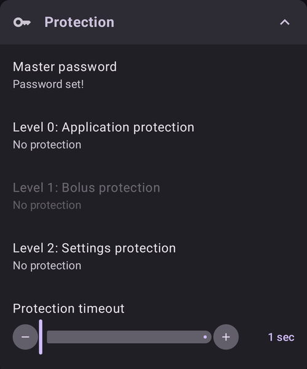

Whatever protection you choose (custom password, PIN or biometric), the prompt also accepts your **master password**. If you forget a custom password or PIN, enter the master password instead.

A custom password or PIN that you never entered counts as no protection: **AAPS** does not ask for it.

(Preferences-master-password)=
### Hovedadgangskode

Påkrævet for at kunne [eksportere indstillinger](../Maintenance/ExportImportSettings.md), da de er krypteret fra version 2.7.

Hvis du har glemt din hovedadgangskode, så se [Hvordan nulstiller jeg hovedadgangskoden?](#FAQ-reset-master-password)

**Biometrisk beskyttelse virker måske ikke på OnePlus-telefoner. Det er et kendt problem hos OnePlus på nogle telefoner.**

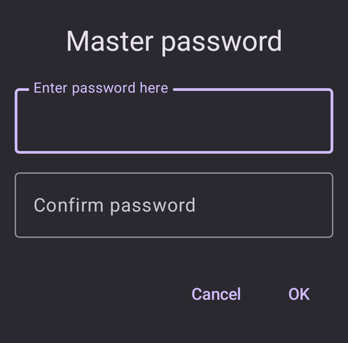

(Preferences-settings-protection)=
### Beskyttelse af indstillinger

- Beskyt dine indstillinger med en adgangskode eller telefonens biometriske godkendelse (f.eks. hvis [et barn bruger **AAPS**](../RemoteFeatures/RemoteMonitoring.md)). Hvis du aktiverer denne funktion, bliver du bedt om godkendelse, hver gang du vil åbne en visning, der har med indstillinger at gøre.

- Administrationsskærmene (**Profil**, **Insulinindstillinger**, **Midlertidigt mål**, **Hurtigbolus**) åbner derefter **skrivebeskyttet**. Du kan stadig aktivere eller bruge et element, men tilføj, rediger, klon og slet er skjult, indtil du låser dine indstillinger op. Se [Beskyttelse af indstillinger låser nu også administrationsskærmene](#v4changes-read-only-management).

- En brugerdefineret adgangskode bør bruges, hvis du kun vil bruge hovedadgangskoden til at beskytte [eksporterede indstillinger](../Maintenance/ExportImportSettings.md) og bruge en anden adgangskode til at redigere indstillingerne.

- Hvis du bruger en brugerdefineret adgangskode, så tryk på linjen »Adgangskode til indstillinger« for at indstille adgangskoden som beskrevet [ovenfor](#Preferences-master-password).

### Beskyttelse af appen

Hvis appen er beskyttet, skal du indtaste adgangskoden eller bruge telefonens biometriske godkendelse for at åbne **AAPS**, og igen når du vender tilbage til den efter [timeout for beskyttelse](#Preferences-password-and-pin-retention). Until you do, the screen stays covered: your BG, IOB and graphs cannot be read behind the prompt.

If you cancel the prompt or the authentication fails, **AAPS** shows *Authorization failed* and closes its screen. It still runs in the background if it was opened successfully before.

### Bolusbeskyttelse

- Bolusbeskyttelse kan være nyttig, hvis **AAPS** bruges af et lille barn, og du [giver bolus via SMS](../RemoteFeatures/SMSCommands.md).

- **Bolusbeskyttelse** kan først vælges, når **Beskyttelse af indstillinger** (niveau 2) er sat.

- I eksemplet nedenfor bruger bolusbeskyttelsen **Hovedadgangskode**: **AAPS** beder om den, før en behandlingsdialog som **Insulin** åbnes. Med **Biometrisk** kan du indtaste hovedadgangskoden i stedet, hvis biometrisk godkendelse ikke virker.

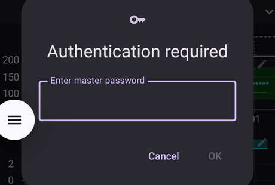

(Preferences-password-and-pin-retention)=
### Opbevaring af adgangskode og PIN

**Timeout for beskyttelse** angiver, hvor længe (i sekunder) indstillingerne eller bolusfunktionerne forbliver låst op, efter at du har indtastet adgangskoden korrekt.

## Behandlingssikkerhed

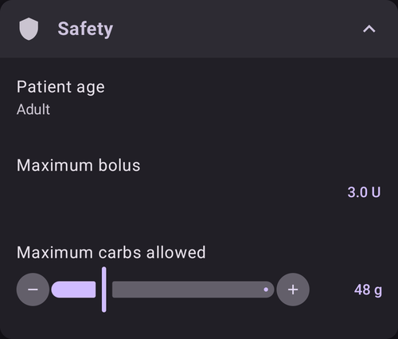

(preferences-patient-type)=
### Patientens alder

- Sikkerhedsgrænserne bliver sat ud fra den alder, du vælger i denne indstilling.
- Hvis du begynder at ramme disse faste grænser (f.eks. maks. bolus), er det tid til at gå et trin op.
- Det er en dårlig idé at vælge en højere alder end den rigtige, fordi det kan føre til overdosering, hvis du indtaster en forkert værdi i insulindialogen (f.eks. hvis du springer decimaltegnet over).
- Hvis du vil kende de faktiske tal for disse faste sikkerhedsgrænser, så rul ned til den algoritmefunktion, du bruger, på [denne side](../DailyLifeWithAaps/KeyAapsFeatures.md).

(Preferences-maximum-bolus)=
### Maks. bolus

- Angiver den største mængde bolusinsulin i insulinenheder, som **AAPS** må give på én gang.
- Denne indstilling er en sikkerhedsgrænse, der skal forhindre, at der bliver givet en meget stor bolus på grund af en fejlindtastning eller en brugerfejl.
- Det anbefales at sætte denne værdi til en fornuftig mængde, som cirka svarer til den største mængde bolusinsulin, du nogensinde forventer at få brug for til et måltid eller en korrektionsdosis.
- Denne begrænsning gælder også for resultaterne fra bolusberegneren.

### Maks. tilladte kulhydrater

- Angiver den største mængde kulhydrater i gram, som bolusberegneren i **AAPS** må beregne en dosis for.
- Denne indstilling er en sikkerhedsgrænse, der skal forhindre, at der bliver givet en meget stor bolus på grund af en fejlindtastning eller en brugerfejl.
- Det anbefales at sætte denne værdi til en fornuftig mængde, som cirka svarer til den største mængde kulhydrater, du nogensinde forventer at få brug for til et måltid.

## BS-kilde

Indstillingerne for din valgte [BS-kilde](#Config-Builder-bg-source) vises som deres egen sektion. For eksempel med **xDrip+ BS**:

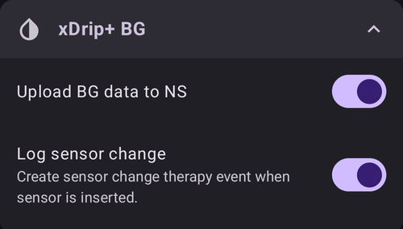

- **Upload BS-data til NS**: lad **AAPS** uploade de modtagne BS-værdier til Nightscout. Aktiver kun dette, hvis CGM-appen ikke selv uploader dem allerede.
- **Registrer sensorskift**: opret automatisk en behandlingshændelse for sensorskift, når sensoren bliver sat i.

## Hovedskærmen

I **AAPS** 3.x var disse indstillinger samlet i en sektion med navnet »Oversigt«. I **AAPS** 4 bliver de indstillet direkte fra de elementer på hovedskærmen, som de hører til.

(Preferences-buttons)=
### Hurtigstart-knapper

Vælg, hvilke handlingsknapper der er synlige på hovedskærmen: tryk på det lille **tandhjul** nederst i midten af hovedskærmen (»Konfigurer Hurtigstart«), og **Tilføj** de handlinger, du vil have hurtig adgang til (behandlinger, CGM-handlinger, Careportal-indtastninger ...).

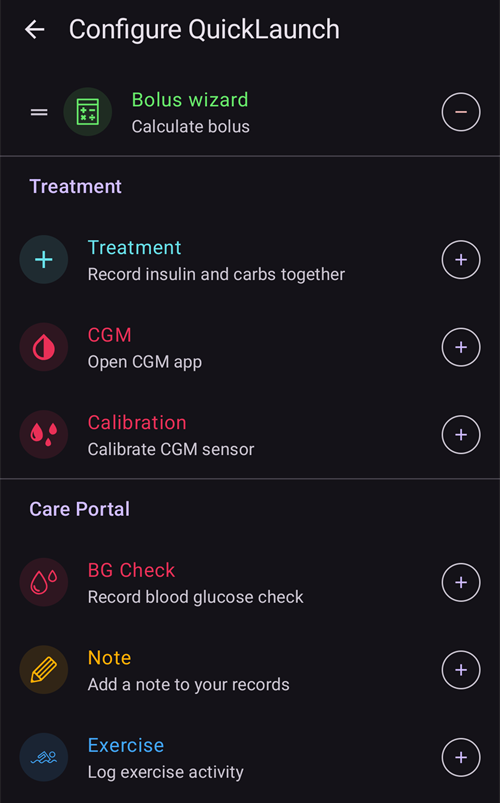

(Preferences-quick-wizard)=
### Hurtigbolus

Opret dine egne knapper til bestemte standardmåltider eller snacks, som vises på hovedskærmen. Nyttigt til standardmåltider, som du ofte spiser.

For hver knap angiver du kulhydraterne og beregningsmetoden for bolussen. Derefter angiver du, i hvilket tidsrum knappen skal være synlig på hovedskærmen - kun én knap pr. tidsrum. Knappen er ikke synlig uden for det angivne tidsrum, eller hvis du har nok IOB til at dække kulhydraterne, der er angivet i Hurtigbolus-knappen. Hvis du angiver forskellige tidspunkter for de forskellige måltider, har du altid den rigtige knap til standardmåltidet på hovedskærmen, afhængigt af tidspunktet på dagen.

For at administrere dine Hurtigbolus-forvalg skal du skrive »Hurtigbolus« i søgelinjen på hovedskærmen og åbne **Hurtigbolus - Administrer forvalg til hurtigbolus**.

Hvis du trykker på en Hurtigbolus-knap, beregner **AAPS** og foreslår en bolus for de kulhydrater ud fra dine aktuelle forhold (med blodsukkerværdien eller insulin om bord, hvis det er sat op).

Forslaget skal bekræftes, før insulinen bliver givet.

(Preferences-default-temp-targets)=
### Standardværdier for midlertidige mål

[Midlertidige mål (TT)](../DailyLifeWithAaps/TempTargets.md) giver dig mulighed for at ændre dit blodsukkermål i en bestemt periode. Når du indstiller et standard-TT, kan du nemt ændre dit mål ved aktivitet, når du snart skal spise osv.

Tryk på **målområdet** på hovedskærmen for at åbne skærmen **Midlertidigt mål**. Swipe gennem forvalgskortene (Spiser snart, Aktivitet, Hypo), og ændr målet og varigheden for hvert forvalg under **Indstillinger for forvalg**. Forvalgte værdier er:

* Spiser snart: mål 90 mg/dl / 5,0 mmol/l, varighed 45 min
* Aktivitet: mål 140 mg/dl / 7,8 mmol/l, varighed 90 min
* Hypo: mål 160 mg/dl / 8,9 mmol/l, varighed 60 min

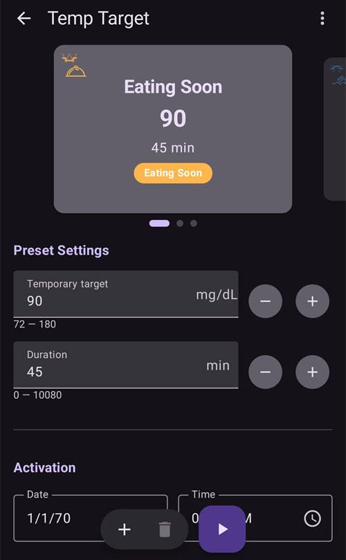

Lær, hvordan du [aktiverer midlertidige mål her](#TempTargets-where-can-i-select-a-temp-target).

### Standardmængder insulin til Klargør/Fyld

Hvis du vil fylde slangen eller klargøre kanylen gennem **AAPS**, kan du gøre det med knapperne **Klargør/Fyld** i det udvidede statuspanel på hovedskærmen.

Standardmængderne for de tre fyldknapper kan angives i indstillingerne for **Klargør/Fyld**, afhængigt af længden på din slange. Skriv »klargør« i søgelinjen på hovedskærmen for at åbne dem.

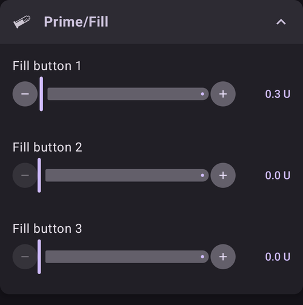

(Preferences-status-lights)=
### Statuslys

Statuslys giver en visuel advarsel for:

- Sensoralder
- Insulinalder (antal dage reservoiret har været i brug)
- Reservoirniveau (enheder)
- Kanylealder
- Pumpebatteriets alder
- Pumpebatteriets niveau (%)

Hvis advarselsgrænsen overskrides, vises værdierne med gult. Hvis den kritiske grænse overskrides, vises værdierne med rødt.

For at ændre grænserne skal du folde statuspanelet på hovedskærmen ud (pilen til højre i statuslinjen) og trykke på det lille ikon **Indstillinger** ved siden af »Status«:

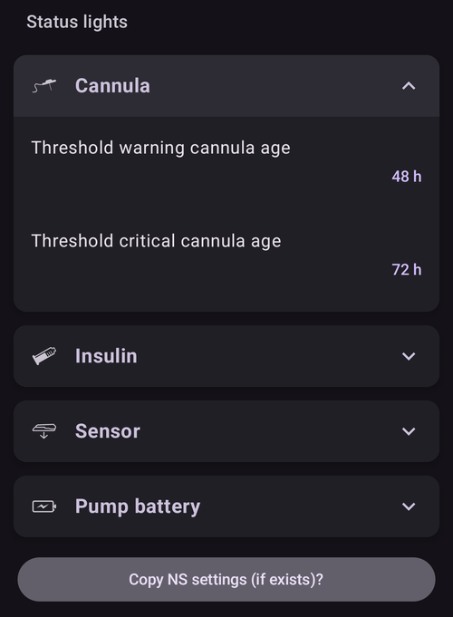

Tryk på et element (**Kanyle**, **Insulin**, **Sensor** eller **Pumpebatteri**) for at åbne dets grænser for advarsel og kritisk niveau:

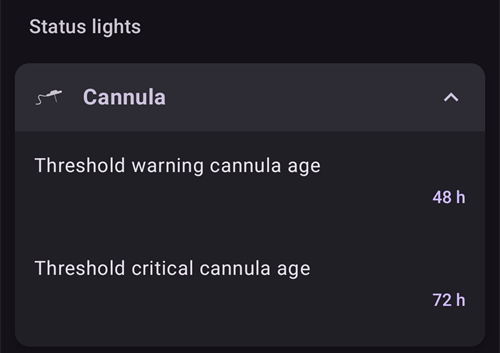

Den sidste mulighed giver dig mulighed for at importere disse indstillinger fra Nightscout, hvis de er angivet der. Se [Nightscout-dokumentationen](https://nightscout.github.io/nightscout/setup_variables/#age-pills) for mere information.

(Preferences-deliver-this-part-of-bolus-wizard-result)=
### Indstillinger for bolusberegner

Skriv »bolus« i søgelinjen på hovedskærmen for at åbne indstillingerne for **Bolusberegner**:

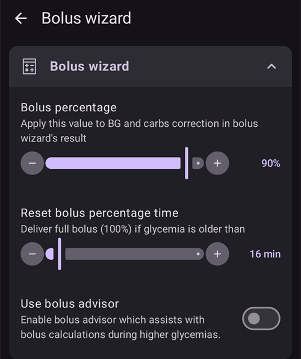

**Bolusprocent** angiver [standardprocenten](#AapsScreens-section-j) af den beregnede bolus, når du bruger bolusberegneren.

Standard er 100%: ingen korrektion. Selv om du indstiller en anden værdi her, kan du stadig ændre den, hver gang du bruger bolusberegneren. Hvis denne indstilling er 75%, og du skulle have givet 10 IE i bolus, vil bolusberegneren kun foreslå en måltidsbolus på 7,5 IE.

Når de bruger [SMB](#objectives-objective9), giver mange personer ikke 100% af den nødvendige insulin som måltidsbolus, men kun en del af den (f.eks. 75%), og lader SMB med UAM (registrering af uanmeldte måltider) klare resten. En værdi under 100% her kan være nyttig:
* for personer med langsom fordøjelse: Hvis hele bolussen bliver givet på forhånd, kan det give hypo, fordi insulinen virker hurtigere end fordøjelsen.
* for at give **AAPS** mere plads til selv at håndtere **stigende BS**. I begge tilfælde vil **AAPS** udligne den manglende del af bolussen med SMB'er, hvis og når det vurderes at være passende.

**Brug bolusrådgiver**

Når den er aktiveret, og du bruger bolusberegneren, mens du har hyperglykæmi, får du en advarsel, der spørger, om du vil give bolus nu og spise senere, når dit **BS** er tilbage i målområdet.

(Preferences-advanced-settings-overview)=
### Superbolus

Superbolus-muligheden fra **AAPS** 3.x findes ikke som en indstilling i **AAPS** 4.

## Loop

Se [AAPS-skærme > Hovedskærmen > Loop-status](#AapsScreens-loop-status) for at skifte loop-tilstand nu.

(Preferences-minimal-request-change)=
### Mindste ændring i åbent loop

Når du bruger **Åbent loop**, får du en notifikation, hver gang **AAPS** anbefaler at justere basalraten. For at få færre notifikationer kan du enten bruge et [bredere BS-målområde](#profile-glucose-targets) eller øge procenten i indstillingen »**Mindste ændring i åbent loop**«. Denne værdi angiver, hvor stor en relativ ændring der skal til, før der kommer en notifikation.

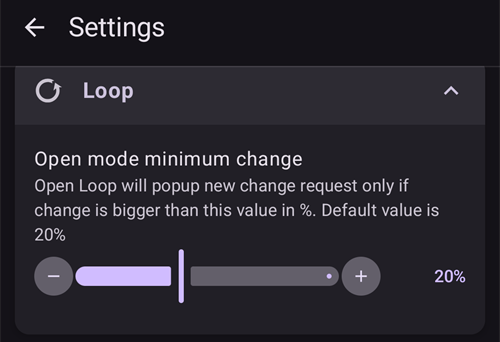

## Advanced Meal Assist (AMA) eller Super Micro Bolus (SMB)

Afhængigt af dine indstillinger under [Konfiguration > APS](../SettingUpAaps/ConfigBuilder.md) kan du vælge mellem to algoritmer:

- [Advanced Meal Assist (OpenAPS AMA)](#Open-APS-features-advanced-meal-assist-ama) - algoritmen, som den var i 2017
- [Super Micro Bolus (OpenAPS SMB)](#Open-APS-features-super-micro-bolus-smb) - den nyeste algoritme, anbefales til begyndere

Fra og med [**AAPS** version 3.3](#version3300) er funktionen [Dynamisk ISF](../DailyLifeWithAaps/DynamicISF.md) flyttet ind i OpenAPS SMB.

### OpenAPS AMA

Alle indstillinger for OpenAPS AMA er beskrevet i det særlige afsnit i [Vigtige AAPS-funktioner > Advanced Meal Assist (AMA)](#Open-APS-features-advanced-meal-assist-ama).

(Preferences-openaps-smb-settings)=
### OpenAPS SMB

Alle indstillinger for OpenAPS SMB er beskrevet i det særlige afsnit i [Vigtige AAPS-funktioner > Super Micro Bolus (SMB)](#Open-APS-features-super-micro-bolus-smb).

Listen over indstillinger, du ser, afhænger af, hvor langt du er kommet i [læringsmålene](../SettingUpAaps/CompletingTheObjectives.md), og af [simpel tilstand](#preferences-simple-mode). På en ny installation vises kun **Brug dynamisk følsomhed**. Når læringsmålene er gennemført, ser sektionen sådan ud:

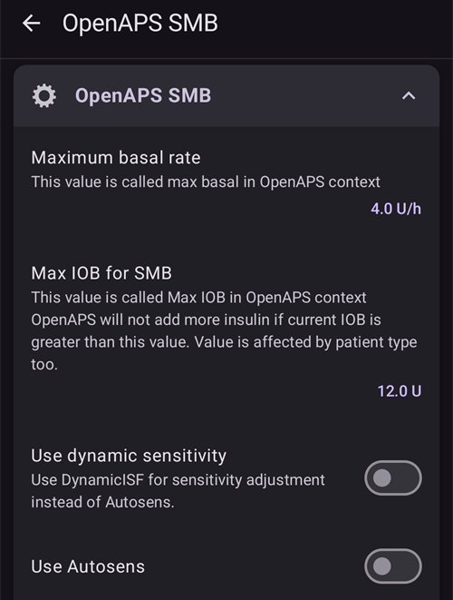

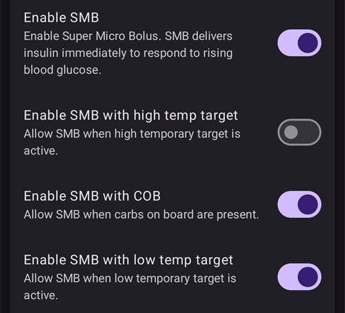

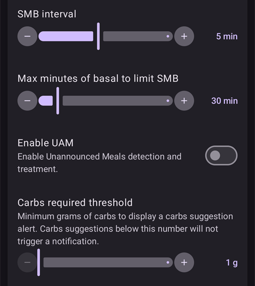

**Avancerede indstillinger** nederst i sektionen indeholder værdier, som du normalt ikke behøver at ændre:

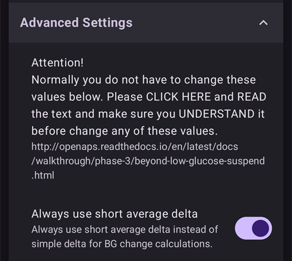

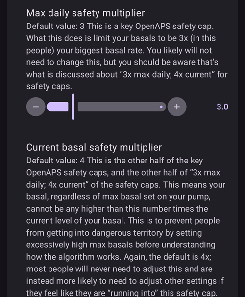

## Indstillinger for absorbering

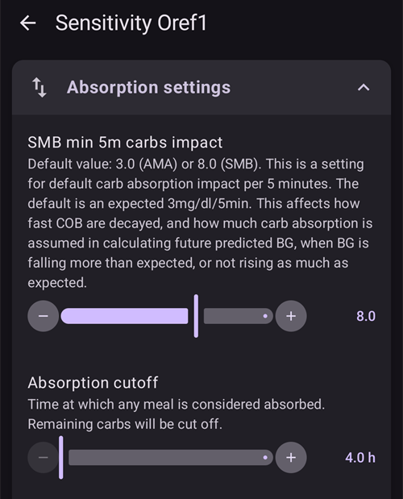

(Preferences-min_5m_carbimpact)=
### SMB min. kulhydratpåvirkning pr. 5 min (min_5m_carbimpact)

Indstillingen er skjult i [simpel tilstand](#preferences-simple-mode).

Algoritmen bruger BGI (blodsukkerpåvirkning) til at afgøre, hvornår [kulhydraterne er absorberet](../DailyLifeWithAaps/CobCalculation.md).

Når kulhydratabsorptionen ikke kan beregnes dynamisk ud fra blodets reaktioner, bruger **AAPS** en standardnedbrydning af dine kulhydrater. Grundlæggende er det en sikkerhedsforanstaltning. Denne værdi bruges kun, når der mangler **CGM**-målinger, eller når fysisk aktivitet »bruger« hele den blodsukkerstigning, som ellers ville få **AAPS** til at nedbryde COB.

Sagt enkelt: Algoritmen »ved«, hvordan dit blodsukker *burde* opføre sig, når det påvirkes af den aktuelle insulindosis osv. Hver gang der er en positiv afvigelse fra den forventede udvikling, bliver nogle kulhydrater regnet som absorberet/nedbrudt. Stor ændring = mange kulhydrater osv.

min_5m_carbimpact angiver standardpåvirkningen fra kulhydratabsorption pr. 5 minutter. Den fulde beskrivelse af parametrene finder du i [OpenAPS-dokumentationen om indstillinger og sikkerhedsindstillinger](https://openaps.readthedocs.io/en/latest/docs/While%20You%20Wait%20For%20Gear/preferences-and-safety-settings.html?highlight=carbimpact#min-5m-carbimpact).

Standardværdien for AMA er 3, for SMB er den 8.

COB-grafen på hovedskærmen viser, når min_5m_carbimpact bliver brugt, ved at sætte orange prikker langs toppen af COB-kurven.

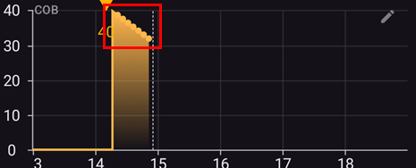

### Absorptionsgrænse

Tidspunktet, hvor et måltid regnes som absorberet; de resterende kulhydrater bliver fjernet. Hvis du ofte spiser måltider med meget fedt eller protein, skal du øge din absorptionstid for måltider.

### Avancerede indstillinger - autosens-forhold


- Angiv min. og maks. [autosens](#Open-APS-features-autosens)-forhold.
- Normalt bør standardværdierne (maks. 1,2 og min. 0,7) ikke ændres.

## Pumpe


### BT Watchdog

Aktiver BT Watchdog, hvis det er nødvendigt (f.eks. til Dana-pumper). Den slår Bluetooth fra i ét sekund, hvis der ikke kan oprettes forbindelse til pumpen. Det kan hjælpe på nogle telefoner, hvor Bluetooth-stakken fryser.

## Pumpeindstillinger

Mulighederne her afhænger af, hvilken pumpedriver du har valgt under [Konfiguration > Pumpe](#Config-Builder-pump). Par og opsæt din pumpe efter [vejledningen for din pumpe](../Getting-Started/CompatiblePumps.md).

For eksempel med **Virtuel pumpe** hedder sektionen **Indstillinger for virtuel pumpe**. Du vælger den **Pumpetype**, som den virtuelle pumpe efterligner, og om dens status bliver uploadet til Nightscout:

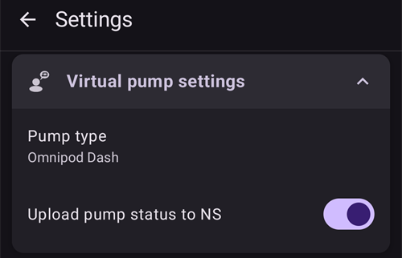

## Tidepool

Mere information på siden [Tidepool](../SettingUpAaps/Tidepool.md).

(Preferences-nsclient)=
## NSClientV3


NSClient-pluginet (vist som **NSClientV3** i menuen Konfiguration) synkroniserer dine data med Nightscout. Det bruger Nightscout API v3.

```{admonition} Data uploaders
:class: warning

Når du bruger NSClientV3, skal alle uploadere bruge Nightscout API v3. Hvis en anden uploader (f.eks. din CGM-app) ikke understøtter API v3, så **lad AAPS uploade alle data** (BS, behandlinger, ...) til Nightscout, og deaktiver den anden uploader.
```

- Indstil din *Nightscout URL* (f.eks. <https://yoursitename.yourplatform.dom>).
- **Sørg for, at URL'en er UDEN /api/v1/ til sidst.**
- Opret en *[Admin-token](https://nightscout.github.io/nightscout/security/#create-a-token)* i Nightscout (kræver [Nightscout 15](https://nightscout.github.io/update/update/) for at bruge V3 API), og skriv den i **Nightscout-adgangstoken** (ikke din API Secret!). På **AAPSClient** kan du i stedet scanne hovedenhedens QR-kode, som opretter en token, der kun hører til klienten. En klient, der er parret med PIN, får sin egen token fra hovedenheden efter parringen. Se [Klientens egen Nightscout-token](#client-master-control-own-token).
- Dette gør det muligt at læse og skrive data mellem Nightscout-hjemmesiden og **AAPS**.
- Tjek grundigt for stavefejl her, hvis du sidder fast i læringsmål 1.
- Lad »Brug websockets« være aktiveret (anbefales). Websockets er **påkrævet** for fjernstyring fra **AAPSClient** på begge telefoner.

(Preferences-nsclient-synchronization)=
### Synkronisering


Valgene for synkronisering afhænger af, hvordan du vil bruge **AAPS**.

Du kan vælge, hvilke data du vil [uploade til og downloade fra Nightscout](#Nightscout-aaps-settings).

Mens klientstyring er slået til (altid i simpel tilstand), er disse indstillinger skjult: **AAPS** er så i [hærdet tilstand](#client-master-control-hardened-mode), tager ikke imod ændringer, der laves direkte i Nightscout, og uploader alle sine data.

### Indstillinger for alarm

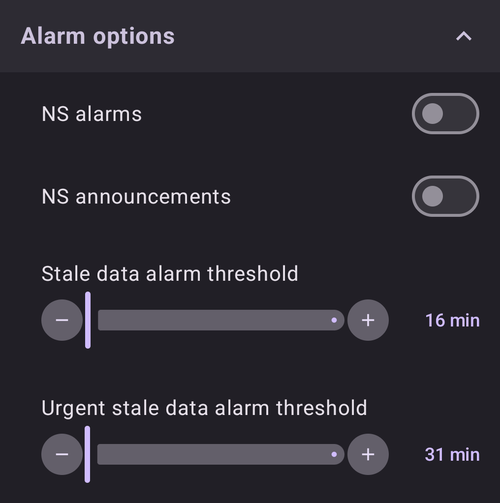

- Med indstillinger for alarm kan du vælge, hvilke Nightscout-alarmer du vil bruge gennem appen. **AAPS** giver alarm, når en Nightscout-alarm udløses.
- For at alarmerne kan lyde, skal du indstille værdierne for alarmerne akut høj, høj, lav og akut lav i dine [Nightscout-variabler](https://nightscout.github.io/nightscout/setup_variables/#alarms).
- De virker kun, mens du har forbindelse til Nightscout, og er beregnet til forældre/omsorgspersoner.
- Hvis du har **CGM**-kilden på din telefon (f.eks. xDrip eller BYODA), så brug de alarmer i stedet for Nightscout-alarmer.
- NS-meddelelser viser Nightscout-[meddelelser](https://nightscout.github.io/nightscout/discover/#announcement) i notifikationerne i **AAPS**.
- Du kan ændre grænserne for alarmerne for forældede data og akut forældede data, når der ikke er modtaget data fra Nightscout efter en vis tid.

### Fjernstyring

Kontakten »**Tillad styring fra klienter**« er ikke længere i disse indstillinger: den er øverst under **Administrer → Godkendte klienter**, hvor de parrede klienter administreres. Se siden [Styring mellem hovedenhed ↔ klient](../RemoteFeatures/ClientMasterControl.md), også om [hærdet tilstand](#client-master-control-hardened-mode), som denne kontakt slår til.

### Indstillinger for forbindelse

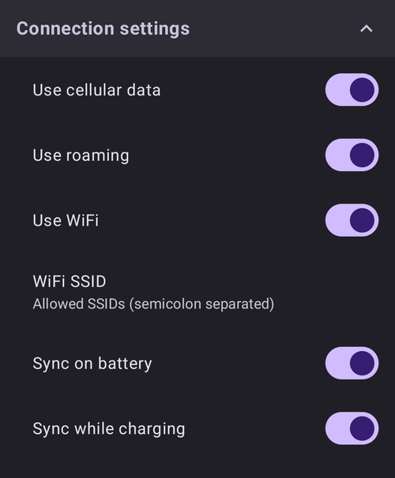

- Indstillinger for forbindelse bestemmer, hvornår forbindelsen til Nightscout er aktiveret.
- Begræns upload til Nightscout til kun Wi-Fi eller endda til bestemte Wi-Fi-SSID'er.
- Hvis du kun vil bruge et bestemt Wi-Fi-netværk, kan du skrive dets Wi-Fi-SSID.
- Flere SSID'er kan adskilles med semikolon.
- For at slette alle SSID'er skal du skrive et mellemrum i feltet.

(Preferences-advanced-settings-nsclient)=
### Avancerede indstillinger (NSClientV3)

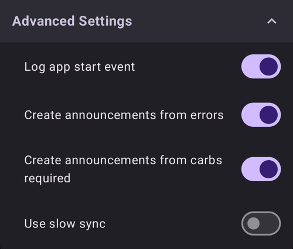

Mulighederne under avancerede indstillinger burde forklare sig selv.

## SMS-kommunikator

Mere information på siden [SMS-kommandoer](../RemoteFeatures/SMSCommands.md).

(preferences-wear)=
## Ur

Denne sektion vises, når pluginet **Ur** er aktiveret under [Konfiguration > Kommunikation](#Config-Builder-wear). Mere information på siderne [Opsæt AAPS på dit Wear OS-ur](../WearOS/WearOsSmartwatch.md) og [Betjening af AAPS med dit Wear OS-smartur](../RemoteFeatures/RemoteControlWearOS.md).

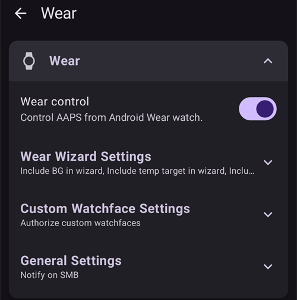

- **Styring fra ur**: tillad, at behandlinger og andre handlinger sendes fra uret. Uden den viser uret kun data: telefonen afviser alle kommandoer fra uret, og hvis du trykker på en komplikation, der ville åbne en styringsskærm, åbnes menuen for **AAPS** på uret i stedet.

**Indstillinger for beregner på ur** angiver, hvilke beregninger der indgår i resultatet fra bolusberegneren på uret. På uret indtaster du kun kulhydraterne; disse kontakter erstatter de valg, du ville træffe i bolusberegneren på telefonen:

- **Medtag BS i beregner**: tilføj en korrektion for forskellen mellem dit aktuelle glukoseniveau og dit mål.
- **Medtag midlertidigt mål i beregner**: brug det aktive midlertidige mål i stedet for profilens mål til denne korrektion.
- **Medtag trend i beregner**: tag højde for den aktuelle glukosetrend.
- **Medtag COB i beregner**: tilføj insulin for de kulhydrater, der stadig er om bord.
- **Medtag IOB i beregner**: træk den insulin fra, som stadig er om bord.

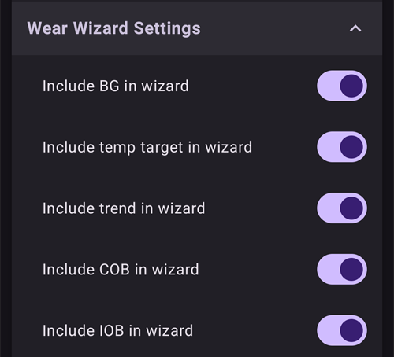

**Brugerdefinerede urskiveindstillinger** indeholder **Godkend brugerdefinerede urskiver**. En fil med en brugerdefineret urskive kan indeholde værdier for nogle af urets indstillinger. Når denne kontakt er slået til, må en sådan urskive ændre disse indstillinger på uret, når den indlæses; når den er slået fra, bliver urskiven indlæst, men indstillingerne forbliver, som de er:

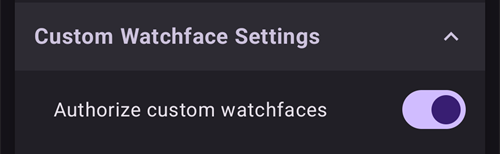

**Generelle indstillinger** indeholder **Giv besked ved SMB**, så du får en notifikation på uret, hver gang der bliver givet en SMB:

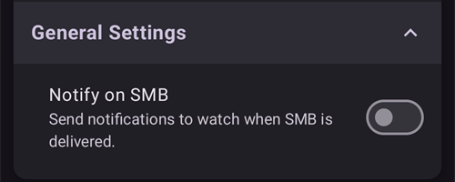

## Autotune

Denne sektion vises, når pluginet **Autotune** er aktiveret under [Konfiguration > Generelt](#Config-Builder-autotune). Indstillingerne er beskrevet på siden [Sådan bruger du Autotune-pluginet](../AdvancedOptions/Autotune.md).


## Automatisering

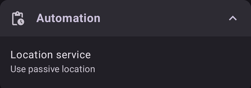

Vælg, hvilken placeringstjeneste der skal bruges:

- Brug passiv placering: **AAPS** henter kun placeringer, hvis andre apps beder om dem
- Brug netværksplacering: placeringen af dit Wi-Fi
- Brug GPS-placering (Bemærk! Kan bruge meget batteri!)

## Lokale alarmer


Indstillingerne burde forklare sig selv.

**Tilsidesæt Forstyr ikke-tilstand** (slået til som standard): alarmerne i **AAPS** ringer, selv når telefonen er på lydløs eller i Forstyr ikke. Slå den fra, hvis **AAPS** skal respektere disse tilstande: så ringer alarmerne ikke, og i Forstyr ikke vibrerer de kun, på telefonen og på uret. Loop-forslag, der kommer under Forstyr ikke, vises uden lyd.

Når en alarm ringer, giver alarmskærmen mulighederne **Lydløs i 5 minutter**, **Gør alarmen lydløs** (skærmen forbliver åben, så du kan læse beskeden) og **Lydløs og luk**. Hvis du swiper alarmnotifikationen væk i notifikationsområdet, bliver alarmen gjort lydløs. Når du senere åbner **AAPS**, bliver en alarm, du ikke har svaret på, vist igen.

(preferences-alarm-sound-volume-vibration)=
### Alarmlyd, lydstyrke og vibration

- **Lyd**: alarmlydene i **AAPS** er indbygget og kan ikke ændres.
- **Lydstyrke**: **AAPS** har ingen egen indstilling for lydstyrke. Med **Tilsidesæt Forstyr ikke-tilstand** slået til følger alarmerne telefonens lydstyrke for alarmer. Når den er slået fra, følger de lydstyrken for notifikationer.
- **Øg lydstyrken for notifikationer gradvist** (slået til som standard): alarmen starter stille og bliver højere. Slå den fra for at ringe med fuld lydstyrke med det samme.
- **Vibration**: i telefonens indstillinger skal du gå til **Apps** > **AAPS** > **Notifikationer**. Listen **AAPS-alarmer** vises der efter den første alarm. Tryk på en alarm for at slå dens **Vibration** til eller fra. Hold disse alarmer slået til.

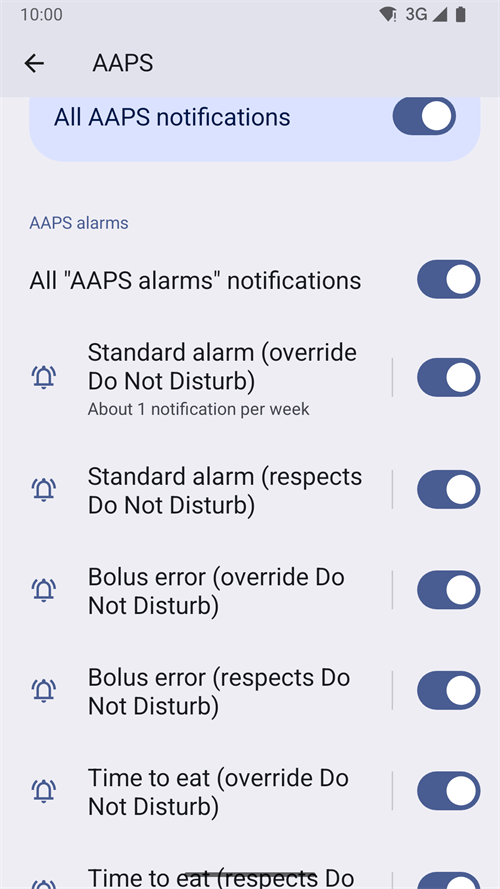 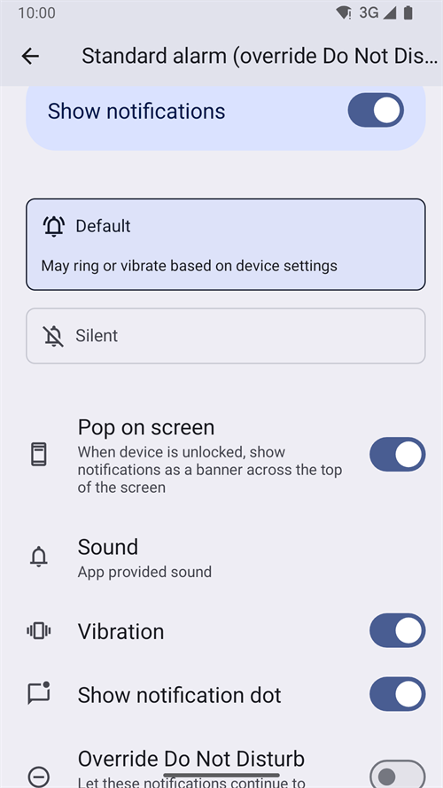

- Glukosealarmer (høj, lav, ingen data) kommer fra din CGM-app eller Nightscout: indstil deres lyd og vibration der.

(preferences-maintenance-settings)=
## Indstillinger for vedligeholdelse

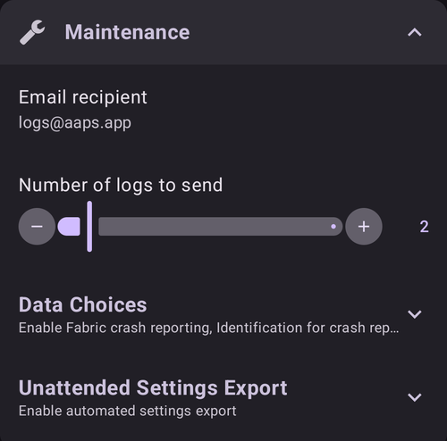

**E-mailmodtager**: Standardmodtageren af logfiler er <logs@aaps.app>.

**Antal logfiler, der skal sendes**: hvor mange af de nyeste logfiler der vedhæftes, når du sender logfiler.

**Valg af data**

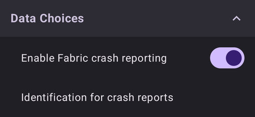

Du kan hjælpe med at udvikle **AAPS** ved at sende nedbrudsrapporter til udviklerne.

**Automatisk eksport af indstillinger**<br/> Når du aktiverer denne funktion, tillader du **AAPS** at eksportere indstillinger, uden at du skal gøre noget. Til det gemmes hovedadgangskoden sikkert på din telefon (og kun der) ved den næste manuelle eksport. Den gemte adgangskode bruges i op til 4 uger. Efter 4 uger får du besked om, at adgangskoden snart udløber. I en frist på 1 uge kan adgangskoden derefter fornyes ved at eksportere indstillingerne manuelt fra menuen Vedligeholdelse.

Når fristen på 1 uge er gået, udløber den gemte adgangskode, og alle automatiske eksporter af indstillinger bliver afbrudt, mens brugeren får besked og bliver bedt om at indtaste adgangskoden igen. [(**Automatiske eksporter af indstillinger**)](../DailyLifeWithAaps/Automations.md#automating-preference-settings-export) bliver registreret i listerne 'Careportal' og 'Brugerindtastning' under Behandlinger i **AAPS**.

Når du har aktiveret denne mulighed, skal du lave en manuel eksport af indstillingerne, hvor du bliver bedt om din adgangskode, så **AAPS** kan gemme den.

### Logfiler

AAPS gemmer logfiler til fejlfinding.

Slå ikke denne funktion fra: den hjælper med at forstå årsagen, hvis noget går galt.

Hvis du skal sende logfilerne til udviklerne, så sørg for at beskrive problemet præcist i e-mailen. Det er bedst kun at sende logfiler, når du er blevet bedt om det, efter en [fejlrapport på GitHub](https://github.com/nightscout/AndroidAPS/issues).

Du kan finde logfilerne fra AAPS i telefonens hukommelse -> Android -> data -> info.nightscout.androidaps -> files.

Håndtering af logfiler (indstillinger for logfiler, afsendelse og sletning af logfiler) og filhåndtering finder du på skærmen **Vedligeholdelse**, som du åbner fra **menuen** (☰) i øverste venstre hjørne af hovedskærmen:

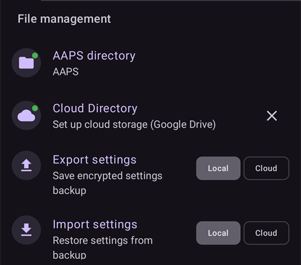

(preferences-maintenance-logdirectory)=

### Indstilling af den lokale AAPS-mappe

Skærmen **Vedligeholdelse** indeholder også **AAPS-mappe**. Med denne indstilling kan brugeren vælge en mappe på telefonen, hvor **AAPS** gemmer indstillinger, logfiler og andre filer. Når en mappe er valgt, vises dens sti (f.eks. `Documents/AAPS`) under **AAPS-mappe**, så du altid kan se, hvor dine filer bliver gemt.

Det anbefales kraftigt at bruge en mappe direkte i hovedniveauet af telefonens hukommelse. Standard er AAPS.

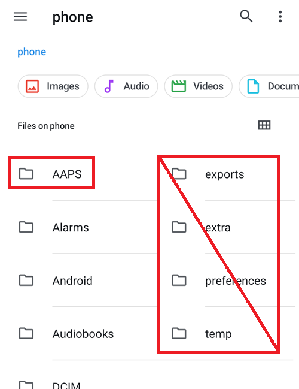

Hvis du vælger en undermappe til AAPS, vil du se en fejlmeddelelse. Tryk på »OK«, og prøv igen, hvor du vælger den rigtige mappe (et niveau højere). Vælg ikke »AFVIS«, medmindre du ved præcis, hvad du gør.

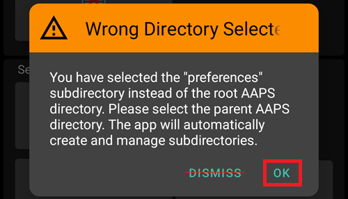

Android kan uden varsel fjerne tilladelsen til mappen, f.eks. når du geninstallerer **AAPS** eller rydder dens lager. Når det sker, viser **AAPS** en vedvarende notifikation **Adgangen til AAPS-mappen er mistet**, og lokal eksport af indstillinger holder op med at virke, indtil du kommer tilbage hertil og vælger mappen igen. Gør det hurtigt, ellers bliver dine sikkerhedskopier på telefonen ikke længere opdateret.

(preferences-maintenance-cloud)=

### Opsætning af en skymappe

Du kan eksportere dine indstillinger, logfiler og CSV-data til en skytjeneste.

1. Åbn **menuen** (☰), vælg **Vedligeholdelse**, og tryk på **Skymappe** (under **Filhåndtering**).

   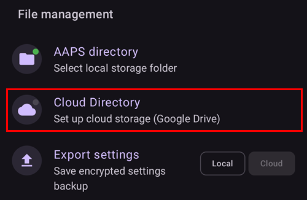

2. Vælg **Google Drive** i **Vælg lagertype**.

   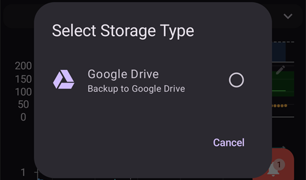

3. En Google-loginside åbnes. Vælg den Google-konto, der skal gemme dine sikkerhedskopier (du kan bruge en [separat Google-konto](../UsefulLinks/DedicatedGoogleAccountForAaps.md)).

   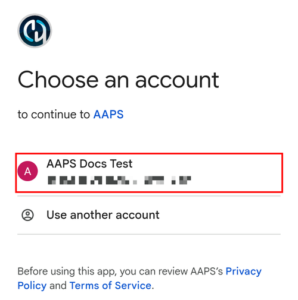

4. Tjek, at det er den rigtige konto, og tryk på **Continue** for at give **AAPS** adgang. Hvis du har sat skymappen op før, står der på siden, at **AAPS** allerede har en vis adgang.

   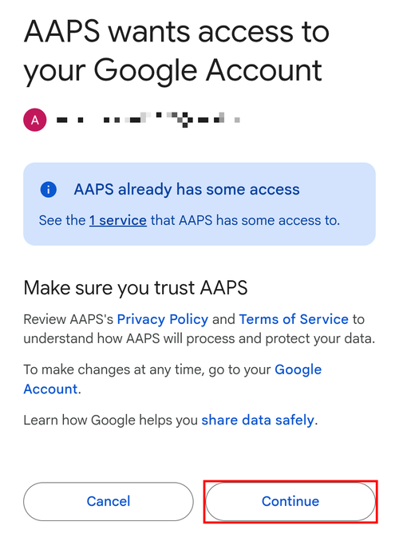

5. Tilbage i **AAPS** vises beskeden **Godkendelse af skylager lykkedes** nederst på hovedskærmen:

   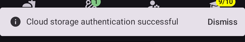

   I menuen **Vedligeholdelse** har **Skymappe** nu en grøn prik, og knapperne **Sky** ved siden af **Send logfiler**, **Eksporter indstillinger**, **Importer indstillinger** og **Eksporter brugerindtastninger til Excel (csv)** er tilgængelige.

   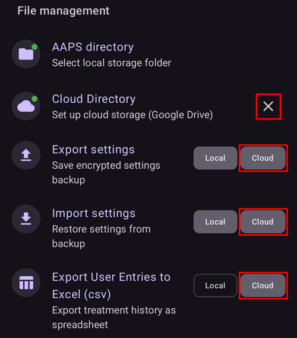

For at stoppe eksport til skyen skal du trykke på ikonet **✕** (**Ryd indstillinger**) i slutningen af rækken **Skymappe** i menuen **Vedligeholdelse** (det vises, når en skytjeneste er sat op) og bekræfte **Ryd skyindstillinger**. Det skifter tilbage til lokal lagring og fjerner godkendelsen.

## Open Humans

Du kan hjælpe fællesskabet ved at donere dine data til forskningsprojekter! Detaljer er beskrevet på siden [Open Humans Uploader](../SupportingAaps/OpenHumans.md).

Under **Indstillinger → Open Humans** kan du angive, hvornår data skal uploades
- kun når der er forbindelse til Wi-Fi
- kun under opladning
