# AAPS-opsætningsguide

```{contents} In this page
:backlinks: entry
:depth: 2
```

Når du starter **AAPS** første gang, bliver du ført gennem »**Opsætningsguide**«, så du hurtigt kan opsætte alle appens grundlæggende indstillinger på én gang. **Opsætningsguide** fører dig gennem opsætningen, så du ikke glemmer noget vigtigt. For eksempel er **indstillingerne for tilladelser** helt grundlæggende for at opsætte **AAPS** korrekt.

Det er dog ikke et krav, at alt bliver helt færdigt første gang, du bruger **Opsætningsguide**. Du kan nemt forlade guiden og komme tilbage til den senere. Efter **Opsætningsguide** er der tre måder at forbedre eller ændre konfigurationen yderligere på. Det bliver forklaret i næste afsnit. Så det er i orden, hvis du springer nogle punkter over i opsætningsguiden. Du kan nemt indstille dem senere.

Mens du bruger **Opsætningsguide**, og lige bagefter, ser du måske ikke nogen tydelige ændringer i **AAPS**. For at aktivere dit **AAPS**-loop skal du gennemføre **Mål** (læringsmålene), som aktiverer den ene funktion efter den anden. Du starter **Mål 1** i slutningen af opsætningsguiden. Det er dig, der styrer **AAPS**, ikke omvendt.

```{admonition} Preview Objectives
:class: note
Hvis du gerne vil kende opbygningen af læringsmålene, så læs [Gennemførelse af læringsmålene](../SettingUpAaps/CompletingTheObjectives.md), men kom så tilbage hertil og kør opsætningsguiden først.

```

Vi ved af erfaring, at nye brugere ofte presser sig selv til at opsætte **AAPS** så hurtigt som muligt. Det kan give frustration, for der er meget at lære.

Så tag dig god tid til at indstille dit loop. Et **AAPS**-loop, der kører godt, giver meget store fordele.

```{admonition} Ask for Help
:class: note
Hvis der er en fejl i dokumentationen, eller hvis du har en bedre idé til, hvordan noget kan forklares, kan du bede fællesskabet om hjælp som beskrevet under [Få kontakt med andre brugere](../GettingHelp/WhereCanIGetHelp.md).
```
## Velkomstbesked

Når opsætningsguiden åbner, byder den dig velkommen med en kort besked og viser straks et panel med »**Tilladelser påkrævet**« nederst på skærmen (se næste afsnit).

Når du har givet tilladelserne, lukker panelet, og velkomstskærmen viser knappen »**Næste**«. Tryk på »**NÆSTE**« for at fortsætte:

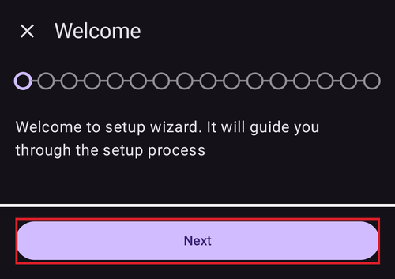

## Nødvendige tilladelser

**AAPS** skal have nogle tilladelser for at virke korrekt. Guiden samler dem på ét panel, »**Tilladelser påkrævet**«, hvor hver tilladelse har sin egen knap »**Tillad**«. Giv dem én ad gangen — ikonet ved siden af hvert punkt bliver til et flueben, når det er gjort.

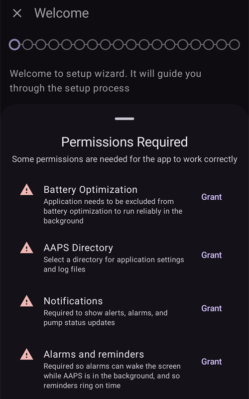

### Batterioptimering

Batteriforbrug på smartphones er vigtigt, fordi batteriernes ydeevne stadig er ret begrænset. Derfor er Android-styresystemet på din smartphone restriktivt med at lade apps køre og bruge CPU-tid og dermed batteristrøm.

**AAPS** skal dog køre regelmæssigt, _f.eks._ for at modtage glukosemålingerne med få minutters mellemrum og derefter bruge algoritmen til at beslutte, hvordan dit glukoseniveau skal håndteres ud fra dine indstillinger. Derfor skal den undtages fra batterioptimering.

Tryk på »**Tillad**« ved siden af »**Batterioptimering**«, og vælg derefter »**Tillad**« (Allow) i dialogen »Lad appen altid køre i baggrunden?«:

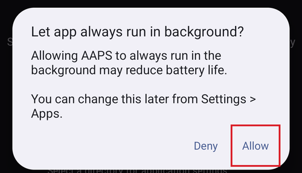

(SetupWizard-StoragePermission)=

### AAPS-mappe

**AAPS** skal gemme sine indstillinger og logoplysninger på det permanente lager på din smartphone. Permanent lager betyder, at oplysningerne stadig er der, efter at du har genstartet din smartphone. Andre oplysninger går simpelthen tabt, fordi de ikke bliver gemt på permanent lager.

Tryk på »**Tillad**« ved siden af »**AAPS-mappe**«. Det åbner filsystemet på din telefon, så du kan vælge, hvor **AAPS** gemmer sine oplysninger.

```{tip}
Vi anbefaler at vælge standardmappen AAPS.</br>
Vælg **ikke** en undermappe til AAPS.
```

Standardmappen er **AAPS**, men du kan bruge en hvilken som helst mappe, du vælger til formålet. Opret mappen, hvis det er nødvendigt, åbn den, og vælg »**BRUG DENNE MAPPE**« (USE THIS FOLDER):

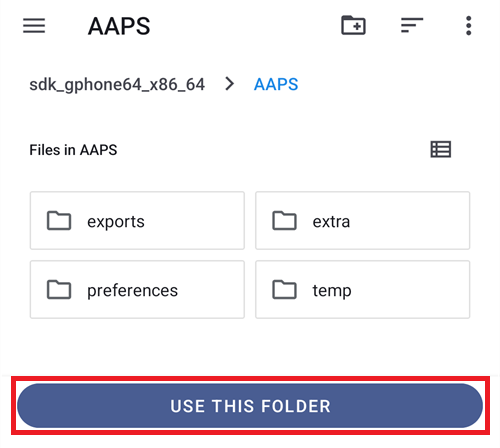

Bekræft med »**TILLAD**« (ALLOW), at du vil give **AAPS** adgang til den valgte mappe:

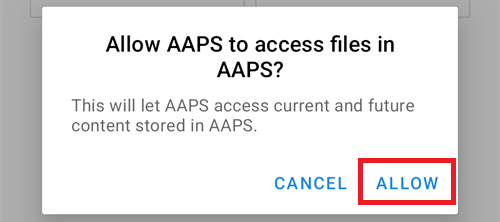

### Notifikationer

Android kræver en særlig tilladelse for apps, der vil sende dig notifikationer.

Det kan være en god idé at slå notifikationer fra, _f.eks._ fra apps til sociale medier, men det er vigtigt, at du lader **AAPS** sende dig notifikationer.

Tryk på »**Tillad**« ved siden af »**Notifikationer**«, og vælg »**Tillad**« (Allow) i systemets dialog:

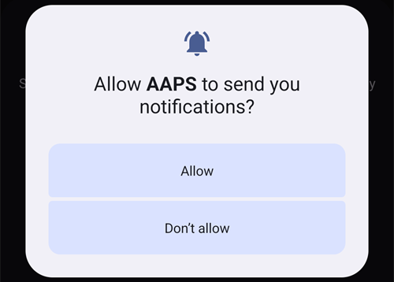

### Alarmer og påmindelser

På **Android 14 og nyere** skal **AAPS** have tilladelsen »**Alarmer og påmindelser**«, så alarmer kan tænde skærmen, mens **AAPS** kører i baggrunden, og så påmindelser (for eksempel fra en **Automatisering**) ringer til tiden.

Dette punkt vises kun, når der er brug for det. Når **AAPS** er undtaget fra batterioptimering (se ovenfor), giver Android automatisk tilladelse til præcise alarmer, og punktet forsvinder. Hvis det stadig står på listen, så tryk på »**Tillad**« ved siden af »**Alarmer og påmindelser**«. Det åbner en skærm i systemindstillingerne for **AAPS**. Slå kontakten til, og gå tilbage til **AAPS**. På Android 13 og ældre vises dette punkt ikke, og du skal ikke gøre noget.

Når alle tilladelser viser et flueben (tre, eller fire på Android 14 og nyere), lukker panelet »**Tilladelser påkrævet**« af sig selv, og du kan trykke på »**NÆSTE**« på velkomstskærmen for at fortsætte.

(setup-wizard-bluetooth-battery-optimisation)=
### Batterioptimering af Bluetooth

```{admonition} Extra Android setting, not part of the Wizard
:class: note
Det følgende er ekstra Android-konfiguration, som du laver uden for opsætningsguiden. Det er ikke en af knapperne »Tillad« ovenfor, men det er vigtigt for en stabil forbindelse til pumpen.
```

Nyere versioner af Android har også tilføjet batterioptimering til systemets Bluetooth-app.

Ud over at slå batterioptimering fra for **AAPS** skal du sandsynligvis også slå den fra for Bluetooth-systemappen. Hvis du ikke gør dette, kan det give afbrydelser og problemer med forbindelsen til pumpen.

***BEMÆRK: xDrip-dokumentationen beskriver, hvordan du gør dette her: [xDrip-dokumentation](https://navid200.github.io/xDrip/docs/BluetoothBatteryOpt.html)***

Følg disse trin på Android 16. Andre versioner ser lidt anderledes ud end skærmbillederne her:

1. Åbn Android-indstillinger, søg efter **Apps**, og åbn indstillingerne for apps.

   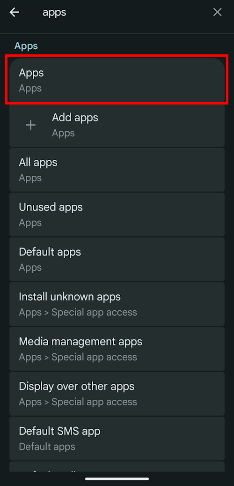

2. Du ser nu indstillingerne for apps, men vi skal udvide listen for at se alle apps. Tryk på **Se alle apps** (See all apps) for at udvide den.

   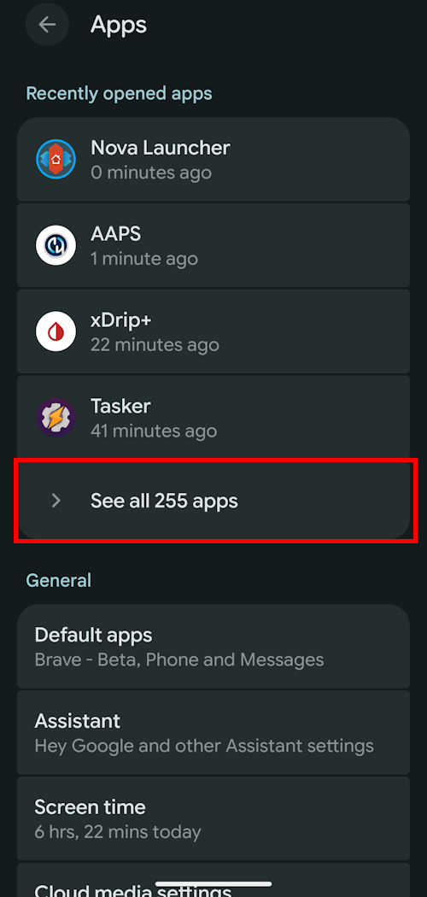

3. Bluetooth-appen er en systemapp og er derfor skjult som standard, så vi skal vise systemapps. Tryk på de **tre prikker** (⋮) øverst til højre (1). Tryk derefter på **Vis system** (Show system) (2).

   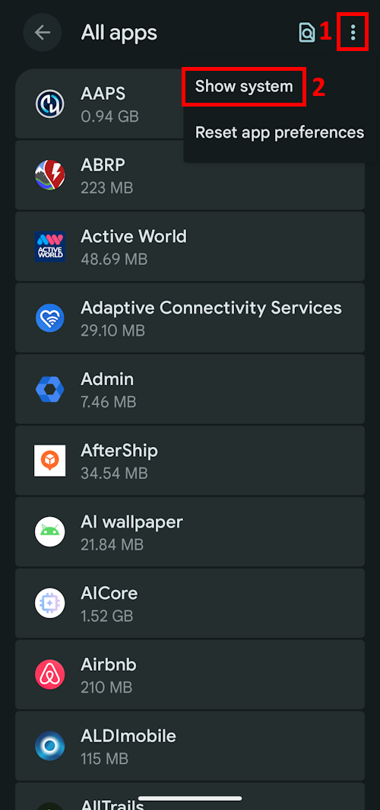

4. Søg efter appen `Bluetooth`, og tryk på `Bluetooth` og/eller `Legacy Bluetooth`. Hvis begge findes, skal du følge fremgangsmåden for begge.

   ***BEMÆRK: Du kan roligt ignorere `Bluetooth MIDI Service`. Den bruges ikke af AAPS***

   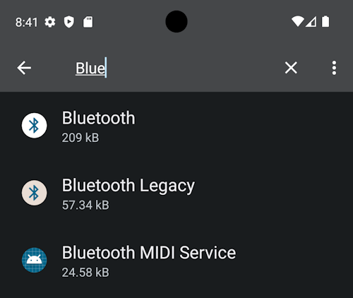    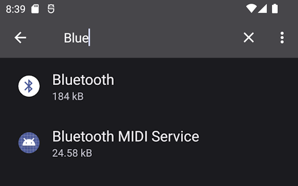    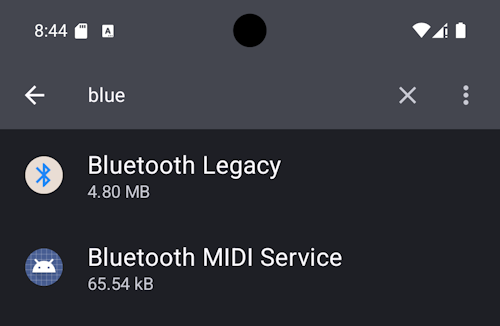

   1. På Android 12 skal du trykke på `Batteri` (Battery), på Android 13+ skal du trykke på `Batteriforbrug for apps` (App battery usage).

   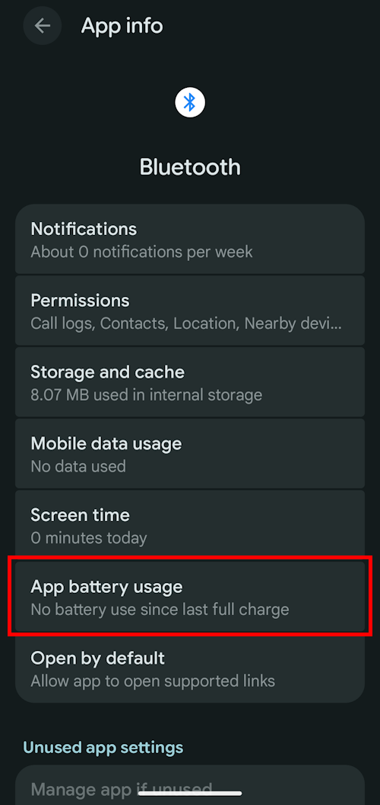   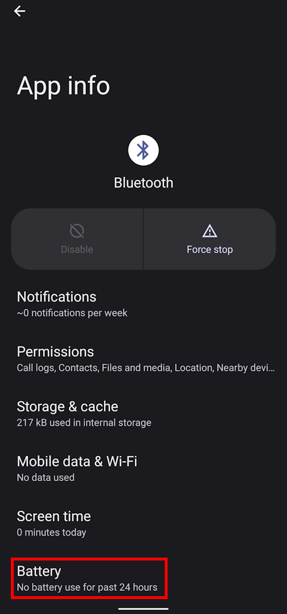

5. På Android 12+ skal du vælge `Ubegrænset` (Unrestricted). På Android 15+ skal du udvide indstillingen `Tillad brug i baggrunden` (Allow background usage). Tryk på det område, der er markeret med rødt, og følg derefter trin 6 for at gøre det færdigt.

   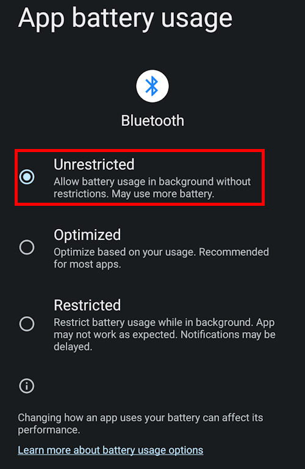    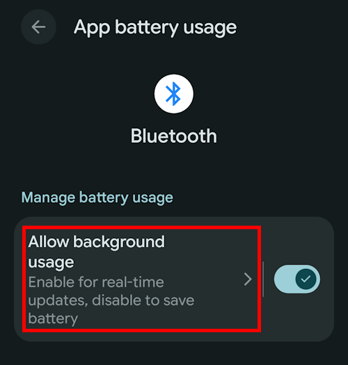

6. På Android 16 skal du vælge `Ubegrænset` (Unrestricted)

   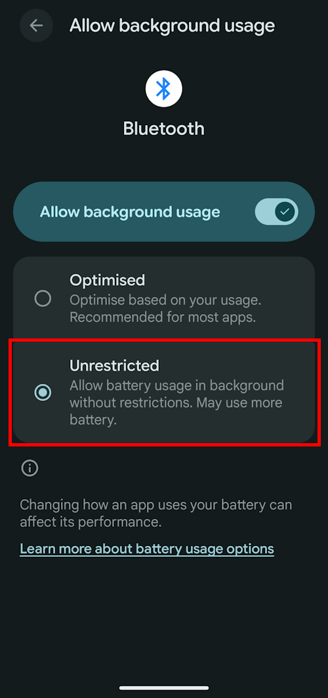

## Licensaftale

Licensaftalen for slutbrugere indeholder vigtige oplysninger om de juridiske forhold ved brug af **AAPS**. Læs den grundigt.

Hvis du ikke forstår licensaftalen for slutbrugere, eller ikke kan acceptere den, så brug slet ikke **AAPS**!

Hvis du forstår og er enig, så tryk på knappen »**JEG FORSTÅR OG ER ENIG**«, og følg opsætningsguiden:

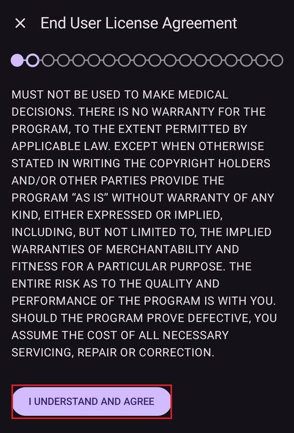

Knappen »**Næste**« vises, når du har accepteret. Tryk på »**NÆSTE**«.

Næste skærm, »**Tilladelser**«, viser tilladelserne igen. De bør alle vise et flueben, da du gav dem i starten. Hvis en mangler, så tryk på »**Tillad**« ved siden af den. Tryk på »**NÆSTE**« for at fortsætte:

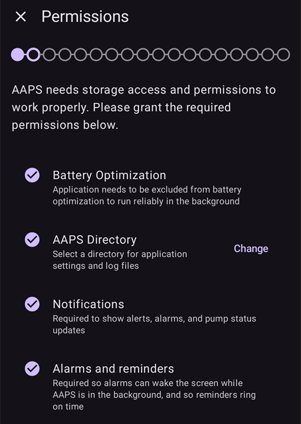

## Hovedadgangskode

Da konfigurationen af **AAPS** indeholder nogle følsomme data (_f.eks._ adgangstokenet til din Nightscout-server), bliver den krypteret med en adgangskode, som du angiver her.

Guiden viser »**Adgangskode ikke angivet**«. Tryk på »**Indstil**«:

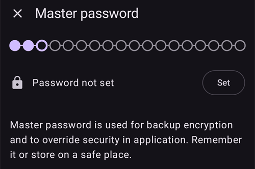

Det åbner skærmen »**Beskyttelse**«. Tryk på »**Hovedadgangskode**« (vises som »Adgangskode ikke angivet«):

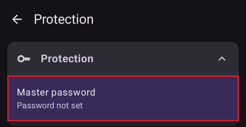

Indtast den samme adgangskode i begge felter, og tryk på »**OK**«:

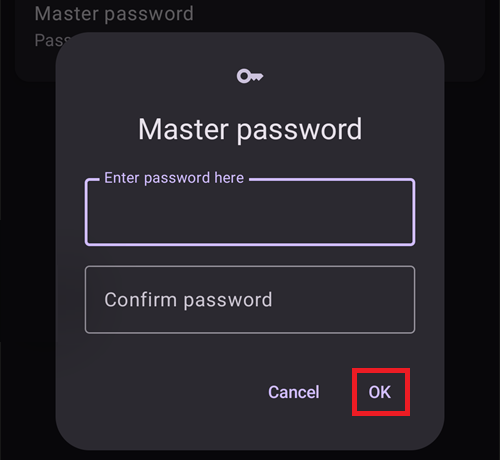

Gå tilbage med pilen i øverste venstre hjørne. Guiden viser nu »**Adgangskode angivet!**«:

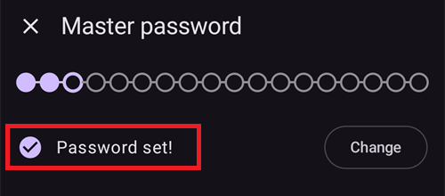

```{admonition} Do not lose your Master Password
:class: danger
**MIST IKKE DIN HOVEDADGANGSKODE**. Skriv den ned, _f.eks._ på Google Drive, som er et godt sted, fordi Google laver sikkerhedskopi af den for dig. Din smartphone eller pc kan gå ned, og så har du måske ikke en aktuel kopi. Hvis du glemmer din hovedadgangskode, kan det senere være svært at gendanne din profilkonfiguration og dine fremskridt i **Mål** (læringsmålene). Se [Hvordan nulstiller jeg hovedadgangskoden?](#FAQ-reset-master-password)
```

Når du er færdig, så tryk på »**NÆSTE**« for at gå til næste skærm.

(setup-wizard-import-settings)=
## Importer indstillinger

Denne skærm vises kun, når **AAPS** finder indstillinger, som tidligere er eksporteret til **AAPS**-mappen (»Gemte indstillinger fundet«), for eksempel når du geninstallerer appen eller skifter til en ny telefon.

- To restore your previous configuration, press "**Import settings**" — see [Export & import settings](../Maintenance/ExportImportSettings.md). After a successful import the Setup Wizard closes: the imported settings replace the remaining steps.
- For at starte med en ny konfiguration skal du trykke på »**NÆSTE**« og fortsætte med guiden.

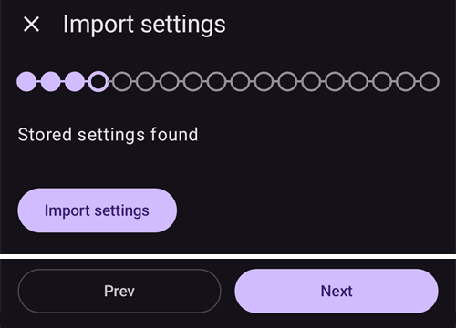

## Enheder (mg/dl <-> mmol/l)

Vælg, om dine glukoseværdier er i mg/dl eller mmol/l, og tryk derefter på knappen »**NÆSTE**«:

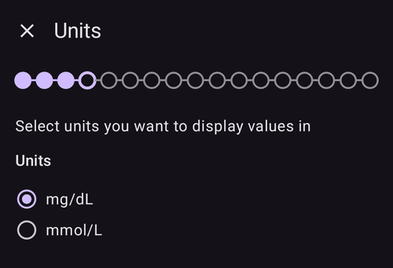

## Visningsindstillinger

Her indstiller du »**LAV værdi**« og »**HØJ værdi**« for visningen af sensorglukose. Glukoseværdier mellem disse to grænser vises som »i område«. Du kan beholde standardværdierne (72 og 180 mg/dl) indtil videre og ændre dem senere.

De værdier, du vælger, påvirker kun den grafiske visning af diagrammet og intet andet.

Dit glukosemål, _f.eks._, indstilles separat i din profil.

Dit område til analyse af TIR (tid i målområde) indstilles separat på din rapporteringsserver.

Juster grænserne med knapperne »−« / »+«, hvis det er nødvendigt, og tryk derefter på knappen »**NÆSTE**«:

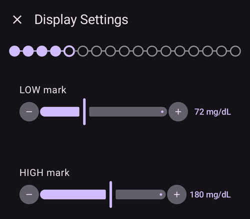

(SetupWizard-synchronization-with-the-reporting-server-and-more)=
## Kommunikation

Skærmen »**Kommunikation**« viser de plugins, der bruges til at uploade, synkronisere og sende dine data:

- **SMS-kommunikator** – fjernstyring af **AAPS** med SMS-kommandoer
- **NSClientV3** – synkroniserer dine data med Nightscout via v3 API
- **Tidepool** – uploader data til Tidepool
- **xDrip** – sender data til xDrip
- **Open Humans** – upload og donér dine diabetesdata til videnskabelige projekter
- **Ur** – overvåg og styr **AAPS** fra et Wear OS-ur
- **Eksterne ledsagerapps** – sender data til forskellige eksterne apps
- **Garmin** – forbindelse til en Garmin-enhed

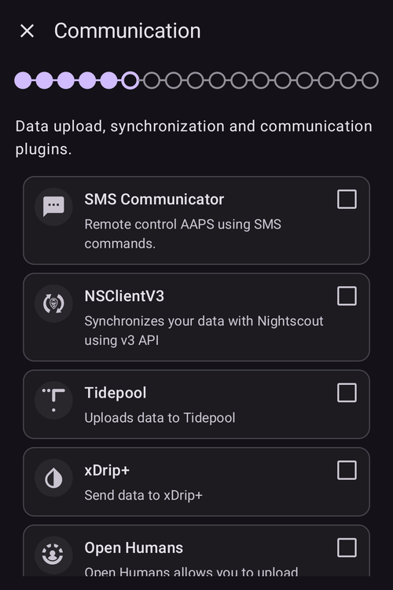

Rul ned for at se resten af listen:

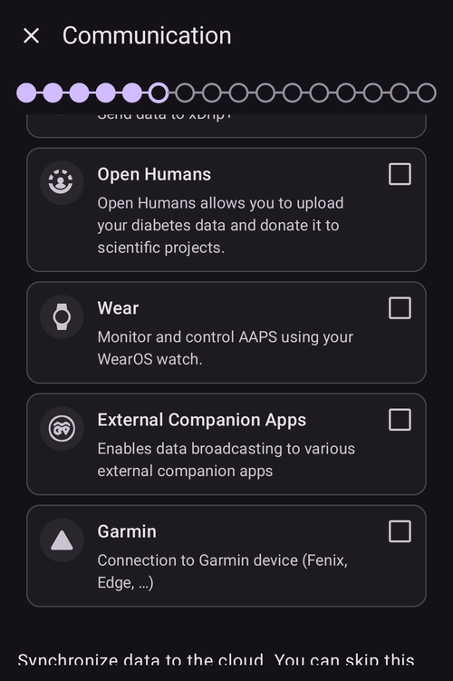

Du kunne indstille flere af dem nu, men første gang fokuserer vi kun på rapporteringsserveren. Hvis du ikke kan opsætte den lige nu, så spring den over indtil videre — du kan indstille den senere.

I dette eksempel bruger vi Nightscout som rapporteringsserver. Sæt flueben i feltet til højre for »**NSClientV3**« for at aktivere det. For Tidepool er det endnu enklere, da du kun skal bruge dine personlige loginoplysninger.

Når det er aktiveret, så tryk på »**Indstillinger**« under NSClientV3 for at indstille det:

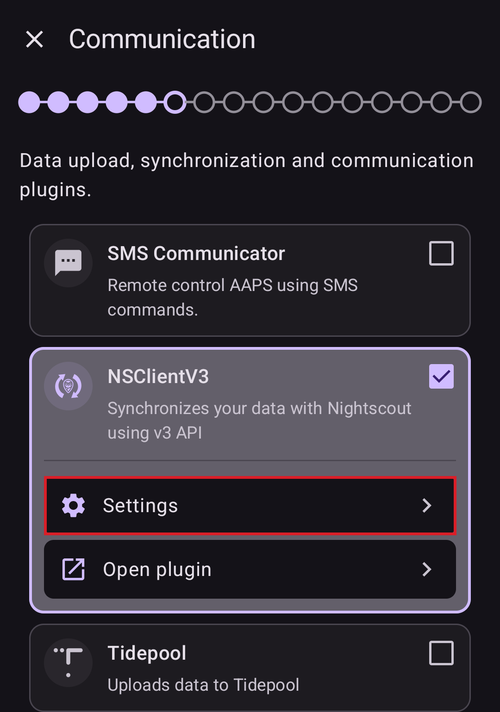

Her indstiller du Nightscout-rapporteringsserveren. Indstillingerne for NSClientV3 vises på én side, som du kan rulle i:

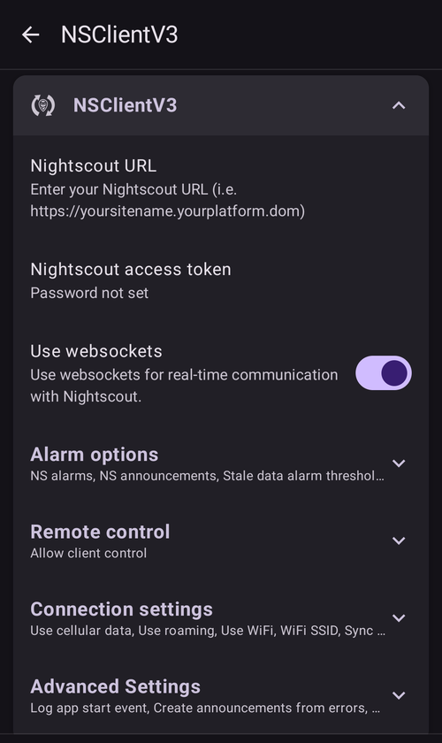

Tryk på »**Nightscout URL**«, og indtast adressen på din personlige Nightscout-server (den URL, du selv har opsat, eller som du har fået fra din udbyder). Bekræft med »**OK**«.

Tryk på »**Nightscout-adgangstoken**«, og indtast adgangstokenet til din Nightscout-server. Uden dette token virker adgangen ikke. Hvis du ikke har det endnu, så se dokumentationen om opsætning af rapporteringsserveren.

Lad »**Brug websockets**« være aktiveret for kommunikation med Nightscout i realtid. Websockets er **påkrævet** for fjernstyring fra **AAPSClient** på begge telefoner.

De øvrige afsnit kan have standardværdierne indtil videre. De bliver beskrevet her, så du ved, hvor du kan finde dem senere:

**Indstillinger for alarm** — Nightscout-alarmer, meddelelser og grænser for forældede data. Lad kontakterne være slået fra indtil videre. Vi åbner dem kun, så du kender mulighederne.

**Indstillinger for forbindelse** — vælg, hvordan data overføres. Omsorgspersoner skal aktivere »**Brug mobildata**«, ellers kan telefonen hos den person, de passer på (_f.eks._ et barn), ikke uploade uden for wi-fi-dækning, _f.eks._ på vej til skole. Andre brugere kan slå overførsel via mobildata fra for at spare data eller batteri. Hvis du er i tvivl, så lad alt være aktiveret.

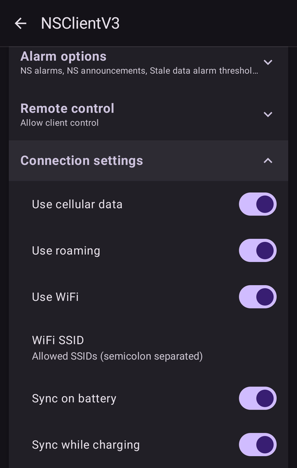

**Avancerede indstillinger** — aktiver »**Registrer start af appen**«, hvis du vil se i Nightscout, når appen genstarter (nyttigt for omsorgspersoner). Lad »**Opret meddelelser fra fejl**« og »**Opret meddelelser ved behov for kulhydrater**« være aktiveret. Lad »**Brug langsom synkronisering**« være slået fra. Du skal kun bruge den, hvis Nightscout-serveren er langsom til at behandle store mængder data.

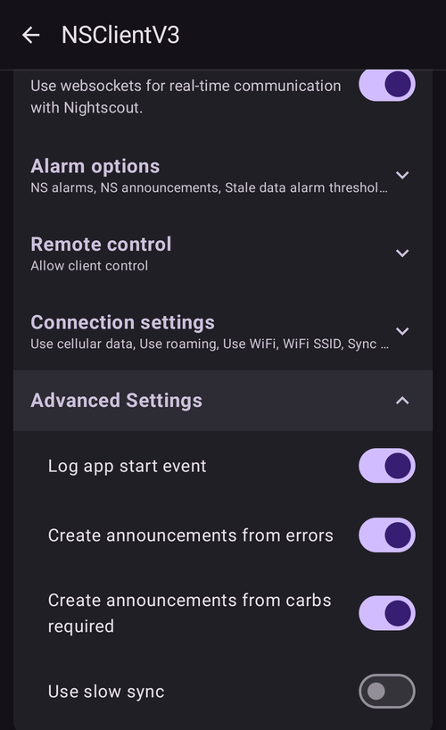

Gå tilbage til listen over plugins, og tryk på »**NÆSTE**« for at gå til næste skærm.

## Klientstyring

Fra **AAPS** version 4 kan klientenheder med **AAPSClient** **parres** med denne telefon (**hovedenheden**) og styre den med signerede kommandoer, der sendes via Nightscout. Det er den nye anbefalede måde at fjernstyre **AAPS** på — se [Styring mellem hovedenhed ↔ klient (signeret fjernstyring)](../RemoteFeatures/ClientMasterControl.md) for den fulde forklaring og opsætning.

Du skal ikke indstille noget på denne skærm nu. Du kan parre klienter når som helst senere fra **Administrer → Godkendte klienter**. Der tilføjer du en klient med en **QR-kode** (den opsætter også Nightscout på klienten) eller med en **PIN**, og giver den en **rolle**.

- »**Godkendte klienter**« — administrer de parrede klientenheder, der må styre denne hovedenhed.
- »**Modtagelse af data fra Nightscout**« — modtagelse af behandlinger og data, der er indtastet direkte i Nightscout (den gamle, mindre sikre metode), er nu slået fra som standard. Åbn kun disse indstillinger, hvis du stadig har brug for det, _f.eks._ for at indtaste data via Nightscout eller apps fra tredjepart.

Når klientstyring allerede er slået til — altid i [Simpel tilstand](#preferences-simple-mode) — er denne telefon i [hærdet tilstand](#client-master-control-hardened-mode): den tager kun imod ændringer fra parrede klienter, så skærmen forklarer hærdet tilstand i stedet for at vise indstillingerne for »**Modtagelse af data fra Nightscout**«.

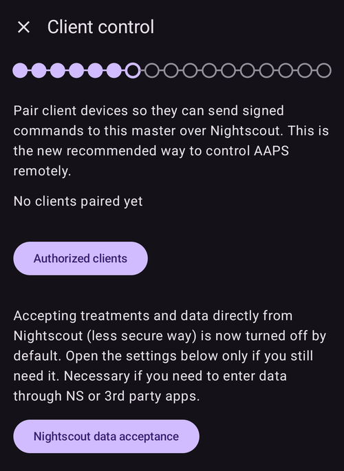

»**Modtagelse af data fra Nightscout**« åbner indstillingerne for »**Synkronisering**«, hvor hver type data, der modtages fra Nightscout, har sin egen kontakt:

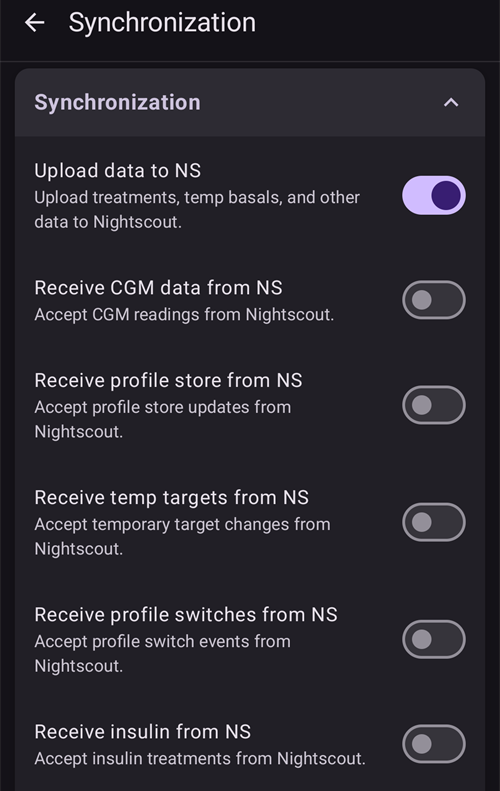

Tryk på »**NÆSTE**« for at gå til næste skærm.

(setup-wizard-instance-name)=
## Hvem bruger denne telefon?

Her indtaster du navnet på den person, der bruger denne telefon. Navnet adskiller denne **AAPS**-instans fra andre i rapporter og ved synkronisering, for eksempel hvis to børn i din familie bruger **AAPS**. Det bruges også i navnene på eksporterede indstillingsfiler og vises på uret.

Det kan være hvad som helst. Du kan ændre det senere under **Indstillinger → Generelt → Navn på instans**.

Tryk på »**NÆSTE**« for at gå til næste skærm.

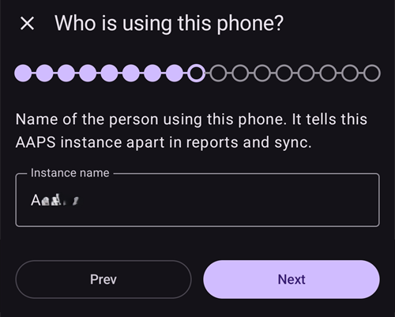

## Patienttype

Her vælger du din »Patienttype«. Det er vigtigt, fordi **AAPS**-softwaren har forskellige grænser afhængigt af patientens alder. Det er vigtigt af sikkerhedsgrunde.

Her indstiller du også den **maksimalt tilladte bolus** til et måltid. Det vil sige den største bolus, du skal give for at dække dine typiske måltider. Det er en sikkerhedsfunktion, der hjælper dig med at undgå en overdosis ved et uheld, når du giver bolus til et måltid.

Den anden grænse fungerer på samme måde, men gælder den største mængde kulhydrater, du forventer at spise.

Når du har indstillet disse værdier, så tryk på »**NÆSTE**« for at gå til næste skærm:

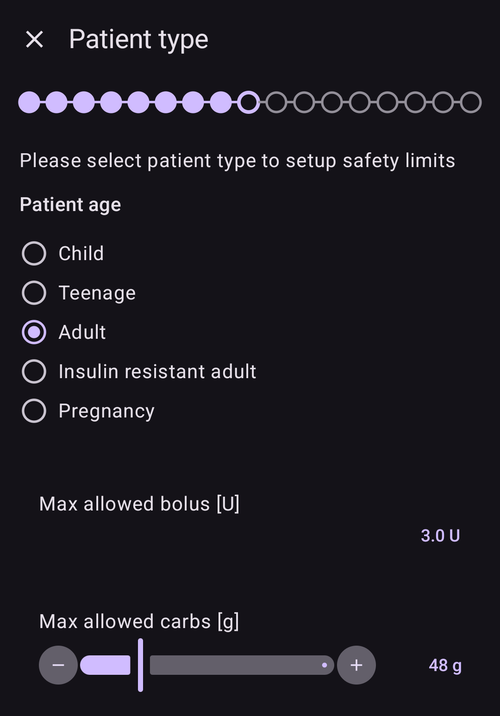

## Insulin

Her indstiller du den insulin, der bruges i din pumpe. Nye insulinprofiler kræver en **DIA på mindst 5 t**.

Tryk på knappen »**Insulin**« for at åbne insulineditoren:

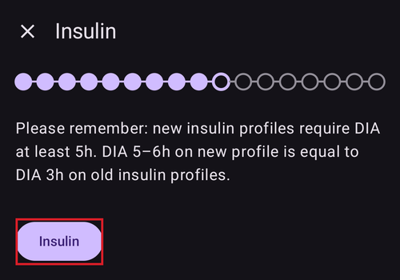

I editoren kan du give insulinen et **kaldenavn** og indstille dens **Spids** (i minutter) og **DIA** (i timer). Den hurtigste måde er at hente en forudindstilling med »**Hent spids fra**« — vælg **Novorapid**, **Fiasp** eller **Lyumjev** — så bliver spidsen udfyldt for dig. Grafen nederst viser den insulinaktivitetskurve, der kommer ud af det.

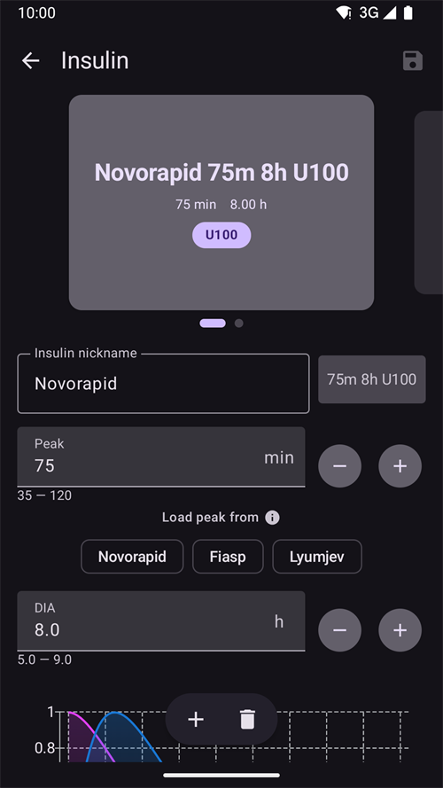

Vælg den forudindstilling, der passer til din insulin, for eksempel **Fiasp**:

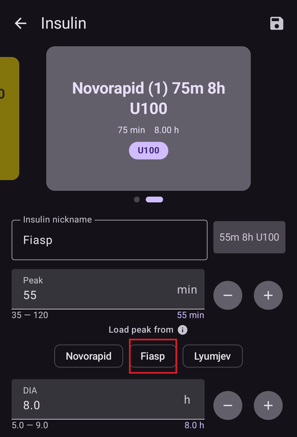

```{admonition} Use your insulin brand's preset peak
:class: danger
Ændr ikke spidsen, medmindre du er ekspert — normalt virker de forudindstillede værdier godt for hvert insulinmærke.
```

Hvis du er ny **AAPS**-bruger, så indstil **DIA** til 9 timer — se [Varighed af insulinvirkning (DIA) og spids](#Config-Builder-insulin-dia) for at forstå hvorfor.

```{admonition} "Insulin configuration changed" dialog
:class: note
Hvis en parret klient (_f.eks._ en anden telefon) har ændret insulinkonfigurationen, vises en dialog. Tryk på **OK** for at hente ændringerne, eller på **Annuller** for at fortsætte med at redigere (når du gemmer næste gang, overskriver du deres ændringer).
```

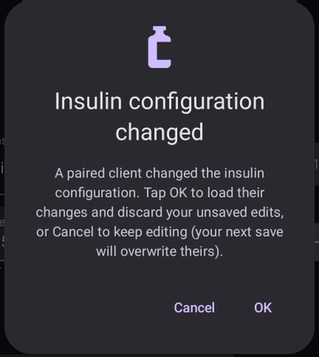

Tryk på ikonet for at gemme (øverst til højre), og tryk derefter på »**NÆSTE**« for at gå til næste skærm.

## Blodsukkerkilde

Her vælger du, hvor **AAPS** får sine glukosedata fra. Læs dokumentationen for din [BS-kilde](../Getting-Started/CompatiblesCgms.md).

Der er mange kilder at vælge imellem — rul gennem listen, og vælg den, du bruger:

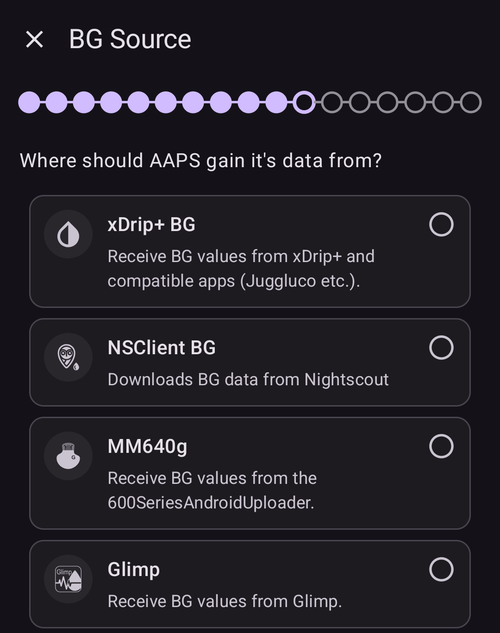

Når du vælger en kilde, udvides dens kort og viser to knapper: »**Indstillinger**« til at justere, hvordan data modtages, og »**Åbn plugin**« til at åbne kildens egen skærm. I eksemplet nedenfor er **BYODA** valgt. Nogle kilder har intet at indstille på dette trin, så du kan normalt gå direkte til næste skærm:

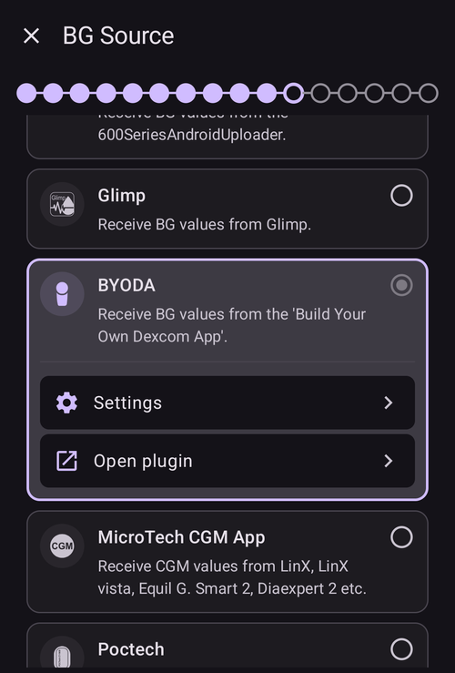

Når du har valgt, så tryk på »**NÆSTE**« for at gå til næste skærm.

(setup-wizard-profile)=
## Profil

Nu kommer vi til en meget vigtig del af opsætningsguiden.

Læs dokumentationen om [profiler](../SettingUpAaps/YourAapsProfile.md), før du prøver at indtaste dine profiloplysninger på næste skærm.

```{admonition} Working profile required - no exceptions here !
:class: danger
En præcis profil er nødvendig, for at **AAPS** kan virke sikkert.

Det er et krav, at du har fundet frem til din profil og drøftet den med din læge, og at den har vist sig at virke ved vellykkede test af basalrate, ISF og IC!

Hvis en robot får forkerte data, går det galt - hver gang. **AAPS** kan kun arbejde med de oplysninger, den får. Hvis din profil er for stærk, risikerer du hypoglykæmi, og hvis den er for svag, risikerer du hyperglykæmi. 
```

Tryk på knappen »**Profil**« for at åbne profileditoren:

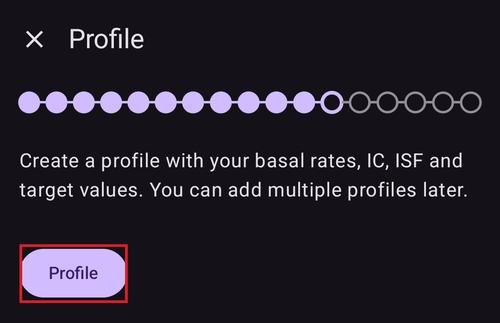

Editoren åbner tom (»Ingen poster tilgængelige«). Tryk på knappen »**+**« nederst for at oprette en ny profil:

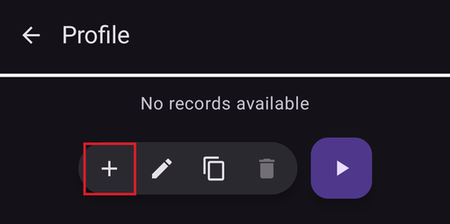

Du kan have flere profiler på længere sigt, hvis du har brug for det. Her opretter vi kun én.

```{admonition} Profile only for tutorial - not for your usage
:class: note
Eksempelprofilen her skal kun vise dig, hvordan du indtaster data.

Den er ikke tænkt som en præcis eller særlig godt optimeret profil, for hver persons behov er meget forskellige.

Brug den ikke til rigtig looping!
```

Den nye profil (for eksempel »**LocalProfile1**«) har fire faner: **IC**, **ISF**, **BAS** og **MÅL**. Tryk på blyanten ved siden af profilnavnet for at omdøbe den. Udfyld alle faner — en fane forbliver rød og viser en fejlbesked, indtil den indeholder gyldige værdier:

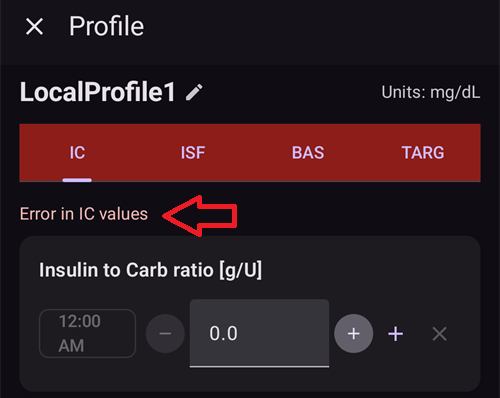

Tryk på »**IC**«, og indtast dine [IC](#your-aaps-profile-insulin-to-carbs-ratio)-værdier. Brug knappen »**+**« til at tilføje flere tidsblokke:


Tryk på »**ISF**«, og indtast dine [ISF-værdier](#your-aaps-profile-insulin-sensitivity-factor):

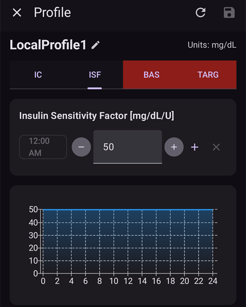

Tryk på »**BAS**«, og indtast dine [basalværdier](#your-aaps-profile-basal-rates):

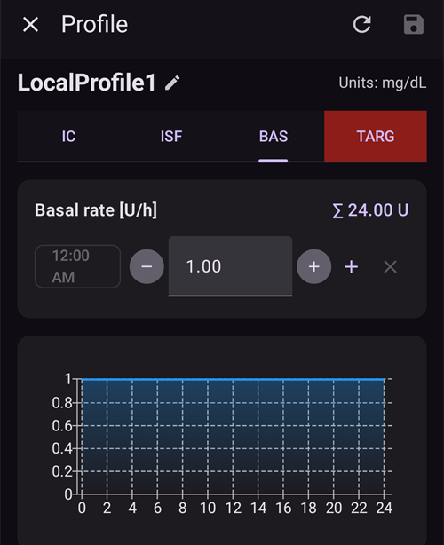

Tryk på »**MÅL**«, og indtast dine målværdier for blodsukker.

Ved åbent loop kan dette mål være et bredere område. Ellers giver **AAPS** dig hele tiden besked om at ændre den midlertidige basalrate eller en anden indstilling, og det kan være udmattende.

Senere, ved lukket loop, vil du normalt kun have én værdi for øvre og nedre grænse. Det gør det lettere for **AAPS** at ramme målet og giver dig en bedre samlet kontrol over din diabetes.

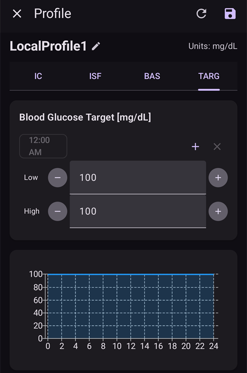

Når alle fire faner er gyldige, bliver **ikonet for at gemme** (øverst til højre) aktivt. Tryk på det for at gemme profilen:

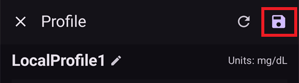

Luk editoren med »**X**« i øverste venstre hjørne. Profiloversigten viser derefter profilens navn, dens samlede daglige basal (∑), enhederne og IC- og ISF-værdierne med deres grafer:

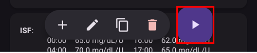

```{admonition} Several defined but only one active profile
:class: note
Du kan have flere profiler oprettet, men kun én aktiv profil kører ad gangen.
```

Tryk på knappen »**▶**« (aktiver) nederst til højre. Skærmen »**Aktiver**« åbner. Da der endnu ikke er nogen insulin i brug, beder den dig først om at vælge den insulin, du bruger, så profilskiftet kan registrere den. Knappen »**Aktiver**« er grå, indtil du har gjort det:


Tryk på »**Vælg insulin**«, og vælg den insulin, du indstillede tidligere. Lad procenten stå på 100 %, og tryk på »**Aktiver**«:


En dialog til profilskift vises. I dette tilfælde skal du lade den stå med de forudindstillede værdier og bekræfte med »**OK**«:

```{admonition} Profile switch dialog
:class: note
Senere lærer du, hvordan du bruger denne generelle dialog i situationer som sygdom eller sport, hvor du skal ændre din profil, så den passer til forholdene.
```


Din profil er nu aktiv. Tryk på »**NÆSTE**« for at gå til næste skærm.

## Insulinpumpe

Nu vælger du din insulinpumpe. Læs dokumentationen for din [insulinpumpe](../Getting-Started/CompatiblePumps.md).

Rul gennem listen, og vælg din pumpe. I dette eksempel bruger vi »**Virtuel pumpe**«. Den er nyttig, mens du stadig lærer og endnu ikke har forbundet en rigtig pumpe:


Mange pumper understøttes — rul ned for at finde din:


Når du vælger en rigtig pumpe, beder **AAPS** dig om at bekræfte, fordi den vil kopiere basalraterne fra din profil til pumpen og overskrive de basalrater, der er gemt i pumpen. Tryk kun på »**OK**«, hvis basalraterne i din **AAPS**-profil er korrekte. Ellers skal du trykke på »**Annuller**« og skifte til pumpen senere:


Hvis den pumpe, du vælger, kommunikerer via Bluetooth, beder **AAPS** om tilladelse til at forbinde til enheder i nærheden, når du har afsluttet guiden (se [Bluetooth-tilladelse](#setup-wizard-bluetooth-permission)).

Hvis du allerede har opsat din profil og ved, hvordan du forbinder din pumpe, kan du godt forbinde den nu. Ellers kan du lade den stå på **Virtuel pumpe** indtil videre — du kan ændre det når som helst. Du kan også forlade opsætningsguiden med pilen i øverste venstre hjørne og lade **AAPS** vise dig nogle blodsukkerværdier først.

Tryk på »**NÆSTE**« for at gå til næste skærm.

## APS-algoritme

Brug OpenAPS SMB-algoritmen som din APS-algoritme. Selvom navnet siger noget andet, er algoritmens SMB-funktion slået fra, indtil du kender AAPS godt og har gennemført de første læringsmål. OpenAPS SMB er nyere og generelt bedre end OpenAPS AMA alligevel.

SMB er slået fra i starten, fordi SMB-funktionen reagerer hurtigere på en stigning i blodsukkeret ved at bruge en Super Micro Bolus i stedet for at hæve basalraten i procent. Fordi din profil normalt ikke er lige så god i starten, som den er efter nogen tids erfaring, er funktionen slået fra i begyndelsen.

```{admonition} Only use the older algorithm **OpenAPS AMA** if you know what you are doing
:class: note
OpenAPS AMA er den mest grundlæggende algoritme, og den understøtter ikke mikroboluser til at rette høje værdier. Der kan være situationer, hvor det er bedre at bruge denne algoritme, men det er ikke anbefalingen.
```

Vælg »**OpenAPS SMB**«, og tryk derefter på »**Indstillinger**« for at se detaljerne:


Den eneste mulighed her er »**Brug dynamisk følsomhed**«. Lad den være slået fra, og ændr ikke noget indtil videre — læs bare teksten.

På grund af de begrænsninger, som **Mål** (læringsmålene) sætter, kan du alligevel ikke bruge hverken »lukket loop« eller »SMB-funktioner« i øjeblikket.

Gå tilbage, og tryk på »**NÆSTE**« for at gå til næste skærm:


## Detektering af følsomhed

Lad »**Følsomhed Oref1**« være valgt som standardplugin for følsomhed:


Hvis du trykker på »**Indstillinger**«, kan du se indstillingerne for absorption. Standardværdierne (_f.eks._ en grænse for absorption på 6 t) er fine indtil videre.


Tryk på »**NÆSTE**« for at gå til næste skærm.

## Start Mål 1

Nu begynder du på læringsmålene — kravene for at få adgang til flere **AAPS**-funktioner.

Tryk på »**Åbn Mål**«:


Her starter vi Mål 1, selvom vores opsætning i øjeblikket ikke er helt klar til at gennemføre dette mål. Men det er begyndelsen.

Tryk på knappen »**Start**« for **Mål 1**:


Læringsmålet udvides og viser de enkelte punkter. Du kan se, at du allerede har gjort nogle fremskridt, mens andre punkter mangler:


Gå tilbage, og tryk derefter på »**FÆRDIG**« for at afslutte opsætningsguiden:


Når du har trykket på »**FÆRDIG**«, kommer du til hovedskærmen i **AAPS**. Et panel med »**Notifikation**« kan åbne med informationsbeskeder, for eksempel om det profilskift, du lige har lavet — tryk på »**Afvis**« under hver besked for at fjerne den.

Hvis du ved et uheld forlader opsætningsguiden på et tidspunkt, kan du enten bare starte guiden igen eller ændre [konfigurationen af dit AAPS-loop](../SettingUpAaps/ChangeAapsConfiguration.md) manuelt.

(setup-wizard-bluetooth-permission)=
## Bluetooth-tilladelse

Hvis du vælger en pumpe, der forbinder via Bluetooth (for eksempel **Omnipod Dash**), minder et banner dig om, at **AAPS** skal have Bluetooth-tilladelse. Du kan trykke på »**Afvis**« indtil videre — tilladelsen gives, når du har afsluttet guiden:


Når opsætningsguiden er afsluttet, viser hovedskærmen i **AAPS** et panel med »**Tilladelser påkrævet**«. De andre tilladelser er allerede givet. Tryk på »**Tillad**« ved siden af »**Bluetooth**«:


Vælg »**Tillad**« (Allow), så **AAPS** kan finde og forbinde til din pumpe:


Hvis dit **AAPS**-loop nu er helt opsat, så gå videre til næste afsnit [»Gennemførelse af læringsmålene«](../SettingUpAaps/CompletingTheObjectives.md).
