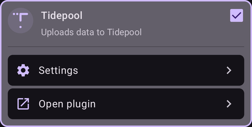
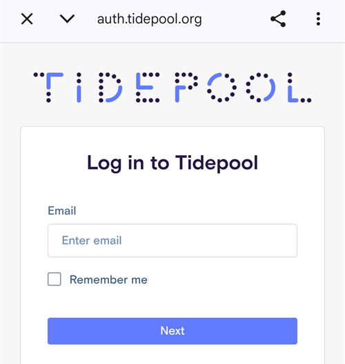
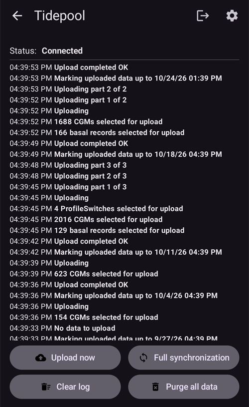
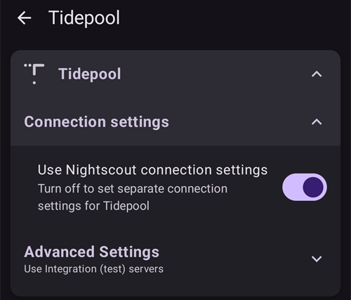
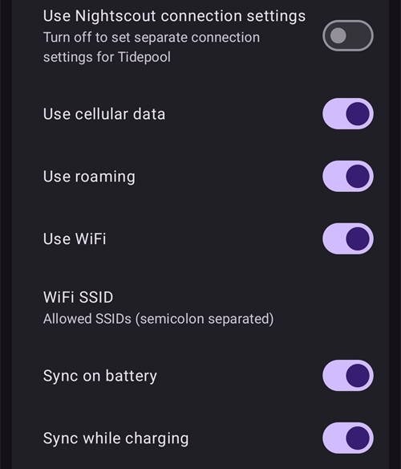
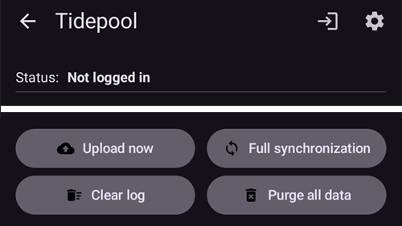

# Tidepool

Tidepool er et værktøj fra en tredjepart, som samler data om BS, insulin og kulhydrater (og de notater, du tilføjer til dine behandlinger). Det kan bruges til at analysere disse data og dele dem med dit behandlerteam. Fra AAPS version 3.2 kan det bruges i stedet for Nightscout til at opfylde en del af læringsmål 1. Det kan også bruges sammen med Nightscout som en alternativ rapporteringsplatform, der passer godt ind i det kliniske arbejde. Det kan være den rette løsning for børn, der bruger AAPS, og som vil have Nightscouts muligheder for fjernovervågning og fjernstyring, men også en rapporteringsplatform, som deres behandlerteam er mere fortroligt med.

Det er vigtigt at forstå, at Tidepool kun er til rapportering. Det er IKKE en app til at følge data i realtid. Hvis du har brug for følgere ud over den primære AAPS-telefon, skal du også sætte Nightscout op.

Bemærk: Organisationen Tidepool har bragt iOS-produktet Loop på markedet med godkendelse fra FDA. Dette arbejde har intet at gøre med deres platform til datarapportering eller med AAPS.

## Trin 1 - Opret en Tidepool-konto

- Gå til [tidepool.org](https://www.tidepool.org/)

- Vælg »Personal Sign Up« eller »Sign Up«

- Opret en e-mailadresse og en adgangskode, og skriv dem ned

- Vælg »Personal Account«, og klik på »Continue«

- Udfyld afsnittet med patientoplysninger, og accepter brugsbetingelserne

- Bekræft din e-mailadresse ved at følge vejledningen i den e-mail, du modtager

## Trin 2 - Forbind AAPS med Tidepool

- Åbn **menuen** (☰) i øverste venstre hjørne af hovedskærmen, og vælg »**Konfiguration**«

- Åbn kategorien »**Kommunikation**«, og aktiver »**Tidepool**«:

- Tryk på »**Åbn plugin**« under Tidepool, og tryk derefter på ikonet **Log ind** (en pil, der går ind ad en dør) i øverste højre hjørne

- Et browservindue åbner på Tidepools login-side. Log ind med den e-mailadresse og adgangskode, du oprettede i trin 1 ovenfor:

- Efter et vellykket login lukker browseren, og Tidepool-skærmen viser status »**Tilsluttet**«; loggen nedenfor viser de data, der bliver uploadet. Hvis login mislykkes, så kontroller, at dine loginoplysninger er korrekte, og at du har bekræftet din e-mailadresse hos Tidepool.

- Åbn »**Indstillinger for forbindelse**« under »**Indstillinger**« for Tidepool-pluginet. Som standard er »**Brug Nightscout-forbindelsesindstillinger**« slået til, så Tidepool uploader under de samme betingelser, som du har sat for Nightscout. Slå den fra, hvis du vil have andre betingelser for Tidepool, f.eks. kun upload til Tidepool via Wi-Fi og under opladning, mens Nightscout også bruger mobildata.

 

Mere hjælp til, hvordan du bruger dine data, når de er uploadet til Tidepool, finder du her: [https://www.tidepool.org/viewing-your-data](https://www.tidepool.org/viewing-your-data)

(tidepool-menu)=
## Knapperne i Tidepool

I øverste højre hjørne af Tidepool-skærmen:

- Ikonet **Log ind** eller **Log af** — forbind til eller afbryd forbindelsen til din Tidepool-konto. Kun ét af dem vises: **Log ind**, når du er logget af, og **Log af**, når du er logget ind. **AAPS** beder dig bekræfte, før du bliver logget af.
- Tandhjulsikonet — indstillingerne for Tidepool.

Knapperne nederst på Tidepool-skærmen:

- »**Upload nu**« — upload nye data med det samme i stedet for at vente på den næste automatiske upload.
- »**Fuld synkronisering**« — upload alle data, der er gemt i **AAPS**, igen.
- »**Slet alle data**« — slet **alle** data, som **AAPS** har uploadet til din Tidepool-konto. Det kan ikke fortrydes. Brug det kun til at fjerne forkerte eller dobbelte data, og kør derefter »**Fuld synkronisering**« for at uploade dine data igen.
- »**Ryd log**« — tøm loggen, der vises på Tidepool-skærmen.

I Tidepool vises de data, som **AAPS** 4 har uploadet, under enhedsnavnet **AAPS**. Se [Hvad er ændret i AAPS v4](#v4changes-tidepool), hvis du har brugt Tidepool med en ældre version. 
