# Overførsel og installation af AAPS på din telefon

I det forrige afsnit, [Byg **AAPS**](../SettingUpAaps/BuildingAaps.md), byggede du **AAPS**-appen (som er en .apk-fil) på en computer.

De næste trin er at **overføre** **AAPS**-APK-filen (og andre apps, du måske har brug for, f.eks. BYODA, xDrip eller en anden CGM-app) til din Android-telefon og derefter **installere** appen (apps). Når **AAPS** er installeret på telefonen, kan du gå videre til [**AAPS-opsætningsguide**](../SettingUpAaps/SetupWizard.md).

Denne side forklarer også [Android-udviklerverificering](#android-developer-verification), en ændring, som Google indfører fra september 2026, og som påvirker installation af apps, du selv har bygget. Siden forklarer også de [gratis installationsmetoder](#android-developer-verification-free-methods), som stadig virker efter ændringen.

```{contents} Table of contents
:depth: 1
:local: true
```

## Installation af AAPS ved at trykke på APK-filen

I dag installerer du **AAPS** ved at overføre APK-filen til din telefon og åbne den (»trykke« på den). Der er flere måder at overføre **AAPS**-APK-filen fra din computer til telefonen på. Her forklarer vi to forskellige måder:

* Mulighed 1 - Brug dit Google Drive (Gdrive)
* Mulighed 2 - Brug et USB-kabel

Bemærk, at overførsel med e-mail kan give problemer og frarådes.

```{admonition} Android developer verification
:class: warning
Google indfører [Android-udviklerverificering](#android-developer-verification) fra september 2026 (først i Brasilien, Indonesien, Singapore og Thailand; i hele verden i 2027). Hvor det håndhæves, er installation af en APK ved at trykke på filen – som beskrevet i begge muligheder nedenfor – blokeret. I så fald skal du bruge en af de [gratis installationsmetoder](#android-developer-verification-free-methods) længere nede på denne side.
```

### Mulighed 1. Brug Google Drive til at overføre filer

Åbn [Google.com](https://www.google.com/) i din webbrowser, og log ind på din Google-konto.

Vælg Drive-appen i Google-menuen øverst til højre.

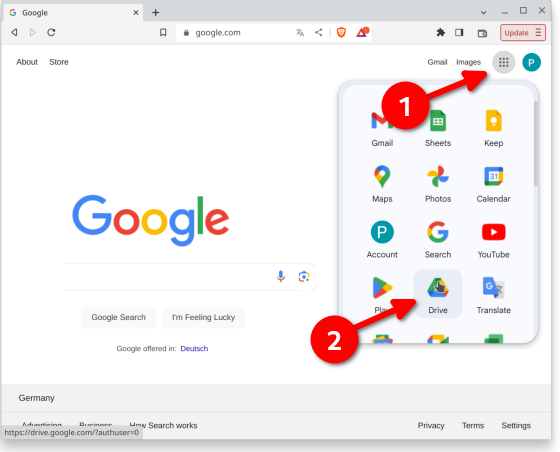

Klik på **New** øverst til venstre (eller højreklik på et tomt område under dine filer og mapper), og vælg **File upload**.

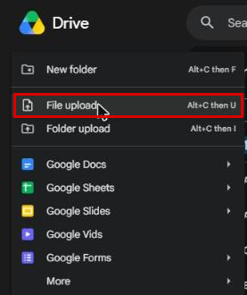

Apk-filen skulle nu være uploadet til Google Drive.

#### Brug Google Drive-appen til at åbne apk-filen og installere den

Skift til din telefon, og start Google Drive-appen. Det er en forudinstalleret app. Du finder den der, hvor de andre Google-apps er, eller ved at søge efter appens navn.

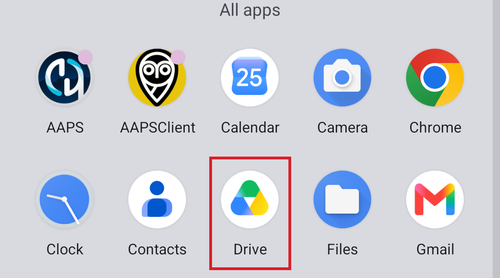

Start installationen af apk-filen ved at trykke på filnavnet i Google Drive-appen på telefonen.

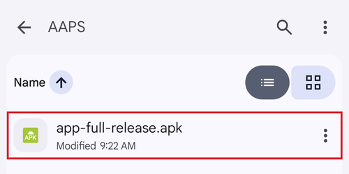

Hvis du får en sikkerhedsmeddelelse om, at du ikke må installere apps fra Google Drive lige nu, så tryk på »Indstillinger«, og tillad det i det korte øjeblik. Slå det fra igen bagefter, fordi det er en sikkerhedsrisiko at have det slået til hele tiden.

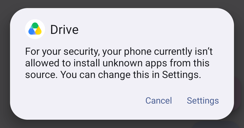

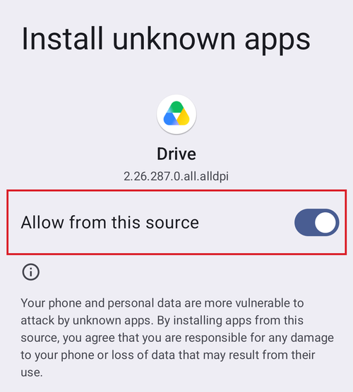

Når installationen er færdig, er du færdig med dette trin.

Du skulle nu kunne se **AAPS**-ikonet og åbne appen.

```{warning}
**VIGTIG SIKKERHEDSMEDDELELSE**
Huskede du at slå installation fra Google Drive fra igen?
```

Fortsæt med [AAPS-opsætningsguide](../SettingUpAaps/SetupWizard.md).

### Mulighed 2. Brug et USB-kabel til at overføre filer

Den anden måde at overføre AAPS-apk-filen på er med et [USB-kabel](https://support.google.com/android/answer/9064445?hl=en).

Overfør filen fra dens placering på din computer til mappen »Downloads« på telefonen.

På din telefon skal du tillade installation fra ukendte kilder. Du kan finde forklaringer på, hvordan du gør det, på internettet (_f.eks._ [her](https://www.expressvpn.com/de/support/vpn-setup/enable-apk-installs-android/) eller [her](https://www.androidcentral.com/unknown-sources)).

Når du har overført filen ved at trække den over, skal du åbne mappen »Downloads« på telefonen og trykke på AAPS-apk-filen:

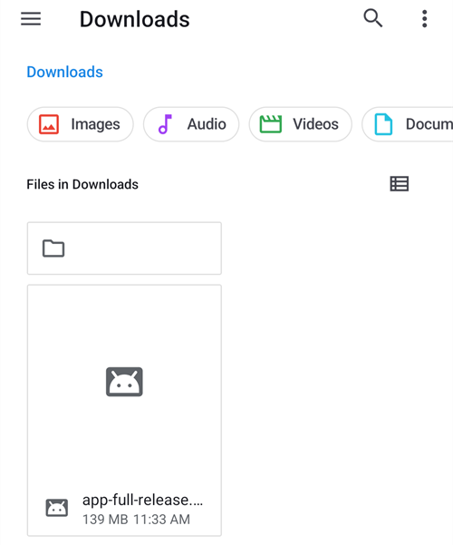

Første gang fortæller Android dig, at telefonen ikke må installere ukendte apps fra denne kilde. Tryk på »**Indstillinger**«:

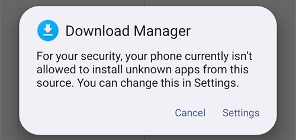

Slå »**Tillad fra denne kilde**« til, og gå derefter tilbage:

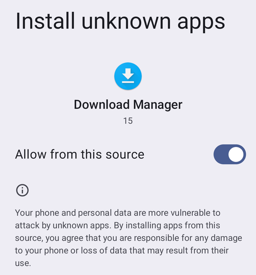

Tryk på apk-filen igen, og vælg »**Installer**«:

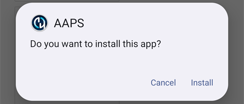

Når installationen er færdig, skal du trykke på »**Åbn**« for at starte **AAPS** eller på »**Udført**« for at åbne den senere:

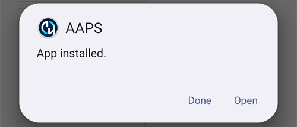

```{warning}
**VIGTIG SIKKERHEDSMEDDELELSE**
Husk at slå »Tillad fra denne kilde« fra igen efter installationen, fordi det er en sikkerhedsrisiko at have det slået til hele tiden.
```

Fortsæt med [AAPS-opsætningsguide](../SettingUpAaps/SetupWizard.md).

(transferring-installing-play-protect-warning)=
## Advarsel fra Google Play Protect

Når du installerer **AAPS**, kan Google Play Protect advare dig om, at appen er usikker, er bygget til en ældre version af Android og ikke har den nyeste beskyttelse af privatlivet.

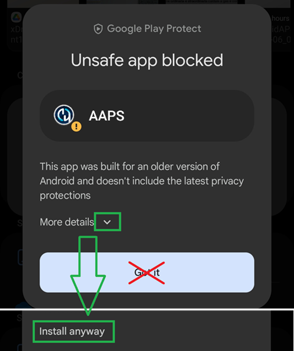

Det er normalt for en app, du selv har bygget. Tryk på **Flere detaljer** (More details) og derefter på **Installer alligevel** (Install anyway).

Hvis installationen bliver **blokeret** med en meddelelse om en ikke-verificeret udvikler (og ikke kun en advarsel), så se [Android-udviklerverificering](#android-developer-verification) nedenfor.

(android-developer-verification)=

## Android-udviklerverificering

Google indfører **Android-udviklerverificering**: På de fleste Android-telefoner kan apps kun installeres, hvis de er registreret hos Google af en verificeret udvikler. Det gælder også apps, der installeres fra en APK-fil (»sideloading«) – og det er sådan, du installerer den **AAPS**-app, du selv har bygget.

### Hvad ændrer sig

Når du installerer **AAPS** på en telefon med Google-tjenester (en »certificeret« Android-enhed – næsten alle telefoner, der sælges med Play Butik), tjekker Android, om appen kommer fra en udvikler, der er registreret hos Google. Hvis ikke, bliver den normale installation ved at trykke på APK-filen blokeret.

**Kontrollen sker, når en app installeres eller opdateres.** Den fjerner ikke apps, der allerede er installeret og kører.

Google indfører det gradvist:

| Hvornår            | Hvad sker der                                                                                                                                           |
| ------------------ | ------------------------------------------------------------------------------------------------------------------------------------------------------- |
| August 2026        | Gratis udviklerkonti til »begrænset distribution« er åbne i hele verden, og det »avancerede forløb« (advanced flow) begynder at komme ud på telefonerne |
| 30. september 2026 | Verificering håndhæves i **Brasilien, Indonesien, Singapore og Thailand** for apps, der installeres fra Google Play og nogle få andre appbutikker       |
| 2027               | Håndhævelsen udvides til **resten af verden** og til **alle installationer**, også APK-filer                                                            |

Google offentliggør detaljerne på siderne om [Android developer verification](https://developer.android.com/developer-verification), herunder en [FAQ](https://developer.android.com/developer-verification/guides/faq). Google kan stadig ændre datoer og detaljer. Denne side bliver opdateret, efterhånden som ændringen bliver indført.

### Påvirker det mig?

- **Det påvirker slet ikke, hvordan du bygger AAPS.** [Build i browseren](#browser-build), [build med Android Studio](ComputerBuild.md) og [build med kommandolinjen](CLIBuild.md) virker præcis som før, og dit keystore ændrer sig ikke.
- **Din nuværende AAPS kører videre.** Verificering tjekkes kun, når en app installeres eller opdateres.
- **Hvis du bor i Brasilien, Indonesien, Singapore eller Thailand:** Fra 30. september 2026 håndhæves verificering for apps, der installeres fra Google Play og nogle få andre appbutikker. Google oplyser, at direkte installation af en APK-fil ikke er omfattet af dette første trin, så **AAPS** burde stadig kunne installeres som normalt. Forbered alligevel en af de [gratis installationsmetoder](#android-developer-verification-free-methods) nedenfor nu, så du ikke bliver overrasket, hvis det ændrer sig.
- **Hvis du bor et andet sted:** Der ændrer sig intet for dig før 2027, og det er et rimeligt valg ikke at gøre noget lige nu. Men sæt en af de [gratis installationsmetoder](#android-developer-verification-free-methods) nedenfor op, mens alt virker: Det er det forkerte tidspunkt at opdage blokeringen den dag, hvor en opdatering bliver afvist, og du har ventetiden på 24 timer i [det avancerede forløb](#android-developer-verification-advanced-flow) foran dig.
- **Gamle telefoner:** Verificering gælder for telefoner med Android 7 eller nyere, og det vil sige alle telefoner, der kan køre **AAPS**.

(android-developer-verification-free-methods)=

## Gratis måder at installere AAPS på

Du behøver **ikke** at betale Google noget for at blive ved med at bruge **AAPS**. Der er flere gratis metoder. Vælg den, der passer til din situation.

```{admonition} Which method should I use?
:class: tip
- Du har en **computer** (uanset hvordan du byggede **AAPS**): Brug [ADB](#android-developer-verification-adb) eller, hvis du helst vil undgå kommandolinjen, [webinstallationsprogrammet](#android-developer-verification-web). Begge er undtaget fra verificering, har ingen begrænsninger og kræver ingen Google-konto.
- Du har **slet ingen computer**: Brug [det avancerede forløb](#android-developer-verification-advanced-flow) på din telefon.
- Du vil hellere registrere dig hos Google, så den normale installation, hvor du »trykker på APK-filen«, bliver ved med at virke: Der findes en [gratis konto til begrænset distribution](#android-developer-verification-limited-account), men den er ikke testet med **AAPS**.
```

(android-developer-verification-adb)=

### Mulighed 1: Installer med ADB (kræver en computer)

ADB (Android Debug Bridge) er Googles officielle værktøj til at installere apps fra en computer på en telefon med et USB-kabel. Google har bekræftet, at **apps, der installeres med ADB, ikke kræver verificering** – der er ingen ventetid, ingen grænse for antal enheder og ingen registrering.

Forberedelse (kun én gang):

1. Slå de skjulte udviklerindstillinger til på din telefon: Gå til **Indstillinger** > **Om telefonen** (på nogle telefoner **Softwareoplysninger**), og tryk syv gange på **Buildnummer**, indtil telefonen bekræfter, at du er udvikler.
1. Gå tilbage til hovedsiden i **Indstillinger**, åbn det nye punkt **Udviklerindstillinger**, og slå **USB-fejlretning** til.
1. Sørg for, at ADB findes på din computer:
   - Hvis du bruger **Android Studio**, er ADB allerede installeret sammen med det.
   - Ellers skal du downloade Googles gratis [SDK Platform Tools](https://developer.android.com/tools/releases/platform-tools) og pakke mappen ud. Der skal ikke installeres noget; ADB er programmet `adb` i den mappe.

Installation (og senere opdatering) af **AAPS**:

1. Forbind telefonen til computeren med et USB-kabel. Du behøver ikke at overføre APK-filen til telefonen først: ADB sender den direkte fra computeren.
1. Accepter spørgsmålet **Vil du tillade USB-fejlretning?** på telefonen (kun første gang).
1. Åbn en terminal (kommandoprompt) på computeren i den mappe, der indeholder ADB og **AAPS**-APK-filen, og kør:

   ```
   adb install -r app-full-release.apk
   ```

   Erstat `app-full-release.apk` med det rigtige navn på din APK-fil. Valget `-r` opdaterer en **AAPS**, der allerede er installeret, og beholder alle dens data og indstillinger.

1. Vent, indtil der står `Success`. **AAPS** er nu installeret på din telefon.

Den samme kommando bruges til alle fremtidige opdateringer. [Siderne om Wear OS](../WearOS/WearOsSmartwatch.md) bruger allerede ADB på samme måde til at installere appen på uret.

Hvis du helst vil undgå et kabel: På Android 11 og nyere kan **Trådløs fejlretning** (også under **Udviklerindstillinger**) gøre det samme via Wi-Fi, efter en parring én gang med en kode, der vises på telefonen.

(android-developer-verification-web)=

### Mulighed 2: Installer fra en webside (computer, ingen kommandolinje)

Hvis kommandolinjen ikke er noget for dig, kan en webside gøre præcis det samme som ADB, direkte fra din browser. Fordi den taler med telefonen gennem den samme mekanisme som ADB, har den **den samme undtagelse fra verificering** – men der er intet at downloade, ingen mappe at pakke ud og ingen kommando at skrive.

Det er den nemmeste vej, hvis du har brugt [build i browseren](#browser-build) og aldrig har åbnet en kommandolinje.

1. Slå **USB-fejlretning** til på telefonen (trin 1 og 2 i [ADB-metoden](#android-developer-verification-adb) ovenfor – kun én gang).
1. Åbn **[Webinstallationsprogram til AAPS](#web-installer)** i din browser.
1. Forbind telefonen med et USB-kabel, og følg vejledningen på siden: forbind, vælg din APK-fil, og installer.

Tre ting, du skal vide:

- Det virker kun i **Chrome, Edge eller Opera**. Firefox og Safari kan ikke tale med USB-enheder.
- Kun ét program ad gangen kan bruge telefonens ADB-forbindelse, så **luk Android Studio** (eller andet, der bruger ADB), før du forbinder.
- En webside, der er forbundet på denne måde, får fuld kontrol over din telefon. **Brug kun adressen ovenfor** fra **AAPS**-dokumentationen – aldrig en installationsside, du har fundet via en søgemaskine. **AAPS**-webinstallationsprogrammet kører helt i din browser: Din APK-fil bliver ikke uploadet nogen steder.

```{admonition} No computer? A second phone works too
:class: tip
Webinstallationsprogrammet virker også fra **Chrome på en anden Android-telefon** med et USB-C til USB-C-kabel – så en forælder kan installere **AAPS** på et barns telefon, selv om der ikke er en computer i huset.
```

(android-developer-verification-advanced-flow)=

### Mulighed 3: Det »avancerede forløb« på din telefon (kræver ingen computer)

Google tilbyder en nødudgang til erfarne brugere, der forstår risikoen ved at installere ikke-verificerede apps. Den hedder det **avancerede forløb** (advanced flow). Google begyndte at sende det ud til telefonerne i august 2026, før håndhævelsen starter, så du kan sætte det op nu. Det er en opsætning, du laver én gang på selve telefonen, og den **tager 24 timer**:

1. Slå de skjulte udviklerindstillinger til (se trin 1 i ADB-metoden ovenfor), og åbn derefter **Indstillinger** > **Udviklerindstillinger** > **Apps fra ikke-verificerede udviklere** (Apps from unverified developers).
1. Slå **Tillad apps fra ikke-verificerede udviklere** (Allow apps from unverified developers) til. Telefonen beder om din skærmlås for at bekræfte, at det er dig.
1. Telefonen spørger, om nogen beder dig om at slå denne indstilling til, og forklarer, at banker, myndigheder eller politiet aldrig vil bede dig om det. Læs advarslen, og bekræft, at ingen presser dig eller guider dig (det er en beskyttelse mod svindlere).
1. **Genstart din telefon.** Det starter en **ventetid på 24 timer** (kun én gang).
1. Efter 24 timer skal du gå tilbage til **Indstillinger** > **Udviklerindstillinger** > **Apps fra ikke-verificerede udviklere** for at gøre opsætningen færdig.
1. Vælg, om ikke-verificerede apps skal tillades i **7 dage** eller **uden tidsbegrænsning** (indefinitely). Vælg **uden tidsbegrænsning** for **AAPS**, ellers bliver din næste opdatering blokeret, når de 7 dage er gået.

Efter denne opsætning virker installation og opdatering af **AAPS**-APK'en som i dag, med én ekstra advarsel om, at appen kommer fra en ikke-verificeret udvikler – tryk på **Installer alligevel**.

Godt at vide:

- Du kan slå **Udviklerindstillinger** fra igen bagefter: Det avancerede forløb forbliver slået til. Google giver heller ikke apps (f.eks. bankapps) nogen mulighed for at se, at det avancerede forløb er slået til.
- Hvis du slår det avancerede forløb fra, bliver installation **eller opdatering** af **AAPS** blokeret igen (din installerede **AAPS** kører videre). Du har 10 minutter til at slå det til igen; derefter starter ventetiden på 24 timer forfra.
- Hvis du ændrer telefonens ur, bliver ventetiden ikke kortere, og ADB kan ikke springe den over.
- Google oplyser, at dit valg følger din Google-konto til dine andre enheder, så en ny telefon burde ikke betyde endnu en ventetid på 24 timer.
- Hvis du ikke kan finde **Apps fra ikke-verificerede udviklere** i udviklerindstillingerne, har din telefon ikke fået funktionen endnu. Den leveres af en systemkomponent, der hedder **Android Developer Verifier**, som Google gradvist sender ud via Play Butik. Du kan hjælpe den på vej ved at åbne **Android Developer Verifier** i Play Butik.

```{note}
Google beskriver dette som en første version og kan stadig ændre skærmene og trinnene. Dette afsnit bliver opdateret med skærmbilleder, når den endelige version er tilgængelig.
```

(android-developer-verification-limited-account)=

### Mulighed 4: Registrer dig hos Google (gratis konto til begrænset distribution)

Google tilbyder en **gratis** type udviklerkonto til hobbybrug og personlig brug, kaldet en **konto til begrænset distribution** (limited distribution account). Den har været åben for alle siden august 2026:

- **Intet officielt ID** og **intet gebyr** (i modsætning til den betalte udviklerkonto, som ikke er nødvendig til personlig brug af **AAPS**). Du skal dog have en Google-konto med totrinsbekræftelse, en Google-betalingsprofil med dit juridiske navn og din adresse og en e-mailadresse til kontakt.
- Du registrerer appens pakkenavn i Googles Android Developer Console og godkender de telefoner, den må installeres på, op til **20 enheder**, via et håndtryk med en QR-kode eller et link mellem telefonen og konsollen.
- Når registreringen er gjort, virker den normale installation (tryk på APK-filen) igen på de godkendte telefoner, uden ADB og uden det avancerede forløb.
- En konto til begrænset distribution kan senere opgraderes til en fuld konto, men ikke omvendt.

```{warning}
Google har ikke forklaret, hvordan registrering virker, når mange personer bygger den samme open source-app: Alle selvbyggede **AAPS** bruger det samme pakkenavn (`info.nightscout.androidaps`) med forskellige signeringsnøgler, og Googles FAQ siger, at et pakkenavn, som andre allerede bruger, ikke bare kan overtages og kræver en ekstra gennemgang. Det er ukendt, hvad resultatet af sådan en gennemgang bliver, og den betalte udviklerkonto (25 $ og et officielt ID) hjælper ikke her: Betaling fjerner kun grænsen på 20 enheder, ikke gennemgangen af pakkenavnet.

Derfor kan der endnu ikke skrives en trin-for-trin-vejledning. Dette afsnit bliver gjort færdigt, når registreringen er testet med **AAPS**. Indtil da er ADB, webinstallationsprogrammet og det avancerede forløb ovenfor pålidelige alternativer.
```

## Hvad ændrer sig ikke

- At bygge **AAPS** selv med en af de tre [byggemetoder](BuildingAaps.md).
- Din GitHub-konto, dit build-repository (AAPS Builder) eller din fork og dit keystore.
- Din installerede **AAPS**-app, dine indstillinger og dine [læringsmål](CompletingTheObjectives.md).
- Telefoner uden Google-tjenester og [installationer med ADB](#android-developer-verification-adb) generelt.

## Hvor kan du få hjælp

1. **Læs** Googles [FAQ om udviklerverificering](https://developer.android.com/developer-verification/guides/faq), hvis du har spørgsmål om selve verificeringen.
2. **Spørg** i kanalen *#AAPS* på [Discord](https://discord.gg/4fQUWHZ4Mw) eller i en af de andre [kanaler i fællesskabet](../GettingHelp/WhereCanIGetHelp.md), hvis en installation bliver blokeret.
3. Når du beder om hjælp, så skriv din telefons mærke og model, Android-version, dit land og den præcise meddelelse, der vises, når installationen fejler.

```{toctree}
:hidden:

Webinstallationsprogram til AAPS <WebInstaller.md>
```
