# Din AAPS-profil

Din **AAPS-profil** er et sæt af fire vigtige parametre, som bestemmer, hvordan **AAPS** skal levere insulin ud fra dine glukoseværdier fra sensoren. Dette er de vigtigste parametre, som **AAPS** bygger på. Når du kommer gennem **Mål**, låser du flere parametre op, som du kan ændre (f.eks. SMB-indstillinger), men disse funktioner virker kun godt, hvis din underliggende **profil** er rigtig. **Profilen** indeholder:
* [glukosemål](#profile-glucose-targets),
* [basalrater](#your-aaps-profile-basal-rates) (BR),
* [insulinfølsomhedsfaktorer](#your-aaps-profile-insulin-sensitivity-factor) (ISF) og
* [insulin til kulhydrat-forhold](#your-aaps-profile-insulin-to-carbs-ratio) (IC eller ICR).

```{admonition} Where did DIA go?
:class: note
**Varigheden af insulinvirkning (DIA)** er ikke længere en del af din **profil**. Den sættes i stedet for hver insulin – se [Administrer → Insulinindstillinger](#Config-Builder-insulin-dia).
```

Som en del af arbejdet med **AAPS** bør du hele tiden vurdere og kontrollere, om indstillingerne i din **profil** er præcise. Det anbefales at tage indstillingerne i den rækkefølge, de vises her. Prøv at få én indstilling rigtig, før du ændrer en anden. Arbejd i små trin i stedet for at lave store ændringer på én gang. Husk at aktivere den nye profil efter hver ændring. Lav jævnligt en [sikkerhedskopi af dine indstillinger i **profilen**](#YourAapsProfile_Profile-backup) ved at eksportere dine indstillinger.

Indstillingerne i din **profil** påvirker hinanden – du kan have »forkerte« indstillinger, som virker godt sammen i nogle situationer, men ikke i andre. For eksempel hvis en for høj basal tilfældigvis er på samme tid som en for høj **CR**. Det betyder, at du skal se på hver indstilling for sig og kontrollere, at de virker godt sammen i mange forskellige situationer.

Du kan bruge [Autotune](https://autotuneweb.azurewebsites.net/) som hjælp til at tænke over det, men du bør ikke følge det blindt: det virker måske ikke godt for dig eller i alle situationer.

```{admonition} Your diabetes may vary
:class: note
**Profiler** varierer meget fra person til person.

For basalrater (BR), insulinfølsomhedsfaktorer (ISF) og insulin til kulhydrat-forhold (IC eller ICR) varierer de absolutte værdier og tendenser i insulinbehovet meget fra person til person, afhængigt af din biologi, dit køn, din alder, din form osv. og af kortvarige faktorer som sygdom og nylig motion. Hvis du vil have mere vejledning om dette, er bogen [»Bright Spots and Landmines«](https://diatribe.org/bright-spots-and-landmines/) af Adam Brown en fremragende bog at læse.

```

De fire sidste parametre (glukosemål, basalrater, insulinfølsomhedsfaktorer og insulin til kulhydrat-forhold) kan sættes til forskellige værdier over 24 timer og om nødvendigt ændres hver time.


Nedenfor ses skærmbilleder fra **AAPS** af en _eksempel_profil. Bemærk, at eksempelprofilen nedenfor har mange tidspunkter. Når du starter med **AAPS**, er din profil sandsynligvis meget enklere.

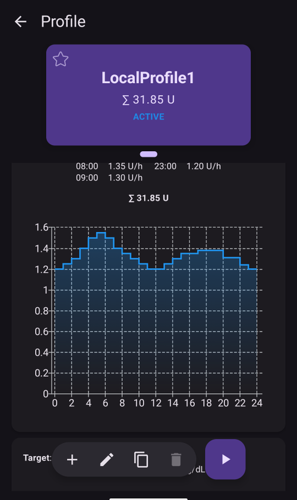

(profile-glucose-targets)=
## Glukosemål

### Beskrivelse

Dit **BS-mål** er en central værdi, og alle beregninger i **AAPS** er baseret på det. Det er noget andet end det målområde, som du normalt prøver at holde dine blodsukkerværdier inden for. Målet bruges i beregningerne i **AAPS**: hvis **AAPS** forudsiger, at dit **BS** vil ende uden for målområdet, så handler den for at få dig tilbage i området.

Målene kan sættes inden for disse grænser:

|          | _Nedre_ målværdi          | _Øvre_ målværdi             |
| -------- | ------------------------- | --------------------------- |
| Minimum  | 4,4 mmol/l eller 80 mg/dl | 5 mmol/l eller 90 mg/dl     |
| Maksimum | 10 mmol/l eller 180 mg/dl | 11,1 mmol/l eller 200 mg/dl |

### Virkning

Hvis målet i din **profil** er meget bredt (f.eks. 3 mmol/l [50 mg/dl] eller mere), vil du ofte kun se lidt handling fra **AAPS**. Det skyldes, at **BS**-niveauet forventes at ligge et sted i det brede område, og derfor vil **AAPS** sjældent sætte en midlertidig basalrate.

### Sådan indstiller du det

**Figuren nedenfor** viser et eksempel på, hvordan målet kan sættes i en **AAPS**-profil.

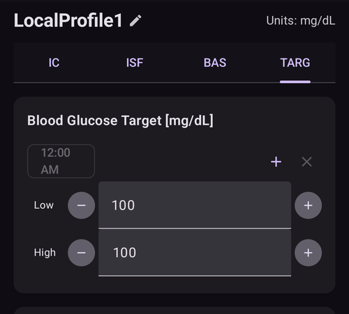

**BS**-mål sættes efter dine personlige ønsker og behov. Hvis du f.eks. er bekymret for hypoer om natten, kan du sætte dit mål lidt højere på 117 mg/dl (6,5 mmol/l) fra kl. 21 til 7. Hvis du vil være sikker på at have rigeligt insulin om bord (IOB) om morgenen, før du tager bolus til morgenmad, kan du sætte et lavere mål på 81 mg/dl (4,5 mmol/l) fra kl. 7 til 8.

I [åbent loop](#KeyAapsFeatures-OpenLoop), især når du går gennem [de første læringsmål](../SettingUpAaps/CompletingTheObjectives.md), kan et bredt målområde være en god løsning, mens du lærer, hvordan **AAPS** opfører sig, og justerer din **profil**.<br/> I [lukket loop](#KeyAapsFeatures-ClosedLoop) (fra **[Mål 6](#objectives-objective6)**) anbefales det at gøre området mindre, indtil du har ét enkelt mål for hvert tidspunkt af dagen (_nedre_ målværdi = _øvre_ målværdi), så **AAPS** reagerer hurtigt på udsving i **BS**.

(your-aaps-profile-basal-rates)=

## Basalrater

### Beskrivelse

Din basalrate af insulin (enheder/time) giver baggrundsinsulin, som holder dit glukoseniveau stabilt, når du ikke spiser eller motionerer.

Insulinpumpen leverer små mængder hurtigtvirkende insulin med få minutters mellemrum for at forhindre leveren i at frigive for meget glukose og for at flytte glukose ind i kroppens celler. Basalinsulin udgør normalt mellem 40 og 50% af din samlede daglige dosis (TDD), afhængigt af din kost, og følger typisk en døgnrytme med én top og én dal i insulinbehovet over 24 timer. Kapitel 6 i [»Think like a Pancreas«](https://amzn.eu/d/iVU0RGe) af Gary Scheiner er meget nyttigt, hvis du vil vide mere.

De fleste diabetesundervisere (og personer med type 1-diabetes!) er enige om, at du bør få dine basalrater rigtige, før du prøver at optimere din ISF og ICR.

### Virkning

Med præcise basalrater kan du vågne op i målområdet og springe måltider over – eller spise – tidligere eller senere på dagen uden at blive for høj eller for lav.

For høj basalrate kan give lavt BS. Og omvendt.

**AAPS** bruger standardbasalraten som udgangspunkt (baseline). Hvis basalraten er for høj, vil en »nul-basal« tælle som en større negativ IOB, end den burde. Det får **AAPS** til at give flere efterfølgende korrektioner, end den burde, for til sidst at bringe IOB op på nul.

En for høj basalrate giver altså lavt **BS** både med standardraten og også nogle timer senere, når **AAPS** korrigerer mod målet.

Omvendt kan en for lav basalrate give højt BS, og niveauet kommer ikke ned til målet.

### Sådan indstiller du det

**Figuren nedenfor** viser et eksempel på, hvordan basalraterne kan sættes i en **AAPS**-profil.

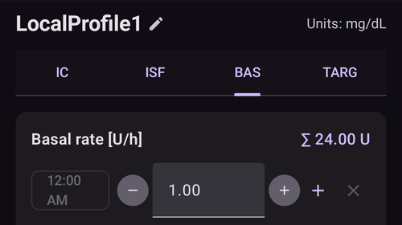

Du finder de rigtige basalrater ved at prøve dig frem, og det bør ske i samråd med dit diabetesteam.

Der findes metoder til at teste basal, hvor man normalt ser på sine basalrater og sit insulinbehov under en <u>periodevis</u> faste over 24 timer. Selv om du skal teste dine basalrater for hele døgnet, anbefales det ikke at faste i 24 timer i træk. Det skyldes, at kroppen sætter mekanismer i gang, f.eks. hormoner, for at kompensere. En anbefalet måde er at faste i 8 timer på 3 forskellige dage.

Den anbefalede metode er at suspendere loopet (for en sikkerheds skyld kan du sætte AAPS til [**LGS**](#KeyAapsFeatures-LGS) for at undgå lave værdier, som når du gennemfører [mål 6](#objectives-objective6)), så den går tilbage til din standardbasalrate. Se, hvordan dit **BS** ændrer sig: hvis det falder, er basalraten for høj. Og omvendt.<br/> En anden metode (kan være sværere) er at lade loopet køre og se, hvordan **IOB** ændrer sig. Hvis **IOB** er negativ, er din basalrate for høj. Og omvendt. Vær opmærksom på, at denne metode er afhængig af **ISF** til at korrigere **BS**, og derfor skal andre værdier også være sat rimeligt godt, for at den kan lykkes.<br/> En anden måde at justere dine basalrater på er at se på loopets handlinger om natten, når alle COB er optaget. Denne metode er især nyttig for børn, når det er svært at faste, eller når insulinbehovet ofte ændrer sig. [Dr. Saleh Adi fra Tidepool](https://www.youtube.com/watch?v=-fpWnGRhLSo) viser nyttige måder at analysere BS-kurver om natten på, så du kan optimere dine basalrater.

Se [her](../GettingHelp/ProfileTuning.md), hvordan du justerer din basalprofil ved at analysere mønstre i lukket loop.

Når du handler ud fra resultatet af din basaltest, skal ændringer i **profilen** ske 1 til 2 timer (afhængigt af din insulintype) før stigningen/faldet. Gentag testen efter behov, indtil du er tryg ved dine indstillinger af **basalrater**.

(your-aaps-profile-basal-not-compatible)=
#### Besked: »Basalraten er ikke kompatibel med den aktuelle pumpe«

Hver pumpe har grænser: en laveste og en højeste basalrate, den kan levere, og for nogle pumper (f.eks. Dana, Accu-Chek Combo, Medtronic og Diaconn G8) basalrater, der kun kan ændres på hele timer. **AAPS** kontrollerer din profil mod den pumpe, du bruger, **efter** at den procent, du vælger, er lagt på.

Hvis en basalrate er uden for disse grænser, viser skærmen **Aktiver** denne besked, og knappen **Aktiver** forbliver grå:

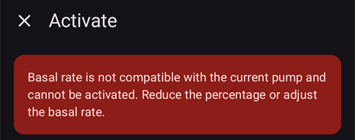

Med f.eks. en basalrate på 0,10 E/t om natten og en profilprocent på 35% skulle **AAPS** levere 0,035 E/t. Det er mindre, end en Dana-pumpe kan levere (0,04 E/t).

Løs det ved enten at:

* vælge en anden procent: en **højere**, hvis en basalrate bliver for lav, en **lavere**, hvis en basalrate bliver for høj, eller
* [redigere profilen](#your-aaps-profile-create-and-edit-profiles) og ændre basalraten.

Profileditoren lader dig kun starte basalrater på en hel time. En basalrate, der starter f.eks. kl. 06:30, kan kun komme fra en ældre profil, f.eks. når du skifter til en pumpe, som ikke understøtter det.

(your-aaps-profile-insulin-sensitivity-factor)=

## Insulinfølsomhedsfaktor (ISF)

### Beskrivelse

Insulinfølsomhedsfaktoren (nogle gange kaldet korrektionsfaktor) er et mål for, hvor meget dit blodsukker falder med 1 enhed insulin.

**I mg/dl:** Hvis du har en **ISF** på 40, vil hver enhed insulin sænke dit blodsukker med ca. 40 mg/dl (f.eks. vil dit blodsukker falde fra 140 mg/dl til 100 mg/dl).

**I mmol/l:** Hvis du har en **ISF** på 1,5, vil hver enhed insulin sænke dit blodsukker med ca. 1,5 mmol/l (f.eks. fra 8 mmol/l til 6,5 mmol/l).

Ud fra disse eksempler kan du se, at jo _mindre_ værdien af **ISF** er, jo mindre følsom er du over for insulin. Hvis du altså sænker din ISF fra 40 til 35 (mg/dl) eller fra 1,5 til 1,3 (mmol/l), kaldes det ofte at gøre din **ISF** stærkere. Omvendt, hvis du øger værdien af **ISF** fra 40 til 45 (mg/dl) eller fra 1,5 til 1,8 (mmol/l), gør du din **ISF** svagere.

### Virkning

En **lavere / stærkere ISF** (f.eks. 40 i stedet for 50) betyder, at insulin sænker dit **BS** mindre pr. enhed. Det giver en mere aggressiv / stærkere korrektion fra loopet med **mere insulin**. Hvis din **ISF** er for stærk (lille værdi), kan det give lavt **BS**.

En **højere / svagere ISF** (f.eks. 45 i stedet for 35) betyder, at insulin sænker dit **BS** mere pr. enhed. Det giver en mindre aggressiv / svagere korrektion fra loopet med **mindre insulin**. Hvis din **ISF** er for svag (stor værdi), kan det give højt **BS**.

**Eksempel:**
* **BS** er 190 mg/dl (10,5 mmol/l), og målet er 100 mg/dl (5,6 mmol/l).
* Du vil altså have en korrektion på `190 - 100 = 90 mg/dL` eller `10.5 - 5.6 = 4.9 mmol/L`
* Hvis `ISF = 30` -> `90 / 30 = 3` eller `ISF = 1.63` -> `4.9 / 1.63 = 3`: 3 enheder insulin
* Hvis `ISF = 45` -> `90 / 45 = 2` eller `ISF = 2.45` -> `4.9 / 2.45 = 2`: 2 enheder insulin

En **ISF**, der er for lav (og derfor mere aggressiv, hvilket ikke er usædvanligt), kan give »overkorrektioner«, fordi **AAPS** beregner, at brugeren skal bruge mere insulin til at korrigere et højt **BS**, end der faktisk er brug for. Det kan give et BS, der går op og ned som en »rutsjebane« (især ved faste), som vist på billedet nedenfor. I denne situation skal værdien af **ISF** øges, så **AAPS** bliver mindre aggressiv. Så giver **AAPS** mindre korrektionsdoser og undgår at overkorrigere et højt **BS**, så det ender som et lavt **BS**.

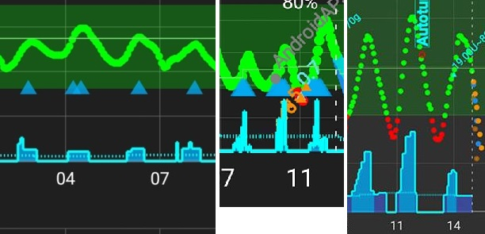

Omvendt kan en **ISF**, der er sat for højt, give underkorrektioner, så dit **BS** bliver over målet – det ses især om natten.

### Sådan indstiller du det

Se **figuren nedenfor** for et eksempel på, hvordan ISF-værdier kan sættes i en **AAPS**-profil.

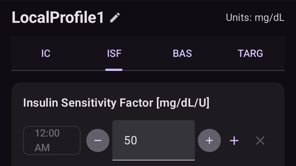

Et simpelt udgangspunkt for at finde din ISF om dagen er at basere den på din samlede daglige dosis (TDD) med 1700 (94)-reglen. Flere detaljer findes i kapitel 7 i [»Think like a Pancreas«](https://amzn.eu/d/iVU0RGe) af Gary Scheiner.

| 1700 (hvis du måler i mg/dl) eller 94 (mmol/l) / TDD = ca. ISF.<br/><br/>Eksempel: TDD = 40 IE<br/>Ca. ISF (mg/dl) = 1700/40 = 43<br/>Ca. ISF (mmol/l) = 94/40 = 2,4 |
| -------------------------------------------------------------------------------------------------------------------------------------------------------------------------------------------- |
|                                                                                                                                                                                              |

Hvis dine basalrater er rigtige, kan du teste dette ved at suspendere loopet, kontrollere at **IOB** er nul og tage et par druesukkertabletter for at komme op på et stabilt »højt« niveau.

Tag derefter en anslået mængde insulin (efter den nuværende 1/ISF) for at nå dit BS-mål.

Vær forsigtig, da den ret ofte er sat for lavt. For lav betyder, at 1 IE får BS til at falde hurtigere end forventet.

(your-aaps-profile-insulin-to-carbs-ratio)=

## Insulin til kulhydrat-forhold (ICR)

### Beskrivelse

**ICR** er et mål for, hvor mange gram kulhydrat der dækkes af én enhed insulin.

Nogle bruger også **I:C** som forkortelse i stedet for **ICR** eller taler om kulhydratforhold: **CR**.

For eksempel betyder et insulin til kulhydrat-forhold på 1 til 10 (1:10), at du tager 1 IE insulin for hver 10 gram kulhydrater, du spiser. Et måltid med 25 g kulhydrater kræver 2,5 IE insulin.

Hvis din **ICR** er svagere (højere værdi), måske 1:20, skal du kun bruge 0,5 IE insulin til at dække 10 g kulhydrater. Et måltid med 25 g kulhydrater kræver 25/20 = 1,25 IE insulin.

Det er almindeligt at have forskellig **ICR** på forskellige tidspunkter af dagen på grund af hormonniveauer og fysisk aktivitet. Mange oplever, at deres **ICR** er lavest/stærkest omkring morgenmad, fordi de ofte er mere insulinresistente på det tidspunkt. En voksen brugers **ICR** kan f.eks. være 1:8 til morgenmad, 1:10 til frokost og 1:10 til aftensmad, men disse mønstre gælder ikke for alle, og nogle er mere insulinresistente ved aftensmaden og har brug for en stærkere/mindre **ICR** der.

> **BEMÆRK:**
> 
> I nogle europæiske lande blev brødenheder brugt til at bestemme, hvor meget insulin der skal bruges til mad. I starten var 1 brødenhed lig med 12 g kulhydrater, senere skiftede nogle til 10 g kulhydrater.
> 
> I denne model var mængden af kulhydrater fast, og mængden af insulin varierede. (»Hvor meget insulin skal der til for at dække én brødenhed?«)
> 
> Når man bruger **ICR**, er mængden af insulin fast, og mængden af kulhydrater varierer. (»Hvor mange g kulhydrater kan dækkes af én enhed insulin?«)
> 
> Eksempel:
> 
> Brødenhedsfaktor (BE = 12 g kulhydrater): 2,4 IE/BE -> Du skal bruge 2,4 enheder insulin, når du spiser én brødenhed.
> 
> Tilsvarende **ICR**: 12 g / 2,4 IE = 5,0 g/E -> 5,0 g kulhydrater kan dækkes af én enhed insulin.
> 
> BE-faktor 2,4 IE / 12 g   ===>   IC = 12 g / 2,4 IE = 5,0 g/E
> 
> Omregningstabeller findes online, f.eks. [her](https://www.mylife-diabetescare.com/files/media/03_Documents/11_Software/FAS/SOF_FAS_App_KI-Verha%CC%88ltnis_MSTR-DE-AT-CH.pdf).

### Virkning

En **lavere / stærkere ICR** betyder mindre mad pr. enhed, dvs. du får mere insulin for en fast mængde kulhydrater. Kan også kaldes »mere aggressiv«. Hvis din IC er for stærk, får du for meget insulin, og det kan give lavt **BS**.

En **højere / svagere ICR** = mere mad pr. enhed, dvs. du får mindre insulin for en fast mængde kulhydrater. Kan også kaldes »mindre aggressiv«. Hvis din IC er for svag, får du mindre insulin, end du har brug for, og det kan give højt **BS**.

### Sådan indstiller du det

**Figuren nedenfor** viser et eksempel på en brugers **ICR**, og hvordan den kan sættes i en **AAPS-profil**. Når du indtaster disse værdier, indtaster du den sidste del af forholdet, så et insulin til kulhydrat-forhold på 1:3,5 indtastes bare som »3,5«.

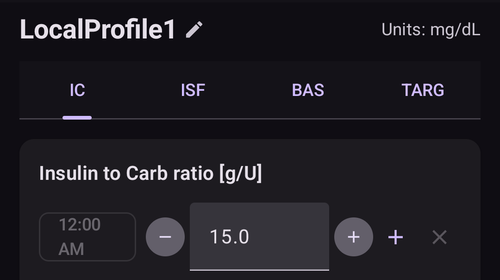

Hvis dit **BS** stadig er højere end før maden, når måltidet er fordøjet og **IOB** er tilbage på nul, er din **ICR** sandsynligvis for svag (_dvs._ tallet er for højt og skal sænkes gradvist). Omvendt, hvis dit **BS** er lavere end før maden, er **ICR** for stærk (_dvs._ tallet er for lille og skal øges gradvist).

Hvis dine basalrater er rigtige, kan du teste ved at kontrollere, at **IOB** er nul, og at du er i målområdet, spise en nøjagtigt kendt mængde kulhydrater og tage en anslået mængde insulin ud fra dit nuværende insulin til kulhydrat-forhold. Det bedste er at spise mad, som du normalt spiser på det tidspunkt af dagen, og tælle kulhydraterne præcist.

## Almindelige spørgsmål om profilen

```{contents} Common questions related to the Profile
:depth: 1
:local: true
```

### Hvorfor det er vigtigt, at din profil er rigtig

**Hvorfor skal jeg prøve at få mine profilindstillinger rigtige? Kan loopet ikke bare klare det?**

Et hybrid lukket loop _kan_ prøve at justere insulintilførslen for at mindske dårlig glykæmisk kontrol, som skyldes forkerte værdier i **profilen**. Det kan det f.eks. gøre ved at holde insulintilførslen tilbage, hvis du er på vej mod en hypo. Du kan dog opnå en meget bedre glykæmisk kontrol, hvis indstillingerne i din **profil** allerede ligger så tæt som muligt på det, din krop har brug for. Det er en af grundene til, at **AAPS** bruger læringsmål i trin for at gå fra pumpebehandling med åbent loop til hybrid lukket loop. Desuden vil der være tidspunkter, hvor du skal åbne loopet (opvarmning af sensor, sensorfejl _osv._), nogle gange midt om natten, og så vil du gerne have rigtige indstillinger til disse situationer.

Hvis du starter med **AAPS** efter at have brugt et andet pumpesystem med åbent eller lukket loop, har du allerede en god idé om, hvilke værdier du skal bruge til basalrater (**BR**), insulinfølsomhedsfaktorer (**ISF**) og insulin til kulhydrat-forhold (**ICR**).

Hvis du skifter fra injektioner (MDI) til **AAPS**, er det en god idé først at læse om, hvordan man skifter fra MDI til pumpe, og at planlægge og gennemføre skiftet omhyggeligt i samråd med dit diabetesteam. [»Pumping insulin«](https://amzn.eu/d/iaCsFa2) af John Walsh og Ruth Roberts og [»Think like a Pancreas«](https://amzn.eu/d/iVU0RGe) af Gary Scheiner er meget nyttige.

### Hvad giver høje toppe efter måltider i lukket loop?
Kontroller først din basalrate, og lav en basalratetest uden kulhydrater. Hvis den er rigtig, og dit **BS** falder til dit mål, når kulhydraterne er helt optaget, så prøv at sætte et midlertidigt mål »Spiser snart« i **AAPS** et stykke tid før måltidet, eller overvej sammen med din endokrinolog, hvornår du bør tage bolus før måltidet. <br/> Hvis dit **BS** er for højt efter måltidet og stadig for højt, når kulhydraterne er helt optaget, så overvej sammen med din endokrinolog at sænke din **ICR**. Hvis dit **BS** er for højt, mens der er **COB**, og for lavt, når kulhydraterne er helt optaget, så overvej sammen med din endokrinolog at øge din **ICR** og et passende tidspunkt for bolus før måltidet.

### Mit BS bliver ved med at være højt, og loopet får det ikke ned
Mulige grunde til, at **AAPS** ikke giver nok insulin:
* **ISF** er ikke stærk nok
* Basalraten er måske ikke stærk nok
* En sikkerhedsindstilling kan træde i kraft, f.eks. **maxIOB**. Eller **SMB** er deaktiveret på dette tidspunkt, afhængigt af dine indstillinger.
* En automatisering er sat op og har tilsidesat **AAPS**.

Se også [Justering af din AAPS-profil](../GettingHelp/ProfileTuning.md).

### Jeg har negativ IOB – er det et problem?
Negativ **IOB** betyder, at den absolutte mængde insulin (basal + bolus) i din krop er mindre end basalen. Det får **AAPS** til at sende mere insulin, så snart **BS** begynder at stige, fordi den mener, at der mangler insulin, og det kan give lavt **BS** senere.

Her er nogle grunde til, at du kan have negativ IOB, og hvad du kan gøre:
* en for stærk basal: juster din **profil**
* for meget bolus ved det forrige måltid: juster din **profil**, eller kontroller, om du tager bolus på det rigtige tidspunkt.
* DIA er sat for kort for din insulintype, så insulinen hober sig op: juster det i [Administrer → Insulinindstillinger](#Config-Builder-insulin-dia)
* fysisk aktivitet: overvej næste gang at bruge en lavere [profilprocent](../DailyLifeWithAaps/ProfileSwitch-ProfilePercentage.md) under aktivitet for at tage højde for den øgede følsomhed.

## Administrer dine profiler

```{contents} Operations that you can perform on your **Profiles** in **AAPS**
:depth: 1
:local: true
```
(your-aaps-profile-create-and-edit-profiles)=
### Opret og rediger profiler

I **AAPS** v4 findes dine profiler på skærmen **Administrer** (nederste navigation) → **Profil**, vist som en karrusel af kort, du kan stryge mellem, med en handlingsbjælke (**➕ Tilføj**, **✏️ Rediger**, **⧉ Klon**, **🗑️ Slet**, **▶ Aktiver**). Se [Administrer og aktiver profiler](#ProfileSwitch-manage-v4) om at administrere og aktivere en profil. Kommer du fra **AAPS** v3, hvor profiler havde deres egen fane? Se [Hvad er ændret i AAPS v4](#v4changes-manage).

Tryk på **✏️ Rediger** for at åbne editoren. Angiv profilens **Navn** og **Enheder**, og udfyld derefter de fire skemaer med fanerne:

- **IC** — insulin til kulhydrat-forhold (g/E)
- **ISF** — insulinfølsomhedsfaktor
- **BAS** — basalrater
- **MÅL** — målområde


Hvert skema er en liste af **tidsblokke**: tilføj en blok, angiv dens starttid og værdi, og tryk derefter på **Gem**.

Hvis du ændrer noget i din **profil**, skal du sikre dig, at du redigerer den rigtige **profil**: kortet for den profil, der er i brug, er markeret **AKTIV**, men det kort, der er valgt på skærmen, kan være et andet.

(your-aaps-profile-profile-from-scratch-for-a-kid)=
### Lav en profil fra bunden til et barn

[Profilhjælperen](#aaps-screens-profile-helper) (menu ☰ → **Profilhjælper**) kan hjælpe dig med at lave en profil til et barn (op til 18 år).

**Vigtigt:**

**Profilhjælperen skal hjælpe dig med at finde den første profil til dit barn. Selv om den er baseret på datasæt fra to forskellige hospitaler, skal du altid tale med dit behandlerteam, før du bruger en ny profil!**

Profilhjælperen har datasæt fra to forskellige hospitaler for børn, så du kan finde den første profil til dit barn op til 18 år.

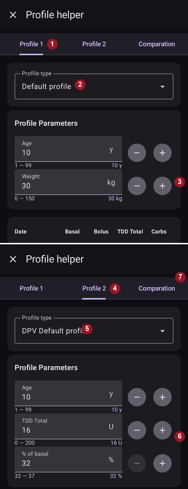

1. Sørg for, at du er på fanen **Profil 1**.
2. I **Profiltype** skal du sørge for, at »Standardprofil« er valgt.
3. Juster Standardprofil (baseret på et datasæt fra et hospital) ved at indtaste barnets alder og enten TDD Total **eller** vægt.
4. Skift til fanen **Profil 2**.
5. Tryk på **Profiltype**, og vælg »DPV standardprofil«.
6. Juster DPV standardprofil (baseret på et datasæt fra et andet hospital) ved at indtaste barnets alder, TDD Total og procentdelen af basal. Bemærk, at DPV-datasættet kun giver **basalrater**, så IC og ISF vises som nul for denne profil.
7. Åbn fanen **Sammenligning**. En sammenligning af de to justerede profiler bliver vist (se skærmbilledet nedenfor).
8. Hvis du vil begynde at justere din profil ud fra et af disse forslag, så brug knappen **Klon** nederst i sammenligningen.

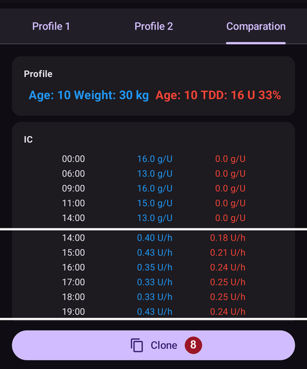

### Skift profil

Se [Profilskift og profilprocent](../DailyLifeWithAaps/ProfileSwitch-ProfilePercentage.md).

(your-aaps-profile-clone-profile-switch)=
### Klon et profilskift til en ny profil


[Behandlingshistorik](#aaps-screens-treatments) viser alle tidligere **profilskift**. Når du går til fanen **Profilskift**, kan du bruge et tidligere **profilskift** som grundlag for at lave en ny **profil**. I dette tilfælde bliver tidsforskydning og procent overført til den nye lokale profil. Brug knappen **Klon**, som vises på linje **2**.

Du kan nu gå til [profilskærmen](#your-aaps-profile-create-and-edit-profiles) (**Administrer → Profil**) for at redigere den nye profil.

(YourAapsProfile_Profile-backup)=
### Sikkerhedskopi af profiler

Dine **profiler** er en central indstilling i dit loop-system. De er meget følsomme, og du vil bestemt ikke miste dem.

* Dine **profiler** gemmes i databasen i **AAPS**.
* Når **NSClientV3** er sat op (se [Synkronisering](#SetupWizard-synchronization-with-the-reporting-server-and-more)), bliver dine **profiler** også automatisk uploadet til Nightscout.
* De er også en del af de [eksporterede indstillinger](../Maintenance/ExportImportSettings.md). Sørg derfor for at have en sikkerhedskopi et sikkert sted.

### Redigering af profiler fra Nightscout

Hvis det er slået til, kan ændringer i **profilen**, som er lavet direkte i Nightscout, modtages i **AAPS**. Indstillingen hedder »**Modtag profillager fra NS**« og er en del af indstillingerne for **Modtagelse af data fra Nightscout** (modtagelse af data fra Nightscout er slået fra som standard, se [trinnet Klientstyring i opsætningsguiden](../SettingUpAaps/SetupWizard.md)); du kan hurtigt finde den med **søgefeltet** på hovedskærmen. Mens klientstyring er slået til, er indstillingen skjult, og **AAPS** tager ikke imod profilændringer fra Nightscout ([hærdet tilstand](#client-master-control-hardened-mode)); rediger i stedet profilen på en parret klient, eller indlæs den én gang med **Fuld synkronisering**.

Det kan være nyttigt, før du laver store ændringer i en mere omfattende **profil**. De kan nemmere indtastes via webgrænsefladen, _f.eks._ for at kopiere data manuelt fra et regneark.

For at gøre det er det dog vigtigt at klone hele **databaseposten**, som består af flere profiler, i Nightscout-editoren (den blå pil på skærmbilledet nedenfor). De nye databaseposter får så den aktuelle dato. Når du har gemt, kan den ændrede/nye **profil** aktiveres i **AAPS** med et almindeligt [profilskift](../DailyLifeWithAaps/ProfileSwitch-ProfilePercentage.md).

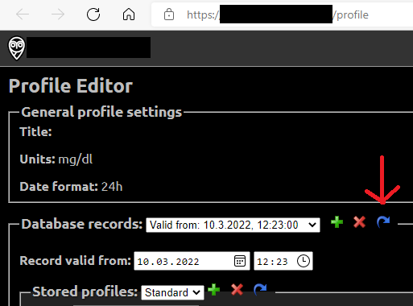

(your-aaps-profile-compare-profiles)=
### Sammenlign to profiler

Du kan også bruge [Profilhjælperen](#aaps-screens-profile-helper) (menu ☰ → **Profilhjælper**) til at sammenligne to forskellige profiler eller profilskift (procent af en af dine profiler, som tidligere er brugt i et [profilskift](../DailyLifeWithAaps/ProfileSwitch-ProfilePercentage.md)).

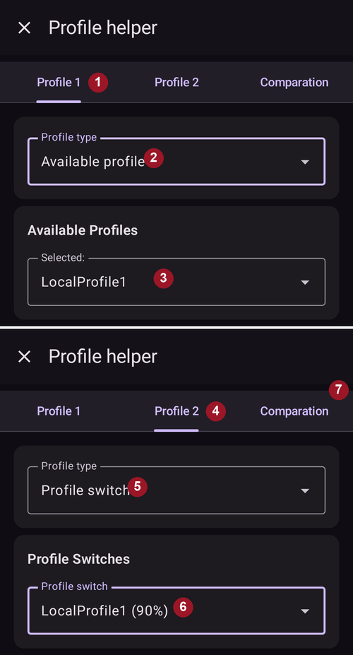

1. Sørg for, at du er på fanen **Profil 1**.
2. I **Profiltype** skal du vælge »Tilgængelig profil« for at vælge mellem alle gemte **profiler**.
3. Vælg den **profil**, du vil sammenligne fra.
4. Skift til fanen **Profil 2**.
5. I **Profiltype** skal du vælge »Profilskift« for at vælge i historikken over alle dine **profilskift**.
6. Vælg det **profilskift**, du vil sammenligne med.
7. Åbn fanen **Sammenligning**. En sammenligning af de to profiler bliver vist (se skærmbilledet nedenfor).

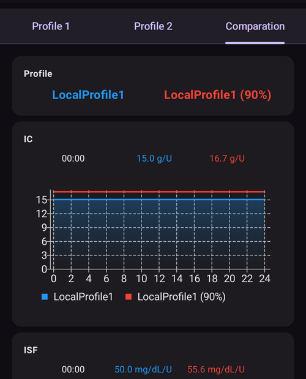
