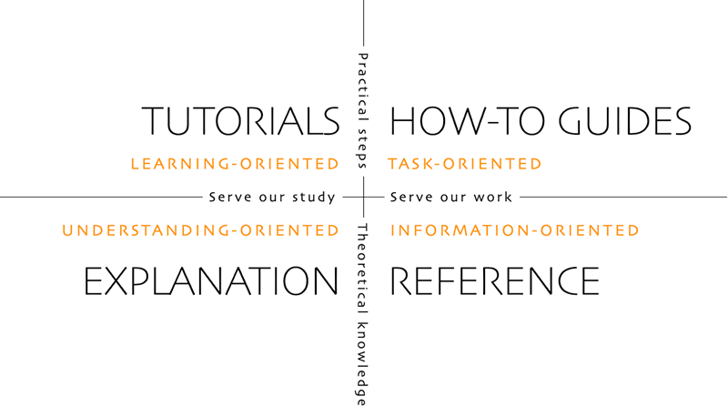

# Sådan redigerer du dokumentationen

**Denne beskrivelse gælder kun for redigering af den engelske dokumentation. Al ny information skal først tilføjes på engelsk. Hvis du vil oversætte til andre sprog (tak!), så brug [Crowdin](https://crowdin.com/project/androidapsdocs).**

Se afsnittet [»Kodesyntaks«](#edit-the-docs-code-syntax) på denne side for at få tips til, hvordan du formaterer tekst (overskrift, fed ...) og laver links.

## Generelt

Har du spørgsmål, feedback eller nye idéer, kan du kontakte dokumentationsteamet via [Discord](https://discord.gg/4fQUWHZ4Mw).

På et tidspunkt vil nogen foreslå, at du laver en pull request (PR). Det er sådan, dine ændringer i dokumentationen rent faktisk kommer ind på AAPS-websiderne, som er gemt i GitHub. Det er faktisk ikke så svært at lave en PR, og det er en rigtig god måde at bidrage på. Du læser denne dokumentation lige nu, fordi folk som dig har lavet PR'er. Vær ikke bange for at lave en fejl eller komme til at redigere de forkerte dokumenter. Dine ændringer bliver gennemgået, før de bliver flettet ind i det »officielle« repository med AAPS-dokumentationen. Du kan ikke ødelægge originalerne ved et uheld undervejs. Den generelle fremgangsmåde er:

- Lav ændringer og forbedringer i koden eller dokumentationen ved at redigere det eksisterende indhold.
- Kontroller en ekstra gang, at dine ændringer ser rigtige ud.
- Skriv et par noter om, hvad der er ændret, så andre kan forstå ændringerne.
- Opret en pull request, som beder administratorerne om at bruge dine ændringer.
- De gennemgår den og vil så enten (1) flette dine ændringer ind (merge), (2) skrive en kommentar til dig om dine ændringer eller (3) starte et nyt dokument med dine ændringer.

(En sidebemærkning: Hvis du lærer bedst med billeder, er der en YouTube-video [her](https://youtu.be/4b6tsL0_kzg), som viser, hvordan man laver en PR.)

I vores eksempel laver vi en ændring i AndroidAPSdocs. Det kan gøres på enhver Windows-pc, Mac osv. (enhver computer med internetadgang).

1. Gå til <https://github.com/openaps/AndroidAPSdocs>, og tryk på Fork øverst til højre for at lave din egen kopi af repositoryet.


2. Gå til en vilkårlig side, og naviger til den side, du vil redigere. Du kan klikke på linket »Edit in GitHub« øverst til højre. Det kan kun lade sig gøre på engelske sider. 


Eller klik på blyantikonet, der vises i den øverste bjælke på siden med det indhold, der skal redigeres. Du skal allerede være logget ind på din GitHub-konto for at gøre dette (hvis du ikke har en, er den nem at oprette).


3. Den ene eller den anden af mulighederne i trin 2 opretter en ny gren i DIT repository, hvor dine ændringer bliver gemt. Lav dine ændringer i filen.

Vi bruger Markdown til siderne i dokumentationen. Filerne har endelsen ».md«. Markdown-specifikationen er ikke fast, og vi bruger i øjeblikket myst_parser til vores Markdown-filer. Sørg for at bruge den rigtige syntaks som [beskrevet nedenfor](#edit-the-docs-code-syntax).


4. Du har arbejdet i fanen »<>Edit file«. Vælg fanen »Preview changes« for at se på det med friske øjne og sikre dig, at alt, hvad du har ændret, ser ud, som du ville have det (kontroller for stavefejl). Hvis du ser noget, der bør forbedres, så gå tilbage til fanen til redigering og lav flere forbedringer. 


5. Når du er færdig med dine ændringer, så rul ned til bunden af siden. I boksen nederst skriver du dine kommentarer i tekstfeltet, hvor der står »Add an optional extended description...«. Standardtitlen indeholder filnavnet. Prøv at skrive en sætning, der forklarer **grunden** til ændringen. Når du skriver grunden, hjælper det dem, der gennemgår din PR, med at forstå, hvad du prøver at gøre.


6. Klik på den grønne knap »Propose file changes« eller »Commit changes«. På den side, der vises, klikker du på »Create Pull Request«, og på den næste side klikker du igen på »Create Pull Request«.


7. Så er din pull request (PR) oprettet. GitHub giver din PR et nummer, som står efter titlen og et #-tegn. Kom tilbage til denne side for at se, om der er feedback (eller, hvis du får GitHub-notifikationer på e-mail, får du e-mails om al aktivitet på din PR). Ændringen vil nu stå på en liste over PR'er, som teamet gennemgår og måske giver feedback på, før den bliver føjet til den officielle dokumentation for AAPS! Hvis du vil følge med i, hvordan det går med din PR, kan du klikke på klokken øverst til højre i din GitHub-konto og se alle dine PR'er.


PS: Din fork og din gren ligger stadig på din egen personlige GitHub-konto. Når du får en notifikation om, at din PR er blevet flettet ind (merged), kan du slette din gren, hvis du er færdig med den (notifikationsområdet fra trin 7 giver et link til at slette grenen, når den er lukket eller flettet ind). Hvis du følger denne fremgangsmåde ved fremtidige ændringer, starter ændringerne altid fra en opdateret version af AndroidAPSdocs-repositories. Hvis du vælger en anden måde at starte en PR på (f.eks. at redigere med master-grenen i dit forkede repository som udgangspunkt), skal du sikre dig, at dit repository er opdateret. Lav først en »compare« (sammenligning), og flet alle opdateringer ind, der er kommet, siden du sidst opdaterede din fork. Da mange glemmer at opdatere deres repositories, anbefaler vi at bruge den PR-fremgangsmåde, der er beskrevet ovenfor, indtil du er vant til at lave »compares« (sammenligninger).

(edit-the-docs-code-syntax)=

## Kodesyntaks

Vi bruger Markdown til siderne i dokumentationen. Filerne har endelsen ».md«.

Markdown er et meget enkelt sprog til tekstformatering, som adskiller tekstens indhold fra tekstens formatering.

Forfatteren markerer kun f.eks. en overskrift som overskrift på niveau 1, og Markdown-processoren laver den nødvendige HTML-kode under behandlingen, så overskriften vises i HTML.

Tanken bag dette er, at

- forfatteren først skal tænke på teksten og ikke på formateringen,
- markdown-teksten kan bruges i forskellige Markdown-værktøjer i stedet for f.eks. lukkede værktøjer som Microsoft Word, og
- man kan lave flere outputformater ud fra én Markdown-fil.

Markdown er ikke en 100% fast standard, og vi prøver at holde os så tæt som muligt på standarden for at

- vi kan forblive fleksible og skifte Markdown-værktøjer, når det er nødvendigt eller bliver tvunget af den videre udvikling af Markdown-værktøjer og Markdown-SaaS-tjenester, og
- kunne bruge oversættelsestjenester til at oversætte det engelske sprog til et målsprog som fransk eller tysk. De kan arbejde med Markdown, men ikke med komplekse formateringskoder, fordi de ikke kan adskille indhold fra layout, hvilket kan være fatalt.

### Overskrifter

- Overskrift 1: `# headline`
- Overskrift 2: `## headline`
- Overskrift 3: `### headline`
- Overskrift 4: `#### headline`

Vi prøver at undgå flere niveauer af overskrifter.

### Tekstformat

- **fed**: `**text**`
- *kursiv*: `*text*`
- ***fed kursiv***: `***text***`

### Nummereret liste

    1. første
    1. anden
    1. tredje
    

1. første
2. anden
3. tredje

### Liste uden numre

    - et element
    - et andet element
    - og endnu et element
    

- et element
- et andet element
- og endnu et element

### Liste med flere niveauer

Du kan lave lister i lister ved at rykke det næste niveau 4 mellemrum længere ind end det forrige.

    1. første
    1. anden
    1. tredje
      1. et element
      1. et andet element
      1. og endnu et element
    1. fire
    1. fem
    1. seks
    

1. første
2. anden
3. tredje 
    1. et element
    2. et andet element
    3. og endnu et element
4. fire
5. fem
6. seks

### Billeder

Du indsætter billeder med denne Markdown-syntaks.

- billeder: ``

Billedet skal være af typen PNG eller JPEG.

Navne på billeder skal følge en af disse regler for navngivning. I eksemplet bruger jeg png som endelse. Hvis du bruger JPEG, så brug i stedet jpeg som endelse.

- `filename-image-xx.png`, hvor xx er et unikt tocifret tal for billederne i denne fil.
- `filename-image-xx.png`, hvor xx er et sigende navn, som forfatteren af md-filen har valgt.

Billederne ligger i mappen images for det engelske sprog og bliver automatisk overført til de andre sprog af Crowdin. Det behøver du ikke gøre noget for!

Vi oversætter ikke billeder i øjeblikket: Billeder bør have **så lidt tekst som muligt**, så de også er tilgængelige for læsere, der ikke kan engelsk.

(make-a-PR-image-size)= Brug en fornuftig størrelse til billederne. De skal kunne læses på pc, tablet og mobil.

- Skærmbilleder af websider skal være højst **1050 pixels brede**.
- Diagrammer over procesforløb skal være højst **1050 pixels brede**.
- Skærmbilleder fra appen skal være højst **500 pixels brede**. Sæt dem ikke ved siden af hinanden, hvis det ikke er nødvendigt.
- Skærmbilleder fra uret (**Wear OS**) skal være højst **360 pixels brede**. Forstør aldrig et skærmbillede, der er mindre.

### Links

#### Eksterne links

Eksterne links er links til eksterne websteder.

- eksternt link: `[alt text](www.url.tld)`

#### Interne links til starten af en md-fil

Interne links til sider er links til starten af en md-fil, der ligger på vores egen server.

- internt link til en .md-side: `[alt text](../folder/file.md)`

#### Interne links til navngivne referencer i teksten

Interne links til navngivne referencer i teksten er links til et vilkårligt sted i en md-fil, der ligger på vores egen server, og hvor der er sat en reference, man kan linke til.

Tilføj en navngiven reference på det sted i md-målfilen, som du vil springe til.

`(name-of-my-md-file-this-is-my-fancy-named-reference)=`

Den navngivne reference skal være unik i alle AndroidAPSDocs-md-filerne og ikke kun i den md-fil, hvor den står!

Derfor er det en god idé at starte med filnavnet og derefter det referencenavn, du vælger.

Brug kun små bogstaver, og sæt bindestreg mellem ordene.

Link derefter til denne reference i den tekst, du skriver, med denne slags link.

- Interne links til navngivne referencer i teksten: `[alt text](name-of-my-md-file-this-is-my-fancy-named-reference)`

### Noter, advarsler, sammenfoldelige noter

Du kan tilføje bokse med noter og advarsler til dokumentationen.

Desuden kan du tilføje sammenfoldelige noter med detaljeret information, så brugere, der ikke er interesserede i detaljerne, ikke bliver skræmt væk fra at læse teksten. Brug dem med omtanke, da dokumentationen skal være så let at læse som muligt.

#### Noter

    ```{admonition} Overskrift på note
    :class: note
    Dette er en note.
    ```
    

```{admonition} Overskrift på note :class: note Dette er en note.

    <br />#### Advarsler
    
    ````
    ```{admonition} Advarsel
    :class: warning
    Dette er en advarsel.
    

    ```{admonition} Overskrift på advarsel
    :class: warning
    Dette er en advarsel.
    ```
    
    #### Sammenfoldelige noter
    
    

    {admonition} flere detaljer for interesserede læsere
    :class: dropdown
    
    Denne boks er foldet sammen,
    det betyder, at du kan skrive længere indhold her,
    uden at det fylder for meget på siden.
    

````

```{admonition} flere detaljer for interesserede læsere :class: dropdown Denne boks er foldet sammen, det betyder, at du kan skrive længere indhold her, uden at det fylder for meget på siden.

```

## Tabeller

Undgå tabeller med lange tekster, da indholdet er svært at sætte op i Markdown, de passer som regel ikke til bredden på en mobilskærm, og de vises sandsynligvis ikke på samme måde efter oversættelse.

## Stilguide

### Indhold

1. Tips til at skrive på engelsk

2. Noter om skrivning, der er specifikke for AAPS

3. Nyttige referencer

###  1\. Tips til at skrive på engelsk

#### Brug et sprog, der passer til læseren

Brug enkelt engelsk, hvor det er muligt. Det hjælper læsere, der ikke har engelsk som modersmål, og gør det også nemmere at oversætte AAPS-dokumenterne til andre sprog. Skriv, som om du taler med brugeren. Forestil dig, at du sidder over for den person, du skriver til, ved et skrivebord. Husk: De fleste AAPS-brugere har ingen baggrund i programmering. Diabetes har også i sig selv mange fagudtryk og forkortelser. Husk, at nogle måske lige har fået diagnosen, måske ikke har så meget erfaring med diabetes som dig, eller måske har fået en anden diabetesundervisning. Hvis du bruger en kort form eller en forkortelse, så skriv den helt ud første gang, du bruger den, med forkortelsen lige efter i parentes, f.eks. »super micro bolus (SMB)«. Link også til ordlisten. Tekniske udtryk, som læseren måske ikke kender, kan også tilføjes i parentes.

I stedet for: *“What causes high postprandial BG peaks in closed loop?”*

Brug: *“What causes a high BG peak **after lunch** (postprandial) in closed loop?”*

##### Brug enkle ord, som alle kan forstå

Her finder du en A-Z-liste med alternative ord, der gør din tekst lettere at forstå:

<https://www.plainenglish.co.uk/the-a-z-of-alternative-words.html>

#### Hensyn til privatliv og licenser:

Især hvis du optager video eller tager skærmbilleder, skal du sørge for ikke at vise dine private oplysninger (API-nøgle, adgangskoder). Sørg for, at YouTube-indhold ikke er offentligt listet, så man skal bruge et link fra dokumentationen for at se det. Undgå at henlede opmærksomheden på materiale, der krænker ophavsret (BYODA osv.).

#### Skriv korte sætninger, og kom til sagen

- Klar tekst bør have en gennemsnitlig sætningslængde på 15 til 20 ord.

- Det betyder ikke, at alle sætninger skal være lige lange. Vær skarp. Skab variation ved at blande korte sætninger (som den forrige) med længere sætninger (som denne).

- Hold dig til én hovedidé i en sætning, plus måske ét andet punkt, der hører til.

- Du vil stadig af og til skrive en lang sætning, især når du prøver at forklare noget kompliceret. Men de fleste lange sætninger kan deles op på en eller anden måde.

- Fjern svage ord: »you can«, »there is/are/were«, »in order to«.

- Sæt nøgleord tæt på starten af titler, sætninger og afsnit.

- Vær visuel! Brug et kort diagram, et skærmbillede eller en video, hvor det er muligt.

#### Vær ikke bange for at give instruktioner

Kommandoer er den hurtigste måde at give instruktioner på, men forfattere er nogle gange bange for at give kommandoer og skriver »you should do this« i stedet for bare »do this«. Måske er folk bekymrede for, at kommandoer lyder for hårde. Det kan du tit løse ved at sætte ordet »please« foran. Men hvis noget skal gøres, er det bedst ikke at skrive »please«, da det giver læseren mulighed for at sige nej.

I stedet for: *“You should just think of it as a complete statement.”*

Brug: *“Think of it as a complete statement.”*

#### Brug for det meste aktive verber i stedet for passive verber

Eksempel på et **aktivt verbum**:

- *“The pump (subject) delivers (verb) the insulin (object).” (Pumpen (subjekt) leverer (verbum) insulinen (objekt).)*

»delivers« er et aktivt verbum her. Sætningen siger, hvad der leverer, før den siger, hvad der bliver leveret.

Eksempel på et **passivt verbum**:

- *“The insulin (subject) is delivered (verb) by the pump (object).” (Insulinen (subjekt) bliver leveret (verbum) af pumpen (objekt).)*

*“delivered”* er et passivt verbum her. Subjekt og objekt har byttet plads i forhold til sætningen med det aktive verbum. Vi har gjort sætningen længere ved at tilføje »is« og »by the«. Overvej også at starte med det aktive verbum.

I stedet for: *“You can connect your pump with the phone through the AAPS pump menu, and there are a number of pumps available for you to connect with.”*

Brug: *“Connect your desired pump to the phone through the AAPS pump menu.”*

Passive verber kan give problemer:

- De kan være forvirrende.

- De gør ofte teksten mere langtrukken.

- De gør teksten mindre levende.

##### Gode anvendelser af passiv

Der er tilfælde, hvor det kan være passende at bruge passiv.

- For at gøre noget mindre fjendtligt – »denne regning er ikke blevet betalt« (passiv) er blødere end »du har ikke betalt denne regning« (aktiv).

- For at undgå at give nogen skylden – »der blev begået en fejl« (passiv) i stedet for »Du begik en fejl« (aktiv).

- Når du ikke ved, hvem eller hvad der udfører handlingen – »det engelske hold er blevet udtaget«.

- Hvis det simpelthen lyder bedre.

#### Undgå nominaliseringer

En nominalisering er navnet på noget, der ikke er en fysisk ting, f.eks. en proces, en teknik eller en følelse. Nominaliseringer dannes ud fra verber.

For eksempel:

| Verbum    | Nominalisering |
| --------- | -------------- |
| complete  | completion     |
| introduce | introduction   |
| provide   | provision      |
| fail      | failure        |

De bruges ofte **i stedet** for de verber, de kommer fra, men de kan lyde, som om der ikke rigtig sker noget. For mange af dem kan gøre teksten meget kedelig og tung at læse.

I stedet for: *“The implementation of the method has been done by a team.”*

Brug: *“A team has implemented the method.”*

#### Brug lister, hvor det passer

Lister er rigtig gode til at dele information op. Der er to hovedtyper af lister:

- En sammenhængende sætning med flere punkter, der er fremhævet i starten, midten eller slutningen.

- Separate punkttegn med en indledende sætning.

I punktlisten ovenfor er hvert punkt en hel sætning, så de starter alle med stort bogstav og slutter med punktum. Brug punkttegn i stedet for tal eller bogstaver, da de henleder opmærksomheden på hvert punkt uden at give dig ekstra information, du skal tage stilling til.

#### Myter, der ikke holder

- Du kan starte en sætning med **and, but, because, so eller however**.

- Du kan dele en infinitiv op (split infinitive). Så du kan godt skrive **“to boldly go”**.

- Du kan slutte en sætning med en præposition. Faktisk er det noget, vi bør stå op for (**we should stand up for**).

- Og **du** kan bruge det samme **ord** to gange i en sætning, hvis **du** ikke kan finde et bedre **ord**.

#### Tilpas skrivestilen efter formålet

For at holde dokumentationen klar og kort skriver vi forskellige afsnit af dokumentationen i forskellige stilarter.

En »forklarende« stil bruges til introduktion, baggrund og afsnit, der opbygger viden.

En »vejledende« stil (»How-to-guide«, med så lidt forklaring som muligt) bruges til at bygge og konfigurere AAPS og til nogle af afsnittene om fejlfinding.

En tutorial hjælper eleven med at få grundlæggende færdigheder. Brugeren vil **lære ved at gøre det**.



#####  Tutorials (f.eks. at lære et barn at piske æggehvider)

- fortælleren taler direkte til læseren: I denne tutorial vil **du** (vi) kan i sjældne tilfælde bruges til at give følelsen af, at »vi er i det her sammen«

- Fremtid -> for at vise det endelige mål

- Bydeform -> for at udføre opgaverne -> Konkrete trin – undgå abstrakte begreber

- Datid -> for at vise udførte opgaver -> Hurtige resultater, der kan ses med det samme

- Minimum af forklaringer -> kun det strengt nødvendige for at gennemføre opgaven – **hvad og hvorfor**

- Ignorer muligheder/alternativer/…. Ingen tvetydighed

- Overgange mellem trin: Afslut et trin med en sætning, der fører videre til næste trin som et logisk forløb. Eksempel: *Du har nu installeret Let’s Encrypt-klienten, men før du henter certifikater, skal du sikre dig, at alle nødvendige porte er åbne. For at gøre det opdaterer du dine firewallindstillinger i det næste trin.*

- **Tutorial** Titel (overskrift på niveau 1)

- Introduktion (ingen overskrift)

- Forudsætninger (overskrift på niveau 2)

- Trin:

- Trin 1 – Gør det første (overskrift på niveau 2)

- Trin 2 – Gør det næste (overskrift på niveau 2)

- Trin n – Gør det sidste (overskrift på niveau 2)

- Konklusion (overskrift på niveau 2)
    
    - **Sproget i tutorials**
        
        *I denne tutorial vil du …*
        
        Beskriv, hvad eleven vil opnå (bemærk – ikke: »du vil lære …«).
        
        *Gør først x. Gør nu y. Nu hvor du har gjort y, så gør z.*
        
        Ingen plads til tvetydighed eller tvivl.
        
        *Vi skal altid gøre x, før vi gør y, fordi … (se Forklaring for flere detaljer).*
        
        Forklar handlingerne kort med det mest enkle sprog, der er muligt. Link til en mere detaljeret forklaring.
        
        *Resultatet bør se nogenlunde sådan ud …*
        
        Giv din elev klare forventninger.
        
        *Bemærk, at … Husk, at …*
        
        Giv din elev masser af tegn, der hjælper med at bekræfte, at de er på rette vej, og med at finde rundt.
        
        *Du har bygget en sikker hylomorf stasemaskine med tre lag …*
        
        Beskriv (og beundr, på en mild måde) hvad din elev har opnået (bemærk – ikke: »du har lært …«)

#####  Vejledninger (How-to, f.eks. en opskrift)

Formålet med en vejledning er at hjælpe en bruger, der allerede har færdighederne, med at udføre en bestemt opgave korrekt.

- HVORDAN

- fortælleren taler direkte til læseren: I denne vejledning vil **du**

- Fremtid -> for at vise det endelige mål

- Betinget bydeform -> for at få X skal du gøre y -> Konkrete trin – undgå abstrakte begreber

- Minimum af forklaringer -> kun det strengt nødvendige for at gennemføre opgaven -> **hvad og hvorfor**

- Ignorer muligheder/alternativer/…. Ingen tvetydighed, men du kan linke til referenceafsnittet eller det forklarende afsnit

- **How-to**: Titel (overskrift på niveau 1)

- Introduktionsafsnit

- Valgfrie forudsætninger (afsnit eller overskrift på niveau 2, hvis der er mere end 1)

- Trin:

- Trin 1 – Gør det første (overskrift på niveau 2)

- Trin 2 – Gør det næste (overskrift på niveau 2)

- Trin n – Gør det sidste (overskrift på niveau 2)

- Konklusionsafsnit
    
    - **Sproget i vejledninger**
        
        *Denne vejledning viser dig, hvordan du …*
        
        Beskriv tydeligt det problem eller den opgave, som vejledningen viser brugeren, hvordan man løser.
        
        *Hvis du vil have x, så gør y. For at opnå w skal du gøre z.*
        
        Brug betinget bydeform.
        
        *Se referencevejledningen til x for en komplet liste over muligheder.*
        
        Fyld ikke din praktiske vejledning med alt, hvad brugeren måske kunne gøre i forbindelse med x.

#####  Forklaring (f.eks. videnskaben bag, hvorfor æggehvider bliver stive, når du pisker dem)

En forklaring gør læserens forståelse af et emne klarere, dybere og bredere.

- HVORFOR

- Start med **Om**

- Giv sammenhæng, og link til ALLE relevante referencer

- Diskuter muligheder/alternativer

- Giv ikke instruktioner eller referencer (link til dem)

- Nævn det ukendte, mål der flytter sig osv.…

- **Om** Titel (overskrift på niveau 1)

- Introduktion (ingen overskrift)

- Valgfrie forudsætninger (overskrift på niveau 2)

- Underemne 1 (overskrift på niveau 2)

- Konklusion (overskrift på niveau 2)
    
    - **Sproget i forklaringer**
    
    *Grunden til x er, at y historisk set …*
    
    Forklar.
    
    *W er bedre end z, fordi …*
    
    Giv vurderinger og endda meninger, hvor det passer.
    
    *Et x i system y svarer til et w i system z. Men …*
    
    Giv sammenhæng, der hjælper læseren.
    
    *Nogle brugere foretrækker w (fordi z). Det kan være en god fremgangsmåde, men …*
    
    Vej alternativerne op mod hinanden.
    
    *Et x virker sammen med et y på denne måde: …*
    
    Afslør maskinens indre hemmeligheder for at hjælpe med at forstå, hvorfor noget gør, som det gør.

### 2\. Noter om skrivning/opdatering, der er specifikke for AAPS

#### Forfatter og redaktør

Når du skriver eller opdaterer AAPS-dokumentationen, så tænk på processen som to trin. De kan udføres af den samme person på forskellige tidspunkter eller af flere personer.

En **forfatter (f.eks. dig!)** skriver/redigerer et afsnit af dokumentationen i en kort tone, som om man taler sammen, og giver det så videre til redaktøren.

**Redaktøren (f.eks. en anden AAPS-bruger eller den person, der modtager pull requesten)** kontrollerer, at stilguiden er fulgt, og redigerer afsnittet, så det bliver klart og tilgængeligt, og fjerner så mange ord som muligt (især i afsnit med tutorials/vejledninger). Det kan hjælpe at læse teksten højt.

#### Generelle punkter om AAPS

- For glukoseværdier skal du angive både mg/dl og mmol/l hver gang (overvej det også for skærmbilleder, hvis det er muligt).

- For at være konsekvent skal du skrive »AAPS« i stedet for »Android APS«.

- Skriv tydeligt, hvilken version af Android Studio/AAPS du skriver om, eller som skærmbillederne er taget fra.

### 3\. Nyttige referencer

<https://dev.readthedocs.io/en/latest/style-guide.html>

[Diátaxis (diataxis.fr)](https://diataxis.fr/)

[Technical Writer Style Guide Examples | Technical Writer HQ](https://technicalwriterhq.com/writing/technical-writing/technical-writer-style-guide/)

[DigitalOcean's Technical Writing Guidelines | DigitalOcean](https://www.digitalocean.com/community/tutorials/digitalocean-s-technical-writing-guidelines)

[Top 10 tips for Microsoft style and voice - Microsoft Style Guide | Microsoft Learn](https://learn.microsoft.com/en-us/style-guide/top-10-tips-style-voice?source=recommendations)

<https://www.plainenglish.co.uk/how-to-write-in-plain-english.html>

<https://developers.google.com/style>

<https://www.mongodb.com/docs/meta/style-guide/screenshots/screenshot-guidelines/>