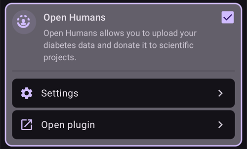
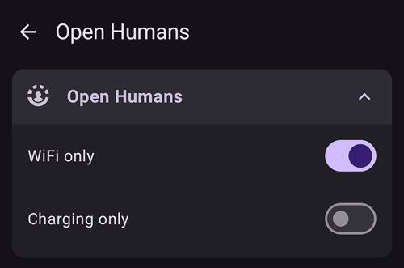
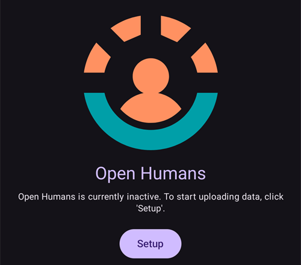
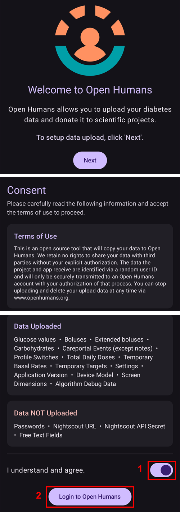
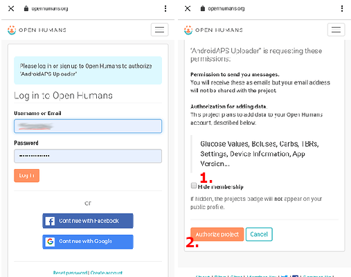
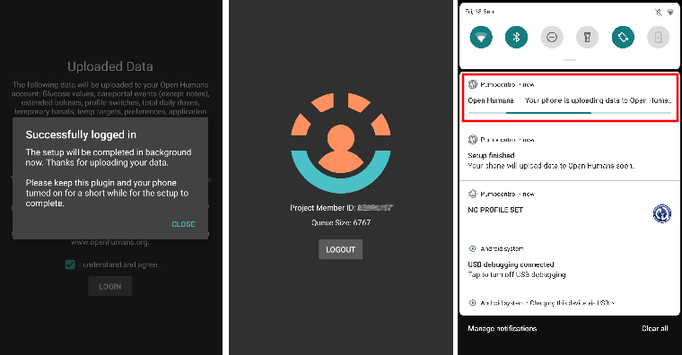
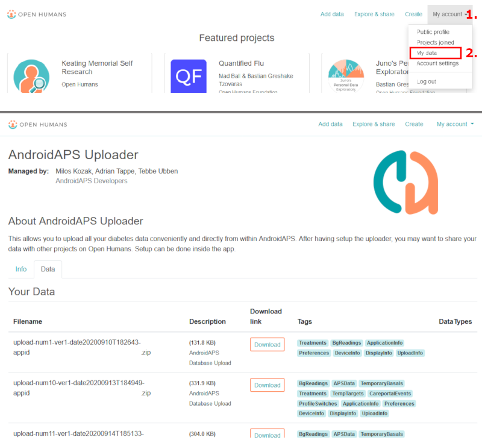

# Open Humans Uploader

## Donér dine data til forskning

Du kan hjælpe fællesskabet ved at donere dine data til forskningsprojekter! Det hjælper forskere med at give noget videre, udvikle nye videnskabelige idéer og gøre open source-systemer med lukket loop mere kendte. AAPS er klar til at synkronisere dine data med [Open Humans](https://www.openhumans.org), en platform, hvor du kan uploade, forbinde og gemme dine personlige data – f.eks. genetiske data, aktivitetsdata og sundhedsdata.

Du har fuld kontrol over, hvad der sker med dine data, og hvilke projekter du vil støtte ved at give dem adgang til dine data. Afhængigt af det projekt, du er med i, bliver data vurderet og brugt på forskellige måder og i forskelligt omfang.

Følgende data bliver uploadet til din Open Humans-konto:

- Glukoseværdier
- Careportal-hændelser (undtagen notater)
- Forlængede boluser
- Profilskift
- Samlede daglige doser
- Midlertidige basaler
- Midlertidige mål
- Indstillinger
- Appversion
- Enhedsmodel
- Skærmstørrelse

Hemmelige eller private oplysninger som din Nightscout-URL eller API secret bliver ikke uploadet.

## Opsætning

1. Opret en konto på [Open Humans](https://www.openhumans.org), hvis du ikke allerede har gjort det. Du kan bruge din eksisterende Google- eller Facebook-konto, hvis du vil.
2. Aktiver pluginet **Open Humans** i [**Konfiguration** > **Kommunikation**](../SettingUpAaps/ConfigBuilder.md).



3. Tryk på **Indstillinger** på kortet **Open Humans**. Du kan begrænse uploads til de tidspunkter, hvor telefonen bruger wi-fi (**Kun WiFi**) og/eller oplader (**Kun under opladning**).



4. Tryk på **Åbn plugin** på kortet **Open Humans**, og tryk derefter på **Opsætning**.



5. Tryk på **Næste** på skærmen **Velkommen til Open Humans**. Læs skærmen **Samtykke** grundigt: den viser vilkårene for brug, og hvilke data der bliver uploadet, og hvilke der ikke bliver.
6. Slå **Jeg forstår og er enig.** (1) til, og tryk på **Login på Open Humans** (2).



7. Open Humans-webstedet åbnes. Log ind med dine loginoplysninger.
8. Vælg, om du vil skjule dit medlemskab af AAPS Uploader i din offentlige Open Humans-profil (1).
9. Klik på **Authorize project** (2).



```{admonition} Older screenshot
:class: note
Skærmbillederne ovenfor viser en tidligere version af Open Humans-webstedet og bruger stadig det gamle projektnavn **AndroidAPS Uploader**. Trinene er de samme.
```

10. Tilbage i **AAPS** spørger skærmen **Afsluttende detaljer**, om du vil fortsætte. Tryk på **Fortsæt**.
11. Vent, til **Vi er færdige!** vises, og tryk derefter på **Luk**. Fra nu af uploader din telefon data i baggrunden en gang imellem.
12. Skærmen for pluginet **Open Humans** viser nu dit **Projektmedlems-ID**. Tryk på **Upload nu**, hvis du vil starte en upload med det samme.
13. Tryk på **Log af**, hvis du vil stoppe med at uploade data til Open Humans.
14. En Android-notifikation fortæller dig, når en upload kører.



```{admonition} Older screenshot
:class: note
Skærmbilledet ovenfor er fra en tidligere **AAPS**-version. I **AAPS** 4 hedder bekræftelsesskærmene **Afsluttende detaljer** og **Vi er færdige!**, der er ingen køstørrelse, og knapperne hedder **Upload nu** og **Log af**.
```

15. Du kan administrere dine data ved at logge ind på [Open Humans-webstedet](https://www.openhumans.org).



## Muligheder for deling

### [Projektet »OPEN«](https://www.open-diabetes.eu/)

Projektet »OPEN« samler et internationalt og tværfagligt konsortium af patientinnovatører, klinikere, samfundsforskere, dataloger og patientorganisationer. Formålet er at undersøge forskellige sider af gør-det-selv kunstige bugspytkirtelsystemer (DIY APS), som et stigende antal mennesker med diabetes bruger. Se flere detaljer på deres [websted](https://www.open-diabetes.eu/).

I september 2020 startede projektet »OPEN« et [spørgeskema](https://survey.open-diabetes.eu/), som også giver mulighed for at donere data, du har uploadet til Open Humans. En [vejledning](https://open-diabetes.eu/en/open-survey/survey-tutorials/) i, hvordan du donerer dine data til projektet »OPEN«, findes på deres websted og i selve spørgeskemaet.

### [OpenAPS Data Commons](https://www.openhumans.org/activity/openaps-data-commons/)

OpenAPS Data Commons blev oprettet for at gøre det nemt at dele datasæt fra DIYAPS-fællesskabet til forskning. Data bliver delt både med traditionelle forskere, som laver traditionelle forskningsstudier, og med grupper eller personer fra fællesskabet, som vil se på data som en del af deres egne forskningsprojekter. OpenAPS Data Commons bruger platformen »Open Humans«, så folk nemt kan uploade og dele deres data fra DIYAPS, herunder AAPS, Loop og OpenAPS.

Du kan få dine data ind i Open Humans på en af tre måder:

1. brug AAPS' uploader-mulighed til at få dine data ind i Open Humans
2. brug Nightscout Data Transfer til at få dine data ind i Open Humans
3. upload datafiler manuelt til Open Humans.

Når du har oprettet en konto, og dine data er begyndt at komme ind i Open Humans, skal du også tilmelde dig OpenAPS Data Commons, hvis du vil donere dine data til forskning.

## Vilkår for brug

Dette er et open source-værktøj, som kopierer dine data til [Open Humans](https://www.openhumans.org). Vi har ingen ret til at dele dine data med tredjeparter uden din udtrykkelige tilladelse. De data, som projektet og appen modtager, er kendetegnet ved et tilfældigt bruger-ID. De bliver kun overført sikkert til en Open Humans-konto, når du har givet tilladelse til det. Du kan når som helst stoppe uploads og slette dine uploadede data via [www.openhumans.org](https://www.openhumans.org). Vær opmærksom på, at nogle projekter, der modtager data, måske ikke understøtter dette.

Se også [vilkårene for brug af Open Humans](https://www.openhumans.org/terms/).

## Databeskyttelse

Open Humans beskytter dit privatliv ved at give dig et numerisk ID for hvert projekt. Det gør det muligt for projekter at genkende dig, men ikke at identificere dig. Det applikations-ID, som AAPS uploader, fungerer på samme måde og hjælper kun med at administrere data. Du kan finde flere oplysninger her:

- [Open Humans' politik for brug af data](https://www.openhumans.org/data-use/)
- [Open Humans og GDPR](https://www.openhumans.org/gdpr/)
