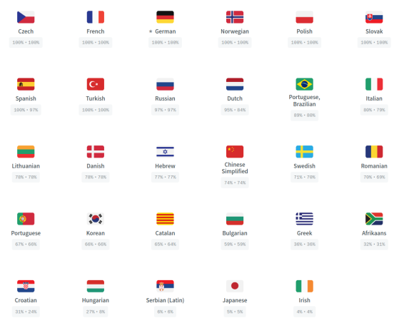
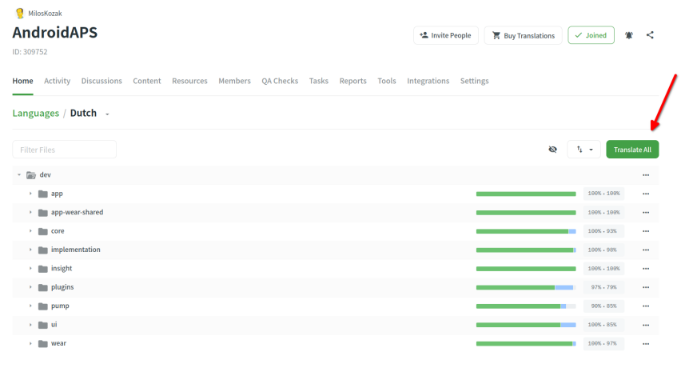
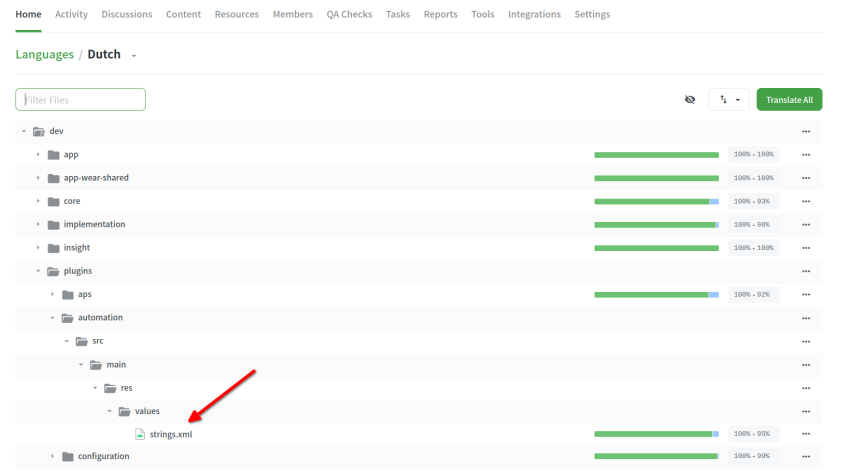
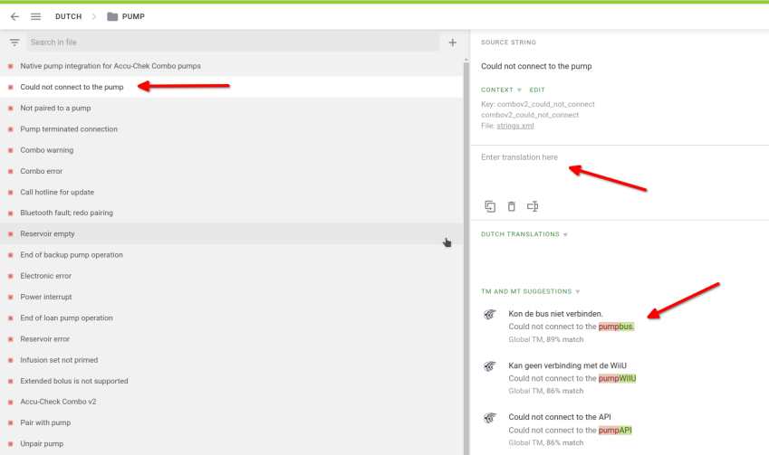
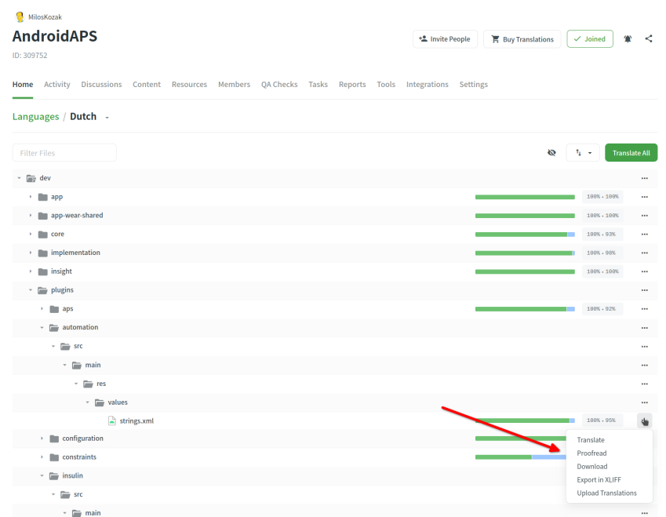
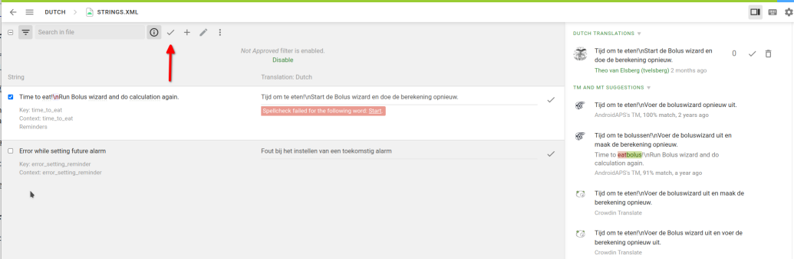
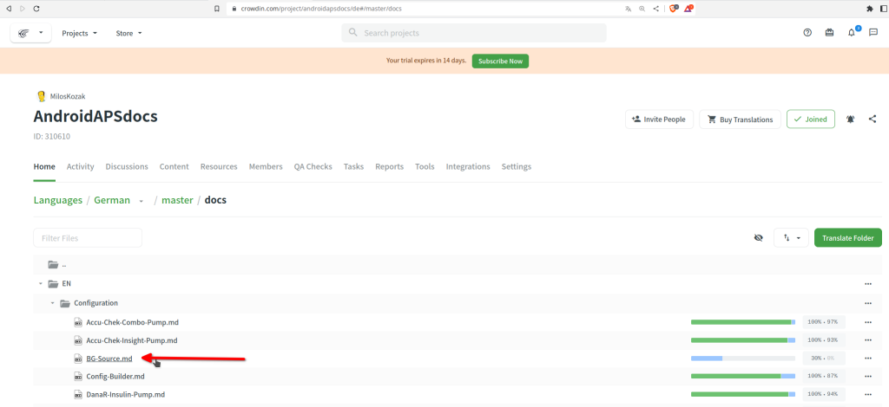
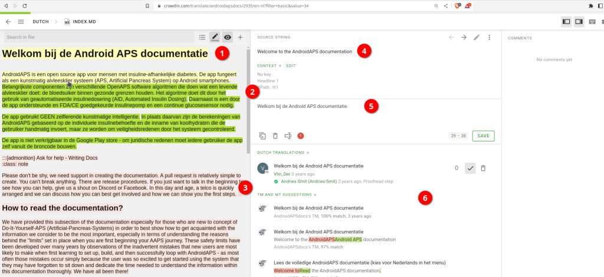
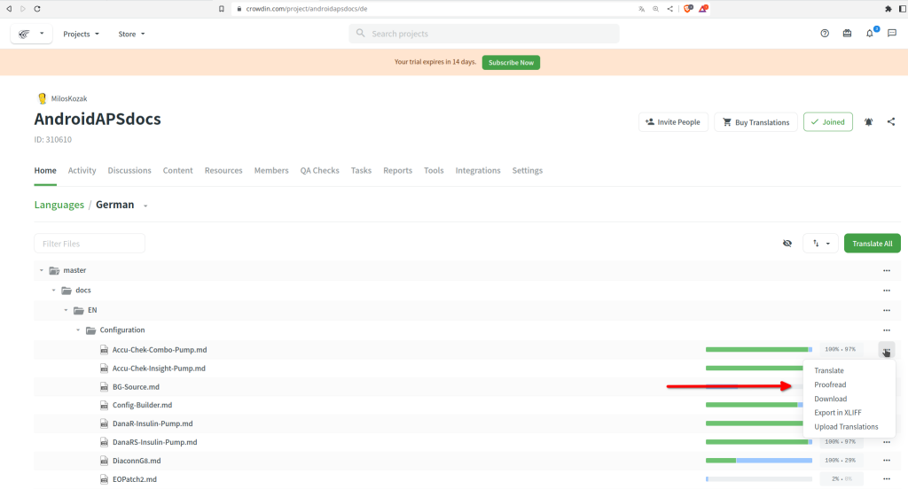

# Sådan oversætter du tekster til AAPS-appen eller dokumentationen

* Til teksterne i appen skal du gå til <https://crowdin.com/project/androidaps> og logge ind med din GitHub-konto
* Til dokumentationen skal du gå til <https://crowdin.com/project/androidapsdocs> og logge ind med din GitHub-konto

* Send en anmodning om at blive medlem til dokumentationsholdet. Det gør du ved at klikke på flaget for det ønskede sprog og derefter på knappen »Join« i øverste højre hjørne på den næste side. Angiv sprog, fortæl lidt om dig selv og din erfaring med AAPS, og om du vil være oversætter eller korrekturlæser (kun for personer med erfaring i oversættelse + erfarne AAPS-brugere).

```{admonition} Tid til godkendelse :class: note

Godkendelsen er et manuelt trin. Som en nonprofitorganisation giver vi ingen servicegaranti (SLA), men normalt sker godkendelsen på under 1 dag. Hvis ikke, så kontakt dokumentationsholdet via Facebook eller Discord.

    <br />* Når vi har godkendt dig, så klik på flaget
       
    
    ## Oversættelse af appen
    
    (translations-translate-strings-for-AAPS-app)=
    ### Oversæt tekster til AAPS-appen
    
    * Hvis du ikke har nogen præference for, hvilke tekster du oversætter, så vælg bare knappen »Translate All« for at starte. Den viser dig de tekster, der skal oversættes.
    
       
    
    * Hvis du vil oversætte en bestemt fil, så søg efter filen via søgefeltet eller træstrukturen, og klik på filnavnet for at begynde at oversætte teksterne i den fil.
    
       
    
    * Oversæt sætningerne i venstre side ved at tilføje ny oversat tekst, eller brug og rediger et forslag
    
       
    
    
    ### Korrekturlæs tekster til AAPS-appen
    
    * Korrekturlæsere starter med at vælge »Proofread« på sprogets startskærm.
    
       
    
    
      og godkend oversatte tekster
    
       
    
    Når en korrekturlæser godkender en oversættelse, kommer den med i den næste version af AAPS.
    
    (translations-translation-of-the-documentation)=
    ## Oversættelse af dokumentationen
    
    * Klik på navnet på den side i dokumentationen, du vil oversætte
    
    
    
    
    * Oversæt sætning for sætning
    
        1. Den gule tekst er den tekst, du arbejder på lige nu.
    
        1. Den grønne tekst er allerede oversat. Den behøver du ikke at oversætte igen.
    
        1. Den røde tekst er den resterende tekst, der skal oversættes.
    
        1. Dette er kildeteksten, du arbejder på lige nu
    
        1. Dette er den oversættelse, du er ved at lave. Du kan kopiere teksten ovenfra eller vælge et af forslagene nedenfor.
    
        1. Dette er forslagene til en oversættelse. Her kan du især se, hvor godt Crowdin vurderer, at forslaget passer, eller om teksten allerede er oversat tidligere og kun er kommet tilbage, fordi den er flyttet, ikke ændret.
        1. Tryk på knappen »save« for at gemme et forslag til oversættelsen. Derefter går den videre til en korrekturlæser til den endelige kontrol.
    
    
    
    * En oversat side bliver ikke offentliggjort i dokumentationen, før
    
        1. oversættelsen er korrekturlæst
    
        1. synkroniseringen mellem Crowdin og GitHub er færdig (én gang i timen), og den opretter en PR til GitHub.
    
        1. PR'en på GitHub er godkendt.
    
    Normalt tager det 1–3 dage, men i ferier kan det tage lidt længere tid.
    
    ### Oversættelse af links
    
    ```{admonition} Links bliver ikke længere oversat
    :class: note
    
    Links bliver ikke længere oversat. Tidligere havde vi et emne her, men det er væk, fordi vi med overgangen til Markdown og myst_parser opretter labels direkte i den engelske tekst og automatisk overfører disse labels til sprogene.
    
    

Du oversætter den tekst, der står for linket. Pas på **ikke** at fjerne linket, som er vist med et par `<0></0>`-tags (eller andre tal, hvis der er flere links i et afsnit).

Det er korrekturlæsernes opgave at holde særligt øje med dette!

### Korrekturlæsning

* Korrekturlæsere skal skifte til korrekturtilstand (Proofreading)
    
    
    
    og godkende oversatte tekster
    
    

* Når en korrekturlæser godkender en oversættelse, kommer den med i den næste build af dokumentationen. Det sker uden fast tidsplan efter behov, men cirka én gang om ugen undtagen i ferier. For at gøre processen hurtigere kan du give dokumentationsholdet besked om nye oversættelser.