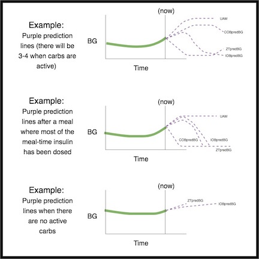
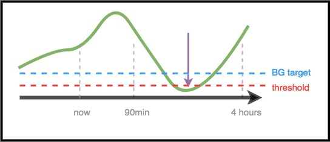
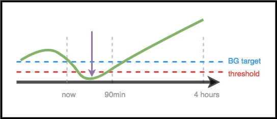
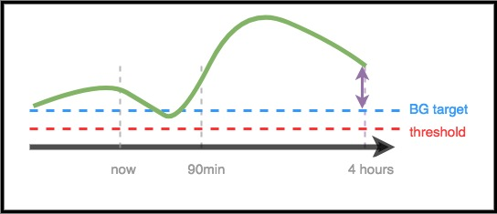
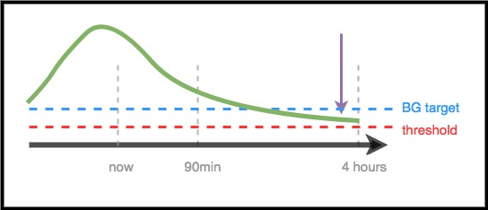

# Til sundhedspersonale – En generel introduktion og vejledning til AAPS

```{note}
Denne side er en overordnet introduktion for sundhedspersonale. Den blev sidst gennemgået i juni 2026. AAPS udvikles hele tiden, så de mest præcise og opdaterede detaljer finder du altid i [den primære AAPS-dokumentation](../index.md).
```

Denne side er beregnet til sundhedspersonale, der har vist interesse for open source-teknologi til kunstig bugspytkirtel som AAPS, eller til patienter, der vil dele sådan information med deres behandlere.

Denne vejledning giver overordnet information om DIY lukket loop og især om, hvordan AAPS virker. Flere detaljer om alle disse emner finder du i [den samlede AAPS-dokumentation online](../index.md). Hvis du har spørgsmål, så spørg din patient om flere detaljer, eller kontakt altid gerne fællesskabet med dit spørgsmål. (Hvis du ikke er på sociale medier (f.eks. [Twitter](https://twitter.com/kozakmilos) eller Facebook), er du velkommen til at skrive til developers@aaps.app). [Her kan du også finde nogle af de nyeste studier og data om resultater](https://openaps.org/outcomes/).

## Trinene til at bygge et DIY lukket loop:

For at begynde at bruge AAPS skal følgende trin udføres:

* Find en [kompatibel pumpe](../Getting-Started/CompatiblePumps.md), en [kompatibel Android-enhed](../Getting-Started/Phones.md) og en [kompatibel CGM-kilde](../Getting-Started/CompatiblesCgms.md).
* [Download AAPS-kildekoden og byg softwaren](../SettingUpAaps/BuildingAaps.md).
* [Konfigurer softwaren, så den kan tale med deres diabetesenheder, og angiv indstillinger og sikkerhedsvalg](../SettingUpAaps/SetupWizard.md).

## Sådan virker et DIY lukket loop

Uden et lukket loop-system samler en person med diabetes data fra sin pumpe og CGM, beslutter hvad der skal gøres, og handler.

Med automatisk insulintilførsel gør systemet det samme: det samler data fra pumpen, CGM'en og alle andre steder, hvor information bliver registreret (f.eks. Nightscout). Det bruger disse data til at regne ud og beslutte, hvor meget mere eller mindre insulin der er brug for (over eller under den grundlæggende basalrate), og bruger midlertidige basalrater til at lave de nødvendige justeringer, så BS holdes i eller til sidst bringes ind i målområdet.

Hvis enheden, der kører AAPS, går i stykker eller kommer uden for pumpens rækkevidde, bliver pumpen igen en almindelig pumpe med de forprogrammerede basalrater, når den seneste midlertidige basalrate slutter.

## Sådan samles data:

Med AAPS kører en Android-enhed en særlig app, der laver beregningerne, og enheden kommunikerer via Bluetooth med en understøttet pumpe. AAPS kan kommunikere med andre enheder og med skyen via Wi-Fi eller mobildata for at hente flere oplysninger og for at fortælle patienten, omsorgspersoner og pårørende, hvad den gør og hvorfor.

Android-enheden skal:

* kommunikere med pumpen og læse historikken – hvor meget insulin der er blevet tilført
* kommunikere med CGM'en (enten direkte eller via skyen) – for at se, hvad BS gør og har gjort

Når enheden har samlet disse data, kører algoritmen og træffer beslutninger ud fra indstillingerne (ISF, kulhydratforhold, DIA, målværdi osv.). Hvis det er nødvendigt, sender den derefter kommandoer til pumpen for at ændre insulintilførslen.

Den samler også alle oplysninger om boluser, indtagne kulhydrater og midlertidige mål fra pumpen eller fra Nightscout og bruger dem til at beregne insulintilførslen.

## Hvordan ved den, hvad den skal gøre?

Open source-softwaren er designet, så enheden nemt kan gøre det arbejde, som folk før gjorde selv (i manuel tilstand), for at beregne, hvordan insulintilførslen skal justeres. Først samler den data fra alle de tilknyttede enheder og fra skyen, forbereder dataene og kører beregningerne, laver forudsigelser af, hvad BS forventes at gøre i de næste timer i forskellige scenarier, og beregner de nødvendige justeringer for at holde BS i eller bringe det tilbage i målområdet. Derefter sender den alle nødvendige justeringer til pumpen. Så læser den data tilbage og gør det igen og igen.

Da den vigtigste inputparameter er blodsukkerværdien fra CGM'en, er det vigtigt at have CGM-data af høj kvalitet.

AAPS er designet til åbent at registrere alle de inputdata, den samler, den anbefaling, der kommer ud af det, og alle handlinger, der udføres. Derfor er det til enhver tid let at svare på spørgsmålet »hvorfor gør den X?« ved at gennemgå logfilerne.

## Eksempler på, hvordan AAPS-algoritmen træffer beslutninger:

AAPS bruger den samme kernealgoritme og de samme funktioner som OpenAPS. Algoritmen laver flere forudsigelser (ud fra indstillingerne og situationen), som viser forskellige scenarier for, hvad der kan ske i fremtiden. I Nightscout vises de som »lilla linjer«. AAPS bruger forskellige farver til at skelne mellem disse [prognoselinjer](#aaps-screens-prediction-lines). I logfilerne beskriver den, hvilke af disse forudsigelser og hvilken tidsramme der styrer de nødvendige handlinger.

### Her er eksempler på de lilla prognoselinjer, og hvordan de kan være forskellige:



(clinicianguide-dosing-scenarios)=

### Her er eksempler på forskellige tidsrammer, der påvirker de nødvendige justeringer af insulintilførslen:

### Scenarie 1 – Nul-basal for sikkerhed

I dette eksempel stiger BS på kort sigt; men det forudsiges at blive lavt på længere sigt. Det forudsiges faktisk at falde under målværdien *og* under sikkerhedsgrænsen. For at forebygge det lave BS af sikkerhedshensyn giver AAPS en nul-basal (midlertidig basalrate på 0%), indtil eventualBG (i en hvilken som helst tidsramme) er over grænsen.



### Scenarie 2 – Nul-basal for sikkerhed

I dette eksempel forudsiges BS at blive lavt på kort sigt, men til sidst at ligge over målværdien. Men fordi det lave BS på kort sigt faktisk er under sikkerhedsgrænsen, giver AAPS en nul-basal, indtil intet punkt på prognoselinjen længere ligger under grænsen.



### Scenarie 3 – Mere insulin er nødvendigt

I dette eksempel viser en forudsigelse på kort sigt et dyk under målværdien. Men det forudsiges ikke at komme under sikkerhedsgrænsen. Det endelige BS ligger over målværdien. Derfor undlader AAPS at give insulin, der ville bidrage til et lavt BS på kort sigt (insulin, der ville få forudsigelsen til at gå under grænsen). Derefter vil den overveje at give mere insulin for at bringe det laveste punkt af det forudsagte endelige BS ned til målværdien, når det er sikkert at gøre det. *(Afhængigt af indstillingerne og af, hvor meget insulin der skal til og hvornår, kan denne insulin blive givet som midlertidige basaler eller SMB'er (super mikroboluser)).*



### Scenarie 4 – Lav midlertidig basal for sikkerhed

I dette eksempel ser AAPS, at BS stiger kraftigt langt over målværdien. Men på grund af insulinens tidsforløb er der allerede nok insulin i kroppen til til sidst at bringe BS ind i målområdet. BS forudsiges faktisk til sidst at ligge under målværdien. Derfor giver AAPS ikke ekstra insulin, så den ikke bidrager til et lavt BS på længere sigt. Selvom BS er højt eller stigende, er en lav midlertidig basalrate sandsynlig her.



## Optimering af indstillinger og ændringer

Som behandler uden erfaring med AAPS eller DIY lukket loop kan det være svært for dig at hjælpe din patient med at optimere indstillingerne eller lave ændringer, der forbedrer resultaterne. Vi har flere værktøjer og [vejledninger](https://openaps.readthedocs.io/en/latest/docs/Customize-Iterate/optimize-your-settings.html) i fællesskabet, som hjælper patienter med at lave små, afprøvede justeringer for at forbedre deres indstillinger.

Det vigtigste for patienterne er at lave én ændring ad gangen og se på virkningen i 2-3 dage, før de vælger at ændre en anden indstilling (medmindre det tydeligvis er en dårlig ændring, der gør tingene værre – så skal de straks gå tilbage til den tidligere indstilling). Mennesker har en tendens til at dreje på alle knapper og ændre alt på én gang; men hvis man gør det, kan man ende med endnu dårligere indstillinger fremover og have svært ved at komme tilbage til en kendt god tilstand.

Et af de stærkeste værktøjer til at ændre indstillinger er et automatisk beregningsværktøj for basalrater, ISF og kulhydratforhold. Dette kaldes »[Autotune](#autotune-how-autotune-calculates-adjustments)«. Det er designet, så dataene kan guide dig eller din patient til at lave små, trinvise ændringer i indstillingerne. Det er god praksis i fællesskabet først at køre (eller gennemgå) Autotune-rapporter, før man prøver at justere indstillingerne manuelt. Autotune er indbygget i AAPS som et plugin (**Konfiguration** → **Generelt** → **Autotune**); se [Sådan bruger du Autotune-pluginet](../AdvancedOptions/Autotune.md). Det kan køres efter behov eller automatisk. Da disse parametre er en forudsætning både for almindelig insulintilførsel med pumpe og for insulintilførsel med lukket loop, er en drøftelse af Autotune-resultaterne og justering af disse parametre det naturlige sted, hvor behandleren kan bidrage.

Desuden påvirker menneskelig adfærd (lært fra manuel diabetesbehandling) ofte resultaterne, også med et DIY lukket loop. Hvis BS f.eks. forudsiges at blive lavt, og AAPS reducerer insulinen på vej ned, kan der være brug for kun en lille mængde kulhydrater (f.eks. 3-4 g) for at bringe BS op fra 70 mg/dl (3,9 mmol/l). Men i mange tilfælde vælger man måske at behandle med mange flere kulhydrater (f.eks. ved at holde sig til 15-reglen), hvilket giver en hurtigere stigning både på grund af den ekstra glukose og fordi insulinen allerede var blevet reduceret i tiden op til det lave BS.

## OpenAPS

**Denne vejledning er tilpasset fra [The clinician's guide to OpenAPS](https://openaps.readthedocs.io/en/latest/docs/Resources/clinician-guide-to-OpenAPS.html).** OpenAPS er et system, der er udviklet til at køre på en lille bærbar computer (normalt kaldet »riggen«). AAPS bruger mange af de teknikker, der er indbygget i OpenAPS, og deler meget af logikken og algoritmerne. Derfor ligner denne vejledning den oprindelige vejledning meget. Meget af informationen om OpenAPS kan let overføres til AAPS. Den største forskel er den hardwareplatform, som hver software kører på.

## Sammenfatning

Dette er tænkt som et overordnet overblik over, hvordan AAPS virker. For flere detaljer kan du spørge din patient, kontakte fællesskabet eller læse den fulde AAPS-dokumentation online.

Mere anbefalet læsning:

* [Den fulde AAPS-dokumentation](../index.md)
* [OpenAPS Reference Design](https://OpenAPS.org/reference-design/), som forklarer, hvordan OpenAPS er designet med sikkerhed for øje: https://openaps.org/reference-design/
* [Den fulde OpenAPS-dokumentation](https://openaps.readthedocs.io/en/latest/index.html) 
  * Se [hvordan AAPS omsætter forudsigelser til en doseringsbeslutning](#aaps-screens-how-predictions-become-a-dosing-decision) i denne dokumentation, eller [OpenAPS' dokumentation om determine-basal](https://openaps.readthedocs.io/en/latest/docs/While%20You%20Wait%20For%20Gear/Understand-determine-basal.html#understanding-the-determine-basal-logic) for den bagvedliggende algoritme med alle tekniske detaljer