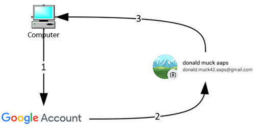
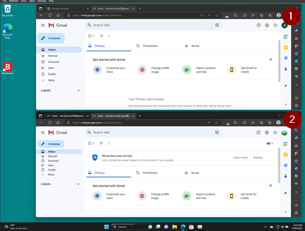

# En separat Google-konto til AAPS (valgfri)

Nogle **AAPS**-brugere vil hellere bruge deres egen e-mailkonto til **AAPS** også. Andre **AAPS**-brugere (eller deres omsorgspersoner) opretter en separat e-mailkonto til **AAPS**. Det er valgfrit. Nedenfor viser vi et eksempel på, hvordan du gør det.

Hvis du ikke vil oprette en separat Gmail-konto til **AAPS**, kan du gå direkte til næste afsnit, [Byg AAPS](../SettingUpAaps/BuildingAaps.md).

```{admonition} Advantages of a dedicated Google account for AAPS
:class: dropdown

- Med separat plads på Google Drive risikerer du ikke at fylde din personlige Google Drive-grænse op med **Eksporter indstillinger**.
- Hver version af **AAPS** (og hjælpeapps som xDrip, BYODA osv.) bliver gemt ét sted, som ikke afhænger af din computer. Hvis din pc eller telefon bliver stjålet, mistet eller går i stykker, har du stadig adgang.
- Når alle har den samme opsætning med en lignende mappestruktur, er det lettere at give hjælp online.
- Afhængigt af opsætningen (se nedenfor) får du en separat identitet som et alias, du kan bruge i fællesskabet. Det kan beskytte dit privatliv. 
- Børn med type 1-diabetes kan beholde deres egen »daglige« e-mailkonto som mindreårige, mens de bruger **AAPS** og tilknyttede funktioner, som kræver en konto for en voksen.
- Gmail lader dig registrere op til 4 konti med det samme telefonnummer.
```

## Sådan opretter du en separat Google-konto til AAPS

(⌛Ca. 10 minutter)



Krav:

* Du har en Windows-pc (Windows 10 eller nyere) og en Android-telefon (Android 12 eller nyere), som skal køre **AAPS**-appen. Begge har de nyeste sikkerhedsopdateringer, internetadgang og administratorrettigheder, fordi nogle trin kræver, at du downloader og installerer programmer.
* Android-telefonen er allerede sat op med din personlige »daglige« e-mailadresse, f.eks. en Gmail-konto.

```{admonition} Things to consider when setting up your new account
:class: dropdown
- Af hensyn til privatlivet kan du bruge et andet navn end dit eget, som passer til kontoen (f.eks. t1dsuperstar). Så kan du bruge det i offentlige **AAPS**-fora og holde din egen identitet privat. Google kræver en e-mailadresse og et telefonnummer til gendannelse, så kontoen kan stadig spores.
- Den nye **AAPS**-konto bruger det samme telefonnummer til bekræftelse som din »_daglige_« konto. Den bruger den »daglige« e-mailadresse til bekræftelse;
- Vi opsætter videresendelse, så alle e-mails til den nye AAPS-konto bliver sendt videre til din primære konto (så du ikke skal tjekke to forskellige indbakker);
- Brug forskellige adgangskoder til din _daglige_ Gmail-konto og din Gmail-konto til AAPS
- Hvis du bruger Googles »totrinsbekræftelse« (multifaktorgodkendelse) på den ene Gmail-konto, kan du lige så godt bruge den på begge Gmail-konti.
- Hvis du vil bruge Google »Adgangsnøgler« (Passkeys), skal du registrere flere enheder. Så låser du ikke dig selv ude. Gør det kun på enheder, som ingen andre har adgang til (_dvs._ ikke på en pc med en delt konto, som andre kan låse op).
```


```{admonition} Video Walkthrough!
:class: note
Klik [her](<https://drive.google.com/file/d/1dMZTIolO-kd2eB0soP7boEVtHeCDEQBF/view?usp=drive_link>) for at se en video om, hvordan du opretter en separat Google-konto.
```

 Det er de trin, der vises i videoen:

I dette eksempel: 
- Din eksisterende »_daglige_« Google-konto er <donald.muck42@gmail.com>; 
- Din nye »_AAPS_«-Gmail-konto bliver: <donald.muck42.aaps@gmail.com>; 


### Gå til <https://myaccount.google.com> 

 Hvis du allerede er logget ind på Google, kommer du til din »daglige« side **My Account** (Min konto). (1) Klik på dit profilbillede øverst til højre på siden (her et simpelt ) (2) vælg »_add another account_« (tilføj en anden konto).


### Indtast oplysningerne for din NYE separate konto: 

- Indtast den nye konto: 
- Opret konto
- til mit personlige brug. 


### Indtast din persona:
 - Indtast fornavn
 - efternavn
 - fødselsdato (skal være en voksens alder)

### Vælg din NYE e-mailadresse og adgangskode

I dette eksempel bliver ».AAPS« tilføjet til Donald Mucks eksisterende adresse…\
Vælg en adgangskode

### Indtast et telefonnummer, som kan modtage SMS-bekræftelsen

Gmail sender dig nu en unik kode, som du skal indtaste for at bekræfte.

### Indtast e-mailadressen til gendannelse

Her er det din eksisterende »_daglige_« e-mail…

### Gør oprettelsen af kontoen færdig

Gmail viser kontonavnet. Du bliver bedt om at acceptere Gmails vilkår og betingelser og bekræfte dine indstillinger for tilpasning.

### Tilpas visningen af den nye profil

Nu bør du være på Gmails side MyAccount, som viser din nye e-mailkonto til **AAPS**. Profilbilledet er som standard det første bogstav i dit navn. Skift det til noget unikt for at undgå forvirring… i dette eksempel har Donald.Muck.AAPS erstattet  med .

\


### Åbn Gmail-webstedet i begge vinduer for at konfigurere den nye konto

Så du ikke skal holde øje med en separat e-mailkonto, skal du videresende alle e-mails fra den nye **AAPS**-konto til din daglige konto\
Denne del kan være lidt forvirrende, fordi du skal skifte frem og tilbage mellem de to konti. For at gøre det lettere skal du åbne 2 separate browservinduer over hinanden:

1. Flyt din åbne browser til den øverste del af skærmen, og gør den mindre, så den kun fylder ca. den øverste halvdel af skærmen…
2. Højreklik på browserens logo på proceslinjen
3. Vælg »Nyt vindue« i menuen... og juster det, så det kun fylder den nederste halvdel af skærmen.

Åbn <https://gmail.com> i hvert browservindue. Sørg for, at din personlige konto er øverst og den nye **AAPS**-konto er nederst, og at du let kan kende den på profilbilledet i øverste højre hjørne. Hvis du har brug for det, kan du altid skifte konto ved at klikke på profilbilledet og vælge den rigtige.


Dine Gmail-startsider skal se sådan ud:\


 ### I den nye Gmail-konto (nederste vindue) skal du åbne Gmail-indstillingerne…

- Klik på tandhjulet til venstre for profilbilledet
- og vælg derefter »**See all Settings**« (Se alle indstillinger)


### Opsæt videresendelse…

- Klik på fanen »Forwarding and POP/IMAP« (Videresendelse og POP/IMAP)
- Klik på »add a forwarding address« (Tilføj en videresendelsesadresse)
- Tilføj din »daglige« e-mailadresse
- Gmail sender en bekræftelseskode til din »daglige« e-mailadresse.
- Skift tilbage til din daglige profil, og klik på linket for at bekræfte, at du accepterer videresendelsen (eller tag koden fra Gmails bekræftelsesmail i dit »daglige« Gmail-vindue, og klip og indsæt den i dit »nye AAPS« Gmail-vindue).

Du skal skifte en del frem og tilbage mellem vinduerne. Men så ser du også de e-mails, der er videresendt fra din AAPS-konto, f.eks. Gmail-advarsler, når du tjekker e-mails på din »daglige« konto.


### Bekræft den videresendte e-mailadresse

- I den »daglige« Gmail (øverste vindue) får du e-mailen »Gmail forwarding Confirmation« (bekræftelse af videresendelse).
- Åbn den, og »klik på linket for at bekræfte anmodningen«

### Arkivér videresendte e-mails i den nye separate Gmail-konto (nederste vindue)

<!---->

1. Opdater det nederste vindue
2. Vælg »Videresend en kopi af indgående e-mails« (forward incoming email)
3. Og arkivér Gmails kopi (så din nye separate indbakke forbliver ryddelig)
4. Rul helt ned til bunden for at gemme dine ændringer\
   


Tillykke! Nu har du oprettet en separat Google-konto til AAPS. Næste trin er at [bygge AAPS-appen](../SettingUpAaps/BuildingAaps.md).