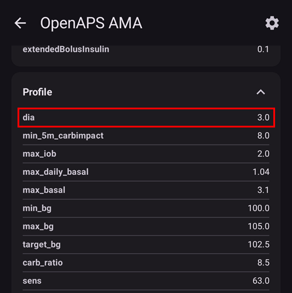

# Ofte stillede spørgsmål for loopere

Sådan tilføjer du spørgsmål til de ofte stillede spørgsmål: Følg denne [vejledning](../SupportingAaps/HowToEditTheDocs.md)

## Generelt

### Kan jeg ikke bare downloade installationsfilen til AAPS?

Nej. Der findes ingen apk-fil af AAPS til download. Du skal selv [bygge](../SettingUpAaps/BuildingAaps.md) den. Her er grunden:

AAPS bruges til at styre din pumpe og give insulin. Efter de nuværende regler i Europa er alle systemer i klasse IIa eller IIb medicinsk udstyr, der kræver myndighedsgodkendelse (en CE-mærkning), som igen kræver forskellige undersøgelser og godkendelser. Det er ulovligt at distribuere et ikke-godkendt medicinsk udstyr. Der findes lignende regler i andre dele af verden.

Reglerne gælder ikke kun for salg (i betydningen at få penge for noget), men for enhver form for distribution (også hvis det gives væk gratis). At bygge et medicinsk udstyr til dig selv er den eneste måde at bruge appen på inden for disse regler.

Derfor er der ingen apk-filer til download.

(FAQ-how-to-begin)=

### Hvordan starter jeg?

Start med [Forberedelse til at starte med AAPS](../Getting-Started/PreparingForAaps.md): den gennemgår alt nedenfor mere detaljeret.

Først skal du **skaffe hardware, der kan bruges til loop**:

* En [understøttet insulinpumpe](../Getting-Started/CompatiblePumps.md), 
* en [Android-smartphone](../Getting-Started/Phones.md) (Apple iOS understøttes ikke af AAPS - du kan se på [iOS Loop](https://loopkit.github.io/loopdocs/)) og
* et [system til kontinuerlig glukosemåling (CGM)](../Getting-Started/CompatiblesCgms.md). 

Dernæst skal du **sætte dine softwarekomponenter op**: [AAPS](../SettingUpAaps/BuildingAaps.md), [CGM/FGM-kilde](../Getting-Started/CompatiblesCgms.md) og en [rapporteringsserver](../SettingUpAaps/SettingUpTheReportingServer.md).

For det tredje skal du lære og **forstå OpenAPS reference design for at kontrollere dine behandlingsfaktorer**. Grundprincippet for lukket loop er, at din [basalrate og dit kulhydratforhold](../SettingUpAaps/YourAapsProfile.md) er korrekte. Alle anbefalinger går ud fra, at dit basalbehov er dækket, og at de toppe eller dale, du ser, skyldes andre faktorer, som derfor kræver enkelte, midlertidige justeringer (motion, stress osv.). De justeringer, som det lukkede loop kan foretage af sikkerhedshensyn, er begrænsede (se maksimal tilladt midlertidig basalrate i [OpenAPS Reference Design](https://openaps.org/reference-design/)). Det betyder, at du ikke vil bruge den tilladte dosering på at rette en forkert grundlæggende basal. Hvis du for eksempel ofte får en lav midlertidig basal op til et måltid, skal din basal sandsynligvis justeres. Du kan bruge [Autotune](#autotune-how-autotune-calculates-adjustments) til at se på en stor mængde data og få forslag til, om og hvordan basaler og/eller ISF skal justeres, og også om kulhydratforholdet skal ændres. Eller du kan teste og indstille din basal på den [gammeldags måde](https://integrateddiabetes.com/basal-testing/).

### Hvilke praktiske sider af at loope skal jeg tænke på?

#### Beskyttelse med adgangskode

Hvis du ikke vil have, at dine indstillinger let kan ændres, kan du beskytte dem med en adgangskode, en PIN eller telefonens biometriske godkendelse (fingeraftryk, ansigt). Åbn **Indstillinger** > **Beskyttelse** > **Beskyttelse af indstillinger**, og vælg typen af beskyttelse. Samme sted kan du også beskytte hele appen eller kun boluser. Se [Beskyttelse af indstillinger](#Preferences-settings-protection) for detaljer.

#### Android Wear-smarture

Hvis du bruger AAPS-appen på uret til at give bolus eller ændre indstillinger, skal hver anmodning bekræftes på uret: når du har sendt den, viser uret en oversigt med knappen **BEKRÆFT**. Se [Betjening af AAPS med dit Wear OS-smartur](../RemoteFeatures/RemoteControlWearOS.md).

(FAQ-disconnect-pump)=

#### Afbryd pumpe

Hvis du tager pumpen af, når du går i bad, svømmer, dyrker sport eller andre aktiviteter, skal du fortælle AAPS, at der ikke gives insulin, så IOB forbliver korrekt.

Pumpen kan afbrydes med [loop-ikonet](#AapsScreens-loop-status) på AAPS-hovedskærmen: tryk på det, og vælg **Afbryd pumpe** med den varighed, du har brug for. Hvis aktiviteten varer længere end planlagt, så tryk på ikonet igen, og vælg en ny varighed: du behøver ikke at genforbinde først. Se [Afbrydelse af pumpen ved bad eller aktivitet](#pumps-cannulas-disconnecting) for at se, hvordan du undgår mangel på insulin ved lange afbrydelser.

#### Anbefalinger bygger ikke kun på én enkelt CGM-måling

Af sikkerhedshensyn bygger anbefalingerne ikke på én enkelt CGM-måling, men på den gennemsnitlige delta. Hvis du mangler nogle målinger, kan det derfor tage et stykke tid, efter data er tilbage, før AAPS begynder at loope igen.

#### Mere at læse

Der findes flere blogs med gode tips, som hjælper dig med at forstå de praktiske sider af at loope. Nogle af dem er ikke længere online: linkene nedenfor, der er markeret med »arkiveret kopi«, åbner en gemt kopi på Internet Archive.

    * [Finjustering af indstillinger](https://web.archive.org/web/20171029031305/http://seemycgm.com/2017/10/29/fine-tuning-settings/) See my CGM (arkiveret kopi)
    * [Hvorfor DIA er vigtig](https://web.archive.org/web/20231130035027/http://seemycgm.com/2017/08/09/why-dia-matters/) See my CGM (arkiveret kopi)
    * [Begræns stigninger efter måltider](https://diyps.org/2016/07/11/picture-this-how-to-do-eating-soon-mode/) #DIYPS
    * [Hormoner og autosens](https://web.archive.org/web/20170902081839/http://seemycgm.com/2017/06/06/hormones-2/) See my CGM (arkiveret kopi)
    

(what-emergency-equipment-is-recommended-to-take-with-me)= (FAQ-emergency-equipment)=

### Hvilket nødudstyr anbefales det at have med?

Du skal have det samme nødudstyr med dig som alle andre med type 1-diabetes i insulinpumpebehandling. Når du looper med AAPS, anbefales det stærkt at have følgende ekstra udstyr med dig eller tæt på dig:

* Batteripakke og kabler til at oplade din smartphone, dit ur og (om nødvendigt) BT-læser eller Link-enhed
* Pumpebatterier
* Adgang til dine sikkerhedskopier, både på telefonen og i skyen (f.eks. Google Drive, Dropbox), så du kan sætte AAPS op igen på en anden telefon (se [Oprettelse og gendannelse af sikkerhedskopier](../Maintenance/ExportImportSettings.md)): 
  * den aktuelle [apk](../SettingUpAaps/BuildingAaps.md) af AAPS og af andre apps, du bruger (f.eks. xDrip, Juggluco, BYODA).
  * din keystore-fil (fra da du byggede apk'en) og dens adgangskode,
  * dine nyeste eksportfiler med indstillinger fra AAPS og dine andre apps,
  * din **AAPS**-hovedadgangskode: du kan ikke importere indstillingsfilen uden den. Hvis du har glemt den, så se [Hvordan nulstiller jeg hovedadgangskoden?](#FAQ-reset-master-password)

(FAQ-organize-backups)=

#### Hvordan organiserer jeg mine sikkerhedskopier?

Eksporter indstillinger meget ofte: efter hvert skift af pod eller reservoir, når du har ændret din profil, når du har godkendt et læringsmål, hvis du skifter pumpe… Selv hvis intet ændrer sig, så eksporter én gang om måneden. Gem flere gamle eksportfiler.

**AAPS** kan gøre det for dig: den kan eksportere dine indstillinger automatisk (f.eks. med en [automatisering](#ExportImportSettings-Automating-Settings-Export) efter hvert podskift) og gemme eksporten direkte i en mappe i skyen (Google Drive). Se [Oprettelse og gendannelse af sikkerhedskopier](../Maintenance/ExportImportSettings.md).

### Hvordan kan jeg sætte CGM/FGM sikkert fast?

Du kan tape den. Der findes flere færdigt perforerede »overpatches« til almindelige CGM-systemer (søg på Google, eBay eller Amazon). Nogle loopere bruger den billigere almindelige kinesiologitape eller rocktape.

Du kan fastgøre den. Du kan også købe overarmsbånd, der holder CGM/FGM fast med et bånd (søg på Google, eBay eller Amazon).

## APS-algoritme

### Hvorfor viser OpenAPS AMA "dia: 3", selvom jeg har en anden DIA i min profil?

Når **OpenAPS AMA** er valgt i **Konfiguration** > **APS**, viser **Åbn plugin** de data, der sendes til algoritmen. I afsnittet **Profil** er `dia` altid 3,0 eller mindre:

I AMA betyder DIA faktisk ikke »varighed af insulinvirkning«. Det er en parameter, som tidligere var knyttet til DIA. Nu betyder den »inden for hvilken tid korrektionen skal være færdig«. Den har intet at gøre med beregningen af IOB. I OpenAPS SMB er der ikke længere brug for denne parameter.

## Andre indstillinger

### Nightscout-indstillinger

(FAQ-nsclient-blocked)=

#### AAPSClient (eller AAPS) uploader ikke data: "Blokeret af…". Hvad kan jeg gøre?

NSClient-status viser, hvorfor der ikke sendes data:

* **Blokeret af forbindelsesmuligheder**: forbindelsesindstillingerne tillader ikke den aktuelle forbindelse. For eksempel bruger du mobildata, men kun Wi-Fi er tilladt, eller du er ikke på et af de tilladte Wi-Fi-netværk (SSID'er).
* **Blokeret af opladningsmuligheder**: forbindelsesindstillingerne tillader kun synkronisering, mens telefonen oplader (eller kun på batteri), og det er ikke tilfældet lige nu.
* **Ingen forbindelse**: telefonen har ingen internetforbindelse.

Kontroller [NSClient-forbindelsesindstillingerne](#Preferences-nsclient): **Brug mobildata**, **Brug roaming**, **Brug WiFi**, **WiFi SSID**, **Synkroniser på batteri** og **Synkroniser under opladning**.

### CGM-indstillinger

(FAQ-advanced-filtering)=

#### Hvorfor siger AAPS »SMB altid og efter kulhydrater deaktiveret, fordi den aktive BS kilde ikke understøtter avanceret filtrering«?

**Aktiver SMB altid** og **Aktiver SMB efter kulhydrater** kan kun bruges med en [pålidelig BS-datakilde](#GettingStarted-TrustedBGSource): en sensor og CGM-app, der kan fortælle **AAPS**, hvilken sensor målingerne kommer fra. Med alle andre BS-kilder slår **AAPS** disse to muligheder fra og viser denne besked. Se listen over pålidelige kilder, og hvis din sensor står på listen, så sørg for, at du bruger en af de CGM-apps, der er vist for den. Se også [Udjævning af blodsukkerdata](../CompatibleCgms/SmoothingBloodGlucoseData.md).

### Pumpe

#### Batterier

Loop kan bruge pumpens batteri hurtigere end normal brug, fordi systemet kommunikerer meget mere via Bluetooth, end en bruger gør manuelt. Det er bedst at skifte batteri ved 25%, fordi kommunikationen derefter bliver svær. Du kan indstille advarselsalarmer for pumpens batteri med variablen PUMP_WARN_BATT_P på din Nightscout-side. Tricks til at forlænge batteriets levetid:

* gør tiden kortere, hvor LCD-skærmen er tændt (i pumpens indstillingsmenu)
* gør tiden kortere, hvor baggrundslyset er tændt (i pumpens indstillingsmenu)
* vælg bip i stedet for vibration i notifikationsindstillingerne (i pumpens indstillingsmenu)
* tryk kun på knapperne på pumpen for at genindlæse, brug AAPS til at se al historik, batteriniveau og reservoirvolumen.
* AAPS-appen bliver på nogle telefoner ofte lukket for at spare strøm eller frigøre RAM. Når AAPS starter igen, opretter den en Bluetooth-forbindelse til pumpen og læser den aktuelle basalrate og bolushistorik igen. Det bruger batteri. For at se, om det sker, skal du aktivere **Registrer start af appen** i NSClient under **Avancerede indstillinger**: Nightscout modtager så en hændelse ved hver genstart af AAPS, hvilket gør det let at følge problemet. For at mindske det skal du slå batterioptimering fra for AAPS, så telefonen ikke lukker appen: se [batteribesparelse](#FAQ-battery-savings) nedenfor.
* rens batteripolerne med en spritserviet, så der ikke er voks eller fedt fra produktionen tilbage.
* for [Dana R/RS-pumper](../CompatiblePumps/DanaRS-Insulin-Pump.md) trækker opstarten en høj strøm fra batteriet for bevidst at bryde passiveringslaget (som forhindrer tab af energi under opbevaring), men det lykkes ikke altid at bryde det 100%. Tag enten batteriet ud og sæt det i igen 2-3 gange, indtil det viser 100% på skærmen, eller brug batterinøglen til kortvarigt at kortslutte batteriet, før du sætter det i: hold den mod begge poler i et splitsekund.
* se også flere tips om [bestemte batterityper](#Accu-Chek-Combo-Tips-for-Basic-usage-battery-type-and-causes-of-short-battery-life)

#### Skift af reservoir og kanyle

Reservoiret skal skiftes direkte på pumpen, og derefter registreres skiftet i **AAPS**. Følg [vejledningen trin for trin til skift af pumpens reservoir og kanyle](#pumps-cannulas-changing-reservoir-and-cannula).

### Baggrundsbillede

Du kan finde AAPS-baggrundsbilledet til din telefon på siden [Telefoner](#Phones-phone-wallpaper).

### Daglig brug

Mange af situationerne nedenfor kan forberedes én gang som en [scene](#scenes): en forudindstilling, der skifter profil, midlertidigt mål og andre indstillinger med ét tryk. **AAPS** har færdige skabeloner, f.eks. *Motion*, *Søvn*, *Alkohol* eller *Badning*.

#### Hygiejne

(what-to-do-when-taking-a-shower-or-bath)=

##### Hvad gør jeg, når jeg går i bad?

Du kan tage pumpen af, når du går i bad. I denne korte tid har du måske ikke brug for den, men du skal fortælle AAPS, at du har afbrudt pumpen, så IOB-beregningerne er korrekte. Se [beskrivelsen ovenfor](#FAQ-disconnect-pump). [Sceneskabelonen](#scenes) *Badning* gør dette for dig.

#### Arbejde

Afhængigt af dit arbejde kan du vælge at bruge andre behandlingsfaktorer på arbejdsdage. Som looper bør du overveje et [profilskift](../DailyLifeWithAaps/ProfileSwitch-ProfilePercentage.md) til din typiske arbejdsdag. For eksempel kan du skifte til en profil over 100%, hvis du har et mindre krævende arbejde (f.eks. sidder ved et skrivebord), eller under 100%, hvis du er aktiv og på benene hele dagen. Du kan også overveje et højt eller lavt midlertidigt mål eller en [tidsforskydning af din profil](#ProfileSwitch-ProfilePercentage-time-shift-of-the-circadian-percentage-profile), når du arbejder meget tidligere eller senere end normalt, eller hvis du har skiftende vagter. Du kan også oprette en ekstra profil (f.eks. »hjemme« og »arbejdsdag«) og lave et dagligt profilskift til den profil, du faktisk har brug for, eller gemme dine indstillinger til arbejdsdage som en [scene](#scenes).

### Fritidsaktiviteter

(FAQ-sports)=

#### Sport

Du skal ændre dine gamle sportsvaner fra tiden før loop. Hvis du bare spiser en eller flere sportskulhydrater som før, vil det lukkede loop-system opdage dem og korrigere for dem.

Så du ville have flere kulhydrater om bord, men samtidig ville loopet modvirke det og give insulin.

Når du looper, kan du prøve disse trin:

* Lav et [profilskift](#ProfileSwitch-change-percentage) under 100%: tryk på profilnavnet på hovedskærmen, tryk på den runde knap **▶**, og indstil derefter **Procent** og **Varighed**.
* Sæt et [midlertidigt mål for aktivitet](#TempTargets-activity-temp-target) over dit normale mål. Med en procent under 100 % og en varighed har den samme **Aktiver**-skærm en **Midlertidigt mål / Aktivitet**-kontakt, der starter begge på én gang.
* Hvis du bruger SMB, så sørg for, at [»Aktiver SMB ved højt midlertidigt mål«](#Open-APS-features-enable-smb-with-high-temp-targets) og [»Aktiver SMB altid«](#Open-APS-features-enable-smb-always) er deaktiveret.

Det er vigtigt at forberede og efterbehandle disse indstillinger. Lav ændringerne i god tid før sport, og tænk på effekten af, at musklerne fyldes op.

[Sceneskabelonerne](#scenes) *Motion* og *Nat efter motion* samler disse indstillinger, så du kan starte dem med ét tryk. Hvis du dyrker sport fast på samme tidspunkt (f.eks. et hold i dit fitnesscenter), kan du overveje at bruge [automatisering](../DailyLifeWithAaps/Automations.md) til at starte profilskiftet og det midlertidige mål eller scenen. Automatisering baseret på placering kan også være en idé, men gør forberedelsen sværere.

Procentdelen i profilskiftet, værdien for dit midlertidige mål ved aktivitet og det bedste tidspunkt for ændringerne er individuelle. Start på den sikre side, når du leder efter den rigtige værdi for dig (start med lavere procent og højere midlertidigt mål).

#### Sex

Du kan tage pumpen af for at være »fri«, men du skal fortælle AAPS det, så IOB-beregningerne er korrekte. Se [beskrivelsen ovenfor](#FAQ-disconnect-pump).

#### At drikke alkohol

Det er risikabelt at drikke alkohol i lukket loop, fordi algoritmen ikke kan forudsige det blodsukker, som alkoholen påvirker, korrekt. Du skal selv finde din metode til at håndtere dette med følgende funktioner i AAPS:

* At deaktivere lukket loop og behandle diabetes manuelt eller
* indstille høje midlertidige mål og deaktivere UAM, så loopet ikke øger IOB på grund af et uanmeldt måltid, eller
* lav et [profilskift](#ProfileSwitch-change-percentage) til tydeligt under 100% 

[Sceneskabelonen](#scenes) *Alkohol* er et udgangspunkt, som du kan tilpasse til din egen metode.

Når du drikker alkohol, skal du altid holde øje med din CGM og selv undgå hypoglykæmi ved at spise kulhydrater.

#### Søvn

##### Hvordan kan jeg loope om natten uden stråling fra mobilnet og Wi-Fi?

Mange brugere sætter telefonen i flytilstand om natten. Hvis du vil have, at loopet hjælper dig, mens du sover, så gør sådan (det virker kun, hvis din CGM-app kører på den samme telefon som AAPS, f.eks. xDrip, Juggluco eller BYODA; det virker IKKE, hvis du får BS-målingerne via Nightscout):

1. Slå flytilstand til på din telefon.
2. Vent, til flytilstand er aktiv.
3. Slå Bluetooth til.

Du modtager nu ikke opkald, og du er heller ikke forbundet til internettet. Men loopet kører stadig.

Nogle har oplevet problemer med lokal udsendelse (AAPS modtager ikke BS-værdier fra xDrip), når telefonen er i flytilstand. I xDrip skal du gå til Settings > Inter-app settings > Identify receiver og indtaste `info.nightscout.androidaps`.

Hvis du vil have andre indstillinger om natten (f.eks. et højere mål), er [sceneskabelonen](#scenes) *Søvn* et godt udgangspunkt.

#### Rejser

##### Hvordan håndterer jeg skift af tidszone?

Med Dana R og Dana R Korean skal du ikke gøre noget. For andre pumper, se siden [Skift af tidszone og sommertid](../DailyLifeWithAaps/TimezoneTraveling-DaylightSavingTime.md) for flere detaljer.

### Medicinske emner

#### Indlæggelse på hospital

Hvis du vil dele information om AAPS og gør-det-selv-loop med dit sundhedspersonale, kan du printe [vejledningen om AAPS til sundhedspersonale](../UsefulLinks/ClinicianGuideToAaps.md).

#### Besøg hos din diabeteslæge

##### Rapporter

Du kan enten vise dine Nightscout-rapporter (https://YOUR-NS-SITE.com/report) eller bruge [Nightscout Reporter](https://nightscout-reporter.zreptil.de/).

## Ofte stillede spørgsmål på Discord og svarene på dem...

### Mit problem står ikke her.

Se [Hvor kan jeg få hjælp?](../GettingHelp/WhereCanIGetHelp.md). Hvis du selv har fundet løsningen, så **mind os om at tilføje den til denne liste!**

### Bygning og installation

(FAQ-build-errors)=

#### Jeg har problemer eller fejl, når jeg bygger appen.

Se fejlfindingssiden for den måde, du bygger **AAPS** på (se [Byg AAPS](../SettingUpAaps/BuildingAaps.md)):

* build med en browser: [Build i browseren: fejlfinding](#aaps-ci-troubleshooting),
* build med Android Studio: [Fejlfinding i Android Studio](../GettingHelp/TroubleshootingAndroidStudio.md).

(FAQ-build-error-file-name-too-long)=

#### Build-fejl: filnavnet er for langt

Denne fejl kan ske, når du bygger med Android Studio: buildet stopper med en fejl om, at filnavnet er for langt. Mulige løsninger: Flyt dine kildefiler til en mappe tættere på roden af dit drev (f.eks. "C:\src\AndroidAPS").

I Android Studio: Sørg for, at »Gradle« er færdig med at synkronisere og indeksere, efter du har åbnet projektet og hentet fra GitHub. Kør en Build->Clean Project, før du laver en Rebuild Project. Kør File->Invalidate Caches and Restart i Android Studio.

(FAQ-running-dev-version)=

#### Advarsel: Kører dev version. Lukket loop er deaktiveret

**AAPS** viser denne besked, når du kører en udviklingsversion (dev) uden engineering mode: i en dev-version virker lukket loop kun i engineering mode.

Dev-versionen er beregnet til test, ikke til rigtig loop: læs [Udviklingsgren](../AdvancedOptions/DevBranch.md), før du går videre.

Sådan slår du engineering mode til:

1. Læg en fil med navnet `engineering_mode` i undermappen `extra` i din AAPS-mappe (den mappe, du valgte i opsætningsguiden, som regel `AAPS/extra`). Enhver fil kan bruges, så længe den har det rigtige navn.
2. Genstart **AAPS**, så den finder filen.

Tip: Lav en kopi af en eksisterende logfil, og omdøb den til "engineering_mode" (bemærk: ingen filtypenavn!).

### Mål

#### Jeg sidder fast i et læringsmål og har brug for hjælp.

Læs først [Gennemførelse af læringsmålene](../SettingUpAaps/CompletingTheObjectives.md). Hvis du stadig sidder fast, så tag et skærmbillede af spørgsmålet og svarene, og læg dem på AAPS-kanalen på Discord. Husk at fortælle, hvilke muligheder du vælger (eller ikke vælger), og hvorfor. Du får tips og hjælp, men du skal selv finde svarene.

### Indstillinger, adgangskoder og sikkerhedskopier

(FAQ-reset-master-password)=

#### Hvordan nulstiller jeg hovedadgangskoden?

Hvis du har glemt din hovedadgangskode, kan du nulstille den til din pumpes serienummer:

1. Opret en tom fil med navnet `PasswordReset` (uden filtypenavn) i undermappen `extra` i din AAPS-mappe (som regel `AAPS/extra`).
2. Genstart **AAPS**. Din pumpe skal være forbundet: **AAPS** viser "Venter på pumpe…" og skal læse pumpens serienummer inden for 30 sekunder.
  
  For at genstarte skal du lukke **AAPS** med **menu** (☰) > **Afslut** og derefter åbne den igen. **AAPS** leder kun efter filen, når den starter helt forfra. Det er ikke nok at lukke skærmen eller stryge appen væk, fordi **AAPS** bliver ved med at køre i baggrunden. Hvis "Venter på pumpe…" ikke vises, så brug **Tving til at standse** i Androids **Appinfo** for **AAPS**, eller genstart din telefon. Det virker også at installere din aktuelle **AAPS**-apk igen oven på den installerede app: den beholder dine indstillinger.

3. **AAPS** viser "Adgangskode angivet!": din hovedadgangskode er nu din **pumpes serienummer**. Filen `PasswordReset` slettes automatisk.

4. Åbn **Indstillinger** > **Beskyttelse** > **Hovedadgangskode**, og indstil en ny adgangskode.

Hvis pumpen ikke nås i tide, ændres intet: kontroller forbindelsen til pumpen, og prøv igen.

Dette nulstiller kun hovedadgangskoden. En adgangskode eller PIN til indstillinger, appen eller bolus nulstilles ikke, men du kan altid bruge hovedadgangskoden i stedet.

    {admonition} Gamle indstillingsfiler
    :class: warning
    Indstillingsfiler, der er eksporteret med den gamle hovedadgangskode, kan kun importeres med den gamle adgangskode.

(FAQ-where-are-settings-files)=

#### Hvor finder jeg indstillingsfilerne?

Indstillingsfiler gemmes i undermappen `preferences` i den AAPS-mappe, du valgte i [opsætningsguiden](#SetupWizard-StoragePermission) (f.eks. `/internal storage/AAPS/preferences`). Hvis du har sat en mappe i skyen op (Google Drive), kan dine eksporter også gemmes der. Se [Oprettelse og gendannelse af sikkerhedskopier](../Maintenance/ExportImportSettings.md).

ADVARSEL: Pas på ikke at miste din adgangskode, for uden den kan du ikke importere en krypteret indstillingsfil!

(FAQ-import-settings-earlier-versions)=

#### Hvordan importerer jeg indstillinger fra ældre versioner af AAPS til AAPS v3 eller v4?

Du kan kun importere indstillinger (i AAPS v3 eller v4), som er eksporteret med AAPS v2.8x eller nyere. Hvis du brugte en version af AAPS ældre end v2.8x, eller hvis du skal bruge eksporterede indstillinger, der er ældre end v2.8x, skal du først installere AAPS v2.8. Importer de ældre indstillinger fra v2.x i v2.8. Når du har kontrolleret, at alt er i orden, kan du eksportere indstillingerne fra v2.8. Installer den aktuelle AAPS-version, og importer indstillingerne fra v2.8 i den.

Hvis du bruger den samme nøgle til at bygge den gamle og den nye version, behøver du ikke engang at importere indstillinger. Du kan installere den nye version oven på den gamle.

Der er tilføjet nogle nye læringsmål. Du skal godkende dem.

(FAQ-delete-treatments)=

#### Hvor kan jeg slette behandlinger?

Åbn **menuen** (☰), og vælg **Behandlingshistorik**. Tryk længe på en post for at vælge den, tryk på flere poster om nødvendigt, tryk derefter på ikonet **skraldespand**, og bekræft. Se [Behandlingshistorik](#aaps-screens-treatments).

### Problemer med telefon og forbindelse

(FAQ-aaps-stops)=

#### AAPS stopper hver dag omkring samme tidspunkt.

* På nogle telefoner kan Google Play Protect lukke **AAPS** hver morgen. Hvis det sker, så gå til indstillingerne for Google Play, og deaktiver **Google Play Protect**.
* Se efter »rengørings«-apps (f.eks. CCleaner) og afinstaller dem.
* Slå al batterioptimering fra for **AAPS** (se [batteribesparelse](#FAQ-battery-savings) nedenfor).

(FAQ-battery-savings)=

#### Hvordan indstiller jeg batteribesparelse?

Din telefon kan sætte **AAPS** og tilhørende apps (CGM-app, Bluetooth) på pause, når du ikke bruger den. Så kan **AAPS** ikke gøre sit arbejde, og Bluetooth-forbindelserne til sensor og pumpe (eller RileyLink) kan blive lukket. Det giver advarsler om »pumpe utilgængelig« og kommunikationsfejl.

Slå batterioptimering fra for **AAPS**, din CGM-app (f.eks. xDrip) og systemappen Bluetooth. Hvordan du gør det, afhænger af telefonens mærke, model og Android-version:

* se [Batterioptimering](#generaltroubleshooting-android-related-issues) for Pixel-, Samsung- og Huawei-telefoner,
* i **AAPS** skal du åbne **menuen** (☰) > **Om** og trykke på **Dræb ikke min app?**, eller besøg [Don't kill my app](https://dontkillmyapp.com/) for andre mærker.

Hvis du ikke er sikker på, at batteribesparelse er årsagen til dit problem, kan du midlertidigt slå al batteribesparelse fra på telefonen: dit batteri aflades hurtigere, men du ser hurtigt, om problemet forsvinder.

(FAQ-pump-unreachable-alerts)=

#### Advarsler om, at pumpen er utilgængelig, flere gange om dagen eller om natten.

Din telefon sætter måske **AAPS** eller endda Bluetooth på pause, så forbindelsen til pumpen eller RileyLink mistes (se [batteribesparelse](#FAQ-battery-savings) ovenfor).

Du kan også ændre, hvornår advarslen kommer: tryk på ikonet **Indstillinger** (tandhjul) øverst til højre på hovedskærmen, og vælg derefter **Lokale alarmer** > **Grænse for utilgængelig pumpe** (30 til 300 minutter). Se siden for din pumpe: nogle anbefaler en værdi, f.eks. 120 minutter for [Omnipod DASH](../CompatiblePumps/OmnipodDASH.md).

(FAQ-link-unresponsive)=

#### Min link/pumpe/pod svarer ikke (RL/OL/EmaLink…)

Med nogle telefoner afbrydes Bluetooth-forbindelsen til Link-enhederne (RL/OL/EmaLink).

Nogle har også Link-enheder, der ikke svarer (AAPS siger, at de er forbundet, men Link-enhederne kan ikke nå eller styre pumpen).

Prøv først knappen **Nulstil RileyLink** på pumpeskærmen (se siden for din pumpe: [Medtronic](#MedtronicPump-what-to-do-if-i-loose-connection-to-rileylink-and-or-pump), [Omnipod Eros](#OmnipodEros-reset-rileylink-config-notes)). Hvis det ikke hjælper, er den letteste måde at få alle delene til at virke sammen:

1. Sluk for Link-enheden.
2. Luk **AAPS** (**menu** (☰) > **Afslut**).
3. Tryk længe på ikonet for **AAPS**, åbn Androids **Appinfo**, tryk på **Tving til at standse** og derefter **Lagerplads** > **Ryd cache** (ryd IKKE lagerplads/data!).
4. Nogle få telefoner skal måske genstartes her. Du kan prøve uden genstart.
5. Tænd for Link-enheden.
6. Start **AAPS**.
7. Tryk på **Par RileyLink** på pumpeskærmen, og vælg din Link-enhed igen.

### Fjernstyring

(FAQ-aapsclient)=

#### Opsætning og brug af AAPSClient-appen til fjernstyring

**AAPSClient** er en separat app, som lader en omsorgsperson følge og styre **AAPS** på afstand. Siden **AAPS** v4 kræver styring af **AAPS** fra AAPSClient, at de to apps parres én gang. Se:

* [AAPSClient-appen](#aapsclient-app): installation, første start og parring,
* [Styring mellem hovedenhed ↔ klient](#client-master-control): hvad der kan styres, og hvordan parring virker,
* [AAPSClient på et smartur](#remotecontrol-smartwatches).

(FAQ-hardened-mode)=

#### Behandlinger, som jeg indtaster på Nightscout-hjemmesiden, bliver ikke brugt

Det skyldes [hærdet tilstand](#client-master-control-hardened-mode). Mens klientstyring er slået til — altid i Simpel tilstand — tager **AAPS** kun imod ændringer fra parrede klienter, ikke fra Nightscout-hjemmesiden eller andre apps. Indtast dem i stedet på en parret **AAPSClient**.

### Alarmer og advarsler

#### Jeg har et rødt advarselsmærke (rød trekant) / AAPS vil ikke aktivere lukket loop / Loop bliver i LGS / Jeg havde en gul trekant

Det røde advarselsmærke på genvejen til BS-kilden er en sikkerhedsfunktion i AAPS. Se [BS-advarselstegn](#aaps-screens-bg-warning-sign) for den fulde forklaring.

Et rødt advarselsmærke på genvejen til BS-kilden i den nederste bjælke (den røde trekant i ældre versioner) betyder, at du har dobbelte BS-værdier, og at AAPS ikke kan beregne delta præcist. Et lukket loop skiftes til tilstanden **Stop ved lavt BS**: det sænker eller stopper stadig din basal for at beskytte dig mod lavt blodsukker, men det giver ingen korrektionsinsulin. Du skal slette én BS-værdi af hver dobbelt værdi for at fjerne advarslen. Tryk på genvejen for at åbne din [BS-kilde-skærm](#aaps-screens-bg-source): den dobbelte værdi er markeret med rødt. Tryk længe på en linje, du vil slette, marker én af hver dobbelt linje, og tryk på ikonet skraldespand. Du skal måske nulstille AAPS-databaserne, hvis der er for mange dobbelte BS-værdier. I så fald mister du også statistik, IOB, COB og valgt profil.

Når advarslen er væk, går AAPS ikke selv tilbage til **Lukket loop**. Tryk på loop-ikonet på hovedskærmen, og vælg **Lukket loop** igen.

Mulig årsag til problemet: xDrip og/eller NS udfylder manglende BS-værdier bagudrettet (backfilling).

Den gule trekant i ældre versioner betød ustabil tid mellem hver BS-måling (BS-værdier kommer ikke regelmæssigt hvert 5. min, eller BS-værdier mangler). Det sker ofte med Libre eller efter skift af sender på G6. **AAPS** 4 viser den ikke længere: den genberegner værdierne i baggrunden, og loopet virker korrekt.

### Omnipod DASH

(FAQ-move-dash-pod)=

#### Kan jeg flytte en aktiv DASH-pod til en anden telefon?

Podens tilstand er med i de eksporterede indstillinger, så en aktiv pod kan flyttes til en anden telefon ved at eksportere indstillingerne lige før flytningen og importere dem på den anden telefon. Det er ikke officielt understøttet, og der er risiko for at miste poden: prøv det om muligt, når din pod snart udløber.

Læs først disse afsnit:

* [Eksporter og importer indstillinger](#omnipod-dash-export-import) på siden om Omnipod DASH og [Slangeløse pumper](#ExportImportSettings-tubeless-pumps): sæt på den nye telefon flueben i **Erstat også pumpeindstillinger**, og brug en fil, der er eksporteret, mens du har din nuværende pod på,
* [Kassering af en pod](#omnipod-dash-discard-pod), så du bagefter kan fjerne poden fra den gamle telefon. Hold den gamle telefon i flytilstand, indtil poden er kasseret, så de to telefoner aldrig taler med poden på samme tid.