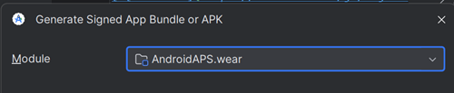
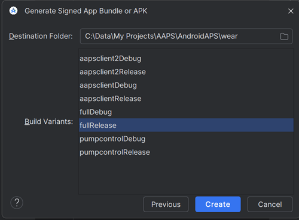

# Byg AAPS-appen til Wear OS

**AAPS**-appen til et Wear OS-smartur (**Wear-apk'en**, `aaps-wear-….apk`) er en separat installationsfil, adskilt fra **AAPS**-appen til telefonen. Du skal bruge begge: telefonappen kører loopet, urappen viser dens data og kan sende kommandoer til den. Urappen installeres fra telefonen, se [Opsæt AAPS på dit Wear OS-ur](WearOsSmartwatch.md).

De to apps virker kun sammen, når de passer til hinanden:

- **Samme AAPS-version** på telefonen og på uret.
- **Samme keystore** bruges til at signere begge apps.

Den nemmeste måde at sikre dette på er at bygge begge apps **på samme tid**, i det samme build. Build i browseren gør det for dig: hvert build laver telefon-apk'en og Wear-apk'en sammen. Med Android Studio eller kommandolinjen bygger du Wear-apk'en som et andet trin lige efter telefon-apk'en.

```{note}
Bruger du allerede **AAPS** på din telefon, men har ingen Wear-apk fra det samme build? Byg begge apps igen med det samme keystore, og geninstaller også telefonappen. En Wear-apk, der er bygget måneder senere eller med en anden version af Android Studio, er sandsynligvis ikke kompatibel med telefonappen.
```

## Understøttede Wear OS-versioner

**AAPS** kører på ure med **Wear OS 3.0, 3.2 eller 3.5** (Android 11, API-niveau 30) **eller nyere** (Wear OS 4, 5 og 6). Ure med Wear OS 2 understøttes ikke.

```{warning}
AAPS-urskiver findes til Wear OS-smarture med API-niveau 30 til 33 (Wear OS 3.0, 3.2, 3.5 og 4).<br>
Nyere Wear OS-versioner ødelægger AAPS-urskiverne mere og mere – se [Ændringer i Wear OS-urskiver](#wearos-watchface-changes) og [begrænsningerne i Wear OS 5](#BuildingAapsWearOs-WearOS5).
```

(building-aaps-wear-os-method)=

## Få Wear-apk'en med din build-metode

Følg afsnittet for den metode, du bruger på siden [Byg AAPS](../SettingUpAaps/BuildingAaps.md).

(building-aaps-wear-os-browser)=

### Build i browseren (anbefalet)

**Du skal ikke gøre noget ekstra.** Hvert build i browseren laver to filer fra den samme kildekode og det samme keystore:

- `aaps-….apk`: telefonappen.
- `aaps-wear-….apk`: urappen.

Wear-apk'en følger den [variant](#browserbuild-variant), du har valgt til buildet: `fullRelease` giver appen **AAPS Wear**, `aapsclientRelease` appen **AAPSClient Wear**, `pumpcontrolRelease` appen **PumpControl Wear**. Hver Wear-app taler kun med den telefonapp, der passer til den.

Her finder du Wear-apk'en:

- **AAPS Builder**: rul ned til **Artifacts** på build-siden, og download `aaps-wear-….apk` ved siden af telefonappen, som vist i [Trin 5 – Installer appen på din telefon](#aaps-builder-step5). Download den på den telefon, der kører **AAPS**, hvis du installerer urappen fra telefonen (Wear Installer 2 eller Easy Fire Tools), eller på din computer, hvis du bruger ADB.

  

- **Fork med Google Drive**: åbn dit Google Drive, mappen `AAPS` og derefter mappen for den version, du har bygget. Den indeholder telefon-apk'en og Wear-apk'en, se [Trin 4 – Byg APK'en](#github-build-apk).

  

Gem Wear-apk'en sammen med telefon-apk'en i dine sikkerhedskopier. Med **AAPS Builder** bliver filerne kun liggende på build-siden i 14 dage.

Næste trin: installer Wear-apk'en på uret, se [Opsæt AAPS på dit Wear OS-ur](WearOsSmartwatch.md).

(building-aaps-wear-os-android-studio)=

### Android Studio

Wear-apk'en bygges som telefon-apk'en, som et andet signeret build. Gør det lige efter telefon-apk'en, med den samme version af Android Studio og det samme keystore.

- Følg vejledningen i [Build med Android Studio](../SettingUpAaps/ComputerBuild.md).
- Når du når til [valg af modul](#Building-APK-wearapk) i »Byg den signerede AAPS-apk«, skal du vælge **`AndroidAPS.wear`**.



Vælg »**fullRelease**« for at lave **AAPS** Wear-apk-filen.



Hvis du foretrækker det, kan du i stedet bygge **»pumpcontrolRelease«** fra rullemenuen. Med den kan du kun fjernstyre pumpen, men uden loop.

Næste trin: installer Wear-apk'en på uret, se [Opsæt AAPS på dit Wear OS-ur](WearOsSmartwatch.md).

(building-aaps-wear-os-troubleshooting)=

#### Fejlfinding af build i Android Studio

Når den fulde **AAPS**-app bygges (og faktisk enhver signeret app), laver Android Studio en .json-fil i den samme mappe. Det giver så fejl med [ændringer, der ikke er committet](#troubleshooting_androidstudio-uncommitted-changes), når du prøver at bygge den næste signerede app, f.eks. **AAPS** Wear-appen. Den hurtigste måde at løse det på er at gå til den mappe, hvor den fulde AAPS-app er bygget. Din mappe er sandsynligvis noget i stil med:

`C:\Users\Your Name\AndroidStudioProjects\AndroidAPS\app\full\release.`

Slet enten den unødvendige .json-fil, eller flyt den ud af mappen. Prøv derefter at bygge **AAPS** Wear-appen igen. Hvis det ikke virker, hjælper den mere detaljerede [Fejlfinding i Android Studio](../GettingHelp/TroubleshootingAndroidStudio.md) dig med at finde den fil, der giver problemet. Det kan også være din keystore-fil.

(building-aaps-wear-os-cli)=

### Kommandolinje

Følg [Byggevejledning til kommandolinjen](../SettingUpAaps/CLIBuild.md), og gentag trinene for kompilering og signering for modulet `wear` med det samme keystore:

```sh
./gradlew :wear:assembleFullRelease
```

Den usignerede Wear-apk bliver gemt under `wear/build/outputs/apk/full/release/`. Signer den med `apksigner` præcis som telefon-apk'en, og installer den derefter på uret, se [Opsæt AAPS på dit Wear OS-ur](WearOsSmartwatch.md).
