# Opsæt AAPS på dit Wear OS-ur

Vejledningen herunder gælder for **AAPS Wear**-apk'en, som du skal bygge. Hvis du ikke har bygget den endnu, så se vejledningen [her](../WearOS/BuildingAapsWearOS.md). Når du bygger, skal du bruge den samme keystore-fil, som du brugte til **AAPS**-apk'en til telefonen.

Du kan også bruge noget af informationen til **AAPSClient**- og **PumpControl**-**Wear**-apk'en. Hver **Wear**-app kommunikerer med den tilsvarende app på telefonen. For eksempel kan appen **AAPSClient Wear** bruges til at vise data fra **AAPSClient** og ikke data fra **AAPS**. Når flere klientvarianter (**AAPSClient**, **AAPSClient2**, **AAPSClient3**) er installeret side om side, har hver variants felter en lille overskrift i variantens accentfarve, så du kan kende dem fra hinanden, når du stryger.

## Wear OS-versioner og kompatibilitet

(wearos-watchface-changes)=

### Ændringer i Wear OS-urskiver (virkning på AAPS-urskiver)

```{admonition} Why newer Wear OS watches break AAPS watchfaces
:class: warning

I juni 2025 [annoncerede](https://android-developers.googleblog.com/2025/06/upcoming-changes-to-wear-os-watch-faces.html) Google ændringer, der udfaser den gamle urskivemotor (AndroidX / Wearable Support Library, eller »WSL«-motoren) til fordel for det nyere deklarative **Watch Face Format**. **AAPS**-brugerdefinerede urskiver er bygget på den gamle motor. Jo nyere Wear OS-versionen er, jo større er risikoen for, at en AAPS-urskive opfører sig forkert eller holder op med at virke.

Det gælder specifikt **urskiverne** – AAPS-**komplikationer**, felter og fjernstyringsfunktioner er ikke berørt. Det er også grunden til, at **en firmware-/systemopdatering på et Wear OS-ur kan ødelægge AAPS-urskiver**, og et ur kan ikke bagefter sættes tilbage til en ældre Wear OS-version. Hvis din AAPS-urskive virker nu, så **slå automatiske opdateringer af uret fra**.
```

Tabellen herunder viser, hvordan Googles ændring påvirker AAPS-urskiverne (med den gamle motor) for hver Wear OS-version:

| Wear OS-version         | Android-grundversion | API-niveau | Virkning på AAPS-urskiver (gamle)                                                                                                                                                                      |
| ----------------------- | -------------------- | ---------- | ------------------------------------------------------------------------------------------------------------------------------------------------------------------------------------------------------ |
| Wear OS 6               | Android 16           | 36         | **Gamle urskiver findes ikke længere** – AAPS installerer i stedet en [urskive i Watch Face Format](#wearos-aaps-v4-watchface): din brugerdefinerede urskive eller AAPS V4-urskiven med komplikationer |
| Wear OS 5               | Android 14           | 34         | **Alvorlig** – aktiv (interaktiv) tilstand fejler ofte, komplikationer fryser, animationer stopper                                                                                                     |
| Wear OS 4               | Android 13           | 33         | **Middel** – begrænsning, manglende opdateringer, delvise fejl                                                                                                                                         |
| Wear OS 3.0 / 3.2 / 3.5 | Android 11           | 30         | **Lav** – den gamle motor understøttes stadig                                                                                                                                                          |

Hvis dit ur kører en version, hvor AAPS-urskiver ikke er pålidelige, kan du i stedet vise AAPS-data med **komplikationer** på en kompatibel urskive, eller bruge [GlucoDataHandler](https://play.google.com/store/apps/details?id=de.michelinside.glucodatahandler) med en komplikation, som får data fra pluginet [Eksterne ledsagerapps](#external-companion-apps) i **AAPS**. På **Wear OS 6 og nyere** installerer AAPS en erstatningsurskive, der er bygget i det nye format – se nedenfor.

(wearos-aaps-v4-watchface)=

### Wear OS 6 og nyere – den urskive, AAPS installerer

Ure med **Wear OS 6 eller nyere** kan ikke køre de klassiske AAPS-urskiver som urskiver. Til disse ure har AAPS-urappen to urskiver, der er bygget i Googles nye **Watch Face Format**. Wear OS lader en app installere kun **én** urskive, så du vælger, hvilken af de to der er på uret:

- **Brugerdefineret urskive** (standard): viser den brugerdefinerede urskive, du har indlæst fra telefonen med **Indlæs urskive** (se [Skift til en AAPS-urskive](#WearOS_changing-to-AAPS-watchface)). Uret tegner dit design som et billede, så alle eksisterende brugerdefinerede urskiver virker. De komplikationspladser, som en brugerdefineret urskive kan have, er **ikke tilgængelige** i dette billede, fordi Wear OS kun sender komplikationsdata til en rigtig urskive. Tryk længe på urskiven for at komme til dens ene indstilling: om skærmen, der altid er tændt, viser et almindeligt ur eller dit eget design, dæmpet.
- **Urskive med komplikationer** (urskiven **AAPS V4**): dens **syv komplikationspladser** er **sat op på forhånd med AAPS-data**: BS-værdi, IOB, COB, [komplikationen BS-graf](#Watchfaces-complications), basalrate / midlertidigt mål og ikonet for **Loop-tilstand** i pladsen øverst til venstre (tryk på det for at skifte loop-tilstand fra uret). Tryk på klokkeslættet øverst for at åbne urets alarm-app. Du kan ændre, hvad hver plads viser, i urets editor til urskiver.

Du vælger på telefonen: åbn pluginet **Ur**, og vælg en af de to under **Urskive installeret på uret**. Dette kort vises kun, mens et ur med Wear OS 6 eller nyere er forbundet. **AAPS** beder dig bekræfte, fordi uret skifter sin urskive med det samme. Når du skifter væk fra **Urskive med komplikationer**, bliver de komplikationer, du har ændret i urets editor til urskiver, også sat tilbage til standard, og bekræftelsen siger det. Mens **Urskive med komplikationer** er valgt, er knapperne til brugerdefinerede urskiver skjult, og i stedet vises et eksempel på urskiven. Hvis du indlæser en brugerdefineret urskive, mens **Urskive med komplikationer** er valgt, minder **AAPS** dig om at skifte til **Brugerdefineret urskive** for at se den på uret.

- Den valgte urskive bliver **installeret og aktiveret automatisk**, første gang AAPS-urappen kører på sådan et ur, og den bliver **opdateret automatisk** sammen med urappen.
- Hvis du har fjernet urskiven, vises punktet **Installer urskive** nederst i urets AAPS-**hovedmenu** – tryk på det for at installere den igen.

Mens et ur med Wear OS 5 eller ældre er forbundet, vises kortet **Urskive installeret på uret** slet ikke (den teknik, det bygger på, kræver Wear OS 6); de klassiske urskiver kører der som før.

(wearos-complications-watchface-setup)=

### Urskive med komplikationer – anbefalet opsætning

**Urskive med komplikationer** har syv komplikationspladser. Tryk længe på urskiven, tryk på **Customize**, og vælg en datakilde til hver plads. Pladserne er nummereret som i urets editor til urskiver: **1** venstre, **2** midten, **3** højre, **4** grafen, **5** nederst, **6** øverst til venstre og **7** øverst til højre.

| Standardopsætning                                                                                      | Alternativ opsætning                                                                                          |
| ------------------------------------------------------------------------------------------------------ | ------------------------------------------------------------------------------------------------------------- |
| 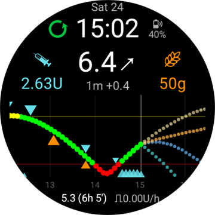 | 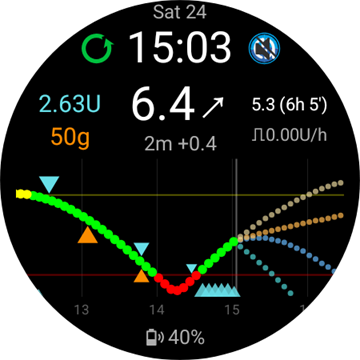 |

| Plads | Placering          | Standard                                                               | Alternativ                           |
| ----- | ------------------ | ---------------------------------------------------------------------- | ------------------------------------ |
| 1     | Venstre            | IoB-ikon                                                               | CoB & IoB                            |
| 2     | Midten             | Blodsukker                                                             | Blodsukker                           |
| 3     | Højre              | CoB-ikon                                                               | BR & mål                             |
| 4     | Graf               | BS-graf                                                                | BS-graf                              |
| 5     | Nederst            | BR & mål                                                               | Uploader-/telefonbatteri             |
| 6     | Øverst til venstre | Loop-tilstand                                                          | Loop-tilstand                        |
| 7     | Øverst til højre   | Uploader-/telefonbatteri eller en app-genvej til **AAPS Snooze Alarm** | App-genvej til **AAPS Snooze Alarm** |

Genvejen **AAPS Snooze Alarm** vælges blandt urets egne komplikationer af typen **App shortcut** (app-genvej). Når du trykker på den, udsættes den alarm, der lyder på telefonen.

```{tip}
Slå **Always-on display** (skærm, der altid er tændt) til på uret (**Settings** > **Display**). Urskiven bliver så ved med at vise dit blodsukker, når håndleddet er nede, i stedet for en tom skærm eller et almindeligt ur.
```

```{admonition} No complication data while the watch is locked
:class: note
Hvis der er valgt en **Lock type** (låsetype) under **Settings** > **Security and privacy**, skjuler uret komplikationsdata, mens det er låst, og urskiven viser tomme pladser, indtil du låser det op. Slå **Hide information** fra i den samme menu for at beholde dataene synlige.
```

### Wear OS 3

Installer **AAPS Wear**-apk'en med [Wear Installer 2](https://youtu.be/abgN4jQqHb0?si=5L7WUeYMSd_8IdPV), Easy Fire Tools (beskrevet nedenfor) eller ADB.  
Ingen begrænsninger i **AAPS Wear**-funktionerne.

(BuildingAapsWearOs-WearOS5)=

### Wear OS 4 og Wear OS 5

Eksempel: Galaxy Watch 4, 5, 6, 7 og Ultra eller Pixel Watch, som **ikke** er opdateret til Wear OS 6 endnu. Tjek versionen under **Settings** > **About watch** > **Software**.

Installer **AAPS Wear**-apk'en med [Wear Installer 2](https://youtu.be/abgN4jQqHb0?si=5L7WUeYMSd_8IdPV) (til Wear OS 5 skal du følge [denne video](https://www.youtube.com/watch?v=yef_qGvcCnk)). Alle **AAPS Wear**-funktioner virker, men de klassiske **AAPS**-urskiver er begrænsede som beskrevet i tabellen ovenfor: begrænset på Wear OS 4, fejler ofte på Wear OS 5.

```{admonition} Wear OS 5
:class: warning
På Wear OS 5 skal AAPS-urskiven vælges med Wear Installer 2 lige efter installationen af Wear-appen: installationsprogrammet tilbyder urskiven **AAPS (Custom)** til sidst i installationen. Hvis du kommer til at skifte til en anden urskive, så gentag installationen. Det er måske ikke muligt at ændre urskivens indstillinger (Mørk, Matchende skilletegn osv.).

Hvis den klassiske urskive virker for dig nu, så **slå automatiske opdateringer af uret fra**: den næste firmwareopdatering vil sandsynligvis ødelægge den. Hvis du alligevel opdaterer til Wear OS 6, så læs afsnittet ovenfor: **AAPS** installerer så sin egen urskive i det nye format.
```

Hvis urskiven er for upålidelig, så overvej i stedet [GlucoDataHandler](https://play.google.com/store/apps/details?id=de.michelinside.glucodatahandler) med en komplikation. Det kræver, at pluginet [Eksterne ledsagerapps](#external-companion-apps) er aktiveret i **AAPS**.

### Wear OS 6 og nyere

Eksempel: Galaxy Watch 4 og nyere med One UI 8 Watch, Pixel Watch efter opdateringen i 2025. De fleste Galaxy- og Pixel-ure har fået denne opdatering.

Installer **AAPS Wear**-apk'en med [Wear Installer 2](https://youtu.be/abgN4jQqHb0?si=5L7WUeYMSd_8IdPV). De klassiske urskiver er ikke tilgængelige; **AAPS** installerer automatisk den urskive, der er valgt på telefonen, se [den urskive, AAPS installerer](#wearos-aaps-v4-watchface). Ingen begrænsninger i **AAPS Wear**-funktionerne.

## Sådan sætter du et Samsung Galaxy Watch 4-smartur op med **AAPS**

Dette afsnit går ud fra, at du er helt ny med smarture. Det giver dig en grundlæggende introduktion til et populært ur, **Galaxy Watch 4**, og derefter en trin-for-trin-vejledning i at sætte **AAPS** op på uret.

_Denne vejledning blev skrevet til et Galaxy Watch med Wear OS 3._ På Wear OS 4 og nyere beder uret om en **parringskode**, når en telefon eller computer forbinder via ADB. Både Wear Installer 2 og fremgangsmåden med terminalen [nedenfor](#BuildingAapsWearOs-WearOS5-TShoot) understøtter det.

Her er grundlæggende opsætningsvejledninger til [Galaxy Watch 5](https://www.youtube.com/watch?v=Y5upzOIxwTU) og [Galaxy Watch 6](https://www.youtube.com/watch?v=D6bq20KzPW0)

## Lær dit smartur at kende

Efter den grundlæggende opsætning af dit ur ifølge videoen ovenfor skal du gå til Play Butik på telefonen og hente disse apps: »Galaxy Wearable«, »Samsung« og enten »Easy Fire Tools« eller »Wear Installer 2«.

Der findes mange YouTube-videoer fra andre, som hjælper dig med at lære dit nye smartur at kende, for eksempel:

[https://www.youtube.com/watch?v=tSVkqWNmO2c](https://www.youtube.com/watch?v=tSVkqWNmO2c)

Appen »Galaxy Wearable« har også en del med en brugsanvisning. Åbn Galaxy Wearable på telefonen, søg efter uret, og prøv at parre uret med telefonen. Afhængigt af din version kan du blive bedt om at installere endnu en app, »galaxy watch 4 plugin«, fra Play Butik (det tager et stykke tid at hente). Installer den på telefonen, og prøv derefter igen at parre uret og telefonen i Wearable-appen. Gå igennem en række menuer, og sæt flueben ved forskellige indstillinger.

## Opret en Samsung-konto

Sørg for, at den e-mailkonto, du bruger til at oprette Samsung-kontoen, har en fødselsdato, så brugeren er mindst 13 år. Ellers er Samsungs tilladelser meget svære at godkende. Hvis du har givet dit barn under 13 år en Gmail-konto og bruger den e-mailadresse, kan du ikke bare ændre den til en voksenkonto. En måde at komme uden om det på er at ændre den nuværende fødselsdato, så alderen nu er 12 år og 364 dage. Dagen efter bliver kontoen ændret til en voksenkonto, og du kan fortsætte med at oprette Samsung-kontoen.

(remote-control-transferring-the-aaps-wear-app-onto-your-aaps-phone)=

## Overfør **AAPS** Wear-appen til din **AAPS**-telefon

Du kan overføre Wear.apk fra Android Studio til din telefon på en af disse måder:

a)  brug et USB-kabel til at lægge **AAPS** Wear-apk-filen over på telefonen, og »sideload« den derefter til uret. Overfør Wear.apk til telefonen via USB til mappen Downloads; eller

b)  klip og indsæt Wear.apk fra Android Studio til dit Google Drev.


Du kan sideloade AAPS til uret med enten: 1) Wear Installer 2 2) Easy Fire Tools 3) Android Debug Bridge (ADB) Her anbefaler vi Wear Installer 2, fordi vejledningen og fremgangsmåden i videoen er meget klar og godt forklaret. Hvis Wear Installer 2 ikke virker for dig, så prøv Easy Fire Tools eller ADB, som begge er beskrevet nedenfor.

### Brug Wear Installer 2 til at sideloade **AAPS** Wear fra telefonen til uret

 

Wear Installer 2, udviklet af [Malcolm Bryant](https://www.youtube.com/@Freepoc), kan hentes fra Google Play til din telefon og kan bruges til at sideloade AAPS Wear-appen til uret. Appen har en praktisk [video](https://youtu.be/abgN4jQqHb0?si=5L7WUeYMSd_8IdPV) om, hvordan man sideloader.

```{tip}
For ure med Wear OS 5 skal du følge [denne video](https://www.youtube.com/watch?v=yef_qGvcCnk).
Se tips til fejlfinding [nedenfor](#BuildingAapsWearOs-WearOS5-TShoot).
```

Den giver alle de nødvendige detaljer (det er bedst at åbne videoen på en anden enhed, så du kan se den, mens du sætter telefonen op).

Som nævnt i videoen skal du slå ADB-fejlfinding fra på uret, når du er færdig, så smarturets batteri ikke bliver brugt op.

Du kan også gøre følgende, men ikke på Wear OS 5:

### Brug Easy Fire Tools til at sideloade **AAPS** Wear til uret

1)   Hent _[Easy Fire Tools](https://play.google.com/store/apps/details?id=de.agondev.easyfiretools&hl=en)_ fra Play Butik til telefonen


2)  Gør dig selv til udvikler på uret (når det er sat op og forbundet til telefonen):

Gå til **Settings** > **System** > **About** > **Versions** (navnene på menuerne er forskellige fra mærke til mærke – på nogle ure er det **About watch** > **Software info** > **Software version**).

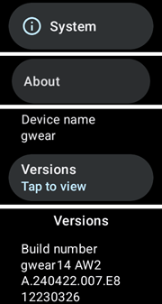

Tryk hurtigt flere gange på **Build number** (eller **Software version**), indtil en besked fortæller dig, at du nu er udvikler.

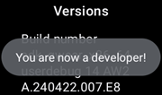

Gå tilbage til **Settings** > **System**: der vises nu en ny menu, **Developer options**.

I **Developer options** skal du slå **ADB debugging** og **Wireless debugging** til og bekræfte spørgsmålene. Wireless debugging viser derefter urets **IP address & Port**, noget i stil med: **192.168.1.214** : 5555. Du skal kun bruge IP-adressen (her **192.168.1.214**), ikke portnummeret efter kolonet. Bemærk, at IP-adressen kan ændre sig, for eksempel hver gang du skifter til en ny telefon til AAPS.

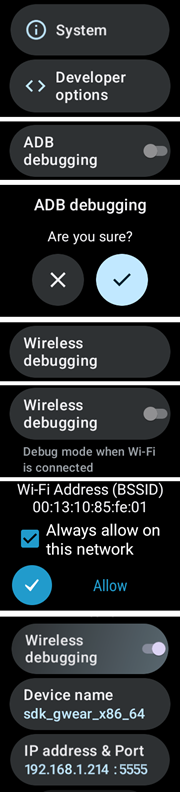

TRIN 3)     Indtast IP-adressen, _f.eks._ **192.168.1.214**, i Easy Fire Tools på telefonen (gå ind i hamburgermenuen til venstre, vælg indstillinger, og indtast IP-adressen).

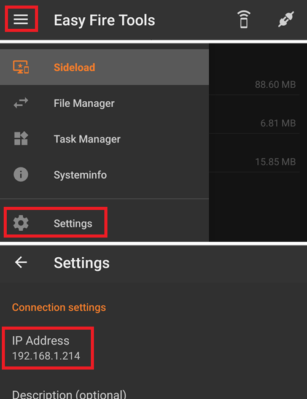

Klik derefter på stikkontakt-ikonet øverst til højre. Den bliver grøn, når den er forbundet.

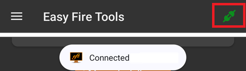


TRIN 4) Følg vejledningen [her](https://wearablestouse.com/blog/2022/01/04/install-apps-apk-samsung-galaxy-watch-4/?utm_content=cmp-true) for at sideloade (dvs. overføre) aaps-wear.apk til smarturet med Easy Fire Tools


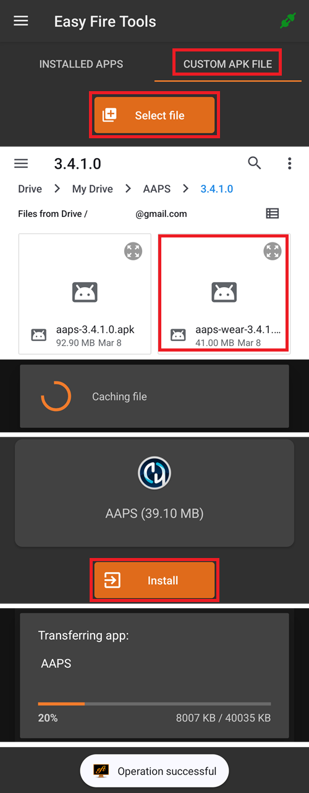


(BuildingAapsWearOs-WearOS5-TShoot)=

### Brug af terminalen
Forbind dit smartur og din computer til det samme Wi-Fi-netværk.

- Du installerer ADB ved at hente det fra: https://developer.android.com/tools/releases/platform-tools
- Åbn en terminal.
- På Windows skal du oprette en ny mappe med navnet `adb` på dit drev `C:`. Åbn filen `platform-tools-latest-windows.zip`, som du hentede ovenfor. Kopier alle filer i `platform-tools` til `C:\adb`, og åbn mappen med en kommandoprompt (højreklik, og vælg Open in Terminal). Skriv kommandoen herunder for at sætte stien til den mappe, hvor ADB ligger: `setx PATH "%PATH%;C:\adb"`
- På en Mac kan du bruge homebrew i stedet for at installere manuelt: `brew install android-platform-tools`

På uret:
- Gå til Settings → About watch → **Software Information**
- Tryk 7 gange på Software version, indtil du ser, at udviklertilstand er slået til.
- Gå til Settings → Developer options. Slå **ADB debugging** til
- Gå til Settings → Developer options → Wireless debugging → **Pair new device**

Du vil se en Wi-Fi-parringskode samt IP-adresse og port:


- I terminalen: `adb pair ipaddress:port` F.eks. `adb pair 10.10.1.125:36299`
- Du bliver bedt om parringskoden. Indtast den.
- Du vil se et svar:<br> `Successfully paired to 10.10.1.125:36299 [guid=adb-RXXXW20LMKJY-eh5zBj]`<br>
- Skriv i terminalen: <br>`adb devices`.<br> Du skulle se noget i stil med:<br> `List of devices attached`<br> `10.10.1.125:36299  offline`<br> `adb-RFAW20LMKJY-eh5zBj._adb-tls-connect._tcp   device`<br>

- Gå nu til den mappe på din computer, hvor Wear-apk'en ligger, og skriv<br> `adb install wear-full.apk` <br>hvor du erstatter wear-full.apk med navnet på din apk-fil.
- Du vil se:<br> `Performing Streamed Install`<br> `Success`


(wear-os-5-troubleshooting)=

### Generelle råd om fejlfinding til Wear OS 5

- Brug ikke Wi-Fi-tethering. Det virker ikke.
- Du behøver ikke at slå adb-fejlfinding til på telefonen (kun på uret). Slå adb-fejlfinding fra på telefonen.
- Sørg for, at du forbinder til dit lokale netværk, hvor telefonen og uret kan se hinanden (brug ikke dit Wi-Fi-gæstenetværk).
- Sørg for, at både uret og telefonen er på det samme netværk og den samme Wi-Fi-enhed. Især Wi-Fi-repeatere eller adgangspunkter kan give problemer.
- Vær tæt på din primære router, og genstart derefter både telefonen og uret.

**Parring:**

- Ur: Trådløs fejlfinding: notér IP-adressen.
- Wear Installer: indtast IP-adressen i appen Wear Installer.
- Vælg »Pair new« (Par ny), og notér den parringskode og det portnummer, der vises.
- Wear Installer: indtast parringskoden + mellemrum + portnummeret.
- Wear Installer skulle melde, at parringen lykkedes. Hvis den ikke gør det, så luk Wear Installer, og prøv igen.

Når de er parret, skulle du kunne installere AAPS Wear-apk'en:

- Afslut/luk, og genstart derefter Wear Installer.
- Under trådløs fejlfinding: notér IP-adressen og portnummeret, og sørg for at tjekke/indtaste IP-adressen og portnummeret i Wear Installer.
- Bemærk: portnummeret er et andet end det, der blev brugt til parringen!

## Opsætning af forbindelsen mellem uret og telefonen fra **AAPS**

Det sidste trin er at sætte **AAPS** op på telefonen, så den arbejder sammen med **Wear.apk** på uret. For at gøre det skal du aktivere pluginet Ur:

* Gå til **AAPS**-appen på telefonen

* Åbn **menuen** (☰) øverst til venstre, og gå til **Konfiguration** > **Kommunikation**

* Sæt flueben i feltet **Ur**


For at give bolus eller udføre andre handlinger fra uret skal du også slå **Styring fra ur** til i [Indstillinger > Ur](#preferences-wear).

For at skifte til en anden **AAPS**-urskive skal du trykke længe på urskiven på urets startskærm og trykke på **Customize**. Stryg derefter til højre, indtil du kommer til alle **AAPS**-urskiverne.

Hvis **AAPS** Wear.apk er blevet sideloadet til smarturet, ser det sådan ud:


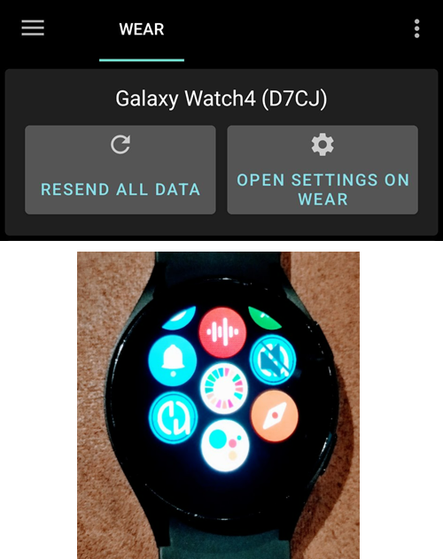


På nogle smarture, f.eks. Samsung Galaxy, skal »Remote Connection« under Samsung Galaxys Advanced Features være slået **til** for at bruge **Wear.apk** & **AAPS** på afstand via Wi-Fi.


(wear-os-watch-phone-communication)=

### Fejlfinding af kommunikationen mellem **AAPS**-uret og **AAPS**-telefonen

1.  Hvis Easy Fire Tools ikke kan forbinde, eller du får »authorisation failed« > tjek, at IP-adressen er indtastet rigtigt.
2.  Tjek, at smarturet er forbundet til internettet (og ikke kun forbundet til telefonen via Bluetooth).
3.  Tjek, at **AAPS**-telefonen og smarturet er parret eller forbundet i Samsung-appen.
4.  Det kan også hjælpe at genstarte telefonen og smarturet helt (det vil sige slukke og tænde telefonen)
5.  Hvis det er lykkedes dig at hente Wear.apk til din telefon, men du ikke modtager BS-data, så _tjek_, at du har sideloadet den rigtige **AAPS** Wear-apk til uret: urappen fra et build i browseren er filen `aaps-wear-….apk`, se [Byg AAPS-appen til Wear OS](../WearOS/BuildingAapsWearOS.md). Hvis den fil, du installerede, er en af følgende: a) en **AAPSClient** Wear-apk (mens telefonen kører **AAPS**); b) en `.aab`-fil; eller c) en fil med ordet ‘debug’ i navnet, så har du ikke valgt den rigtige Wear OS-apk under bygningen.
6.  Tjek, at din router ikke isolerer enhederne fra hinanden.

Du finder flere tips til fejlfinding [her](https://freepoc.org/wear-installer-help-page/#:~:text=If%20you%20are%20having%20problems,your%20phone%20and%20your%20watch.)

(WearOS_changing-to-AAPS-watchface)=

## Skift til en AAPS-urskive på dit Wear OS-ur

Der findes en række urskiver i det almindelige build af AAPS Wear OS-APK'en. Når du har installeret AAPS Wear-APK'en på dit ur, kan du bruge dem. Sådan vælger du en:

1. På dit ur (hvis det er Wear OS): tryk længe på din nuværende urskive for at åbne skærmen til valg af urskive, rul helt til højre, indtil du ser knappen »Add Watch Face« (Tilføj urskive), og vælg den

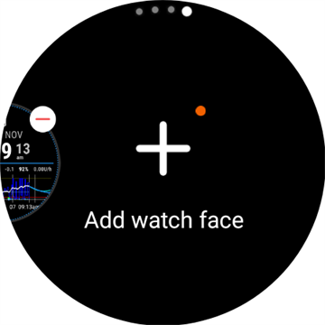

2. Rul gennem listen, indtil du finder »AAPS (Custom)« (afhængigt af uret står urskiverne fra installerede apps under et afsnit »Downloaded« eller er grupperet efter app), og klik midt på billedet for at føje den til din liste over aktuelle urskiver. Du skal ikke bekymre dig om, hvordan urskiven »AAPS (Custom)« ser ud lige nu. Vi vælger dit foretrukne udseende i næste trin.

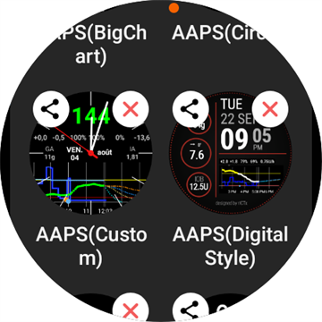

3. Åbn nu AAPS på din telefon, og åbn pluginet Ur: **Konfiguration** > **Kommunikation** > **Ur** > **Åbn plugin** (sæt først flueben ved **Ur**, hvis det ikke er aktiveret).

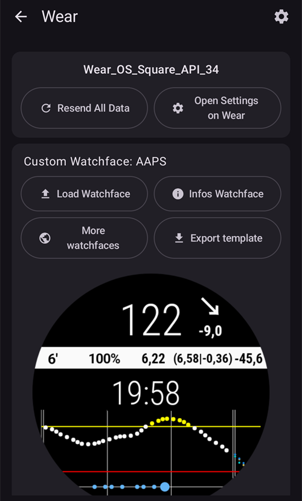

4. Klik på knappen »Indlæs urskive«, og vælg den urskive, du kan lide

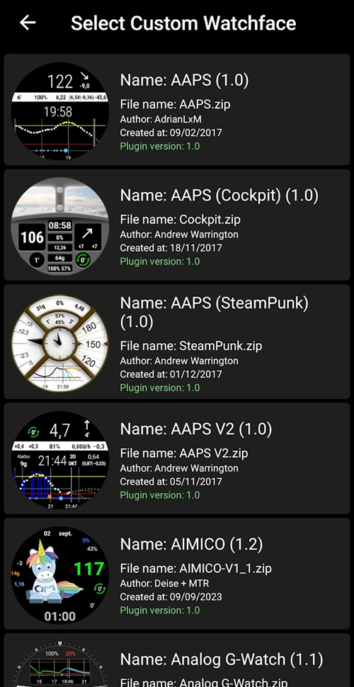

5. Se på dit ur: urskiven »AAPS (Custom)« skulle nu vise det udseende, du har valgt. Giv den et par sekunder til at opdatere. Skærmen **Ur** på telefonen viser nu navnet på den indlæste urskive og et eksempel på den. **Info om urskive** viser dens detaljer og de felter, den indeholder, og **Flere urskiver** åbner [udvekslingssiden](../ExchangeSiteCustomWatchfaces/index.md), hvor du kan hente andre brugerdefinerede urskiver. Du kan nu tilpasse komplikationerne osv. ved at trykke længe på urskiven og derefter trykke på knappen »Customize« (Tilpas) på billedet af urskiven.

```{admonition} Complications on a custom watchface
:class: note
Brugerdefinerede urskiver, der er lavet med version 3.0 eller nyere af formatet for brugerdefinerede urskiver, kan have op til fem komplikationspladser, hvor urskiven bestemmer deres placering og størrelse (**Komplikationslayout**). Tryk længe på urskiven på uret, tryk på **Customize**, og tryk på **Komplikation 1** til **Komplikation 5** for at vælge den datakilde, der vises i hver plads. De samme rækker findes i urets AAPS-app under **Indstillinger** > **AAPS(Brugerdefineret)**; når du trykker på en af dem der, åbnes den samme vælger. **Prioritet for komplikationstype** bestemmer, om en plads foretrækker en værdi eller måler, tekst eller et ikon, når datakilden tilbyder flere. En ændret prioritet gælder først, næste gang du vælger en datakilde til den plads.

Disse pladser virker kun på ure med **Wear OS 5 eller ældre**, hvor den brugerdefinerede urskive kører som en rigtig urskive. På **Wear OS 6 og nyere** vises den brugerdefinerede urskive som et billede uden sine komplikationspladser, og trin 1 og 2 ovenfor er ikke nødvendige: sørg for, at **Brugerdefineret urskive** er valgt under **Urskive installeret på uret** i pluginet **Ur** på telefonen (se [den urskive, AAPS installerer](#wearos-aaps-v4-watchface)).
```

## AAPSv2-urskive – forklaring

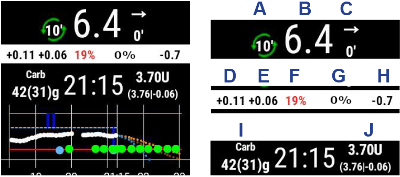

A – tid siden loopet sidst kørte

B – CGM-måling

C – minutter siden sidste CGM-måling

D – ændring i forhold til sidste CGM-måling (i mmol eller mg/dl)

E – gennemsnitlig ændring i CGM-måling de sidste 15 minutter

F – telefonens batteri

G – basalrate (vist i E/t ved standardrate og i % ved TBR)

H – BGI (blodsukkerpåvirkning) -> hvor meget BS »burde« stige eller falde kun på grund af insulinaktiviteten.

I – kulhydrater (kulhydrater om bord | e-kulhydrater i fremtiden)

J – insulin om bord (fra bolus | fra basal)
