# Wie man das Autotune-Plugin benutzt

Das Autotune-Plugin ist die Umsetzung des OpenAPS Autotune-Algorithmus in AAPS. It analyzes your recent AAPS history to suggest adjustments to your basal rates, ISF and carb ratio.

Autotune Plugin is available in AAPS releases since [3.4](#version3400) but is hidden by default.

(autotune-how-autotune-calculates-adjustments)=
## How Autotune calculates adjustments

Autotune looks back over your recent AAPS history — CGM readings, boluses, carbs and temporary basal rates — and works out where your **Profile** (basal rates, ISF, carb ratio) doesn't quite match what actually happened to your BG.

For each 5-minute data point, it compares your **actual BG change** to the change your Profile predicted, and sorts the resulting deviation into one of three buckets:

* deviations that happened with no carbs on board and no insulin activity (used to tune **basal rates**, hour by hour),
* deviations that happened after a bolus/correction with no carbs (used to tune **ISF**), or
* deviations that happened while carbs were absorbing (used to tune **carb ratio**).

It then looks at the pattern of deviations in each bucket (using percentiles rather than a simple average, so a few noisy data points don't skew the result) and proposes a new value for that hour/parameter.

To keep any single run from overcorrecting, each Autotune run only ever moves a value a fraction of the way towards what the data suggests: up to 10% for ISF and carb ratio, and up to 20% for each basal segment. Overall drift is further capped by the **Max autosens ratio** / **Min autosens ratio** settings (see [Other settings](#autotune-other-settings) below) — the same bounds that limit Autosens. This is why Autotune is meant to be run repeatedly (day after day, or nightly) rather than trusted after a single run: results should converge gradually, and a big jump on one run is a sign to double check your data (missed carbs, a bad sensor day, _etc._) rather than to trust it blindly.

Autotune can be run three ways: manually as a one-off from within the plugin (as described below), automatically every night via an [automation rule](#autotune-run-autotune-with-an-automation-rule), or — outside of AAPS entirely — as a standalone command-line tool against exported data, which is how some community guides describe using it without a phone actively running AAPS.

*For the underlying oref0 algorithm in full mathematical detail, see [OpenAPS's Autotune documentation](https://openaps.readthedocs.io/en/latest/docs/Customize-Iterate/autotune.html).*

## Das Autotune-Plugin sichtbar machen

Erstelle im Unterordner `extra` Deines [AAPS-Ordners](#preferences-maintenance-settings) auf Deinem Smartphone eine leere Datei mit dem Namen `enable_autotune`.

***HINWEIS: Schaue in den **AAPS**-Einstellungen, wo sich Dein AAPS-Ordner befindet und überprüfe, dass die Datei in das richtige Verzeichnis gelegt wurde. Es kam häufiger vor, dass diese Datei nicht im richtigen Verzeichnis lag.***

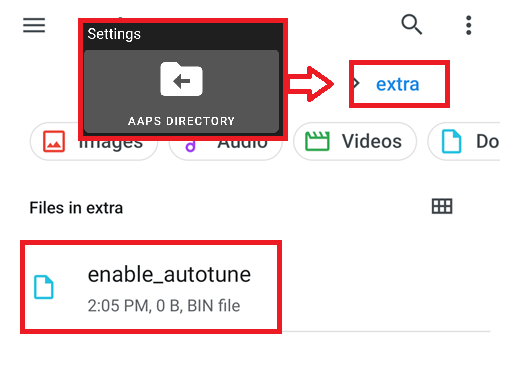

Restart **AAPS**. Then open the **menu** (☰), select **Configuration**, then the **General** category, and tick **Autotune**. The card then shows **Settings** and **Open plugin**:


## Autotune Dialogbox

Tap **Open plugin** on the **Autotune** card to open the Autotune screen:

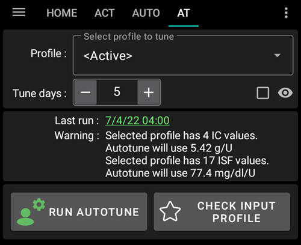

- In der Profil-Auswahlliste kannst Du das Profil auswählen, das Du automatisch überarbeiten (autotune) lassen möchtest (Dein aktives Profil ist voreingestellt)
  - Note: each time you select a new profile, previous results will be removed and the **Number of days of data** will be set to its default value
- Then **Number of days of data** (called **Tune days** in older versions) is to select the number of days used in calculation to tune your profile. Der kleinste Wert ist 1 und der größte Wert ist 30 Tage. Um korrekte wiederholbare und geglättete Ergebnisse zu bekommen, sollte der Wert nicht zu klein gewählt werden (idealerweise sollten sieben oder mehr Tage berücksichtigt werden)
  - Note: each time you change the **Number of days of data**, previous results will be removed
- 'Last Run' ruft die Ergebnisse Deines letzten gültigen Durchlaufs auf. Wenn Du „Autotune“ nicht am selben Tag gestartet haben solltest oder Ergebnisse der vorherigen Durchläufe durch die Änderung der Parameter zurückgesetzt wurden, kannst Du so die letzten Parameter und Ergebnisse zurückholen.
- 'Warnung' zeigt Dir im Fehlerfall Informationen zu Deinem gewählten Profil an (falls es z. B. mehrere KH- oder Korrekturfaktoren (IC/ISF) geben sollte)
  - Hinweis: Die Autotune-Berechnungen funktionieren nur mit einem einzigen KH-Faktor und einem einzigen Korrekturfaktor. Zur Zeit gibt es keinen Autotune-Algorithmus, der mit zirkadianen KH-Faktoren oder Korrekturfaktoren umgehen kann. Wenn Dein Profil mehrere Werte haben sollte, wird Dir im Abschnitt 'Warnung' der für die Berechnung genutzte (gemittelte) Wert angezeigt.
- Check Input Profile button open the Profile Viewer to allow you a quick verification of your profile (Units, IC, ISF, basal and target)
  - Hinweis: 'Autotune' wird nur Deinen KH-Faktor (Einzelwert), den Korrekturfaktor (Einzelwert) und Deine Basalrate (zirkadian verteilt) korrigieren bzw. anpassen. Units and target will remain unchanged in output profile.

- "Run Autotune" will launch Autotune calculation with selected profile and the selected number of days of data
  - Hinweis: Die Autotune-Berechnung kann einige Zeit in Anspruch nehmen. Sobald 'Autotune' gestartet wurde, kannst zu anderen Ansichten (Startbildschirm, ...) wechseln und später zum Autotune-Plugin zurückkehren, um die Ergebnisse zu prüfen

  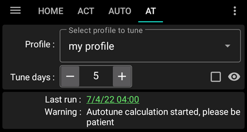

- Während 'Autotune' läuft, wirst Du Zwischenergebnisse angezeigt bekommen

  - Hinweis: Während die Berechnungen laufen sind sowohl die Auswahl des Profils, als auch die 'Anpassungstage' vorübergehend gesperrt. Der aktuelle Durchlauf muss abgeschlossen sein, bevor Du einen neuen Berechnungsdurchgang mit geänderten Parametern starten kannst.

  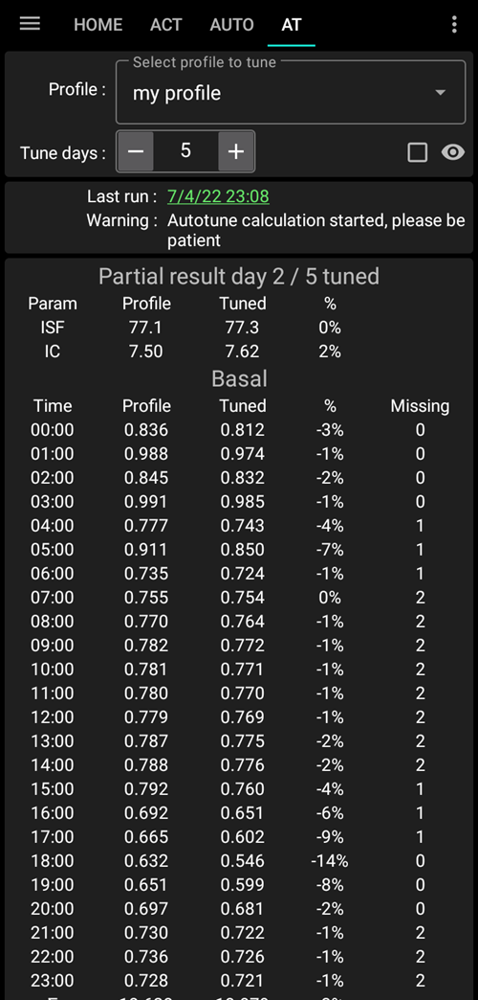

- Sind die Autotune-Berechnungen abgeschlossen, bekommst Du das angepasste Profil und vier Schaltflächen angezeigt.

  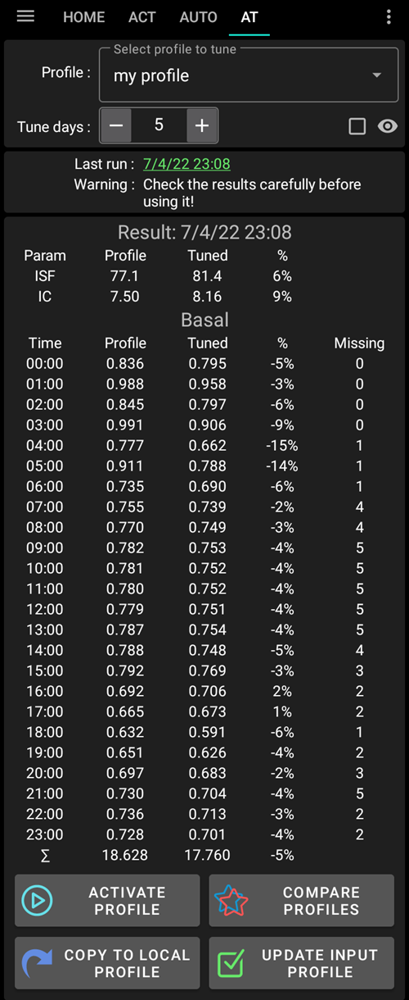

- Wichtig ist, dass Du das Eingangsprofil (Spalte 'Profil') mit dem Ergebnisprofil (Spalte 'Angepasst') und die Abweichungen der Einzelwerte (Spalte '%') vergleichst.

- Für die Basalrate wird auch die Anzahl der nicht berücksichtigten Tage ('missing days') ausgegeben. 'Fehlend' tritt immer dann auf, wenn 'Autotune' nicht genügend Daten, die eindeutig einer Basalrate zugeordnet werden können, in der gewählten Periode zur Verfügung hat (z.B. in Phasen nach Mahlzeiten wenn, die KH-Aufnahme läuft). In der Nacht oder am späten Nachmittag sollten diese Effekte selten auftreten, da dort im Regelfall überwiegend das Basal wirksam sein sollte.

- Die Schaltfläche "Profile vergleichen" öffnet die Profilvergleichsansicht. Das Eingangsprofil ist blau und das Ergebnisprofil 'Angepasst' ist rot dargestellt.

  - Hinweis: im Beispiel unten hat das Eingangsprofil zirkadianisch angepasste Werte für IC und ISF, aber das Ergebnisprofil hat jeweils nur einen Wert. Wenn es Dir wichtig ist ein zirkadian verteiltes Ergebnisprofil zu bekommen, lies den Abschnitt [Zirkadiane Profile für KH- und Korrekturfaktoren (IC/ISF)](#autotune-circadian-ic-or-isf-profile) unten.

  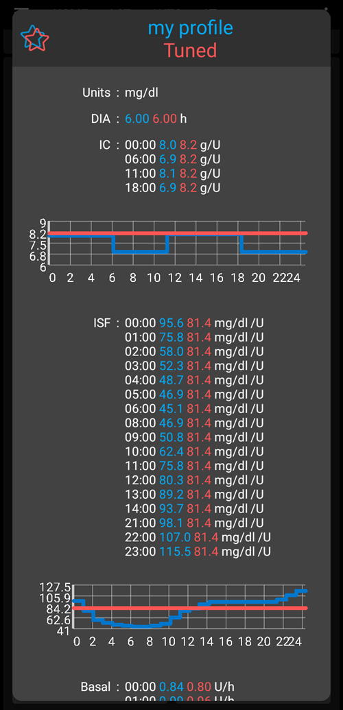

- Wenn Du mit den Ergebnissen zufrieden bist (geringe Abweichungen zwischen dem Eingangsprofil und dem erzeugten Profil), kannst Du auf 'Aktiviere Profil' und 'OK' zur Bestätigung drücken.

  - Activate Tuned profile will automatically create a new profile "Tuned" in your profile list (**Manage → Profile**).
  - If you already have a profile named "Tuned" in **Manage → Profile**, then this profile will be updated with calculated Autotune profile before the activation

  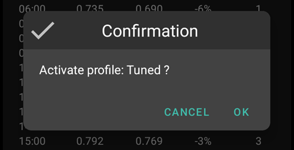

- Wenn Du denkst, dass das angepasste/berechnete Profil verändert werden muss (z.B. wenn Du findest, dass einige Abweichungen zu gravierend sind), dann kannst Du auf 'In lokales Profil kopieren' klicken.

  - A new profile with the prefix "Tuned" and the date and time of the run will be created in **Manage → Profile**

  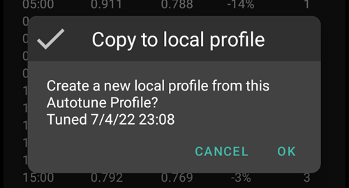

- You can then edit the Tuned profile: open **Manage** > **Profile**, swipe to the card named "Tuned" with the date and time of the run, and tap the **Edit** (pencil) button

  - the values in the profile will be rounded in the user interface to your pump capabilities

  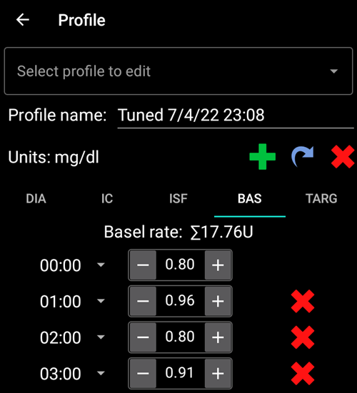

- Wenn Du Dein Eingabeprofil durch die Autotune-Ergebnis ersetzen möchtest, tippe auf 'Eingabeprofil anpassen' und bestätige die Dialogbox 'OK'

  - Hinweis: Wenn Du nach 'Eingabeprofil anpassen' auf 'Profil aktivieren' tippst, aktivierst Du das gerade aktualisierte Profil und nicht das durch Autotune berechnete Profil (Ergebnisprofil)

  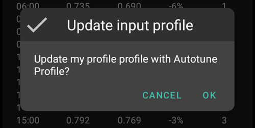

- Wenn Du Dein Eingagebeprofil angepasst hast, wird der Button durch den Button 'Eingabeprofil zurücksetzen' ersetzt (wie auf dem Screenshot unten zu sehen). You can that way immediately see if your current input profile in **Manage → Profile** already includes the result of last run or not. Mit diesem Button kannst Du auch Dein Eingabeprofil ohne die Autotune-Ergebnisse wiederherzustellen

  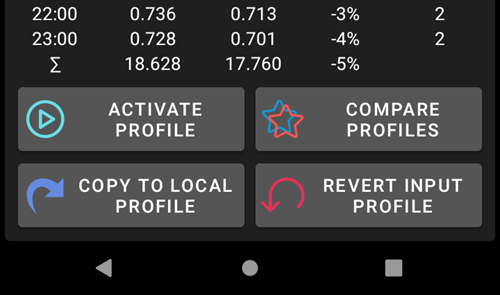


## Autotune Einstellungen

(autotune-plugin-settings)=

### Autotune Einstellungen

  

```{admonition} Only DEV
:class: note
The **Auto switch profile** feature is only available in Dev/Engineering mode.
```

- **Auto switch profile** (default Off): see [Run Autotune with an automation rule](#autotune-run-autotune-with-an-automation-rule) below. Wenn Du diese Einstellung auf AN änderst, wird in einer Automatisierungsregel das Eingabeprofil automatisch durch das berechnete Profil aktualisiert und anschliessend darauf gewechselt.
  - **Sei vorsichtig und prüfe in den kommenden Tagen sehr genau, ob sich das Loop-Verhalten nach der Anpassung und Aktivierung des Profils verbessert.**

- **Categorize UAM as basal** (default Off): This setting is for the users using AndroidAPS without any carbs entered (Full UAM). Wenn die Option deaktiviert ist, werden UAM nicht als Basal bewertet.
  - Hinweis: Wenn mindestens eine Stunde eines Tages erkannt wird, in der KH-Aufnahme stattgefunden hat, werden alle als "UAM" kategorisierte Daten, als Basal gewertet. Das ist unabhängig davon, ob Du die Option aktiviert hast oder nicht (AN oder AUS)
- **Default tune days** (default 5): You can define the default value with this setting. Each time you select a new profile in the Autotune plugin, the **Number of days of data** will be replaced by this default value
- **Use circadian IC/ISF** (default Off): see [Circadian IC or ISF profile](#autotune-circadian-ic-or-isf-profile) below.

(autotune-other-settings)=
### Andere Einstellungen

- Autotune nutzt „Max. Autosens-Faktor“ und „Min Autotsens-Faktor“, um die Variabilität zu begrenzen. You can see and adjust these values in [**Settings** > **Absorption settings** > **Advanced Settings**](../SettingUpAaps/Preferences.md) (**Autosens max** and **Autosens min**).

  


## Erweiterte Funktionen

(autotune-circadian-ic-or-isf-profile)=

### Zirkadiane Profile für KH- und Korrekturfaktoren (IC/ISF)

- If you have important variation of IC and/or you ISF in your profile, and you fully trust in your circadian time and variation, then you can enable **Use circadian IC/ISF** (called "Apply average result in circadian IC/ISF" in older versions)

  - Es ist wichtig zu wissen, dass die Autotune-Berechnungen immer mit einem fixen Wert erfolgt. Autotune wird keine zirkadiane Verteilung erstellen. Diese Einstellung berücksichtigt lediglich berechnete Durchschnittswerte Deiner zirkadianen Werte für IC und/oder ISF

- Auf dem Screenshot unten siehst Du links das angepasste Profil mit der abgeschalteten Funktionen 'Durchschnittsresultat im zirkadianen IC/ISF anwenden' (AUS) und rechts mit der eingeschalteten Funktion (AN)

  


### Bestimmte Tage der Woche anpassen

- If you tap the **eye** icon on the right of the **Number of days of data** field, you will see the day selection. Du kannst festlegen, welche Wochentage in der Autotune-Berechnung berücksichtigt werden sollen (im Screenshot unten ist ein Beispiel zu sehen, in dem nur die "Arbeitstage" berücksichtigt werden und Samstag und Sonntag von der Berechnung ausgeschlossen werden)
  - If the number of days included in Autotune calculation is lower than the **Number of days of data**, then you will see how many days will be included on the right of the days selector (10 days in the example below)
  - This setting gives good results only if the number of remaining days is not to small (for example if you Tune a specific profile for week end days with only Sunday and Saturday selected, you should set **Number of days of data** to at least 21 or 28 to have 6 or 8 days included in Autotune calculation)

  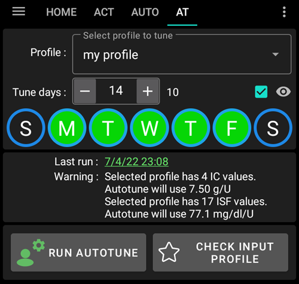

- During Autotune calculation, you can see the progress of the calculations ("Partial result day 1 / 4 tuned" in the example below, with Saturday and Sunday excluded)

  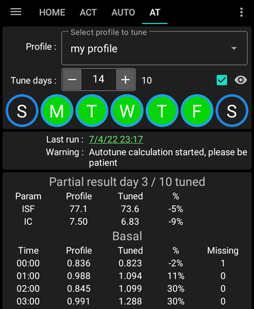


(autotune-run-autotune-with-an-automation-rule)=

## Autotune mit einer Automatisierungsregel starten

```{admonition} Only DEV
:class: note
The **Auto switch profile** feature is only available in Dev/Engineering mode.
```

Der erste Schritt besteht darin, den richtigen Auslöser für eine Automatisierungsregel mit Autotune zu definieren:

Hinweis: Details zum Setzen einer Automatisierungsregel, findest Du [hier](../DailyLifeWithAaps/Automations.md).

- Als Auslöser sollte „Wiederholungszeit“ ausgewählt werden: Starte Autotune nur einmal täglich. Autotune ist so konzipiert, dass es einmal am Tag läuft und vorgeschlagene Profilanpassungen am Folgetag durch Autotune erneut geprüft werden können. Bei regelmäßiger Ausführung (täglich) sind die dann notwendigen Profilanpassungen nur gering bzw. klein

  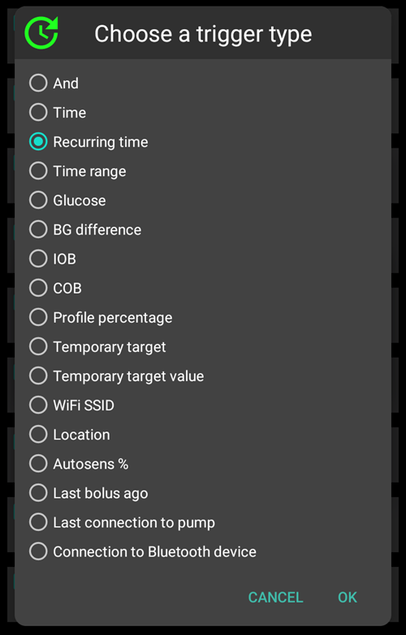

- Um die Ergebnisse unmittelbar überprüfen zu können, hat sich am Anfang bewährt Autotune am Tag auszuführen. Bei einer geplanten Ausführung in den Nachtstunden, wähle 04:00h oder später. Damit wird der aktuelle Tag in der nächsten Autotune-Berechnung berücksichtigt.

  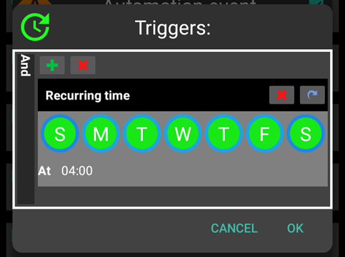

- Then you can select the **Autotune profile** action (in the **Loop & insulin** group)

  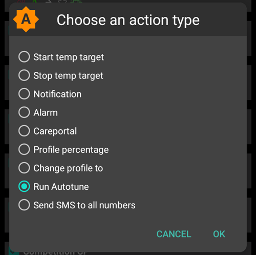

- You can then adjust the parameters of the action for your run. In a new action, **Select profile to tune** shows the first profile of your local profile list, the **Tune days** field is empty and all days are selected. Choose the profile to tune and enter the number of **Tune days** (1 to 30).

  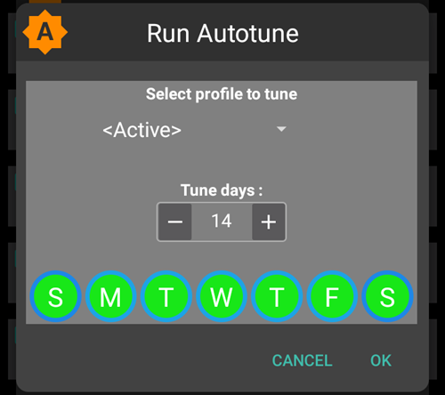

- After a few days, if you fully trust Autotune results and percentage of modification is low, you can modify [Autotune settings](#autotune-plugin-settings) "**Auto switch profile**" to enabled to automatically update and activate profile tuned after calculation.

Hinweis: Wenn Du automatisch Profile für einzelne Wochentage (z. B. ein Profil fürs Wochenende und eines für Wochentage) überarbeiten lassen möchtest, erstelle eine Regel je Profil und wähle den gleichen Tag als Auslöser und "Autotune ausführen" als Aktion. Die Anpassungstage müssen so hoch eingestellt werden, dass die Berechnung am Ende mit mindestens 6 oder 8 Tagen durchgeführt wird, und vergiss nicht den Auslösezeipunkt nach 4 Uhr morgens zu setzen ...

- See below an example of rule that runs every working day (Monday to Friday) at 04:00 and tunes the profile "Normal" with 14 **Tune days**, working days only (so only 10 days are included in the Autotune calculation).

  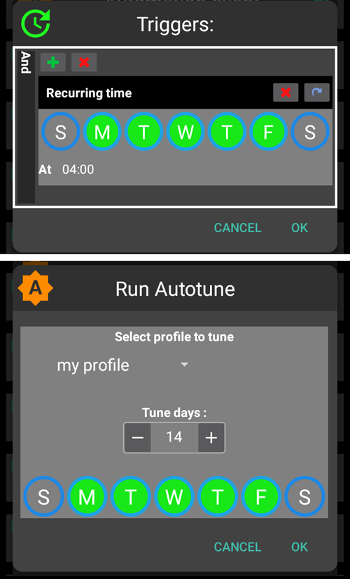


## Tipps und Tricks

Autotune arbeitet den Informationen in Deiner Datenbank. Wenn Du AAPS gerade erst frisch auf Deinem Smartphone installiert hast, musst Du einige Tage warten, bevor Autotune mit genügend Informationen gestartet werden kann und sinnvolle Ergebnisse zurückliefert.

Autotune ist nur ein Hilfsmittel. Es ist wichtig, dass Du das berechnete Profil überprüfst und die Einzelwerte bewusst hinterfragst. Wenn Du an irgendeiner Stelle Zweifel haben solltest, passe die Autotune-Einstellungen (z.B. die Anpassungstage) an oder kopiere die Ergebnisse in ein lokales Profil, um dort notwendige Änderungen vorzunehmen, bevor Du diese verwendest.

Autotune sollte immer einige Tage manuell ausgeführt werden, damit Du die Möglichkeit hast die Ergebnisse zuerst zu prüfen, bevor Du sie übernimmst. Eine vollautomatisches 'Autotunen' darf nur dann (und wirklich nur dann!) begonnen werden, wenn Du den bisherigen Ergebnissen voll vertraust, und die vorgeschlagenen Anpassungen zwischen Eingangsprofil und berechnetem Profil nur noch sehr gering ausfallen.

- Autotune funktioniert für einige von uns sehr gut, für andere allerdings auch nicht. **Solltest Du am Autotune-Ergebnis zweifeln, nutze es nicht**

It's also important to analyze Autotune results to understand (or try to understand) why Autotune proposes these modifications

- Es kann eine vollständige Erhöhung oder Abschwächung Deines Profils geben (z.B. Anhebung des Basalprofils, um ISF- und IC-Werte abzuschwächen). Das kann die Folge von längeren Phasen (mehrere Tage) mit einer Autosens-Korrektur über 100% (höhere Aggressivität notwendig) oder unter 100% (Abschwächung notwendig) sein
- Manchmal schlägt Autotune ein anderes „Basal zu IC/ISF“-Verhältnis vor (z. B. niedrigere Basalrate und aggressivere IC/ISF-Faktoren)

In folgenden Situationen wird von einer Autotune-Nutzung abgeraten:

- Du gibst nicht alle Kohlenhydrate ein
  - Wenn Du Kohlenhydrate zur Korrektur einer Hypo nicht eingibst, wird Autotune den dann steigenden Glukosewert nicht erwarten und als Konsequenz eine Erhöhung der Basalraten 4 Stunden davor vorschlagen. Das kann genau das Gegenteil sein, was nötig ist, um die Hypo (besonders in den Nachtstunden) zukünftig zu vermeiden. Deshalb ist es wichtig, alle Kohlenhydrate (insbesondere die KH, um aus einer Hypo zu kommen) vollständig einzugeben.
- Du hast viele Abschnitte mit nicht angekündigten Mahlzeiten (UAM) im Verlauf Deines Tages
  - Hast Du alle Kohlenhydrate eingegeben und hast Du die Kohlenhydratmenge richtig eingeschätzt?
  - Alle Abschnitte mit nicht angekündigten Mahlzeiten (UAM), werden der Basalrate zugerechnet, sodass eine erhebliche Anhebung (mehr als notwendig) der Basalrate als Folge vorgeschlagen werden wird. Ausnahme: Du hast die Option 'UAM als Basal kategorisieren' deaktiviert

- Deine KH-Aufnahme ist deutlich verlangsamt: Die Berechnung der aktiven Kohlenhydrate (COB) kann falsch sein und in der Folge zu falschen Ergebnissen führen. Die verlangsamte Aufnahme kannst Du an kleinen orangenen Punkten oberhalb der COB-Kurve erkennen. Als Referenz wird der Parameter 'min_5m_carbimpact' in den 'Resorptions-Einstellungen' genutzt.
  - Während Du Sport treibst, bist Du durchweg insulinempfindlicher und Dein Glukosewert steigt nur leicht. Es ist daher völlig normal während und nach dem Sport Phasen mit langsamer KH-Aufnahme zu sehen. Solltest Du aber häufiger unerwartet Phasen mit langsamer KH-Aufnahme haben, kann eine Profilanpassung sinnvoll sein. In diesem Fall kann eventuell eine Erhöhung des KH-Faktors (IC) oder eine Reduktion des 'min_5m_carbimpact'-Parameters helfen.
- Du hast einige „sehr schlechte Tage“. Du hängst beispielsweise über mehrere Stunden in einer Hyperglykämie, die Du mit großen Insulinmengen korrigieren kannst oder Deine Glukosewerte sind nach einem Sensorwechsel vorübergehend nicht verlässlich. Wenn Du in den vergangenen Wochen ein oder zwei „schlechte“ Tage hattest, kannst Du diese von der Autotune-Berechnung manuell ausschließen. Es kann nicht oft genug wiederholt werden: **Schau' sehr genau, ob Du den Ergebnissen trauen kannst**.
- Wenn die vorgeschlagenen prozentualen Anpassungen zu gravierend sind
  - Eine bessere Glättung kannst Du eventuell über eine Erhöhung der zu berücksichtigenden Tage (Anpassungstage) erreichen
