# Wie man das Autotune-Modul benutzt

Das Autotune-Modul ist die Umsetzung des OpenAPS Autotune-Algorithmus in AAPS. Es analysiert Deine letzte AAPS-Historie und schlägt Anpassungen Deiner Basalraten, Deines ISF und Deines KH-Faktors vor.

Das Autotune-Modul ist seit der AAPS-Version [3.4](#version3400) verfügbar. Es ist aber standardmäßig nicht sichtbar.

(autotune-how-autotune-calculates-adjustments)=
## Wie Autotune Anpassungen berechnet

Autotune schaut sich Deine letzte AAPS-Historie an – CGM-Werte, Boli, Kohlenhydrate und temporäre Basalraten – und ermittelt, wo Dein **Profil** (Basalraten, ISF, KH-Faktor) nicht ganz zu dem passt, was mit Deinen Glukosewerten tatsächlich passiert ist.

Für jeden 5-Minuten-Datenpunkt vergleicht es die **tatsächliche Glukosewert-Änderung** mit der Änderung, die Dein Profil vorhergesagt hat, und ordnet die Abweichung einer von drei Gruppen zu:

* Abweichungen ohne Kohlenhydrate an Bord und ohne Insulinaktivität (werden zum Anpassen der stündlichen **Basalraten** genutzt),
* Abweichungen nach einem Bolus bzw. einer Korrektur ohne Kohlenhydrate (werden zum Anpassen des **ISF** genutzt) oder
* Abweichungen, während Kohlenhydrate verstoffwechselt (resorbiert) wurden (werden zum Anpassen des **KH-Faktors** genutzt).

Dann betrachtet es das Muster der Abweichungen in jeder Gruppe (mit Perzentilen statt eines einfachen Durchschnitts, damit einzelne verrauschte Datenpunkte das Ergebnis nicht verzerren) und schlägt einen neuen Wert für diese Stunde bzw. diesen Parameter vor.

Damit ein einzelner Lauf nicht zu stark korrigiert, verschiebt jeder Autotune-Lauf einen Wert immer nur ein Stück in die Richtung, die die Daten nahelegen: um bis zu 10 % bei ISF und KH-Faktor und um bis zu 20 % bei jedem Basalabschnitt. Die gesamte Abweichung ist außerdem durch die Einstellungen **Max autosens ratio** / **Min autosens ratio** begrenzt (siehe [Weitere Einstellungen](#autotune-other-settings) unten) – dieselben Grenzen, die auch Autosens beschränken. Deshalb ist Autotune dafür gedacht, wiederholt ausgeführt zu werden (täglich oder jede Nacht), statt einem einzelnen Lauf zu vertrauen: Die Ergebnisse sollten sich nach und nach einpendeln. Ein großer Sprung bei einem Lauf ist ein Zeichen, Deine Daten zu überprüfen (vergessene Kohlenhydrate, ein schlechter Sensortag _usw._), statt ihm blind zu vertrauen.

Autotune lässt sich auf drei Arten ausführen: manuell als einmaliger Lauf im Modul (wie unten beschrieben), automatisch jede Nacht über eine [Automatisierungsregel](#autotune-run-autotune-with-an-automation-rule) oder – ganz außerhalb von AAPS – als eigenständiges Kommandozeilen-Werkzeug mit exportierten Daten. So beschreiben es einige Anleitungen aus der Community, um es ohne ein Smartphone mit laufendem AAPS zu nutzen.

*Den zugrunde liegenden oref0-Algorithmus mit allen mathematischen Details findest Du in der [Autotune-Dokumentation von OpenAPS](https://openaps.readthedocs.io/en/latest/docs/Customize-Iterate/autotune.html).*

## Das Autotune-Modul sichtbar machen

Erstelle im Unterordner `extra` Deines [AAPS-Ordners](#preferences-maintenance-settings) auf Deinem Smartphone eine leere Datei mit dem Namen `enable_autotune`.

***HINWEIS: Prüfe in den AAPS-Einstellungen, wo sich Dein AAPS-Verzeichnis befindet, und ob Du die Datei in das richtige Verzeichnis gelegt hast. Einige AAPS-Nutzende haben die Datei in den falschen Ordner gelegt.***

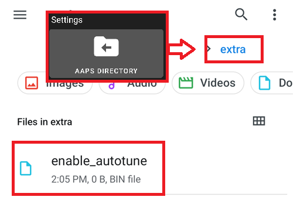

**AAPS** neu starten. Öffne dann das **Menü** (☰), wähle **Konfiguration**, dann die Kategorie **Allgemeines** und hake **Autotune** an. Die Karte zeigt dann **Einstellungen** und **Modul öffnen** (Plugin):


## Autotune Dialogbox

Tippe auf der Karte **Autotune** auf **Modul öffnen**, um den Autotune-Bildschirm zu öffnen:

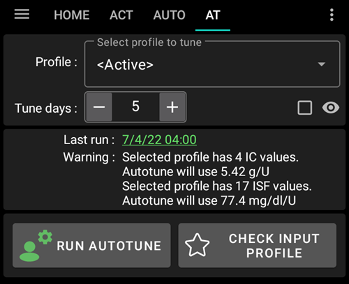

- In der Profil-Auswahlliste kannst Du das Profil auswählen, das Du automatisch überarbeiten (autotune) lassen möchtest (Dein aktives Profil ist voreingestellt)
  - Hinweis: Jedes Mal, wenn Du ein neues Profil auswählst, werden bestehende Ergebnisse gelöscht, und **Anzahl der Tage an Daten** wird auf den Standardwert zurückgesetzt
- Mit **Anzahl der Tage an Daten** (in älteren Versionen **Anpassungstage**) wählst Du, wie viele Tage in die Berechnung zur Anpassung Deines Profils eingehen. Der kleinste Wert ist 1 und der größte Wert ist 30 Tage. Um korrekte wiederholbare und geglättete Ergebnisse zu bekommen, sollte der Wert nicht zu klein gewählt werden (idealerweise sollten sieben oder mehr Tage berücksichtigt werden)
  - Hinweis: Jedes Mal, wenn Du **Anzahl der Tage an Daten** änderst, werden bestehende Ergebnisse gelöscht
- „Last Run“ ruft die Ergebnisse Deines letzten gültigen Durchlaufs auf. Wenn Du „Autotune“ nicht am selben Tag gestartet haben solltest oder Ergebnisse der vorherigen Durchläufe durch die Änderung der Parameter zurückgesetzt wurden, kannst Du so die letzten Parameter und Ergebnisse zurückholen.
- 'Warnung' zeigt Dir im Fehlerfall Informationen zu Deinem gewählten Profil an (falls es z. B. mehrere KH- oder Korrekturfaktoren (IC/ISF) geben sollte)
  - Hinweis: Die Autotune-Berechnungen funktionieren nur mit einem einzigen KH-Faktor und einem einzigen Korrekturfaktor. Zur Zeit gibt es keinen Autotune-Algorithmus, der mit zirkadianen KH-Faktoren oder Korrekturfaktoren umgehen kann. Wenn Dein Profil mehrere Werte haben sollte, wird Dir im Abschnitt 'Warnung' der für die Berechnung genutzte (gemittelte) Wert angezeigt.
- Der Knopf „Eingabeprofil überprüfen“ öffnet die Profilansicht, damit Du Dein Profil schnell überprüfen kannst (Einheiten, IC, ISF, Basal und Zielwert)
  - Hinweis: „Autotune“ wird nur Deinen KH-Faktor (Einzelwert), den Korrekturfaktor (Einzelwert) und Deine Basalrate (zirkadian verteilt) korrigieren bzw. anpassen. Einheiten und Zielwert bleiben im Ergebnisprofil unverändert.

- „Autotune ausführen“ startet die Autotune-Berechnung mit dem ausgewählten Profil und der gewählten Anzahl der Tage an Daten
  - Hinweis: Die Autotune-Berechnung kann einige Zeit in Anspruch nehmen. Sobald „Autotune“ gestartet wurde, kannst Du zu anderen Ansichten (Startbildschirm, ...) wechseln und später zum Autotune-Modul zurückkehren, um die Ergebnisse zu prüfen

  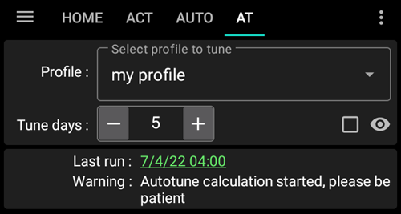

- Während „Autotune“ läuft, wirst Du Zwischenergebnisse angezeigt bekommen

  - Hinweis: Während die Berechnung läuft, sind sowohl die Auswahl des Profils als auch die Anzahl der Tage vorübergehend gesperrt. Der aktuelle Durchlauf muss abgeschlossen sein, bevor Du einen neuen Berechnungsdurchgang mit geänderten Parametern starten kannst.

  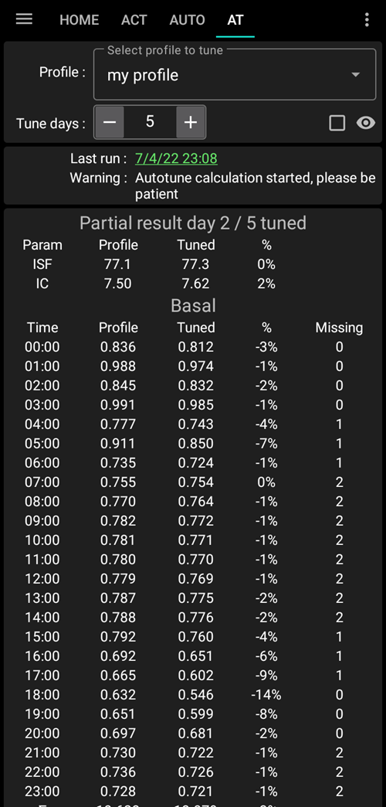

- Sind die Autotune-Berechnungen abgeschlossen, bekommst Du das angepasste Profil und vier Schaltflächen angezeigt.

  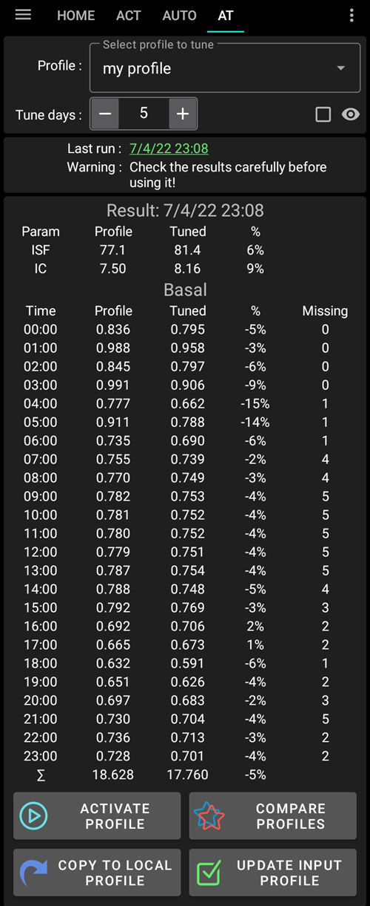

- Wichtig ist, dass Du das Eingabeprofil (Spalte „Profil“) mit dem Ergebnisprofil (Spalte „Angepasst“) und die Abweichungen der Einzelwerte (Spalte „%“) vergleichst.

- Für die Basalrate wird auch die Anzahl der nicht berücksichtigten Tage ('missing days') ausgegeben. 'Fehlend' tritt immer dann auf, wenn 'Autotune' nicht genügend Daten, die eindeutig einer Basalrate zugeordnet werden können, in der gewählten Periode zur Verfügung hat (z.B. in Phasen nach Mahlzeiten wenn, die KH-Aufnahme läuft). In der Nacht oder am späten Nachmittag sollten diese Effekte selten auftreten, da dort im Regelfall überwiegend das Basal wirksam sein sollte.

- Die Schaltfläche "Profile vergleichen" öffnet die Profilvergleichsansicht. Das Eingabeprofil ist blau und das Ergebnisprofil „Angepasst“ rot dargestellt.

  - Hinweis: Im Beispiel unten hat das Eingabeprofil zirkadian angepasste Werte für IC und ISF, aber das Ergebnisprofil hat jeweils nur einen Wert. Wenn es Dir wichtig ist ein zirkadian verteiltes Ergebnisprofil zu bekommen, lies den Abschnitt [Zirkadiane Profile für KH- und Korrekturfaktoren (IC/ISF)](#autotune-circadian-ic-or-isf-profile) unten.

  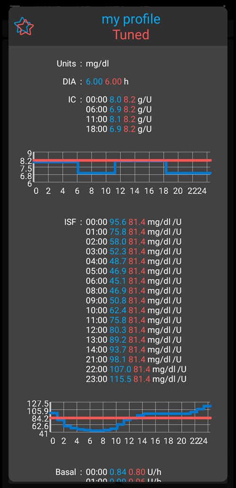

- Wenn Du mit den Ergebnissen zufrieden bist (geringe Abweichungen zwischen dem Eingabeprofil und dem erzeugten Profil), kannst Du auf „Profil aktivieren“ tippen und mit „OK“ bestätigen.

  - „Profil aktivieren“ legt automatisch ein neues Profil „Angepasst“ in Deiner Profilliste an (**Verwalten → Profil**).
  - Gibt es unter **Verwalten → Profil** schon ein Profil namens „Angepasst“, wird dieses vor dem Aktivieren mit dem berechneten Autotune-Profil aktualisiert

  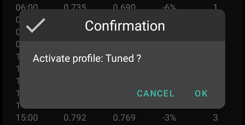

- Wenn Du denkst, dass das angepasste/berechnete Profil verändert werden muss (z.B. wenn Du findest, dass einige Abweichungen zu gravierend sind), dann kannst Du auf 'In lokales Profil kopieren' klicken.

  - Unter **Verwalten → Profil** wird ein neues Profil mit dem Präfix „Angepasst“ sowie Datum und Uhrzeit des Laufs angelegt

  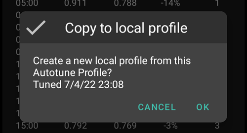

- Danach kannst Du das angepasste Profil bearbeiten: Öffne **Verwalten** > **Profil**, wische zur Karte „Angepasst“ mit Datum und Uhrzeit des Laufs und tippe auf den Knopf **Bearbeiten** (Stift)

  - Die Werte im Profil werden in der Benutzeroberfläche auf das gerundet, was Deine Pumpe kann

  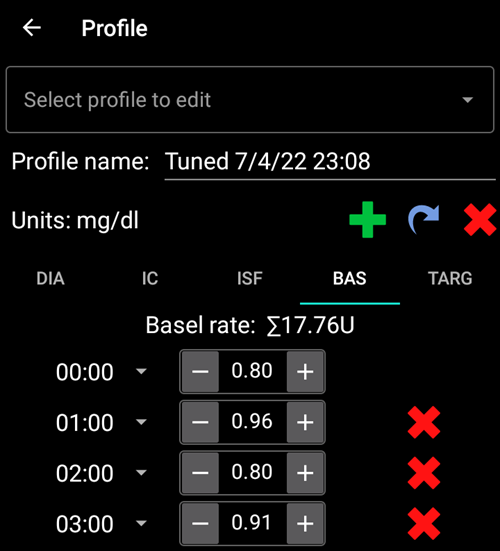

- Wenn Du Dein Eingabeprofil durch das Autotune-Ergebnis ersetzen möchtest, tippe auf „Eingabeprofil anpassen“ und bestätige den Dialog mit „OK“.

  - Hinweis: Wenn Du nach „Eingabeprofil anpassen“ auf „Profil aktivieren“ tippst, aktivierst Du Dein aktualisiertes Profil und nicht das Standardprofil „Angepasst“.

  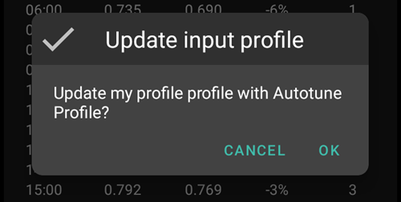

- Wenn Du Dein Eingabeprofil angepasst hast, wird der Knopf „Eingabeprofil anpassen“ durch den Knopf „Eingabeprofil zurücksetzen“ ersetzt (siehe Screenshot unten). So siehst Du sofort, ob Dein aktuelles Eingabeprofil unter **Verwalten → Profil** das Ergebnis des letzten Laufs schon enthält oder nicht. Mit diesem Knopf kannst Du außerdem Dein Eingabeprofil ohne das Autotune-Ergebnis wiederherstellen

  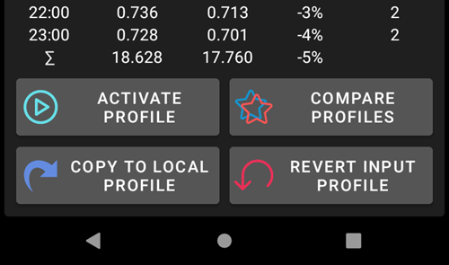


## Autotune Einstellungen

(autotune-plugin-settings)=

### Autotune Einstellungen

  

```{admonition} Only DEV
:class: note
Die Funktion **Profil automatisch wechseln** ist nur im Dev/Engineering Mode verfügbar.
```

- **Profil automatisch wechseln** (Standard: aus): siehe [Autotune mit einer Automatisierungsregel ausführen](#autotune-run-autotune-with-an-automation-rule) unten. Wenn Du diese Einstellung auf AN änderst, wird in einer Automatisierungsregel das Eingabeprofil automatisch durch das berechnete Profil aktualisiert und anschließend darauf gewechselt.
  - **Sei vorsichtig und prüfe in den kommenden Tagen sehr genau, ob sich das Loop-Verhalten nach der Anpassung und Aktivierung des Profils verbessert.**

- **UAM als Basalbedarf einordnen** (Standard: aus): Diese Einstellung ist für Nutzende gedacht, die AndroidAPS ohne Eingabe von Kohlenhydraten nutzen (Full UAM). Wenn die Option deaktiviert ist, werden UAM nicht als Basal bewertet.
  - Hinweis: Wenn mindestens eine Stunde eines Tages erkannt wird, in der KH-Aufnahme stattgefunden hat, werden alle als "UAM" kategorisierte Daten, als Basal gewertet. Das ist unabhängig davon, ob Du die Option aktiviert hast oder nicht (AN oder AUS)
- **Standardanzahl der Tage für Autotune** (Standard: 5): Hiermit legst Du den Standardwert fest. Jedes Mal, wenn Du im Autotune-Modul ein neues Profil auswählst, wird **Anzahl der Tage an Daten** durch diesen Standardwert ersetzt
- **Zirkadianen IC/ISF verwenden** (Standard: aus): siehe [Zirkadianes IC- oder ISF-Profil](#autotune-circadian-ic-or-isf-profile) unten.

(autotune-other-settings)=
### Andere Einstellungen

- Autotune nutzt „Max. Autosens-Faktor“ und „Min Autotsens-Faktor“, um die Variabilität zu begrenzen. Du kannst diese Werte unter [**Einstellungen** > **Resorptions-Einstellungen** > **Erweiterte Einstellungen**](../SettingUpAaps/Preferences.md) ansehen und ändern (**Autosens max** und **Autosens min**).

  


## Erweiterte Funktionen

(autotune-circadian-ic-or-isf-profile)=

### Zirkadiane Profile für KH- und Korrekturfaktoren (IC/ISF)

- Wenn Dein Profil starke Schwankungen bei IC und/oder ISF hat und Du dem zeitlichen Verlauf und den Schwankungen voll vertraust, kannst Du **Zirkadianen IC/ISF verwenden** einschalten (in älteren Versionen „Apply average result in circadian IC/ISF“)

  - Es ist wichtig zu wissen, dass die Autotune-Berechnungen immer mit einem fixen Wert erfolgt. Autotune wird keine zirkadiane Verteilung erstellen. Diese Einstellung berücksichtigt lediglich berechnete Durchschnittswerte Deiner zirkadianen Werte für IC und/oder ISF

- Auf dem Screenshot unten siehst Du links das angepasste Profil mit der abgeschalteten Funktionen 'Durchschnittsresultat im zirkadianen IC/ISF anwenden' (AUS) und rechts mit der eingeschalteten Funktion (AN)

  


### Bestimmte Tage der Woche anpassen

- Tippst Du rechts neben dem Feld **Anzahl der Tage an Daten** auf das **Auge**-Symbol, siehst Du die Auswahl der Tage. Du kannst festlegen, welche Wochentage in der Autotune-Berechnung berücksichtigt werden sollen (im Screenshot unten ist ein Beispiel zu sehen, in dem nur die „Arbeitstage“ berücksichtigt werden und Samstag und Sonntag von der Berechnung ausgeschlossen werden)
  - Ist die Anzahl der Tage, die in die Autotune-Berechnung eingehen, kleiner als **Anzahl der Tage an Daten**, siehst Du rechts neben der Tagesauswahl, wie viele Tage berücksichtigt werden (im Beispiel unten 10 Tage)
  - Diese Einstellung liefert nur dann gute Ergebnisse, wenn nicht zu wenige Tage übrig bleiben (wenn Du zum Beispiel ein eigenes Profil für das Wochenende anpasst und nur Samstag und Sonntag auswählst, solltest Du **Anzahl der Tage an Daten** auf mindestens 21 oder 28 setzen, damit 6 bzw. 8 Tage in die Autotune-Berechnung eingehen)

  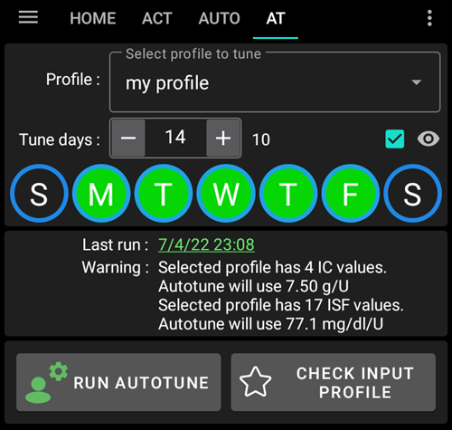

- Während der Autotune-Berechnung siehst Du den Fortschritt („Teilergebnistag 1 / 4 angepasst“ im Beispiel unten, ohne Samstag und Sonntag)

  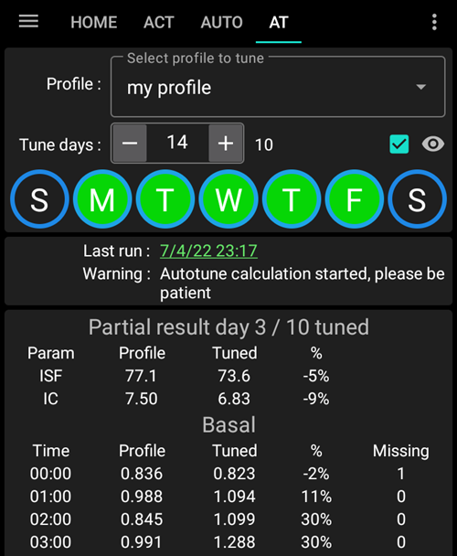


(autotune-run-autotune-with-an-automation-rule)=

## Autotune mit einer Automatisierungsregel starten

```{admonition} Only DEV
:class: note
Die Funktion **Profil automatisch wechseln** ist nur im Dev/Engineering Mode verfügbar.
```

Der erste Schritt besteht darin, den richtigen Auslöser für eine Automatisierungsregel mit Autotune zu definieren:

Hinweis: Details zum Setzen einer Automatisierungsregel, findest Du [hier](../DailyLifeWithAaps/Automations.md).

- Als Auslöser sollte „Wiederholungszeit“ ausgewählt werden: Starte Autotune nur einmal täglich. Autotune ist so konzipiert, dass es einmal am Tag läuft und vorgeschlagene Profilanpassungen am Folgetag durch Autotune erneut geprüft werden können. Bei regelmäßiger Ausführung (täglich) sind die dann notwendigen Profilanpassungen nur gering bzw. klein

  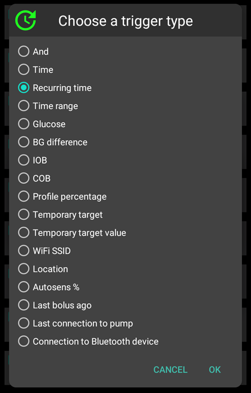

- Um die Ergebnisse unmittelbar überprüfen zu können, hat sich am Anfang bewährt Autotune am Tag auszuführen. Bei einer geplanten Ausführung in den Nachtstunden, wähle 04:00h oder später. Damit wird der aktuelle Tag in der nächsten Autotune-Berechnung berücksichtigt.

  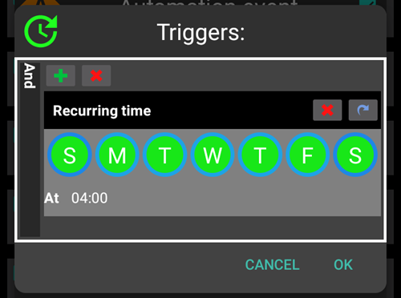

- Dann kannst Du die Aktion **Autotune starten** auswählen (in der Gruppe **Loop & Insulin**)

  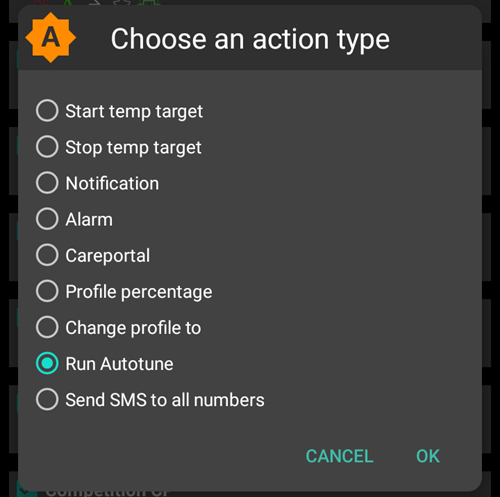

- Anschließend kannst Du die Parameter der Aktion für Deinen Lauf anpassen. Bei einer neuen Aktion zeigt **Wähle das Profil zum Anpassen aus** das erste Profil Deiner lokalen Profilliste, das Feld **Anpassungstage** ist leer, und alle Tage sind ausgewählt. Wähle das Profil, das angepasst werden soll, und gib die Anzahl der **Anpassungstage** ein (1 bis 30).

  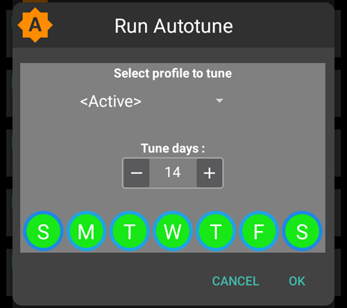

- Wenn Du nach einigen Tagen den Autotune-Ergebnissen voll vertraust und die prozentualen Änderungen gering sind, kannst Du in den [Autotune-Einstellungen](#autotune-plugin-settings) „**Profil automatisch wechseln**“ einschalten. Dann wird das angepasste Profil nach der Berechnung automatisch aktualisiert und aktiviert.

Hinweis: Wenn Du automatisch Profile für einzelne Wochentage (z. B. ein Profil fürs Wochenende und eines für Wochentage) überarbeiten lassen möchtest, erstelle eine Regel je Profil und wähle den gleichen Tag als Auslöser und „Autotune ausführen“ als Aktion. Die Anpassungstage müssen so hoch eingestellt werden, dass die Berechnung am Ende mit mindestens 6 oder 8 Tagen durchgeführt wird, und vergiss nicht den Auslösezeitpunkt nach 4 Uhr morgens zu setzen ...

- Unten siehst Du ein Beispiel für eine Regel, die an jedem Werktag (Montag bis Freitag) um 04:00 Uhr läuft und das Profil „Normal“ mit 14 **Anpassungstagen** anpasst, nur an Werktagen (sodass nur 10 Tage in die Autotune-Berechnung eingehen).

  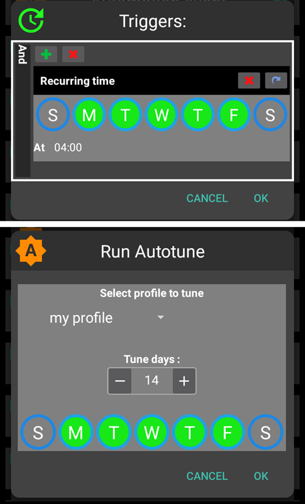


## Tipps und Tricks

Autotune arbeitet mit den Informationen in Deiner Datenbank. Wenn Du AAPS gerade erst frisch auf Deinem Smartphone installiert hast, musst Du einige Tage warten, bevor Autotune mit genügend Informationen gestartet werden kann und sinnvolle Ergebnisse zurückliefert.

Autotune ist nur ein Hilfsmittel. Es ist wichtig, dass Du das berechnete Profil überprüfst und die Einzelwerte bewusst hinterfragst. Wenn Du an irgendeiner Stelle Zweifel haben solltest, passe die Autotune-Einstellungen (z. B. die Anzahl der Tage) an oder kopiere die Ergebnisse in ein lokales Profil, um dort notwendige Änderungen vorzunehmen, bevor Du diese verwendest.

Autotune sollte immer einige Tage manuell ausgeführt werden, damit Du die Möglichkeit hast die Ergebnisse zuerst zu prüfen, bevor Du sie übernimmst. Ein vollautomatisches „Autotunen“ darf nur dann begonnen werden, wenn Du den bisherigen Ergebnissen voll vertraust und die vorgeschlagenen Anpassungen zwischen bisherigem und berechnetem Profil nur noch sehr gering ausfallen

- Autotune funktioniert für einige von uns sehr gut, für andere allerdings auch nicht. **Solltest Du am Autotune-Ergebnis zweifeln, nutze es nicht**

Wichtig ist auch, die Autotune-Ergebnisse zu analysieren, um zu verstehen (oder es zumindest zu versuchen), warum Autotune diese Änderungen vorschlägt

- Es kann eine vollständige Erhöhung oder Abschwächung Deines Profils geben (z.B. Anhebung des Basalprofils, um ISF- und IC-Werte abzuschwächen). Das kann die Folge von längeren Phasen (mehrere Tage) mit einer Autosens-Korrektur über 100% (höhere Aggressivität notwendig) oder unter 100% (Abschwächung notwendig) sein
- Manchmal schlägt Autotune ein anderes „Basal zu IC/ISF“-Verhältnis vor (z. B. niedrigere Basalrate und aggressivere IC/ISF-Faktoren)

In folgenden Situationen wird von einer Autotune-Nutzung abgeraten:

- Du gibst nicht alle Kohlenhydrate ein
  - Wenn Du Kohlenhydrate zur Korrektur einer Hypo nicht eingibst, wird Autotune den dann steigenden Glukosewert nicht erwarten und als Konsequenz eine Erhöhung der Basalraten 4 Stunden davor vorschlagen. Das kann genau das Gegenteil sein, was nötig ist, um die Hypo (besonders in den Nachtstunden) zukünftig zu vermeiden. Deshalb ist es wichtig, alle Kohlenhydrate (insbesondere die KH, um aus einer Hypo zu kommen) vollständig einzugeben.
- Du hast viele Abschnitte mit nicht angekündigten Mahlzeiten (UAM) im Verlauf Deines Tages
  - Hast Du alle Kohlenhydrate eingegeben und hast Du die Kohlenhydratmenge richtig eingeschätzt?
  - Alle Abschnitte mit nicht angekündigten Mahlzeiten (UAM), werden der Basalrate zugerechnet, sodass eine erhebliche Anhebung (mehr als notwendig) der Basalrate als Folge vorgeschlagen werden wird. Ausnahme: Du hast die Option 'UAM als Basal kategorisieren' deaktiviert

- Deine KH-Aufnahme ist deutlich verlangsamt: Die Berechnung der aktiven Kohlenhydrate (COB) kann falsch sein und in der Folge zu falschen Ergebnissen führen. Die verlangsamte Aufnahme kannst Du an kleinen orangenen Punkten oberhalb der COB-Kurve erkennen. Als Referenz wird der Parameter 'min_5m_carbimpact' in den 'Resorptions-Einstellungen' genutzt.
  - Während Du Sport treibst, bist Du durchweg insulinempfindlicher und Dein Glukosewert steigt nur leicht. Es ist daher völlig normal während und nach dem Sport Phasen mit langsamer KH-Aufnahme zu sehen. Solltest Du aber häufiger unerwartet Phasen mit langsamer KH-Aufnahme haben, kann eine Profilanpassung sinnvoll sein. In diesem Fall kann eventuell eine Erhöhung des KH-Faktors (IC) oder eine Reduktion des 'min_5m_carbimpact'-Parameters helfen.
- Du hast einige „sehr schlechte Tage“. Du hängst beispielsweise über mehrere Stunden in einer Hyperglykämie, die Du mit großen Insulinmengen korrigieren kannst oder Deine Glukosewerte sind nach einem Sensorwechsel vorübergehend nicht verlässlich. Wenn Du in den vergangenen Wochen ein oder zwei „schlechte“ Tage hattest, kannst Du diese von der Autotune-Berechnung manuell ausschließen. Es kann nicht oft genug wiederholt werden: **Schau' sehr genau, ob Du den Ergebnissen trauen kannst**.
- Wenn die vorgeschlagenen prozentualen Anpassungen zu gravierend sind
  - Eine bessere Glättung kannst Du eventuell über eine Erhöhung der zu berücksichtigenden Tage erreichen
