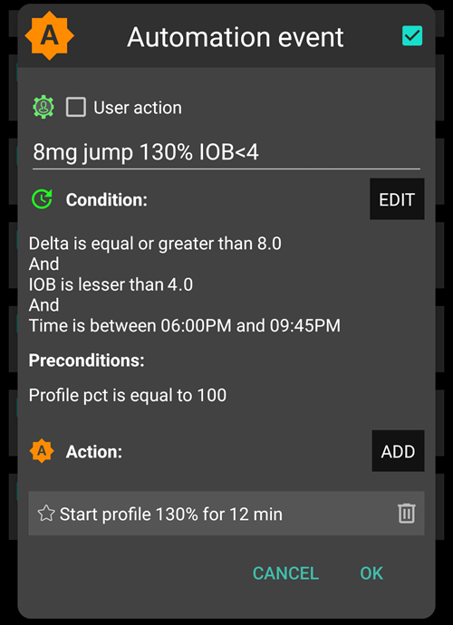
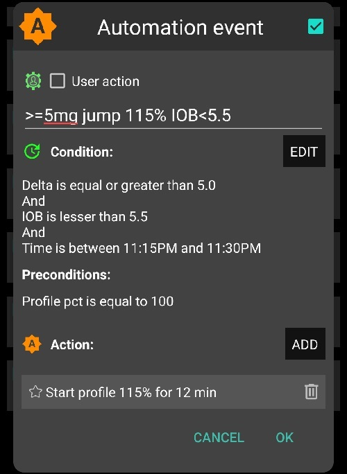
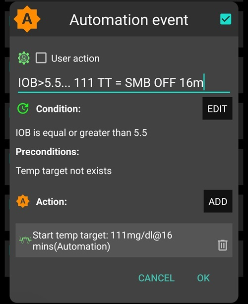
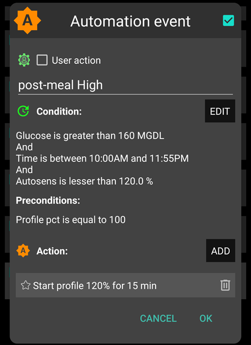
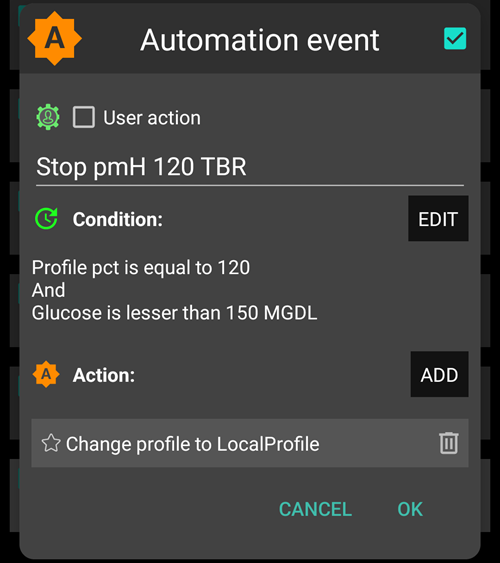

# Full Closed Loop

```{contents} In this page
:backlinks: entry
:depth: 2
```

Der Hauptvorteil des Full Closed Looping **FCL** besteht darin, dass es eine künstliche Bauchspeicheldrüse imitieren und die tägliche Nahrungsaufnahme erleichtern kann, ohne dass ein Bolus für die Mahlzeiten erforderlich ist.

Der **Hybrid Closed Loop** („HCL“) basiert zwar auf einem Algorithmus, erfordert aber immer noch, dass der Anwender vor den Mahlzeiten manuell bolt. Als Ergebnis kann der Loop vorübergehend abgeschaltet werden (temporäre Null-Basalrate), um eine übermäßige Insulinabgabe zu verhindern.

Im **FCL** sind mahlzeitenbezogene Boli nicht mehr notwendig: Überlasse das dem Algorithmus!  Der Modus, der es **AAPS** ermöglicht ohne KH-Eingaben und manuelle Boli auszukommen, nennt sich „unangekündigte Mahlzeiten“ (engl.: un-announced meals **„UAM“**). **UAM** ermöglicht **AAPS** aggressiver auf falsche Kohlenhydrateingaben zu reagieren, sodass sich AAPS damit toleranter auf diese Fehleingaben zeigt.

## Was erwartet mich?

Es gibt viele veröffentlichte Studien über die guten Ergebnisse, die **FCL** erreichen kann. Weitere Informationen findest Du in den folgenden Quellen:

1)   National Library of Medicine, PubMed [First Use of Open-Source Automated Insulin Delivery AndroidAPS in Full Closed-Loop Scenario: Pancreas4ALL Randomized Pilot Study](https://pubmed.ncbi.nlm.nih.gov/36826996/);

2)  ClinicalTrials.gov National Library of Medicine, Clinical Trial [Feasibility and Safety Study of the Automated Insulin Delivery Closed Loop System Pancreas4ALL (ASAP)](https://www.clinicaltrials.gov/study/NCT04835350?term=Feasibility%20and%20Safety%20Study%20of%20the%20Automated%20Insulin%20Delivery%20Closed%20Loop%20System%20Pancreas4ALL%20(ASAP)&rank=1)

Um erfolgreich mit **FCL** zu sein, muss der Nutzende:

- überprüfen, ob er die Anforderungen des **FCL** erfüllt;
- **Automatisierungen** einrichten, die zu  den eigenen Bedürfnisse des täglichen Managements passen, und
- die **AAPS**-Einstellungen (insbesondere die **Automatisierungen**) fein nachjustieren und anpassen.


## Generelle Überlegungen, warum (nicht) von Hybrid zu Full Closed Loop gewechselt werden sollte

Ein **FCL** (Full Closed Loop System) ist nicht für jeden geeignet:

- Während einige **Full Closed Looper** einen TIR (70-180) von etwa 90% und einen HbA1c unter 6% erreichen, wollen andere vielleicht eine noch engere Kontrolle erreichen. Notably, minimizing values over 140 mg/dL at diets with rapid carbs probably requires pre-bolusing.
- Die **AAPS**-Feinabstimmung kann herausfordernd sein. Für diejenigen, die sich mit AAPS überfordert fühlen, ist es sicher nicht geeignet.  Du wirst einige Wochen investieren müssen, um Deinen **FCL** anzupassen und feinzujustieren. Diese Zeit zu investieren, kann verbesserte Ergebnisse und **Glukose**-Kontrolle bringen.
- Während die Handhabung der Mahlzeiten einfacher wird, kann im **FCL** der Umgang mit Aktivität weiterhin herausfordernd sein. Die meisten von uns wollen beim Sport so wenig Snacks wie möglich zu sich nehmen und haben dabei die Körpergewichtskontrolle im Hinterkopf.
- Es bleiben noch Schwierigkeiten beim **FCL** mit Kindern (weiter unten diskutiert).


## Gut eingestellter Hybrid Closed Loop

Es ist ratsam, zuerst eine gut abgestimmte Steuerung des Hybrid Closed Loop (**HCL**) zu haben, bevor Du den Schritt zum **FCL** überlegst.  Ein erfolgreicher **FCL** braucht eine sehr individuelle Abstimmung der Einstellungen, damit **AAPS** so Insulin abgibt, wie es DEIN gut laufender Hybrid-Closed-Loop-Modus tut (d. h. er ahmt ihn nach).

**FCL** erfordert, das **Automationen** eingerichtet und optimiert werden. Bevor Du Dich auf **FCL** einlässt, musst Du ein sicheres Verständnis darüber haben, was ein Insulinmanagement braucht. Fehler können mit Gegenfehlern überdeckt werden. Dies kann ein labiles **FCL**-System zur Folge haben, dass danach nur schwer zu korrigieren ist. Du kannst erwarten, dass Du mit Deinem FCL einen %TIR erreichst, so wie Du ihn heute auch mit Deinem **HCL** hast.

**FCL is a DIY set up of Automations determined by the user by analyzing their data from both their successful HCL and  initial FCL experience when tuning your settings.**

## Schnelles Insulin (Lyumjev, Fiasp)

**FCL** benötigt schnelles Insulin.  This is so that at the start of meal-related **BG** rise, **FCL** is able to keep **BG** in range (by common definition, under 180 mg/dL (10 mmol/L)).

Eine Modellierungsstudie (Details siehe LINK FullLoop V2/March2023; dort Abschnitt 2.2) kann zeigen, dass *schnellere Insuline*

Quelle:

 


IEEE Control Systems Magazine, ResearchGate [The Artificial Pancreas and Meal Control: An Overview of Postprandial Glucose Regulation in Type 1 Diabetes](https://www.researchgate.net/publication/322866519_The_Artificial_Pancreas_and_Meal_Control_An_Overview_of_Postprandial_Glucose_Regulation_in_Type_1_Diabetes);

- zu signifikant niedrigeren Glukose-Spitzen führen, als langsamere Insuline;
- tolerieren ein um ein paar Minuten verzögerten ersten Mahlzeiten-Bolus, ohne dabei zu inakzeptablen Höhen der Spitzen zu führen; und
- minimize the effect on **BG** peak from different carb loads (meal sizes).

**FCL** ist mit anderen Insulinen als Lyumjev oder Fiasp wahrscheinlich nicht effektiv, es sei denn, der Nutzende ernährt sich sehr moderat bis hin zu kohlenhydratarm.

However, Fiasp or Lyumjev can result in frequent pump occlusions, even after optimizing things like needle length. Es ist wichtig, ein Auge auf die Kanülen- oder Pod-Dauer zu haben. Bei vielen Nutzenden lässt die Insulinwirkung nach 48 Stunden nach, bevor die Kanüle bzw. der Pod letztendlich ausfällt.

## Voraussetzungen

**BG** values and stable Bluetooth connectivity are required to ensure **AAPS** can optimally perform without losing valuable time. **FCL** benötigt rund um die Uhr ein technisch stabiles System:

- Die Leistung Deines **CGMs. Dein CGM sollte keine springenden **Glukose** -Werte erzeugen, die vom **FCL** fälschlicherweise als der Beginn einer Mahlzeit interpretiert werden könnten. Genauso können **CGM**-Kalibrierungen zu springenden Ergebnissen führen.
- Wie und an welcher Stelle eine **CGM**-Glättung vorgenommen wird und welche Auswirkungen das auf die Feinabstimmung Deiner Einstellungen hat. Notably how delta is defined, and AAPS recognizing this as being sign of a starting meal.
- Bluetooth stability for the pump and CGM  pump;
- Vermeidung (oder zumindest frühzeitige Erkennung) von Pumpen-Verschlüssen;
- Der Datenfluss und die von Deinem Smartphone verwendeten Apps und die unterschiedlichen Sensortragezeiten;
- Alle **AAPS**-Komponenten gut aufgeladen und Ersatzteile immer griffbereit zu haben; und
- rechtzeitiger Kanülen- (oder Pod-) Wechsel, um das Risiko eines Verschlusses zu verringern;

Das oben Genannte hängt von den jeweiligen Komponenten Deines **AAPS**-Systems und Deinem individuellem Lebensstil ab.

## Mahlzeitbezogene Einschränkungen

- Das Einrichten eines **FCL** für Menschen, deren Ernährung aus wenig schnellen Kohlenhydraten besteht und damit einen geringen Einfluss auf den **Glukosewert** hat und deren Mahlzeiten sich täglich ähneln, könnte einfacher sein. Dies bedeutet nicht automatisch „Low Carb“.

- Fette oder proteinreiche Ernährung oder langsame Verdauung/Gastroparese machen die Dinge eher einfacher als schwieriger für den **FCL**, weil späte Kohlenhydrate schön die unvermeidlichen „späten Wirkenden“ (tails), die durch die zur Spitzenabdeckung benötigten Boli abdecken.

### Glykämischer Index und Wirkung auf den Blutzucker

Die Herausforderung für den **UAM**-Modus steigt mit steigendem „Effekt auf Blutzucker“ („EBG“)

- Beginne niedrig/moderat, und stimme Deine **Profil**-Einstellungen fein ab. „Teste“ erst dann Mahlzeiten mit hohem **EBG**.
- Denke darüber nach < 50% als ersten Bolus abzugeben, wenn Du Nahrungsmittel mit sehr hohem **EBG** isst.

1) **Kein EBG**: z. B. frisches Fleisch, Fisch, Eier, Speck, Öle, Käse. 2) **Geringer EBG**: z. B. frisches Gemüse und Beeren, Pilze, Nüsse, Milch, Joghurt, Hüttenkäse. 3) **Mäßiger EBG**: z. B. Vollkornbrot/Nudeln, Kartoffeln, Wildreis, Hafer, getrocknete Früchte. 4) **Hoher EBG**: z. B. Weizenbrot, Baguette, Toast, Waffeln, Kekse, Kartoffeln, Nudeln, Reis. 5) **Sehr hoher EBG**: z. B. gezuckerte Getränke, Fruchtsäfte, Cornflakes, Süßigkeiten, Kartoffelchips, Salzstangen.


Die schwierigsten Mahlzeiten für den **FCL** sind diejenigen mit ausschließlich sehr hohen und hohen **EBG**-Komponenten („Effect on blood glucose“) (rot im Bild): Es steigt nicht nur der **Glukosespiegel** schnell an, sondern es gibt auch nur wenig Fett-/Protein-/Ballaststoffkomponenten, die das unvermeidliche „späte Wirkende“ (tail) der Insulinaktivität, das durch den Versuch einen hohen Glukosespiegel frühzeitig abzufangen entsteht, ausgleichen.

Der falsche Konsum von Snacks und Süßgetränken, die aus schnell absorbierten Kohlenhydraten bestehen, ist für den **FCL** problematisch.


## Vorbereitung auf Aktivität/Sport

Wenn Du mit einer Pumpe oder einem hybriden Closed Loop trainierst oder aktiv bist, wird empfohlen, das **IOB** vor der Aktivität zu reduzieren.

Mit **FCL** ist der Algorithmus so eingestellt, dass er **UAM** erkennt und bei steigenden **Glukosewerten** automatisch Insulin abgibt.  Ein hohes **Temp Target** und niedriger **Profil-Prozentsatz** (bereits rund um den Beginn der Mahlzeit wirksam) sollte rechtzeitig vor jeder Aktivität gesetzt werden.

Ungewöhnliche oder fehlerhafte Aktivität sind für den **FCL** problematisch. Für sportliche Aktivitäten ist es nötig im Voraus zu planen (insbesondere, wenn der Bedarf an Notfall-KH/Snacks während einer Sport-Hypo reduziert werden soll). After an active day it is recommended that a lower  **Percentage Profile** is set for overnight after the evening meal is fully digested: set in **Automations** an elevated (>100 mg/dL) **BG**  target, with “no **SMBs** at elevated target” selected in **AAPS** **Settings**.

## Hindernisse für Kinder

**FCL** kann für Kinder zusätzliche Herausforderungen mit sich bringen, unter anderem:

- Lyumjev oder Fiasp sind möglicherweise nicht verfügbar oder werden nicht gut vertragen.
- Die stündliche Basalrate ist sehr niedrig und bietet damit eine schlechte Grundlage für große **SMBs**.
- Die Ernährung hat möglicherweise viele süße Bestandteile. Mit dem typischerweise geringen Blutvolumen eines kleinen Körpers besteht eine starke Tendenz zu sehr hohen **Blutzucker**spitzen.
- Wachstumshormone und ausgeprägte Veränderungen der Insulinempfindlichkeit machen es schwierig, den **FCL** genau einzustellen.


## Aktivierung stärkerer SMBs: Sicherheit

Im **HCL** sind Sicherheitseinschränkungen hinsichtlich der Bolusgrößen, die vom Loop automatisch abgegeben werden dürfen, hinterlegt.

**FCL**-Looper müssen mit Beginn der Mahlzeit keinen großen Bolus mehr abgeben. Dies bedeutet, dass die Größenbeschränkungen für **SMBs** reduziert werden müssen /größere SMBs), damit der Loop in der Lage ist, ausreichend große **SMBs** abzugeben.

If you are operating with **AAPS** in the Master release, it is suggested **AAPS**' **Settings** are set up with the maximum allowed **SMB** size so that **FCL** can give (maxUAMSMBBasalMinutes=120, i.e. 2 hours worth of basal at that daytime).

Wenn Deine Basalrate sehr niedrig ist, können die sich daraus ergebenden **SMB**-Grenzen zu niedrig sein, um einen mahlzeitbedingten **Glukoseanstieg** abfangen zu können. One possible solution is to avoid diets that cause strong **BG** spikes. The [Auto ISF](#Open-APS-features-auto-isf) algorithm (only available in a dev build with engineering mode) has a **SMB max range extension** setting that expands the standard maximum of 2 hours worth of basal by a factor of >1, and lets you raise the default 50% **SMB delivery ratio**.

**Folge der Anleitung, um AAPS so aufzusetzen, dass mit einigen SMBs Deine normale Art zu bolen nachgeahmt werden kann**.

Check the **APS** plugin screen (**Configuration → APS → Open plugin**) periodically to see whether your **SMBs** are allowed to be sufficient enough to deliver the required insulin needed for the loop around meal starts.

Wenn nicht, werden Deine Tuning-Bemühungen mitunter vergebens sein!


```{admonition} Boosting **ISF** can become dangerous
:class: danger

Carefully observe/analyze the **SMB** sizes shortly after your meal commences. Verändere in kleinen Schritten und nicht mehr als 1 oder 2 Parameter auf einmal.

Deine **AAPS**-Einstellungen müssen gut genug eingestellt sein, um Deine (!) Essensgewohnheiten und Mahlzeitenauswahl bewältigen zu können.
```

## Mahlzeiterkennung / Deine Automationen zum Boosten

Der Schlüssel für einen erfolgreichen **FCL** ist der richtig abgestimmte **ISF**-Parameter. Wenn der **AAPS**-Master mit **Automationen** genutzt wird, muss **bei der Erkennung einer Mahlzeit (über Glukose-Deltas) automatisch eine Profiländerung > 100% ausgelöst** werden, damit ein aggressiverer **ISF** zur Verfügung steht.

Die **AAPS**-Master-Version erlaubt im **HCL**-Modus ein maximales temporäres **Profil** von bis zu 130 %. Das Boosting des **ISF** erfolgt in drei Schritten:

- Schritt 1 -  Überprüfe im **Profil** den für dieses Zeitfenster gültigen **ISF** und schaue, ob z. B. Autosens, das die aktuelle Insulinempfindlichkeit Deines Körpers der letzten Stunden berücksichtigt, eine Änderung vorschlägt.
- Schritt 2 - Wende einen Faktor (1/Profil%, wie in **Automation** hinterlegt) an, um den **ISF** zu verstärken.
- Schritt 3 - Stelle sicher, dass der vorgeschlagene **ISF** innerhalb der festgelegten Sicherheitsgrenzen liegt.

### FCL Automationsvorlagen

Kästchen, die oben markiert werden sollen. Du hast die Option:

- In Deiner **Automatisierung**s-Liste kannst Du das Häkchen (links von jedem Feld) entfernen => Damit deaktivierst Du die **Automatisierung**. Das kann beispielsweise für alle **FCL**-**Automatisierungen**, die im Zusammenhang mit einem Frühstück stehen, auf dem Weg zum **HCL** für Frühstück erfolgen.

- Für jede **Automatisierungs**-Regel kannst Du das das Kästchen für Benutzeraktion markieren => wenn die Bedingungen erfüllt sind, werden die definierten Aktionen nicht automatisch ausgeführt. Du wirst dann auf der **AAPS**-Übersichtseite jedes Mal alarmiert, wenn Dein **FCL** sonst automatisch einen **SMB** abgeben würde. Du hast dann die Möglichkeit, dazu dann „Ja“ oder „Nein“ zu sagen. Dies hilft insbesondere in der Tuning-Phase.

Diese Funktion kann für bestimmte Situationen wie z. B. das Aufsteh-Phänomen (engl. „foot to floor“) nützlich sein, bei dem es zu einem plötzlichen Anstieg des **Glukosewerts** kommt, sobald Du morgens aufstehst, Du aber eine vollautomatische „Frühstück begonnen"-Reaktion verhindern möchtest.

Der untenstehende Abschnitt enthält Anleitungen, wie man die **Automatisierungs**-Bedingungen zusammenfasst und wie man Situationen begegnen kann, in denen **AAPS** die Insulinabgabe erhöhen (oder verringern) sollte. Da der **ISF** nicht direkt angepasst werden kann, wird das prozentuale Anheben des **Profils** über 100 % für unsern Zweck den gleichen Effekt haben.

### Automatisierte große SMBs bei Glukoseanstieg

Der Schlüssel zu einem erfolgreichen **FCL** ist, **zu Beginn des mahlzeitbedingten Glukoseanstiegs so schnell wie möglich große automatische SMBs durch den Loop abzugeben**, um das benötigte **IOB** „aufzuholen” (verglichen mit dem normalerweise für vergleichbare Mahlzeiten abzugebenden Bolus im **HCL**!)

To achieve this, data from your **HCL** should be analyzed to determine which **deltas** might be not meal –related and those delta which might be.

- As you can define the **Automation** within a pre-defined time-window, you need only to analyze there.
- Wenn Deine Mahlzeiten in der Zusammensetzung sehr unterschiedlich sind (z.B. ein eher kohlenhydratreiches Frühstück, aber ein kohlenhydratarmes Mittagessen), kannst Du Dich dafür entscheiden für jedes der Zeitfenster zwei verschiedene **Automatisierungen** (bzw. Automatisierungsgruppen) zu erstellen.
- Wenn Du gelegentliche nächtliche Sprünge durch "compression lows" siehst, spare die Nächte aus.
- Normalerweise reicht es aus, das Delta der letzten 5 Minuten zu verwenden.
- Du kannst aber auch eines der durchschnittlichen Deltas verwenden. Durch das Vergleichen der Deltas als Bedingung in Deiner **Automatisierung**, kannst Du - abhängig davon, ob der **Glukosewert** schneller steigt oder nicht - sogar unterschiedliche aggressive Aktionen festlegen.

> ( BZ-Unterschied - kurzes durchschnittl. Delta )>n ist ein Ausdruck, der zur Erkennung eines sich beschleunigenden Anstiegs genutzt werden könnte, um so den ersten **SMB** beim ersten Anzeichen steigender **Glukose** auszulösen. -                                                                             
> Achtung: nicht mit schlechten oder stark geglätteten **CGM-Werten verwendbar!

Ein **CGM** mit lückenhaften Daten bringt den Benutzer in eine schwierige Situation, denn es ist aus Sicherheitsgründen,  extrem wichtig, dass das gewählte (bzw. beobachtete) Delta ein sicheres Zeichen für einen Mahlzeitbeginn ist. Das bedeutet:

- Der **FCL** verliert zusätzliche Zeit, was zu höheren **Glukosewert**-Spitzen und einem niedrigeren **TIR**-Prozentsatz führt;
- Du kannst im **FCL** kein früheres oder kleineres Delta benutzen, da dieses auch **SMBs** ohne eine Mahlzeit zum Ausgleich eines manuellen Bolus auslösen können.

Zudem werden schon kleine Anstiege nach einer Mahlzeit durch **wenig IOB** erkannt. Das berücksichtigend, kann eine Automation(#1) für ein Abendessen wie folgt aussehen:



Automatisierung #1

Wenn die Bedingungen eintreten, würde **AAPS** in den nächsten 12 Minuten 1 oder 2 - gemäß dem festgelegten höheren **Profil-Prozentsatz** geboosteten **ISF** - **SMBs** abgeben (im Beispiel, eine Erhöhung von insulinReq um 30 %). Solange diese Bedingungen zutreffen, wird die **Automatisierung**sregel um weitere 12 Minuten verlängert. Eine kohlenhydratarme Mahlzeit könnte langsamere Anstiege der **Glukosewerte** zeigen. Dieser würde von einer weiteren Automation (#2) profitieren, die bei einem niedrigeren Delta einsetzt und einen schwächeren Insulin-Boost gibt.



Die gleiche **Automatisierung** wird wahrscheinlich auch bei Mahlzeiten mit höherem Kohlenhydratgehalt greifen, sobald der steile Anstieg, wie in Automation#1 definiert, vorbei ist.

Diese beiden (und eventuell eine dritte) **Automatisierungen** musst Du so arrangieren, dass sie zu dem passen, was Du bei Deinen verschiedenen Mahlzeiten siehst => die richtigen Sprunghöhen, **IOB**-Kriterien und Verstärkungen zu setzen, wird ein iterativer Abstimmungsprozess.  Wenn Du einen geeigneten Zeitraum in den Bedingungen angibst, kannst Du ganz einfach unterschiedliche Automationen für Deine verschiedenen täglichen Mahlzeitenzeiten (Frühstück, Mittagessen, Abendessen) ausführen.

Berücksichtige bitte, dass noch in der Steigphase (!), ein **IOB**-„Überschuß“ verhindert werden muss, damit das nach 3-5 Stunden noch wirkende **Insulin** (das „**Wirkende**“ (sog. tail)) nicht die durch das Zero-Temping mögliche Abbremswirkung überschreitet („Basal entziehen“, um das Hypo-Risiko zu reduzieren).

Bei großen Mahlzeiten gibt es **manchmal einen zweiten Anstieg**. Bis zu diesem Zeitpunkt hat sich das aktive Insulin (IOB) in der Regel schon verringert und die aggressiveren Automationen greifen wieder. (Damit das nicht passiert, überprüfe, dass die IOB-Bedingung in der Automation #2 nicht zu niedrig eingestellt ist).

Kurz nachdem einige erste **SMBs** abgegeben wurden, kommt eine **balancierte Phase**, in der eine moderate zusätzliche Insulinabgabe die zusätzliche aufgenommenen Kohlenhydrate abdecken sollte. (Außer bei kohlenhydratarmen Mahlzeiten, bei denen der Loop möglicherweise einen zu schwachen **Glukose**anstieg sieht und sofort in das Zero-Temping geht).

Die **AAPS**-Übersicht (wo Du COB=0 bei **UAM** im Full Loop siehst) könnte in dieser Phase nach zusätzlichen Kohlenhydraten fragen. Im **UAM**-Modus bedeutet das einfach, dass Du eine sehr grobe Plausibilitätsprüfung machen kannst: Ist es wahrscheinlich, dass diese Kohlenhydrate der Mahlzeit von vor einer Stunde unverdaut in Deinem Körper sind (von denen Du dem Loop nichts mitgeteilt hast)?


### IOB-Schwellenwert

Oft bewirken die **Automatisierung** #1 und/oder #2, dass das IOB soweit aufgebaut wird, dass es typischerweise **Deine** Mahlzeiten abdeckt. Für eine individuelles Tuning, schau in den Daten Deines **HCL** nach den maximalen IOB-Werten (max IOB), die bei gut kalkulierbaren Mahlzeiten auftreten (meist: Dein Mahlzeiten-Bolus), und in welchem Ausmaß danach eine Hypo (oder der Bedarf an zusätzlichen Kohlenhydraten) auftrat.

Sensible **IOB-Schwellwerte**, bei denen Du die Aggressivität Deines Loops reduzieren solltest, sind möglicherweise nicht für jede Mahlzeit identisch. Aber vor allem in der ersten Stunde nach Beginn einer Mahlzeit, die im **UAM**-Modus entscheidend ist. Es wird sich für jeden Nutzenden unterscheiden. Der IOB-Schwellwert kann in Deiner Automatisierung schnell angepasst werden, um auch außergewöhnliche Mahlzeiten abzudecken oder um ihn für eine folgende Sporteinheit zu senken.

Der **IOB**-Schwellwert kann in Deiner **Automatisierung** schnell angepasst werden, um auch außergewöhnliche Mahlzeiten abzudecken oder um ihn für eine folgende Sporteinheit zu senken.

Automatisierung(#3), „IOB-Schwellwert erreicht => **SMBs** aus“, wird definiert, um das aggressive **SMB**-Boosting zu beenden (oder zu unterbrechen, bis eine weitere Welle des kohlenhydratbezogenen Anstiegs kommt).



Automatisierung #3

Sie sagt dem Loop, dass es besser ist, über dem von Dir festgelegten **IOB-Schwellwert** keine weiteren **SMBs** abzugeben

- The given example does that by setting TT=111 (which is kind of arbitrary; pick a number>100 that you easy recognize as your automated **SMB** shut-off)
- In **AAPS**' [Settings → OpenAPS SMB](#Preferences-openaps-smb-settings), generally do not allow **SMB** at elevated target.                                                                                                                   
  The insulin required will then have to be delivered with much more caution through the bottleneck of **TBRs**

**Achtung: Automatisierung #3 funktioniert nur, wenn kein aktives TT gesetzt ist.** Falls Du also mit einem temporären Ziel „Bald Essen“ gearbeitet hast, muss dieses bis zum Start der Automatisierung beendet sein (d. h. normalerweise 30-40 Minuten nach Beginn der Mahlzeit).

Eine Möglichkeit, dies zu tun, ist eine **Automatisierungs**-Bedingung einzurichten, die ein eventuell laufendes EatingSoonTT beendet, wenn **iob**>65% * iobTH.
> Möglichkeiten ein „Bald Essen“-TT zu nutzen Um zu Mahlzeitbeginn einen niedrigen Ausgangs-**Glukosewert** und ein wenig mehr aktives Insulin (**IOB**) zu haben, stellen einige Looper durch drücken der „Bald Essen“-Schaltfläche (oder bei verlässlichen Essenszeiten: automatisch über ein reduziertes **Profil**-**Glukose**ziel) mindestens eine Stunde vor Beginn der Mahlzeit ein „Bald Essen“-TT ein. Aber, unter der Annahme, dass der **FCL** sowieso immer auf dem Weg zum Ziel ist, könnte dies nicht viel bringen und Du kannst stattdessen einfach eine **Automatitsierung** definieren, die beim Erkennen des Mahlzeitenbeginns (Glukose-Delta oder Beschleunigung = Delta > Durchschnitts-Delta) ein „Bald Essen"-TT setzt. Ein niedriges **temporäres Ziel** (TT) ist in dieser Phase wichtig, da jeder **SMB** des Loops durch (vorhergesagter Glukose minus temporäres Ziel)/Sensititvität berechnet wird. Damit erhöht ein niedriges temporäres Ziel den daraus resultierenden Insulinbedarf (insulinReq).

After the first boosted **SMB**s were given, your set iobTH and **Automation** #3 should strike a good balance of limiting the glucose peak, but also not leading to a hypo after the meal.

Falls sich beispielsweise Dein Frühstück kohlenhydratmäßig vollständig von Deinen durchschnittlichen Abendessen unterscheidet, kannst Du von **Automatisierungen**, die zu den jeweiligen Tageszeiten gelten und unterschiedliche **iobTH**-Werte haben (möglicherweise auch unterschiedliche Deltas und unterschiedliche **prozentuale Profileinstellungen**), profitieren. Sowohl Du mit der Definition Deines Essensspektrums und Einstellungen (insbesondere **iobTH**), als auch der Loop, der sich um den sich entwickelnden **Glukose**verlauf kümmert, müssen bestimmte hohe Spitzen akzeptieren, um die Hypo-Gefahr gegen Ende der **Insulinwirkdauer** der **SMBs** zu reduzieren.

### Stagnierende hohe Glukosewerte

In case, after a “rich” meal, a long-lasting stagnation with **high BG** value is seen, **Automation** #4 (below), “post-meal High”, helps deal with fatty acid resistance: After multi-course meals, large greasy pizza, raclette evening, the glucose curve can form two humps or, very often, an elongated high plateau.



Automation #4



Automation #5

Automation #4, “Hoch nach dem Essen”, ist auch für einen Hybrid Closed Loop anwendbar

Außerdem muss die Automation#5 abgebrochen werden können ("Stopp Hoch nach dem Essen"), damit die Insulinabgabe bei einem sinkenden Glukosewert weniger aggressiv erfolgt. (Allerdings wird der Loop, bei einem niedrigen erwarteten Glukosewert oft ohnehin schon die Insulinabgabe reduzieren bzw. begrenzen).

## Einer Hypo vorbeugen

Das Kernproblem hier ist natürlich, dass der **UAM**-**FCL** (ohne die Eingabe der Kohlenhydrate) **nicht wissen kann, wie viele Gramm an Kohlenhydraten für die Aufnahme noch verfügbar sind**, und möglicherweise das „Rest“-Insulin aufbraucht, ohne dass Du in eine Hypo kommst.

Mit geboosterten **SMBs**, wird im **FCL** das „aufgeholt“, was wir früher mit einem Mahlzeitenbolus gemacht haben. Aber **zum Ende der Insulinwirkung ("tail end") kann das Vermeiden einer Hypo zu einem ernsten Thema werden**.

Als Vorbereitung auf den **FCL**, musst Du Dir den **zeitlichen Verlauf des IOB** bei typischen Mahlzeiten genauer anschauen und daran beurteilen **, wann es zu viel Insulin wird und wie Du das durch das Tuning der Automatisierungen verhindern/abfangen kannst.** Es gibt einige Stellschrauben, die das möglich machen. Das richtig hinzubekommen, kann eine Herausforderung sein.

Generally, it makes no sense to keep optimizing settings for one kind of meal. Sobald Du eine ausreichend gute Einstellung z.B. für eine Art Deines Mittagessens hast, teste, wie diese mit anderen Arten funktioniert, und wie Du einen „Kompromiss“ findest.

Um Hypos 3-5 Stunden nach einer Mahlzeit zu vermeiden, reduziere die Aggressivität, bevor zu viel aktives Insulin (IOB) aufgebaut wird. Besondere Ansätze:

- Schwäche den **ISF**, so wie es in den Automatiisierungsbeispielen #1 und #2 gemacht wird, schon während des Glukoseanstiegs immer weiter ab.
- Lege den IOB-Schwellwert, ab dem **AAPS** deutlich vorsichtiger gemacht wird (s. Automatisierung #3 oben), fest. Berücksichtige, dass dieses **IOB** durch den letzten **SMB** überschritten werden kann, bevor dessen Wirkung eingetreten ist; und dann weiter: durch temporäre Basalraten (TBR), wenn der Loop insulinReq analysiert. Kohlenhydrate, die verstoffwechselt werden für einen Gegeneffekt sorgen (Verringerung des IOB).
- Der IOB-Schwellwert könnte nach Mahlzeiten differenziert werden: Durch das Klonen der Automatisierungen könnte man nach Frühstück, Mittag- und Abendessen-Zeitfenstern unterscheiden (oder sogar nach Geo-Standorten wie Firmen-Cafeteria oder Schwiegermutter usw.)
> In diesen Zeitfenstern kann sogar weiter unterschieden werden, indem Du verschiedene TTs für Low Carb vs. schnelle Kohlenhydrate usw. setzt, und so verschiedene Mahlzeitklassen „kodierst“, die zu dieser Tageszeit auftreten können und diese mit **Automatisierungen**, die speziell auf Dich zueschnitten sind, aktivierst. Sofern Deine Ernährungsgewohnheiten nicht stark variieren, ist das vermutlich gar nicht notwendig.

Before a special meal challenge, you can raise your **iob** threshold, or make another change in any of your Automations within under 5 seconds, right on your AAPS phone (**Manage → Automation**).

Die Gefahr einer Hypo einge Stunden nach dem Essen ist im Wesentlichen eine Frage, ob Deine Mahlzeit-Zusammensetzung so war, dass die **Insulinrestwirkungen ("tails"), die gegen den Großteil der Kohlenhydrate ankämpfen**, von **"verlängerten Kohlenhydraten" verbraucht ** werden (übermäßige/verzögerte Kohlenhydrataufnahme/Protein/Fett/Ballaststoffe).

Im Laufe der Zeit wirst Du Muster erkennen, Deine Automatisierungen adjustieren - vielleicht sogar Deine Essgewohnheiten ein wenig anpassen, z.B. einfach einen gelegentlichen kleinen(!) Snack genießen, der helfen kann, eine gute **Balance zwischen Insulinaktivität und Kohlenhydratabsorption** für die **gesamte** Dauer der Mahlzeit (mit Verdauung, Absorption) zu halten und so das Leben Deines Loops (und für Dich selbst) einfacher zu machen.

### Reihenfolge der programmierten Automationen

Es können Probleme mit sich überschneidenden Definitionen zwischen den **Automatisierungen** auftreten. Beispiel: Die Problemstellung ist, dass Delta >8 auch Delta >5 ist, d.h. es kann zwei konkurrierende **Automatisierungen** geben. Was macht der Loop in dieser Situation? It always decides according to the sequence in which your **Automations** appear in **Manage → Automation**.  Beispiel: Die Delta > +8-Regel muss als erstes ausgeführt werden (und startet, wenn alle Bedingungen zutreffen den stärksten Boost); danach folgt die Überprüfung auf Delta >5 (und eine sanftere Reaktion). Würden sie anders herum sortiert und ausgeführt werden, würde die Delta >8-Regel nie in Kraft treten, weil bereits Delta >5 angewendet wird, Fall abgeschlossen.
> Tipp für Automatisierungen: Die Reihenfolge ist sehr leicht änderbar. In **Manage → Automation**, touch and hold the **=** handle on the right of a rule and drag it to another position.

Genauso schnell und einfach kannst Du Auslöser oder Aktionen binnen weniger Sekunden auf Deinem AAPS-Smartphone anpassen; wenn Du beispielsweise an einem besonderen Essens-Event teilnimmst. (Aber vergiss nicht, sie für den nächsten Tag wieder auf "normal" zu setzen).

(full-closed-loop-troubleshooting)=

## Problembehandlung

### Wie man wieder in den Hybrid Closed Loop zurückkehrt

You can untick the checkboxes of the **Automations** related to your **FCL**, and go back to bolusing for meals and make carb inputs again. If you had removed the **Insulin** or **Calculator** buttons from your main screen, add them back in the [QuickLaunch toolbar](#quicklaunch) configuration (they always remain available under **Treatments** in the bottom navigation). Be aware that now it is again up to you to bolus for meals.

It may be wise to do **FCL** only for meals (time slots) where **Automations** are fully defined and clicked on, and un-click only those for the other meal times when you like to do **HCL** (or have none defined yet, in your transition period).

For instance, it is perfectly possible, without any extra steps after **Automations** for dinner time slots are defined, to do **FCL** only for dinners, while breakfast and lunch are done in a **HCL** as you are used to.


### Sind die Voraussetzungen für einen FCL immer noch gegeben?

- Ist das Basis-**Profil** noch korrekt?
- Hat sich die **CGM**-Qualität verschlechtert
- Bitte beachte die Voraussetzungen (oben).

### Glukosewerte steigen zu weit an

- Mahlzeiten werden nicht sofort erkannt
    - Prüfe die Bluetooth-(In)Stabilität
    - Prüfe, ob Du kleinere Deltas zum Auslösen des ersten **SMB** festlegen kannst
    - Experimentiere mit einem Aperitif, einer Suppe einige Minuten vor der eigentlichen Mahlzeit
- SMBs sind zu schwach
    - Prüfe die Reihenfolge der **Automatisierungen** (z. B.: großes Delta vor kleinem Delta)
    - Check (real-time) in the **APS** plugin screen whether hourly profile basal and set minutes (max 120) limit allowed SMB size
    - Check (real-time) in the **APS** plugin screen whether %profile must  be set bigger
- Wenn alle Deine Einstellungen das Limit erreicht haben, wirst Du möglicherweise mit den vorübergehend hohen Werten leben oder Deine Ernährung anpassen müssen.
> If you are ready to test a dev build, [Auto ISF](#Open-APS-features-auto-isf) also allows further expanded SMB sizes. Einige Nutzende greifen auch auf einen kleinen Pre-Bolus in ihrem „FCL“ zurück. Das beeinflusst allerdings den Glukoseverlauf und verändern damit die Erkennung der Anstiege und wie sich abgegebene **SMBs** verhalten und kann damit nicht ohne weiteres aus einer Nutzensicht überzeugen.
- Eine wichtige Erkenntnis von Nutzenden im Piloten war, dass es sehr wichtig ist, wie sich Deine Glukose- und IOB-Kurven dem Beginn der Mahlzeit nähern, um zu bestimmen, wie stark sie durch Kohlenhydrate ansteigen: Das Abfallen (zum Beispiel in Richtung eines temporären Ziels "Bald Essen"), der Aufbau von etwas IOB und eine bereits begonnene positive Beschleunigung, scheinen zu helfen, die Spitzen niedrig zu halten.

### Glukosewerte fallen zu weit ab

- Mahlzeiten werden fälschlicherweise erkannt
    - Prüfe, ob Du größere Deltas zum Auslösen des ersten **SMB** festlegen kannst
    - Klicke auf „Benutzeraktion“ in der entsprechenden Automation, damit Du zukünftig spontan entscheiden kannst, die Automation auszuführen oder zu blockieren, wenn sie nicht auf eine Mahlzeit zurückzuführen sind
    - Damit Snacks keine **SMBs**, wie für eine volle Mahlzeit, auslösen, setze ein temporäres Ziel > 100, wenn Du snackst (so wie Du es auch für Sport und Hypo-Snacks tust)
- SMBs liefern insgesamt zu viel Insulin
    - Check (real-time) in the **APS** plugin screen whether **SMB max range extension** must be set smaller
    - Check (real-time) in the **APS** plugin screen whether **Percentage Profile** must  be set smaller
    - SMB Lieferquote kann vermutlich verkleinert werden. Als Hinweis: In diesem Fall wirkt sich das auf alle **SMBs** (und alle Zeitfenster) aus,
- Probleme mit der Insulin-Restwirkung ('tail') nach den Mahlzeiten
    - Du brauchst möglicherweise einen Snack (bei einer Hypo-Vorhersage) oder Glukosetabletten (wenn Du bereits in der Hypo-Zone bist). Aber beachte, dass die benötigten Kohlenhydrate, die der Loop zu einem bestimmten Zeitpunkt angeben wird, zu hoch sein werden. Der Loop hat keinerlei Informationen über Deine Kohlenhydrataufnahme (obwohl Du möglicherweise erraten kannst, wie viel mehr, einschließlich der Kohlenhydrate aus Fetten und Proteinen immer noch darauf wartet, verstoffwechselt zu werden).
    - Eine wertvolle Information wäre, ob das Problem hauptsächlich bereits in der Glukose-Anstiegsphase entsteht. Dann könnte eine einfach Lösung sein, iobTH zu verringern.
    - Wenn der Bedarf an zusätzlichen Kohlenhydraten häufig auftritt, notiere Dir, wie viele Gramm benötigt wurden (ohne das, was Du möglicherweise zu viel genommen hast und dann wieder etwas Insulin erforderte).  Nimm dann den in Deinem Profil hinterlegten Korrekturfaktor (IC) und schätze ab, wie viel Insulin weniger die **SMBs** hätten liefern sollen, und gehe mit diesen Informationen in die Nachjustierung (des **prozentualen Profils** in den **Automatisierungen** oder eventuell auch des eingestellten iobTH). Dies kann sich auf die**SMBs** beziehen, die bei hoher Glukose abgegeben wurden, oder auf die **SMBs**, die während des **Glukoseanstiegs** abgegeben werden.
    - Es könnte gut sein, dass Du höhere **Glukose**spitzen zum Vermeiden einer Hypo akzeptieren musst. Oder stelle Deine Ernährung auf kleinere Kohlenhydrat- und höhere Fett- und Proteinmengen um.


### Weitere Informationen

Make sure you stay in touch with other **FCL** users.

Discussion Full Closed Loop using Automations:

- English:   [Discord Channel](https://discord.gg/ChXj8BaKwA)

- Deutsch:  [German Looper Community](https://de.loopercommunity.org/t/ueber-die-kategorie-full-loop/10107)
