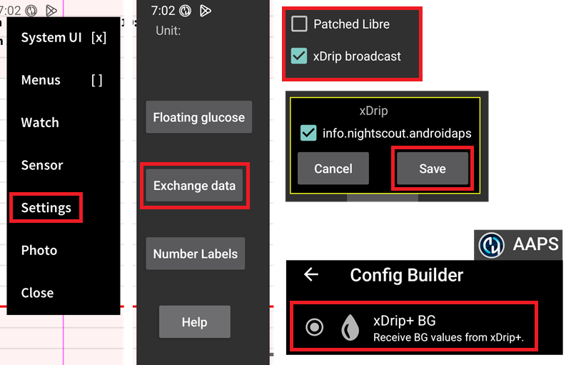

# Juggluco Einstellungen

Sofern noch nicht eingerichtet, lade als erstes [Juggluco](https://www.juggluco.nl/Juggluco/download.html) herunter.

Um Deinen Sensor zu verbinden, führe diese [Einzelschritte](https://www.juggluco.nl/Jugglucohelp/introhelp.html) durch.

## Grundlegende Einstellungen für alle CGM-Systeme

### Nightscout Upload ausschalten

You shouldn't let any other app upload data (blood glucose and treatments) to Nightscout.

Deaktiviere in Juggluco jeden aktiven Nightscout-Uploader.

(juggluco-to-aaps)=

## Juggluco zu AAPS

Juggluco kann Glukosewerte direkt an AAPS senden. Nutzt Du einen [vertrauenswürdigen Sensor](#GettingStarted-TrustedBGSource), kann die Option „SMB immer aktivieren“ eingeschaltet werden.

Die Sensoren Libre 2/2+/3/3+ senden jede Minute Messwerte an AAPS. Die Neuberechnungen in AAPS erfolgen dennoch nicht minütlich.

Aktiviere in Juggluco den xDrip+-Broadcast (nicht „Patched Libre“ aktivieren), bestätige und speicher die AAPS-Paketinformationen. Select the xDrip BG data source in AAPS.

Stelle sicher, dass eine ausreichende [Glättung](./SmoothingBloodGlucoseData.md) der Werte in AAPS erfolgt.

(juggluco-to-xdrip)=

## Juggluco to xDrip

Juggluco can send blood glucose to xDrip which will then send them to AAPS.

Aktiviere in Juggluco „Patched Libre“ (xDrip+-Broadcast nicht aktivieren), bestätige und speicher die Dexdrip-Paketinformationen. Select the xDrip BG data source in AAPS.

Apply sufficient [smoothing](./SmoothingBloodGlucoseData.md) in AAPS if necessary, when using a Libre 2/2+/3/3+ sensor, xDrip will average the minute-by-minute to 5 minutes readings and [also smoothen](#libre2-value-smoothing-raw-values) them.

