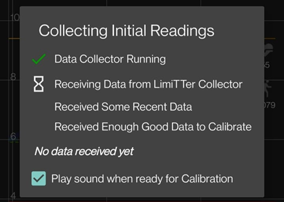

# Anleitung: Libre 2 und OOP2 für eine native Bluetooth-Verbindung in xDrip einrichten

Übertragen aus „[MinimalL00per](https://www.minimallooper.com/post/how-to-setup-freestyle-libre-2-and-oop2-to-use-a-native-Bluetooth-connection-in-xdrip)“ nach Markdown und **überarbeitet/aktualisiert**: 25-Aug-2025 psonnera

Eine Liste der Definitionen findet sich am Ende des Dokumentenabschnitts. Solltest Du irgendeinen Begriff oder eine Abkürzung nicht kennen, springe nach *[unten](#minimallooper-definitions)*. Sie sind dort genauer erklärt.

 

## Konfiguration

### Hardware

- *FSL2 und 2+* **HINWEIS: US, CAN, NZ, AUS-Versionen werden NICHT unterstützt**

**(OPTIONAL) Lesegerät** (nicht mit FSL2+ kompatibel)

- Lesegerät der ersten Generation (mit aktualisierter Firmware)

- Lesegerät der zweiten Generation

*HINWEIS: Wenn Du planst, das Lesegerät in dieser Lösung zu nutzen, MUSS der Sensor mit dem LESEGERÄT GESTARTET werden. Passiert das nicht, kannst Du in der Folge das Lesegerät nicht zum Auslesen der Messwerte des aktivierten Sensors nutzen. Nach der Aufwärmphase des Sensors kannst Du Messwerte mit der LL-App oder mit xDrip abrufen.*

### Software

**OOP** - Out of Process Algorithm, eine externe Android-APK Anwendung, die dabei hilft die Rohdaten des Sensors abzurufen und Glukosewerte zu ermitteln. xDrip sendet die gesammelten Bluetooth-Rohdaten des Libre 2 an OOP, und die Glukosewerte werden an xDrip zurückgegeben.

- **OOP2**

  - **Funktioniert nur mit europäischen FSL2/2+ Sensoren**

  - Geschützter Quellcode (nicht auf GitHub verfügbar)

  - Ziel ist es, die verschlüsselten Sensor-Rohwerte zu entschlüsseln und an xDrip zurückzugeben. Danach kann xDrip entweder mit Rohdaten arbeiten, die eine Kalibrierung erfordern, oder Glukosewerte ähnlich wie das Lesegerät der ersten Generation liefern.

[***xDrip+***](https://jamorham.github.io/)

- [*Nightly*](https://github.com/NightscoutFoundation/xDrip/releases) Neuester Sourcecode, der jede Nacht erstellt wird. Nicht gründlich getestet.

- [*Stable*](https://xdrip-plus-updates.appspot.com/stable/xdrip-plus-latest.apk) Neueste stabile und getestete Version.

- **HINWEIS: Neue Sensoren benötigen eine aktualisierte OOP2-App. Daher wird empfohlen, mindestens die neueste xDrip-Version (Stable) zu verwenden, die zur neuesten OOP2 passt.**

 

## Prozess

- *Lade zuerst die unten aufgeführten Apps herunter und installiere sie*
- *Deinstalliere Apps, die möglicherweise zu Konflikten führen*
- *Anleitung: Libre 2-Sensor im nativen Bluetooth-Modus mit LL und xDrip starten
  - [*Schritt 1: Anwendungsinstallation und -konfiguration*](#minimallooper-step1)
  - [*Schritt 2: Konfiguration der xDrip-Einstellungen*](#minimallooper-step2)
  - [*Schritt 3: Den Sensor (tatsächlich) setzen*](#minimallooper-step3)
  - [*Schritt 4: Starte die LL-App und starte den Sensor mit dem ersten NFC-Scan*](#minimallooper-step4)
  - [*Schritt 5: Öffne xDrip und scanne den Libre 2-Sensor per NFC*](#minimallooper-step5)
  - [*Schritt 6: Starte den neuen Sensor in xDrip*](#minimallooper-step6)
  - [*Schritt 7: Warte 60 Sekunden und scanne den Sensor per NFC erneut*](#minimallooper-step7)
  - [*Schritt 8: Datenerfassung zwischen 3 und 15 Minuten*](#minimallooper-step8)
  - [*Schritt 9: Stelle sicher, dass der Sensor verbunden ist und Daten liefert*](#minimallooper-step9)

- *[Notiz](#minimallooper-notes)*
- *[Vorteile](#minimallooper-advantages)*
- *[Nachteile](#minimallooper-disadvantages)*
- <u>*\[Fehlerbehebung\](#minimallooper-troubleshooting)*</u>

## Bevor Du loslegst

Es wird dringend empfohlen, diesen Prozess mit einem **neuen Sensor** zu durchlaufen. Auch wenn es Berichte gibt, die davon sprechen, dass eine Verbindung mit einem laufenden Sensor hergestellt werden konnte (***siehe [unten](#minimallooper-started-sensor)***), ist die Chance, dass die LL-App oder der Reader einen neuen privaten Freigabeschlüssel für die Kommunikation während der Verbindung erstellt, sehr hoch. Das bedeutet, dass xDrip den neuen Schlüssel nach der Kopplung nicht kennt und nicht mit dem Sensor kommunizieren kann. Probiere am besten zum Ende der Sensorlaufzeit auf eigene Gefahr aus, ob Du eine Verbindung zu einem laufenden Sensor aufbauen kannst.

### Lade zuerst die unten aufgeführten Apps herunter und installiere sie

(Libre2_OOP2)=

- **OOP2** - Versionen der oop2 findest Du hier:

  (*Hinweis: Um auf den Link zugreifen zu können, musst Du bei Google angemeldet sein.*)

*[oop2.apk](https://drive.google.com/file/d/1106h2s12b3Ev9gKCTU2G75q8h9ChHjcz/view?usp=sharing)* - OOP2_21_09_25 (05d1989) **2025.09.21** (neueste Version)

- **xDrip** - **<u>neueste Version</u>** (mindestens Version 2025.09.26) findest Du hier:

[*xDrip.apk*](https://github.com/NightscoutFoundation/xDrip/releases)

(minimallooper-started-sensor)=

### Was passiert, wenn mein Sensor bereits gestartet ist? Kann ich trotzdem Messwerte in xDrip erhalten? JA!

Viele Leute haben gefragt, ob diese Methode mit einem bereits aktiven Sensor funktioniert und ich kann voller Überzeugung sagen: **JA**, Du kannst einen bereits aktivierten Sensor starten.

1.  **ZUERST** stelle sicher, dass Du die unten gezeigten Konfigurationsänderungen und Einstellungen in xDrip vorgenommen sowie OOP2 installiert und konfiguriert hast.

2.  **DANACH**, mache mit *Schritt 5* weiter und **STELLE SICHER**, dass Du LL vor dem neuen Start (erzwungen) geschlossen hast. Dann folge dem Prozess bis zum Ende.

*HINWEIS: Du wirst den aktivierten FSL 2 Sensor nicht mit dem Lesegerät nutzen können, WENN ER nicht als Erstes mit dem Lesegerät gestartet wurde. Wenn er ZUERST mit dem Lesegerät gestartet WURDE, kannst Du den Sensor **scannen** und Messwerte SOWOHL vom Sensor als auch über Apps wie LL und xDrip abrufen.*

## Anleitung: Libre 2-Sensor im nativen Bluetooth-Modus mit LL und xDrip starten

*HINWEIS: Wenn es Einstellungen in den Screenshots gibt, die nicht mit einem RAHMEN hervorgehoben markiert sind und NICHT ANGEHAKT sind (d. h. deaktiviert sind), dann LASS SIE bitte DEAKTIVIERT. Die Screenshots zeigen eine für ALLE Einstellungen funktionierende Konfiguration. Wenn Du mit einem funktionierenden Sensor andere Funktionen ein- oder ausschalten möchtest, kannst Du das auf eigene Gefahr tun.*

(minimallooper-step1)=

### Schritt 1: Anwendungsinstallation und -konfiguration

**Installiere und konfiguriere OOP2** und prüfe durch einfaches Öffnen der App, ob es funktioniert hat.


**Einstellungen**

- *Service* muss auf **ON** gestellt sein

- *Use foreground service* ebenfalls auf **ON**

- *Timer Duration* **5 Minuten**

  - Ändere den Wert auf **1 Sek.**, wenn Du nicht schnell genug Ergebnisse bekommst (der Screenshot unten zeigt diese Einstellung).

**Version 2: 93e5cac-2020.12.08 (neueste Version)**


**Installiere xDrip** in der Mindestversion: neueste Version. Weitere Dokumentation zur Installation und Einrichtung von xDrip findest Du [*hier*](../CompatibleCgms/xDrip.md).

(minimallooper-step2)=

### Schritt 2: Konfiguration der xDrip-Einstellungen

**Datenquelle**: Libre Bluetooth


**NFC Scan Funktionen**: * alle nicht explizit genannten Einstellungen werden als deaktiviert angenommen.*

- *Benutze die NFC-Funktion*: **An**
- *Sensoralter oder -ablauf*: **An**
- *Scannen, wenn nicht in xDrip+*: **An**
- *Benutze die Any-Tag optimierte Lesemethode*: **Aus**. Wenn es Probleme geben sollte, stelle die Option auf **An**


- *Starte Bluetooth-Verbindung mit Libre2-Sensoren*: **Immer mit Libre2-Sensoren verbinden**


- *Libre3-Daten glätten, wenn Methode xxx verwendet wird*: Standardwert unverändert lassen. Erhöhe den Wert für rauschende Sensoren, verringere ihn, wenn stabil.


**Erweiterte Einstellungen -\> Bluetootheinstellungen** (*diese sind wichtig und hängen von Deinem Smartphone und Deiner Konfiguration ab*)

- *Schalte Bluetooth ein*: **An**
- *Vertraue Auto-Wiederverbindung*: **An**
- *Scan im Hintergrund ausführen*: **An**
- *Dienste immer ermitteln*: **An**

Du kannst xDrip mit dem QR-Code unten einrichten. Scanne ihn dazu in xDrip -> Auto-Konfiguration (oder lade das Bild).

```{admonition} QR Code
:class: dropdown


```


Sobald Du den QR-Code oben gescannt hast, scanne den anderen QR-Code unten, um die Einstellungen für eine zuverlässigere Verbindung zu ändern (das gilt für Samsung Smartphones und für viele chinesische Marken):

- *Vertraue Auto-Wiederverbindung*: **Aus**
- *Scan im Hintergrund ausführen*: **Aus**

```{admonition} QR Code
:class: dropdown


```


**Erweiterte Einstellungen für Libre 2** (*optional, aber hilfreich*)

- *Rohwerte im Graph anzeigen*: **An**

- *Sensorinformationen im Status anzeigen*: **An**


**Extra Logging Einstellungen** (*im Fehlerfall für's Debugging benötigt*)

- *Zusätzliche Tags für die Protokollierung*: Gib diesen Wert ein

`BgReading:d,jamorham librereceiver:v,LibreOOPAlgorithm:v,jamorham nsemulator:v,DexCollectionService:v`


(minimallooper-OOPsettings)=

**Erweiterte Einstellungen -\> Andere verschiedene Einstellungen**

> **Einstellungen in der OOP2-Konfiguration**

- *Externer Libre Algorithmus*: **Aus**

(*STELLE SICHER, DASS DIE OPTION **AUS** IST, DA SONST KEINE GLUKOSEWERTE EMPFANGEN WERDEN KÖNNEN!*)


(minimallooper-step3)=

### Schritt 3: Den Sensor (tatsächlich) setzen

(minimallooper-step4)=

### Schritt 4: Starte die LL-App und starte den Sensor mit dem ersten NFC-Scan

Starte die Libre Link-App, scanne dann den neu gesetzten Sensor. Danach schließe, deaktiviere oder deinstalliere die Libre Link-App. **Du musst trotzdem die vollen 60 Minuten Aufwärmphase des Sensors abwarten, bevor Du fortfährst und den Sensor in xDrip startest**. Du kannst Dich vorher nicht auf die Glukosewerte verlassen, da sich der Sensor in dieser Phase noch intern kalibriert die Werte stark variieren.

#### Schritt 4a (OPTIONAL, Lesegerät verwenden):

**Starte den Libre 2-Sensor (nicht 2+) durch einen Scan mit dem Lesegerät. Das Lesegerät muss das erste Gerät sein, dass den Sensor scannt.**

Wenn Du sowohl das **Lesegerät** als auch die LL-App oder xDrip zum Auslesen des Libre 2-Sensors nutzen möchtest, **musst Du den neu gesetzten Libre 2-Sensor ZUERST mit dem Lesegerät scannen.** Nach Abschluss der Aufwärmphase kannst Du dann die LL-App oder xDrip zum Scannen verwenden.

*HINWEIS: Die Libre Link-App wird nur für den ALLERERSTEN NFC Scan nach dem Setzen des Sensors benötigt. Sie wird genutzt, um das Warmup-Startsignal zu senden. Im Anschluss MUSS die App deaktiviert werden (App-Einstellungen-\>Stopp erzwingen) oder deinstalliert werden. Du kannst entweder die gepatchte App 2.3 oder die offiziellen Versionen verwenden. Das macht keinen Unterschied. Wichtig ist vor allem, dass die LL-App nicht läuft, während xDrip versucht, die Bluetooth-Kopplung mit dem Sensor zu starten. Die LL-App stört sonst die Kommunikation und damit den Bluetooth-Wiederverbindungsprozess.*

*Es gibt Rückmeldungen, die sagen, dass das Abschalten der **Standortberechtigung** in den Android-Systemeinstellungen der Libre Link-App ausreicht, um die Störung zu verhindern. Einige Benutzer haben damit das Problem erfolgreich behoben. Noch einmal: **Ich empfehle, die App zu deaktivieren oder zu deinstallieren**. Wenn Du experimentierfreudig bist, kannst Du den Weg über die Standortberechtigung ausprobieren.*

(minimallooper-step5)=

### Schritt 5: Öffne xDrip und scanne den Libre 2-Sensor per NFC

(*Zur Erinnerung! Stelle sicher, dass Libre Link deaktiviert (Standort ausgeschaltet) oder deinstalliert ist UND Du die 60-minütige Aufwärmphase, in der sich der Sensor intern kalibriert, abgewartet hast.*)

Scanne den Libre 2-Sensor mit xDrip per **NFC-SCAN**. Das sendet ein Signal an den Sensor, das Bluetooth-Pairing einzuschalten und den Koppelungsprozess zu beginnen. Bei einem erfolgreichen NFC-Scan des Libre 2-Sensors erscheint unten auf dem xDrip-Hauptbildschirm kurz eine kleine Meldung mit dem Text **Scannen**, gefolgt von der Meldung **Scannen erfolgreich!**.


(minimallooper-step6)=

### Schritt 6: Starte den neuen Sensor in xDrip

Tippe auf dem **xDrip-Hauptbildschirm** oben links auf das **Hamburger-Menü**. Wähle dann **Sensor starten** aus.

Auf dem Bildschirm **Neuen Sensor starten** tippe auf **Sensor starten**. Eine Eingabeaufforderung wird fragen **Hast Du ihn heute gesetzt?**. Beantworte diese Frage mit **NICHT HEUTE**.


*HINWEIS: Wenn Du versehentlich auf "JA, HEUTE" getippt hast, musst Du im xDrip-Hauptmenü "Sensor stoppen" wählen und den Sensor anschließend ab Schritt 5 erneut starten ("Sensor starten").*

(minimallooper-step7)=

### Schritt 7: Warte 60 Sekunden und scanne den Sensor per NFC erneut

Ein zweiter NFC-Scan ist nötig, um den Sensor als Bluetooth-Gerät **HINZUZUFÜGEN**, über das xDrip die Messwerte abruft. Wenn alles abgeschlossen ist, erhältst Du die Nachricht **NEUER SENSOR GESTARTET**.


Der Sensor kann während dieses Ablaufs nur einmal pro Minute gescannt werden, sodass sich eine 60-sekündige Zwangspause ergibt. Wenn der Sensor zu früh gescannt wird, erscheint auf dem xDrip+-Hauptbildschirm die Warnung **Nicht so schnell, warte 60 Sekunden**.


Öffne die Ereignisprotokolle von xDrip und prüfe, ob der Sensor korrekt mit xDrip gekoppelt wurde.


(minimallooper-step8)=

### Schritt 8: Datenerfassung zwischen 3 und 15 Minuten

In der ersten 3-15 Minuten werden genug Daten gesammelt, um die ersten Glukosewerte anzuzeigen. *Wenn Du danach noch keine Glukosewerte erhältst, hilft es manchmal das Smartphone neu zu starten*.

Wenn Du ein Samsung-Smartphone (oder eines vieler chinesischer Marken) nutzt und Probleme beim Datenempfang hast, scanne den QR-Code unten in xDrip -> Auto-Konfiguration.

```{admonition} QR Code
:class: dropdown


```

Er ändert die Bluetooth-Einstellungen von xDrip auf:

- *Vertraue Auto-Wiederverbindung*: **Aus**
- *Scan im Hintergrund ausführen*: **Aus**

(minimallooper-step9)=

### Schritt 9: Stelle sicher, dass der Sensor verbunden ist und Daten liefert

Tippe oben links auf dem xDrip-Hauptbildschirm auf das Hamburger-Menü und wähle **Systemstatus**. Auf dem Systemstatus-Bildschirm wird das aktive **Bluetooth-Gerät:** angezeigt. Es folgt der Bluetooth-Namenskonvention **ABB___XXXXXXXXXXXXXXX**. Die XXX... sind dabei die Seriennummer des Sensors. Das Feld **Verbindungsstatus** zeigt **Verbunden** an und das Feld **Sensorstart:** zeigt den Zeitpunkt, zu dem der Sensor gestartet wurde.


Auf dem **BT Device** Tab (nach links wischen) kannst Du weitere Verbindungsdetails des Sensors prüfen. Die Übersicht hilft bei einer möglichen Fehlerbehebung. In der Liste unten findest Du die Felder und deren Bedeutung, um die Fehlerbehebung zu vereinfachen.

*NOTE: **<u>NIMM KEINE ÄNDERUNGEN</u> auf diesem Bildschirm am Bluetooth Pairing vor. Laß die Einstellung unverändert auf <u>Deaktiviert</u>** stehen. Das würde zu einem direkten Koppelungsversuch führen. Dieser wird fehlschlagen (Nicht gekoppelt) und Du musst wieder ab Schritt 5 des Prozesses beginnen.*


- **Phone Service State:** Gibt den Zeitpunkt an, an dem das Smartphone das letzte Mal eine Bluetooth-Verbindung zum Sensor hatte (das sollte weniger als 5 Minuten zurückliegen)
- **Bluetooth Device:** Gibt den aktuellen Verbindungsstatus an (entweder **Connected** oder **Disconnected**)
- **Device Mac Address**: Das ist die Hardware ID des Sensors
- **Bluetooth Pairing**: Hier sollte **<u>Disabled, tap to enable</u>** stehen. Achte darauf, NICHT darauf zu tippen. Solltest Du versehentlich darauf getippt haben, tippe erneut darauf, um es zu deaktivieren.
- **Slowest wake up**: Du kannst diese Information ignorieren. xDrip wartet nicht ständig auf Messwerte: Es erwartet sie erst nach einer bestimmten Zeit (üblicherweise 5 Minuten). Kommen zu diesem Zeitpunkt keine Daten an, siehst Du "Woke up early". Das bedeutet, dass xDrip Daten erwartet hat, aber keine vorliegen. Slowest wake up ist längste erkannte Verzögerung beim normalen Eintreffen der Werte.
- **Next Wake up**: Solle 5 Minuten anzeigen


(minimallooper-notes)=

### Notiz

- **LL-NFC-Scans NACH abgeschlossener Kopplung in xDrip**: Du kannst NFC-Scans durchführen, aber die Kopplung mit xDrip muss vorher abgeschlossen sein. Schau immer in xDrip nach, ob der nächste 5-Minuten-Wert kurz bevorsteht (z. B. vor 4 Minuten). Wenn es fast 5 Minuten sind, warte, bis der neue Bluetooth-Wert eingegangen ist, und führe erst dann den NFC-Scan durch. Erwischst Du den falschen Zeitpunkt, wird der Bluetooth-Prozess in xDrip gestört und es kommen keine Bluetooth-Werte an. Das erneute Koppeln und Übertragen kann eine Weile dauern, und manchmal kann LL die Bluetooth-Verbindung zum Sensor „stehlen“. Ich hatte noch nie Probleme, wenn ich einen NFC-Scan zwischen dem Werteempfang und dem sofortigen Deaktivieren der App danach durchgeführt habe. Es ist unklar, ob LL jedes Mal deaktiviert werden muss. Es kann aber nicht schaden, dies zu tun.

- **Was passiert hier?** Beim Aufbau einer Bluetooth-Verbindung wird ein privater gemeinsamer Schlüssel erzeugt, der für die Kommunikation zwischen dem Sensor und der aufrufenden Anwendung bzw. dem Gerät nötig ist. Es ist sehr wahrscheinlich, dass die LL-App oder das Lesegerät während der Verbindung einen neuen privaten gemeinsamen Schlüssel für die Kommunikation erstellen. Das bedeutet, dass xDrip den neuen Schlüssel nach der Kopplung nicht kennt und nicht mit dem Sensor kommunizieren kann.

  - Mehrere Nutzer berichten, dass die LL-App wieder gestartet werden kann, nachdem der Sensor erfolgreich gestartet wurde und xDrip Messwerte empfängt. In den Android-Berechtigungen der LL-App musst Du lediglich die **Standortfreigabe** ausschalten. Danach solltest Du die LL-App und xDrip gleichzeitig nutzen können. Es wird empfohlen, keine Standard-Anwendung fürs NFC-Scannen festzulegen und so bei jedem NFC-Scan entscheiden zu können, mit welcher App Du den Sensor auslesen möchtest. VERGISS beim nächsten Sensorwechsel NICHT die LL-App nach dem ersten Scan zum Starten der Aufwärmphase zu beenden („Stopp erzwingen“). Sobald der Sensor konfiguriert ist und xDrip Messwerte empfängt, kannst Du die LL-App wieder starten.

&nbsp;

- **Smartphone neustarten**: DENK DARAN, nach dem Neustart und nach dem Deaktivieren/dem erzwungenen Stopp der App, zu prüfen, dass die LL-App NICHT ausgeführt wird. Ich schlage vor, einen Neustart zu testen, um zu sehen, ob LL automatisch wieder gestartet wird. Du kannst in den LL-App-Einstellungen in den Android-App-Einstellungen Deines Smartphones nachschauen. Wenn es noch aktiviert ist, dann deaktiviere die LL-App erneut. Die Deinstallation der LL-App kann die einzige Möglichkeit sein, das zu verhindern. Das Vorgehen soll verhindern, dass LL versehentlich die BT-Verbindung „stiehlt“. Nach dem Neustart dauert es zwischen 3 und 15 Minuten, bis über Bluetooth Werte vom Sensor kommen. Habe Geduld und plane den Neustart um die Zeit, in der Du Glukosewerte benötigst (Mahlzeitenbolus etc.), herum.

&nbsp;

- **Akku-Optimierungseinstellungen**: Stelle sicher, dass die folgenden Apps von der Akkuoptimierung Deines Smartphones AUSGESCHLOSSEN werden:

  - xDrip+

  - OOP 2

  - LibreLink

  - AAPS

&nbsp;

- **Flugmodus verwenden:** In manchen Situationen möchte man den Flugmodus einschalten (bei einem Flug ;-) oder nachts, wenn Du keine WLAN- oder Mobilfunksignale in der Nähe Deines Kopfes haben möchtest). Das Aktivieren des Flugmodus kann zu Problemen mit der Bluetooth-Kommunikation führen. Beim Einschalten des Flugmodus auf dem Smartphone mit anschließender Bluetooth-Aktivierung gehen Glukosewerte verloren. Der einzige Workaround ist, den Datensammler xDrip+ -\> Systemstatus -\> Classic Status Page neu zu starten. Nach dem Neustart des Datensammlers kamen die Glukosewerte wieder an.

 

(minimallooper-advantages)=

### Vorteile

- **Die LL-gepatchte App wird nicht mehr benötigt**: Du brauchst keine gepatchte Version der LL-App mehr, um Werte vom Libre 2-Sensor abzurufen. Sowohl die gepatchte LibreLink-App, als auch die offiziellen Versionen der LibreLink-App können für den initialen NFC-Scan genutzt werden. Beide Apps funktionieren beim initialen NFC-Scan zum Starten des Sensors gleich.

&nbsp;

- **Drittanbieter-Geräte zum Scannen werden nicht mehr benötigt:** Da der Sensor die Messwerte mittlerweile per Bluetooth überträgt, werden Drittanbieter-Geräte (z. B. (Miaomiao, Bubble oder Blucon) nicht mehr benötigt *(sie können aber weiterhin genutzt werden)*. Weniger Hardware bedeutet weniger Fehlerquellen, weniger Dinge, die geladen werden müssen und ein vereinfachtes Setup.

&nbsp;

- **Du kannst weiterhin mit dem Libre 2-Lesegerät (erste Generation mit aktualisierter Firmware oder zweite Generation) per NFC Messwerte scannen, WENN der Libre 2-Sensor ZUERST mit dem Lesegerät gestartet wurde.** Das eigenständige Libre 2-Lesegerät kann auch dann noch zum Scannen des aktiven Sensors verwendet werden, wenn dieser per Bluetooth mit xDrip gekoppelt ist.

  - Du **MUSST** den Sensor mit dem allerersten NFC-Scan starten, um die Aufwärmphase einzuleiten, und zwar **ZUERST mit dem Lesegerät**. Danach können auch andere Softwareanwendungen NFC-Messungen vom nun aktivierten Sensor zu erhalten.
- Nach meinem Verständnis signalisiert der Libre 2 Sensor exakt alle 2 Minuten seine Verfügbarkeit und Präsenz über BLE, solange noch keine Verbindung aufgebaut wurde oder ein Verbindungsaufbau erfolgt. Dies ist auf jedem Bluetooth-Gerät, das die Möglichkeit hat nach Bluetooth-Geräten zu scannen, zu erkennen. Das Gerät, das als Erstes auf dieses Signal reagiert, gewinnt das Rennen und ist das *einzige* Gerät, das sich mit dem Sensor verbinden und auslesen kann. Der private „Shared Key“ wird während des NFC-Verbindungsprozesses erzeugt und zur Entschlüsselung der FSL 2 Kommunikation verwendet. Der Sensor ist damit für andere Geräte, die diesen privaten „shared key“ nicht haben und dennoch versuchen sich zu verbinden, nicht verfügbar. Es scheint so zu sein, dass das FSL 2 Lesegerät immer, unabhängig davon wer der „Gegner“ ist, das Rennen macht.

&nbsp;

- **Möglichst wenig Hardware** Mein Ziel war es immer, die medizinischen Geräte, die mit meinem Körper verbunden sind auf ein Minimum zu begrenzen. Die Kombination aus Libre 2 und dem Omnipod-System erreicht dieses Ziel. Dieser Punkt ist auf Reisen (sowohl auf kurzen als auch auf Fernreisen) umso wichtiger, weil damit die Dinge, die getauscht werden müssen, weniger werden und so mehr Platz für andere Gegenstände in meinem Reisegepäck bleibt. Hoffentlich wird es in Zukunft eine Patchpumpe geben, die nur ein Auswechseln des Reservoirs benötigt und der Chip und das Motorsystem eine wiederverwendbare Einheit ist. Das würde den Müllberg verringern und die Abfallmenge für einen Kanülenwechsel reduzieren. Das wiederum führt zu mehr Platz in meinem Koffer für andere Dinge.

&nbsp;

- **Sensorwechsel ohne fehlende Werte**, da der neue Sensor mit einem ersten NFC-Scan der LibreLink-App gestartet werden kann, läuft der aktive Sensor währenddessen weiter und liefert Messwerte per Bluetooth. Nach 20 Minuten liefert der Sensor die ersten Werte, es ist allerdings besser die volle Stunde abzuwarten, bis der Sensor sich vernünftig intern kalibriert hat. D. h. dass Du den aktuellen Sensor stoppen und den neuen Sensor starten kannst (nachdem er gesetzt wurde und eine Stunde zuvor mit LibreLink per NFC gescannt wurde). In den nächsten 3 bis 15 Minuten werden die ersten Kalibrierungen durchgeführt und die ersten Messwerte sind verfügbar.

&nbsp;

(minimallooper-disadvantages)=

### Nachteile

- **Neustarten des Smartphones:** Da bei einem Neustart des Smartphones auch der Bluetooth-Prozess neu gestartet wird, muss die LibreLink-App manuell deaktiviert werden bzw. sein (sofern sie nicht ohnehin deinstalliert wurde) und Du musst abwarten bis die ersten Messwerte eintreffen (3 bis 15 Minuten). Lege den Smartphone-Neustart also so, dass er nicht in einen kritischen Zeitraum fällt (außerhalb von z. B. von Korrektur- oder Mahlzeiten-Bolus).

&nbsp;

- **Du kannst LL und xDrip nicht parallel für Bluetooth-Messwerte nutzen**. LibreLink wird immer versuchen, die Bluetooth-Verbindung zum Sensor zu kapern und zu übernehmen. In diesem Fall, bist Du bis zum Laufzeitende des Sensors auf LibreLink angewiesen. Daher funktioniert es nicht immer, die Apps parallel zu nutzen. Wie unten erwähnt, kannst Du die LL-App aktivieren und einen NFC-Scan durchführen, um den LL-Wert zu erhalten (falls Du vergleichen oder den Verlauf für Dich oder für Berichte an Dein Diabetes-Team abrufen möchtest). Du solltest sie aber deaktivieren, sobald Du Deinen Wert hast, und das nicht in der Minute versuchen, in der xDrip seinen Bluetooth-Wert abruft. Ich bin mir aktuell nicht sicher, welchen Einfluss der Einsatz des Libre 2 Lesegeräts hat. Ich werde das zu einem späteren Zeitpunkt testen.
- Mehrere Nutzer berichten, dass die LL-App wieder gestartet werden kann, nachdem der Sensor erfolgreich gestartet wurde und xDrip Messwerte empfängt. In den Android-Berechtigungen der LL-App musst Du lediglich die **Standortfreigabe** ausschalten. Danach solltest Du die LL-App und xDrip gleichzeitig nutzen können. Es wird empfohlen, keine Standard-Anwendung fürs NFC-Scannen festzulegen und so bei jedem NFC-Scan entscheiden zu können, mit welcher App Du den Sensor auslesen möchtest. VERGISS beim nächsten Sensorwechsel NICHT die LL-App nach dem ersten Scan zum Starten der Aufwärmphase zu beenden („Stopp erzwingen“). Sobald der Sensor konfiguriert ist und xDrip Messwerte empfängt, kannst Du die LL-App wieder starten.

&nbsp;

- **NFC-Scan-Geräte von Drittanbietern können weiterhin genutzt werden**. Ich habe das zwar als Nachteil aufgeführt, möchte aber auch darauf hinweisen: Wenn mit dem Sensor etwas schiefgeht und LL die Kontrolle darüber übernimmt, kannst Du jederzeit auf ein NFC-Scan-Gerät auf dem Sensor zurückgreifen, um Messwerte in xDrip zu erhalten. Wenn Du Dich mit einem Setup, dass einen Drittanbieter NFC-Scan-Gerät (Miaomiao, Bubble, Blucon) enthält, wohler fühlst, kannst Du das Gerät auch anstelle einer direkten Bluetooth-Verbindung verwenden. In einzelnen Fällen und für bestimme Smartphones funktioniert die native Bluetooth-Verbindung und -Datenabfrage zum Sensor nicht verlässlich. In dieser Situation können diese Geräte entweder als Backup oder regulär genutzt werden. Wie dem auch sei, Du hast die Möglichkeit.
- Wenn Du das **Lesegerät** als NFC-Scan-Gerät für Messwerte nutzen möchtest, MUSST Du den Libre 2-Sensor mit dem **ALLERERSTEN NFC-Scan** starten, um die Aufwärmphase **ZUERST MIT DEM LESEGERÄT** einzuleiten.

&nbsp;

- **LV-Daten werden nicht automatisch hochgeladen** Da die LL-App keine dauerhafte Bluetooth-Verbindung hat (weil LL nicht gleichzeitig mit xDrip laufen sollte, sobald der Sensor aktiv Bluetooth-Werte sendet), empfängt sie keine Messwerte automatisch vom Sensor. Das heißt, das Glukosewerte nicht automatisch in LibreView verfügbar werden und in der Folge auch auf anderen Smartphones mit LibreLink nicht sichtbar werden. Ich stelle das deswegen als Nachteil heraus, weil viele Eltern und diejenigen, die Reports aus LibreView für ihr Diabetes-Team erstellen müssen, auf diese Funktion angewiesen sind. Du kannst immer noch die LibreLink-App öffnen und damit alle 8 Stunden scannen, um die zurückliegenden Werte des Sensor in LibreLink zu bekommen (3 mal täglich mindestens alle 8 Stunden; aber wahrscheinlich werden mehr Scans benötigt, um die Daten für 24 Stunden zu erfassen). Aber auch das ist ein manueller Prozess.

&nbsp;

(minimallooper-definitions)=

### Definitionen

- **BT** - Bluetooth

- **BLE** - Bluetooth Low Energy

- **FSL** - FreeStyle Libre
  - **Libre 1 (FSL1)** - nur NFC. Erste Version des Sensors.

  - **Libre 2 (FSL2)** - Bluetooth und NFC. Zweite Version des Sensors.

  - **Libre 3 (FSL3)** - Bluetooth und NFC. Dritte kleinere Version des Sensors. Von OOP2 nicht unterstützt (siehe Juggluco).

- **LL** - LibreLink, die **Anwendung** wird genutzt, um den Sensor mit dem initialen NFC-Scan zu starten

- **LV** - LibreView, Cloud-Dienst zum Teilen von Daten mit Deinem Diabetes-Team (denke darüber nach eventuell Tidepool oder Nightscout zu nutzen)

- **MM** - MiaoMiao, Name und Hersteller eines NFC-Scan-Geräts eines Drittanbieters, das Messwerte per Bluetooth an xDrip liefert.

- **NFC** - Near Field Communication, eine physische Aktion, bei der der NFC-Sensor auf dem Smartphone in die Nähe des Sensors gebracht wird, um so einen Glukosewert zu ermitteln. Dies wird oft auch als „Scannen des Sensors“, „Sensor-Scan“ oder „NFC-Scan“ bezeichnet. Dieser Prozess verwendet in keinem Fall Bluetooth.

- **OOP1** - Out of Process Algorithm Version 1, die Drittanbieter-App, die Rohwerte empfängt (per Bluetooth oder NFC-Scan vom Sensor an xDrip geliefert) und sie mit einem Algorithmus verarbeitet, der dem Hardware-Algorithmus auf dem Sensorchip sehr ähnlich ist. Sie gibt einen (vom OOP1-Algorithmus, nicht von der xDrip-eigenen Kalibrierung) kalibrierten Glukosewert an xDrip zurück, der dort angezeigt oder bei Bedarf mit der xDrip-Kalibrierung (blutige Kalibrierung per Fingerstich) weiterverarbeitet wird.

- **OOP2** - Out of Process Algorithm Version 2, die Drittanbieter-App, die die verschlüsselten Daten des Libre 2-Sensors empfängt (per Bluetooth oder NFC-Scan) und sie anschließend entschlüsselt. Nach der Entschlüsselung werden die Daten an xDrip gesendet.

 

(minimallooper-troubleshooting)=

### Fehlerbehebung

#### Sensor kann nicht per NFC gescannt werden

- Stelle sicher, dass in den Android-Einstellungen das NFC-Lesegerät aktiviert ist.
- Der NFC-Reader muss mit **ISO 15693**-Tags kompatibel sein. Einige Cubot Smartphones sind sehr schwierig zu bedienen.
- Schau in der Dokumentation Deines Smartphones nach, wo sich die NFC-Antenne befindet. Halte das Smartphone an den Sensor und lass es 10 Sekunden dort: Das NFC-Auslesen dauert in xDrip länger als in der Hersteller-App oder mit dem Lesegerät.
- Versuche, xDrip vor dem Scannen des Sensors zu schließen.
- Stelle sicher, dass keine andere App den Sensor auslesen will (beim Scannen kann eine Auswahl verschiedener Apps erscheinen: Wähle xDrip, bewege das Smartphone aber nicht).
- Probiere alle Kombinationen der xDrip-NFC-Einstellungen *Benutze die schnellere Multi-Block Lesemethode* und *Benutze die Any-Tag-optimierte Lesemethode* aus. NFC-Scans sind in der Regel zuverlässiger, wenn beide Optionen **Aus** sind.

#### Die ersten Messwerte werden nicht empfangen

*Hinweis: Wenn die Werte des Libre 2 manuell kalibriert wurden, wird der Sensor nicht als vertrauenswürdige Datenquelle eingestuft.*

Setze [OOP2-Kalibrierung](#minimallooper-OOPsettings)s-Strategie auf „Keine Kalibrierung“, solange bis alles funktioniert.

Dann kannst Du entscheiden, ob Du kalibrierst oder nicht.



#### Sensor wird als Libre 1 erkannt


Stelle sicher, dass Du die neuesten Versionen von xDrip und OOP2 nutzt.

#### Verbindung zum Sensor fehlgeschlagen

- Prüfe, ob OOP1 deaktiviert ist (Details findest Du [hier](#minimallooper-OOPsettings))


- Prüfe, dass OOP2 nicht durch die Energiespar-Apps und die Einstellungen des Smartphones in den Tiefschlaf versetzt wurde
- Prüfe, dass Google Play Protect ausgeschaltet ist, da es sonst OOP2 „killt“
- Hast Du die Bluetooth-Koppelung im Systemstatus geändert? Tippe darauf, so dass sie wieder **<u>deaktiviert</u>** ist


#### Fehlende Glukosewerte

Stelle sicher, dass OOP2 Werte anzeigt, die nicht 0 oder -1 sind. Andernfalls kann das ein Zeichen dafür sein, dass Dein Sensor ausfällt (Beispiel unten in mmol/l).


Das Sensoralter hat sich nicht weiter verändert. Auch das kann ein Indikator für Sensorprobleme sein. Das bedeutet, dass xDrip einen Wert empfangen, ihn aber als nicht akzeptabel verworfen hat (Sensorfehler).


#### Sensor komplett neu koppeln

1. xDrip-Menü -> Sensor stoppen (der Libre 2 wird dadurch nicht gestoppt, nur der Status in xDrip wird auf „nicht gestartet“ gesetzt)
2. xDrip-Menü -> Systemstatus -> Gerät löschen
3. Scanne den Sensor mit xDrip per NFC. Warte mindestens eine Minute
4. xDrip-Menü -> Sensor starten. Warte mindestens eine Minute
5. Scanne den Sensor mehrmals mit xDrip per NFC und warte zwischen zwei Scans immer mindestens eine Minute.
