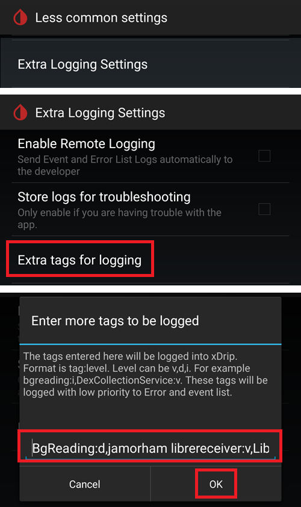
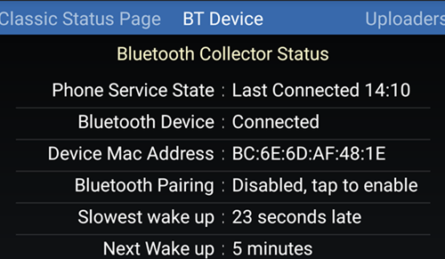
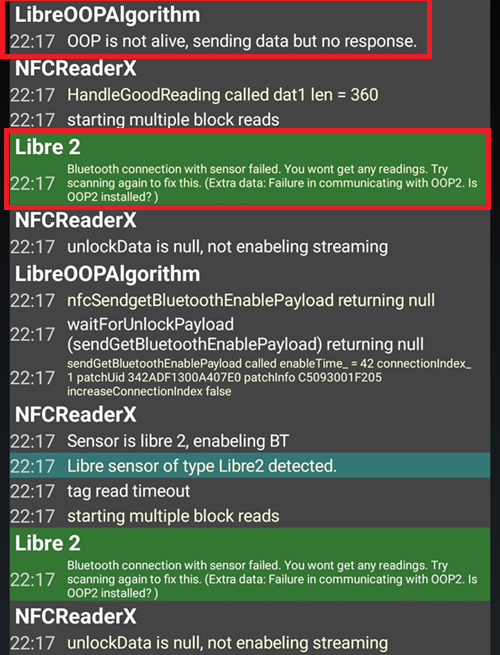

# How to setup FSL 2 and OOP2 to use a native Bluetooth connection in xDrip

Transferred from [MinimalL00per](https://www.minimallooper.com/post/how-to-setup-freestyle-libre-2-and-oop2-to-use-a-native-Bluetooth-connection-in-xdrip) to markdown and **revised/updated**: Aug 25, 2025 psonnera

Eine Liste der Definitionen findet sich am Ende des Dokumentenabschnitts. Solltest Du irgendeinen Begriff oder eine Abkürzung nicht kennen, springe nach *[unten](#minimallooper-definitions)*. Sie sind dort genauer erklärt.

 

## Konfiguration

### Hardware

- *FSL2 und 2+* **HINWEIS: US, CAN, NZ, AUS-Versionen werden NICHT unterstützt**

**(OPTIONAL) Lesegerät** (nicht mit FSL2+ kompatibel)

- Lesegerät der ersten Generation (mit aktualisierter Firmware)

- Lesegerät der zweiten Generation

*HINWEIS: Wenn Du planst, das Lesegerät in dieser Lösung zu nutzen, MUSS der Sensor mit dem LESEGERÄT GESTARTET werden. Passiert das nicht, kannst Du in der Folge das Lesegerät nicht zum Auslesen der Messwerte des aktivierten Sensors nutzen. After the sensor has warmed up, you can then take readings from the LL application or xDrip.*

### Software

**OOP** - Out of Process Algorithm, eine externe Android-APK Anwendung, die dabei hilft die Rohdaten des Sensors abzurufen und Glukosewerte zu ermitteln. xDrip sends gathered FSL2 BT raw data to OOP and blood glucose values are returned to xDrip.

- **OOP2**

  - **Funktioniert nur mit europäischen FSL2/2+ Sensoren**

  - Geschützter Quellcode (nicht auf GitHub verfügbar)

  - Purpose is to decrypt the encrypted raw sensor values and return them to xDrip. Then xDrip can be used with either raw data, requiring calibration, or provide glucose values similar to the Reader 1.

[***xDrip+***](https://jamorham.github.io/)

- [*Nightly*](https://github.com/NightscoutFoundation/xDrip/releases) Neuester Sourcecode, der jede Nacht erstellt wird. Nicht gründlich getestet.

- [*Stable*](https://xdrip-plus-updates.appspot.com/stable/xdrip-plus-latest.apk) Neueste stabile und getestete Version.

- **NOTE: new sensors require updated an OOP2 app, for this it is recommended to use at least the latest xDrip release (Stable) version, matching the latest OOP2.**

 

## Prozess

- *Lade zuerst die unten aufgeführten Apps herunter und installiere sie*
- *Deinstalliere Apps, die möglicherweise zu Konflikten führen*
- *How to Start a FSL2 Sensor in Bluetooth Native mode using LL and xDrip
  - [*Schritt 1: Anwendungsinstallation und -konfiguration*](#minimallooper-step1)
  - [*Step 2: xDrip Settings Configuration*](#minimallooper-step2)
  - [*Schritt 3: Den Sensor (tatsächlich) setzen*](#minimallooper-step3)
  - [*Schritt 4: Starte die LL-App und starte den Sensor mit dem ersten NFC-Scan*](#minimallooper-step4)
  - [*Step 5: Open xDrip and NFC SCAN the FSL2 sensor*](#minimallooper-step5)
  - [*Step 6: Start the new sensor in xDrip*](#minimallooper-step6)
  - [*Schritt 7: Warte 60 Sekunden und scanne den Sensor per NFC erneut*](#minimallooper-step7)
  - [*Schritt 8: Datenerfassung zwischen 3 und 15 Minuten*](#minimallooper-step8)
  - [*Schritt 9: Stelle sicher, dass der Sensor verbunden ist und Daten liefert*](#minimallooper-step9)

- *[Notiz](#minimallooper-notes)*
- *[Vorteile](#minimallooper-advantages)*
- *[Nachteile](#minimallooper-disadvantages)*
- <u>*\[Fehlerbehebung\](#minimallooper-troubleshooting)*</u>

## Bevor Du loslegst

Es wird dringend empfohlen, diesen Prozess mit einem **neuen Sensor** zu durchlaufen. Auch wenn es Berichte gibt, die davon sprechen, dass eine Verbindung mit einem laufenden Sensor hergestellt werden konnte (***siehe [unten](#minimallooper-started-sensor)***), ist die Chance, dass die LL-App oder der Reader einen neuen privaten Freigabeschlüssel für die Kommunikation während der Verbindung erstellt, sehr hoch. This means that after bonding, xDrip is not aware of the new key and will not be able to communicate with the sensor. Probiere am besten zum Ende der Sensorlaufzeit auf eigene Gefahr aus, ob Du eine Verbindung zu einem laufenden Sensor aufbauen kannst.

### Lade zuerst die unten aufgeführten Apps herunter und installiere sie

(Libre2_OOP2)=

- **OOP2** - Versionen der oop2 findest Du hier:

  (*Hinweis: Um auf den Link zugreifen zu können, musst Du bei Google angemeldet sein.*)

*[oop2.apk](https://drive.google.com/file/d/1106h2s12b3Ev9gKCTU2G75q8h9ChHjcz/view?usp=sharing)* - OOP2_21_09_25 (05d1989) **2025.09.21** (neueste Version)

- **xDrip** - **<u>latest version</u>** (minimum version 2025.09.26) can be found at:

[*xDrip.apk*](https://github.com/NightscoutFoundation/xDrip/releases)

(minimallooper-started-sensor)=

### Was passiert, wenn mein Sensor bereits gestartet ist? Can I still get reading in xDrip? JA!

Viele Leute haben gefragt, ob diese Methode mit einem bereits aktiven Sensor funktioniert und ich kann voller Überzeugung sagen: **JA**, Du kannst einen bereits aktivierten Sensor starten.

1.  **FIRST**, make sure you have made the configuration changes and settings to xDrip and installed and configured OOP2 as shown below.

2.  **DANACH**, mache mit *Schritt 5* weiter und **STELLE SICHER**, dass Du LL vor dem neuen Start (erzwungen) geschlossen hast. Dann folge dem Prozess bis zum Ende.

*HINWEIS: Du wirst den aktivierten FSL 2 Sensor nicht mit dem Lesegerät nutzen können, WENN ER nicht als Erstes mit dem Lesegerät gestartet wurde. If it WAS started with the FSLReader first, then you will be able to **scan** the sensor and retrieve readings from BOTH the sensor and apps like LL and xDrip.*

## How to Start a FSL2 Sensor in Bluetooth Native mode using LL and xDrip

*HINWEIS: Wenn es Einstellungen in den Screenshots gibt, die nicht mit einem RAHMEN hervorgehoben markiert sind und NICHT ANGEHAKT sind (d. h. deaktiviert sind), dann LASS SIE bitte DEAKTIVIERT. Die Screenshots zeigen eine für ALLE Einstellungen funktionierende Konfiguration. Wenn Du, nachdem Du einen funktionierenden Sensor hast, durch ein- und ausschalten anderer Features herumexperimentieren möchtest, kannst Du das auf eigene Gefahr tun.*

(minimallooper-step1)=

### Schritt 1: Anwendungsinstallation und -konfiguration

**Installiere und konfiguriere OOP2** und prüfe durch einfaches Öffnen der App, ob es funktioniert hat.


**Einstellungen**

- *Service* muss auf **ON** gestellt sein

- *Use foreground service* ebenfalls auf **ON**

- *Timer Duration* **5 minutes**

  - Change to **1 sec** if you are not getting results fast enough (the screenshot below shows this setting).

**Version 2: 93e5cac-2020.12.08 (neueste Version)**


**Install xDrip** minimum version: latest release. Further documentation on xDrip installation and setup can be found [*here*](../CompatibleCgms/xDrip.md).

(minimallooper-step2)=

### Step 2: xDrip Settings Configuration

**Datenquelle**: Libre Bluetooth


**NFC Scan Funktionen**: * alle nicht explizit genannten Einstellungen werden als deaktiviert angenommen.*

- *Benutze die NFC-Funktion*: **An**
- *Sensoralter oder -ablauf*: **An**
- *Scan when not in xDrip*: **on**
- *Benutze die Any-Tag optimierte Lesemethode*: **Aus**. Wenn es Probleme geben sollte, stelle die Option auf **An**


- *Starte Bluetooth-Verbindung mit Libre2-Sensoren*: **Immer mit Libre2-Sensoren verbinden**


- *Libre3-Daten glätten, wenn Methode xxx verwendet wird*: Standardwert unverändert lassen. Erhöhe den Wert für rauschende Sensoren, verringere ihn, wenn stabil.


**Erweiterte Einstellungen -\> Bluetootheinstellungen** (*diese sind wichtig und hängen von Deinem Smartphone und Deiner Konfiguration ab*)

- *Schalte Bluetooth ein*: **An**
- *Vertraue Auto-Wiederverbindung*: **An**
- *Scan im Hintergrund ausführen*: **An**
- *Dienste immer ermitteln*: **An**

You can setup xDrip using the QR code below. You need to scan it (or load the picture) in xDrip -> Auto Configure.

```{admonition} QR Code
:class: dropdown


```


Sobald Du den QR-Code oben gescannt hast, scanne den anderen QR-Code unten, um die Einstellungen für eine zuverlässigere Verbindung zu ändern (das gilt für Samsung Smartphones und für viele chinesische Marken):

- *Vertraue Auto-Wiederverbindung*: **Aus**
- *Scan im Hintergrund ausführen*: **Aus**

```{admonition} QR Code
:class: dropdown


```


**Erweiterte Einstellungen für Libre 2** (*optional, aber hilfreich*)

- *Rohwerte im Graph anzeigen*: **An**

- *Sensorinformationen im Status anzeigen*: **An**


**Extra Logging Einstellungen** (*im Fehlerfall für's Debugging benötigt*)

- *Zusätzliche Tags für die Protokollierung*: Gib diesen Wert ein

`BgReading:d,jamorham librereceiver:v,LibreOOPAlgorithm:v,jamorham nsemulator:v,DexCollectionService:v`



(minimallooper-OOPsettings)=

**Erweiterte Einstellungen -\> Andere verschiedene Einstellungen**

> **Einstellungen in der OOP2-Konfiguration**

- *Externer Libre Algorithmus*: **Aus**

(*STELLE SICHER, DASS DIE OPTION **AUS** IST, DA SONST KEINE GLUKOSEWERTE EMPFANGEN WERDEN KÖNNEN!*)


(minimallooper-step3)=

### Schritt 3: Den Sensor (tatsächlich) setzen

(minimallooper-step4)=

### Schritt 4: Starte die LL-App und starte den Sensor mit dem ersten NFC-Scan

Starte die Libre Link-App, scanne dann den neu gesetzten Sensor. Danach schließe, deaktiviere oder deinstalliere die Libre Link-App. **You still need to wait for the sensor to warm-up the full 60 minutes before proceeding and starting the sensor in xDrip**. Du kannst Dich vorher nicht auf die Glukosewerte verlassen, da sich der Sensor in dieser Phase noch intern kalibriert die Werte stark variieren.

#### Step 4a (OPTIONAL, Use FSLReader):

**Starte den Libre 2-Sensor (nicht 2+) durch einen Scan mit dem Lesegerät. Das Lesegerät muss das erste Gerät sein, dass den Sensor scannt.**

If you want to be able to use the **FSLReader** as well as the LL app or xDrip to read values from the FSL2 sensor, then **you will need to scan the newly inserted FSL2 sensor with the FSL Reader FIRST.** After the sensor warmup is complete you can then use the LL app or xDrip to scan readings.

*HINWEIS: Die Libre Link-App wird nur für den ALLERERSTEN NFC Scan nach dem Setzen des Sensors benötigt. Sie wird genutzt, um das Warmup-Startsignal zu senden. Im Anschluss MUSS die App deaktiviert werden (App-Einstellungen-\>Stopp erzwingen) oder deinstalliert werden. Du kannst entweder die gepatchte App 2.3 oder die offiziellen Versionen verwenden. Das macht keinen Unterschied. The main thing is to prevent the LL app from running when xDrip is trying to start the BT bonding process with the sensor as the LL app interferes with the Bluetooth reconnection process by disrupting communication.*

*Es gibt Rückmeldungen, die sagen, dass das Abschalten der **Standortberechtigung** in den Android-Systemeinstellungen der Libre Link-App ausreicht, um die Störung zu verhindern. Einige Benutzer haben damit das Problem erfolgreich behoben. Noch einmal: **Ich empfehle, die App zu deaktivieren oder zu deinstallieren**. Wenn Du experimentierfreudig bist, kannst Du den Weg über die Standortberechtigung ausprobieren.*

(minimallooper-step5)=

### Step 5: Open xDrip and NFC SCAN the FSL2 sensor

(*Zur Erinnerung! Stelle sicher, dass Libre Link deaktiviert (Standort ausgeschaltet) oder deinstalliert ist UND Du die 60-minütige Aufwärmphase, in der sich der Sensor intern kalibriert, abgewartet hast.*)

**NFC SCAN** the FSL2 sensor with xDrip. Das sendet ein Signal an den Sensor, das Bluetooth-Pairing einzuschalten und den Koppelungsprozess zu beginnen. A small notification will appear briefly on the bottom of the xDrip Overview screen with the text **Scanning** followed by the notification **Scanned OK!** upon a successful NFC scan of the FSL 2 sensor.


(minimallooper-step6)=

### Step 6: Start the new sensor in xDrip

In the **xDrip Overview screen** press the **hamburger menu** in the upper left corner. Wähle dann **Sensor starten** aus.

Auf dem Bildschirm **Neuen Sensor starten** tippe auf **Sensor starten**. Eine Eingabeaufforderung wird fragen **Hast Du ihn heute gesetzt?**. Beantworte diese Frage mit **NICHT HEUTE**.


*NOTE: If you accidentally clicked "YES, TODAY" then you will need to "stop sensor" from the xDrip main menu followed by "start sensor" by proceeding with Step 5 again.*

(minimallooper-step7)=

### Schritt 7: Warte 60 Sekunden und scanne den Sensor per NFC erneut

A second NFC scan is needed in order to **ADD** the sensor as the Bluetooth device from which xDrip will use to retrieve the readings. Wenn alles abgeschlossen ist, erhältst Du die Nachricht **NEUER SENSOR GESTARTET**.


Der Sensor kann während dieses Ablaufs nur einmal pro Minute gescannt werden, sodass sich eine 60-sekündige Zwangspause ergibt. Wenn der Sensor zu früh gescannt wird, erscheint auf dem xDrip+-Hauptbildschirm die Warnung **Nicht so schnell, warte 60 Sekunden**.


Open xDrip event logs and check the sensor paired correctly with xDrip.


(minimallooper-step8)=

### Schritt 8: Datenerfassung zwischen 3 und 15 Minuten

In der ersten 3-15 Minuten werden genug Daten gesammelt, um die ersten Glukosewerte anzuzeigen. *Wenn Du danach noch keine Glukosewerte erhältst, hilft es manchmal das Smartphone neu zu starten*.

If you use a Samsung (or many Chinese brand phones) and have issues receiving data, scan the QR code below, in xDrip -> Auto Configure.

```{admonition} QR Code
:class: dropdown


```

It will change xDrip Bluetooth settings to:

- *Vertraue Auto-Wiederverbindung*: **Aus**
- *Scan im Hintergrund ausführen*: **Aus**

(minimallooper-step9)=

### Schritt 9: Stelle sicher, dass der Sensor verbunden ist und Daten liefert

Press the Hamburger menu in the upper left of the xDrip Overview screen and select **System Status**. Auf dem Systemstatus-Bildschirm wird das aktive **Bluetooth-Gerät:** angezeigt. Es folgt der Bluetooth-Namenskonvention **ABB___XXXXXXXXXXXXXXX**. Die XXX... sind dabei die Seriennummer des Sensors. Das Feld **Verbindungsstatus** zeigt **Verbunden** an und das Feld **Sensorstart:** zeigt an, wann der Sensor gestartet wurde.


Auf dem **BT Device** Tab (nach links wischen) kannst Du weitere Verbindungsdetails des Sensors prüfen. Die Übersicht hilft bei einer möglichen Fehlerbehebung. In der Liste unten findest Du die Felder und deren Bedeutung, um die Fehlerbehebung zu vereinfachen.

*NOTE: **<u>NIMM KEINE ÄNDERUNGEN</u> auf diesem Bildschirm am Bluetooth Pairing vor. Laß die Einstellung unverändert auf <u>Deaktiviert</u>** stehen. Das würde zu einem direkten Koppelungsversuch führen. Dieser wird fehlschlagen (Nicht gekoppelt) und Du musst wieder ab Schritt 5 des Prozesses beginnen.*


- **Phone Service State:** Gibt den Zeitpunkt an, an dem das Smartphone das letzte Mal eine Bluetooth-Verbindung zum Sensor hatte (das sollte weniger als 5 Minuten zurückliegen)
- **Bluetooth Device:** Gibt den aktuellen Verbindungsstatus an (entweder **Connected** oder **Disconnected**)
- **Device Mac Address**: Das ist die Hardware ID des Sensors
- **Bluetooth Pairing**:  Das sollte **<u>Disabled sein, tippe darauf, um es zu aktivieren</u>**. Achte darauf, NICHT darauf zu tippen. Solltest Du versehentlich darauf getippt haben, tippe erneut darauf, um es zu deaktivieren.
- **Slowest wake up**: Du kannst diese Information ignorieren. xDrip doesn't spend its time waiting for readings: it will start expecting them at after a certain time (traditionally 5 minutes). If no data arrives at that time, you'll see "Woke up early" meaning xDrip was expecting data to be ready but there's none. Slowest wake up ist längste erkannte Verzögerung beim normalen Eintreffen der Werte.
- **Next Wake up**: Solle 5 Minuten anzeigen



(minimallooper-notes)=

### Notiz

- **Using LL NFC Scans AFTER bonding/pairing in xDrip is completed**: You can conduct NFC scans but the bonding/pairing process with xDrip needs to be completed first. Always look at xDrip and see if it is close to the 5 minute reading (i.e. 4 minutes ago), if it is near 5 min, wait for the new BT reading to come in and then conduct the NFC scan. If you catch it at the wrong time it will disturb the BT process in xDrip and not receive BT readings, which can take a while to re-bond and transmit again and sometimes a sensor BT connection can be “stolen” by LL. Ich hatte noch nie Probleme, wenn ich einen NFC-Scan zwischen dem Werteempfang und dem sofortigen Deaktivieren der App danach durchgeführt habe. Es ist unklar, ob LL jedes Mal deaktiviert werden muss. Es kann aber nicht schaden, dies zu tun.

- **Was passiert hier?** Wenn eine Bluetoothverbindung aufgebaut wird, wird ein Private Shared Key erzeugt. Dieser Schlüssel wird benötigt, um die Kommunikation zwischen dem Sensor und der anfragenden App (oder anfragendem Gerät) zuzulassen. Es ist sehr wahrscheinlich, dass die LL-App oder das Lesegerät während der Verbindung einen neuen privaten gemeinsamen Schlüssel für die Kommunikation erstellen. This means that after bonding, xDrip is not aware of the new key and will not be able to communicate with the sensor.

  - Several users have reported that the LL app can be restarted after successfully starting the sensor and receiving readers in xDrip. In den Android-Berechtigungen der LL-App musst Du lediglich die **Standortfreigabe** ausschalten. Once this is done you should be able to use the LL app and xDrip simultaneously. Es wird empfohlen, keine Standard-Anwendung fürs NFC-Scannen festzulegen und so bei jedem NFC-Scan entscheiden zu können, mit welcher App Du den Sensor auslesen möchtest. VERGISS beim nächsten Sensorwechsel NICHT die LL-App nach dem ersten Scan zum Starten der Aufwärmphase zu beenden („Stopp erzwingen“). After the sensor is configured and receiving readings in xDrip you can then start the LL app again.

&nbsp;

- **Smartphone neustarten**: DENK DARAN, nach dem Neustart und nach dem Deaktivieren/dem erzwungenen Stopp der App, zu prüfen, dass die LL-App NICHT ausgeführt wird. Ich schlage vor, einen Neustart zu testen, um zu sehen, ob LL automatisch wieder gestartet wird. Du kannst in den LL-App-Einstellungen in den Android-App-Einstellungen Deines Smartphones nachschauen. Wenn es noch aktiviert ist, dann deaktiviere die LL-App erneut. Die Deinstallation der LL-App kann die einzige Möglichkeit sein, das zu verhindern. Das Vorgehen soll verhindern, dass LL versehentlich die BT-Verbindung „stiehlt“. Nach dem Neustart dauert es zwischen 3 und 15 Minuten, bis über Bluetooth Werte vom Sensor kommen. Habe Geduld und plane den Neustart um die Zeit, in der Du Glukosewerte benötigst (Mahlzeitenbolus etc.), herum.

&nbsp;

- **Akku-Optimierungseinstellungen**: Stelle sicher, dass die folgenden Apps von der Akkuoptimierung Deines Smartphones AUSGESCHLOSSEN werden:

  - xDrip+

  - OOP 2

  - LibreLink

  - AAPS

&nbsp;

- **Using Flight Mode:** There are some situations which call for turning on flight mode (when taking a flight ;-), sleeping at night and you do not wish to have Wi-Fi or Mobile connection signals operating with your phone in close range of your head) and this can cause issues with the Bluetooth communication during activation of Flight mode. Beim Einschalten des Flugmodus auf dem Smartphone mit anschließender Bluetooth-Aktivierung gehen Glukosewerte verloren. Der einzige Workaround ist, den Datensammler xDrip+ -\> Systemstatus -\> Classic Status Page neu zu starten. Nach dem Neustart des Datensammlers kamen die Glukosewerte wieder an.

 

(minimallooper-advantages)=

### Vorteile

- **Die LL-gepatchte App wird nicht mehr benötigt**: Du brauchst keine gepatchte Version der LL-App mehr, um Werte vom Libre 2-Sensor abzurufen. Sowohl die gepatchte LibreLink-App, als auch die offiziellen Versionen der LibreLink-App können für den initialen NFC-Scan genutzt werden. Beide Apps funktionieren beim initialen NFC-Scan zum Starten des Sensors gleich.

&nbsp;

- **Drittanbieter-Geräte zum Scannen werden nicht mehr benötigt:** Da der Sensor die Messwerte mittlerweile per Bluetooth überträgt, werden Drittanbieter-Geräte (z. B. (Miaomiao, Bubble oder Blucon) nicht mehr benötigt *(sie können aber weiterhin genutzt werden)*. Weniger Hardware bedeutet weniger Fehlerquellen, weniger Dinge, die geladen werden müssen und ein vereinfachtes Setup.

&nbsp;

- **You will still be able to NFC scan readings with the FSL2 Reader (version 1 with updated FW or version 2) WHEN the FSL2 sensor has been started with the FSL Reader FIRST.** The FSL2 standalone reader can still be used to scan readings on the active sensor once it is bonded via Bluetooth to xDrip.

  - Du **MUSST**, um den Sensor zu starten, ihn **mit dem Libre Lesegerät scannen, mit dem Du auch die Aufwärmphase ALS ERSTES** eingeleitet hast. Danach können auch andere Softwareanwendungen NFC-Messungen vom nun aktivierten Sensor zu erhalten.
- Nach meinem Verständnis signalisiert der Libre 2 Sensor exakt alle 2 Minuten seine Verfügbarkeit und Präsenz über BLE, solange noch keine Verbindung aufgebaut wurde oder ein Verbindungsaufbau erfolgt. Dies ist auf jedem Bluetooth-Gerät, das die Möglichkeit hat nach Bluetooth-Geräten zu scannen, zu erkennen. Das Gerät, das als Erstes auf dieses Signal reagiert, gewinnt das Rennen und ist das *einzige* Gerät, das sich mit dem Sensor verbinden und auslesen kann. Der private „Shared Key“ wird während des NFC-Verbindungsprozesses erzeugt und zur Entschlüsselung der FSL 2 Kommunikation verwendet. Der Sensor ist damit für andere Geräte, die diesen privaten „shared key“ nicht haben und dennoch versuchen sich zu verbinden, nicht verfügbar. Es scheint so zu sein, dass das FSL 2 Lesegerät immer, unabhängig davon wer der „Gegner“ ist, das Rennen macht.

&nbsp;

- **Möglichst wenig Hardware** Mein Ziel war es immer, die medizinischen Geräte, die mit meinem Körper verbunden sind auf ein Minimum zu begrenzen. Die Kombination aus Libre 2 und dem Omnipod-System erreicht dieses Ziel. Dieser Punkt ist auf Reisen (sowohl auf kurzen als auch auf Fernreisen) umso wichtiger, weil damit die Dinge, die getauscht werden müssen, weniger werden und so mehr Platz für andere Gegenstände in meinem Reisegepäck bleibt. Hoffentlich wird es in Zukunft eine Patchpumpe geben, die nur ein Auswechseln des Reservoirs benötigt und der Chip und das Motorsystem eine wiederverwendbare Einheit ist. Das würde den Müllberg verringern und die Abfallmenge für einen Kanülenwechsel reduzieren. Das wiederum führt zu mehr Platz in meinem Koffer für andere Dinge.

&nbsp;

- **Sensorwechsel ohne fehlende Werte**, da der neue Sensor mit einem ersten NFC-Scan der LibreLink-App gestartet werden kann, läuft der aktive Sensor währenddessen weiter und liefert Messwerte per Bluetooth. Nach 20 Minuten liefert der Sensor die ersten Werte, es ist allerdings besser die volle Stunde abzuwarten, bis der Sensor sich vernünftig intern kalibriert hat. D. h. dass Du den aktuellen Sensor stoppen und den neuen Sensor starten kannst (nachdem er gesetzt wurde und eine Stunde zuvor mit LibreLink per NFC gescannt wurde). In den nächsten 3 bis 15 Minuten werden die ersten Kalibrierungen durchgeführt und die ersten Messwerte sind verfügbar.

&nbsp;

(minimallooper-disadvantages)=

### Nachteile

- **Neustarten des Smartphones:** Da bei einem Neustart des Smartphones auch der Bluetooth-Prozess neu gestartet wird, muss die LibreLink-App manuell deaktiviert werden bzw. sein (sofern sie nicht ohnehin deinstalliert wurde) und Du musst abwarten bis die ersten Messwerte eintreffen (3 bis 15 Minuten). Lege den Smartphone-Neustart also so, dass er nicht in einen kritischen Zeitraum fällt (außerhalb von z. B. von Korrektur- oder Mahlzeiten-Bolus).

&nbsp;

- **You can't run LL and xDrip in parallel together for Bluetooth readings**. LibreLink wird immer versuchen, die Bluetooth-Verbindung zum Sensor zu kapern und zu übernehmen. In diesem Fall, bist Du bis zum Laufzeitende des Sensors auf LibreLink angewiesen. Daher funktioniert es nicht immer, die Apps parallel zu nutzen. As I mention below, you can enable the LL app and do an NFC scan to get the LL reading (if you need to compare, want to retrieve history for yourself or endocrinologist reports) however you should disable it as soon as you have your reading and not try to attempt this within a minute of when xDrip is going to retrieve its Bluetooth reading. Ich bin mir aktuell nicht sicher, welchen Einfluss der Einsatz des Libre 2 Lesegeräts hat. Ich werde das zu einem späteren Zeitpunkt testen.
- Several users have reported that the LL app can be restarted after successfully starting the sensor and receiving readers in xDrip. In den Android-Berechtigungen der LL-App musst Du lediglich die **Standortfreigabe** ausschalten. Once this is done you should be able to use the LL app and xDrip simultaneously. Es wird empfohlen, keine Standard-Anwendung fürs NFC-Scannen festzulegen und so bei jedem NFC-Scan entscheiden zu können, mit welcher App Du den Sensor auslesen möchtest. VERGISS beim nächsten Sensorwechsel NICHT die LL-App nach dem ersten Scan zum Starten der Aufwärmphase zu beenden („Stopp erzwingen“). After the sensor is configured and receiving readings in xDrip you can then start the LL app again.

&nbsp;

- **NFC-Scan-Geräte von Drittanbietern können weiterhin genutzt werden**. Yes, I listed this as a disadvantage but I also wanted to point out that if something goes wrong with the sensor and LL captures control of it, you can always fall back to placing an NFC scanning device on the sensor to get readings in xDrip. Wenn Du Dich mit einem Setup, dass einen Drittanbieter NFC-Scan-Gerät (Miaomiao, Bubble, Blucon) enthält, wohler fühlst, kannst Du das Gerät auch anstelle einer direkten Bluetooth-Verbindung verwenden. In einzelnen Fällen und für bestimme Smartphones funktioniert die native Bluetooth-Verbindung und -Datenabfrage zum Sensor nicht verlässlich. In dieser Situation können diese Geräte entweder als Backup oder regulär genutzt werden. Wie dem auch sei, Du hast die Möglichkeit.
- Wenn Du vorhast, das **FSL-Lesegerät** als NFC-Scangerät zum Auslesen der Messwerte zu nutzen, MUSS der **ALLERERSTE SCAN** zum Starten der Aufwärmphase des Libre 2 Sensors mit dem **LESEGERÄT** erfolgen.

&nbsp;

- **LV data will not be uploaded automatically** Since the LL app does not have a constant Bluetooth connection (because LL should not be running simultaneously with xDrip once the sensor is actively sending Bluetooth readings) then it is not receiving readings automatically from the sensor. Das heißt, das Glukosewerte nicht automatisch in LibreView verfügbar werden und in der Folge auch auf anderen Smartphones mit LibreLink nicht sichtbar werden. Ich stelle das deswegen als Nachteil heraus, weil viele Eltern und diejenigen, die Reports aus LibreView für ihr Diabetes-Team erstellen müssen, auf diese Funktion angewiesen sind. Du kannst immer noch die LibreLink-App öffnen und damit alle 8 Stunden scannen, um die zurückliegenden Werte des Sensor in LibreLink zu bekommen (3 mal täglich mindestens alle 8 Stunden; aber wahrscheinlich werden mehr Scans benötigt, um die Daten für 24 Stunden zu erfassen). Aber auch das ist ein manueller Prozess.

&nbsp;

(minimallooper-definitions)=

### Definitions

- **BT** - Bluetooth

- **BLE** - Bluetooth Low Energy

- **FSL** - FreeStyle Libre
  - **Libre 1 (FSL1)** - nur NFC. Erste Version des Sensors.

  - **Libre 2 (FSL2)** - Bluetooth und NFC. Zweite Version des Sensors.

  - **Libre 3 (FSL3)** - Bluetooth und NFC. Dritte kleinere Version des Sensors. Von OOP2 nicht unterstützt (siehe Juggluco).

- **LL** - LibreLink, die **Anwendung** wird genutzt, um den Sensor mit dem initialen NFC-Scan zu starten

- **LV** - LibreView, Cloud-Dienst zum Teilen von Daten mit Deinem Diabetes-Team (denke darüber nach eventuell Tidepool oder Nightscout zu nutzen)

- **MM** - MiaoMiao, name and manufacturer of a 3rd party NFC scanning device that delivers readings via Bluetooth to xDrip.

- **NFC** - Near Field Communication, eine physische Aktion, bei der der NFC-Sensor auf dem Smartphone in die Nähe des Sensors gebracht wird, um so einen Glukosewert zu ermitteln. Dies wird oft auch als „Scannen des Sensors“, „Sensor-Scan“ oder „NFC-Scan“ bezeichnet. Dieser Prozess verwendet in keinem Fall Bluetooth.

- **OOP1** - Out of Process Algorithm version 1, the 3rd party app that receives raw values (delivered to xDrip from the sensor by Bluetooth or NFC scan) and then uses an algorithm (very similar to the hardware algorithm on the sensor chip) to process the raw values and returns a calibrated (by the OOP1 algorithm, not by xDrip’s native calibrations) blood sugar back to xDrip to either display or be further processed with xDrip’s calibration (with a finger pick blood calibration) if needed.

- **OOP2** - Out of Process Algorithm Version 2, die Drittanbieter-App, die verschlüsselte Daten vom FSL 2-Sensor erhält (über Bluetooth oder NFC-Scan) und dann diese verschlüsselten Informationen entschlüsselt. Once decrypted, the data is then sent to xDrip.

 

(minimallooper-troubleshooting)=

### Problembehandlung

#### Sensor kann nicht per NFC gescannt werden

- Stelle sicher, dass in den Android-Einstellungen das NFC-Lesegerät aktiviert ist.
- Der NFC-Reader muss mit **ISO 15693**-Tags kompatibel sein. Einige Cubot Smartphones sind sehr schwierig zu bedienen.
- Schau in der Smartphone-Anleitung nach, wo die NFC-Antenne positioniert ist. Bring it to the sensor and stay on it for 10 seconds: xDrip NFC reading takes longer than the vendor app or the reader.
- Try to close xDrip before scanning the sensor.
- Make sure no other app wants to read the sensor (you might see a selection with different app choices when scanning: select xDrip but don't move the phone).
- Try all combinations of xDrip NFC settings *Use faster multi-block reading method* and *Use Any-tag optimized reading method* knowing that NFC scans are usually more reliable with both these options **off**.

#### Die ersten Messwerte werden nicht empfangen

*Hinweis: Wenn die Werte des Libre 2 manuell kalibriert wurden, wird der Sensor nicht als vertrauenswürdige Datenquelle eingestuft.*

Setze [OOP2-Kalibrierung](#minimallooper-OOPsettings)s-Strategie auf „Keine Kalibrierung“, solange bis alles funktioniert.

Dann kannst Du entscheiden, ob Du kalibrierst oder nicht.


#### Sensor wird als Libre 1 erkannt


Make sure you are running the latest versions of xDrip and OOP2.

#### Verbindung zum Sensor fehlgeschlagen

- Prüfe, ob OOP1 deaktiviert ist (Details findest Du [hier](#minimallooper-OOPsettings))



- Prüfe, dass OOP2 nicht durch die Energiespar-Apps und die Einstellungen des Smartphones in den Tiefschlaf versetzt wurde
- Prüfe, dass Google Play Protect ausgeschaltet ist, da es sonst OOP2 „killt“
- Hast Du die Bluetooth-Koppelung im Systemstatus geändert? Tippe darauf, so dass sie wieder **<u>deaktiviert</u>** ist


#### Fehlende Glukosewerte

Make sure OOP2 shows values that are not 0 or -1, it might be a sign your sensor is failing (example below in mmol/L).


Das Sensoralter hat sich nicht weiter verändert. Auch das kann ein Indikator für Sensorprobleme sein. This means xDrip received a value, but discarded it as it was not acceptable (sensor error).


#### Sensor komplett neu koppeln

1. xDrip menu -> Stop sensor (it won't stop the FSL2, just change xDrip state to not started)
2. xDrip menu -> System status -> Forget device
3. Scan the sensor with xDrip NFC. Warte mindestens eine Minute
4. xDrip menu -> Start sensor. Warte mindestens eine Minute
5. Scan the sensor with xDrip NFC, a few times,  always waiting at least one minute between two scans
