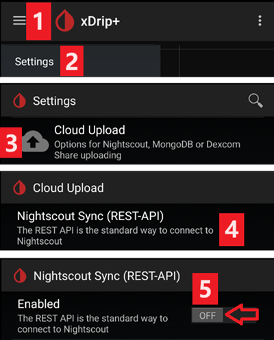
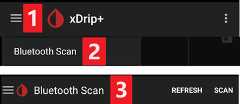

# xDrip-Einstellungen

Falls noch nicht geschehen, lade die neueste xDrip-Version von der [xDrip-Releases-Seite](https://github.com/NightscoutFoundation/xDrip/releases) herunter und installiere sie.

Deaktiviere die Akku-Optimierung und erlaube die Hintergrundaktivität für die xDrip-App.

## Grundsätzliche Einstellungen für alle CGM & FGM-Systeme

### Nightscout Upload ausschalten

Neben AAPS sollte keine andere App Daten (Glukosewerte und Behandlungen) zu Nightscout hochladen.

→ Hamburger Menü (1) → Einstellungen (2) → Cloud Upload (3) → Nightscout Sync (REST-API) (4) → Schalte `Aktiviert` (5) **AUS**

#### Automatische Kalibrierung und Behandlungen ausschalten

Stelle sicher, dass `Automatische Kalibrierung` (7) deaktiviert ist. Ist das Kontrollkästchen `Automatische Kalibrierung` aktiviert, aktiviere einmal `Behandlungen herunterladen` (6), entferne dann den Haken bei `Automatische Kalibrierung` und deaktiviere `Behandlungen herunterladen` wieder.

Tippe auf `Zusätzliche Optionen` (8)

    {admonition} Sicherheitshinweis
    :class: warning
    Du musst „Behandlungen hochladen“ in xDrip deaktivieren, da Behandlungen sonst in AAPS doppelt erscheinen können, was zu falschen COB- und IOB-Werten führt.

Deaktiviere `Behandlungen hochladen` (9) und nutze **auf keinen Fall** die Funktion `Back-fill Daten` (11).

Die Option `Alarm bei Fehlern` sollte ebenfalls deaktiviert sein (10). Bei WLAN bzw. Mobilfunk-Problemen oder wenn der Server nicht erreichbar ist, erhältst Du sonst alle 5 Minuten einen Alarm.

### **Inter-App Einstellungen** (Broadcast)

Wenn Du AAPS nutzt, musst Du in den Inter-App Einstellungen von xDrip den Broadcast aktivieren, damit die Daten an AAPS weitergeleitet werden.

→ Hamburger Menü (1) → Einstellungen (2) → Inter-App Einstellunge (3) → Lokaler Broadcast **AN** (4)

Damit die Werte in AAPS und in xDrip übereinstimmen, solltest Du `Sende den angezeigten Glukosewert` (5) aktivieren.

Aktiviere „Kompatible Broadcasts“ (6).

If you have also activated `Accept treatments` in xDrip and `Enable broadcasts to xDrip` in AAPS xDrip plugin, then xDrip will receive insulin, carbs and basal rate information from AAPS.

If you enable `Accept Calibrations`, xDrip will use the calibrations from AAPS. Be careful when you use this feature with Dexcom sensors: read [this](https://navid200.github.io/xDrip/docs/Calibrate-G6.html) first.

Remember to disable Import Sounds to avoid xDrip making a ringtone every time AAPS sends a basal/profile change.

(xdrip-identify-receiver)=

#### Identifiziere Empfänger

- If you discover problems with local broadcast (AAPS not receiving BG values from xDrip) go to → Hamburger Menu (1) Settings (2) → Inter-app settings (3) → Identify receiver (7) and enter `info.nightscout.androidaps` for AAPS build (if you are using PumpControl build, please enter `info.nightscout.aapspumpcontrol` instead!!).
- Achtung: Die Auto-Korrektur neigt manchmal dazu, das i von info in einen Großbuchstaben zu ändern. Du **darfst nur Kleinbuchstaben** verwenden, wenn Du `info.nightscout.androidaps` (oder `info.nightscout.aapspumpcontrol` für PumpControl eingibst), da die Groß-/Kleinschreibung beachtet wird. Capital I would prevent the App from receiving BG values from xDrip.
    
    

## Use AAPS to calibrate in xDrip

- If you want to be able to use AAPS to calibrate then in xDrip go to Settings → Interapp Compatibility → Accept Calibrations and select ON. 
- You may also want to review the options in Settings → Less Common Settings → Advanced Calibration Settings. Du solltest auch die Optionen in Einstellungen → Erweiterte Einstellungen → Erweiterte Kalibrierung kontrollieren.

## Dexcom-Sensoren

Everything related to the Dexcom sensor and transmitter themselves (starting, stopping, replacing, calibrating, troubleshooting) is documented and kept up to date in the [xDrip Dexcom documentation](https://navid200.github.io/xDrip/docs/Dexcom_page.html). Follow those instructions for the sensor; the settings connecting xDrip to **AAPS** (described above on this page) are the only AAPS-specific part.

### Dexcom G6 und ONE

- Set up xDrip following the [recommended settings](https://navid200.github.io/xDrip/docs/G6-Recommended-Settings.html).
- Der Dexcom G6- und ONE-Transmitter können gleichzeitig mit einem Dexcom-Empfänger (oder alternativ mit der t:slim-Pumpe) und einer App auf dem Smartphone verbunden werden.
- Wenn Du xDrip als Empfänger verwendest, deinstalliere zuerst die Dexcom-App. **You cannot connect xDrip and the Dexcom app with the transmitter at the same time!**
- If you need Clarity and want to profit from xDrip features, use the [Build Your Own Dexcom App](#DexcomG6-if-using-g6-with-build-your-own-dexcom-app) with local broadcast to xDrip, or use xDrip as a Companion app receiving notifications from the official Dexcom app (with possible delays in BG readings).

#### Sensor restarts

- Mit aktuellen Transmittern verwendet xDrip immer den [nativen Algorithmus](https://navid200.github.io/xDrip/docs/Native-Algorithm.html) des Transmitters; es gibt keinen Grund, ihn zu deaktivieren.
- [Preemptive restarts](https://navid200.github.io/xDrip/docs/Preemptive-Restart.html) only function on old transmitters (firmware 1.6.5.25 or earlier), where they are needed to prevent the sensor stopping after 10 days. Recent (Firefly) transmitters ignore them.
- Restarting a sensor on a Firefly transmitter requires [removing the transmitter](https://navid200.github.io/xDrip/docs/Remove-transmitter.html) and readings can be significantly in error after the restart, which is dangerous when looping: read [Restart a sensor](https://navid200.github.io/xDrip/docs/Restart-G6-sensor.html) in full and [calibrate carefully](https://navid200.github.io/xDrip/docs/Calibrate-after-G6Restart.html).

(xdrip-connect-g6-transmitter-for-the-first-time)=

#### Start, stop and replace sensors

Follow the instructions:

- [Start a G6 or ONE transmitter](https://navid200.github.io/xDrip/docs/Starting-G6.html)
- [Stop and start a G6 or ONE sensor](https://navid200.github.io/xDrip/docs/Dexcom/StartG6Sensor.html)
- [Remove the transmitter from a sensor](https://navid200.github.io/xDrip/docs/Remove-transmitter.html)
- [Transmitter lifetime](https://navid200.github.io/xDrip/docs/Transmitter-lifetime.html) can only be extended ([hard reset](https://navid200.github.io/xDrip/docs/Hard-Reset.html)) on rebatteried or modified transmitters, not on Firefly.

(xdrip-replace-transmitter)=

#### Replace a transmitter

- Turn the original Dexcom receiver off (if used) and do not turn it back on before xDrip shows readings.
- Forget the device in xDrip (System Status → Forget Device) AND in the smartphone's Bluetooth settings (shown as DexcomXX where XX are the last two digits of the transmitter serial number).
- Keep the old transmitter out of Bluetooth range to prevent reconnection.
- Then follow [Start a G6 or ONE transmitter](https://navid200.github.io/xDrip/docs/Starting-G6.html).

### Dexcom G7, ONE+ und Stelo

- Folge der [Anleitung für G7, ONE+ und Stelo](https://navid200.github.io/xDrip/docs/Dexcom/G7.html) (eine aktuelle xDrip-Version ist nötig, siehe verlinkte Seite).
- Auf der Seite [Dexcom G7, ONE+ und Stelo](../CompatibleCgms/DexcomG7.md) findest Du außerdem die möglichen Konfigurationen mit **AAPS**.

(xdrip-troubleshooting-dexcom-g5-g6-and-xdrip)=

### Fehlerbehebung Dexcom und xDrip

- [Fehlerbehebung bei Verbindungsproblemen G6/ONE](https://navid200.github.io/xDrip/docs/Connectivity-troubleshoot.html)
- [Fehlerbehebung G7/ONE+/Stelo](https://navid200.github.io/xDrip/docs/Dexcom/G7_Troubleshooting.html)
- [Probleme beim Starten eines neuen Sensors](https://navid200.github.io/xDrip/docs/Dexcom/SensorFailedStart.html)
- Die vollständige Liste findest Du unter **Troubleshooting** auf der [xDrip-Dexcom-Seite](https://navid200.github.io/xDrip/docs/Dexcom_page.html).

## Libre 1

- Einrichten der NFC zu Bluetooth Bridge in xDrip
    
    → Hamburger Menü (1) → Einstellungen (2) → Erweiterte Einstellungen (3) → Bluetootheinstellungen (4)

- Setze in den Bluetootheinstellungen die Haken genauso, wie es im Screenshot unten gezeigt ist (5)
    
    - Deaktiviere die "Watchdogs", da diese die Bluetooth-Verbindung Deines Smartphones zurücksetzen und damit die Verbindung zur Insulinpumpe unterbrechen.
    
    

- Du kannst versuchen, die folgenden Einstellungen (7) zu aktivieren
    
    - Verwende Scannen
    - Vertraue Auto-Wiederverbindung
    - Scan im Hintergrund ausführen

- Wenn Du die Verbindung zur Bluethooth-Bridge leicht verlieren solltest oder es Probleme mit dem erneuten Verbindungsaufbau geben sollte, **DEAKTIVIERE DIESE** (8).
    
    

- Lass alle anderen Optionen abgeschaltet, außer Du hast einen konkreten Grund diese zu aktivieren.
    
    

### Batteriestand Libre Smart Reader

- Der Batteriestand von Bluethooth-Bridges (wie z.B. MiaoMiao oder Bubble) kann in AAPS angezeigt werden (nicht möglich beim BluCon).
- Details findest Du auf der [Screenshots-Seite](#screens-sensor-level-battery).

### Libre Transmitter verbinden und Sensor starten

- Wenn Dein Sensor (Libre 2 EU und Libre 1 US) es erfordert, installiere den neuesten Verarbeitungsalgorithmus.

- Dein Sensor muss bereits mit der Hersteller-App oder dem Lesegerät gestartet worden sein (xDrip kann Libre-Sensoren nicht starten oder stoppen).

- Wähle Libre Bluetooth als Datenquelle.
    
    → Hamburger Menü (1) → Einstellungen (2) → Wähle Libre Bluetooth als Datenquelle aus (3)
    
    

- Starte die Bluethooth-Suche und verbinde die Bridge.
    
    → Hamburger Menü (1) → Bluetooth scannen (2) → Scannen (3)
    
    - Wenn xDrip die Bridge nicht findet, stelle sicher, dass sie nicht mit der Hersteller-App verbunden ist. Lade sie auf und setze sie zurück.
    
    

- Start the sensor in xDrip.
    
        {admonition} Sicherheitshinweis
        :class: warning
        Sensorwerte innerhalb der einstündigen Aufwärmphase sind nicht brauchbar: Die Werte können extrem zu hoch angezeigt werden und in AAPS zu falschen Entscheidungen führen.
    
    → Hamburger Menü (1) → Sensor starten (2) → Sensor starten (3) → Vermerke den genauen Zeitpunkt an dem der Sensor durch die Hersteller-App oder das Lesegerät gestartet wurde. Wurde der Sensor nicht heute gestartet, wähle "NICHT HEUTE" aus (4).

(xdrip-libre2-patched-app)=

## Libre 2 (gepatchte App)

- Wähle "Libre (patched app)" als Datenquelle aus.
    
    → Hamburger Menü (1) → Einstellungen (2) → Wähle Libre (patched app) als Datenquelle aus (3)
    
    

- Du kannst unter → Hamburger Menü → Einstellungen → Erweiterte Einstellungen → Extra-Logging-Einstellungen → Zusätzliche Tags für die Protokollierung `BgReading:d,xdrip libre_receiver:v` hinzufügen. Damit werden evtl. Fehlermeldungen protokolliert.

