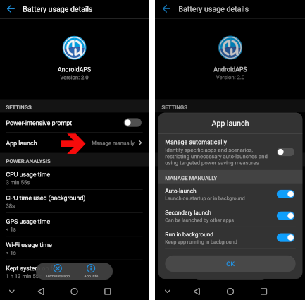

# Huawei-Smartphone einrichten

**Für welche Smartphones diese Seite gilt:** Huawei-Smartphones mit **EMUI 12 bis EMUI 15**. Alle basieren auf Android 12, dem Minimum für die aktuelle **AAPS**-Version. Auf einem Smartphone mit älterer EMUI-Version kannst Du nur eine [ältere AAPS-Version](#maintenance-android-version-aaps-version) verwenden.

```{admonition} Smartphones mit HarmonyOS NEXT / HarmonyOS 5 :class: warning

Neuere Huawei-Smartphones, die in China verkauft werden, laufen mit HarmonyOS NEXT (HarmonyOS 5 und höher). Dieses System ist kein Android mehr, und **AAPS** läuft darauf nicht. ```

Huawei-Smartphones beenden Apps im Hintergrund sehr aggressiv. Nimm alle folgenden Einstellungen für **AAPS** und für Deine CGM-App vor (zum Beispiel xDrip+ oder Juggluco), sonst können der Loop und die Glukosewerte einfrieren, wenn der Bildschirm aus ist.

Die Namen der Menüs können sich je nach Modell leicht unterscheiden. Wenn Du eine Einstellung nicht findest, gib ihren Namen in die Suchleiste oben in den **Einstellungen** ein.

Die Screenshots unten stammen von einer älteren EMUI-Version. Die Einstellungen sind bei EMUI 12 bis 15 dieselben.

## Akku-Optimierung ignorieren

1. Öffne **Einstellungen > Apps > Apps**.
2. Tippe oben rechts auf das Menü **⋮** und wähle **Sonderzugriff > Akkuoptimierung**.
3. Tippe oben in der Liste auf den Pfeil und wähle **Alle Apps**.
4. Wähle **AAPS** und dann **Nicht zulassen**. Apps in dieser Liste optimiert Huawei dann nicht mehr.
5. Wiederhole das für Deine CGM-App.


## App-Start: Ausführen im Hintergrund erlauben

1. Öffne **Einstellungen > Akku > App-Start** (oder **Einstellungen > Apps > Apps >** die App wählen **> Akku > App-Start**).
2. Suche **AAPS** und schalte **Automatisch verwalten** aus.
3. Schalte im Fenster **Manuell verwalten** alle drei Optionen ein: 
    - **Autostart**
    - **Sekundärer Start** (kann von anderen Apps gestartet werden)
    - **Im Hintergrund ausführen**
4. Wiederhole das für Deine CGM-App.



## AAPS in den zuletzt verwendeten Apps sperren

Gesperrte Apps werden nicht geschlossen, wenn Du die Liste der zuletzt verwendeten Apps leerst.

1. Öffne die Liste der zuletzt verwendeten Apps.
2. Wische auf der Karte von **AAPS** nach unten. Auf der Karte erscheint ein Schloss-Symbol.
3. Mach dasselbe für Deine CGM-App.


## Energiesparmodus

Lass **Energiesparmodus** und **Ultra-Energiesparmodus** ausgeschaltet (**Einstellungen > Akku**). Sie beenden Apps im Hintergrund unabhängig von den Einstellungen oben.

## Wenn AAPS im Hintergrund trotzdem einfriert

Weitere Lösungen speziell für Huawei findest Du auf [Don't kill my app](https://dontkillmyapp.com/huawei).

## Honor-Smartphones

Honor ist inzwischen eine eigene Marke, und seine Smartphones laufen mit MagicOS statt EMUI. Die Einstellungen für den Hintergrund sind sehr ähnlich: Suche in den Akku-Einstellungen der App nach **App-Start**, schalte **Automatisch verwalten** aus, erlaube alle drei Optionen und nimm die App dann aus der Akkuoptimierung heraus.