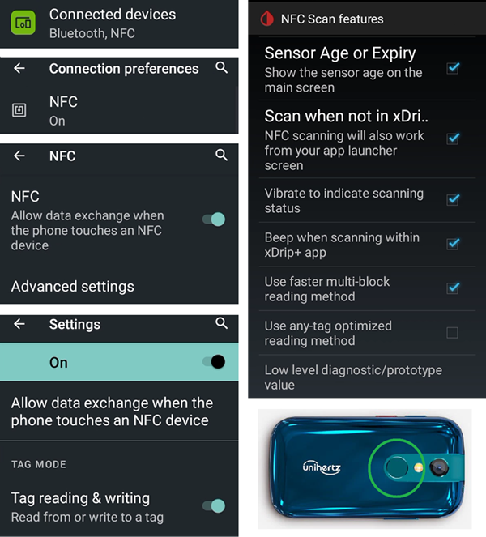

# Unihertz Jelly

## Jelly Star Mini

**Funktionalitäten**

* Android 13
* 8 GB RAM

**Vorteile**

* Es ist wirklich klein.
* Selbst wenn Du es anderen erklärst, sehen manche es nicht als normales Smartphone an und akzeptieren es eher als Ausnahme, wenn Smartphones eigentlich nicht erlaubt sind.

**Nachteile**

* Nur für erfahrene Looper empfohlen. Manche Einstellungen sind nicht leicht zu finden: Du musst aus Erfahrung mit einem großen Android-Smartphone mit AAPS wissen, wie und wo sich die Dinge befinden. Manche AAPS-Schaltflächen sind klein und schwer zu treffen: Du brauchst eine präzise Fingerspitze, keine dicken Finger.
* Nur als Loop-Phone zu nutzen. In wessen Hosentasche ein normales Android passt, ist damit besser beraten. 

### Optimierung der Akkulaufzeit

Das Jelly hat sehr leistungsfähige Optimierungsfunktionen, die für AAPS (und andere DIY-Apps wie BYODA, xDrip, OOP2, Juggluco usw.) deaktiviert werden **müssen**.

Die Funktion "Intelligent Assistance" kann aktiviert bleiben, **muss aber für DIY-Apps deaktiviert werden**.

NFC kann für Nutzung mit Libre Sensoren aktiviert werden.

### Optimierung der Akkulaufzeit

Damit es keine Konflikte mit **AAPS** gibt, solltest Du die Akku-Optimierung des Jelly Star abschalten, indem Du unter „Akkunutzung“ für **AAPS** (und für andere **DIY-Apps** wie BYODA, xDrip, OOP2, Juggluco usw.) „Nicht eingeschränkt“ auswählst.

### Google Play Protect

Denk daran, Google Play Protect zu deaktivieren.

### Remote-Verbindung für die Wear-APK

Bei bestimmten Smartwatches wie der Samsung Galaxy Watch muss in der Galaxy Wearable-App unter „Erweiterte Funktionen“ die Option „Remote-Verbindung“ **eingeschaltet** sein, damit Du das Jelly, die **Wear.apk** & **AAPS** remote über WLAN nutzen kannst.

