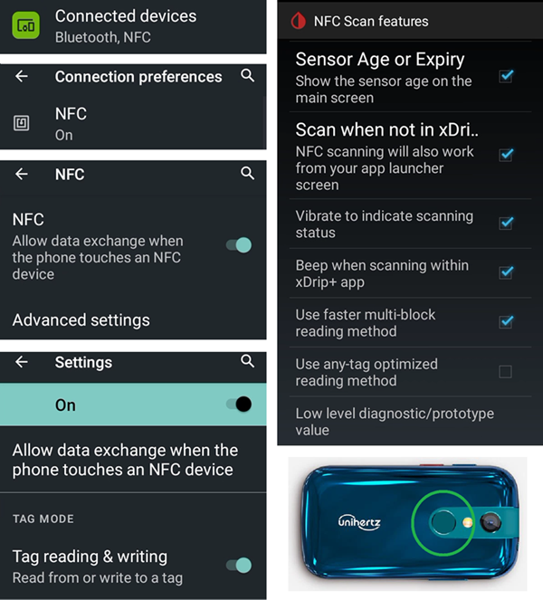

# Unihertz Jelly

## Jelly Star Mini

**Funktionalitäten**

* Android 13
* 8 GB RAM

**Vorteile**

* Es ist wirklich klein.
* Even if you tell people, they might not consider it as a normal smartphone and will accept it more easily as an exception when phones are normally not allowed.

**Nachteile**

* Nur für erfahrene Looper zu empfehlen (Manche Einstellungen sind nicht zu erkennen, man muss aus Erfahrungen mit einem großen Android-AAS-Phone wissen, wie und wo was steht. Manche AAPS Buttons kann man mit viel Gefühl nur schwer antippen, mit Wurstfingern gar nicht.)
* Nur als Loop-Phone zu nutzen. In wessen Hosentasche ein normales Android passt, ist damit besser beraten. 

### Optimierung der Akkulaufzeit

The Jelly comes with strong optimization features that **must** be disabled for AAPS (and other DIY apps like BYODA, xDrip, OOP2, Juggluco, etc...).

Die Funktion "Intelligent Assistance" kann aktiviert bleiben, **muss aber für DIY-Apps deaktiviert werden**.

NFC kann für Nutzung mit Libre Sensoren aktiviert werden.

### Optimierung der Akkulaufzeit

To avoid interference with **AAPS**, the Jelly Star 'battery usage' should be disabled by selecting 'unrestricted' for **AAPS** (and for other **DIY apps** like BYODA, xDrip, OOP2, Juggluco, etc...).

### Google Play Protect

Denk daran, Google Play Protect zu deaktivieren.

### Remote Connection for Wear apk

For certain smart watches, like the Samsung Galaxy, 'Remote Connection' under Samsung Galaxy's Advanced Features must be switched **on** to use the Jelly, **Wear.apk** & **AAPS** remotely via Wi-Fi.

