# AP550-Insulinpumpe

_Insulinpumpe uAP 550S_

_Diese Anleitung beschreibt, wie Du AAPS und Deine Pumpe einrichtest, wenn Du die uAP 550S verwendest. Der Treiber kommuniziert mit der Pumpe über Bluetooth LE._

Die Pumpe läuft mit handelsüblichen **AAA-Batterien**.

(AP550-Insulin-Pump-pairing-pump)=
## Pumpe verbinden

* Öffne oben links auf dem AAPS-Startbildschirm das Menü (☰) und wähle **Konfiguration**.
* Wähle im Abschnitt Pumpe **AP550** aus. 
* Der AP550-Übersichtsbildschirm öffnet sich. Tippe auf die Verbindungskarte mit der Aufschrift **„Insulin pump not bound“**. Du kannst auch unten auf die Schaltfläche **„Pair“** tippen.

  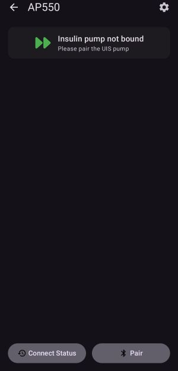

* Der Kopplungsassistent startet. Du kannst die Pumpe auf zwei Wegen finden:

  1. **Scan** – Der Assistent sucht 15 Sekunden lang nach Pumpen in der Nähe und listet sie mit Namen und Seriennummer auf (die Seriennummer steht auf dem Etikett auf der Rückseite). Tippe in der Liste auf Deine Pumpe.
  2. **QR code** – Tippe auf „QR code scan“ und richte die Kamera auf den QR-Code auf der **Rückseite der Pumpe**. Der QR-Code enthält Modell und Seriennummer. AAPS sucht dann so lange, bis es die Pumpe mit dieser Seriennummer findet.

  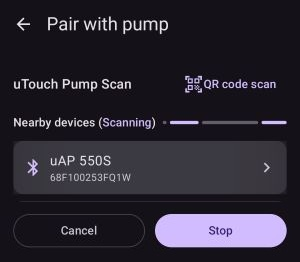

* AAPS verbindet sich mit der Pumpe („Bluetooth is connecting...“).
* **Gib den 6-stelligen Kopplungscode ein, der auf der Pumpe angezeigt wird.** Du musst den Code auch auf der Pumpe bestätigen. Das funktioniert wie eine normale Bluetooth-Kopplung, zum Beispiel zwischen Smartphone und Autoradio. 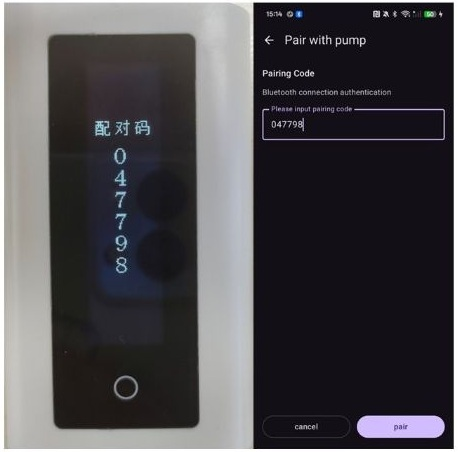
* Ist der Code falsch, kannst Du es noch einmal versuchen. Nach einem zweiten falschen Code bricht die Verbindung ab und Du beginnst wieder bei der Suche.
* Wenn die Kopplung erfolgreich war, siehst Du „Pump pair successes“. Tippe auf OK, um zur Übersicht zurückzukehren.

## Bedienung der Pumpe

Das Standard-Passwort für das Menü an der Pumpe ist **211**.

### Pumpe entsperren

1. **Tippe zweimal auf den Kreis auf dem Display**, um sie aufzuwecken.
2. Tippe auf die **Entsperr-Schaltfläche**.
3. **Wische nach oben**, um zu entsperren. 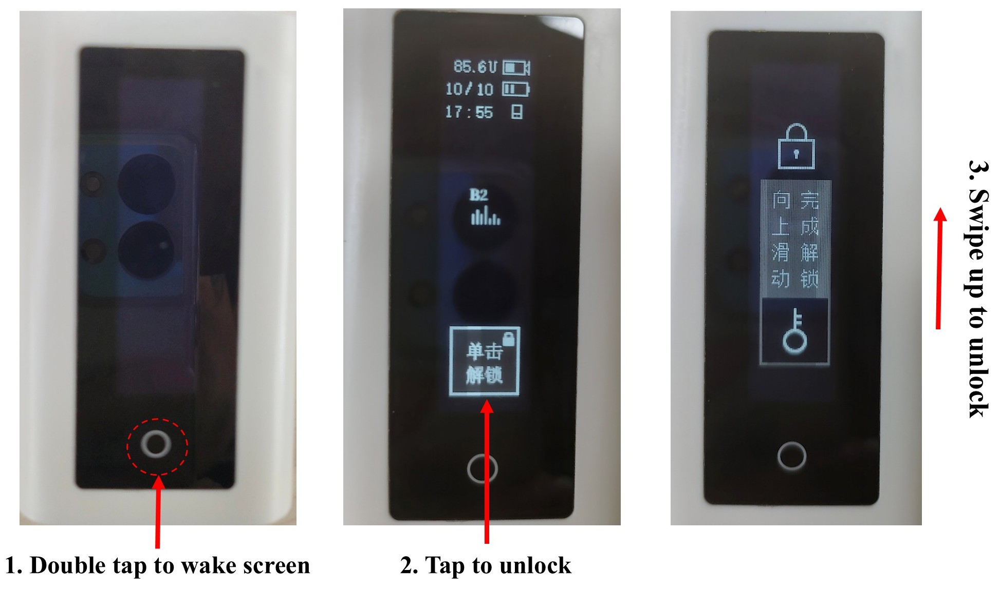

### Schaltflächen der Pumpe

Die Tabelle unten zeigt die gängigen Schaltflächen der AP550 und was sie jeweils bewirken. Ein Screenshot kann mehrere Schaltflächen auf einmal zeigen; dann erstreckt sich das Bild über mehrere Zeilen und jede Schaltfläche hat eine eigene Beschreibungszeile.

<table>
  <tr>
    <th>Schaltfläche</th>
    <th>Beschreibung</th>
  </tr>

  <!-- Group 1: one screenshot containing 4 buttons -->
  <tr>
    <td rowspan="4">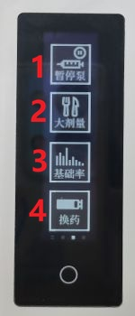</td>
    <td>1: Stop pump Injection</td>
  </tr>
  <tr><td>2: Bolus</td></tr>
  <tr><td>3: Basal</td></tr>
  <tr><td>4: Change the infusion set</td></tr>

  <!-- Group 2: one screenshot containing 2 buttons -->
  <tr>
    <td rowspan="3"></td>
    <td>1: Settings</td>
  </tr>
  <tr><td>2: History</td></tr>
  <tr><td>3: Device Info</td></tr>

  <tr>
    <td rowspan="2"></td>
    <td>1: Normal Basal Rate</td>
  </tr>
  <tr><td>2: Temporary Basal Rate</td></tr>

  <tr>
    <td rowspan="2"></td>
    <td>1: Setzt eine temporäre Basalrate in Prozent.</td>
  </tr>
  <tr><td>2: Setzt eine temporäre Basalrate als absolute Rate.</td></tr>

  <tr>
    <td rowspan="2"></td>
    <td>1: Manual Bolus</td>
  </tr>
  <tr><td>2: Preset Bolus</td></tr>

  <tr>
    <td rowspan="4">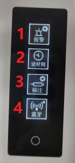</td>
    <td>1: Alarm</td>
  </tr>
  <tr><td>2: Time</td></tr>
  <tr><td>3: Infusion</td></tr>
  <tr><td>4: Wireless</td></tr>

  <tr>
    <td rowspan="4"></td>
    <td>1: Bolus Settings</td>
  </tr>
  <tr><td>2: Low Reservoir Threshold</td></tr>
  <tr><td>3: Max basal</td></tr>
  <tr><td>4: Max bolus</td></tr>

</table>

### Reservoir und Infusionsset wechseln

Die Schaltfläche **Change the infusion set** im Hauptmenü wird immer dann verwendet, wenn die Zuleitung geöffnet werden muss. Dabei gibt es zwei Fälle:

* das Insulin im Reservoir ist aufgebraucht und das Reservoir muss durch ein neues ersetzt werden:

  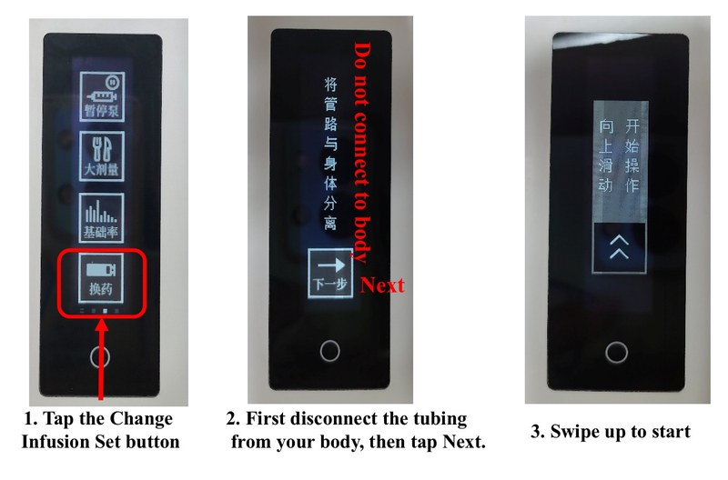

  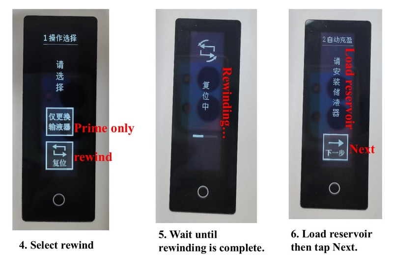

  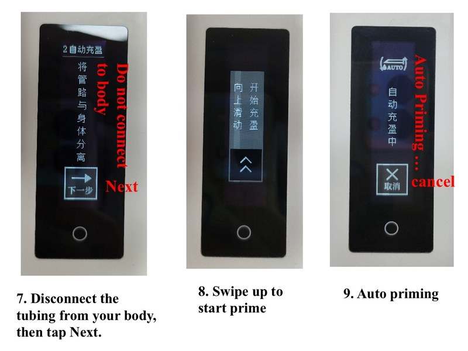

  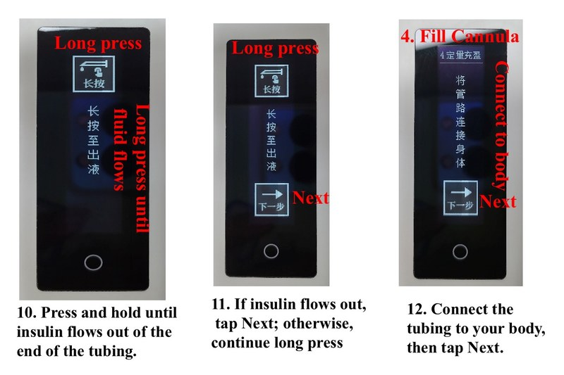

  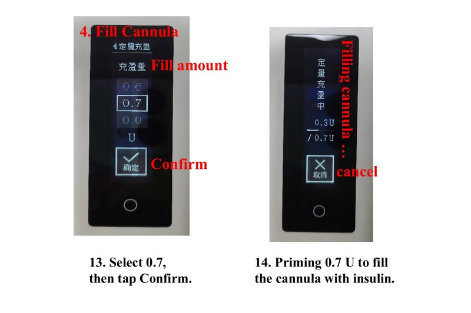

* das Infusionsset (Schlauch und Kanüle) muss ersetzt werden:

  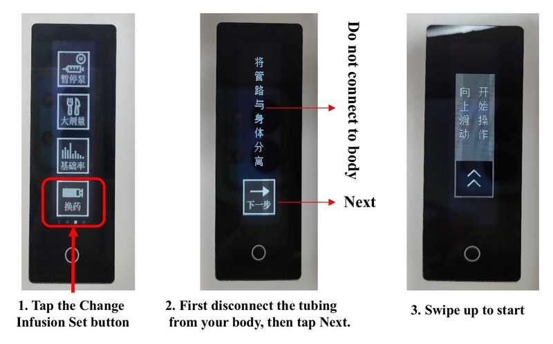

  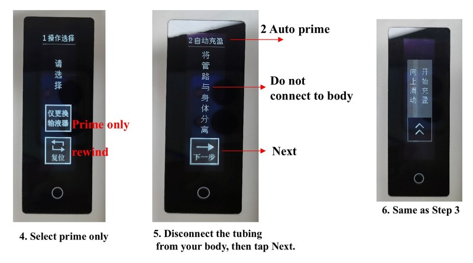

  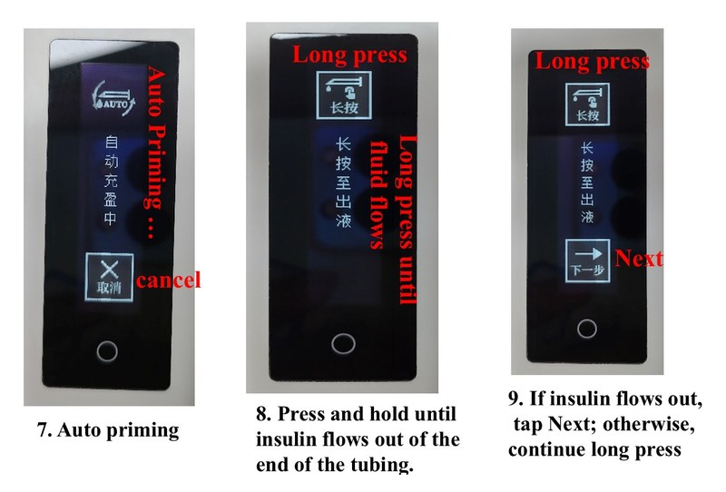

  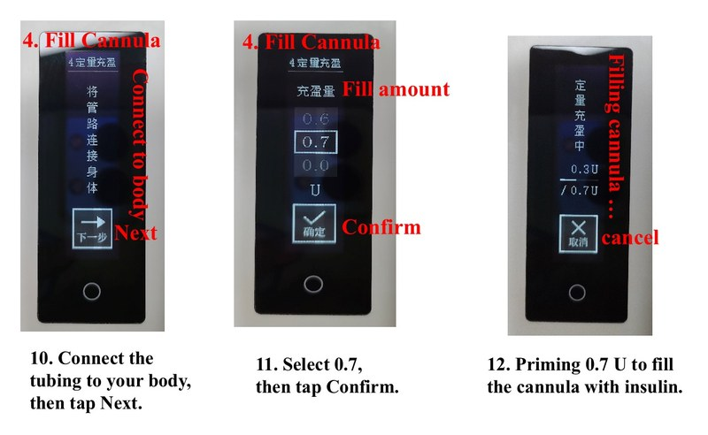

### Alarme der Pumpe

Die Pumpe zeigt einen Alarmbildschirm an, wenn etwas Deine Aufmerksamkeit braucht. Das Bild unten zeigt die Alarme so, wie sie auf der Pumpe erscheinen, zusammen mit den Schaltflächen, die Du drücken kannst. Jeder Alarm wird in der Tabelle erklärt.

<table>
  <tr>
    <th>Alarm</th>
    <th>Bedeutung / was zu tun ist</th>
  </tr>
  <tr>
    <td rowspan="9"></td>
    <td><strong>H1 Pump battery empty</strong> – die AAA-Batterien sind leer. Ersetze sie sofort.</td>
  </tr>
  <tr><td><strong>H2 Abnormal pump motor</strong> – die Pumpe hat einen Motorfehler erkannt. Verwende die Pumpe nicht weiter und wende Dich an Deinen Lieferanten.</td></tr>
  <tr><td><strong>H3 Insulin depleted</strong> – das Insulin ist aufgebraucht. Die Abgabe kann nicht abgeschlossen werden.</td></tr>
  <tr><td><strong>H4 Occlusion</strong> – Schlauch oder Kanüle sind blockiert (Verschluss). Prüfe das Infusionsset und ersetze es bei Bedarf.</td></tr>
  <tr><td><strong>L1 Reservoir empty</strong> – kein Reservoir erkannt.</td></tr>
  <tr><td><strong>L2 Pipeline detachment</strong> – der Schlauch hat sich gelöst. Verbinde das Infusionsset wieder oder ersetze es.</td></tr>
  <tr><td><strong>L3 Low battery</strong> – die Batterien sind fast leer. Ersetze sie bald.</td></tr>
  <tr><td><strong>L4 Insufficient insulin</strong> – die verbleibende Insulinmenge liegt unter der Alarmschwelle.</td></tr>
</table>

### Hinweise der Pumpe

Neben Alarmen zeigt die Pumpe auch **Hinweise** an: kurze Bildschirme, auf denen Du eine Aktion bestätigen sollst oder die Dich über den Zustand der Pumpe informieren. Die Tabelle unten zeigt jeden Hinweisbildschirm und erklärt, was er bedeutet.

<table>
  <tr>
    <th>Hinweis</th><th>Bedeutung</th>
    <th>Hinweis</th><th>Bedeutung</th>
    <th>Hinweis</th><th>Bedeutung</th>
  </tr>

  <!-- Row 1: prompts 1–3 -->
  <tr>
    <td></td>
    <td>Das Gerät war zu lange ausgeschaltet. Bitte stelle die Uhrzeit neu ein.</td>
    <td></td>
    <td>Der Wert überschreitet das Maximum. Bitte gib ihn neu ein.</td>
    <td></td>
    <td>** IE vor ** Minuten abgegeben.</td>
  </tr>

  <!-- Row 2: prompts 4–6 -->
  <tr>
    <td></td>
    <td>Für diesen Bolus können maximal ** IE abgegeben werden.</td>
    <td></td>
    <td>Das 4-Stunden-Bolus-Limit ist erreicht: ** IE.</td>
    <td></td>
    <td>Das tägliche Bolus-Limit ist erreicht: ** IE.</td>
  </tr>

  <!-- Row 3: prompts 7–9 -->
  <tr>
    <td></td>
    <td>Bolus abgebrochen. Bitte prüfe den Eintrag.</td>
    <td></td>
    <td>Die Abgabe kann bei der aktuellen Alarmsituation nicht fortgesetzt werden.</td>
    <td></td>
    <td>Bolus läuft. Das Wechseln des Infusionssets ist nicht erlaubt.</td>
  </tr>

  <!-- Row 4: prompts 10–12 -->
  <tr>
    <td></td>
    <td>Temporäre Basalrate läuft. Das Wechseln des Infusionssets ist nicht erlaubt.</td>
    <td></td>
    <td>Bolus läuft. Bearbeiten ist nicht erlaubt.</td>
    <td></td>
    <td>Temporäre Basalrate läuft. Bearbeiten ist nicht erlaubt.</td>
  </tr>

  <!-- Row 5: prompts 13–15 -->
  <tr>
    <td></td>
    <td>Die Dosis ist 0. Einstellen nicht möglich.</td>
    <td></td>
    <td>Abgabe pausiert. Bitte gehe zum Startbildschirm, um die Abgabe fortzusetzen.</td>
    <td></td>
    <td>Alle Abgaben sind pausiert. Bearbeiten ist nicht erlaubt.</td>
  </tr>

  <!-- Row 6: prompts 16–18 -->
  <tr>
    <td></td>
    <td>Keine neue Batterie.</td>
    <td></td>
    <td>Bitte ersetze die Batterie.</td>
    <td></td>
    <td>Bitte stelle die Uhrzeit neu ein.</td>
  </tr>

  <!-- Row 7: prompts 19–21 -->
  <tr>
    <td></td>
    <td>Bitte setze die Parameter der Insulinpumpe neu.</td>
    <td></td>
    <td>Es gibt einen nicht abgeschlossenen Vorgang.</td>
  </tr>
</table>

## Übersichtsbildschirm

Der AP550-Übersichtsbildschirm zeigt den Zustand der Pumpe:

* Verbindungskarte oben: Tippe darauf, um die Verbindung **herzustellen** oder zu **trennen**.
* Infozeilen: Seriennummer, Batterie, letzte Verbindung, Tagesinsulin, Reservoir, Basis-Basalrate, Basal-Schrittweite, Bolus-Schrittweite, Firmware, max. Bolus, max. Basal.
* **Pump History** – Boli, temporäre Basalraten, Alarme, Befüllungen und mehr. Dieser Verlauf stammt von der Pumpe selbst und bleibt auf dem Smartphone.
* **Stop pump Injection / Resume pump Injection** – hält die Pumpe an oder setzt sie fort. AAPS fragt vorher nach einer Bestätigung.
* **Connect Status** – eine Liste der bisherigen Verbindungs- und Trennungsereignisse.
* **Turn pump sound on/off** – schaltet den Ton der Pumpe stumm oder wieder ein. AAPS fragt vorher nach einer Bestätigung.

## Einstellungen

Die Pumpeneinstellungen öffnest Du über die Konfiguration (Zahnrad neben AP550):

* **Visualize basal as percentage** – die Pumpe verwendet temporäre Basalraten in Prozent (10 % – 300 %). Ist diese Option aktiv, sendet und zeigt AAPS temporäre Basalraten in Prozent statt in IE/h.
* **Hypoglycemia risk alert** – die Pumpe warnt, wenn eine Unterzuckerung in naher Zukunft wahrscheinlich ist. AAPS prüft das Risiko einmal am Tag und nach jedem Bolus.
* **Unpair** – AAPS vergisst die Pumpe.

## Bolus-Limits

Pumpe und Treiber begrenzen, wie viel Insulin abgegeben werden kann:

* Maximaler Einzelbolus – wird an der Pumpe eingestellt.
* **Gesamt-Bolus-Limit für 4 Stunden** – das 2-Fache des maximalen Bolus der Pumpe.
* **Tägliches Gesamt-Bolus-Limit** – das 4-Fache des maximalen Bolus der Pumpe.

AAPS blockiert einen Bolus, der eines dieser Limits überschreiten würde.

## Fehler und Alarme

### Fehler bei der Insulinabgabe

Bricht die Verbindung ab, während ein Bolus läuft (zum Beispiel, weil Du Dich vom Smartphone entfernst), zeigt AAPS eine Meldung an, dass die Kommunikation mit der Pumpe verloren gegangen ist, und bittet Dich, **an der Pumpe zu prüfen, wie viel Bolus tatsächlich abgegeben wurde**. Die tatsächliche Menge wird bei der nächsten Verbindung von der Pumpe gelesen.

### Fehlercodes bei der Abgabe

Schlägt eine Abgabe fehl, meldet die Pumpe einen Code. Die wichtigsten:

| Code | Bedeutung                                                                                   |
| ---- | ------------------------------------------------------------------------------------------- |
| 01   | Injektion manuell pausiert                                                                  |
| 03   | Motorstörung der Pumpe                                                                      |
| 04   | Pumpenbatterie leer                                                                         |
| 05   | Tagesdosis-Limit erreicht                                                                   |
| 06   | Verschluss (Leitung der Pumpe blockiert)                                                    |
| 07   | Reservoir leer                                                                              |
| 08   | Schlauch gelöst                                                                             |
| 09   | Bolus über dem Maximum der Pumpe                                                            |
| 10   | Batterie schwach – oder auf der Pumpe läuft bereits ein Bolus bzw. eine temporäre Basalrate |
| 12   | Kommunikationsfehler, bitte verbinde die Pumpe erneut                                       |

### Verbindungsprobleme

Während AAPS versucht, die Pumpe zu erreichen, erinnert es Dich alle paar Minuten:

1. Please confirm that the pump is within searchable range.
2. Please confirm that the pump and phone bluetooth are enabled.

Erhält AAPS länger als 10 Minuten keine Glukosedaten, zeigt es eine Benachrichtigung an („AAPS blood glucose data lost“), damit Du die Verbindung prüfen kannst.

### Basalprofil stimmt nicht überein

Stimmt das Basalprofil auf der Pumpe nicht mit dem Profil in AAPS überein, meldet die Pumpe ihre eigene Rate (zum Beispiel „pump basal rate: 0.80 U/h, please reset profile“). Sende Dein Profil erneut aus AAPS.

## Kopplung aufheben und Smartphone wechseln

* **Unpair** – Tippe in den Pumpeneinstellungen auf „Unpair“ und bestätige. Der Treiber vergisst die Adresse und die Seriennummer der Pumpe. Die Pumpe bleibt in den Android-Bluetooth-Einstellungen gekoppelt; Du kannst sie dort ebenfalls entfernen, wenn Du möchtest.
* **Andere Pumpe koppeln** – starte einfach den Kopplungsassistenten erneut. Das Koppeln einer neuen Pumpe ersetzt die alte Registrierung, und der Verlauf der alten Pumpe wird nicht übernommen.
* **Smartphone wechseln** – Hebe die Kopplung auf dem alten Smartphone auf (oder kopple einfach neu), dann [exportiere die Einstellungen](../Maintenance/ExportImportSettings.md) auf dem alten Smartphone, installiere AAPS auf dem neuen Smartphone und [importiere die Einstellungen](../Maintenance/ExportImportSettings.md). Kommt die Verbindung nicht zurück, kopple die Pumpe erneut, wie [oben](#AP550-Insulin-Pump-pairing-pump) beschrieben.

## Mit der AP550 über Zeitzonen hinweg reisen

Die AP550 unterstützt keine Zeitänderungen von mehr als 24 Stunden. Wenn Du über Zeitzonen hinweg reist, aktualisiert AAPS die Uhrzeit der Pumpe bei der nächsten Verbindung, nachdem sich die Uhrzeit des Smartphones geändert hat. Beträgt der Unterschied mehr als 24 Stunden, bittet AAPS Dich, zuerst die Uhrzeit auf dem Smartphone und der Pumpe zu prüfen.

Beachte, dass Zeitverschiebungen auf der Pumpe zu falschen Basaleinträgen im Pumpenverlauf führen können. Siehe auch [Mit der Pumpe über Zeitzonen hinweg reisen](#timezone-traveling-with-pumps).