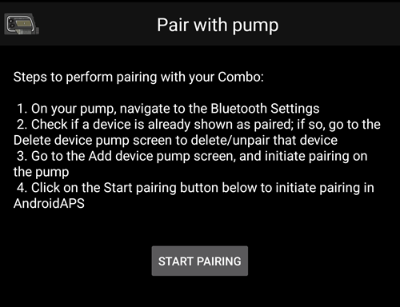
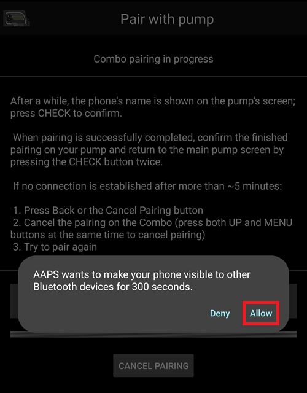

# Accu-Chek Combo

**Die Software ist Teil einer DIY-Lösung (Do It Yourself = Eigenbau) und kein kommerzielles Produkt. Daher bist DU gefordert. DU musst lesen, lernen und verstehen, was das System macht und wie du es bedienst. Das System wird Dir nicht alle Schwierigkeiten Deiner Diabetestherapie abnehmen, aber wenn Du willens bist, die nötige Zeit zu investieren, dann kann es die Ergebnisse Deiner Therapie verbessern und die Lebensqualität erhöhen. Überstürze nichts. Nimm dir Zeit zum Lernen. Du bist ganz alleine dafür verantwortlich, was Du mit dem System machst. Du bist ganz alleine dafür verantwortlich, was Du mit dem System machst.**

```{admonition} Accu-Chek Combo is being phased out
:class: note

Roche is withdrawing from the insulin pump market to refocus its diabetes portfolio on the Accu-Chek SmartGuide CGM. It has communicated the end of sales of both the Accu-Chek Combo and Accu-Chek Insight pumps; its remaining Accu-Chek Solo micropump is also being wound down (last deliveries in Germany at the end of 2025). The change is being rolled out by region, starting in Germany, with other European markets expected to follow. If you rely on this pump, plan ahead for a transition to a supported pump.
```

```{contents} Table of contents
:depth: 1
:local: true
```

## Funktionalitäten bei der Nutzung mit AAPS

* Communicates with **AAPS** over your phone's native Bluetooth, without an additional communication device.
* Automatic DST and timezone handling.

## Hardware- und Softwareanforderungen

* Eine Roche Accu-Chek Combo (jede Firmware funktioniert).
* Einen Smartpix oder Realtyme Adapter und die Accu-Chek 360°-Konfigurationssoftware um die Pumpe zu konfigurieren. (Kunden von Roche können die Software beim Kundendienst anfordern.)
* A compatible phone running Android 12 or newer. Details findest Du in den [Release Notes](#maintenance-android-version-aaps-version).
* The **AAPS** app installed on your phone.

Einige Telefone funktionieren vielleicht besser als andere je nach Qualität der Bluetooth-Unterstützung und ob sie eine zusätzliche, sehr aggressive Energiesparlogik haben oder nicht. Eine Liste mit Smartphones findest Du im Abschnitt [Smartphones](#Phones-list-of-tested-phones). Die Liste ist nicht abschließend und spiegelt nur die persönliche Erfahrung der Benutzer wieder. Bitte trage Deine Erfahrung in die Liste ein und hilf damit anderen. Die ganzen DIY-Projekte funktionieren nur, wenn jeder etwas zurückgibt.

(combov2-before-you-begin)=
## Bevor du startest

**SICHERHEITEN** - Versuche diesen Prozess nicht in einer Umgebung, in der Du Dich nicht von einem Fehler erholen kannst. Halten Sie Ihr Smartpix / Realtyme Gerät bereit, zusammen mit der 360 Configuration Software. Plane ungefähr eine Stunde, um alles einzurichten und zu überprüfen, ob alles richtig funktioniert.

Beachte folgende Einschränkungen:

* Verzögerter Bolus und Multiwave-Bolus werden nicht unterstützt. (Als Alternative schau Dir [Verzögerte Kohlenhydrate](../DailyLifeWithAaps/ExtendedCarbs.md) an.)
* Nur ein basales Profil (das erste Profil) wird unterstützt.
* The lowest basal rate in your **Profile** is 0.05 U/h. **AAPS** refuses a **Profile** with a lower rate. The Combo rounds basal rates to its own steps (0.01 U/h below 1 U/h, 0.05 U/h up to 10 U/h, 0.1 U/h above). **AAPS** uses the rates the pump really gives.
* Temporary basal rates are limited to 500% of the current basal rate. **AAPS** takes this limit into account.
* Der Loop ist deaktiviert, wenn das aktuell aktive Profil der Pumpe nicht Profil Nr. 1 ist. This continues until profile no. 1 is made the active one; when that is done, the next time AAPS connects (either on its own after a while or because you tap **Refresh** on the Accu-Chek Combo pump screen), it will notice that profile no. 1 is the current one, and enable the loop again.
* Wenn der Loop eine laufende Basalrate abbrechen will, wird stattdessen die Basalrate für 15 min. auf 90% oder 110% gesetzt. Das liegt daran, dass das Abbrechen eines TBR eine Warnung auf die Pumpe verursacht, die viele Vibrationen verursacht, und diese Vibrationen können nicht deaktiviert werden.
* Die Stabiltät der Bluetooth-Verbindung variiert je nach verwendetem Telefon stark, dies kann zu “pump unreachable”-Alarmen führen und verhindern, dass die Verbindung zur Pumpe hergestellt werden kann. If that error occurs, make sure Bluetooth is enabled, tap **Refresh** on the pump screen (**Manage** > **Pump**) to see if this was caused by an intermitted issue and if still no connection is established, reboot the phone which should usually fix this.
* Es gibt ein anderes Problem, bei dem ein Neustart nicht hilft, sondern eine Taste auf der Pumpe gedrückt werden muss (welcher den Bluetooth-Stack der Pumpe zurücksetzt), bevor die Pumpe wieder Verbindungen vom Telefon annimmt.
* Das Setzen einer TBR direkt auf der Pumpe ist im Closed Loop Betrieb nicht nötig und sollte möglichst nicht vorgenommen werden. Das Erkennen einer manuell gesetzten Basalrate kann bis zu 20 Minuten dauern und wird bei der Berechnung auch erst ab dem Zeitpunkt berücksichtigt, zu dem die TBR von AAPS eingelesen wird. Das führt dazu, dass die im Körper befindliche Insulinmenge (IOB) falsch berechnet wird.

The driver is currently written to support the following languages on the Combo. (Dies hat nichts mit der Sprache in AAPS zu tun - hier ist die auf dem Bildschirm der Combo verwendete Sprache gemeint.)

* English
* Spanish
* Französisch
* Italienisch
* Russisch
* Türkisch
* Polnisch
* Tschechisch
* Ungarisch
* Slovakisch
* Rumänisch
* Kroatisch
* Dutch
* Greek
* Finnisch
* Norwegisch
* Portugiesisch
* Schwedisch
* Dänisch
* German
* Slowenisch
* Lithuanian

**Wichtig**: Wenn Deine Combo eine Sprache verwendet, die nicht auf der Liste steht, kontaktiere das Entwickler-Team und setze die Pumpensprache auf eine Sprache aus der Liste. Andernfalls funktioniert der Treiber nicht richtig.

## Telefon einrichten

Es ist sehr wichtig sicherzustellen, dass die Batterieoptimierung ausgeschaltet wird. AAPS erkennt automatisch, wenn es diesen Optimierungen unterliegt und fragt in seiner Benutzeroberfläche an, dass diese abgeschaltet werden. Aber auf modernen Android-Telefonen ist Bluetooth _selbst_ eine App (eine System-App). Und im Allgemeinen läuft die "Bluetooth app" mit _eingeschalteter Batterie Optimierung im Standard_. Infolgedessen kann Bluetooth es ablehnen, zu reagieren, wenn das Telefon darauf abzielt, Strom zu sparen, da es die Bluetooth-App einfach beendet. Das bedeutet, dass in den Einstellungen der Bluetooth-System-App auch die Batterieoptimierungen ausgeschaltet werden müssen. Unglücklicherweise kann man feststellen, dass die Bluetooth-System-App sich zwischen den Telefonen unterscheidet. In unverändertem Android gehe zu Einstellungen -> Apps -> Alle N-Apps anzeigen (N = Anzahl der Apps auf Ihrem Handy). Öffnen Sie dann das Menü in der oberen rechten Ecke, klicken Sie auf "System anzeigen" oder "System-Apps anzeigen" oder "Alle Apps". Jetzt in der erweiterten Liste der Apps nach einer "Bluetooth"-App suchen. Wähle es aus und tippe auf "App-Informationen" und dann auf "Batterie". Dort deaktiviere die Batterieoptimierung (manchmal auch als "Batterieverbrauch" bezeichnet) .

## Combo Setup

* Konfiguriere die Pumpe mit der Accu-Chek 360 Konfigurationssoftware. Falls du die Software nicht hast wende dich an die Accu-Chek Hotline. Sie senden registrierten Benutzern normalerweise eine CD mit der 360º Konfigurations-Software und einen SmartPix USB-Infrarotempfänger. (Das Realtyme Gerät funktioniert auch falls du dieses besitzt.)

  - **Erforderliche Einstellungen** (in Screenshots grün markiert):

     * Setze/Lasse das Benutzermenü auf “Standard”. Dadurch werden nur die benötigten Menüs/Aktionen auf der Pumpe angezeigt und solche versteckt, die nicht unterstützt werden (verzögerter Bolus, Multiwave Bolus, mehrere Basalprofile), die die Loop-Funktionalität einschränken würden, da der Loop nicht sicher laufen würde, wenn diese Aktionen Verwendung fänden.
     * Stelle sicher, dass der _Quick Info Text_ auch wirklich “QUICK INFO” heißt (ohne Anführungszeichen, zu finden unter _Anzeige-/Kommunikationseinstellungen_).
     * Stelle die _Maximale Anpassung_ der Temporären Basalrate auf 500%.
     * Deaktiviere _Ende der temporären Basalrate signalisieren_.
     * Setze die _Schrittweitendauer_ der Temporären Basalrate auf 15 min.
     * Bluetooth aktivieren

  - **Empfohlene Einstellungen** (in Screenshots blau markiert)

     * Stelle den Restmenge bei Alarm “Amp. fast leer” ein, wie es für dich passt.
     * Konfiguriere eine maximale Bolusmenge passend zu deiner Therapie, um dich gegen Fehler in der Software zu schützen.
     * Lege gleichermaßen die maximale Dauer einer temporären Basalrate als Sicherheitsmaßnahme fest. Erlaube mindestens 3 Stunden, da die Option die Pumpe für 3 Stunden abzulegen, 0% über 3 Stunden setzt.
     * Aktiviere die Tastensperre an der Pumpe, um die Bolusabgabe über die Pumpe zu verhindern, insbesondere wenn die Pumpe vorher schon verwendet wurde und die schnelle Bolusabgabe eingerichtet war.
     * Stelle die Anzeigedauer und das Menü-Timeout auf das Minimum (5,5 bzw. 5). Das erlaubt AndroidAPS in Fehlerzuständen schneller wieder fortzusetzen und verringert die Anzahl an Vibrationen die während so einem Fehler auftreten können.

  

  

  

  

## Aktivierung des Treibers und Kopplung mit der Combo

* Open the **menu** (☰) in the top-left corner, go to [**Configuration** > **Pump**](../SettingUpAaps/ConfigBuilder.md) and select **Accu-Chek Combo**.

  

  Once it is selected, the **Accu-Chek Combo** card shows two buttons, **Settings** and **Open plugin**:

  

  **Settings** opens the settings of the Accu-Chek Combo driver (see [Settings](#combov2-preferences) below):

  

  **Open plugin** (or **Manage** > **Pump**) opens the Accu-Chek Combo pump screen. Before a pump is paired it shows **Not paired to a pump**:

  

* On the pump screen, tap **Pairing**. The **Pair with pump** screen opens. Follow the steps shown on screen, then tap **Start pairing**. When Android asks for permission to make the phone visible to other Bluetooth devices, tap **Allow**. Eventually, the Combo shows a 10-digit pairing PIN on its screen, and **AAPS** asks for it. Enter that PIN in the **10-digit PIN** field.

  

  

  

  The next pictures are from an older **AAPS** version. The steps and texts are the same, but the screens look slightly different.

  

  

  

* If the PIN is entered incorrectly, **AAPS** shows **PIN did not work. Check if there was a typo. If this keeps happening, cancel and retry pairing.**

  

* When **Successfully paired with Combo** is shown, tap **OK**. You return to the pump screen, which now shows the pump status (see [Accu-Chek Combo pump screen contents](#combov2-tab-contents) below). The **Pairing** button is replaced by **Unpair**.

* **Trenne die Pumpe** zum Testen der Konfiguration. Setze mit AAPS eine temporäre Basalrate von 500% für 15 Min. und gib einen Testbolus ab. Die Pumpe sollte nun die TBR anzeigen und einen Bolus-Eintrag in der Historie haben. AAPS sollte ebenfalls die TBR und den Bolus anzeigen.

* Die Tastensperre der Combo sollte aktiviert werden, um eine versehentliche Bolusabgabe - insbesondere wenn die Combo vorher klassisch auch mit der 'Quick-Bolus'-Funktion genutzt wurde, zu verhindern.

## Notizen zum Pairing

Die Accu-Chek Combo wurde knapp ein Jahr nachdem die erste Android-Version veröffentlicht wurde und bevor Bluetooth 4.0 verfügbar war, entwickelt. Aus diesem Grund weicht der Koppelungsprozess vom heute üblichen Weg ab. Um dies zu umgehen, würde AAPS Berechtigungen auf Systemebene benötigen, die nur für Systemanwendungen vergeben werden. Diese Systemanwendungen werden von den Herstellern vorinstalliert. Diese können von Dir nicht (nachträglich) installiert werden.

The consequence of this is that pairing will never be 100% without problems. Insbesondere während des eigentlichen Android-Pairings kann es passieren, dass die Bluetooth-PIN nur sehr kurz zu sehen ist und dann wieder verschwindet. In einigen Fällen, bleibt das Dialogfeld sichtbar und es wird nach einer 4-stelligen PIN gefragt werden. (Nicht zu verwechseln mit der 10-stelligen Combo-Pairing-PIN.) Bitte gib hier nichts ein und tippe auf 'abbrechen' (cancel). Sollte der Pairing-Vorgang nicht weiter vorangehen, folge den auf dem Bildschirm gezeigten Anweisungen, um es erneut zu versuchen.

(combov2-tab-contents)=
## Accu-Chek Combo pump screen contents

To open the pump screen, go to **Manage** > **Pump**. Once a pump is paired, it shows the following information (items are listed from top to bottom):


1. **Driver state**: The driver can be in one of the following states:
   - **Disconnected**: There is no Bluetooth connection; the driver is in this state most of the time, and only connects to the pump when needed - this saves power
   - **Connecting**
   - **Checking pump**: the pump is connected, but the driver is currently performing safety checks to ensure that everything is OK and up to date
   - **Ready**: the driver is ready to accept commands from AAPS
   - **Suspended**: the pump is suspended (shown as "stopped" in the Combo)
   - A description of the command being executed, for example **Setting basal profile** or **Updating pump status**
   - **Error**: an error occurred; the connection was terminated, any ongoing command was aborted
2. **Last connection**: How many minutes ago the driver successfully connected to the Combo; if this goes beyond 30 minutes, this item is shown with a red color
3. **Battery**: Battery level; the Combo only indicates **Full**, **Low** or **Empty**, and does not offer anything more accurate (like a percentage), so only these three levels are shown here
4. **Reservoir**: How many IU are currently in the Combo's reservoir
5. **Last bolus**: How many minutes ago the last bolus was delivered; if none was delivered yet after AAPS was started, this is not shown
6. **Temp basal**: Details about the currently active temporary basal; if none is currently active, this is not shown
7. **Base basal rate**: Currently active base basal rate ("base" means the basal rate without any active TBR influencing the basal rate factor)
8. **Serial number**: Combo serial number as indicated by the pump (this corresponds to the serial number shown on the back of the Combo)
9. **Bluetooth address**: The Combo's 6-byte Bluetooth address, shown in the `XX:XX:XX:XX:XX:XX` format

While the driver is doing something (for example, setting a basal profile), a box below the list describes the current activity, with a thin progress bar showing the progress.

Die Combo kann über Bluetooth im _Remote-Terminal_-Modus oder im _Befehls_-Modus (command) genutzt werden. Der Remote-Terminal-Modus ähnelt dem "Fernbedienungsmodus" auf dem Combo-Messgerät, das das LCD-Display und die vier Knöpfe simuliert. Einige Befehle müssen vom Treiber in diesem Modus ausgeführt werden, da sie im Befehlsmodus kein passendes Gegenstück haben. Dieser letztgenannte Modus ist viel schneller, aber, wie beschrieben, begrenzt. When the remote-terminal mode is active, the current remote-terminal screen is shown in the field that is located just above the Combo drawing. Wenn der Treiber in den Befehlsmodus wechselt, wird dieses Feld leer gelassen.

(You do not influence this; the driver fully decides on its own what mode to use. This is merely a note for you to know why sometimes you can see Combo frames in that field.)

At the bottom, there are these buttons:

- **Refresh**: Triggers an immediate pump status update. It is also used to let AAPS know that a previously discovered error is now fixed and that AAPS can check again that everything is OK (more on that below in [the section about alerts](#combov2-alerts)). You can only tap it when the driver is disconnected, suspended or in the error state.
- **Unpair**: Unpairs the paired Combo from **AAPS** and Android, after you confirm **Do you really want to unpair the pump?**. When no pump is paired, this button is replaced by **Pairing**.

(combov2-preferences)=
## Einstellungen

These settings are available for the Combo driver (**Configuration** > **Pump** > **Accu-Chek Combo** > **Settings**, or the settings icon (cog wheel) on the pump screen). Items are listed from top to bottom:

1. **Discovery duration (in seconds)**: When pairing, the driver makes the phone discoverable by the pump. Dies beinflusst die Dauer der Sichtbarkeit. Das Maximum (300 Sekunden = 5 Minuten) ist voreingestellt. Android erlaubt keine permanente Sichtbarkeit, sodass eine Dauer ausgewählt werden muss.
2. **Autodetect and automatically enter insulin reservoir change**: If enabled, the driver enters the "reservoir change" that you would normally enter yourself with **Manage** > **Prime/Fill**. Dies wird [weiter unten](#combov2-autodetections) genauer beschrieben.
3. **Autodetect and automatically enter battery change**: If enabled, the driver enters the "battery change" that you would normally enter yourself with **Manage** > **Pump Battery Change**. Dies wird [weiter unten](#combov2-autodetections) genauer beschrieben.
4. **Enable verbose Combo logging**: This greatly expands the amount of logging done by the driver. **ACHTUNG**: Aktiviere diese Option nur, wenn Du von einem Entwickler oder einer Entwicklerin dazu aufgefordert wirst. Otherwise, this can add a lot of noise to **AAPS** logs and lessen their usefulness.

Pairing and unpairing are done on the pump screen, not in the settings (see above).

(combov2-autodetections)=
## Automatische Erkennung und automatische Eingabe von Akku- und Reservoir-Änderungen

Der Treiber kann, Batterie- und Ampullenwechsel erkennen, indem er den Batterie- und den Ampullenstand überwacht. Wenn die Combo bei der letzten Abfrage einen niedrigen Batteriestand zurückgemeldet hat, und bei der erneuten Abfrage ('aktualisieren') ein normaler Batteriestand übermittelt bekommt, geht der Treiber davon aus, dass ein Batteriewechsel erfolgt ist. Die gleiche Logik wird einen Ampullenwechsel genutzt: Ist der Ampullenfüllstand bei der zweiten Abfrage höher als bei der ersten, wird angenommen, dass in der Zwischenzeit ein Ampullenwechsel stattgefunden hat.

Dies funktioniert nur, wenn Batterie- und Reservoirstände zuvor als 'niedrig' gemeldet wurden _und_ dann wieder vollgefüllt sind.

These autodetections can be turned off in the driver [settings](#combov2-preferences).

(combov2-alerts)=
## Alarme (Warnungen und Fehler) und wie sie behandelt werden

The Combo shows alerts as remote-terminal screens. Warnungen werden mit einem "Wx"-Code (x ist eine Zahl) zusammen mit einer kurzen Beschreibung angezeigt. Ein Beispiel ist "W7", "TBR ABGELAUFEN". Fehler sind ähnlich, werden aber stattdessen mit einem "Ex"-Code angezeigt.

Bestimmte Warnungen werden automatisch vom Treiber verworfen. Diese sind:

- W1 "reservoir low" : the driver turns this into a "low reservoir" warning that is shown on the AAPS main screen
- W2 "battery low" : the driver turns this into a "low battery" warning that is shown on the AAPS main screen
- W3, W6, W7, W8: Sind alle rein informativ, daher ist es OK, dass der Treiber diese Meldungen automatisch verwirft/bestätigt

Andere Warnungen werden _nicht automatisch_ verworfen/bestätigt. Fehlermeldungen werden ebenfalls _niemals automatisch_ verworfen/bestätigt. Beide werden gleich behandelt: Sie führen dazu, dass der Treiber einen Warndialog auf der AAPS-Oberfläche anzeigt und der laufende Befehl abgebrochen wird. The driver then switches to the "error" state (see [the Accu-Chek Combo pump screen contents above](#combov2-tab-contents)). In diesem Zustand können keine weiteren Befehle ausgeführt werden. Du musst den Fehler auf der Pumpe lösen (z.B. kann ein Verstopfungs-Fehler einen Kanülenwechsel erfordern). Once the user took care of the error, normal operation can be resumed by tapping **Refresh** on the Accu-Chek Combo pump screen. Der Treiber verbindet sich dann mit der Combo und aktualisiert den Status und prüft, ob noch andere Fehler bestehen. Der Treiber aktualisiert den Pumpenstatus in regelmäßigen Abständen automatisch. Ein manuelles Aktualisieren ist also nicht unbedingt erforderlich.

Einen Bolus abzugeben ist ein Sonderfall. Dies wird über den Befehlsmodus, der während der Bolusabgabe keine Alarme bzw. Fehlermeldungen weitergibt, umgesetzt. Deshalb kann der Treiber Warnungen während der Bolusabgabe _nicht automatisch_ verwerfen bzw. bestätigen. Leider bedeutet das, dass die Combo in dieser Situation bis zum Ende des Bolus piepen wird. Der Alarm, der am häufigsten während einer Bolusabgabe auftritt, ist W1 'Ampulle fast leer'. Bestätige während eines laufenden Bolus **auf keinen Fall** Warnungen händisch direkt auf der Combo. Du riskierst sonst, den Bolus zu unterbrechen. Der Treiber wird sich um die Warnungen kümmern, sobald der Bolus durchgelaufen ist.

Alarme, die auftreten, während der Treiber nicht mit der Combo verbunden ist, kennt der Treiber nicht. Die Combo hat keine Möglichkeit, diese Alarme automatisch an das Smartphone weiterzureichen; es ist immer das Smartphone, das die Verbindung aufbauen muss. Damit bleibt der Alarm so lange aktiv, bis der Treiber sich wieder mit der Pumpe verbunden hat. You can tap **Refresh** on the pump screen to trigger a connection and let the driver handle the alert right then and there (instead of waiting until AAPS itself decides to initiate a connection).

**WICHTIG**: Sollten Fehler oder Warnungen auftreten, die nicht automatisch verworfen/bestätigt werden können, wird der Treiber in einen Fehlerzustand (error state) gehen. In diesem Fehlerzustand wird der Loop **BLOCKIERT**, bis der Pumpenstatus aktualisiert bzw. aufgelöst ist! It is unblocked after the pump status is updated (either by tapping **Refresh** or by the driver's eventual auto-update) and no error is shown anymore.

## Dinge, auf die Du bei der Verwendung der Combo achten solltest

* Beachten Sie, dass dies kein 'Produkt' ist. Besonders am Anfang musst Du das System überwachen und verstehen wo seine Grenzen sind und es versagen kann. Es wird dringend empfohlen, dieses System NICHT zu verwenden, wenn die Person, die es benutzt, nicht in der Lage ist, es vollständig zu verstehen.
* Aufgrund der Art wie die Fernbedienung der Combo funktioniert, sind einige Aktionen im Vergleich zu anderen Pumpen (insbesondere das Setzen eines Basalprofils) langsam. Leider ist das eine Beschränkung der Combo, die nicht überwunden werden kann.
* Gib keine TBR an der Pumpe ein und lösche dort auch keine. Der Loop übernimmt die Verwaltung der TBR. Sollte manuell eingegriffen werden, kann der Loop z.B. die Startzeit einer TBR nicht ermitteln und wird somit nicht zuverlässig funktionieren können.
* Drücke keine Tasten an der Pumpe während AAPS mit der Pumpe kommuniziert (erkennbar am Bluetooth Logo, das auf dem Display der Pumpe angezeigt wird). Durch einen Knopfdruck wird die Bluetooth-Verbindung unterbrochen. Tue das nur, wenn es Probleme beim Verbindungsaufbau gibt (siehe Abschnitt ["Bevor Du startest"](#combov2-before-you-begin) oben).
* Drücke keine Tasten während eines laufenden Bolus. Versuche insbesondere nicht, Alarme durch Drücken von Tasten zu verwerfen/bestätigen. Eine detailliertere Beschreibung zu den Hintergründen findest Du im Abschnitt [Alarme (Warnungen und Fehler)](#combov2-alerts).

## Checkliste für den Fall, dass keine Verbindung mit der Combo hergestellt werden kann

Der Treiber tut sein Bestes, um sich mit der Combo zu verbinden und wendet einige Tricks an, um die Zuverlässigkeit zu maximieren. Trotzdem kann manchmal keine Verbindung aufgebaut werden. Hier sind einige mögliche Schritte, um diese Situation zu beheben.

1. Drücke eine Taste auf der Combo. Manchmal reagiert der Bluetooth-Stack der Combo nicht mehr und akzeptiert keine Verbindungen mehr. Durch den Tastendruck wird auf dem LCD-Display etwas angezeigt und der Bluetooth-Stack damit zurückgesetzt. Meist reicht dieser Schritt schon aus, um das Verbindungsproblem zu lösen.
2. Starte Dein Smartphone neu. Bei Problemen mit dem Bluetooth-Stack des Smartphones selber, kann das notwendig werden.
3. Wenn die Batteriekappe der Combo alt ist, sollte sie eventuell getauscht werden. Alte Batteriekappen können die Stromversorgung der Combo beeinträchtigen und so Einfluss auf die Bluetooth-Verbindung haben.
4. Wenn der Verbindungsversuch immer noch fehlschlägt, kannst Du versuchen die Pumpe zu entkoppeln und dann wieder neu zu koppeln.

(combov2-tips-for-basic-usage)=
## Tips for basic usage

### How to ensure smooth operations

* Always **carry the smartphone with you**, leave it next to your bed at night. As your pump may lay behind or under you body while you sleep, a higher position (on a shelf or board) works best.
* Always make sure that the pump battery is as full as possible. See the battery section for tipps regarding the battery.
* Whenever possible, only operate the pump via the AAPS app. To facilitate this, activate the key lock on the pump under **PUMP SETTINGS / KEY LOCK / ON**. Only when changing the battery or the cartridge, it is necessary to use the pump's keys.


### Pump not reachable. What to do?

#### Activate pump unreachable alarm
* In **AAPS**, tap the **Settings** (gear) icon at the top right of the main screen, go to **Local alerts**, activate **Alert if pump is unreachable** and set **Pump unreachable threshold** to **31** minutes.
* This will give you enough time to not trigger the alarm when leaving the room while your phone is left on the desk, but informs you if the pump cannot be reached for a time that exceeds the duration of a temporary basal rate.

#### Restore reachability of the pump

* When AAPS reports a **pump unreachable** alarm, first release the keylock and **press any key on the pump** (e.g. "down" button). As soon as the pump display has turned off, tap **Refresh** on the Accu-Chek Combo pump screen (**Manage** > **Pump**). Mostly then the communication works again.
* If that does not help, reboot your smartphone. After the restart, AAPS will be reactivated and a new connection will be established with the pump.

* The tests with different smartphones have shown that certain smartphones trigger the "pump unreachable" error more often than others. See [AAPS Phones](#Phones-list-of-tested-phones) for successfully tested smartphones.

#### Root causes and consequences of frequent communication errors
* On phones with **low memory** (or **aggressive power-saving** settings), AAPS is often shut down. You can tell by the fact that the treatment buttons (QuickLaunch toolbar) on the main screen are not shown when opening AAPS because the system is initializing. This can trigger "pump unreachable alarms" at startup. In the **Last connection** field of the pump screen (**Manage** > **Pump**), you can check when AAPS last communicated with the pump.


* This error can drain the pump's battery faster because the basal profile is read from the pump when the app is restarted.
* It also increases the likelihood of causing the error that causes the pump to reject all incoming connections until a button on the pump is pressed.

### Cancellation of temporary basal rate fails
* Occasionally, AAPS cannot automatically cancel a **TBR CANCELED** alert. Then you have to either tap **Refresh** on the Accu-Chek Combo pump screen or the alarm on the pump will need to be confirmed.

### Pump battery considerations

#### Changing the battery
* After a **low battery** alarm, the battery should be changed as soon as possible to always have enough energy for a reliable Bluetooth communication with the smartphone, even if the phone is within a wider distance of the pump.
* Even after a **low battery** alarm, the battery might be used for a significant amount of time. However, it is recommended to always have a fresh battery with you after a "low battery" alarm rang.
* Before changing the battery, press on the **Loop** symbol on the main screen and select **Suspend loop** for 1 hour.
* Wait for the pump to communicate with the pump and the Bluetooth logo on the pump has faded.


* Release the key lock on the pump, put the pump into stop mode, confirm a possibly canceled temporary basal rate, and change the battery quickly.
* You don't need to re-set the pump's clock after the battery change: AAPS automatically updates the pump's date and time.
* Then put the pump back in run mode select **Resume** when pressing on the **Suspended Loop** icon on the main screen.
* AAPS will re-set a necessary temporary basal rate with the arrival of the next blood sugar value.

(Accu-Chek-Combo-Tips-for-Basic-usage-battery-type-and-causes-of-short-battery-life)=
#### Battery type and causes of short battery life
* As intensive Bluetooth communication consumes a lot of energy, only use **high-quality batteries** like Energizer Ultimate Lithium, the "power one"s from the "large" Accu-Chek service pack, or if you are going for a rechargeable battery, use Eneloop batteries.

 

Ranges for typical life time of the different battery types are as follows:
* **Energizer Ultimate Lithium**: 4 to 7 weeks
* **Power One Alkaline** (Varta) from the service pack: 2 to 4 weeks
* **Eneloop rechargeable** batteries (BK-3MCCE): 1 to 3 weeks

If your battery life is significantly shorter than the ranges given above, please check the following possible causes:
* There are some variants of the screw-on battery cap of the Combo pump, which partially short circuit the batteries and drain them quickly. The caps without this problem can be recognized by the golden metal contacts.
* If the pump clock does not "survive" a short battery change, it is likely that the capacitor is broken which keeps the clock running during a brief power outage. In this case, a replacement of the pump by Roche might help, which is not a problem during the warranty period.
* The smart phone hardware and software (Android operating system and Bluetooth stack) also impact the battery lifetime of the pump, even though the exact factors are not completely known yet. If you have the opportunity, try another smartphone and compare battery lifetimes.

### Extended bolus, multiwave bolus
The OpenAPS algorithm does not support a parallel extended bolus or multiwave bolus. But a similar treatment can be achieved by the following alternatives:
* Use **e-Carbs** when entering carbs or using the Bolus wizard by entering the carbs of the full meal and the duration you expect the carbs to arrive as glucose in your blood. The system will then calculate small carbs equally distributed over the whole duration which will cause th algorithm to provide equivalent insulin dosing while still permanently checking the overall rise/decrease of the blood glucose level. For a multiwave bolus approach, you can also combine a smaller immediate bolus with e-carbs.
* Before eating, set a temporary **Eating Soon** target with glucose 80 for several hours (press the target on the main screen, or **Manage** > **Temp Target**). The duration should be based on the interval you would choose for an extended bolus. This will keep your target lower than usual and therefore increase the amount of insulin delivered.
* Then use the **Bolus wizard** to enter the full carbs of the meal, but do not directly apply the values it suggests. If a multiwave-like bolus is to be delivered, correct the insulin dosage down. Depending on the meal, the algorithm now has to deliver additional SMBs or higher temporary basal rates to counteract the increase in blood sugar. Here, the safety limitation of the basal rate (Max IE / h, Maximum basal IOB) should be very carefully experimented with and, if necessary, temporarily changed.

* Don't use the extended or multiwave bolus directly on the pump. The driver does not support them (see [Before you begin](#combov2-before-you-begin)); if a multiwave bolus is given on the pump anyway, **AAPS** records it from the pump history as a normal bolus plus an extended bolus, so it is counted in IOB. An extended bolus does not work in a closed loop environment (see [this page](#extended-bolus-and-why-they-wont-work-in-closed-loop-environment) for details).

### Alarms at bolus delivery
* After each bolus, the driver reads the pump's bolus history. This is a safety mechanism to correctly calculate insulin on board (IOB), even when a bolus is delivered directly from the pump.
* Before a bolus, if the pump history has a bolus that **AAPS** did not know about (for example, a bolus given directly on the pump), the requested bolus is **not given**, because it was calculated without that insulin. **AAPS** shows **The pump history has a bolus that AAPS did not know about. The requested bolus was not given...** Check the bolus history on the pump and your IOB. If a bolus is still needed, calculate it again. This also applies when the unknown bolus is found on a new connection.
* If the bolus was given but the pump history also had other boluses that **AAPS** did not know about, they are recorded now and **AAPS** asks you to check IOB before the next bolus.
* If the connection to the pump is lost **during** a bolus, **AAPS** does not record 0 U: it shows how much the pump had given by then and warns that the pump may still give the rest. **Do not bolus again.** **AAPS** reads the real amount from the pump history at the next connection.
* If the connection is lost while **AAPS** sends the bolus, it is not known whether the pump got it. Check the bolus history on the pump before the next bolus.
* If **AAPS** cannot confirm that a bolus was delivered, it shows **Bolus delivery failed. It appears no bolus was delivered. To be sure, please check the pump to avoid a double bolus and then bolus again.** Boluses are never retried automatically.

## Wo ich Hilfe bekomme

Development of the Combo driver is done by the community on a **volunteer** basis. Before requesting help, please:

1. **Read** the relevant section of this documentation to confirm how the feature is meant to work.
2. **Ask** on the *#AAPS* channel on [Discord](https://discord.gg/4fQUWHZ4Mw), or in one of the other [community channels](../GettingHelp/WhereCanIGetHelp.md).
3. **Report a bug** by searching the [existing issues](https://github.com/nightscout/AndroidAPS/issues); if yours is not listed, open a [new issue](https://github.com/nightscout/AndroidAPS/issues) and attach your [log files](../GettingHelp/AccessingLogFiles.md).

When asking for help, include your phone make and model, Android version, **AAPS** version, and a plain-English description of the problem (what changed, when it last worked).
