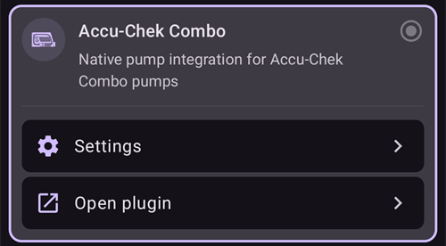
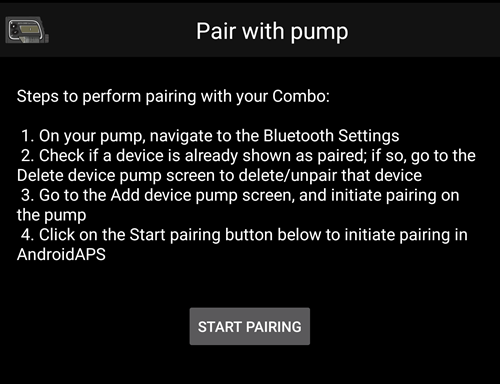
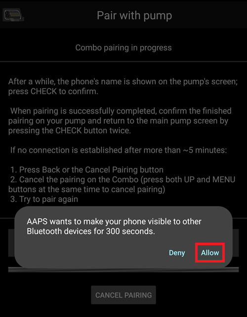
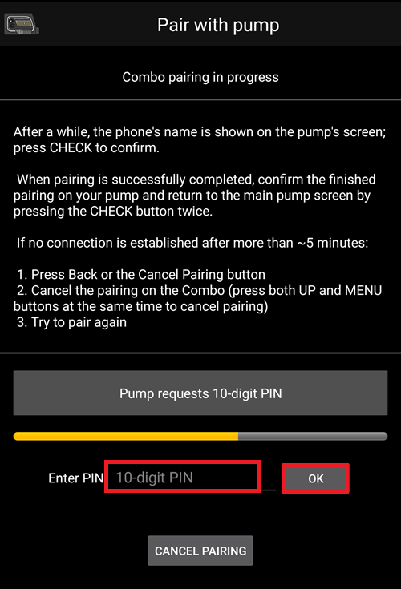
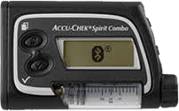

# Accu-Chek Combo

**Die Software ist Teil einer DIY-Lösung (Do It Yourself = Eigenbau) und kein kommerzielles Produkt. Daher bist DU gefordert. DU musst lesen, lernen und verstehen, was das System macht und wie du es bedienst. Das System wird Dir nicht alle Schwierigkeiten Deiner Diabetestherapie abnehmen, aber wenn Du willens bist, die nötige Zeit zu investieren, dann kann es die Ergebnisse Deiner Therapie verbessern und die Lebensqualität erhöhen. Überstürze nichts. Nimm dir Zeit zum Lernen. Du bist ganz alleine dafür verantwortlich, was Du mit dem System machst. Du bist ganz alleine dafür verantwortlich, was Du mit dem System machst.**

```{admonition} Accu-Chek Combo is being phased out
:class: note

Roche zieht sich aus dem Insulinpumpenmarkt zurück, um sein Diabetes-Portfolio auf das CGM Accu-Chek SmartGuide auszurichten. Roche hat das Verkaufsende sowohl der Accu-Chek Combo als auch der Accu-Chek Insight angekündigt; auch die verbliebene Mikropumpe Accu-Chek Solo wird auslaufen (letzte Lieferungen in Deutschland Ende 2025). Die Umstellung erfolgt nach Regionen, beginnend in Deutschland; weitere europäische Märkte sollen folgen. Wenn Du auf diese Pumpe angewiesen bist, plane rechtzeitig den Umstieg auf eine unterstützte Pumpe.
```

```{contents} Table of contents
:depth: 1
:local: true
```

## Funktionalitäten bei der Nutzung mit AAPS

* Kommuniziert mit **AAPS** über das Bluetooth Deines Smartphones, ohne zusätzliches Kommunikationsgerät.
* Automatischer Zeitzonenwechsel und Sommer-/Winterzeitumstellung.

## Hardware- und Softwareanforderungen

* Eine Roche Accu-Chek Combo (jede Firmware funktioniert).
* Einen Smartpix oder Realtyme Adapter und die Accu-Chek 360°-Konfigurationssoftware um die Pumpe zu konfigurieren. (Kunden von Roche können die Software beim Kundendienst anfordern.)
* Ein kompatibles Smartphone mit Android 12 oder neuer. Details findest Du in den [Release Notes](#maintenance-android-version-aaps-version).
* Die **AAPS**-App ist auf Deinem Smartphone installiert.

Einige Telefone funktionieren vielleicht besser als andere je nach Qualität der Bluetooth-Unterstützung und ob sie eine zusätzliche, sehr aggressive Energiesparlogik haben oder nicht. Eine Liste mit Smartphones findest Du im Abschnitt [Smartphones](#Phones-list-of-tested-phones). Die Liste ist nicht abschließend und spiegelt nur die persönliche Erfahrung der Benutzer wieder. Bitte trage Deine Erfahrung in die Liste ein und hilf damit anderen. Die ganzen DIY-Projekte funktionieren nur, wenn jeder etwas zurückgibt.

(combov2-before-you-begin)=
## Bevor du startest

**SICHERHEITEN** - Versuche diesen Prozess nicht in einer Umgebung, in der Du Dich nicht von einem Fehler erholen kannst. Halten Sie Ihr Smartpix / Realtyme Gerät bereit, zusammen mit der 360 Configuration Software. Plane ungefähr eine Stunde, um alles einzurichten und zu überprüfen, ob alles richtig funktioniert.

Beachte folgende Einschränkungen:

* Verzögerter Bolus und Multiwave-Bolus werden nicht unterstützt. (Als Alternative schau Dir [Verzögerte Kohlenhydrate](../DailyLifeWithAaps/ExtendedCarbs.md) an.)
* Nur ein basales Profil (das erste Profil) wird unterstützt.
* Die niedrigste Basalrate in Deinem **Profil** beträgt 0,05 IE/h. **AAPS** lehnt ein **Profil** mit einer niedrigeren Rate ab. Die Combo rundet Basalraten auf ihre eigenen Schritte (0,01 IE/h unter 1 IE/h, 0,05 IE/h bis 10 IE/h, 0,1 IE/h darüber). **AAPS** verwendet die Raten, die die Pumpe tatsächlich abgibt.
* Temporäre Basalraten sind auf 500 % der aktuellen Basalrate begrenzt. **AAPS** berücksichtigt diese Grenze.
* Der Loop ist deaktiviert, wenn das aktuell aktive Profil der Pumpe nicht Profil Nr. 1 ist. Das bleibt so, bis Profil Nr. 1 wieder das aktive ist. Ist das erledigt, bemerkt AAPS bei der nächsten Verbindung (entweder nach einer Weile von selbst oder weil Du auf dem Accu-Chek-Combo-Pumpenbildschirm auf **Aktualisieren** tippst), dass Profil Nr. 1 das aktuelle ist, und aktiviert den Loop wieder.
* Wenn der Loop eine laufende Basalrate abbrechen will, wird stattdessen die Basalrate für 15 min. auf 90% oder 110% gesetzt. Das liegt daran, dass das Abbrechen eines TBR eine Warnung auf die Pumpe verursacht, die viele Vibrationen verursacht, und diese Vibrationen können nicht deaktiviert werden.
* Die Stabiltät der Bluetooth-Verbindung variiert je nach verwendetem Telefon stark, dies kann zu “pump unreachable”-Alarmen führen und verhindern, dass die Verbindung zur Pumpe hergestellt werden kann. Tritt dieser Fehler auf, stelle sicher, dass Bluetooth eingeschaltet ist, und tippe auf dem Pumpenbildschirm (**Verwalten** > **Pumpe**) auf **Aktualisieren**, um zu sehen, ob es nur ein vorübergehendes Problem war. Kommt weiterhin keine Verbindung zustande, starte das Smartphone neu, das behebt das Problem in der Regel.
* Bei einem anderen Problem hilft ein Neustart nicht, sondern es muss eine Taste an der Pumpe gedrückt werden (was den Bluetooth-Stack der Pumpe zurücksetzt), bevor die Pumpe wieder Verbindungen vom Smartphone annimmt.
* Das Setzen einer TBR direkt auf der Pumpe ist im Closed Loop Betrieb nicht nötig und sollte möglichst nicht vorgenommen werden. Das Erkennen einer manuell gesetzten Basalrate kann bis zu 20 Minuten dauern und wird bei der Berechnung auch erst ab dem Zeitpunkt berücksichtigt, zu dem die TBR von AAPS eingelesen wird. Das führt dazu, dass die im Körper befindliche Insulinmenge (IOB) falsch berechnet wird.

Der Treiber unterstützt derzeit die folgenden Sprachen auf der Combo. (Dies hat nichts mit der Sprache in AAPS zu tun - hier ist die auf dem Bildschirm der Combo verwendete Sprache gemeint.)

* English
* Spanish
* Französisch
* Italienisch
* Russisch
* Türkisch
* Polnisch
* Tschechisch
* Ungarisch
* Slovakisch
* Rumänisch
* Kroatisch
* Dutch
* Greek
* Finnisch
* Norwegisch
* Portugiesisch
* Schwedisch
* Dänisch
* German
* Slowenisch
* Lithuanian

**Wichtig**: Wenn Deine Combo eine Sprache verwendet, die nicht auf der Liste steht, kontaktiere das Entwickler-Team und setze die Pumpensprache auf eine Sprache aus der Liste. Andernfalls funktioniert der Treiber nicht richtig.

## Smartphone einrichten

Es ist sehr wichtig sicherzustellen, dass die Batterieoptimierung ausgeschaltet wird. AAPS erkennt automatisch, wenn es diesen Optimierungen unterliegt und fragt in seiner Benutzeroberfläche an, dass diese abgeschaltet werden. Aber auf modernen Android-Telefonen ist Bluetooth _selbst_ eine App (eine System-App). Und im Allgemeinen läuft die "Bluetooth app" mit _eingeschalteter Batterie Optimierung im Standard_. Infolgedessen kann Bluetooth es ablehnen, zu reagieren, wenn das Telefon darauf abzielt, Strom zu sparen, da es die Bluetooth-App einfach beendet. Das bedeutet, dass in den Einstellungen der Bluetooth-System-App auch die Batterieoptimierungen ausgeschaltet werden müssen. Unglücklicherweise kann man feststellen, dass die Bluetooth-System-App sich zwischen den Telefonen unterscheidet. In unverändertem Android gehe zu Einstellungen -> Apps -> Alle N-Apps anzeigen (N = Anzahl der Apps auf Ihrem Handy). Öffnen Sie dann das Menü in der oberen rechten Ecke, klicken Sie auf "System anzeigen" oder "System-Apps anzeigen" oder "Alle Apps". Jetzt in der erweiterten Liste der Apps nach einer "Bluetooth"-App suchen. Wähle es aus und tippe auf "App-Informationen" und dann auf "Batterie". Dort deaktiviere die Batterieoptimierung (manchmal auch als "Batterieverbrauch" bezeichnet) .

## Combo Setup

* Konfiguriere die Pumpe mit der Accu-Chek 360 Konfigurationssoftware. Falls du die Software nicht hast wende dich an die Accu-Chek Hotline. Sie senden registrierten Benutzern normalerweise eine CD mit der 360º Konfigurations-Software und einen SmartPix USB-Infrarotempfänger. (Das Realtyme Gerät funktioniert auch falls du dieses besitzt.)

  - **Erforderliche Einstellungen** (in Screenshots grün markiert):

     * Setze/Lasse das Benutzermenü auf “Standard”. Dadurch werden nur die benötigten Menüs/Aktionen auf der Pumpe angezeigt und solche versteckt, die nicht unterstützt werden (verzögerter Bolus, Multiwave Bolus, mehrere Basalprofile), die die Loop-Funktionalität einschränken würden, da der Loop nicht sicher laufen würde, wenn diese Aktionen Verwendung fänden.
     * Stelle sicher, dass der _Quick Info Text_ auch wirklich “QUICK INFO” heißt (ohne Anführungszeichen, zu finden unter _Anzeige-/Kommunikationseinstellungen_).
     * Stelle die _Maximale Anpassung_ der Temporären Basalrate auf 500%.
     * Deaktiviere _Ende der temporären Basalrate signalisieren_.
     * Setze die _Schrittweitendauer_ der Temporären Basalrate auf 15 min.
     * Bluetooth aktivieren

  - **Empfohlene Einstellungen** (in Screenshots blau markiert)

     * Stelle den Restmenge bei Alarm “Amp. fast leer” ein, wie es für dich passt.
     * Konfiguriere eine maximale Bolusmenge passend zu deiner Therapie, um dich gegen Fehler in der Software zu schützen.
     * Lege gleichermaßen die maximale Dauer einer temporären Basalrate als Sicherheitsmaßnahme fest. Erlaube mindestens 3 Stunden, da die Option die Pumpe für 3 Stunden abzulegen, 0% über 3 Stunden setzt.
     * Aktiviere die Tastensperre an der Pumpe, um die Bolusabgabe über die Pumpe zu verhindern, insbesondere wenn die Pumpe vorher schon verwendet wurde und die schnelle Bolusabgabe eingerichtet war.
     * Stelle die Anzeigedauer und das Menü-Timeout auf das Minimum (5,5 bzw. 5). Das erlaubt AndroidAPS in Fehlerzuständen schneller wieder fortzusetzen und verringert die Anzahl an Vibrationen die während so einem Fehler auftreten können.

  

  

  

  

## Aktivierung des Treibers und Kopplung mit der Combo

* Öffne oben links das **Menü** (☰), gehe zu [**Konfiguration** > **Pumpe**](../SettingUpAaps/ConfigBuilder.md) und wähle **Accu-Chek Combo**.

  

  Sobald sie ausgewählt ist, zeigt die Karte **Accu-Chek Combo** zwei Schaltflächen: **Einstellungen** und **Plugin öffnen**:

  

  **Einstellungen** öffnet die Einstellungen des Accu-Chek-Combo-Treibers (siehe unten [Einstellungen](#combov2-preferences)):

  

  **Plugin öffnen** (oder **Verwalten** > **Pumpe**) öffnet den Accu-Chek-Combo-Pumpenbildschirm. Bevor eine Pumpe gekoppelt ist, zeigt er **Nicht mit einer Pumpe gekoppelt**:

  

* Tippe auf dem Pumpenbildschirm auf **Koppeln**. Der Bildschirm **Mit Pumpe verbinden** öffnet sich. Folge den angezeigten Schritten und tippe dann auf **Pairing starten**. Wenn Android um die Erlaubnis bittet, das Smartphone für andere Bluetooth-Geräte sichtbar zu machen, tippe auf **Zulassen**. Nach einer Weile zeigt die Combo eine 10-stellige Kopplungs-PIN auf ihrem Display an, und **AAPS** fragt danach. Gib diese PIN in das Feld **10-stellige PIN** ein.

  

  

  

  Die nächsten Bilder stammen aus einer älteren **AAPS**-Version. Schritte und Texte sind gleich, die Bildschirme sehen aber etwas anders aus.

  

  

  

* Wurde die PIN falsch eingegeben, zeigt **AAPS** **PIN hat nicht funktioniert. Überprüfe, ob es einen Tippfehler gab. Wenn dies weiterhin geschieht, brich ab und versuche es erneut.**

  

* Wenn **Erfolgreich mit Combo gekoppelt** angezeigt wird, tippe auf **OK**. Du kehrst zum Pumpenbildschirm zurück, der jetzt den Pumpenstatus zeigt (siehe unten [Inhalt des Accu-Chek-Combo-Pumpenbildschirms](#combov2-tab-contents)). Die Schaltfläche **Koppeln** wird durch **Kopplung aufheben** ersetzt.

* **Trenne die Pumpe** zum Testen der Konfiguration. Setze mit AAPS eine temporäre Basalrate von 500% für 15 Min. und gib einen Testbolus ab. Die Pumpe sollte nun die TBR anzeigen und einen Bolus-Eintrag in der Historie haben. AAPS sollte ebenfalls die TBR und den Bolus anzeigen.

* Die Tastensperre der Combo sollte aktiviert werden, um eine versehentliche Bolusabgabe - insbesondere wenn die Combo vorher klassisch auch mit der 'Quick-Bolus'-Funktion genutzt wurde, zu verhindern.

## Notizen zum Pairing

Die Accu-Chek Combo wurde knapp ein Jahr nachdem die erste Android-Version veröffentlicht wurde und bevor Bluetooth 4.0 verfügbar war, entwickelt. Aus diesem Grund weicht der Koppelungsprozess vom heute üblichen Weg ab. Um dies zu umgehen, würde AAPS Berechtigungen auf Systemebene benötigen, die nur für Systemanwendungen vergeben werden. Diese Systemanwendungen werden von den Herstellern vorinstalliert. Diese können von Dir nicht (nachträglich) installiert werden.

Deshalb wird die Kopplung nie zu 100 % problemlos funktionieren. Insbesondere während des eigentlichen Android-Pairings kann es passieren, dass die Bluetooth-PIN nur sehr kurz zu sehen ist und dann wieder verschwindet. In einigen Fällen, bleibt das Dialogfeld sichtbar und es wird nach einer 4-stelligen PIN gefragt werden. (Nicht zu verwechseln mit der 10-stelligen Combo-Pairing-PIN.) Bitte gib hier nichts ein und tippe auf 'abbrechen' (cancel). Sollte der Pairing-Vorgang nicht weiter vorangehen, folge den auf dem Bildschirm gezeigten Anweisungen, um es erneut zu versuchen.

(combov2-tab-contents)=
## Inhalt des Accu-Chek-Combo-Pumpenbildschirms

Den Pumpenbildschirm öffnest Du über **Verwalten** > **Pumpe**. Ist eine Pumpe gekoppelt, zeigt er folgende Informationen (von oben nach unten):


1. **Treiberstatus**: Der Treiber kann in einem der folgenden Zustände sein:
   - **Getrennt**: Es besteht keine Bluetooth-Verbindung. In diesem Zustand ist der Treiber die meiste Zeit und verbindet sich nur bei Bedarf mit der Pumpe, das spart Strom.
   - **Verbinden**
   - **Pumpe wird überprüft**: Die Pumpe ist verbunden, aber der Treiber führt gerade Sicherheitsprüfungen durch, um sicherzustellen, dass alles in Ordnung und aktuell ist.
   - **Bereit**: Der Treiber ist bereit, Befehle von AAPS anzunehmen.
   - **Angehalten**: Die Pumpe ist angehalten (auf der Combo als „STOP“ angezeigt).
   - Eine Beschreibung des gerade ausgeführten Befehls, zum Beispiel **BR-Profil wird aktualisiert.** oder **Pumpenstatus wird aktualisiert**
   - **Fehler**: Ein Fehler ist aufgetreten; die Verbindung wurde beendet und ein laufender Befehl abgebrochen.
2. **Letzte Verbindung**: Vor wie vielen Minuten sich der Treiber zuletzt erfolgreich mit der Combo verbunden hat; sind es mehr als 30 Minuten, wird dieser Eintrag rot angezeigt.
3. **Batterie**: Batteriestand; die Combo meldet nur **Voll**, **Niedrig** oder **Leer** und nichts Genaueres (etwa einen Prozentwert), daher werden hier nur diese drei Stufen angezeigt.
4. **Reservoir**: Wie viele Insulin-Einheiten noch im Reservoir der Combo sind
5. **Letzter Bolus**: Vor wie vielen Minuten der letzte Bolus abgegeben wurde; wurde seit dem Start von AAPS noch keiner abgegeben, wird das nicht angezeigt.
6. **Temporäre Basalrate**: Details zur gerade aktiven temporären Basalrate; ist keine aktiv, wird das nicht angezeigt.
7. **Basis-Basalrate**: Aktuell laufende Basis-Basalrate (d. h. die im Profil hinterlegte Basalrate in diesem Zeitfenster ohne temporäre Änderungen)
8. **Seriennummer**: Seriennummer der Combo, wie sie auch auf der Rückseite der Pumpe angegeben ist
9. **Bluetooth-Adresse**: Die 6-byte-Bluetooth-Adresse der Combo, die im Format `XX:XX:XX:XX:XX:XX` angezeigt wird

Während der Treiber etwas tut (zum Beispiel ein Basalratenprofil setzt), beschreibt ein Feld unter der Liste die aktuelle Tätigkeit, mit einem schmalen Fortschrittsbalken.

Die Combo kann über Bluetooth im _Remote-Terminal_-Modus oder im _Befehls_-Modus (command) genutzt werden. Der Remote-Terminal-Modus ähnelt dem "Fernbedienungsmodus" auf dem Combo-Messgerät, das das LCD-Display und die vier Knöpfe simuliert. Einige Befehle müssen vom Treiber in diesem Modus ausgeführt werden, da sie im Befehlsmodus kein passendes Gegenstück haben. Dieser letztgenannte Modus ist viel schneller, aber, wie beschrieben, begrenzt. Ist der Remote-Terminal-Modus aktiv, wird der aktuelle Remote-Terminal-Bildschirm in dem Feld direkt über der Combo-Abbildung angezeigt. Wenn der Treiber in den Befehlsmodus wechselt, wird dieses Feld leer gelassen.

(Darauf hast Du keinen Einfluss; der Treiber entscheidet ganz selbst, welchen Modus er verwendet. Das ist nur ein Hinweis, damit Du weißt, warum Du in diesem Feld manchmal Combo-Bilder siehst.)

Unten befinden sich diese Schaltflächen:

- **Aktualisieren**: Löst eine sofortige Aktualisierung des Pumpenstatus aus. Damit teilst Du AAPS auch mit, dass ein zuvor erkannter Fehler jetzt behoben ist und AAPS erneut prüfen kann, ob alles in Ordnung ist (mehr dazu unten im [Abschnitt zu Warnungen](#combov2-alerts)). Du kannst nur darauf tippen, wenn der Treiber getrennt, angehalten oder im Fehlerzustand ist.
- **Kopplung aufheben**: Hebt die Kopplung der Combo mit **AAPS** und Android auf, nachdem Du **Möchtest du die Pumpe wirklich entkoppeln?** bestätigt hast. Ist keine Pumpe gekoppelt, wird diese Schaltfläche durch **Koppeln** ersetzt.

(combov2-preferences)=
## Einstellungen

Diese Einstellungen gibt es für den Combo-Treiber (**Konfiguration** > **Pumpe** > **Accu-Chek Combo** > **Einstellungen** oder das Einstellungssymbol (Zahnrad) auf dem Pumpenbildschirm). Die Einträge sind von oben nach unten aufgeführt:

1. **Suchzeit (in Sekunden)**: Beim Koppeln macht der Treiber das Smartphone für die Pumpe sichtbar. Dies beinflusst die Dauer der Sichtbarkeit. Das Maximum (300 Sekunden = 5 Minuten) ist voreingestellt. Android erlaubt keine permanente Sichtbarkeit, sodass eine Dauer ausgewählt werden muss.
2. **Insulinreservoirwechsel automatisch erkennen und eingeben**: Ist das aktiviert, trägt der Treiber den „Ampullenwechsel“ ein, den Du sonst selbst über **Verwalten** > **Nadelwechsel/Füllen** eingeben würdest. Dies wird [weiter unten](#combov2-autodetections) genauer beschrieben.
3. **Batteriewechsel automatisch erkennen und eingeben**: Ist das aktiviert, trägt der Treiber den „Batteriewechsel“ ein, den Du sonst selbst über **Verwalten** > **Pumpenbatterie-Wechsel** eingeben würdest. Dies wird [weiter unten](#combov2-autodetections) genauer beschrieben.
4. **Aktiviere erweitertes Combo-Logging**: Dies erhöht die Anzahl der Log-Einträge durch den Treiber. **ACHTUNG**: Aktiviere diese Option nur, wenn Du von einem Entwickler oder einer Entwicklerin dazu aufgefordert wirst. Andernfalls kann das die **AAPS**-Protokolle mit sehr vielen Einträgen füllen und sie weniger nützlich machen.

Koppeln und Kopplung aufheben erledigst Du auf dem Pumpenbildschirm, nicht in den Einstellungen (siehe oben).

(combov2-autodetections)=
## Automatische Erkennung und automatische Eingabe von Akku- und Reservoir-Änderungen

Der Treiber kann, Batterie- und Ampullenwechsel erkennen, indem er den Batterie- und den Ampullenstand überwacht. Wenn die Combo bei der letzten Abfrage einen niedrigen Batteriestand zurückgemeldet hat, und bei der erneuten Abfrage ('aktualisieren') ein normaler Batteriestand übermittelt bekommt, geht der Treiber davon aus, dass ein Batteriewechsel erfolgt ist. Die gleiche Logik wird einen Ampullenwechsel genutzt: Ist der Ampullenfüllstand bei der zweiten Abfrage höher als bei der ersten, wird angenommen, dass in der Zwischenzeit ein Ampullenwechsel stattgefunden hat.

Dies funktioniert nur, wenn Batterie- und Reservoirstände zuvor als 'niedrig' gemeldet wurden _und_ dann wieder vollgefüllt sind.

Diese automatische Erkennung kann in den [Einstellungen](#combov2-preferences) des Treibers ausgeschaltet werden.

(combov2-alerts)=
## Alarme (Warnungen und Fehler) und wie sie behandelt werden

The Combo shows alerts as remote-terminal screens. Warnungen werden mit einem Code „Wx“ (x ist eine Ziffer) und einer kurzen Beschreibung angezeigt. Ein Beispiel ist "W7", "TBR ABGELAUFEN". Fehler sind ähnlich, werden aber stattdessen mit einem "Ex"-Code angezeigt.

Bestimmte Warnungen werden automatisch vom Treiber verworfen. Diese sind:

- W1 „AMPULLE FAST LEER“: Der Treiber macht daraus eine Warnung „Reservoir fast leer“, die auf dem AAPS-Startbildschirm angezeigt wird.
- W2 „BATTERIE FAST LEER“: Der Treiber macht daraus eine Warnung „Batterie fast leer“, die auf dem AAPS-Startbildschirm angezeigt wird.
- W3, W6, W7, W8: Sind alle rein informativ, daher ist es OK, dass der Treiber diese Meldungen automatisch verwirft/bestätigt

Andere Warnungen werden _nicht automatisch_ verworfen/bestätigt. Fehlermeldungen werden ebenfalls _niemals automatisch_ verworfen/bestätigt. Beide werden gleich behandelt: Sie führen dazu, dass der Treiber einen Warndialog auf der AAPS-Oberfläche anzeigt und der laufende Befehl abgebrochen wird. Der Treiber wechselt dann in den Zustand „Fehler“ (siehe oben [Inhalt des Accu-Chek-Combo-Pumpenbildschirms](#combov2-tab-contents)). In diesem Zustand können keine weiteren Befehle ausgeführt werden. Du musst den Fehler auf der Pumpe lösen (z.B. kann ein Verschluss-Fehler einen Kanülenwechsel erfordern). Hast Du Dich um den Fehler gekümmert, kannst Du den normalen Betrieb fortsetzen, indem Du auf dem Accu-Chek-Combo-Pumpenbildschirm auf **Aktualisieren** tippst. Der Treiber verbindet sich dann mit der Combo und aktualisiert den Status und prüft, ob noch andere Fehler bestehen. Der Treiber aktualisiert den Pumpenstatus in regelmäßigen Abständen automatisch. Ein manuelles Aktualisieren ist also nicht unbedingt erforderlich.

Einen Bolus abzugeben ist ein Sonderfall. Dies wird über den Befehlsmodus, der während der Bolusabgabe keine Alarme bzw. Fehlermeldungen weitergibt, umgesetzt. Deshalb kann der Treiber Warnungen während der Bolusabgabe _nicht automatisch_ verwerfen bzw. bestätigen. Leider bedeutet das, dass die Combo in dieser Situation bis zum Ende des Bolus piepen wird. Der Alarm, der am häufigsten während einer Bolusabgabe auftritt, ist W1 'Ampulle fast leer'. Quittiere Combo-Warnungen während eines Bolus **nicht** manuell an der Pumpe. Du riskierst sonst, den Bolus zu unterbrechen. Der Treiber wird sich um die Warnungen kümmern, sobald der Bolus durchgelaufen ist.

Alarme, die auftreten, während der Treiber nicht mit der Combo verbunden ist, kennt der Treiber nicht. Die Combo hat keine Möglichkeit, diese Alarme automatisch an das Smartphone weiterzureichen; es ist immer das Smartphone, das die Verbindung aufbauen muss. Damit bleibt der Alarm so lange aktiv, bis der Treiber sich wieder mit der Pumpe verbunden hat. Du kannst auf dem Pumpenbildschirm auf **Aktualisieren** tippen, um eine Verbindung auszulösen und den Treiber die Warnung sofort bearbeiten zu lassen (statt zu warten, bis AAPS selbst eine Verbindung aufbaut).

**WICHTIG**: Sollten Fehler oder Warnungen auftreten, die nicht automatisch verworfen/bestätigt werden können, wird der Treiber in einen Fehlerzustand (error state) gehen. In diesem Fehlerzustand wird der Loop **BLOCKIERT**, bis der Pumpenstatus aktualisiert bzw. aufgelöst ist! Die Sperre wird aufgehoben, sobald der Pumpenstatus aktualisiert wurde (durch Tippen auf **Aktualisieren** oder durch die automatische Aktualisierung des Treibers) und kein Fehler mehr angezeigt wird.

## Dinge, auf die Du bei der Verwendung der Combo achten solltest

* Beachten Sie, dass dies kein 'Produkt' ist. Besonders am Anfang musst Du das System überwachen und verstehen wo seine Grenzen sind und es versagen kann. Es wird dringend empfohlen, dieses System NICHT zu verwenden, wenn die Person, die es benutzt, nicht in der Lage ist, es vollständig zu verstehen.
* Aufgrund der Art wie die Fernbedienung der Combo funktioniert, sind einige Aktionen im Vergleich zu anderen Pumpen (insbesondere das Setzen eines Basalprofils) langsam. Leider ist das eine Beschränkung der Combo, die nicht überwunden werden kann.
* Gib keine TBR an der Pumpe ein und lösche dort auch keine. Der Loop übernimmt die Verwaltung der TBR. Sollte manuell eingegriffen werden, kann der Loop z.B. die Startzeit einer TBR nicht ermitteln und wird somit nicht zuverlässig funktionieren können.
* Drücke keine Tasten an der Pumpe während AAPS mit der Pumpe kommuniziert (erkennbar am Bluetooth Logo, das auf dem Display der Pumpe angezeigt wird). Durch einen Knopfdruck wird die Bluetooth-Verbindung unterbrochen. Tue das nur, wenn es Probleme beim Verbindungsaufbau gibt (siehe Abschnitt ["Bevor Du startest"](#combov2-before-you-begin) oben).
* Drücke keine Tasten während eines laufenden Bolus. Versuche insbesondere nicht, Alarme durch Drücken von Tasten zu verwerfen/bestätigen. Eine detailliertere Beschreibung zu den Hintergründen findest Du im Abschnitt [Alarme (Warnungen und Fehler)](#combov2-alerts).

## Checkliste für den Fall, dass keine Verbindung mit der Combo hergestellt werden kann

Der Treiber tut sein Bestes, um sich mit der Combo zu verbinden und wendet einige Tricks an, um die Zuverlässigkeit zu maximieren. Trotzdem kann manchmal keine Verbindung aufgebaut werden. Hier sind einige mögliche Schritte, um diese Situation zu beheben.

1. Drücke eine Taste auf der Combo. Manchmal reagiert der Bluetooth-Stack der Combo nicht mehr und akzeptiert keine Verbindungen mehr. Durch den Tastendruck wird auf dem LCD-Display etwas angezeigt und der Bluetooth-Stack damit zurückgesetzt. Meist reicht dieser Schritt schon aus, um das Verbindungsproblem zu lösen.
2. Starte Dein Smartphone neu. Bei Problemen mit dem Bluetooth-Stack des Smartphones selber, kann das notwendig werden.
3. Wenn die Batteriekappe der Combo alt ist, sollte sie eventuell getauscht werden. Alte Batteriekappen können die Stromversorgung der Combo beeinträchtigen und so Einfluss auf die Bluetooth-Verbindung haben.
4. Wenn der Verbindungsversuch immer noch fehlschlägt, kannst Du versuchen die Pumpe zu entkoppeln und dann wieder neu zu koppeln.

(combov2-tips-for-basic-usage)=
## Tipps für die grundlegende Nutzung

### Wie man einen reibungslosen Betrieb gewährleistet

* **Hab immer dein Smartphone dabei**, lege es in der Nacht neben dein Bett. Da Deine Pumpe im Schlaf hinter oder unter Deinem Körper liegen kann, ist eine erhöhte Position (auf einem Regal oder Brett) am besten.
* Sorge dafür, dass die Batterie der Pumpe immer so voll wie möglich ist. Tipps zur Batterie findest Du im Abschnitt zur Batterie.
* Bediene die Pumpe nach Möglichkeit nur über die AAPS-App. Aktiviere dazu die Tastensperre der Pumpe unter **PUMPENEINSTELLUNGEN / TASTENSPERRE / EIN**. Es ist lediglich dann notwendig, die Tasten der Pumpe zu benutzen, wenn das Reservoir oder die Batterie ausgewechselt werden müssen.


### Pumpe nicht erreichbar. Was ist zu tun?

#### Alarm für „Pumpe nicht erreichbar“ aktivieren
* Tippe in **AAPS** oben rechts auf dem Startbildschirm auf das Symbol **Einstellungen** (Zahnrad), gehe zu **Lokale Alarme**, aktiviere **Alarm bei nicht erreichbarer Pumpe** und setze **Grenzwert für Pumpe ist nicht erreichbar** auf **31** Minuten.
* Das gibt dir genug Zeit, dass der Alarm nicht ausgelöst wird, wenn du das Smartphone auf dem Schreibtisch liegen lässt und das Zimmer verlässt, aber informiert dich, wenn die Pumpe für einen Zeitraum nicht erreichbar ist, der die Dauer einer temporären Basalrate übersteigt.

#### Erreichbarkeit der Pumpe wiederherstellen

* Wenn AAPS einen **Pumpe nicht erreichbar**-Alarm auslöst, hebe zuerst die Tastensperre auf und **drücke irgendeine Taste an der Pumpe** (z.B. den "Runter" Button). Sobald das Pumpendisplay ausgegangen ist, tippe auf dem Accu-Chek-Combo-Pumpenbildschirm (**Verwalten** > **Pumpe**) auf **Aktualisieren**. Meistens funktioniert die Verbindung dann wieder.
* Wenn das nicht hilft, starte dein Smartphone neu. Nach dem Neustart wird AAPS ebenfalls neu gestartet und es wird eine neue Verbindung zur Pumpe aufgebaut.

* Die Tests haben gezeigt, dass bestimmte Smartphones den Fehler „Pumpe nicht erreichbar“ öfter auslösen als andere. Schaue in der [Liste von getesteten Smartphones](#Phones-list-of-tested-phones) nach erfolgreich getesteten Smartphones.

#### Ursachen und Folgen von häufigen Kommunikationsfehlern
* Auf Smartphones mit **wenig Speicher** (oder **aggressiven Enegierspar-**-Einstellungen) wird AAPS oft abgeschaltet. Das erkennst Du daran, dass beim Öffnen von AAPS die Behandlungsschaltflächen (Schnellstart-Leiste) auf dem Startbildschirm nicht angezeigt werden, weil das System noch initialisiert wird. Das kann „Pumpe nicht erreichbar“-Alarme beim Start auslösen. Im Feld **Letzte Verbindung** des Pumpenbildschirms (**Verwalten** > **Pumpe**) siehst Du, wann AAPS zuletzt mit der Pumpe kommuniziert hat.


* Dieser Fehler kann dafür sorgen, dass die Batterie der Pumpe sich schneller entlädt, da das Basalprofil von der Pumpe eingelesen wird, wenn die App neu gestartet wird.
* Er erhöht außerdem die Wahrscheinlichkeit, dass der Fehler auftritt, der dafür sorgt, dass die Pumpe alle eingehenden Verbindungsanfragen unterbindet, bis eine Taste an der Pumpe gedrückt wird.

### Abbruch der temporären Basalrate schlägt fehl
* Gelegentlich kann AAPS eine Warnung **TBR ABBRUCH** nicht automatisch quittieren. Dann musst Du entweder auf dem Accu-Chek-Combo-Pumpenbildschirm auf **Aktualisieren** tippen oder den Alarm an der Pumpe bestätigen.

### Überlegungen zur Pumpenbatterie

#### Wechsel der Batterie
* Nach einem **Batterie fast leer**-Alarm sollte die Batterie so bald wie möglich gewechselt werden, damit genug Leistung für eine zuverlässige Bluetooth-Verbindung mit dem Smartphone vorhanden ist, selbst wenn das Smartphone weiter von der Pumpe entfernt ist.
* Selbst nach einem **Batterie fast leer**-Alarm kann die Batterie noch für einen längeren Zeitraum benutzt werden. Trotzdem ist es empfehlenswert immer eine neue Batterie griffbereit zu haben, nachdem der Alarm ausgelöst wurde.
* Tippe vor dem Batteriewechsel auf dem Startbildschirm auf das Symbol **Loop** und wähle **Loop pausieren** für 1 Stunde.
* Warte, bis das Smartphone mit der Pumpe kommuniziert hat und das Bluetooth-Symbol auf der Pumpe erlischt.



* Hebe die Tastensperre auf der Pumpe auf, versetze die Pumpe in den Stop-Modus, bestätige bei Bedarf den Abbruch einer temporären Basalrate und tausche die Batterie aus.
* Die Uhr der Pumpe musst Du nach dem Batteriewechsel nicht neu stellen: AAPS aktualisiert Datum und Uhrzeit der Pumpe automatisch.
* Schalte die Pumpe dann wieder in den Betriebszustand RUN und wähle **Fortsetzen**, wenn Du auf dem Startbildschirm auf das Symbol **Loop pausiert** tippst.
* Mit dem Eintreffen des nächsten Glukosewertes, setzt AAPS dann erneut eine benötigte temporäre Basalrate.

(Accu-Chek-Combo-Tips-for-Basic-usage-battery-type-and-causes-of-short-battery-life)=
#### Batterieart und Ursachen für eine kurze Lebensdauer der Batterie
* Häufige Bluetooth-Verbindungen verbrauchten eine Menge Energie, verwende nur **qualitativ hochwertige Batterien** wie Energizer Ultimate Lithium, die "Power One"s auf dem "grossen" Accu-Chek Servicepack oder verwende Eneloop Batterien, wenn Du Dich für einen wiederaufladbaren Akku entscheidest.

 

Die typische Lebensdauer für verschiedene Batterien ist wie folgt:
* **Energizer Ultimate Lithium**: 4 bis 7 Wochen
* **Power One Alkaline** (Varta) aus dem Service-Pack: 2 bis 4 Wochen
* **Eneloop wiederaufladbare** Batterien (BK-3MCCE): 1-3 Wochen

Wenn die Lebensdauer der Batterie wesentlich kürzer ist, als die oben angegebenen Bereiche, überprüfe bitte folgende mögliche Ursachen:
* Es gibt verschiedene Varianten der Batterie Abdeckung bei der Combo Pumpe, die teilweise einen Kurzschluss bei der Batterie verursachen und sie schnell entladen. Die Abdeckungen ohne dieses Problem kann man an den goldenen Metallkontakten erkennen.
* Wenn die Uhr in der Pumpe einen kurzen Batteriewechsel nicht "überlebt", kann es sein, dass der Kondensator kaputt ist, der die Uhr nach einem kurzen Energieverlust weiter laufen lässt. In diesem Fall hilft nur ein Austausch der Pumpe durch Roche, was während der Garantiezeit kein Problem ist.
* Auch Hardware und Software des Smartphones (Android-Betriebssystem und Bluetooth-Stack) beeinflussen die Batterielaufzeit der Pumpe, auch wenn die genauen Faktoren noch nicht vollständig bekannt sind. Wenn du die Möglichkeit hast, versuche es mit einem anderen Smartphone und vergleiche die Lebensdauer der Batterie.

### Erweiterter Bolus, Multiwave Bolus
Ein gleichzeitiger erweiterter Bolus und Multiwave Bolus wird nicht vom OpenAPS-Algorithmus unterstützt. Aber ein ähnlicher Effekt kann durch folgende Alternativen erreicht werden:
* Nutze **e-Carbs**, wenn Du Kohlenhydrate eingibst oder den Bolus-Rechner verwendest: Gib die Kohlenhydrate der ganzen Mahlzeit ein und die Dauer, über die sie voraussichtlich als Glukose im Blut ankommen. Das System berechnet dann kleine, gleichmäßig über die gesamte Dauer verteilte Kohlenhydratmengen, sodass der Algorithmus entsprechend Insulin abgibt und dabei laufend den Gesamtanstieg bzw. -abfall des Glukosewerts überwacht. Um eine Art Multi-Wave-Bolus nachzuahmen, kannst Du auch einen kleinen Einzelbolus mit e-carbs (verzögerte Kohlenhydrate) kombinieren.
* Setze vor dem Essen für mehrere Stunden ein temporäres Ziel **Bald essen** von 80 mg/dl (4,4 mmol/l) (tippe auf das Ziel auf dem Startbildschirm oder auf **Verwalten** > **Temporäre Ziele**). Die Dauer sollte dem Intervall entsprechen, das Du für einen verlängerten/verzögerten Bolus verwenden würdest. Dadurch wird Dein Zielwert niedriger als üblich gehalten und somit die (benötigte) Insulinmenge erhöht werden.
* Gib dann im **Bolus-Rechner** die gesamten Kohlenhydrate der Mahlzeit ein, übernimm die vorgeschlagenen Werte aber nicht direkt. Korrigiere die Insulindosis nach unten, wenn ein Multi-Wave-Bolus abgegeben werden soll. Der Algorithmus muss nun, abhängig von der Mahlzeit, zusätzliche Mikroboli (SMB) abgeben oder eine sehr hohe temporäre Basalrate setzen, um der Steigerung des Glukosewertes entgegenzuwirken. Hier solltest Du mit der Sicherheitsbegrenzung der Basalrate (Max. IE/h, maximales Basal-IOB) sehr vorsichtig experimentieren und sie bei Bedarf vorübergehend ändern.

* Verwende den verzögerten Bolus oder den Multiwave-Bolus nicht direkt an der Pumpe. Der Treiber unterstützt sie nicht (siehe [Bevor Du beginnst](#combov2-before-you-begin)). Wird an der Pumpe trotzdem ein Multiwave-Bolus abgegeben, erfasst **AAPS** ihn aus der Pumpenhistorie als normalen Bolus plus verzögerten Bolus, sodass er im IOB berücksichtigt wird. Ein verzögerter Bolus funktioniert im Closed Loop nicht (Details auf [dieser Seite](#extended-bolus-and-why-they-wont-work-in-closed-loop-environment)).

### Alarme bei Bolusabgabe
* Nach jedem Bolus liest der Treiber die Bolushistorie der Pumpe aus. Das ist ein Sicherheitsmechanismus, damit das aktive Insulin (IOB) richtig berechnet wird, auch wenn ein Bolus direkt an der Pumpe abgegeben wird.
* Enthält die Pumpenhistorie vor einem Bolus einen Bolus, den **AAPS** nicht kannte (zum Beispiel einen direkt an der Pumpe abgegebenen Bolus), wird der angeforderte Bolus **nicht abgegeben**, weil er ohne dieses Insulin berechnet wurde. **AAPS** zeigt **Die Pumpenhistorie enthält einen Bolus, der nicht in AAPS gespeichert ist. Der gewünschte Bolus wurde nicht abgegeben...** Prüfe die Bolushistorie an der Pumpe und Dein IOB. Wird noch ein Bolus benötigt, berechne ihn neu. Das gilt auch, wenn der unbekannte Bolus bei einer neuen Verbindung gefunden wird.
* Wurde der Bolus abgegeben, enthielt die Pumpenhistorie aber noch andere Boli, die **AAPS** nicht kannte, werden diese jetzt erfasst, und **AAPS** bittet Dich, vor dem nächsten Bolus das IOB zu prüfen.
* Bricht die Verbindung zur Pumpe **während** eines Bolus ab, erfasst **AAPS** nicht 0 IE: Es zeigt an, wie viel die Pumpe bis dahin abgegeben hat, und warnt, dass die Pumpe den Rest möglicherweise noch abgibt. **Gib keinen weiteren Bolus ab.** **AAPS** liest die tatsächliche Menge bei der nächsten Verbindung aus der Pumpenhistorie aus.
* Bricht die Verbindung ab, während **AAPS** den Bolus sendet, ist unklar, ob die Pumpe ihn empfangen hat. Prüfe vor dem nächsten Bolus die Bolushistorie an der Pumpe.
* Kann **AAPS** nicht bestätigen, dass ein Bolus abgegeben wurde, zeigt es **Die Bolusabgabe ist fehlgeschlagen. Es wurde scheinbar kein Bolus abgegeben. Prüfe zur Sicherheit die Pumpe, um einen doppelten Bolus zu vermeiden, und gib dann erneut einen Bolus ab.** Boli werden nie automatisch wiederholt.

## Wo ich Hilfe bekomme

Der Combo-Treiber wird von der Community **ehrenamtlich** entwickelt. Bevor Du um Hilfe bittest, bitte:

1. **Lies** den entsprechenden Abschnitt dieser Dokumentation, um zu prüfen, wie die Funktion gedacht ist.
2. **Frag** im Kanal *#AAPS* auf [Discord](https://discord.gg/4fQUWHZ4Mw) oder in einem der anderen [Community-Kanäle](../GettingHelp/WhereCanIGetHelp.md) nach.
3. **Melde einen Fehler**, indem Du die [bestehenden Issues](https://github.com/nightscout/AndroidAPS/issues) durchsuchst; ist Deiner nicht dabei, eröffne ein [neues Issue](https://github.com/nightscout/AndroidAPS/issues) und hänge Deine [Logdateien](../GettingHelp/AccessingLogFiles.md) an.

Gib bei der Bitte um Hilfe Hersteller und Modell Deines Smartphones, die Android-Version, die **AAPS**-Version und eine verständliche Beschreibung des Problems an (was sich geändert hat, wann es zuletzt funktioniert hat).
