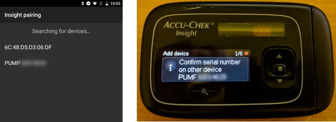
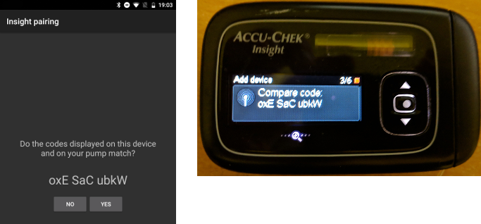
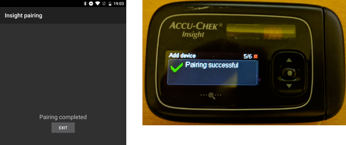
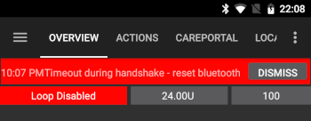

# Accu-Chek Insight

**Diese Software ist Teil einer DIY-Lösung (Do It Yourself = Eigenbau) einer künstlichen Bauchspeicheldrüse und kein kommerzielles Produkt. Daher bist DU gefordert. DU musst lesen, lernen und verstehen, was das System macht und wie du es bedienst. Das System wird Dir nicht alle Schwierigkeiten Deiner Diabetestherapie abnehmen, aber wenn Du willens bist, die nötige Zeit zu investieren, dann kann es die Ergebnisse Deiner Therapie verbessern und die Lebensqualität erhöhen. Überstürze nichts. Nimm dir Zeit zum Lernen. Du bist ganz alleine dafür verantwortlich, was Du mit dem System machst.**

```{admonition} Die Accu-Chek Insight wird eingestellt :class: note

Roche zieht sich aus dem Insulinpumpenmarkt zurück, um sein Diabetes-Portfolio auf das CGM Accu-Chek SmartGuide auszurichten. Roche hat das Verkaufsende sowohl der Accu-Chek Combo als auch der Accu-Chek Insight angekündigt; auch die verbliebene Mikropumpe Accu-Chek Solo wird auslaufen (letzte Lieferungen in Deutschland Ende 2025). Die Umstellung erfolgt nach Regionen, beginnend in Deutschland; weitere europäische Märkte sollen folgen. Die Unterstützung der Insight ist bereits als beendet aufgeführt (siehe [Nicht mehr verkaufte Pumpen](./Future-possible-Pump-Drivers.md)). Wenn Du auf diese Pumpe angewiesen bist, plane rechtzeitig den Umstieg auf eine unterstützte Pumpe.

    <br />```{note}
    Bevor **AAPS** einen eigenen Insight-Treiber hatte, wurde die Insight über die separate App [SightRemote](https://github.com/TebbeUbben/SightRemote) gesteuert. SightRemote wird nicht mehr benötigt und nicht mehr gepflegt: Ist sie aus dieser Zeit noch installiert, deinstalliere sie und nutze stattdessen eine aktuelle Version von **AAPS**.
    

```{contents} Inhaltsverzeichnis :depth: 1 :local: true

    <br />## Funktionen der Pumpe mit AAPS
    
    * Kommuniziert mit **AAPS** über das Bluetooth Deines Smartphones, ohne zusätzliches Kommunikationsgerät.
    * Automatischer Zeitzonenwechsel und Sommer-/Winterzeitumstellung.
    
    ## Hardware- und Softwarevoraussetzungen
    
    * Eine Roche Accu-Chek Insight Pumpe (jede Firmware, alle funktionieren)
    
    Hinweis: AAPS schreibt die Daten immer in das **erste Basalratenprofil der Pumpe**.
    
    * Ein Android-Smartphone mit Android 12 oder neuer (siehe [Smartphones](../Getting-Started/Phones.md))
    * Die AAPS-App ist auf Deinem Smartphone installiert
    
    ## Einrichtung
    
    * Die Insight-Pumpe sollte immer nur mit einem Gerät gleichzeitig verbunden sein. Wenn Du bisher die Insight-Fernbedienung (Messgerät) verwendet hast, musst Du das Messgerät aus der Liste der gekoppelten Geräte Deiner Pumpe entfernen: **Menü** > **Einstellungen** > **Kommunikation** > **Gerät entfernen**.
    
       
    
    * Wähle unter [Konfiguration > Pumpe](#Config-Builder-pump) die Karte **Accu-Chek Insight**. Es kann immer nur eine Pumpe aktiv sein.
    
       
    
       Sobald sie ausgewählt ist, zeigt die Karte **Accu-Chek Insight** zwei Schaltflächen: **Einstellungen** und **Plugin öffnen**:
    
       
    
       **Einstellungen** öffnet die Einstellungen des Accu-Chek-Insight-Treibers (siehe [Einstellungen in AAPS](#Accu-Chek-Insight-Pump-settings-in-aaps)).
    
       **Plugin öffnen** (oder **Bearbeiten → Pumpe**) öffnet den Accu-Chek-Insight-Pumpenbildschirm. Bevor eine Pumpe gekoppelt ist, sieht er so aus:
    
       
    
    (accu-chek-insight-pairing)=
    ### Koppeln
    
    * Tippe auf dem Pumpenbildschirm auf **Insight Kopplung**. Der Kopplungsassistent öffnet sich und sucht nach Bluetooth-Geräten in der Nähe (oberer Teil des Bildes unten).
    * Wähle an der Insight-Pumpe **Menü** > **Einstellungen** > **Kommunikation** > **Gerät hinzufügen**. Die Pumpe zeigt den folgenden Bildschirm (unterer Teil des Bildes unten) mit der Seriennummer der Pumpe.
    
       
    
    * Tippe wieder auf Deinem Smartphone in der Liste der Bluetooth-Geräte auf die Seriennummer der Pumpe. Fragt Android nach einer Bestätigung der Kopplung, tippe auf **Koppeln**.
    
       
    
    * Pumpe und Smartphone zeigen beide einen Code an. Prüfe, ob die Codes auf beiden Geräten gleich sind. Bestätige an der Pumpe und tippe auf dem Smartphone auf **Ja**. (Tippe auf **Nein**, wenn die Codes nicht übereinstimmen.)
    
       
    
    * Das Smartphone zeigt **Kopplung abgeschlossen**. Tippe auf **Verlassen**, um zum Pumpenbildschirm zurückzukehren.
    
       
    
    * Um zu prüfen, ob alles in Ordnung ist, sieh Dir den Pumpenbildschirm an (**Bearbeiten → Pumpe**). Ist die Pumpe gekoppelt, zeigt er Informationen zur Pumpe, etwa **Seriennummer**, **Herstellungsdatum**, **Release-Softwareversion** und **Bluetooth-Adresse**.
    
       
    
       ```{admonition} Älterer Screenshot
       :class: note
       Abgesehen vom oberen Teil des ersten Bildes stammen die Screenshots zur Kopplung oben aus einer früheren **AAPS**-Version und können in **AAPS** 4 anders aussehen.
       ```
    
    * Um die Kopplung zu entfernen, tippe auf dem Pumpenbildschirm auf **Entkoppeln** und bestätige **Kopplungsinformationen zurücksetzen?**. Danach erscheint wieder die Schaltfläche **Insight Kopplung**.
    
    Hinweis: Zwischen Pumpe und Smartphone besteht keine dauerhafte Verbindung. **AAPS** verbindet sich nur bei Bedarf (zum Beispiel, um eine temporäre Basalrate zu setzen, einen Bolus abzugeben oder die Pumpenhistorie auszulesen). Sonst wären die Akkus des Smartphones und die Batterie der Pumpe viel zu schnell leer.
    
    (Accu-Chek-Insight-Pump-settings-in-aaps)=
    ## Einstellungen in AAPS
    
    Öffne die Einstellungen über **Einstellungen** auf der Karte **Accu-Chek Insight** unter **Konfiguration** > **Pumpe** oder über das Zahnrad-Symbol oben rechts auf dem Pumpenbildschirm.
    
    
    
    In den Insight-Einstellungen in **AAPS** kannst Du folgende Optionen aktivieren:
    
    * **Reservoirwechsel aufzeichnen**: Erfasst automatisch einen Ampullenwechsel, wenn Du die Ampulle in der Pumpe wechselst.
    
    * **Schlauchwechsel protokollieren**: Fügt der **AAPS**-Datenbank eine Notiz hinzu, wenn Du an der Pumpe das Programm „Schlauch füllen“ ausführst.
    
    * **Katheterwechsel protokollieren**: Fügt der **AAPS**-Datenbank eine Notiz hinzu, wenn Du an der Pumpe das Programm „Kanüle füllen“ ausführst. **Hinweis: Ein Katheterwechsel setzt auch Autosens zurück.**
    
    * **Batteriewechsel protokollieren**: Erfasst einen Batteriewechsel, wenn Du eine neue Batterie in die Pumpe einsetzt.
    
    * **Wechsel des Betriebsmodus protokollieren**: Fügt der **AAPS**-Datenbank eine Notiz hinzu, wenn Du die Pumpe startest, stoppst oder pausierst.
    
    * **Alarme protokollieren**: Fügt der **AAPS**-Datenbank eine Notiz hinzu, wenn die Pumpe einen Alarm ausgibt (ausgenommen Erinnerungen sowie Bolus- und TBR-Abbrüche, die nicht erfasst werden).
    
    * **TBR-Emulation aktivieren**: Die Insight-Pumpe kann temporäre Basalraten (TBR) nur bis 250 % setzen. Um diese Grenze zu umgehen, weist die TBR-Emulation die Pumpe an, für das zusätzliche Insulin einen verzögerten Bolus abzugeben, wenn eine TBR über 250 % angefordert wird.
    
      **Hinweis: Verwende immer nur einen verzögerten Bolus gleichzeitig. Mehrere gleichzeitige verzögerte Boli können zu Fehlern führen.**
    
    * **Vibrationen bei manueller Bolus-Abgabe deaktivieren**: Die Insight-Pumpe vibriert nicht mehr, wenn sie einen manuellen Bolus (oder verzögerten Bolus) abgibt. Nur mit Insight-Firmware 3.x verfügbar.
    
    * **Vibrationen bei automatischer Bolus-Abgabe deaktivieren**: Die Insight-Pumpe vibriert nicht mehr, wenn sie einen automatischen Bolus abgibt (SMB oder temporäre Basalrate mit TBR-Emulation). Nur mit Insight-Firmware 3.x verfügbar.
    
    * **Min. Erholungsdauer [s]** und **Max. Erholungsdauer [s]**: Wie lange **AAPS** nach einem fehlgeschlagenen Verbindungsversuch wartet, bevor es erneut versucht. Du kannst Werte zwischen 0 und 20 Sekunden auswählen. Hast Du Verbindungsprobleme, wähle eine längere Wartezeit.
        <br><br>Beispiel für min. Erholungsdauer = 5 und max. Erholungsdauer = 20
        <br><br>keine Verbindung -> warte <b>5</b> Sek.
          <br>  neuer Versuch -> keine Verbindung -> warte <b>6</b> Sek.
          <br>  neuer Versuch -> keine Verbindung -> warte <b>7</b> Sek.
          <br>  neuer Versuch -> keine Verbindung -> warte <b>8</b> Sek.
          <br>...
          <br>neuer Versuch -> keine Verbindung -> warte <b>20</b> Sek.
          <br>neuer Versuch -> keine Verbindung -> warte <b>20</b> Sek.
          <br>...
    
    * **Verbindungsabbau-Verzögerung [s]**: Wie lange (in Sekunden) **AAPS** nach Abschluss einer Aktion wartet, bevor es die Verbindung zur Pumpe trennt. Du kannst Werte zwischen 0 und 15 Sekunden auswählen. Der Standardwert ist 5 Sekunden.
    
    Für Zeiträume, in denen die Pumpe gestoppt war, erfasst **AAPS** eine temporäre Basalrate von 0 %.
    
    ### Der Pumpenbildschirm
    
    Der Accu-Chek-Insight-Pumpenbildschirm (**Bearbeiten → Pumpe**) zeigt den aktuellen Status der Pumpe, zum Beispiel **Status**, **Zuletzt verbunden**, **Betriebsmodus**, **Batterie**, **Reservoirstand**, die heutigen Tagesgesamtdosen (**TDD Bolus**, **TDD Basal**), Basalraten und den letzten Bolus. Ist die Pumpe gekoppelt, gibt es diese Schaltflächen:
    
    * **Aktualisieren**: Aktualisiert den Pumpenstatus.
    * **TBR-Ende-Benachrichtigung aktivieren (Pumpeneinstellung)** / **TBR-Ende-Benachrichtigung deaktivieren (Pumpeneinstellung)**: Eine Insight-Pumpe gibt standardmäßig einen Alarm aus, wenn eine TBR endet. Mit dieser Schaltfläche schaltest Du diesen Alarm ein oder aus, ohne dafür eine Konfigurationssoftware zu brauchen.
    * **Entkoppeln**: Entfernt die Kopplung mit der Pumpe (siehe [Koppeln](#accu-chek-insight-pairing)).
    
    
    
    ```{admonition} Älterer Screenshot
    :class: note
    Der Screenshot oben stammt aus einer früheren **AAPS**-Version. In **AAPS** 4 sieht der Pumpenbildschirm anders aus und hat zusätzlich eine Schaltfläche **Entkoppeln**.
    

## Einstellungen in der Pumpe

Stelle die Alarme in der Pumpe wie folgt ein:

* Menü > Einstellungen > Pumpeneinstellungen > Moduseinstellungen > Leise > Signalart > Tonsignal
* Menü > Einstellungen > Pumpeneinstellungen > Moduseinstellungen > Leise > Lautstärke > 0 (alle Balken entfernen)
* Menü > Modi > Signal-Modus > Stille

Damit werden Pumpenalarme stumm geschaltet, sodass AAPS entscheiden kann, ob ein Alarm für Dich relevant ist. Wenn AAPS einen Alarm nicht bestätigt, wird dessen Lautstärke ansteigen (zuerst einem Piepton, dann mit Vibration).

(Accu-Chek-Insight-Pump-vibration)=

### Vibration

Abhängig von der Version der Pumpen-Firmware kann die Insight bei Bolusabgabe (z. B. Abgabe SMB oder TBR-Anpassungen mit verlängertem Bolus) jedes Mal kurz vibrieren.

* Firmware 1.x: Grundsätzlich keine Vibration
* Firmware 2.x: Vibration kann nicht deaktiviert werden.
* Firmware 3.x: AAPS Bolusabgabe ohne Vibration.

Die Firmware-Version kann im Menü der Pumpe nachgesehen werden.

## Batteriewechsel

Die Batterielaufzeit der Insight beim Loopen liegt zwischen 10 und 14 Tagen, maximal 20 Tage. Diese Angaben wurden mit Energizer Lithium Batterien ermittelt.

Die Innenpumpe hat eine kleine interne Batterie, um wichtige Funktionen wie die Uhr am Laufen zu halten, während Du die herausnehmbare Batterie wechselst. Wenn der Batteriewechsel zu lange dauert, kann diese interne Batterie leer werden, die Uhr wird zurückgesetzt und Du wirst gebeten, Zeit und Datum nach dem Einlegen der neuen Batterie neu einzugeben. In diesem Fall werden alle Einträge in AAPS, die vor dem Batteriewechsel liegen, nicht mehr in die Berechnungen aufgenommen, da die richtige Zeit nicht korrekt erkannt werden kann.

(Accu-Chek-Insight-Pump-insight-specific-errors)=

## Insight spezifische Fehler

### Verzögerter Bolus

Bitte verwende nicht mehrere verzögerte Boli gleichzeitig, da dies zu Fehlern führen kann.

### Timeout

Manchmal antwortet die Insight-Pumpe nicht, während **AAPS** die Verbindung aufbaut. **AAPS** zeigt dann die Benachrichtigung „Zeitüberschreitung während des Handshakes - Bluetooth zurücksetzen“.



Schalte in diesem Fall Bluetooth an der Pumpe UND am Smartphone für etwa 10 Sekunden aus und dann wieder ein.

## Mit der Insight Pumpe über Zeitzonen hinweg reisen

Für allgemeine Informationen zum Reisen über Zeitzonen hinweg siehe [Mit der Pumpe über Zeitzonen hinweg reisen](#timezone-traveling-insight).

## Wo ich Hilfe bekomme

Der Insight-Treiber wird von der Community **ehrenamtlich** entwickelt. Bevor Du um Hilfe bittest, bitte:

1. **Lies** den entsprechenden Abschnitt dieser Dokumentation, um zu prüfen, wie die Funktion gedacht ist.
2. **Frag** im Kanal *#AAPS* auf [Discord](https://discord.gg/4fQUWHZ4Mw) oder in einem der anderen [Community-Kanäle](../GettingHelp/WhereCanIGetHelp.md) nach.
3. **Melde einen Fehler**, indem Du die [bestehenden Issues](https://github.com/nightscout/AndroidAPS/issues) durchsuchst; ist Deiner nicht dabei, eröffne ein [neues Issue](https://github.com/nightscout/AndroidAPS/issues) und hänge Deine [Logdateien](../GettingHelp/AccessingLogFiles.md) an.

Gib bei der Bitte um Hilfe Hersteller und Modell Deines Smartphones, die Android-Version, die **AAPS**-Version und eine verständliche Beschreibung des Problems an (was sich geändert hat, wann es zuletzt funktioniert hat).