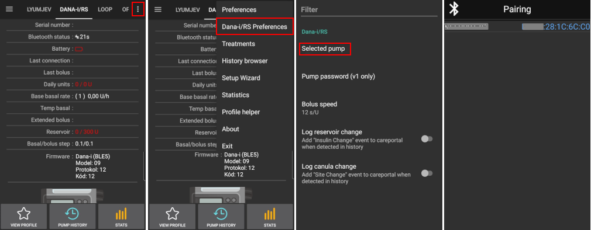
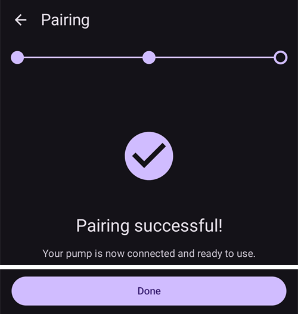
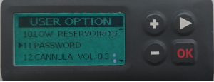

# DanaRS, Dana-i und Dana-i2

*Diese Anleitung beschreibt die Einrichtung der App und Deiner Pumpe, wenn Du eine DanaRS (ab 2017), eine Dana-i oder eine Dana-i2 verwendest. Für eine Original DanaR, lies bitte die Informationen zur [DanaR Insulinpumpe](./DanaR-Insulin-Pump.md).*

**Die Dana-i2 kann ab AAPS-Version 4.0 verwendet werden.** Sie nutzt denselben **Dana-i/RS**-Treiber wie die Dana-i.

* Bei der DanaRS/i/i2 verwendet die App das Basalprofil „BASAL A“. Vorhandene Daten darin werden überschrieben.

    {contents} Inhaltsverzeichnis
    :depth: 1
    :local: true

## Funktionalitäten bei der Nutzung mit AAPS

* Kommuniziert mit **AAPS** über das Bluetooth Deines Smartphones, ohne zusätzliches Kommunikationsgerät.
* Sommerzeit- und Zeitzonenwechsel müssen manuell erledigt werden (siehe [Reisen über Zeitzonen](#timezone-traveling-danarv2-danars)).

(DanaRS-Insulin-Pump-pairing-pump)=

## Pumpe verbinden

* Öffne oben links auf dem **AAPS**-Startbildschirm das **Menü** (☰) und wähle **Konfiguration**.
* Tippe auf **Pumpe** und wähle **Dana-i/RS**.
    
    
    
    Sobald sie ausgewählt ist, zeigt die Karte **Dana-i/RS** zwei Schaltflächen: **Einstellungen** und **Plugin öffnen**:
    
    
    
    **Einstellungen** öffnet die Einstellungen des Dana-i/RS-Treibers:
    
    
    
    **Plugin öffnen** (oder **Verwalten** > **Pumpe**) öffnet den Dana-i/RS-Pumpenbildschirm. Bevor eine Pumpe gekoppelt ist, sieht er so aus:
    
    

* Tippe auf dem Pumpenbildschirm auf **Koppeln**. **AAPS** sucht nach Pumpen in der Nähe.

* Tippe in der Liste auf den Eintrag Deiner Pumpe.
    
    

* **Du musst die Kopplung an der Pumpe bestätigen!** Das funktioniert genauso wie andere Bluetooth-Kopplungen, die Du vielleicht kennst (zum Beispiel Smartphone und Autoradio).
    
    

* Der Kopplungsprozess unterscheidet sich abhängig vom Pumpentyp und Firmware:
    
    * Bei der DanaRS v1 fragt **AAPS** nach dem **Pumpen-Passwort (nur v1)**. Gib das Passwort Deiner Pumpe ein (siehe [Standardpasswort](#DanaRS-Insulin-Pump-default-password)).
    * Bei der DanaRS v3 fordert **AAPS** Dich auf, an der Pumpe OK zu drücken und die beiden Zahlen- und Buchstabenfolgen einzugeben, die auf der Pumpe angezeigt werden. Halte das Pumpendisplay eingeschaltet, indem Du die Minus-Taste drückst, bis Du fertig bist. Tippe dann auf **Fertig**.
    * Bei der Dana-i und Dana-i2 erscheint der normale Android-Kopplungsdialog. Gib die 6-stellige Zahl ein, die auf der Pumpe angezeigt wird.

* Wenn **Verbindung erfolgreich!** angezeigt wird, tippe auf **Fertig**.
    
    
    
    Du bist wieder auf dem Pumpenbildschirm, der jetzt den Status Deiner Pumpe anzeigt.
    
    

* Wähle in den **Einstellungen** die Option **Bolusgeschwindigkeit**, um die Standard-Bolusgeschwindigkeit zu ändern (12 s/IE, 30 s/IE oder 60 s/IE).

* Stelle im Arztmenü auf der Pumpe (siehe Bedienungsanleitung der DanaRS) die BASALschritte auf 0,01 IE/h.
* Stelle im Arztmenü der Pumpe (siehe Bedienungsanleitung der Pumpe) die Bolusschritte auf 0,05 IE. **AAPS** liest die Basal- und Bolusschritte aus der Pumpe aus und verwendet sie für jeden Bolus, sodass ein Bolus immer zur an der Pumpe eingestellten Schrittgröße passt. Der Pumpenbildschirm zeigt sie in der Zeile **Basal/Bolus Schrittgröße**.
* Aktiviere verzögerten Bolus in der Pumpe.

### Optionen, die nur bei manchen Modellen angezeigt werden

* **Automatische Sperre**: Bei einer Dana-i2 gibt es im Bildschirm **Benutzerdefinierte Einstellungen** (auf dem Pumpenbildschirm, **Verwalten** > **Pumpe**) einen Schalter **Automatische Sperre** für die automatische Sperre der Pumpe. Tippe nach der Änderung auf **In Pumpe speichern**.
* **Einfacher Modus**: Bei Pumpenmodellen mit einem einfachen Menümodus zeigt der Pumpenbildschirm eine Zeile **Einfacher Modus** mit **An** oder **Aus**.
* Lehnt eine Dana-i2 einen Bolus ab, zeigt **AAPS** den Grund an, zum Beispiel *Pumpe ist nicht befüllt*, *Nicht genug Insulin im Reservoir* oder *Der einfache Ruhemodus ist auf der Pumpe aktiviert*.

(DanaRS-Insulin-Pump-default-password)=

### Standard-Passwort

* Für die DanaRS mit Firmware v1 und v2 ist das Standard-Passwort 1234.
* Das Standard-Password einer DanaRS (mit Firmware v3) oder eine Dana-i leitet sich vom Produktionsdatum der Pumpe ab. Das Password muss im Format MMTT eingegeben werden, wobei MM der Produktionsmonat ist und TT der Produktionstag (Beispiel: '0124' steht für das Produktionsdatum 24. Januar).
    
    * Wähle PRÜFEN aus dem Hauptmenü aus und drücke dann OK. Wähle nun GERÄTE INFO aus und bestätige mit OK.
    * Nummer 3 ist das Produktionsdatum. 
    * Bei DanaRS v3 und Dana-i wird dieses Passwort nur verwendet, um die Tasten der Pumpe zu sperren. Es wird nicht zur Kommunikation verwendet wird und muss auch nicht in AAPS eingegeben werden.

(DanaRS-Insulin-Pump-change-password-on-pump)=

## Passwort auf Pumpe ändern

* Auf der Pumpe Taste OK drücken.
* Im Hauptmenü "EINSTELLUNGEN" wählen. (Dazu nach rechts scrollen indem Du mehrfach den Pfeiltaste drückst.)
    
    

* Wähle im Untermenü "ANWENDER MENÜ".
    
    

* Scrolle mit der Pfeiltaste nach unten zu "11. Passwort".
    
    

* Drücke OK, um das bisherige Passwort einzugeben.

* Gib das **bisherige Passwort** (Standard-Passwort siehe [oben](#DanaRS-Insulin-Pump-default-password)) ein und drücke OK
    
    

* Wenn hier das falsche Passwort eingegeben wird, gibt es keine Fehlermeldung!

* Lege ein **neues Passwort** fest (Ändere die Ziffern mit den + & - Buttons / gehe mit dem Pfeil-Button nach rechts).
    
    

* Bestätige mit der OK-Taste.

* Bestätige erneut mit OK, um die Änderungen zu speichern.
    
    

* Scrolle nach unten zu "14. EXIT" und drücke die OK-Taste.
    
    

(DanaRS-Insulin-Pump-dana-rs-specific-errors)=

## Dana RS spezifische Fehler

### Fehler bei der Insulinabgabe

Falls die Verbindung zwischen AAPS und der Dana RS während der Insulinabgabe abbricht (z.B. weil du dich vom Smartphone entfernst, während die Dana RS Insulin abgibt) wird die folgende Meldung angezeigt und ein Alarmton abgegeben.

* In den meisten Fällen handelt es sich nur um ein Kommunikationsproblem und es wurde tatsächlich die korrekte Insulinmenge abgegeben.
* Prüfe im Pumpenverlauf, ob der richtige Bolus abgegeben wurde. Das geht an der Pumpe selbst oder in **AAPS** auf dem Pumpenbildschirm (**Verwalten** > **Pumpe**) > **Pumpen-Historie** > **Boli**.
* Lösche den Fehlereintrag in den [Behandlungen](#screens-bolus-carbs), wenn Du möchtest.
* Die tatsächlich abgegebene Menge wird bei der nächsten Verbindung ausgelesen und gespeichert. Um das zu erzwingen, tippe auf dem Pumpenbildschirm auf **Aktualisieren** oder warte einfach auf die nächste Verbindung.

## Wichtiger Hinweis beim Wechsel des Smartphones

Falls Du das Smartphone wechselst, sind die folgenden Schritte erforderlich:

* [Exportiere die Einstellungen](../Maintenance/ExportImportSettings.md) auf Deinem alten Smartphone
* Übertrage die Einstellungen vom alten auf das neue Smartphone.

### DanaRS v1

* Verbinde die Dana RS **manuell** mit dem neuen Smartphone.
* Hakst Du beim Import **Pumpeneinstellungen auch ersetzen** an, werden auch die Verbindungseinstellungen der Pumpe importiert: AAPS auf Deinem neuen Smartphone „kennt“ die Pumpe dann schon und startet deshalb keine Bluetooth-Suche. Daher müssen das neue Smartphone und die Pumpe manuell verbunden werden.
* Installiere AAPS auf dem neuen Smartphone.
* [Importiere die Einstellungen](../Maintenance/ExportImportSettings.md) auf Deinem neuen Smartphone

### DanaRS v3, Dana-i, Dana-i2

* Starte den Kopplungsprozess wie [oben](#DanaRS-Insulin-Pump-pairing-pump) beschrieben.
* Manchmal musst Du zuerst die Kopplungsinformationen in **AAPS** löschen. Tippe auf dem Pumpenbildschirm (**Verwalten** > **Pumpe**) auf **Kopplung aufheben** und bestätige **Kopplungsinformationen zurücksetzen?**. Tippe dann erneut auf **Koppeln**.

## Reisen über Zeitzonen mit DanaRS, Dana-i und Dana-i2

Für allgemeine Informationen zum Reisen über Zeitzonen hinweg siehe [Mit der Pumpe über Zeitzonen hinweg reisen](#timezone-traveling-danarv2-danars).

## Wo ich Hilfe bekomme

Der Treiber für DanaRS/Dana-i/Dana-i2 wird von der Community **ehrenamtlich** entwickelt. Bevor Du um Hilfe bittest, bitte:

1. **Lies** den entsprechenden Abschnitt dieser Dokumentation, um zu prüfen, wie die Funktion gedacht ist.
2. **Frag** im Kanal *#AAPS* auf [Discord](https://discord.gg/4fQUWHZ4Mw) oder in einem der anderen [Community-Kanäle](../GettingHelp/WhereCanIGetHelp.md) nach.
3. **Melde einen Fehler**, indem Du die [bestehenden Issues](https://github.com/nightscout/AndroidAPS/issues) durchsuchst; ist Deiner nicht dabei, eröffne ein [neues Issue](https://github.com/nightscout/AndroidAPS/issues) und hänge Deine [Logdateien](../GettingHelp/AccessingLogFiles.md) an.

Gib bei der Bitte um Hilfe Hersteller und Modell Deines Smartphones, die Android-Version, die **AAPS**-Version und eine verständliche Beschreibung des Problems an (was sich geändert hat, wann es zuletzt funktioniert hat).