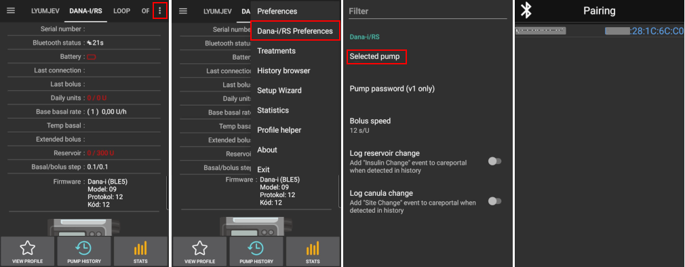

# DanaRS, Dana-i and Dana-i2

*These instructions are for configuring the app and your pump if you have a DanaRS from 2017 onwards, a Dana-i or a Dana-i2. Für eine Original DanaR, lies bitte die Informationen zur [DanaR Insulinpumpe](./DanaR-Insulin-Pump.md).*

**Dana-i2 can be used from AAPS version 4.0 onwards.** It uses the same **Dana-i/RS** driver as the Dana-i.

* In DanaRS/i/i2 pump "BASAL A" is used by the app. Existing data gets overwritten.

    {contents} Table of contents
    :depth: 1
    :local: true

## Funktionalitäten bei der Nutzung mit AAPS

* Communicates with **AAPS** over your phone's native Bluetooth, without an additional communication device.
* DST and timezone changes must be handled manually (see [Timezone traveling](#timezone-traveling-danarv2-danars)).

(DanaRS-Insulin-Pump-pairing-pump)=

## Pumpe verbinden

* Open the **menu** (☰) in the top-left corner of the **AAPS** main screen and select **Configuration**.
* Tap **Pump** and select **Dana-i/RS**.
    
    
    
    Once it is selected, the **Dana-i/RS** card shows two buttons, **Settings** and **Open plugin**:
    
    
    
    **Settings** opens the settings of the Dana-i/RS driver:
    
    
    
    **Open plugin** (or **Manage** > **Pump**) opens the Dana-i/RS pump screen. Before a pump is paired it looks like this:
    
    

* On the pump screen, tap **Pairing**. **AAPS** scans for nearby pumps.

* Tap the entry for your pump in the list.
    
    

* **You have to confirm the pairing on the pump!** This works the same way as other Bluetooth pairings you may know (for example, smartphone and car audio).
    
    

* Der Kopplungsprozess unterscheidet sich abhängig vom Pumpentyp und Firmware:
    
    * For DanaRS v1, **AAPS** asks for the **Pump password (v1 only)**. Enter your pump password (see [Default password](#DanaRS-Insulin-Pump-default-password)).
    * For DanaRS v3, **AAPS** asks you to press OK on the pump and type the 2 sequences of numbers and letters shown on the pump. Keep the pump display on by pressing the minus button until you have finished. Then tap **Done**.
    * For Dana-i and Dana-i2, the standard Android pairing dialog appears. Enter the 6-digit number shown on the pump.

* When **Pairing successful!** is shown, tap **Done**.
    
    
    
    You are back on the pump screen, which now shows your pump's status.
    
    

* In **Settings**, select **Bolus speed** to change the default bolus speed (12 s/U, 30 s/U or 60 s/U).

* Stelle im Arztmenü auf der Pumpe (siehe Bedienungsanleitung der DanaRS) die BASALschritte auf 0,01 IE/h.
* Set bolus step on pump to 0.05 U using Doctors menu (see pump user guide). **AAPS** reads the basal and bolus steps from the pump and uses them for every bolus, so a bolus always matches the step set on the pump. The pump screen shows them in the **Basal/Bolus step** row.
* Aktiviere verzögerten Bolus in der Pumpe.

### Options shown only for some models

* **Auto lock**: on a Dana-i2, the **User options** screen (on the pump screen, **Manage** > **Pump**) has an **Auto lock** switch for the pump's auto lock setting. Press **Save options to pump** after changing it.
* **Easy mode**: on pump models that have an easy menu mode, the pump screen shows an **Easy mode** row with **On** or **Off**.
* If a Dana-i2 refuses a bolus, **AAPS** shows the reason, for example *Pump is not primed*, *Not enough insulin in the reservoir* or *Easy sleep mode is on in the pump*.

(DanaRS-Insulin-Pump-default-password)=

### Standard-Passwort

* Für die DanaRS mit Firmware v1 und v2 ist das Standard-Passwort 1234.
* Das Standard-Password einer DanaRS (mit Firmware v3) oder eine Dana-i leitet sich vom Produktionsdatum der Pumpe ab. Das Password muss im Format MMTT eingegeben werden, wobei MM der Produktionsmonat ist und TT der Produktionstag (Beispiel: '0124' steht für das Produktionsdatum 24. Januar).
    
    * Wähle PRÜFEN aus dem Hauptmenü aus und drücke dann OK. Wähle nun GERÄTE INFO aus und bestätige mit OK.
    * Nummer 3 ist das Produktionsdatum. 
    * Bei DanaRS v3 und Dana-i wird dieses Passwort nur verwendet, um die Tasten der Pumpe zu sperren. Es wird nicht zur Kommunikation verwendet wird und muss auch nicht in AAPS eingegeben werden.

(DanaRS-Insulin-Pump-change-password-on-pump)=

## Passwort auf Pumpe ändern

* Auf der Pumpe Taste OK drücken.
* Im Hauptmenü "EINSTELLUNGEN" wählen. (Dazu nach rechts scrollen indem Du mehrfach den Pfeiltaste drückst.)
    
    

* Wähle im Untermenü "ANWENDER MENÜ".
    
    

* Scrolle mit der Pfeiltaste nach unten zu "11. Passwort".
    
    

* Drücke OK, um das bisherige Passwort einzugeben.

* Gib das **bisherige Passwort** (Standard-Passwort siehe [oben](#DanaRS-Insulin-Pump-default-password)) ein und drücke OK
    
    

* Wenn hier das falsche Passwort eingegeben wird, gibt es keine Fehlermeldung!

* Lege ein **neues Passwort** fest (Ändere die Ziffern mit den + & - Buttons / gehe mit dem Pfeil-Button nach rechts).
    
    

* Bestätige mit der OK-Taste.

* Bestätige erneut mit OK, um die Änderungen zu speichern.
    
    

* Scrolle nach unten zu "14. EXIT" und drücke die OK-Taste.
    
    

(DanaRS-Insulin-Pump-dana-rs-specific-errors)=

## Dana RS spezifische Fehler

### Fehler bei der Insulinabgabe

Falls die Verbindung zwischen AAPS und der Dana RS während der Insulinabgabe abbricht (z.B. weil du dich vom Smartphone entfernst, während die Dana RS Insulin abgibt) wird die folgende Meldung angezeigt und ein Alarmton abgegeben.

* In den meisten Fällen handelt es sich nur um ein Kommunikationsproblem und es wurde tatsächlich die korrekte Insulinmenge abgegeben.
* Check in the pump history that the correct bolus was given. You can do this on the pump itself, or in **AAPS** on the pump screen (**Manage** > **Pump**) > **Pump history** > **Boluses**.
* Delete the error entry in [treatments](#screens-bolus-carbs) if you wish.
* The real amount is read and recorded at the next connection. To force this, tap **Refresh** on the pump screen, or just wait for the next connection.

## Wichtiger Hinweis beim Wechsel des Smartphones

Falls Du das Smartphone wechselst, sind die folgenden Schritte erforderlich:

* [Exportiere die Einstellungen](../Maintenance/ExportImportSettings.md) auf Deinem alten Smartphone
* Übertrage die Einstellungen vom alten auf das neue Smartphone.

### DanaRS v1

* Verbinde die Dana RS **manuell** mit dem neuen Smartphone.
* If you tick **Also replace pump settings** when importing, the pump connection settings are imported too and AAPS on your new phone will already "know" the pump and therefore not start a Bluetooth scan. Daher müssen das neue Smartphone und die Pumpe manuell verbunden werden.
* Installiere AAPS auf dem neuen Smartphone.
* [Importiere die Einstellungen](../Maintenance/ExportImportSettings.md) auf Deinem neuen Smartphone

### DanaRS v3, Dana-i, Dana-i2

* Starte den Kopplungsprozess wie [oben](#DanaRS-Insulin-Pump-pairing-pump) beschrieben.
* Sometimes you may need to clear the pairing information in **AAPS** first. On the pump screen (**Manage** > **Pump**), tap **Unpair** and confirm **Reset pairing information?**. Then tap **Pairing** again.

## Timezone traveling with DanaRS, Dana-i and Dana-i2 pumps

Für allgemeine Informationen zum Reisen über Zeitzonen hinweg siehe [Mit der Pumpe über Zeitzonen hinweg reisen](#timezone-traveling-danarv2-danars).

## Wo ich Hilfe bekomme

Development of the DanaRS/Dana-i/Dana-i2 driver is done by the community on a **volunteer** basis. Before requesting help, please:

1. **Read** the relevant section of this documentation to confirm how the feature is meant to work.
2. **Ask** on the *#AAPS* channel on [Discord](https://discord.gg/4fQUWHZ4Mw), or in one of the other [community channels](../GettingHelp/WhereCanIGetHelp.md).
3. **Report a bug** by searching the [existing issues](https://github.com/nightscout/AndroidAPS/issues); if yours is not listed, open a [new issue](https://github.com/nightscout/AndroidAPS/issues) and attach your [log files](../GettingHelp/AccessingLogFiles.md).

When asking for help, include your phone make and model, Android version, **AAPS** version, and a plain-English description of the problem (what changed, when it last worked).