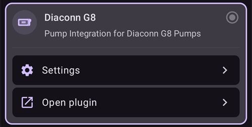
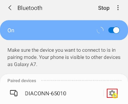
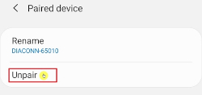

# Diaconn G8

```{contents} Table of contents
:depth: 1
:local: true
```

## Funktionalitäten bei der Nutzung mit AAPS

* Kommuniziert mit **AAPS** über das Bluetooth Deines Smartphones, ohne zusätzliches Kommunikationsgerät.
* Sommerzeit- und Zeitzonenwechsel müssen manuell erledigt werden.

## Bluetooth-Pairing

- Tippe oben links auf das **Menü** (☰).


- Tippe auf **Konfiguration** > **Pumpe** und wähle **Diaconn G8**.


Sobald sie ausgewählt ist, zeigt die Karte **Diaconn G8** zwei Schaltflächen: **Einstellungen** und **Plugin öffnen**:



**Einstellungen** öffnet die Einstellungen des Diaconn-G8-Treibers (siehe unten [Options-Einstellungen für Diaconn G8 Insulinpumpe](#diaconn-g8-insulin-pump-option-setting)).

**Plugin öffnen** (oder **Bearbeiten** > **Pumpe**) öffnet den Diaconn-G8-Pumpenbildschirm. Bevor eine Pumpe gekoppelt ist, sieht er so aus:


```{admonition} Older screenshot
:class: note
Der Screenshot oben stammt aus einer früheren **AAPS**-Version. In **AAPS** 4 startet die Kopplung über die Schaltfläche **Koppeln** auf dem Pumpenbildschirm; eine Einstellung **Ausgewählte Pumpe** gibt es nicht.
```

- Tippe auf dem Pumpenbildschirm auf **Koppeln**. Der Bildschirm **Diaconn Pumpe verbinden** öffnet sich, und **AAPS** sucht nach Pumpen in der Nähe.
- Tippe auf die Modellnummer Deiner Insulinpumpe, sobald sie in der Liste erscheint (zum Beispiel **DIACONN-65010**).


- Es gibt zwei Möglichkeiten, um Deine Modellnummer zu überprüfen:

1. Die letzten 5 Ziffern der Seriennummer auf der Rückseite der Pumpe.
2. Drücke den = Button > Information > BLE > letzte 5 Ziffern.


- Nach Auswahl der Pumpe erscheint ein Fenster, in dem der PIN-Code abgefragt wird. Gib die PIN ein, die auf Deiner Pumpe angezeigt wird, um die Verbindung abzuschließen.

 

- Wenn **Verbindung erfolgreich!** angezeigt wird, tippe auf **OK**, um zum Pumpenbildschirm zurückzukehren.

## Überprüfung des Pumpenstatus und Synchronisierung der Protokolle

- Ist Deine Pumpe verbunden, öffne den Pumpenbildschirm (**Bearbeiten** > **Pumpe**). Er zeigt den Pumpenstatus (Batterie, Reservoir, letzte Verbindung, letzter Bolus, Basalrate und mehr).
- Tippe auf **Aktualisieren**, um Dich mit der Pumpe zu verbinden, den Status zu aktualisieren und die Protokolle zu synchronisieren.
- Tippe auf **Pumpen-Historie**, um die aus der Pumpe gelesene Historie zu sehen.


```{admonition} Older screenshot
:class: note
Der Screenshot oben stammt aus einer früheren **AAPS**-Version. In **AAPS** 4 wird der Pumpenstatus auf dem Pumpenbildschirm (**Bearbeiten** > **Pumpe**) angezeigt und mit der Schaltfläche **Aktualisieren** synchronisiert.
```

(diaconn-g8-bluetooth-troubleshooting)=

## Bluetooth-Fehlerbehebung

**Was ist bei einer instabilen Bluetooth-Verbindung mit der Pumpe zu tun?**

### Methode 1) AAPS neu starten und dann die Pumpe erneut prüfen

- Tippe oben links auf das **Menü** (☰).
- Tippe unten im Menü auf **Schließen**.


- Starte **AAPS** erneut und prüfe die Verbindung zur Pumpe.

### Methode 2) Wenn die erste Methode nicht funktioniert, trenne die Bluetooth-Verbindung und stelle sie dann wieder her.

- Halte die Bluetooth-Taste an der Oberseite etwa 3 Sekunden lang gedrückt.


- Klicke auf den Button 'Einstellungen' auf der gekoppelten Diaconn G8 Insulinpumpe.



- Entkoppeln.



- Öffne in **AAPS** den Pumpenbildschirm (**Bearbeiten** > **Pumpe**), tippe auf **Kopplung aufheben** und bestätige **Kopplungsinformation zurücksetzen?**.
- Wiederhole den Bluetooth-Pairing-Prozess für die Pumpe (siehe oben).

## Weitere Informationen

(diaconn-g8-insulin-pump-option-setting)=

### Options-Einstellungen für Diaconn G8 Insulinpumpe

- **Konfiguration** > **Pumpe** > **Diaconn G8** > **Einstellungen**
- Oder tippe auf dem Pumpenbildschirm (**Bearbeiten** > **Pumpe**) oben rechts auf das Einstellungssymbol (Zahnrad).


- **Bolus-Geschwindigkeit** legt fest, wie schnell die Pumpe einen Bolus abgibt.
- Ist die Option **Reservoirwechsel aufzeichnen** aktiviert, werden die entsprechenden Details automatisch in das Careportal hochgeladen, wenn das Ereignis „Insulinwechsel“ eintritt.
- Ist die Option **Kanülenwechsel protokollieren** aktiviert, werden die entsprechenden Details automatisch in das Careportal hochgeladen, wenn das Ereignis „Kanülenwechsel“ eintritt.
- Ist die Option **Katheterwechsel protokollieren** aktiviert, werden die entsprechenden Details automatisch als Notiz hinzugefügt, wenn das Ereignis „Schlauchwechsel“ eintritt.
- Ist die Option **Batteriewechsel protokollieren** aktiviert, werden die entsprechenden Details automatisch in das Careportal hochgeladen, wenn das Ereignis „Batteriewechsel“ eintritt. Einen Batteriewechsel kannst Du auch selbst über **Bearbeiten** > **Pumpenbatterie-Wechsel** erfassen. (Hinweis: Um die Batterie zu wechseln, stoppe bitte alle laufenden Injektionsvorgänge.)
- **Diaconn Cloud-Sync** sendet die Pumpenprotokolle an die Diaconn Cloud.


```{admonition} Older screenshot
:class: note
Der Screenshot oben stammt aus einer früheren **AAPS**-Version. In **AAPS** 4 wird ein Batteriewechsel über **Bearbeiten** > **Pumpenbatterie-Wechsel** erfasst; einen Reiter **Aktionen** gibt es nicht.
```

### Funktion verzögerter Bolus

- Wenn Du einen verzögerten Bolus verwendest, wird der "Closed Loop"-Modus deaktiviert.
- [Diese Seite](#extended-bolus-and-why-they-wont-work-in-closed-loop-environment) erklärt die Details, warum der Extended-Bolus in einem Closed-Loop-Umfeld nicht funktioniert.

## Wo ich Hilfe bekomme

Der Diaconn-G8-Treiber wird von der Community **ehrenamtlich** entwickelt. Bevor Du um Hilfe bittest, bitte:

1. **Lies** den entsprechenden Abschnitt dieser Dokumentation, um zu prüfen, wie die Funktion gedacht ist.
2. **Frag** im Kanal *#AAPS* auf [Discord](https://discord.gg/4fQUWHZ4Mw) oder in einem der anderen [Community-Kanäle](../GettingHelp/WhereCanIGetHelp.md) nach.
3. **Melde einen Fehler**, indem Du die [bestehenden Issues](https://github.com/nightscout/AndroidAPS/issues) durchsuchst; ist Deiner nicht dabei, eröffne ein [neues Issue](https://github.com/nightscout/AndroidAPS/issues) und hänge Deine [Logdateien](../GettingHelp/AccessingLogFiles.md) an.

Gib bei der Bitte um Hilfe Hersteller und Modell Deines Smartphones, die Android-Version, die **AAPS**-Version und eine verständliche Beschreibung des Problems an (was sich geändert hat, wann es zuletzt funktioniert hat).
