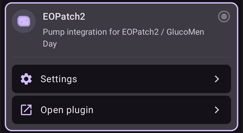
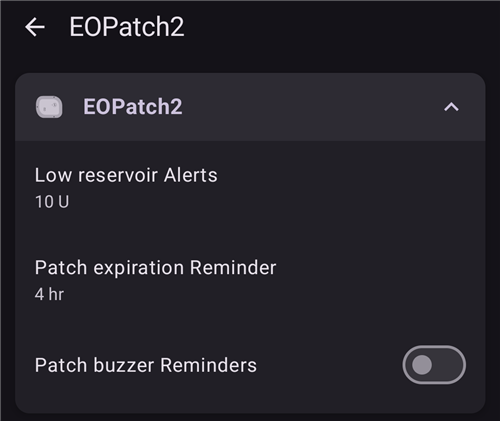
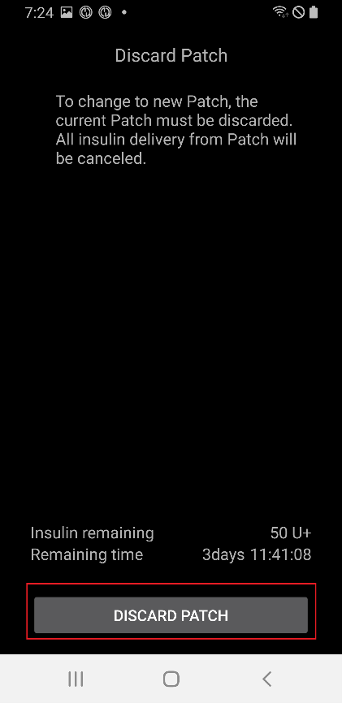
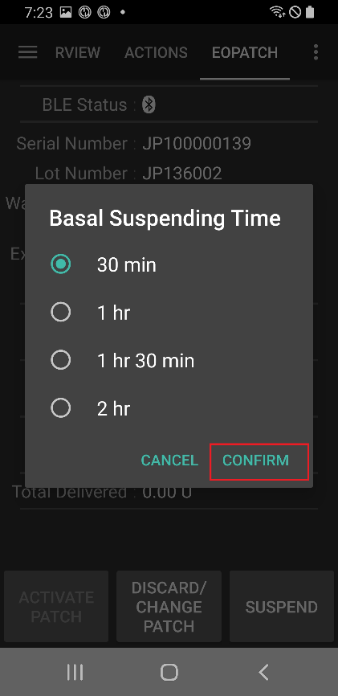

# EOPatch2

Der Patch braucht schnell wirkendes U-100-Insulin wie NovoRapid oder Humalog. Verwende das schnell wirkende Insulin, das Dir Deine Ärztin oder Dein Arzt verordnet hat.

Die kleinste Dosis, die der Patch abgeben kann, ist 0,05 IE. Setze jede Basalrate in Deinem **Profil** auf mindestens 0,05 IE/h, in Schritten von 0,05 IE/h. Andernfalls rundet **AAPS** jede Rate auf die nächsten 0,05 IE/h (nie auf 0 ab) und verwendet die Raten, die der Patch tatsächlich abgibt, sodass die Insulinmenge pro Tag leicht von Deinem **Profil** abweicht. Ebenso müssen Boli mindestens 0,05 IE betragen.

```{contents} Table of contents
:depth: 1
:local: true
```

## Funktionalitäten bei der Nutzung mit AAPS

* Kommuniziert mit **AAPS** über das Bluetooth Deines Smartphones, ohne zusätzliches Kommunikationsgerät.
* Sommerzeit- und Zeitzonenwechsel müssen manuell erledigt werden.

## Pumpen-Einrichtung

1. Öffne oben links auf dem **AAPS**-Startbildschirm das **Menü** (☰) und wähle **Konfiguration**.
1. Wähle im Bereich **Pumpe** die Option **EOPatch2**.
1. Drücke die Zurück-Taste, um zum Startbildschirm zurückzukehren.

 

Sobald sie ausgewählt ist, zeigt die Karte **EOPatch2** zwei Schaltflächen: **Einstellungen** und **Plugin öffnen**:



## Einstellungen

Die EOPatch2-Einstellungen öffnest Du auf zwei Wegen:

* Tippe in der **Konfiguration** auf der Karte **EOPatch2** auf **Einstellungen** oder
* öffne den Pumpenbildschirm (**Bearbeiten** → **Pumpe**) und tippe oben rechts auf das Zahnrad-Symbol.

Es gibt drei Einstellungen:



### Insulin-Reservoir fast leer

Eine Warnung erscheint, wenn die Restmenge Insulin im Patch auf diesen Wert oder darunter sinkt. Einstellbar sind 10 bis 50 IE in Schritten von 5 IE. Standard sind 10 IE.

### Erinnerung an POD-Ablauf

Erinnert Dich daran, wie viel Zeit noch bleibt, bis der aktuelle Patch abläuft. Einstellbar sind 1 bis 24 Stunden in Schritten von 1 Stunde. Standard sind 4 Stunden.

### Patch Ton zur Erinnerung

Ist das eingeschaltet, piept der Patch, wenn ein Bolus, ein verzögerter Bolus oder eine temporäre Basalrate beginnt und endet. Auf Deine normale Basalrate hat das keinen Einfluss. Standardmäßig ausgeschaltet.

## Einen neuen Patch aktivieren

### Aktivierungsassistenten öffnen

Öffne den Pumpenbildschirm über **Bearbeiten** → **Pumpe** (oder tippe in der **Konfiguration** auf der Karte **EOPatch2** auf **Plugin öffnen**). Ist kein Patch aktiv, zeigt der Bildschirm **Nicht aktiviert** und unten die Schaltfläche **Patch aktivieren**.

Tippe auf **Patch aktivieren**, um den Assistenten zu starten.


Der Assistent führt Dich durch jeden Schritt. Die Punktreihe oben zeigt, wie weit Du bist.

```{note}
Hast Du in **AAPS** noch nie ein **Profil** aktiviert, zeigt der Assistent zuerst die Seite **Profil erforderlich**. Wähle das zu verwendende Profil aus und tippe auf **Aktiviere Profil**.
```

### Insulin füllen

Stich die Nadel der Spritze in die Insulin-Einfüllöffnung des Patches. Drücke den Kolben langsam, um den Patch zu füllen. Sobald mehr als 80 IE im Patch sind, piept er einmal und startet (bootet).

Wenn Du den Piepton hörst, tippe auf **Kopplung starten**.


```{warning}
- Drehe den Hebel zur Nadelauslösung erst, wenn der Assistent Dich dazu auffordert. Drehst Du ihn zu früh, kann das beim Füllen oder bei der Sicherheitsprüfung ernste Probleme verursachen.
- Der Patch fasst 80 bis 200 IE. Füllst Du weniger als 80 IE ein, funktioniert der Patch nicht.
- Nimm das Insulin 15 bis 30 Minuten vor dem Füllen aus dem Kühlschrank, damit es Raumtemperatur annimmt. Das Insulin muss mindestens 10 °C warm sein.
```

### Pod koppeln

**AAPS** versucht nun automatisch, sich mit dem Patch zu koppeln. Während der Kopplung erscheinen zwei Android-Anfragen zur Bluetooth-Kopplung. Tippe bei der ersten auf **OK**. Tippe bei der zweiten, die einen Schlüssel (Passkey) zeigt, ebenfalls auf **OK**.

```{warning}
- Halte Patch und Smartphone während der Kopplung höchstens 30 cm voneinander entfernt.
- Nach dem Booten piept der Patch alle 3 Minuten, bis die Kopplung abgeschlossen ist.
- Du musst die Aktivierung innerhalb von 60 Minuten nach dem Booten abschließen. Schaffst Du das nicht, verwirf den Patch.
```

  

```{admonition} Older screenshot
:class: note
Die beiden Screenshots zur Bluetooth-Kopplung stammen aus einer früheren **AAPS**-Version: Der **AAPS**-Bildschirm hinter der Android-Kopplungsanfrage sieht in **AAPS** 4 anders aus.
```

### Insulin auswählen

Wähle das Insulin aus, mit dem Du den Patch gefüllt hast, und tippe auf **Weiter**. **AAPS** führt nach der Aktivierung einen Profilwechsel mit diesem Insulin durch.

### Vorbereitung auf das Anbringen des Patches

Entferne das Klebeband vom Patch und tippe dann auf **Weiter**.

Ragt eine Nadel heraus oder ist der Patch nass, verschmutzt oder sein Klebeband geknickt, tippe stattdessen auf **Verwerfen** und verwende einen neuen Patch.


### Setzstelle

Dieser Schritt erscheint nur, wenn in den Einstellungen zum Wechsel der Setzstellen **Wechsel der Pumpen-Einstichstellen verwalten** eingeschaltet ist. Tippe auf der Körperabbildung auf die Stelle, an der Du den Patch anbringen wirst, und tippe auf **Weiter** oder auf **Überspringen**.

### Den Patch anbringen

Das Insulin sollte in eine Stelle mit Fettgewebe unter der Haut gehen, aber mit wenigen Nerven und Blutgefäßen. Bauch, Arm oder Oberschenkel sind gut geeignet. Reinige und trockne die Stelle und klebe den Patch dann auf die Haut.

Prüfe die Infusionsstelle und tippe dann auf **Sicherheitsprüfung starten**.

```{warning}
- Drücke die Ränder des Patch-Klebebands gleichmäßig an, damit der ganze Patch fest auf der Haut klebt.
- Klebt der Patch nicht vollständig, kann Luft zwischen Patch und Haut gelangen. Das schwächt die Haftung und die Wasserdichtigkeit des Patches.
```


### Sicherheitsprüfung

Die Sicherheitsprüfung dauert etwa 30 Sekunden. Ist sie abgeschlossen, piept der Patch einmal. Schlägt sie fehl, tippe auf **Erneut versuchen**.

```{warning}
Drehe aus Sicherheitsgründen den Hebel zur Nadelauslösung nicht, bevor die Sicherheitsprüfung abgeschlossen ist.
```

 

```{admonition} Older screenshot
:class: note
Die Screenshots von **Bereite dich auf das Anhängen des Patches vor** bis **Sicherheitsprüfung** stammen aus einer früheren **AAPS**-Version und können in **AAPS** 4 anders aussehen.
```

### Einführen der Nadel

Halte den Patch gut fest. Drehe den Hebel zur Nadelauslösung um mehr als 100° nach oben, um die Nadel einzuführen. Ist die Nadel richtig eingeführt, piept der Patch einmal. Drehe den Hebel dann ganz weiter, um ihn abzunehmen. Tippe auf **Weiter**.

```{caution}
Gehst Du zum nächsten Schritt, ohne den Piepton gehört zu haben, erscheint **Fehler beim Einfügen der Nadeln.** Achte auf den Piepton und tippe auf **Erneut versuchen**. Bleibt der Fehler bestehen, tippe auf **Verwerfen**, um den Patch zu deaktivieren.
```

### Pod-Aktivierung abgeschlossen

Die letzte Seite bestätigt, dass der Patch aktiv ist und Dich erinnern wird, wenn er sich seinem Ablaufzeitpunkt nähert. Tippe auf **Abschließen**, um zum Pumpenbildschirm zurückzukehren.

## Den Patch entfernen

Ersetze den Patch, wenn das Insulin knapp wird, wenn er abläuft oder wenn er fehlerhaft ist. Wir empfehlen, jeden Patch nach dem Booten höchstens 84 Stunden zu verwenden.

1. Öffne den Pumpenbildschirm (**Bearbeiten** → **Pumpe**). Tippe bei aktivem Patch auf **Patch verwerfen**.
1. Die Seite **Patch verwerfen** zeigt die verbleibende Zeit und die Restmenge Insulin im Patch. Tippe auf **Patch verwerfen**.
1. Ein Dialog bittet um Bestätigung. Tippe noch einmal auf **Patch verwerfen**.
1. Ist der Patch deaktiviert, zeigt der Assistent **Das Entfernen des Patches ist abgeschlossen.** Entferne den Patch von Deinem Körper und tippe auf **Bestätigen**.

Danach geht der Assistent direkt zur Aktivierung eines neuen Patches über (siehe oben). Tippe auf den Zurück-Pfeil, wenn Du hier aufhören möchtest.

Solange kein Patch aktiv ist, zeigt **AAPS** die Pumpe als unterbrochen an und erfasst eine temporäre Basalrate von 0 IE/h, sodass bis zur Aktivierung des nächsten Patches kein Basalinsulin im IOB berücksichtigt wird.

   

```{admonition} Older screenshot
:class: note
Die Screenshots oben stammen aus einer früheren **AAPS**-Version. In **AAPS** 4 öffnest Du den Pumpenbildschirm über **Bearbeiten** → **Pumpe**, und die Schaltfläche darauf heißt **Patch verwerfen**.
```

```{admonition} If the patch does not respond
:class: warning
Kann **AAPS** den Patch nicht erreichen, zeigt es möglicherweise eine Seite zum manuellen Abschalten des Patch-Alarms: Entferne den Patch von Deinem Körper, ziehe das Klebeband ab und drücke mit einer Büroklammer fest in das Loch neben der Insulin-Einfüllöffnung.

Die Seite **Patch verwerfen** hat außerdem eine Schaltfläche **Zurücksetzen erzwingen**. Sie entfernt den Patch nur aus **AAPS**, ohne einen Befehl an den Patch zu senden. Der Patch gibt weiter Insulin ab, bis seine Batterie leer ist oder Du ihn manuell abschaltest. Nutze sie nur, wenn ein normales Verwerfen fehlschlägt, und entferne den Patch von Deinem Körper.
```

## Insulinabgabe unterbrechen und fortsetzen

Das Unterbrechen der Insulinabgabe bricht auch einen laufenden verzögerten Bolus und eine temporäre Basalrate ab. Beim Fortsetzen werden diese **nicht** neu gestartet. Solange die Insulinabgabe unterbrochen ist, piept der Patch alle 15 Minuten.

### Insulinabgabe unterbrechen

1. Öffne den Pumpenbildschirm (**Bearbeiten** → **Pumpe**) und tippe auf **Pumpe pausieren**.
1. Ein Dialog erklärt, was unterbrochen wird. Tippe auf **Bestätigen**.
1. Wähle im Dialog **Basal Suspendierung Zeit**, wie lange unterbrochen werden soll: 30 min, 1 Std., 1 Std. 30 Min. oder 2 Std. Tippe auf **Bestätigen**.

Die Insulinabgabe wird für die gewählte Zeit unterbrochen.

  

```{admonition} Older screenshot
:class: note
Die Screenshots oben stammen aus einer früheren **AAPS**-Version. In **AAPS** 4 öffnest Du den Pumpenbildschirm über **Bearbeiten** → **Pumpe**, und die Schaltfläche darauf heißt **Pumpe pausieren**.
```

### Insulinabgabe fortsetzen

1. Öffne den Pumpenbildschirm (**Bearbeiten** → **Pumpe**) und tippe auf **Pumpe fortsetzen**.
1. Tippe im Dialog **Insulinabgabe fortsetzen** auf **Bestätigen**.

 

```{admonition} Older screenshot
:class: note
Die Screenshots oben stammen aus einer früheren **AAPS**-Version. In **AAPS** 4 öffnest Du den Pumpenbildschirm über **Bearbeiten** → **Pumpe**, und die Schaltfläche darauf heißt **Pumpe fortsetzen**.
```

```{warning}
Ist die Unterbrechungszeit vorbei, zeigt **AAPS** die Warnung **Ende der Insulinpause**. Die Insulinabgabe startet **nicht** neu, bis Du es bestätigst. Tust Du das nicht, kann es zu einer Hyperglykämie kommen.
```

(eopatch2-alarms-and-warnings)=

## Alarme und Warnungen

### Alarme

Alarme sind für dringende Situationen mit höchster Priorität gedacht und erfordern sofortiges Handeln. **AAPS** gibt einen Alarm aus, der so lange ertönt, bis Du ihn quittierst, und zeigt die Meldung als Benachrichtigung auf dem Bildschirm **Übersicht**. Ein Alarm bedeutet, dass es ein Problem mit dem verwendeten Patch gibt. In vielen Fällen muss der Patch verworfen und durch einen neuen ersetzt werden.

Tippst Du in der Benachrichtigung auf **Bestätigen**, bearbeitet **AAPS** den Alarm. Bei den meisten Alarmen wird dabei der Patch deaktiviert. Beim Alarm **Unangemessene Temperatur** heißt die Schaltfläche **Erneut versuchen**.

 

```{admonition} Older screenshot
:class: note
Die Screenshots der Alarme stammen aus einer früheren **AAPS**-Version und können in **AAPS** 4 anders aussehen.
```

Die einzelnen Alarme sind unten erklärt.

| Alarm                            | Beschreibung                                                                                                                                                               |
| -------------------------------- | -------------------------------------------------------------------------------------------------------------------------------------------------------------------------- |
| Reservoir leer                   | Der Patch hat kein Insulin mehr.                                                                                                                                           |
| Patch abgelaufen                 | Die Nutzungsdauer des Patches ist vorbei, er kann kein Insulin mehr abgeben.                                                                                               |
| Verstopfung                      | Der Insulinweg des Patches scheint blockiert zu sein.                                                                                                                      |
| Selbsttestfehler beim Starten    | Der Patch hat beim Selbsttest nach dem Booten einen unerwarteten Fehler gefunden.                                                                                          |
| Ungeeignete Temperatur           | Der Patch ist beim Aktivieren oder Verwenden außerhalb seiner normalen Betriebstemperatur. Bring den Patch an einen Ort mit geeigneter Temperatur (4,4 bis 37 °C).         |
| Fehler beim Einführen der Nadeln | Die Nadel wurde bei der Aktivierung nicht richtig eingeführt. Prüfe, ob die Nadeleinstichkante des Patches und der Hebel zur Nadelauslösung in einer geraden Linie liegen. |
| Patch-Batteriefehler             | Die interne Batterie des Patches ist fast leer, und der Patch schaltet sich ab.                                                                                            |
| Patch-Aktivierungsfehler         | Der Patch wurde nicht innerhalb von 60 Minuten nach dem Booten vollständig aktiviert.                                                                                      |
| Patch-Fehler                     | Der Patch hat beim Aktivieren oder Verwenden einen unerwarteten Fehler gefunden.                                                                                           |

### Warnungen

Warnungen sind für Situationen mit mittlerer oder niedriger Priorität gedacht. Eine Warnung erscheint als Benachrichtigung auf dem Bildschirm **Übersicht**.


```{admonition} Older screenshot
:class: note
Dieser Screenshot stammt aus einer früheren **AAPS**-Version: In **AAPS** 4 erscheint die Warnung auf dem Startbildschirm, der anders aussieht.
```

Die einzelnen Warnungen sind unten erklärt.

| Warnung                          | Beschreibung                                                                                                                                             |
| -------------------------------- | -------------------------------------------------------------------------------------------------------------------------------------------------------- |
| Ende der Insulinunterbrechung    | Die gewählte Unterbrechungszeit ist vorbei. Tippe in der Benachrichtigung auf **Pumpe fortsetzen**, um die Insulinabgabe wieder zu starten.              |
| Niedriger Reservoirstand         | Die Restmenge Insulin im Patch liegt unter dem Wert, der unter **Niedrige Reservoir-Warnungen** eingestellt ist.                                         |
| Patch-Nutzungsdauer abgelaufen   | Die Nutzungsdauer des Patches ist vorbei.                                                                                                                |
| Patch läuft in Kürze ab          | Der Patch muss in 1 Stunde verworfen werden.                                                                                                             |
| Unvollständige Patch-Aktivierung | Die Patch-Aktivierung wurde nach der Kopplung länger als 3 Minuten unterbrochen. Öffne den Pumpenbildschirm und schließe die Aktivierung des Patches ab. |
| Niedriger Patch-Batteriestand    | Die Batterie des Patches ist schwach.                                                                                                                    |

## Wo ich Hilfe bekomme

Der EOPatch2-Treiber wird von der Community **ehrenamtlich** entwickelt. Bevor Du um Hilfe bittest, bitte:

1. **Lies** den entsprechenden Abschnitt dieser Dokumentation, um zu prüfen, wie die Funktion gedacht ist.
2. **Frag** im Kanal *#AAPS* auf [Discord](https://discord.gg/4fQUWHZ4Mw) oder in einem der anderen [Community-Kanäle](../GettingHelp/WhereCanIGetHelp.md) nach.
3. **Melde einen Fehler**, indem Du die [bestehenden Issues](https://github.com/nightscout/AndroidAPS/issues) durchsuchst; ist Deiner nicht dabei, eröffne ein [neues Issue](https://github.com/nightscout/AndroidAPS/issues) und hänge Deine [Logdateien](../GettingHelp/AccessingLogFiles.md) an.

Gib bei der Bitte um Hilfe Hersteller und Modell Deines Smartphones, die Android-Version, die **AAPS**-Version und eine verständliche Beschreibung des Problems an (was sich geändert hat, wann es zuletzt funktioniert hat).
