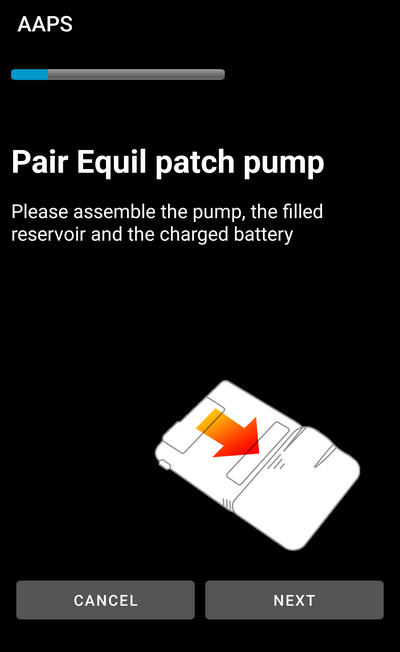
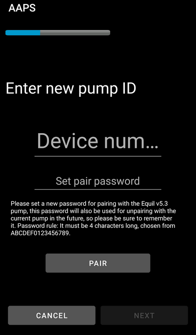

# Equil

Diese Anleitung führt Dich durch die Konfiguration der Equil-Insulinpumpe.

```{contents} Table of contents
:depth: 1
:local: true
```

## Funktionalitäten bei der Nutzung mit AAPS

* Schlauchlose Patch-Pumpe, die mit **AAPS** über das Bluetooth Deines Smartphones kommuniziert, ohne zusätzliches Kommunikationsgerät.
* **AAPS** behandelt die Equil als Patch-Pumpe mit einem 200-IE-Reservoir: Der Startbildschirm zeigt die Statusanzeigen für Patch-Pumpen, und **Nadelwechsel/Füllen** sowie **Pumpenbatterie-Wechsel** werden nicht angeboten. Füllen, Entlüften und Batteriewechsel erledigst Du in den Assistenten der Pumpe.
* Solange die Pumpe angehalten oder gestoppt ist, erfasst **AAPS** eine temporäre Basalrate von 0 IE/h, sodass kein Basalinsulin im IOB berücksichtigt wird.
* Sommerzeit- und Zeitzonenwechsel müssen manuell erledigt werden.

## Hardware- und Softwareanforderungen
* **Kompatible Equil-Hardware**

  Derzeit werden Equil 5.3 und 5.4 unterstützt.

* **AAPS** erstellt und installiert nach der Anleitung [APK erstellen](../SettingUpAaps/BuildingAaps.md)

## Einrichtung

### Equil-Insulinpumpe auswählen

Öffne oben links das **Menü** (☰), wähle **[Konfiguration](#Config-Builder-pump)** und unter **Pumpe** die Option **Equil**.

Sobald sie ausgewählt ist, zeigt die Karte **Equil** zwei Schaltflächen: **Einstellungen** und **Plugin öffnen**:


**Plugin öffnen** (oder **Verwalten** → **Pumpe**) öffnet den Equil-Pumpenbildschirm. Bevor eine Pumpe gekoppelt ist, sieht er so aus:


### Einstellungen

Die Equil-Einstellungen öffnest Du über **Einstellungen** auf der Karte **Equil** oder über das Zahnrad-Symbol oben rechts auf dem Pumpenbildschirm.


* **Alarm bei niedrigem Batteriestand**: Warnt Dich, wenn die Pumpenbatterie schwach ist.
* **Insulin-Reservoir fast leer**: Warnt Dich, wenn das Insulin im Reservoir knapp wird.
* **Warnton**: Wie die Pumpe Dich warnt: **Stummschalten**, **Nur vibrieren**, **Nur Töne** oder **Vibration und Ton**.
* **Bolus-Geschwindigkeit**: Wie schnell ein Bolus abgegeben wird: **1.5 U/min (Standard)**, **3 IE/min**, **6 IE/min** oder **12 IE/min**. Ein schnellerer Bolus kann zu mehr Verschlussalarmen führen.


```{admonition} Max basal and max bolus on the patch
:class: note
Der Patch selbst lehnt jede Basalrate über einem Höchstwert ab, den **AAPS** in ihm einprogrammiert. **AAPS** nimmt den höheren Wert aus Deiner [Einstellung](../SettingUpAaps/Preferences.md) **max. Basalrate** und der höchsten stündlichen Basalrate in Deinem **Profil**, sodass der Patch Dein Profil und die vom Loop angeforderten temporären Basalraten immer annimmt. **AAPS** sendet außerdem Deinen maximal erlaubten Bolus an den Patch.

Änderst Du Deine **max. Basalrate** oder Deinen **max. Bolus**, sendet **AAPS** die neuen Werte automatisch an den Patch. Sie werden auch bei jedem Profilwechsel gesendet. Am Patch selbst musst Du nichts einstellen.
```

### Pumpe koppeln

Tippe auf dem Pumpenbildschirm auf **Koppeln**. Ein Assistent führt Dich durch jeden Schritt. Die Punktreihe oben zeigt, wie weit Du bist.

Fragt Android, ob **AAPS** Geräte in der Nähe finden und sich mit ihnen verbinden darf, tippe auf **Zulassen**. **AAPS** braucht das, um die Pumpe zu finden.


Der Assistent hat diese Schritte. Tippe auf **Weiter**, um fortzufahren, oder auf **Abbrechen**, um den Assistenten zu verlassen.

1. **Profil erforderlich**: Wird nur angezeigt, wenn Du in **AAPS** noch nie ein **Profil** aktiviert hast. Wähle das zu verwendende Profil aus und tippe auf **Aktiviere Profil**.
1. **Pumpe zusammenbauen**: Baue Pumpe, gefülltes Reservoir und geladene Batterie zusammen.

   

1. **Pumpe suchen**: **AAPS** sucht nach Equil-Pumpen in der Nähe. Wähle Deine Pumpe aus der Liste aus.

   
1. **Gerät verbinden**: Du kannst unter **Kopplungspasswort festlegen** ein Kopplungspasswort eingeben. Es muss 4 Zeichen lang sein, gewählt aus `ABCDEF0123456789`. Tippe auf **Koppeln**.

   

1. **Insulin auswählen**: Wird nur angezeigt, wenn Du mehr als ein Insulin eingerichtet hast. Wähle das Insulin im Reservoir aus.
1. **Befüllen/Füllen**: Die Pumpe darf **nicht** auf ihrer Basisplatte sitzen. Tippe auf **Füllen/Befüllen** und entlüfte das Reservoir, bis ein Tropfen Insulin an der Nadelspitze zu sehen ist. Tippe auf **Weiter**.

   
1. **Wechsel der Setzstellen**: Wird nur angezeigt, wenn in den Einstellungen zum Wechsel der Setzstellen **Wechsel der Pumpen-Einstichstellen verwalten** eingeschaltet ist. Tippe auf die Stelle, an der Du die Pumpe anbringen wirst, oder tippe auf **Überspringen**.
1. **Pumpe anbringen**: Setze die Pumpe auf ihre Basisplatte.

   
1. **Kanüle befüllen**: Sitzt die Pumpe auf der Basisplatte, tippe auf **Luft entfernen**, um die Luft aus der Kanüle zu entfernen. Tippe auf **Weiter**.

   

1. **Bestätigen**: Setze die Pumpe auf Deinen Körper und tippe auf **Abschließen**.

   

```{warning}
Hast Du ein eigenes Kopplungspasswort festgelegt (zu Deiner Sicherheit empfohlen), bewahre es an einem sicheren Ort auf. Das Passwort wird in der Pumpe gespeichert. Die Pumpe fragt bei jeder neuen Kopplung danach, bis Du sie in **AAPS** ordnungsgemäß entkoppelst. Bis dahin kann die Pumpe auch nicht mit dem originalen Handgerät (PDA) verwendet werden.
```

### Pumpenbildschirm nach der Kopplung

Ist die Pumpe gekoppelt, zeigt der Pumpenbildschirm diese Schaltflächen:

* **Aktualisieren**: Liest sofort Zustand und Historie der Pumpe aus.
* **Anhalten** / **Abgabe fortsetzen**: Stoppt die Insulinabgabe oder startet sie wieder.
* **Reservoir wechseln**: Führt Dich durch das Abnehmen der Pumpe, das Einsetzen eines neuen Reservoirs (und bei Bedarf einer neuen Batterie), das Entlüften und das erneute Anbringen. Der erste Schritt fragt *Legst Du auch ein neues Infusionsset (Basisplatte und Kanüle) an?*
  * **Ja, neues Infusionsset**: Du wählst die Setzstelle, die Kanüle wird befüllt, und **AAPS** erfasst einen Insulin- und einen Kanülenwechsel.
  * **Nein, nur Reservoir oder Batterie**: Die Kanüle wird nicht befüllt, und **AAPS** erfasst nur einen Insulinwechsel.

  Nach einem Reservoirwechsel zeigt der Batteriestand **-**, bis **AAPS** ihn wieder aus der Pumpe ausliest.

  

* **Verlauf**: Zeigt die von der Pumpe erfassten Ereignisse.
* **Gerät entkoppeln**: Führt Dich durch das Abnehmen der Pumpe und das Entkoppeln von **AAPS**. Dabei wird die Insulinabgabe gestoppt, der Kolben der Pumpe ganz zurückgefahren und die Kopplung gelöscht.

### Alarme

* Der Alarm bei niedrigem Insulinstand ertönt einmal pro Stufe (10 IE, 5 IE und 2 IE) und wenn das Reservoir leer ist. Der Alarm bei niedrigem Batteriestand ertönt einmal bei 10 % und einmal bei 5 %. Jede Stufe alarmiert bis zum nächsten Reservoirwechsel nur einmal.
* Alarme und Stopps der Pumpe werden außerdem als Ankündigungen in den Behandlungen erfasst, mit dem Zeitpunkt, zu dem die Pumpe sie protokolliert hat, sodass Du später sehen kannst, wann und warum die Pumpe gestoppt hat.
* Läuft das Reservoir während eines Bolus leer, erfasst **AAPS** nur das bis dahin abgegebene Insulin und nennt Dir beide Mengen.

## Wo ich Hilfe bekomme

Der Equil-Treiber wird von der Community **ehrenamtlich** entwickelt. Bevor Du um Hilfe bittest, bitte:

1. **Lies** den entsprechenden Abschnitt dieser Dokumentation, um zu prüfen, wie die Funktion gedacht ist.
2. **Frag** im Kanal *#AAPS* auf [Discord](https://discord.gg/4fQUWHZ4Mw) oder in einem der anderen [Community-Kanäle](../GettingHelp/WhereCanIGetHelp.md) nach.
3. **Melde einen Fehler**, indem Du die [bestehenden Issues](https://github.com/nightscout/AndroidAPS/issues) durchsuchst; ist Deiner nicht dabei, eröffne ein [neues Issue](https://github.com/nightscout/AndroidAPS/issues) und hänge Deine [Logdateien](../GettingHelp/AccessingLogFiles.md) an.

Gib bei der Bitte um Hilfe Hersteller und Modell Deines Smartphones, die Android-Version, die **AAPS**-Version und eine verständliche Beschreibung des Problems an (was sich geändert hat, wann es zuletzt funktioniert hat).
