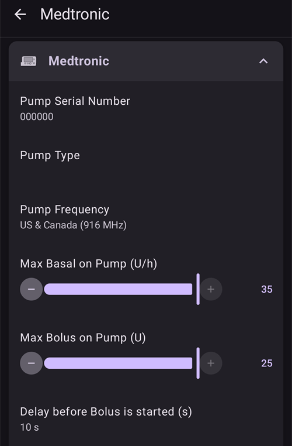
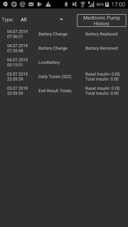
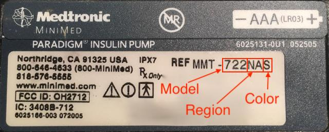

# Medtronic Pumpen

Der Treiber funktioniert nicht mit neueren Modellen, einschließlich aller Modelle mit Endung in G (530G, 600-Serie [630G, 640G, 670G], 700-Serie [770G, 780G], etc.).

Die folgenden Modell- und Firmware-Kombinationen sind kompatibel:

- 512/712 (beliebige Firmware-Version)
- 515/715 (beliebige Firmware-Version)
- 522/722 (beliebige Firmware-Version)
- 523/723 (Firmware 2.4A oder niedriger)
- 554/754 EU Version (Firmware 2.6A oder niedriger)
- 554/754 Kanada Version (Firmware 2.7A oder niedriger)

Hinweise, wie die Firmware der Pumpe ermittelt werden kann, findest Du in den [OpenAPS Docs](https://openaps.readthedocs.io/en/latest/docs/Gear%20Up/pump.html#how-to-check-pump-firmware-check-for-absence-of-pc-connect) und [LoopDocs](https://loopkit.github.io/loopdocs/build/step3/#medtronic-pump-firmware).

    {contents} Inhaltsverzeichnis
    :depth: 1
    :local: true

## Funktionalitäten bei der Nutzung mit AAPS

* Benötigt ein RileyLink-kompatibles Gerät für die Kommunikation mit **AAPS**.
* Automatischer Zeitzonenwechsel und Sommer-/Winterzeitumstellung.

## Hardware- und Softwareanforderungen

- **Telefon:** Der Medtronic-Treiber sollte mit jedem Android-Telefon funktionieren, das Bluetooth-Verbindungen unterstützt. **WICHTIG: Die Bluetooth-Implementierungen der Telefonhersteller können variieren, so dass jedes Telefonmodell variiert. Zum Beispiel werden bei einigen Telefonen Bluetooth anders aktiviert/deaktiviert. Dies kann die Benutzererfahrung (Systemverhalten) beeinflussen, wenn AAPS sich erneut mit dem Rileylink-Gerät verbinden muss.**
- **RileyLink kompatibles Gerät:** Android-Smartphones können ohne ein separates Gerät, dass die Kommunikation steuert, nicht mit Medtronic-Pumpen kommunizieren. Dieses Gerät verbindet sich mit Ihrem Telefon über Bluetooth und mit Ihrer Pumpe über eine kompatible Funkverbindung. Das erste derartige Gerät wurde als Rileylink bezeichnet, aber eine Reihe weiterer Optionen sind jetzt verfügbar, die zusätzliche Funktionalität bieten können.
    
    - Rileylink verfügbar unter [getrileylink.org](https://getrileylink.org/product/rileylink916)
    - Orangelink verfügbar unter [getrileylink.org](https://getrileylink.org/product/orangelink)
    - Emalink (mehrere Model-Optionen) verfügbar unter [github.com](https://github.com/sks01/EmaLink)
    - Gnarl (einige zusätzliche DIY Tätigkeiten erforderlich) Details verfügbar auf [github.com](https://github.com/ecc1/gnarl)

Eine Vergleichstabelle der verschiedenen Rileylink kompatiblen Geräte findest Du unter [getrileylink.org](https://getrileylink.org/rileylink-compatible-hardware-comparison-chart)

(MedtronicPump-configuration-of-the-pump)=

## Pumpen-Einstellungen

Damit AAPS Befehle remote verschicken kann, solltest Du die folgenden Pumpeneinstellungen vornehmen. Die Schritte, die für jede Änderung an einer Medtronic 715 erforderlich sind, werden für jede Einstellung in Klammern angezeigt. Die genauen Schritte können je nach Pumpentyp und/oder Firmware-Version variieren.

- **Aktiviere Remote-Modus an der Pumpe** (Auf der Pumpe Act drücken und gehe zu Utilities -> Remote-Optionen, wähle "On", und auf dem nächsten Bildschirm trage eine zufällige ID wie 111111 ein). Mindestens eine ID muss auf der Liste der Remote-ID stehen, damit die Pumpe eine Fernkommunikation ermöglicht.
- **Lege Max Basal fest** (An der Pumpe ACT drücken und danach Basal und dann Max Basal Rate wählen). Wird dieser Wert zum Beispiel auf das Vierfache Deiner maximalen Standard-Basalrate gesetzt, ist eine temporäre Basalrate von 400 % möglich. Der Maximalwert der Pumpe beträgt 34,9 Einheiten pro Stunde.
- **Setze Max Bolus** (An der Pumpe ACT drücken, dann Bolus und dann Max Bolus wählen). Das ist der größte Bolus, den die Pumpe annimmt. Der Maximalwert der Pumpe beträgt 25.
- **Setze Profil auf Standard**. (Drücke ACT > Basal > Profile wählen: Die Pumpe benötigt nur ein Profil, da AAPS die verschiedenen (anderen) Profile auf Deinem Smartphone verwaltet. Es werden keine weiteren Profile benötigt.
- **Auswählen der Art der temporären Basalrate** (Auf der Pumpe: ACT > Basal > Basal Einstellungen > Art tempor. Basal). Wähle Insulinrate (U/H) - nicht: 'Prozentuale Änderung'.

## Medtronic-Konfiguration des Smartphones/AAPS

- **Koppele RileyLink-kompatible Geräte nicht über das Bluetooth-Menü Deines Smartphones.** AAPS wird das entsprechende Gerät sonst nicht mehr finden können.
- Deaktiviere die "Bildschirm drehen"-Funktion Deines Smartphones. Auf einigen Geräten führt das automatische Drehen des Bildschirms zum Neustart von Bluetooth-Sitzungen. Das kann Verbindungsprobleme mit der Medtronic-Pumpe zur Folge haben. 
- Es gibt zwei Wege die Medtronic-Pumpe in AAPS einzurichten:

1. Den Einrichtungsassistenten im Zuge einer Neuinstallation verwenden
2. Unter **Konfiguration** > **Pumpe** durch Auswahl von **Medtronic**
    
    
    
    Sobald sie ausgewählt ist, zeigt die Karte **Medtronic** zwei Schaltflächen: **Einstellungen** und **Plugin öffnen**:
    
    
    
    **Einstellungen** öffnet die Einstellungen des Medtronic-Treibers:
    
    
    
    **Plugin öffnen** (oder **Bearbeiten** > **Pumpe**) öffnet den Medtronic-Pumpenbildschirm. Bevor eine Pumpe gekoppelt ist, sieht er so aus:
    
    

Falls Du Deine Medtronic-Pumpe mit Hilfe des Einrichtungsassistenten konfigurierst, kann es sein, dass Du die Einrichtung aufgrund von Bluetooth-Problemen nicht abschließen kannst (z.B. Verbindung zur Pumpe nicht möglich). Sollte das so sein, wähle unter KONFIGURATION > Pumpe 'Virtuelle Pumpe' aus und wähle zur Fehlerbehebung den zweiten Weg (s.o.).

Wenn Du AAPS für Deine Medtronic-Pumpe einrichtest, musst Du in den **Einstellungen** folgende Punkte festlegen (siehe Bild der Einstellungen oben):

- **Seriennummer der Pumpe**: Steht auf der Rückseite der Pumpe und beginnt mit 'SN'. Hier sollen nur die sechs Ziffern (keine Buchstaben) eingegeben werden (z.B. 123456).
- **Pumpentyp**: Das genutzte Pumpenmodell (z.B. 522). 
- **Pumpenfrequenz**: In Abhängigkeit davon, wo Deine Pumpe hergestellt wurde, wähle eine der beiden Optionen aus. Wenn Du nicht sicher bist, welche Option Du wählen sollst, sieh in den [FAQ](#MedtronicPump-faq) nach: 
    - für USA & Kanada wird die Frequenz 916 MHz verwendet
    - weltweit („Worldwide“) wird die Frequenz 868 MHz verwendet
- **Max Basal in der Pumpe (IE/h)**: Der Wert muss mit den Einstellungen auf Deiner Pumpe übereinstimmen (vgl. 'Pumpen-Einstellungen' oben). Auch hier gilt: Wähle die Einstellung sorgfältig, da dieser Wert bestimmt, welche Insulinmenge AAPS Dir über die Basalrate geben darf. Damit wird die maximale temporäre Basalrate festgelegt. Zum Beispiel würde die Einstellung dieses Wertes auf das Vierfache Deiner maximalen Standard-Basalrate eine temporäre Basalrate von 400% ermöglichen. Der Maximalwert der Pumpe beträgt 34,9 Einheiten pro Stunde.
- **Max Bolus in der Pumpe (IE)**: Der Wert muss mit den Einstellungen auf Deiner Pumpe übereinstimmen (vgl. 'Pumpen-Einstellungen' oben). Auch diese Einstellung muss sorgfältig überlegt werden, da dieser Wert festlegt wie groß der größte Bolus sein darf, den AAPS abgeben kann.
- **Verzögerung vor dem Start des Bolus (Sek.)**: Zeitspanne (in Sekunden), die vergehen soll, bis der Bolus tatsächlich an die Pumpe gesendet wird. In dieser Zeitspanne kannst Du einen evtl. versehentlich ausgelösten Bolus noch abbrechen. Einen bereits laufenden Bolus kannst Du nicht abbrechen. Die einzige Möglichkeit einen laufenden Bolus zu stoppen, ist die Pumpe zu 'unterbrechen' und sie anschliessend wieder 'fortzusetzen'.
- **Medtronic Codierung**: Legt fest, wo die Medtronic-Codierung durchgeführt wird (Hardware oder Software). Um die übermittelte Datenmenge kleinzuhalten, wird für Pumpen mit Rileylink Setup, empfohlen 'Hardware Codierung' auszuwählen. Die 'Software Codierung' (AAPS nimmt die Verschlüsselung vor) kann eventuell häufige Verbindungsabbrüche beheben. Wenn der Rileylink eine Firmwareversion 0.x haben sollte, wird diese Einstellung nicht genutzt.
- **Batterie-Akkutyp (Power View)**: Um den tatsächlichen Batteriestand bestimmen zu können, sollte angegeben werden welche AAA-Batterien (z.B. Alkaline) verwendet werden. Sollte nicht 'einfache Ansicht' ausgewählt sein, wird AAPS den Batteriestand in Prozent und die Batteriespannung in Volt anzeigen. Die folgenden Optionen sind verfügbar:
    
    - Nicht ausgewählt (Einfache Ansicht)
    - Alkaline Batterie (erweiterte Ansicht)
    - Lithium Batterie (erweiterte Ansicht)
    - Nickel-Zink-Akku (erweiterte Ansicht)
    - Nickel-Zink-Akku (erweiterte Ansicht)
- **Verwende Scannen**: Aktiviert das Bluetooth-Scannen, bevor eine Verbindung mit Deinem RileyLink-kompatiblen Gerät aufgebaut wird. Das sollte die Stabilität der Verbindung zu Deinem Gerät verbessern.

- **Akkustand von OrangeLink/EmaLink/DiaLink anzeigen**: Diese Funktion wird nur von neueren Link-Geräten wie EmaLink oder OrangeLink unterstützt. Der Wert wird auf dem Medtronic-Pumpenbildschirm als **RileyLink-Batterie** angezeigt.
- **Neutrale TBR setzen**: Medtronic-Pumpen piepen bei einer aktiven temporären Basalrate standardmäßig zur vollen Stunde. Bei aktivierter Funktion, wird die TBR vor Ende jeder Stunde abgebrochen und so ein piepen/vibrieren umgangen.

(pairing-your-rileylink-compatible-device)=

### Dein RileyLink-kompatibles Gerät koppeln

Dein RileyLink-kompatibles Gerät wird über den Medtronic-Pumpenbildschirm gekoppelt, nicht über das Bluetooth-Menü Deines Smartphones:

- Öffne den Pumpenbildschirm (**Bearbeiten** > **Pumpe** oder **Plugin öffnen** auf der Karte Medtronic unter **Konfiguration** > **Pumpe**).
- Tippe auf **RileyLink verbinden**. **AAPS** sucht nach RileyLink-kompatiblen Geräten in der Nähe.
- Tippe in der Liste auf Dein Gerät. Wenn **RileyLink erfolgreich verbunden** angezeigt wird, tippe auf **OK**.

## Medtronic-Pumpenbildschirm

Den Medtronic-Pumpenbildschirm öffnest Du über **Bearbeiten** > **Pumpe**. Der Pumpenbildschirm zeigt die aktuellen Statusinformationen der Pumpe sowie einige Medtronic-spezifische Aktionen (siehe Bild des Pumpenbildschirms oben).

- **RileyLink Status**: The current status of the connection between your phone and Rileylink compatible device. Der Status sollte immer 'Verbunden' sein. Jeder andere Status erfordert Deinen Eingriff. 
- **RileyLink Akku**: Zeigt den aktuellen Akkustand Deines EmaLink oder OrangeLink Gerätes an. Wird nur angezeigt, wenn **Akkustand von OrangeLink/EmaLink/DiaLink anzeigen** in den Medtronic-Einstellungen aktiviert ist.
- **Pumpen-Status**: Status der Verbindung zur Pumpe. Da die Pumpe nicht permanent verbunden ist, wird hier in erster Linie das Schlafsymbol angezeigt. Es gibt eine Reihe von möglichen anderen Status wie "Aufwachen", wenn AAPS versucht, einen Befehl oder andere Pumpen-Befehle wie "Zeit abfragen", "Setze TBR", etc. auszuführen.
- **Batterie**: Zeigt den Batteriestand basierend auf dem in den Medtronic-Einstellungen unter **Akkutyp (Power View)** gewählten Wert.
- **Letzte Verbindung**: Wie lange liegt die letzte erfolgreiche Verbindung zur Pumpe zurück.
- **Letzter Bolus**: Wie lange liegt der letzte abgegebene Bolus zurück.
- **Basis Basalrate**: Das ist die Basis-Basalrate, die in dieser Stunde in Deinem aktiven Profil hinterlegt ist.
- **TBR / Temp basal**: Ist die aktuell laufende temporäre Basalrate. Diese kann auch 0 Einheiten pro Stunde sein.
- **Reservoir**: Insulinstand im Reservoir (Update erfolgt mindestens stündlich).
- **Errors**: Fehlercode, falls ein Problem erkannt wurde - meistens, wenn es fehlerhafte Einstellungen in der Konfiguration gibt.

Unten auf dem Bildschirm befinden sich diese Schaltflächen:

- **Aktualisieren** ist zum Aktualisieren des Pumpen-Status. Dies sollte nur verwendet werden, wenn die Verbindung über einen längeren Zeitraum unterbrochen war. Dies löst eine vollständige Datenaktualisierung aus (Chronik abrufen abfragen/setzen der Zeit, Profil abfragen, Batteriestand abfragen, etc).
- **RileyLink verbinden**: Sucht und koppelt Dein RileyLink-kompatibles Gerät (siehe [oben](#pairing-your-rileylink-compatible-device)).
- **Pumpen-Historie**: Zeigt die Pumpen-Historie (siehe [unten](#MedtronicPump-pump-history)).
- **RL Statistik**: Zeigt Statistiken zum RileyLink (siehe [unten](#MedtronicPump-rl-status-rileylink-status)).
- **Aufwachen und anpassen** und **RileyLink zurücksetzen**: Siehe unten [Aktionen](#medtronic-actions).
- **Bolus Block löschen**: Wird nur kurz nach einem Bolus angezeigt, während **AAPS** wartet, bis die Pumpe die Abgabe beendet hat. Tippst Du darauf, endet diese Wartezeit.

(MedtronicPump-pump-history)=

## Pumpen Historie

Die Pumpen Historie wird alle 5 Minuten abgerufen und lokal gespeichert. Nur die letzten 24 Stunden der Pumpen-Historie werden gespeichert. So kannst Du das Pumpenverhalten bei Bedarf bequem nachvollziehen. Es werden nur Einträge gespeichert, die für AAPS relevant sind; Konfigurationsfunktionen ohne Relevanz sind nicht enthalten.

Tippe auf dem Pumpenbildschirm auf **Pumpen-Historie**, um sie zu öffnen. Standardmäßig ist **Alle** ausgewählt. Tippe oben auf eine der Filterschaltflächen (zum Beispiel **Boli**, **Basal** oder **Alarme**), um nur eine Art von Einträgen anzuzeigen.

(MedtronicPump-rl-status-rileylink-status)=

## RL Status (RileyLink Status)

 

Der RL-Statusdialog hat zwei Tabs:

- **Einstellungen**: Zeigt die Einstellungen des RileyLink: Konfigurierte Adresse, verbundene Geräte, Verbindungsstatus, Verbindungsfehler und RileyLink Firmware-Versionen. "Device Type" ist immer Medtronic Pump, Modell wäre Dein Modell, Seriennummer entsprechend Deiner Konfiguration, Pumpenfrequenz zeigt die verwendete Frequenz, Last Frequenz ist die zuletzt verwendete Frequenz.
- **History**: Zeigt den Kommunikationsverlauf, Zeilen mit RileyLink zeigt die Statusänderungen für RileyLink und Zeilen mit Medtronic die an die Pumpe geschickten Befehle .

(medtronic-actions)=

## Aktionen

Mit dem Medtronic-Treiber stehen auf dem Pumpenbildschirm (**Bearbeiten** > **Pumpe**) zwei zusätzliche Aktionen zur Verfügung:

- **Wake und Tune-Up** - Falls AAPS die Pumpe über längere Zeit nicht erreichen kann (Kontakt sollte normalerweise alle fünf Minuten erfolgen), kannst Du die Verbindung mit diesem Button erzwingen. Es wird dann auf allen möglichen Funkfrequenzen versucht Deine Pumpe zu erreichen. Falls eine Verbindung so hergestellt werden kann, wird diese dann verwendete Frequenz als Standard gespeichert. Während die Anpassung läuft, zeigt der RileyLink-Status auf dem Pumpenbildschirm das an. Schlägt eine Anpassung fehl (zum Beispiel weil die Pumpe außer Reichweite war), versucht **AAPS** es etwa alle 10 Minuten von selbst erneut.
- **RileyLink zurücksetzen** - Hast Du Dein RileyLink-kompatibles Gerät zurückgesetzt, musst Du diese Aktion eventuell nutzen, damit das Gerät neu konfiguriert werden kann (Frequenz, Frequenztyp, Codierung).

## Wichtige Hinweise

### Besonderheiten in der Nightscout-Konfiguration

AAPS verwendet die Seriennummer für die Synchronisation und wird Nightscout offengelegt. Die Seriennummer einer alten Medtronic Pumpe kann auch dazu genutzt werden die Insulinpumpe remote zu steuern. Daher achte darauf, Deine Nightscout-Seite, davor zu schützen die Seriennummer über ein Datenleck preiszugeben. Vergleiche dazu auch: https://nightscout.github.io/nightscout/security/

### OpenAPS Nutzer

Als OpenAPS-Nutzender solltest Du wissen, dass AAPS mit einer Medtronic-Pumpe einen völlig anderen Ansatz als OpenAPS verfolgt. AAPS interagiert mit der Pumpe im Wesentlichen über Dein Smartphone. Im normalen Alltag musst Du das Pumpenmenü wahrscheinlich nur beim Reservoirwechsel benutzen. Bei OpenAPS ist es erforderlich zumindest den Teil eines Bolus direkt an der Pumpe auszulösen. Das ist bei AAPS nicht notwendig. Wenn ein manueller Bolus direkt an der Pumpe eingegeben wird und AAPS gleichzeitig versucht einen Bolus abzugeben, kann es zu Problemen kommen. Auch wenn es Sicherhheitsprüfungen zum Verhindern solcher Probleme gibt, sollten diese besser vermieden werden.

### Protokollierung

Falls Du einen Fehler in der Pumpenfunktion Deiner Medtronic behoben möchtest, wähle aus dem Hamburger-Menü (drei Striche) „Wartung“ aus und dann „Log-Einstellungen“. Pump, PumpComm, PumpBTComm sollte für die Fehleranalyse von Medtronic-Problemen ausgewählt werden.

### Medtronic CGM

Das Medtronic CGM ("Enlite") wird derzeit NICHT unterstützt.

### Manuelle Pumpenbedienung

Die händische Bedienung der Pumpe (z.B. Bolusgabe oder temporäre Basalraten setzen) sollte vermieden werden. Alle derartigen Befehle sollten über AAPS gesendet werden. Falls manuelle Befehle verwendet werden, müssen diese mindestens 3 Minuten auseinanderliegen, um das Risiko von Problemen zu verringern.

### Wechsel der Zeitzone / Zeitumstellung oder Reisen mit AAPS und einer Medtronic Pumpe

AAPS erkennt Zeitzonenänderungen automatisch und aktualisiert die Pumpen-Zeit, wenn Dein Smartphone auf die neue Zeit wechselt.

Wenn Du Richtung Osten reist, werden Stunden zur aktuellen Zeit addiert (z. B. von GMT+0 nach GMT+2). Das ist problemlos, da es keine Überschneidungen geben kann (z. B. kann dieselbe Uhrzeit nicht zweimal auftreten). Das Reisen in Richtung Westen kann dagegen Probleme verursachen, da Du effektiv in der Zeit zurückgehst, was zu falschen IOB-Daten führen kann.

Die Probleme beim Reisen nach Westen sind den Entwicklern bekannt, und an einer Lösung wird gearbeitet. Beachte dazu auch https://github.com/andyrozman/RileyLinkAAPS/issues/145 mit mehr Details. Für den Moment, habe bitte im Kopf, dass das Problem auftreten kann und sei beim Reisen durch Zeitzonen entsprechend aufmerksam.

### Ist ein GNARL ein voll kompatibles Rileylink kompatibles Gerät?

Der GNARL-Code unterstützt alle Funktionen des Medtronic-Treibers in AAPS und ist damit vollständig kompatibel. Es ist allerdings wichtig zu wissen, dass das mit zusätzlicher Arbeit verbunden ist. Es muss kompatible Hardware beschafft werden, auf die dann der GNARL-Code geladen werden muss.

**Hinweis:** Die GNARL-Software ist noch experimentell und wenig getestet ist. Sie sollte daher nicht als so sicher angesehen werden wie die des RileyLink.

(MedtronicPump-faq)=

## FAQ

(MedtronicPump-what-to-do-if-i-loose-connection-to-rileylink-and-or-pump)=

### Was tun, wenn die Verbindung zum RileyLink und/oder zur Pumpe verloren geht?

Es gibt einige Möglichkeiten, um Verbindungsprobleme zu lösen.

- Tippe auf dem Pumpenbildschirm (**Bearbeiten** > **Pumpe**) wie oben beschrieben auf **Aufwachen und anpassen**.
- Deaktiviere Bluetooth auf Deinem Smartphone, warte 10 Sekunden und schalte es wieder ein. Dies zwingt das RileyLink-Gerät sich erneut mit dem Smartphone zu verbinden.
- Setze das RileyLink-Gerät zurück. Tippe dann auf dem Pumpenbildschirm (**Bearbeiten** > **Pumpe**) auf **RileyLink zurücksetzen**.
- Wenn alles bis hierhin nicht geholfen hat, haben die folgenden Schritte die Verbindungsprobleme bei einigen Community-Mitgliedern beheben können: 
    1. Starte dein Smartphone neu
    2. *Während* dein Smartphone startet, starte den Rileylink ebenfalls neu
    3. Öffne AAPS und lasse zu, die Verbindung wieder herzustellen

### Ermittlung der Pumpen-Frequenz

Auf der Pumpen-Rückseite findest Du eine Zeile mit der Modellnummer und drei weitere Buchstaben. Die ersten beiden Buchstaben (von dreien) bestimmt die Funkfrequenz der Pumpe. Aus dem letzten Buchstaben lässt sich die Pumpenfarbe ableiten. Hier sind mögliche Werte für die Frequenz:

- NA - Nordamerika (in der Frequenzauswahl musst Du "US & Kanada (916 MHz)" auswählen)
- CA - Kanada (in Frequenzauswahl musst Du "US & Kanada (916 MHz)" auswählen)
- WW - Weltweit (in der Frequenzauswahl musst Du „Weltweit (868 MHz)“ auswählen)

(MedtronicPump-pump-unreachable)=

### So behebst Du den Fehler „Pumpe nicht erreichbar“

Manche Medtronic-Pumpen melden nach einem **AAPS**-Update den Fehler „Pumpe nicht erreichbar“. Um ihn zu beheben, ändere die Codierung:

1. Gehe zu **Konfiguration** > **Pumpe** und tippe auf der Karte **Medtronic** auf **Einstellungen**.
2. Setze **Medtronic Codierung** auf **Hardware 4b6b Codierung**.

## Wo ich Hilfe bekomme

Der Medtronic-Treiber wird von der Community **ehrenamtlich** entwickelt. Bevor Du um Hilfe bittest, bitte:

1. **Lies** den entsprechenden Abschnitt dieser Dokumentation, um zu prüfen, wie die Funktion gedacht ist.
2. **Frag** im Kanal *#AAPS* auf [Discord](https://discord.gg/4fQUWHZ4Mw) oder in einem der anderen [Community-Kanäle](../GettingHelp/WhereCanIGetHelp.md) nach.
3. **Melde einen Fehler**, indem Du die [bestehenden Issues](https://github.com/nightscout/AndroidAPS/issues) durchsuchst; ist Deiner nicht dabei, eröffne ein [neues Issue](https://github.com/nightscout/AndroidAPS/issues) und hänge Deine [Logdateien](../GettingHelp/AccessingLogFiles.md) an.

Gib bei der Bitte um Hilfe Hersteller und Modell Deines Smartphones, die Android-Version, die **AAPS**-Version und eine verständliche Beschreibung des Problems an (was sich geändert hat, wann es zuletzt funktioniert hat).