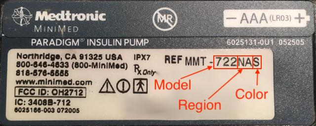

# Medtronic Pumpen

Der Treiber funktioniert nicht mit neueren Modellen, einschließlich aller Modelle mit Endung in G (530G, 600-Serie [630G, 640G, 670G], 700-Serie [770G, 780G], etc.).

Die folgenden Modell- und Firmware-Kombinationen sind kompatibel:

- 512/712 (beliebige Firmware-Version)
- 515/715 (beliebige Firmware-Version)
- 522/722 (beliebige Firmware-Version)
- 523/723 (Firmware 2.4A oder niedriger)
- 554/754 EU Version (Firmware 2.6A oder niedriger)
- 554/754 Kanada Version (Firmware 2.7A oder niedriger)

Hinweise, wie die Firmware der Pumpe ermittelt werden kann, findest Du in den [OpenAPS Docs](https://openaps.readthedocs.io/en/latest/docs/Gear%20Up/pump.html#how-to-check-pump-firmware-check-for-absence-of-pc-connect) und [LoopDocs](https://loopkit.github.io/loopdocs/build/step3/#medtronic-pump-firmware).

    {contents} Table of contents
    :depth: 1
    :local: true

## Funktionalitäten bei der Nutzung mit AAPS

* Requires a RileyLink-compatible device to communicate with **AAPS**.
* Automatic DST and timezone handling.

## Hardware- und Softwareanforderungen

- **Telefon:** Der Medtronic-Treiber sollte mit jedem Android-Telefon funktionieren, das Bluetooth-Verbindungen unterstützt. **WICHTIG: Die Bluetooth-Implementierungen der Telefonhersteller können variieren, so dass jedes Telefonmodell variiert. Zum Beispiel werden bei einigen Telefonen Bluetooth anders aktiviert/deaktiviert. Dies kann die Benutzererfahrung (Systemverhalten) beeinflussen, wenn AAPS sich erneut mit dem Rileylink-Gerät verbinden muss.**
- **RileyLink kompatibles Gerät:** Android-Smartphones können ohne ein separates Gerät, dass die Kommunikation steuert, nicht mit Medtronic-Pumpen kommunizieren. Dieses Gerät verbindet sich mit Ihrem Telefon über Bluetooth und mit Ihrer Pumpe über eine kompatible Funkverbindung. Das erste derartige Gerät wurde als Rileylink bezeichnet, aber eine Reihe weiterer Optionen sind jetzt verfügbar, die zusätzliche Funktionalität bieten können.
    
    - Rileylink verfügbar unter [getrileylink.org](https://getrileylink.org/product/rileylink916)
    - Orangelink verfügbar unter [getrileylink.org](https://getrileylink.org/product/orangelink)
    - Emalink (mehrere Model-Optionen) verfügbar unter [github.com](https://github.com/sks01/EmaLink)
    - Gnarl (einige zusätzliche DIY Tätigkeiten erforderlich) Details verfügbar auf [github.com](https://github.com/ecc1/gnarl)

Eine Vergleichstabelle der verschiedenen Rileylink kompatiblen Geräte findest Du unter [getrileylink.org](https://getrileylink.org/rileylink-compatible-hardware-comparison-chart)

(MedtronicPump-configuration-of-the-pump)=

## Pumpen-Einstellungen

Damit AAPS Befehle remote verschicken kann, solltest Du die folgenden Pumpeneinstellungen vornehmen. Die Schritte, die für jede Änderung an einer Medtronic 715 erforderlich sind, werden für jede Einstellung in Klammern angezeigt. Die genauen Schritte können je nach Pumpentyp und/oder Firmware-Version variieren.

- **Aktiviere Remote-Modus an der Pumpe** (Auf der Pumpe Act drücken und gehe zu Utilities -> Remote-Optionen, wähle "On", und auf dem nächsten Bildschirm trage eine zufällige ID wie 111111 ein). Mindestens eine ID muss auf der Liste der Remote-ID stehen, damit die Pumpe eine Fernkommunikation ermöglicht.
- **Lege Max Basal fest** (An der Pumpe Act drücken und danach Basal und dann Max Basal Rate wählen). Zum Beispiel diesen Wert auf das Vierfache Deiner maximalen Standardbasalrate einstellen, was eine vorläufige Basalquote von 400% erlauben würde. Der Maximalwert der Pumpe beträgt 34,9 Einheiten pro Stunde.
- **Setze Max Bolus** (An der Pumpe Act drücken und dann auf Bolus und dann Max Bolus wählen). Dies ist der größte Bolus, den die Pumpe akzeptiert. Der Maximalwert der Pumpe beträgt 25.
- **Setze Profil auf Standard**. (Drücke ACT > Basal > Profile wählen: Die Pumpe benötigt nur ein Profil, da AAPS die verschiedenen (anderen) Profile auf Deinem Smartphone verwaltet. Es werden keine weiteren Profile benötigt.
- **Auswählen der Art der temporären Basalrate** (Auf der Pumpe: ACT > Basal > Basal Einstellungen > Art tempor. Basal). Wähle Insulinrate (U/H) - nicht: 'Prozentuale Änderung'.

## Medtronic-Konfiguration des Smartphones/AAPS

- **Koppele RileyLink-kompatible Geräte nicht über das Bluetooth-Menü Deines Smartphones.** AAPS wird das entsprechende Gerät sonst nicht mehr finden können.
- Deaktiviere die "Bildschirm drehen"-Funktion Deines Smartphones. Auf einigen Geräten führt das automatische Drehen des Bildschirms zum Neustart von Bluetooth-Sitzungen. Das kann Verbindungsprobleme mit der Medtronic-Pumpe zur Folge haben. 
- Es gibt zwei Wege die Medtronic-Pumpe in AAPS einzurichten:

1. Den Einrichtungsassistenten im Zuge einer Neuinstallation verwenden
2. In **Configuration** > **Pump**, by selecting **Medtronic**
    
    
    
    Once it is selected, the **Medtronic** card shows two buttons, **Settings** and **Open plugin**:
    
    
    
    **Settings** opens the settings of the Medtronic driver:
    
    
    
    **Open plugin** (or **Manage** > **Pump**) opens the Medtronic pump screen. Before a pump is paired it looks like this:
    
    

Falls Du Deine Medtronic-Pumpe mit Hilfe des Einrichtungsassistenten konfigurierst, kann es sein, dass Du die Einrichtung aufgrund von Bluetooth-Problemen nicht abschließen kannst (z.B. Verbindung zur Pumpe nicht möglich). Sollte das so sein, wähle unter KONFIGURATION > Pumpe 'Virtuelle Pumpe' aus und wähle zur Fehlerbehebung den zweiten Weg (s.o.).

While setting up AAPS to work with your medtronic pump you need to set the following items in **Settings** (see the settings picture above):

- **Seriennummer der Pumpe**: Steht auf der Rückseite der Pumpe und beginnt mit 'SN'. Hier sollen nur die sechs Ziffern (keine Buchstaben) eingegeben werden (z.B. 123456).
- **Pumpentyp**: Das genutzte Pumpenmodell (z.B. 522). 
- **Pumpenfrequenz**: In Abhängigkeit davon, wo Deine Pumpe hergestellt wurde, wähle eine der beiden Optionen aus. Bitte schlage in den [FAQ](#MedtronicPump-faq) nach, wenn Du nicht sicher bist welche Option Du wählen solltest: 
    - für Pumpen aus den USA & Kanada ist die Frequenz 916 MHz.
    - Pumpen aus anderen Ländern ("worldwide") nutzen 868 MHz.
- **Max Basal in der Pumpe (IE/h)**: Der Wert muss mit den Einstellungen auf Deiner Pumpe übereinstimmen (vgl. 'Pumpen-Einstellungen' oben). Auch hier gilt: Wähle die Einstellung sorgfältig, da dieser Wert bestimmt, welche Insulinmenge AAPS Dir über die Basalrate geben darf. Damit wird die maximale temporäre Basalrate festgelegt. Zum Beispiel würde die Einstellung dieses Wertes auf das Vierfache Deiner maximalen Standard-Basalrate eine temporäre Basalrate von 400% ermöglichen. Der Maximalwert der Pumpe beträgt 34,9 Einheiten pro Stunde.
- **Max Bolus in der Pumpe (IE)**: Der Wert muss mit den Einstellungen auf Deiner Pumpe übereinstimmen (vgl. 'Pumpen-Einstellungen' oben). Auch diese Einstellung muss sorgfältig überlegt werden, da dieser Wert festlegt wie groß der größte Bolus sein darf, den AAPS abgeben kann.
- **Verzögerung vor dem Start des Bolus (Sek.)**: Zeitspanne (in Sekunden), die vergehen soll, bis der Bolus tatsächlich an die Pumpe gesendet wird. In dieser Zeitspanne kannst Du einen evtl. versehentlich ausgelösten Bolus noch abbrechen. Einen bereits laufenden Bolus kannst Du nicht abbrechen. Die einzige Möglichkeit einen laufenden Bolus zu stoppen, ist die Pumpe zu 'unterbrechen' und sie anschliessend wieder 'fortzusetzen'.
- **Medtronic Verschlüsselung**: Bestimmt, welche Medtronic Verschlüsselung genutzt werden soll. Um die übermittelte Datenmenge kleinzuhalten, wird für Pumpen mit Rileylink Setup, empfohlen 'Hardware Codierung' auszuwählen. Die 'Software Codierung' (AAPS nimmt die Verschlüsselung vor) kann eventuell häufige Verbindungsabbrüche beheben. Wenn der Rileylink eine Firmwareversion 0.x haben sollte, wird diese Einstellung nicht genutzt.
- **Batterie-Akkutyp (Power View)**: Um den tatsächlichen Batteriestand bestimmen zu können, sollte angegeben werden welche AAA-Batterien (z.B. Alkaline) verwendet werden. Sollte nicht 'einfache Ansicht' ausgewählt sein, wird AAPS den Batteriestand in Prozent und die Batteriespannung in Volt anzeigen. Die folgenden Optionen sind verfügbar:
    
    - Nicht ausgewählt (Einfache Ansicht)
    - Alkaline Batterie (erweiterte Ansicht)
    - Lithium Batterie (erweiterte Ansicht)
    - Nickel-Zink-Akku (erweiterte Ansicht)
    - Nickel-Zink-Akku (erweiterte Ansicht)
- **Use Scanning**: Activates Bluetooth scanning before connecting with your Rileylink Compatible devices. Das sollte die Stabilität der Verbindung zu Deinem Gerät verbessern.

- **Show battery level reported by OrangeLink/EmaLink/DiaLink**: This feature is only supported on newer link devices such as the EmaLink or OrangeLink. The value is shown as **RileyLink Battery** on the Medtronic pump screen.
- **Set neutral temp basals**: By default Medtronic pumps beep on the hour when a temporary basal rate is active. Bei aktivierter Funktion, wird die TBR vor Ende jeder Stunde abgebrochen und so ein piepen/vibrieren umgangen.

(pairing-your-rileylink-compatible-device)=

### Pairing your RileyLink compatible device

Your RileyLink compatible device is paired from the Medtronic pump screen, not from the Bluetooth menu of your phone:

- Open the pump screen (**Manage** > **Pump**, or **Open plugin** on the Medtronic card in **Configuration** > **Pump**).
- Tap **Pair RileyLink**. **AAPS** scans for nearby RileyLink compatible devices.
- Tap your device in the list. When **RileyLink paired successfully** is shown, tap **OK**.

## Medtronic pump screen

To open the Medtronic pump screen, go to **Manage** > **Pump**. The pump screen displays the current pump status information along with some Medtronic specific actions (see the pump screen picture above).

- **RileyLink Status**: The current status of the connection between your phone and Rileylink compatible device. Der Status sollte immer 'Verbunden' sein. Jeder andere Status erfordert Deinen Eingriff. 
- **RileyLink Akku**: Zeigt den aktuellen Akkustand Deines EmaLink oder OrangeLink Gerätes an. Only shown if **Show battery level reported by OrangeLink/EmaLink/DiaLink** is enabled in the Medtronic settings.
- **Pumpen-Status**: Status der Verbindung zur Pumpe. Da die Pumpe nicht permanent verbunden ist, wird hier in erster Linie das Schlafsymbol angezeigt. Es gibt eine Reihe von möglichen anderen Status wie "Aufwachen", wenn AAPS versucht, einen Befehl oder andere Pumpen-Befehle wie "Zeit abfragen", "Setze TBR", etc. auszuführen.
- **Battery**: Shows battery status based on the value chosen for **Battery Type (Power View)** in the Medtronic settings.
- **Letzte Verbindung**: Wie lange liegt die letzte erfolgreiche Verbindung zur Pumpe zurück.
- **Letzter Bolus**: Wie lange liegt der letzte abgegebene Bolus zurück.
- **Basis Basalrate**: Das ist die Basis-Basalrate, die in dieser Stunde in Deinem aktiven Profil hinterlegt ist.
- **TBR / Temp basal**: Ist die aktuell laufende temporäre Basalrate. Diese kann auch 0 Einheiten pro Stunde sein.
- **Reservoir**: Insulinstand im Reservoir (Update erfolgt mindestens stündlich).
- **Errors**: Fehlercode, falls ein Problem erkannt wurde - meistens, wenn es fehlerhafte Einstellungen in der Konfiguration gibt.

At the bottom of the screen there are these buttons:

- **Aktualisieren** ist zum Aktualisieren des Pumpen-Status. Dies sollte nur verwendet werden, wenn die Verbindung über einen längeren Zeitraum unterbrochen war. Dies löst eine vollständige Datenaktualisierung aus (Chronik abrufen abfragen/setzen der Zeit, Profil abfragen, Batteriestand abfragen, etc).
- **Pair RileyLink**: Finds and pairs your RileyLink compatible device (see [above](#pairing-your-rileylink-compatible-device)).
- **Pump history**: Shows pump history (see [below](#MedtronicPump-pump-history)).
- **RL Stats**: Shows RL Stats (see [below](#MedtronicPump-rl-status-rileylink-status)).
- **Wake and Tune Up** and **Reset RileyLink**: See [Actions](#medtronic-actions) below.
- **Clear Bolus Block**: Only shown for a short time after a bolus, while **AAPS** waits for the pump to finish delivering it. Tapping it ends this wait.

(MedtronicPump-pump-history)=

## Pumpen Historie

Die Pumpen Historie wird alle 5 Minuten abgerufen und lokal gespeichert. Nur die letzten 24 Stunden der Pumpen-Historie werden gespeichert. This allows for a convenient way to see pump behavior should that be required. The only items stored are those relevant to AAPS and will not include a configuration function that has no relevance.

Tap **Pump history** on the pump screen to open it. By default **All** is selected. Tap one of the filter buttons at the top (for example **Boluses**, **Basals** or **Alarms**) to show only one type of entry.

(MedtronicPump-rl-status-rileylink-status)=

## RL Status (RileyLink Status)

 

Der RL-Statusdialog hat zwei Tabs:

- **Einstellungen**: Zeigt die Einstellungen des RileyLink: Konfigurierte Adresse, verbundene Geräte, Verbindungsstatus, Verbindungsfehler und RileyLink Firmware-Versionen. "Device Type" ist immer Medtronic Pump, Modell wäre Dein Modell, Seriennummer entsprechend Deiner Konfiguration, Pumpenfrequenz zeigt die verwendete Frequenz, Last Frequenz ist die zuletzt verwendete Frequenz.
- **History**: Zeigt den Kommunikationsverlauf, Zeilen mit RileyLink zeigt die Statusänderungen für RileyLink und Zeilen mit Medtronic die an die Pumpe geschickten Befehle .

(medtronic-actions)=

## Aktionen

When the Medtronic driver is used, two additional actions are available on the pump screen (**Manage** > **Pump**):

- **Wake und Tune-Up** - Falls AAPS die Pumpe über längere Zeit nicht erreichen kann (Kontakt sollte normalerweise alle fünf Minuten erfolgen), kannst Du die Verbindung mit diesem Button erzwingen. Es wird dann auf allen möglichen Funkfrequenzen versucht Deine Pumpe zu erreichen. Falls eine Verbindung so hergestellt werden kann, wird diese dann verwendete Frequenz als Standard gespeichert. While the tune-up runs, the RileyLink status on the pump screen shows it. If a tune-up fails (for example because the pump was out of range), **AAPS** tries again by itself about every 10 minutes.
- **Reset RileyLink** - If you reset your RileyLink compatible device you may need to use this action so that device can be reconfigured (frequency set, frequency type set, encoding configured).

## Wichtige Hinweise

### Besonderheiten in der Nightscout-Konfiguration

AAPS verwendet die Seriennummer für die Synchronisation und wird Nightscout offengelegt. Die Seriennummer einer alten Medtronic Pumpe kann auch dazu genutzt werden die Insulinpumpe remote zu steuern. Daher achte darauf, Deine Nightscout-Seite, davor zu schützen die Seriennummer über ein Datenleck preiszugeben. Vergleiche dazu auch: https://nightscout.github.io/nightscout/security/

### OpenAPS Nutzer

Als OpenAPS-Nutzender solltest Du wissen, dass AAPS mit einer Medtronic-Pumpe einen völlig anderen Ansatz als OpenAPS verfolgt. AAPS interagiert mit der Pumpe im Wesentlichen über Dein Smartphone. In der Regel muss die Pumpe nur bei einem Reservoirwechsel direkt über das Pumpen-Menü bedient werden. Bei OpenAPS ist es erforderlich zumindest den Teil eines Bolus direkt an der Pumpe auszulösen. Das ist bei AAPS nicht notwendig. Wenn ein manueller Bolus direkt an der Pumpe eingegeben wird und AAPS gleichzeitig versucht einen Bolus abzugeben, kann es zu Problemen kommen. Auch wenn es Sicherhheitsprüfungen zum Verhindern solcher Probleme gibt, sollten diese besser vermieden werden.

### Protokollierung

Falls Du einen Fehler in der Pumpenfunktion Deiner Medtronic behoben möchtest, wähle aus dem Hamburger-Menü (drei Striche) „Wartung“ aus und dann „Log-Einstellungen“. Pump, PumpComm, PumpBTComm sollte für die Fehleranalyse von Medtronic-Problemen ausgewählt werden.

### Medtronic CGM

Das Medtronic CGM ("Enlite") wird derzeit NICHT unterstützt.

### Manuelle Pumpenbedienung

Die händische Bedienung der Pumpe (z.B. Bolusgabe oder temporäre Basalraten setzen) sollte vermieden werden. Alle derartigen Befehle sollten über AAPS gesendet werden. Falls manuelle Befehle verwendet werden, müssen diese mindestens 3 Minuten auseinanderliegen, um das Risiko von Problemen zu verringern.

### Wechsel der Zeitzone / Zeitumstellung oder Reisen mit AAPS und einer Medtronic Pumpe

AAPS erkennt Zeitzonenänderungen automatisch und aktualisiert die Pumpen-Zeit, wenn Dein Smartphone auf die neue Zeit wechselt.

Traveling east means you are going to be adding hours to the current time (ex. from GMT+0 to GMT+2), which will not result in any issues as there will be no overlap (e.g. it won't be possible to have the same hour twice). Traveling west, however, can result in issues as you are effectively going back in time, which can result in incorrect IOB data.

The issues seen when traveling west are known to the developers and work on a possible solution is ongoing. Beachte dazu auch https://github.com/andyrozman/RileyLinkAAPS/issues/145 mit mehr Details. Für den Moment, habe bitte im Kopf, dass das Problem auftreten kann und sei beim Reisen durch Zeitzonen entsprechend aufmerksam.

### Ist ein GNARL ein voll kompatibles Rileylink kompatibles Gerät?

Der GNARL-Code unterstützt alle Funktionen des Medtronic-Treibers in AAPS und ist damit vollständig kompatibel. Es ist allerdings wichtig zu wissen, dass das mit zusätzlicher Arbeit verbunden ist. Es muss kompatible Hardware beschafft werden, auf die dann der GNARL-Code geladen werden muss.

**Hinweis:** Die GNARL-Software ist noch experimentell und wenig getestet ist. Sie sollte daher nicht als so sicher angesehen werden wie die des RileyLink.

(MedtronicPump-faq)=

## FAQ

(MedtronicPump-what-to-do-if-i-loose-connection-to-rileylink-and-or-pump)=

### Vorgehen bei Verlust der Verbindung zum RileyLink und/oder der Pumpe

Es gibt einige Möglichkeiten, um Verbindungsprobleme zu lösen.

- Tap **Wake and Tune Up** on the pump screen (**Manage** > **Pump**) as detailed above.
- Deaktiviere Bluetooth auf Deinem Smartphone, warte 10 Sekunden und schalte es wieder ein. Dies zwingt das RileyLink-Gerät sich erneut mit dem Smartphone zu verbinden.
- Setze das RileyLink-Gerät zurück. You must then tap **Reset RileyLink** on the pump screen (**Manage** > **Pump**).
- Wenn alles bis hierhin nicht geholfen hat, haben die folgenden Schritte die Verbindungsprobleme bei einigen Community-Mitgliedern beheben können: 
    1. Starte dein Smartphone neu
    2. *Während* dein Smartphone startet, starte den Rileylink ebenfalls neu
    3. Öffne AAPS und lasse zu, die Verbindung wieder herzustellen

### Ermittlung der Pumpen-Frequenz

Auf der Pumpen-Rückseite findest Du eine Zeile mit der Modellnummer und drei weitere Buchstaben. Die ersten beiden Buchstaben (von dreien) bestimmt die Funkfrequenz der Pumpe. Aus dem letzten Buchstaben lässt sich die Pumpenfarbe ableiten. Hier sind mögliche Werte für die Frequenz:

- NA - Nordamerika (in der Frequenzauswahl musst Du "US & Kanada (916 MHz)" auswählen)
- CA - Kanada (in Frequenzauswahl musst Du "US & Kanada (916 MHz)" auswählen)
- WW - Weltweit (in der Frequenzauswahl musst Du "Weltweit (868 MHz)" auswählen)

(MedtronicPump-pump-unreachable)=

### How to fix the "pump unreachable" error

Some Medtronic pumps report a "pump unreachable" error after an **AAPS** update. To fix it, change the encoding type:

1. Go to **Configuration** > **Pump** and tap **Settings** on the **Medtronic** card.
2. Set **Medtronic Encoding** to **Hardware Encoding**.

## Wo ich Hilfe bekomme

Development of the Medtronic driver is done by the community on a **volunteer** basis. Before requesting help, please:

1. **Read** the relevant section of this documentation to confirm how the feature is meant to work.
2. **Ask** on the *#AAPS* channel on [Discord](https://discord.gg/4fQUWHZ4Mw), or in one of the other [community channels](../GettingHelp/WhereCanIGetHelp.md).
3. **Report a bug** by searching the [existing issues](https://github.com/nightscout/AndroidAPS/issues); if yours is not listed, open a [new issue](https://github.com/nightscout/AndroidAPS/issues) and attach your [log files](../GettingHelp/AccessingLogFiles.md).

When asking for help, include your phone make and model, Android version, **AAPS** version, and a plain-English description of the problem (what changed, when it last worked).