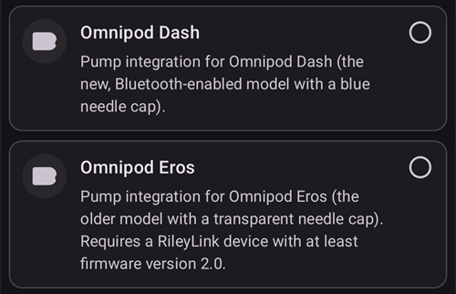
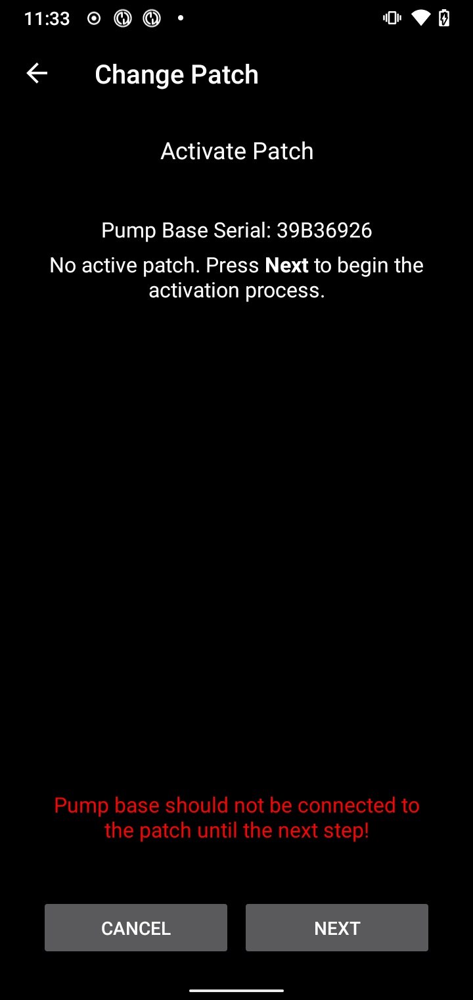
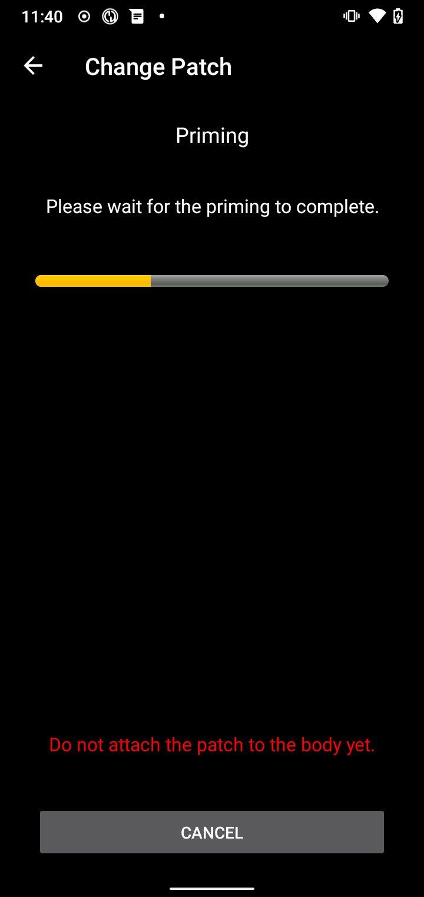
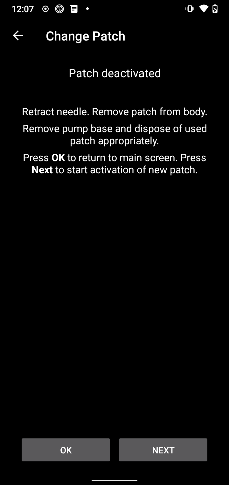
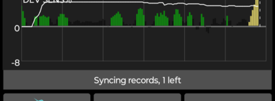

(medtrum-nano-300u)=
# Medtrum Nano 200U / 300U

Diese Anleitung beschreibt die Konfiguration der Medtrum Insulinpumpe.

```{contents} Table of contents
:depth: 1
:local: true
```

## Funktionalitäten bei der Nutzung mit AAPS
* Alle Loop-Funktionen werden unterstützt (SMB, TBR usw.)
* Automatischer Zeitzonenwechsel und Sommer-/Winterzeitumstellung
* Verlängerter/verzögerter Bolus wird nicht unterstützt

## Hardware- und Softwareanforderungen
* **Kompatible Medtrum Pumpenbasen und Reservoir-Patches**
    - Aktuell werden unterstützt:
        - Medtrum TouchCare Nano 200U mit Pumpenbasis Ref.: **MD0201** und **MD8201**.
        - Medtrum TouchCare 300U mit Pumpenbasis Ref.: **MD8301**.
        - Wenn Du ein bisher nicht unterstütztes Modell hast und bereit bist es zu spenden oder Du beim Testen helfen möchtest, kontaktiere uns über den Discord-Kanal [hier](https://discordapp.com/channels/629952586895851530/1076120802476441641).
* **AAPS erstellt und installiert** nach der Anleitung [APK erstellen](../SettingUpAaps/BuildingAaps.md).
* **Kompatibles Android Smartphone** mit Bluetooth-Verbindung (Bluetooth Low Energy, BLE)
    - Siehe dazu auch die AAPS [Release Notes](../Maintenance/ReleaseNotes.md)

## Bevor du startest

**Sicherheit geht vor** - Stelle sicher, dass Du auf eventuell auftretende Fehler reagieren kannst, bevor Du diesen Prozess beginnst: zusätzliche Patches, Insulin und Smartphone mit vollem Akku sind unbedingt notwendig).

**Die PDM- und Medtrum-App wird nicht mit einem Patch funktionieren, der durch AAPS aktiviert wurde.** Vorher hast Du möglicherweise den PDM oder die Medtrum App verwendet, um Befehle an die Patchpumpe zu senden. Aus Sicherheitsgründen kannst einen aktivierten Patch nur mit dem Gerät oder der App verwenden, die zu dessen Aktivierung verwendet wurde.

*Das heißt NICHT, dass Du Deinen PDM wegwerfen solltest. Verwahre ihn an einem sicheren Ort als Backup für einen Notfall (z.B. Verlust Deines Smartphones oder AAPS Probleme).*

**Deine Pumpe wird auch dann Insulin abgeben, wenn es sie nicht mit AAPS verbunden ist**. Die Basalrate des aktiven AAPS Profils ist in der Patch-Pumpe hinterlegt. Eine funktionsfähiges AAPS, sendet Basalraten-Befehle, die maximal 120 Minuten abdecken. Sollte die Pumpe aus irgendeinem Grund keine neuen Befehle erhalten (z.B. weil die Pumpe und das Smartphone zu weit voneinander entfernt sind), wird die Pumpe auf die in der Pumpe hinterlegte Standardbasalrate zurückfallen, sobald die temporäre Basalrate endet.

**Das AAPS-Profil unterstützt keine Basalraten-Zeitabschnitte von 30 Minuten** Wenn Du AAPS neu nutzt und Dein Basalratenprofil zum ersten Mal einrichtest, beachte bitte, dass Basalraten, die zur halben Stunde beginnen, nicht unterstützt werden. Du musst Dein Basalratenprofil so anpassen, dass die Basalraten zur vollen Stunde beginnen. Wenn Du zum Beispiel eine Basalrate von 1,1 Einheiten hast, die um 9:30 Uhr startet und zwei Stunden bis 11:30 Uhr läuft, wird dies nicht funktionieren. Du muss diese 1,1 IE Basalrate auf einen Zeitraum von entweder 9:00 - 11:00 Uhr oder 10:00 - 12:00 Uhr einstellen. Der in AAPS verwendete Algorithmus kann halbstündige Basalraten nicht verarbeiten, auch wenn die Hardware der Medtrum-Pumpe dies unterstützen könnte.

Gleiches gilt auch für 'Null-Basalraten'. **Basalraten mit 0 IE/h werden in AAPS NICHT unterstützt**. AAPS benutzt Vielfache der im Profil hinterlegten Basalrate, um die benötigte Insulinmenge zu berechnen. Mit 'Null-Basalraten' funktioniert diese Berechnungn nicht, auch wenn die Metrum-Pumpe diese unterstützen könnte. Die kleinste Basalrate im Profil beträgt 0,05 IE/h.

Eine temporäre Null-Basalrate kann durch die Funktion PUMPE TRENNEN oder durch eine Kombination aus LOOP DEAKTIVIEREN/TEMP BASALRATE oder LOOP PAUSIEREN/TEMP BASALRATE erreicht werden.

## Einrichtung

```{caution}
Wenn Du einen Patch mit **AAPS** aktivierst, **MUSST** Du alle anderen Geräte ausschalten, die mit der Medtrum-Pumpenbasis kommunizieren können, zum Beispiel einen aktiven PDM oder die Medtrum-App.
```

### Schritt 1: Wähle die Medtrum-Pumpe aus

#### Option 1: Neue Installation

Wenn Du **AAPS** zum ersten Mal installierst, führt Dich der **Einrichtungsassistent** durch die Einrichtung. Wähle im Schritt **Pumpe** die Option **Medtrum**.

Falls Du Dir unsicher bist, kannst Du auch zunächst **Virtuelle Pumpe** wählen und **Medtrum** später nach der Einrichtung von **AAPS** auswählen (siehe Option 2).


#### Option 2: Der Konfigurationsbildschirm

Bei einer bestehenden Installation kannst Du die Pumpe **Medtrum** unter [Konfiguration > Pumpe](#Config-Builder-pump) auswählen:

Öffne oben links das **Menü** (☰), tippe auf **Konfiguration** > **Pumpe** und wähle die Karte **Medtrum**. Es kann immer nur eine Pumpe aktiv sein.



Sobald sie ausgewählt ist, zeigt die Karte **Medtrum** zwei Schaltflächen: **Einstellungen** und **Plugin öffnen**:


**Plugin öffnen** (oder **Verwalten → Pumpe**) öffnet den Medtrum-Pumpenbildschirm. Dort wechselst Du Patches und siehst den Pumpenstatus. Bevor ein Patch aktiviert ist, sieht er so aus:


(medtrum-step-2)=
### Schritt 2: Ändern der Medtrum-Einstellungen

Tippe unter **Konfiguration** > **Pumpe** auf der Karte **Medtrum** auf **Einstellungen**. Du kannst auch oben rechts auf dem Medtrum-Pumpenbildschirm auf das Zahnrad-Symbol tippen. Damit öffnen sich die **Medtrum Pumpeneinstellungen**:


```{note}
Eine Einstellung **Seriennummer** gibt es nicht mehr. **AAPS** findet Deine Pumpenbasis beim ersten Aktivieren eines Patches per Bluetooth-Suche (siehe [Schritt 3](#medtrum-activate-patch)) und merkt sich ihre Seriennummer. Wie Du eine andere Pumpenbasis verwendest, steht unter [Kopplung aufheben](#medtrum-unpair).
```

#### Alarm Einstellungen

***Voreingestellt: Piepton.***

Diese Einstellung ändert, wie Dich die Pumpe bei einer Warnung oder einem Fehler alarmiert.

- **Piepton**: Der Patch piept bei Alarmen und Warnungen.
- **Lautlos**: Der Patch alarmiert Dich bei Alarmen und Warnungen nicht.

Hinweis: Im lautlosen Modus gibt **AAPS** je nach Lautstärkeeinstellungen Deines Smartphones trotzdem den Alarm aus. Wenn Du auf den Alarm nicht reagierst, piept der Patch irgendwann.

#### Notification on pump warning (Benachrichtung bei Pumpenwarnung)

***Voreingestellt: Aktiviert.***

Diese Einstellung ändert, wie **AAPS** Benachrichtigungen bei nicht kritischen Pumpenwarnungen anzeigt. Ist sie aktiviert, wird bei einer Pumpenwarnung eine Benachrichtigung auf dem Smartphone angezeigt, unter anderem bei:
- Niedriger Akkustand
- Reservoir fast leer (20 IE)
- Patch läuft bald ab

Wir empfehlen, diese Option aktiviert zu lassen, wenn die Pumpenalarme auf **Lautlos** gestellt sind. In jedem Fall werden diese Warnungen auch auf dem Medtrum-Pumpenbildschirm unter [Aktive Alarme](#medtrum-active-alarms) angezeigt.

(medtrum-patch-expiration)=
#### Patch Ablaufdatum

***Voreingestellt: Aktiviert.***

Diese Einstellung ändert das Verhalten des Patches. Ist sie aktiviert, läuft der Patch nach 3 Tagen ab und gibt eine hörbare Warnung aus, sofern der Ton eingeschaltet ist. Nach 3 Tagen und 8 Stunden hört der Patch auf zu arbeiten.

Ist diese Einstellung deaktiviert, warnt Dich der Patch nicht, bevor er stoppt. Mit aktueller Firmware der Pumpenbasis läuft ein Patch höchstens 5 Tage.

#### Warnung Ablauf der Pumpenzeit [Stunden]

***Voreingestellt: 72 Stunden.***

Diese Einstellung ändert den Zeitpunkt der Ablaufwarnung. Ist [Patch Ablaufdatum](#medtrum-patch-expiration) aktiviert, zeigt **AAPS** diese Anzahl Stunden nach der Aktivierung eine Benachrichtigung an.

#### Stündliches Maximum Insulin [IE]

***Voreingestellt: 25 IE.***

Diese Einstellung begrenzt die maximal in einer Stunde abzugebende Insulinmenge. Wird dieser Grenzwert überschritten, unterbricht der Patch die Abgabe und gibt einen Alarm aus. Du kannst den Alarm mit der Schaltfläche **Alarme zurücksetzen** auf dem Pumpenbildschirm zurücksetzen, siehe [Alarme zurücksetzen](#nano-reset-alarms).

Setze den Wert auf eine für Deine speziellen Insulin-Anforderungen vernünftigen Wert.

#### Tägliches Maximum Insulin [IE]

***Voreingestellt: 80 IE.***

Diese Einstellung begrenzt die maximal an einem Tag abzugebende Insulinmenge. Wird dieser Grenzwert überschritten, unterbricht der Patch die Abgabe und gibt einen Alarm aus. Du kannst den Alarm mit der Schaltfläche **Alarme zurücksetzen** auf dem Pumpenbildschirm zurücksetzen, siehe [Alarme zurücksetzen](#nano-reset-alarms).

Setze den Wert auf eine für Deine speziellen Insulin-Anforderungen vernünftigen Wert.

#### Scan bei Verbindungsfehler

***Standard: Aus.***

Zu finden unter **Erweiterte Einstellungen**.

Aktiviere diese Option nur, wenn Du Verbindungsprobleme hast. Ist sie aktiviert, sucht der Treiber erneut nach der Pumpe, bevor er versucht, die Verbindung wiederherzustellen. Stelle sicher, dass die Standortberechtigung für **AAPS** auf „Immer zulassen“ gesetzt ist.

### Schritt 2b: AAPS-Alarmeinstellungen

Diese Einstellungen gehören nicht zum Medtrum-Treiber. Du öffnest sie über das Symbol **Einstellungen** (Zahnrad) oben rechts auf dem Startbildschirm. Mehr dazu unter [Einstellungen](../SettingUpAaps/Preferences.md).

#### BT Watchdog

Öffne **Einstellungen** > **Pumpe**:


**BT Watchdog** schaltet Bluetooth auf dem Smartphone für eine Sekunde aus, wenn **AAPS** keine Verbindung zur Pumpe herstellen kann. Das kann bei manchen Smartphones helfen, bei denen Bluetooth hängen bleibt.

Aktiviere diese Einstellung, wenn Du oft Verbindungsprobleme mit Deiner Pumpe hast.

#### Lokale Alarme

Öffne **Einstellungen** > **Lokale Alarme**:


##### Alarm, wenn die Pumpe nicht erreichbar ist

***Voreingestellt: Aktiviert.***

Diese Einstellung ist bei aktiviertem Medtrum-Treiber fest eingeschaltet. Sie alarmiert Dich, wenn die Pumpe nicht erreichbar ist. Das kann passieren, wenn die Pumpe außer Reichweite ist oder wegen eines defekten Patches oder einer defekten Pumpenbasis nicht reagiert, zum Beispiel wenn Wasser zwischen Pumpenbasis und Patch eindringt.

Aus Sicherheitsgründen kann diese Einstellung nicht deaktiviert werden.

##### Grenzwert für Pumpe ist nicht erreichbar

***Voreingestellt: 30 Minuten.***

Diese Einstellung legt fest, wie lange **AAPS** wartet, bevor es Dich alarmiert, dass die Pumpe nicht erreichbar ist.

Du kannst diese Einstellung bei der Medtrum-Pumpe ändern, wir empfehlen aber aus Sicherheitsgründen, sie bei 30 Minuten zu belassen.

(medtrum-activate-patch)=
### Schritt 3: Patch aktivieren

**Bevor Du weiter machst:**
- Leg Deine Medtrum-Pumpenbasis und einen neuen Reservoir-Patch bereit.
- Schalte andere Geräte aus, die mit der Medtrum-Pumpe kommunizieren können (PDM und Medtrum-App).
- Stelle idealerweise sicher, dass **AAPS** eingerichtet und ein [Profil aktiviert](../DailyLifeWithAaps/ProfileSwitch-ProfilePercentage.md) ist. Ist kein Profil aktiv, beginnt die Aktivierung mit dem Schritt **Profil erforderlich**, in dem Du das zu aktivierende Profil auswählst.

#### Aktivierung starten

Öffne den [Medtrum-Pumpenbildschirm](#nano-overview) (**Verwalten → Pumpe**) und tippe auf **Wechsele Patch**. Hast Du einen [Zugriffsschutz für die Einstellungen](#Preferences-protection) eingerichtet, musst Du zuerst Dein Passwort oder Deine PIN eingeben.

Ist bereits ein Patch aktiv, wirst Du aufgefordert, ihn zuerst zu deaktivieren, siehe [Patch deaktivieren](#nano-deactivate-patch).

Die Aktivierung ist ein Schritt-für-Schritt-Assistent. Befolge die Anweisungen, um den neuen Patch zu befüllen und zu aktivieren. Tippe in jedem Schritt auf **Abbrechen**, um abzubrechen.

```{important}
Klebe den Patch erst auf Deinen Körper und führe die Kanüle erst ein, wenn der Assistent Dich dazu auffordert (nach Abschluss der Befüllung).
```

Welche ersten Schritte Du siehst, hängt von Deiner Einrichtung ab:

1. **Profil erforderlich**: nur, wenn kein Profil aktiv ist. Wähle das anzuwendende Profil aus und fahre fort.
2. **Pumpe suchen**: nur beim ersten Mal oder nachdem Du [Kopplung aufheben](#medtrum-unpair) verwendet hast. Verbinde die Pumpenbasis mit einem neuen Patch, um sie einzuschalten. **AAPS** sucht nach Medtrum-Pumpenbasen in der Nähe (ihre Namen beginnen mit `MT`). Tippe in der Liste auf Deine. **AAPS** speichert ihre Seriennummer und geht dann direkt zum Füllen des Patches über.

   

3. **Patch aktivieren**: nur, wenn **AAPS** Deine Pumpenbasis bereits kennt. Auf dem Bildschirm steht „Kein aktiver Patch. Tippe auf **Weiter**, um den Aktivierungsprozess zu starten.“ Stelle sicher, dass die Pumpenbasis **noch nicht** mit dem Patch verbunden ist, und tippe dann auf **Weiter**.



#### Patch verbinden und füllen


Verbinde die Pumpenbasis mit dem Patch, entferne die Restluft und fülle den Patch mit Insulin. Für die Aktivierung sind mindestens 70 Einheiten nötig. Der Bildschirm zeigt den Füllstand des Reservoirs. Klebe den Patch noch nicht auf Deinen Körper.

Ist der Patch erkannt und gefüllt, erscheint die Schaltfläche **Weiter**. Tippe darauf.

#### Insulin auswählen

Dieser Schritt erscheint nur, wenn Du in **AAPS** mehr als ein Insulin eingerichtet hast. Wähle das Insulin aus, mit dem Du den Patch füllst. **AAPS** führt nach der Aktivierung einen Profilwechsel mit diesem Insulin durch.

#### Patch entlüften


Entferne den Sicherheitsverschluss **nicht**. Drücke den Nadelknopf am Patch halb durch und tippe dann auf **Weiter**, um das Füllen zu starten.



Warte, bis das Füllen abgeschlossen ist.


Ist das Füllen abgeschlossen, tippe auf **Weiter**, um fortzufahren.

#### Wechsel der Setzstellen (Site Rotation)

Dieser Schritt erscheint nur, wenn Du Pumpen-Setzstellen mit [Wechsel der Setzstellen](#Aapsscreens-site-rotation) verwaltest (Einstellung **Wechsel der Pumpen-Einstichstellen verwalten**). Wähle, wo Du den Patch an Deinem Körper anbringst, oder überspringe diesen Schritt.

#### Patch setzen


Reinige die Haut und ziehe die Schutzfolien ab. Entferne den Sicherheitsverschluss, klebe den Patch auf Deinen Körper und drücke den Nadelknopf, um die Kanüle einzuführen.

Tippe auf **Weiter**, um den Patch zu aktivieren.

#### Patch aktivieren


**AAPS** aktiviert die Pumpe und setzt die Anfangs-Basalrate. Bitte warten. Ist die Aktivierung abgeschlossen, erscheint folgender Bildschirm:


```{admonition} Older screenshot
:class: note
Abgesehen von **Pumpe suchen** stammen die Screenshots zur Aktivierung oben aus einer früheren **AAPS**-Version und können in **AAPS** 4 anders aussehen.
```

Er zeigt, wie viele Einheiten noch im Patch sind. Tippe auf **OK**, um zum Pumpenbildschirm zurückzukehren.

```{tip}
[Exportiere Deine Einstellungen](../Maintenance/ExportImportSettings.md) nach jeder neuen Aktivierung. So kannst Du diese Patch-Sitzung später wiederherstellen, zum Beispiel auf einem neuen Smartphone.
```

(nano-deactivate-patch)=

### Patch deaktivieren

Um den aktiven Patch zu deaktivieren, öffne den [Medtrum-Pumpenbildschirm](#nano-overview) (**Verwalten → Pumpe**) und tippe auf **Wechsele Patch**.


Du wirst gebeten zu bestätigen, dass Du den aktuellen Patch deaktivieren möchtest. **Das kann nicht rückgängig gemacht werden.** Tippe auf **Weiter**, um zu deaktivieren, oder auf **Abbrechen**, um zum Pumpenbildschirm zurückzukehren.


Kann **AAPS** den Patch nicht deaktivieren (zum Beispiel, weil die Pumpenbasis schon vom Patch abgenommen wurde), tippe auf **Verwerfen**, um die aktuelle Patch-Sitzung zu vergessen. Danach kannst Du einen neuen Patch aktivieren.



Ist die Deaktivierung abgeschlossen, ziehe die Nadel zurück und entferne den Patch von Deinem Körper. Nimm die Pumpenbasis ab und entsorge den gebrauchten Patch. Tippe auf **OK**, um zum Pumpenbildschirm zurückzukehren, oder auf **Weiter**, um die Aktivierung eines neuen Patches zu starten.

(nano-resume-interrupted-activation)=

### Unterbrochene Aktivierung fortsetzen

Wird eine Patch-Aktivierung unterbrochen, zum Beispiel weil der Smartphone-Akku leer ist, kannst Du sie fortsetzen. Öffne den [Medtrum-Pumpenbildschirm](#nano-overview) (**Verwalten → Pumpe**) und tippe auf **Wechsele Patch**.


Tippe auf **Weiter**, um die Aktivierung fortzusetzen. Tippe auf **Verwerfen**, um den Aktivierungsstatus zurückzusetzen, damit Du einen neuen Patch aktivieren kannst.


```{admonition} Older screenshot
:class: note
Die Screenshots unter **Patch deaktivieren** und **Unterbrochene Aktivierung fortsetzen** stammen aus einer früheren **AAPS**-Version und können in **AAPS** 4 anders aussehen.
```

Der Treiber liest den Aktivierungsstatus aus der Pumpe aus. Klappt das, macht der Assistent bei dem Schritt weiter, bei dem er stehen geblieben ist.

(nano-overview)=

## Pumpenbildschirm

Der Medtrum-Pumpenbildschirm (**Verwalten → Pumpe**) zeigt den aktuellen Status des Medtrum-Patches. Er enthält außerdem Schaltflächen zum Wechseln des Patches, zum Zurücksetzen von Alarmen und zum Aktualisieren des Status. Ein Banner oben zeigt wichtige Zustände an, zum Beispiel **Patch nicht aktiviert** oder **Pumpe ist ausgesetzt**.


Der Bildschirm kann diese Zeilen zeigen. Manche Zeilen erscheinen nur, wenn sie einen Wert haben.

- **Letzte Verbindung**: Wie lange es her ist, dass **AAPS** zuletzt mit der Pumpe verbunden war.
- **Letzter Bolus**: Der zuletzt abgegebene Bolus.
- **Batterie**: Die aktuelle Batteriespannung des Patches.
- **Reservoir**: Der aktuelle Füllstand des Reservoirs.
- **Seriennummer**: Die Seriennummer Deiner Pumpenbasis.
- **Pumpenstatus**: Der aktuelle Zustand der Pumpe. Zum Beispiel **Aktiv** (der Patch ist aktiviert und läuft normal) oder **Gestoppt** (der Patch ist nicht aktiviert).
- **Basis-Basalrate**: Die gerade laufende Basalrate aus Deinem Profil.
- **Temporäre Basalrate**: Die temporäre Basalrate, falls eine läuft.
- **Aktiver Bolus**: Der Bolus, der gerade abgegeben wird.
- **Aktive Alarme**: siehe [unten](#medtrum-active-alarms).
- **Pumpentyp**: Das Modell Deiner Pumpenbasis.
- **FW-Version**: Die Firmware-Version der Pumpenbasis.
- **Patch Nr.**: Die laufende Nummer des aktivierten Patches. Sie erhöht sich mit jedem neu aktivierten Patch um eins.
- **Aktivierung**: Datum und Uhrzeit der Patch-Aktivierung und wie lange das her ist.
- **Patch läuft ab**: Datum und Uhrzeit, zu der der Patch abläuft. Zeigt **Nicht aktiviert**, wenn [Patch Ablaufdatum](#medtrum-patch-expiration) ausgeschaltet ist.

(medtrum-active-alarms)=
### Aktive Alarme

Diese Zeile zeigt alle gerade aktiven Alarme, zum Beispiel ein niedriges Reservoir oder einen ablaufenden Patch.

### Aktualisieren

Diese Schaltfläche aktualisiert den Status des Patches. Sie ist nur verfügbar, wenn ein Patch aktiv ist und **AAPS** gerade nicht mit der Pumpe verbunden ist.

### Wechsele Patch

Diese Schaltfläche startet den Assistenten zum Wechseln des Patches. Weitere Informationen findest Du unter [Patch aktivieren](#medtrum-activate-patch).

(medtrum-unpair)=
### Entkoppeln

Diese Schaltfläche erscheint nur, wenn **AAPS** eine Pumpenbasis kennt. Sie löscht die gespeicherte Seriennummer der Pumpenbasis und trennt die Verbindung. Beim nächsten Aktivieren eines Patches sucht **AAPS** wieder nach einer Pumpenbasis (Schritt **Pumpe suchen**). Nutze das, wenn Du zu einer anderen Pumpenbasis wechselst. Mach das nur, wenn kein Patch aktiv ist.

(nano-reset-alarms)=

### Alarme zurücksetzen

Die Schaltfläche **Alarme zurücksetzen** erscheint auf dem Pumpenbildschirm nur, wenn sich der Patch selbst angehalten hat, zum Beispiel nach einem Alarm wegen Überschreitung der maximalen Tagesinsulinmenge. Tippe darauf, um die Alarme zurückzusetzen und die Insulinabgabe fortzusetzen.


```{admonition} Older screenshot
:class: note
Der Screenshot oben stammt aus einer früheren **AAPS**-Version. In **AAPS** 4 sieht der Pumpenbildschirm anders aus, die Schaltfläche **Alarme zurücksetzen** funktioniert aber genauso.
```

## Smartphone wechseln, Export/Import-Einstellungen

Gehe beim Wechsel auf ein neues Smartphone so vor:
* [Exportiere die Einstellungen](../Maintenance/ExportImportSettings.md) auf Deinem alten Smartphone.
* Übertrage die Einstellungsdatei vom alten auf das neue Smartphone und importiere sie in **AAPS**. Hake auf dem Importbildschirm **Pumpeneinstellungen auch ersetzen** an, sonst wird die Patch-Sitzung nicht auf das neue Smartphone übertragen.

Die importierte Einstellungsdatei muss aus der Patch-Sitzung stammen, die Du gerade nutzt, sonst verbindet sich der Patch nicht (siehe [Schlauchlose Pumpen](#ExportImportSettings-tubeless-pumps)).

Nach einem Import der Einstellungen synchronisiert der Treiber die Historie mit der Pumpe. Das kann je nach Alter der Einstellungsdatei eine Weile dauern. Der Fortschritt („Datensätze synchronisieren, ... verbleibend“) wird auf dem Startbildschirm angezeigt:



(medtrum-nano-troubleshooting)=

## Fehlerbehebung

### Verbindungsprobleme

Bei Zeitüberschreitungen oder anderen Verbindungsproblemen:
- Setze in den Android-App-Einstellungen für **AAPS** die Standortberechtigung auf „Immer zulassen“.
- Versuche, **Scan bei Verbindungsfehler** (Medtrum-Einstellungen > **Erweiterte Einstellungen**) und **BT Watchdog** (**Einstellungen** > **Pumpe**) zu aktivieren, siehe [Schritt 2](#medtrum-step-2).

### Bluetooth-Probleme
Bei bekannten Problemen mit Bluetooth-Verbindungen, Pumpen/Pods oder Aktivierungs- und Verbindungsproblemen schau im Abschnitt [Bluetooth-Fehlerbehebung](../GettingHelp/BluetoothTroubleshooting.md) nach.

### Aktivierung unterbrochen

Wird die Aktivierung unterbrochen, zum Beispiel durch einen leeren Smartphone-Akku oder einen Absturz, kannst Du sie fortsetzen. Tippe auf dem Pumpenbildschirm auf **Wechsele Patch** und folge den Schritten unter [Unterbrochene Aktivierung fortsetzen](#nano-resume-interrupted-activation).

### Patch-Fehler verhindern

Der Patch kann eine Vielzahl von Fehlern verursachen. Um häufige Fehler zu vermeiden:
- Vergewissere Dich, dass die Pumpenbasis richtig im Patch sitzt und keine Spalten und Lücken sichtbar sind.
- Übe beim Befüllen des Patches keinen übermäßigen Druck auf den Kolben aus. Befülle den Patch nicht über das für Dein Modell gültige Maximum hinaus.

## Wo ich Hilfe bekomme

Die gesamte Entwicklungsarbeit rund um das Medtrum-Modul wird von der Community auf **freiwilliger** Basis geleistet. Wir bitten Dich daher um einen respektvollen Umgang darum und die folgenden Prinzipien zu befolgen, bevor Du um Unterstützung bittest:

-  **Level 0:** Lies den entsprechenden Abschnitt dieser Dokumentation um sicherzustellen, dass du verstehst, wie die Funktion, mit der Du Schwierigkeiten hast, funktionieren soll.
-  **Level 1:** Solltest Du trotz dieses Dokuments ein Problem nicht lösen können, tritt dem *#Medtrum* **Discord**-Channel bei, indem Du auf diesen [Einladungs-Link](https://discord.gg/4fQUWHZ4Mw) klickst.
-  **Level 2:** Suche unter [Issues](https://github.com/nightscout/AAPS/issues), ob Dein Problem bereits gemeldet wurde. Falls ja, bestätige oder kommentiere es bitte bzw. ergänze Informationen zu Deinem Problem. Wenn nicht, erstelle bitte ein [neues Issue](https://github.com/nightscout/AndroidAPS/issues) und füge [Deine Protokolldateien](../GettingHelp/AccessingLogFiles.md) (Logs) hinzu.
-  **Sei geduldig - die meisten Mitglieder unserer Community sind gutmütige Freiwillige und die Lösung von Problemen erfordert oft Zeit und Geduld von Nutzern und Entwicklern.**