(omnipod5)=
# Omnipod 5

Diese Anleitung beschreibt, wie Du **Omnipod 5**-Pods mit **AAPS** verwendest.

```{admonition} In development
:class: warning
Der Omnipod-5-Treiber befindet sich in Entwicklung. Er ist noch nicht Teil einer veröffentlichten **AAPS**-Version und läuft nur in Test-Builds. Bildschirme und Schritte auf dieser Seite können sich bis zur Veröffentlichung noch ändern.
```

```{contents} Table of contents
:depth: 1
:local: true
```

(omnipod5-how-it-works)=
## Wie AAPS Omnipod 5 verwendet

Der Omnipod-5-Treiber funktioniert fast genauso wie der [Omnipod-DASH-Treiber](../CompatiblePumps/OmnipodDASH.md):

- **AAPS** verbindet sich über das Bluetooth des Smartphones mit dem Pod. Ein RileyLink oder ein anderes Überbrückungsgerät (engl. bridge device) wird nicht benötigt.
- **AAPS** verbindet sich nur, um einen Befehl zu senden (zum Beispiel einen Bolus oder eine **TBR**) oder um den Pod-Status zu lesen, und trennt die Verbindung gleich danach wieder.
- **AAPS** steuert den Pod wie eine normale Pumpe: Es setzt die Basalraten, **TBRs**, Boli und **SMBs**. Der eigene automatische Modus des Pods wird nie verwendet.
- Dosen und Limits sind dieselben wie bei DASH: Boli in Schritten von 0,05 IE, Basalraten in Schritten von 0,05 IE/h (mindestens 0,05 IE/h), **TBRs** bis 30 IE/h für bis zu 12 Stunden.
- Verzögerte Boli werden nicht unterstützt.

Der wichtigste Unterschied zu DASH ist das **persönliche Zertifikat**. **AAPS** braucht es, um sich mit einem Omnipod-5-Pod zu koppeln. Du bekommst es einmalig vor der Aktivierung Deines ersten Pods, indem Du Dich mit Deinem GitHub-Konto anmeldest (siehe [Omnipod-5-Zertifikat holen](#omnipod5-certificate)).

(omnipod5-requirements)=
## Voraussetzungen

- Omnipod-5-Pods.
- Ein kompatibles Android-Smartphone mit Bluetooth Low Energy (siehe [Smartphones](../Getting-Started/Phones.md)).
- Ein **AAPS**-Build, der den Omnipod-5-Treiber enthält.
- Ein [GitHub-Konto](#omnipod5-github-account) mit bestätigter E-Mail-Adresse, das mindestens 7 Tage alt ist.
- Eine Internetverbindung auf dem Smartphone, wenn Du zum ersten Mal einen Pod aktivierst.
- Ein unterstütztes [CGM-System (kontinuierliche Glukosemessung)](../Getting-Started/CompatiblesCgms.md), das wie gewohnt mit **AAPS** verbunden ist.

### Sicherheitshinweise

Verbinde **AAPS** nicht zum ersten Mal mit einem Pod, ohne Folgendes zur Hand zu haben:

1. Ersatz-Pods (3 oder mehr).
2. Ersatzinsulin und Material für Injektionen.
3. Einen funktionierenden Omnipod-5-Controller oder die App, falls **AAPS** ausfällt.

### Der Pod spricht nur mit AAPS

Nur das Gerät, das einen Pod aktiviert, kann ihn auch steuern. Sobald **AAPS** einen Pod aktiviert hat, kannst Du Deinen Omnipod-5-Controller oder die App für diesen Pod nicht mehr verwenden. Behalte Controller oder App trotzdem, als Reserve für den nächsten Pod.

### Der Pod gibt auch ohne AAPS weiter Insulin ab

Bei der Aktivierung programmiert **AAPS** die Basalraten Deines aktiven [**Profils**](../SettingUpAaps/YourAapsProfile.md) in den Pod. Von **AAPS** gesetzte **TBRs** laufen nur eine begrenzte Zeit. Verliert das Smartphone den Kontakt zum Pod, kehrt der Pod nach dem Ende der **TBR** zu diesen Basalraten zurück.

### Profil-Einschränkungen

Es gelten dieselben Einschränkungen wie beim DASH:

- **AAPS**-Profile unterstützen nur Basalraten, die zur vollen Stunde beginnen. Eine Rate, die um 09:30 Uhr beginnt, muss auf 09:00 oder 10:00 Uhr verschoben werden.
- Basalraten von 0 IE/h werden in einem **Profil** nicht unterstützt. Verwende stattdessen eine **TBR** von 0, **Pumpe trennen** oder **Loop pausieren**.

(omnipod5-select)=
## Omnipod 5 in AAPS auswählen

1. Öffne oben links auf dem Startbildschirm das **Menü** (☰) und wähle **Konfiguration**.
2. Tippe auf **Pumpe** und wähle **Omnipod 5** (*„Pump integration for Omnipod 5.“*).
3. Die Karte **Omnipod 5** zeigt jetzt zwei Schaltflächen:
   - **Einstellungen** öffnet die [Omnipod-5-Einstellungen](#omnipod5-settings).
   - **Plugin öffnen** öffnet den [Omnipod-5-Pumpenbildschirm](#omnipod5-pump-screen).

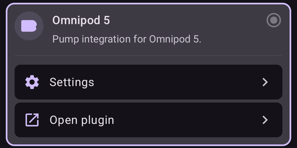

(omnipod5-pump-screen)=
## Der Omnipod-5-Pumpenbildschirm

Du öffnest ihn über **Verwalten** > **Pumpe** oder mit **Plugin öffnen** auf der Karte **Omnipod 5**. Hier aktivierst und deaktivierst Du Pods, aktualisierst den Pod-Status und siehst Dir die Pod-Historie an.

Ohne aktiven Pod zeigt das Feld **Pod Status** den Text **Kein aktiver Pod**, und die Schaltfläche **Pod aktivieren** wird angezeigt:

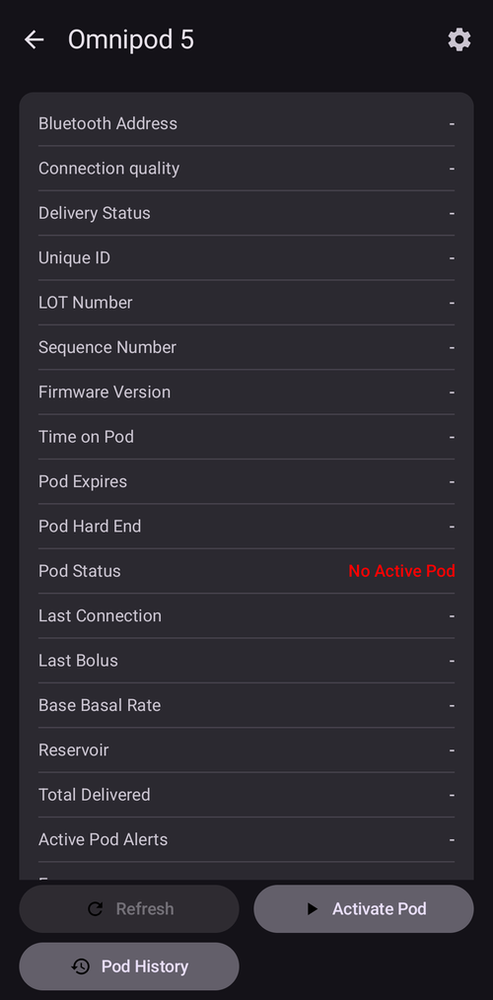

Mit aktivem Pod zeigt der Bildschirm die Pod-Informationen und die Schaltfläche **Pod deaktivieren**:

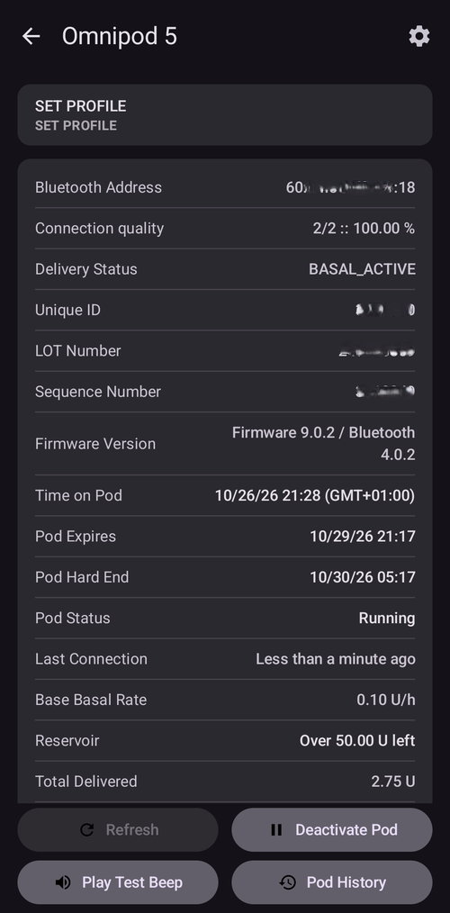

Felder und Schaltflächen sind dieselben wie auf dem DASH-Pumpenbildschirm: siehe [Felder](#omnipod-dash-tab) und die Liste der Schaltflächen darunter. Ein paar Hinweise:

- **Abgabe Status** wird nur in Builds mit Engineering-Modus angezeigt.
- **Reservoir** zeigt *Over 50.00 U left*, bis der Pod weniger als 50 Einheiten enthält. Danach wird die genaue Menge angezeigt.
- Nach einem Pod-Fehler zeigt das Feld **PDM Benachrichtigung** den Fehler so an, wie ihn die Omnipod-5-App angezeigt hätte, zum Beispiel *Blockage detected*, *Pod Out of Insulin*, *Pod Expired*, *Pod Shut-Off* oder *Pod Error*.
- Es gibt keine Schaltfläche, um den Pod anzuhalten. Um die Insulinabgabe eine Zeit lang zu stoppen, setze eine **TBR** von 0.

Das Symbol **Einstellungen** (Zahnrad) oben rechts öffnet die [Omnipod-5-Einstellungen](#omnipod5-settings).

(omnipod5-certificate)=
## Omnipod-5-Zertifikat holen

**AAPS** braucht ein persönliches Zertifikat, um sich mit Omnipod-5-Pods zu koppeln. Du bekommst es einmalig, indem Du Dich mit GitHub anmeldest. Danach kannst Du neue Pods auch ohne Internetverbindung aktivieren.

Diesen Schritt musst Du nicht selbst starten: Wenn Du auf **Pod aktivieren** tippst und noch kein Zertifikat installiert ist, öffnet **AAPS** zuerst den Bildschirm **Import certificate**.

(omnipod5-github-account)=
### Dein GitHub-Konto

Verwende das GitHub-Konto, mit dem Du **AAPS** baust. Das Konto muss:

- eine **bestätigte E-Mail-Adresse** haben: Du musst den Bestätigungslink angeklickt haben, den GitHub Dir geschickt hat,
- mindestens **7 Tage alt** sein.

Wenn Du noch kein GitHub-Konto hast, siehe [AAPS erstellen](../SettingUpAaps/BuildingAaps.md). Lege es mindestens eine Woche vor dem geplanten Start mit Omnipod 5 an.

### Schritte

1. Stelle sicher, dass das Smartphone mit dem Internet verbunden ist. Öffne den Omnipod-5-Pumpenbildschirm und tippe auf **Pod aktivieren**.

   Ohne Internetverbindung zeigt **AAPS** *Unable to connect. An internet connection is needed to retrieve your Omnipod 5 certificate.* Verbinde das Smartphone mit dem Internet und tippe auf **Try again**.

   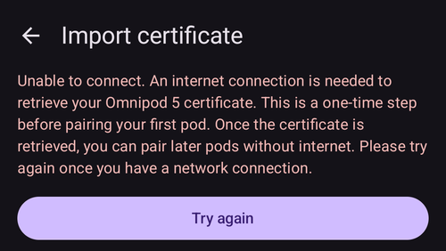

2. Der Bildschirm **Import certificate** öffnet sich und lädt die Seite **Connect O5 to AAPS**. Lies sie und tippe auf **Sign in with GitHub**.

   Deine GitHub-Anmeldung wird nur für diesen Schritt verwendet. Sie wird von **AAPS** nicht gespeichert.

   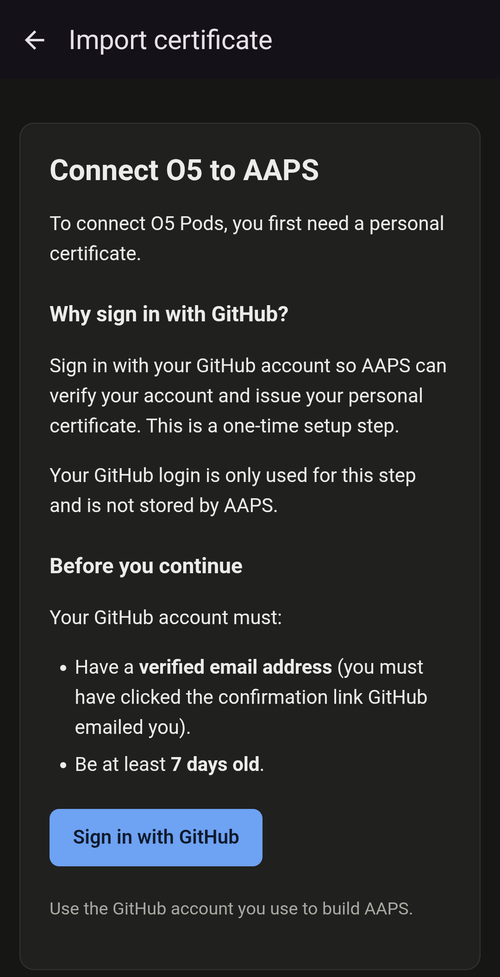

3. Die GitHub-Anmeldeseite öffnet sich: *Sign in to GitHub to continue to OSAID Keymanager*. OSAID Keymanager ist der Dienst, der Dein Zertifikat ausstellt. Gib Deinen GitHub-Benutzernamen oder Deine E-Mail-Adresse und Dein Passwort ein und tippe auf **Sign in**.

   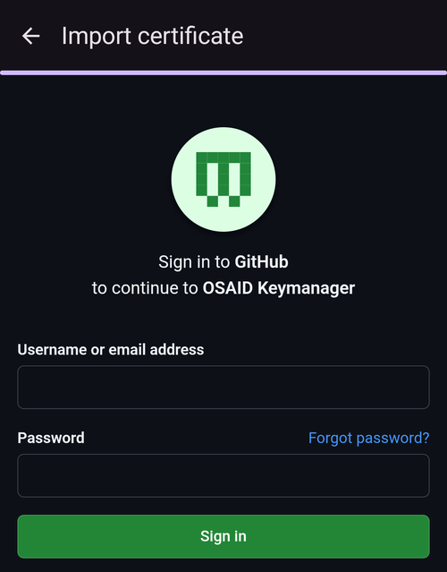

4. Wenn Du bei GitHub die Zwei-Faktor-Authentifizierung nutzt, bestätige die Anmeldung wie gewohnt. Öffne zum Beispiel die App GitHub Mobile und gib die Ziffern ein, die auf dem Smartphone angezeigt werden.

   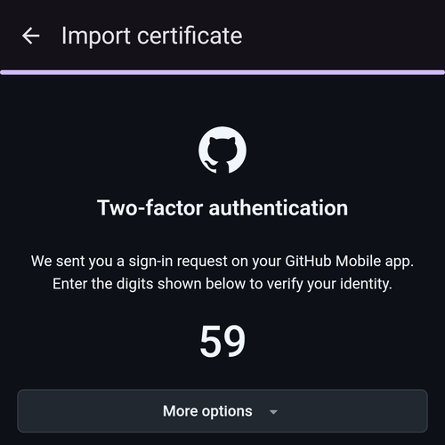

5. Kurz wird *You are being redirected to the authorized application* angezeigt. Warte einfach: Du musst nicht auf den Link tippen.

   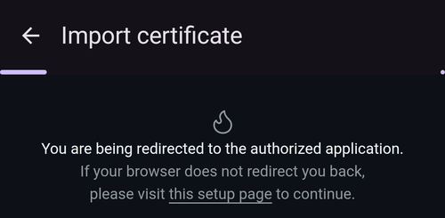

6. **AAPS** zeigt *Omnipod 5 certificate imported* an, und der Aktivierungsassistent öffnet sich beim Schritt **Pod füllen**. Mach mit [Pod aktivieren](#omnipod5-activate-pod) weiter, Schritt 2.

GitHub schickt Dir eine E-Mail, dass eine Drittanbieter-Anwendung (*OSAID Keymanager*) mit dem Bereich *user:email* für Dein Konto autorisiert wurde. Das ist so gewollt: Der Dienst liest nur Deine E-Mail-Adresse, um Dein Konto zu prüfen.

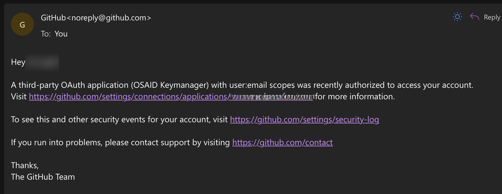

```{admonition} New phone or reinstall
:class: note
Das Zertifikat wird verschlüsselt auf dem Smartphone gespeichert. Es ist nicht Teil der exportierten Einstellungen. Nach einer Neuinstallation von **AAPS** oder auf einem neuen Smartphone bittet **AAPS** Dich beim nächsten Tippen auf **Pod aktivieren**, Dich erneut mit GitHub anzumelden. Sorge dafür, dass das Smartphone in diesem Moment eine Internetverbindung hat.
```

(omnipod5-activate-pod)=
## Pod aktivieren

1. Öffne den Omnipod-5-Pumpenbildschirm (**Verwalten** > **Pumpe**) und tippe auf **Pod aktivieren**.

   Beim ersten Mal bittet **AAPS** Dich zuerst, [Dein Zertifikat zu holen](#omnipod5-certificate).

   Hast Du in **AAPS** noch nie ein **Profil** aktiviert, zeigt der Assistent zuerst den Schritt **Profil erforderlich**: Wähle das Profil, das bei der Aktivierung angewendet werden soll, und fahre fort.

2. Fülle im Schritt **Pod füllen** einen neuen Pod mit genug Insulin für 3 Tage, **mindestens 80 Einheiten**. Achte auf zwei Pieptöne des Pods: Sie bedeuten, dass das Minimum von 80 Einheiten eingefüllt ist. Leere die Füllspritze vollständig, auch nach den zwei Pieptönen. Entferne die Nadelkappe des Pods noch nicht.

   ***HINWEIS:** Das Entlüften des Pods verbraucht etwa 3–10 Einheiten. Berücksichtige das, wenn Du das Insulin für 3 Tage berechnest.*

   Halte den neuen Pod nah an das Smartphone und tippe auf **Weiter**.

   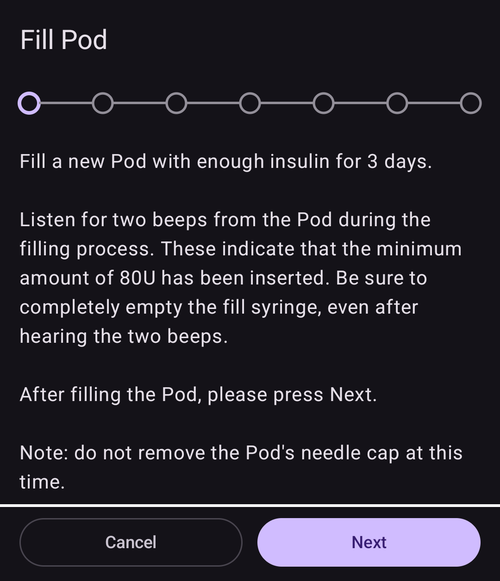

3. Wenn Du in **AAPS** mehr als ein Insulin verwendest, wird der Schritt **Insulin auswählen** angezeigt. **Wird aktiviert** zeigt das Insulin, das **AAPS** verwenden wird. Hast Du den Pod mit einem anderen Insulin gefüllt, tippe auf **Wechseln** und wähle es aus. **AAPS** führt nach Abschluss der Aktivierung einen **Profilwechsel** mit diesem Insulin durch. Tippe auf **Weiter**.

   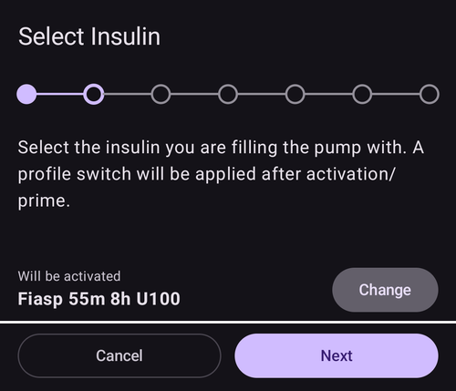

4. Im Schritt **Pod initialisieren** koppelt sich **AAPS** mit dem neuen Pod und entlüftet ihn. Du hörst ein Klicken und dann eine Reihe von Tickgeräuschen, während sich der Pod selbst entlüftet. Danach erscheint die Schaltfläche **Weiter**. Tippe auf **Weiter**.

   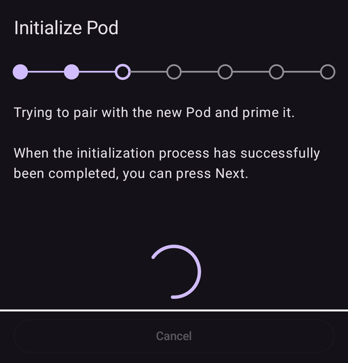    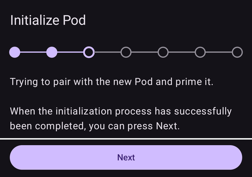

   Wird ein Fehler wie *Scan fehlgeschlagen* oder *Zu viele Pods gefunden* angezeigt, tippe auf **Erneut versuchen**. Bei *Zu viele Pods gefunden* entferne Dich zuerst von anderen Pods, die auf ihre Aktivierung warten.

5. Wenn Du den Wechsel der Setzstellen in **AAPS** verwaltest (**Wechsel der Pumpen-Einstichstellen verwalten** in den Einstellungen [Wechsel der Setzstellen](#Aapsscreens-site-rotation)), wird der Schritt **Setzstelle** angezeigt. Tippe im Körperschema auf die Stelle, an der Du den Pod setzen wirst, und tippe auf **Weiter**, oder tippe auf **Überspringen**.

   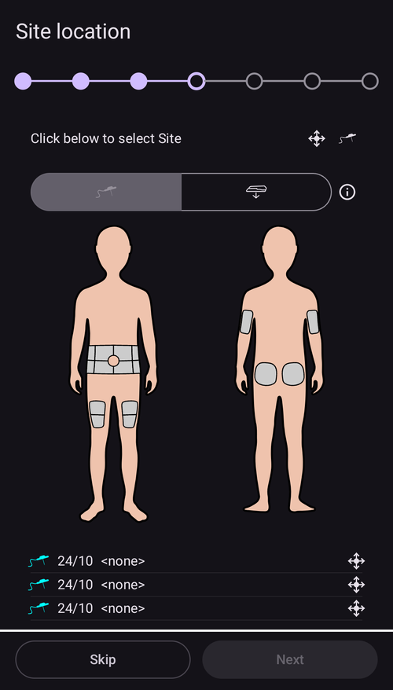

6. Bereite die Infusionsstelle vor: Wasch Dir die Hände, reinige die Haut mit Seife und Wasser oder einem Alkoholtupfer und lass sie vollständig trocknen.

   Entferne im Schritt **Pod anlegen** die Nadelkappe des Pods. Wenn die Kanüle oder etwas anderes aus dem Pod herausragt, **STOPP**: Tippe auf **Abbrechen** und beginne mit einem neuen Pod von vorn. Wenn alles normal aussieht, zieh die Schutzfolie vom Pflaster ab und klebe den Pod auf die gewählte Stelle. Tippe auf **Weiter**.

   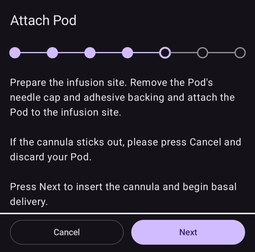

7. Ein Dialog bittet Dich um Bestätigung: *Nachdem Du OK gedrückt hast, wird die Kanüle eingeführt.* **Tippe erst auf OK, wenn der Pod an Deinem Körper befestigt ist.**

   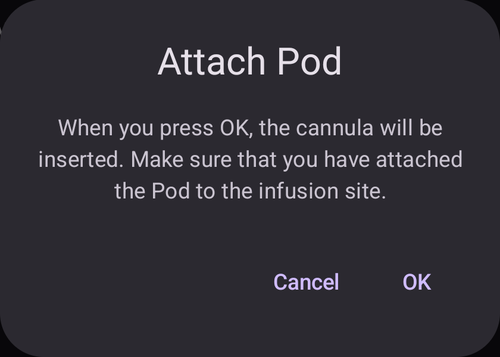

8. Im Schritt **Kanüle setzen** überträgt **AAPS** Deine Basalraten, und der Pod führt die Kanüle ein. Das kann 1–2 Minuten dauern. Sobald die Kanüle eingeführt ist, erscheint die Schaltfläche **Weiter**. Tippe auf **Weiter**.

   ***HINWEIS:** Wenn Du die Haut neben dem Pod zusammendrückst, bevor die Kanüle eingeführt wird, gleitet die Kanüle leichter hinein.*

   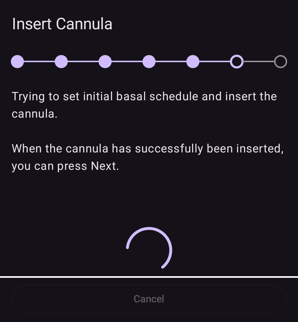    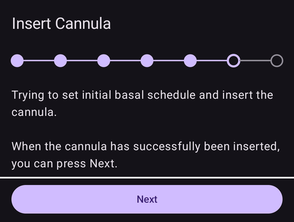

9. Der Schritt **Pod aktiviert** wird angezeigt. Prüfe, ob die Kanüle richtig eingeführt wurde. Wechsle den Pod, wenn Du glaubst, dass das nicht der Fall ist. Tippe auf **Abschließen**.

   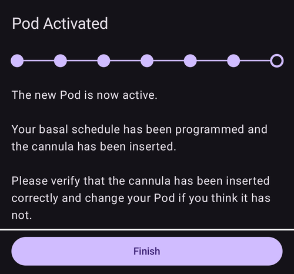

10. Der Pumpenbildschirm zeigt jetzt Deinen aktiven Pod, mit **Pod Status** *In Betrieb*. **Pod aktivieren** wird durch **Pod deaktivieren** ersetzt: Du musst den aktiven Pod deaktivieren, bevor Du einen neuen aktivieren kannst.

    ***HINWEIS:** Exportiere Deine Einstellungen nach jeder Pod-Aktivierung und kopiere die Datei an einen sicheren Ort außerhalb Deines Smartphones (siehe [Einstellungen exportieren](../Maintenance/ExportImportSettings.md)).*

Wurde eine Aktivierung abgebrochen, nachdem der Pod entlüftet war, setzt **Pod aktivieren** beim Schritt **Pod anlegen** fort.

(omnipod5-daily-use)=
## Deaktivieren, Alarme und Pod-Historie

Das funktioniert genauso wie bei DASH:

- [Pod deaktivieren](#omnipod-dash-deactivate-pod) und [Pod verwerfen](#omnipod-dash-discard-pod), wenn der Pod nicht mehr reagiert.
- [Insulinabgabe fortsetzen](#omnipod-dash-resuming-insulin-delivery), wenn die Abgabe nach einem **Profilwechsel** unterbrochen blieb.
- [Pod Alarme stummschalten](#omnipod-dash-silencing-pod-alerts) für die Alarme zum Ablauf und zum niedrigen Reservoirstand.
- [Anzeige Pod-Historie](#omnipod-dash-view-pod-history), einschließlich der kleinen Boli vom Typ *Basal Korrektur*, die der Treiber selbst abgibt.

Ein Pod läuft 72 Stunden nach der Aktivierung ab (**Pod läuft ab**). Er gibt danach noch 8 Stunden lang Insulin ab (Nachlaufzeit) und stoppt bei **Enddatum des Pods**, 80 Stunden nach der Aktivierung.

(omnipod5-settings)=
## Omnipod-5-Einstellungen

Du öffnest sie über das Symbol **Einstellungen** (Zahnrad) auf dem Omnipod-5-Pumpenbildschirm oder mit **Einstellungen** auf der Karte **Omnipod 5** unter **Konfiguration** > **Pumpe**.

Die Einstellungen sind dieselben wie bei DASH, in drei Abschnitten:

- [Bestätigungstöne](#omnipod-dash-settings): Pieptöne des Pods bei Bolus, Basal, **SMB** und **TBR**.
- **Alarme**: die Erinnerung vor dem Ablauf, der Ablauf-Alarm und der Alarm bei niedrigem Reservoirstand. Änderst Du sie, während ein Pod aktiv ist, sendet **AAPS** die neuen Alarmeinstellungen an den Pod.
- **Benachrichtigungen**: ob **AAPS** einen Ton abspielt, wenn es nicht sicher ist, ob eine **TBR**, ein **SMB** oder ein Bolus abgegeben wurde, und wenn die Abgabe unterbrochen ist.

Einen Abschnitt **Erweiterte Einstellungen** gibt es nicht: Bluetooth-Bonding ist für Omnipod 5 nicht verfügbar.

(omnipod5-troubleshooting)=
## Fehlerbehebung

Die meisten Probleme sind dieselben wie bei DASH: siehe [Fehlerbehebung](#omnipod-dash-troubleshooting) und [Bluetooth-Fehlerbehebung](../GettingHelp/BluetoothTroubleshooting.md). Die folgenden betreffen nur Omnipod 5.

### Probleme mit dem Zertifikat

- *Unable to connect. An internet connection is needed to retrieve your Omnipod 5 certificate.*: Verbinde das Smartphone mit dem Internet und tippe auf **Try again**.
- Die GitHub-Anmeldung wird abgelehnt: Prüfe, ob die E-Mail-Adresse Deines GitHub-Kontos bestätigt ist und das Konto mindestens 7 Tage alt ist.
- *Error importing certificate* oder *Could not import the certificate. Please try again.*: Geh zurück zum Pumpenbildschirm und tippe erneut auf **Pod aktivieren**.
- *This device's WebView does not support the certificate bridge.*: Aktualisiere **Android System WebView** aus dem Google Play Store und versuche es erneut.

### Unsichere Befehle

Verliert das Smartphone beim Senden eines Befehls den Kontakt zum Pod, kann **AAPS** unsicher sein, ob der Befehl ausgeführt wurde. Es zeigt dann eine Benachrichtigung an, zum Beispiel *Unable to verify whether the SMB bolus (0.55 U) succeeded. Refresh pod status to confirm or deny this command.*

Tippe auf dem Omnipod-5-Pumpenbildschirm auf **Aktualisieren**, sobald der Pod in Reichweite ist. Bis der unsichere Befehl bestätigt oder verworfen ist, sendet **AAPS** keine neuen Boli oder **TBRs** (*An earlier dose could not be confirmed with the pod, so a new one was not sent.*).

### Pod-Fehler

Fällt ein Pod aus, stoppt er die Insulinabgabe und piept. **AAPS** zeigt eine Benachrichtigung mit dem Fehlercode an. Das Feld **PDM Benachrichtigung** auf dem Pumpenbildschirm zeigt Dir, was passiert ist, so wie es die Omnipod-5-App tun würde, zum Beispiel *Blockage detected. Insulinabgabe gestoppt. Tausche jetzt den Pod. Check your BG.*

Prüfe Deinen Glukosewert, [deaktiviere den Pod](#omnipod-dash-deactivate-pod) und aktiviere einen neuen. Ein ausgefallener Pod kann nicht wieder verwendet werden.

(omnipod5-help)=
## Wo ich Hilfe bekomme

Der Omnipod-5-Treiber wird von Freiwilligen entwickelt. Lies zuerst diese Seite und die [Omnipod-DASH-Seite](../CompatiblePumps/OmnipodDASH.md). Frag dann im Kanal *#AAPS* auf **Discord** ([Einladungslink](https://discord.gg/4fQUWHZ4Mw)) oder siehe [Wo kann ich Hilfe erhalten?](../GettingHelp/WhereCanIGetHelp.md). Melde Fehler bei den [GitHub Issues](https://github.com/nightscout/AndroidAPS/issues) zusammen mit Deinen [Protokolldateien](../GettingHelp/AccessingLogFiles.md).
