# Omnipod DASH

These instructions are for configuring the **Omnipod DASH** generation pump **(NOT Omnipod Eros)**. The DASH driver is a well-established way to loop with Omnipod.

```{contents} Table of contents
:depth: 1
:local: true
```

## Omnipod DASH Spezifikationen

Key characteristics of the **Omnipod DASH** ('DASH'):

- The DASH pods are identified by a **blue needle cap** (the older EROS pod has a clear needle cap). Die Pods sind ansonsten in Bezug auf deren Abmessungen identisch.
- DASH benötigt keinen BLE-Link ein sog. Bridge Device (es wird KEIN RileyLink, OrangeLink oder EmaLink gebraucht).
- Die Bluetooth-Verbindung des DASH wird nur genutzt, wenn ein Befehl (z. B. ein Bolus) gesendet wird. Die Verbindung wird unmittelbar danach wieder getrennt.
- **AAPS** wartet zum Senden der Befehle bis der Pod erreichbar ist.
- Bei Aktivierung des Pods wird **AAPS** den neuen DASH-Pod finden und sich mit ihm verbinden.
- Erwartete Reichweite zum Smartphone: 5-10 Meter (kann individuell verschieden sein; „YMMV“).

(omnipod-dash-constraints)=

## Bekannte Omnipod DASH AAPS-Einschränkungen/Probleme
- General advice is to run **AAPS** on Android 14 or 16. Android 15 has many reported [issues](https://github.com/nightscout/AndroidAPS/issues/3471) from the community. However, if you do run on Android 15 you will likely need to turn on **Bluetooth bonding** (in the **Advanced Settings** section of the [Dash settings](#omnipod-dash-advanced-settings)) to successfully activate and use Pods, see [General Troubleshooting](../GettingHelp/GeneralTroubleshooting.md) for more info on the Bonding settings.
- DST and timezone changes are not applied automatically. After a clock change you must update the pod manually: press **Refresh** on the DASH pump screen, then press **Set time** (shown when the pod and phone time zones differ) or perform a **Profile Switch** (see [Timezone change for Omnipod Dash](#timezone-traveling-with-pumps)).
- Dash unterstützt nur Basalraten in 0,05 IE/h Schritten. Solltest Du versuchen in Deinem **AAPS-Profil** Basalraten mit 0,01 Schritten zu hinterlegen, wirst Du keine Warnmeldung von AAPS erhalten. Der Pod wird die Basalrate auf 0,05 Schritte aufrunden. If you open **Pod History** on the DASH pump screen, it will display that 0.05 basal was set. Dies bedeutet auch, dass die kleinst mögliche Basalrate des DASH in **AAPS** 0,05 IE/h beträgt.
- The settings file contains the active Pod session. Export your settings after each Pod activation, and see [Export and import settings](#omnipod-dash-export-import) before importing settings.
- Beim Setzen eines neuen Basalprofils unterbricht der DASH die Insulinabgabe, bevor das neue Basalprofil **Profil** gesetzt wird. Wenn es eine Kommunikationsstörung oder einen Fehler gibt, wird das Basalprofil nicht automatisch neu gestartet. Mehr Details hierzu findest Du im Abschnitt [Insulinabgabe fortsetzen](#omnipod-dash-resuming-insulin-delivery).
- Wenn Alarme konfiguriert sind und der Pod bald ablaufen wird, wird der Pod solange piepen, bis die Alarme stumm geschaltet werden. Der Abschnitt [Pod-Alarme stummschalten](#omnipod-dash-silencing-pod-alerts) enthält detailliertere Informationen.
- Es gibt eine Reihe von bekannten Bluetooth-Auffälligkeiten, die Probleme mit der Pod-Aktivierung verursachen können. Lies im Abschnitt [Bluetooth-Fehlerbehebung](../GettingHelp/BluetoothTroubleshooting.md) nach, um mehr über die Lösungsmöglichkeiten zu diesen Problemen zu erfahren.

(hardware-software-requirements)=

(omnipod-dash-hardware-software-requirements)=
## Hardware- und Softwareanforderungen

- Omnipod DASH kann an der blauen Nadelkappe erkannt werden.


- **Ein kompatibles Android-Smartphone** mit Bluetooth Low Energy (BLE) (siehe [Smartphones](../Getting-Started/Phones.md) für weitere Informationen). Zusätzlich helfen Dir die folgenden Informationen bei der erfolgreichen Aktivierung und Nutzung des DASH auf einem kompatiblen Smartphone:
    -  Der **AAPS** Omnipod Dash „Treiber“ verbindet sich über Bluetooth mit dem DASH Pod.  
      **AAPS** baut zum Senden eines Kommandos (z. B. eines Bolus) eine Bluetooth-Verbindung auf. Nach dem Senden wird die Bluetooth-Verbindung sofort wieder getrennt.
       - **HINWEIS:**
         - Die Bluetooth-Verbindung kann durch andere mit dem Smartphone, auf dem **AAPS** läuft, verbundene Bluetooth-Geräte (z. B. Ear Buds) gestört oder sogar unterbrochen werden. Derartige Geräte können Verbindungsfehler oder Pod-Aktivierungsprobleme auf einigen Smartphone-Modellen verursachen. It's a good idea to review the [tested hardware setups](https://docs.google.com/spreadsheets/u/1/d/e/2PACX-1vScCNaIguEZVTVFAgpv1kXHdsHl3fs6xT6RB2Z1CeVJ561AvvqGwxMhlmSHk4J056gMCAQE02sAWJvT/pubhtml?gid=683363241&single=true) list for known working configurations when choosing the phone for an Omnipod DASH setup.
         - Es gibt eine Reihe von bekannten Bluetooth-Auffälligkeiten, die Probleme mit der Pod-Aktivierung verursachen können. Im Abschnitt [Fehlerbehebung](#troubleshooting) findest Du einige Hinweise zu Bluetooth-Problemen, mit einer dedizierten Sektion zu den [Bluetooth-Problemen](#omnipod-dash-bluetooth-related-issues).
    - The phone must run **Android 12 or newer**, with **AAPS** built and installed using the [**Build APK**](../SettingUpAaps/BuildingAaps.md) instructions. Always run the latest released version.
- Ein unterstützter [**Kontinuierlicher Glucose Monitor (CGM)**](../Getting-Started/CompatiblesCgms.md)

In den nachfolgenden Anweisungen wird erläutert, wie man eine neue Pod-Sitzung mit **AAPS** aktiviert. Du solltest so lange warten, bis Dein aktueller Pod unmittelbar vor dem Laufzeitende ist, da Du mit **AAPS** ein neuen Pod aktivieren musst. Sobald ein Pod deaktiviert ist, kann er nicht wieder verwendet oder wieder aktiviert werden. Die Deaktivierung ist endgültig.

## Bevor du startest

Stelle sicher, dass Du die vorliegende Anleitung vollständig gelesen und verstanden hast, Du den Abschnitt **Bevor Du anfängst** gelesen und verstanden hast, sowie  **[Omnipod und AAPS Einschränkungen und Probleme](#omnipod-dash-constraints)** gelesen hast, um nicht in bekannte Problem zu laufen.

### **SAFETY FIRST** - Du **SOLLTEST NICHT** versuchen, **AAPS** mit einem Pod zu verbinden, bevor Du nicht die folgenden Dinge zusammenhast:
1. Zusätzliche Pods (3 oder mehr als Ersatz)
2. Ersatz-Insulin und Pen-Equipment
3. Einen funktionierenden Omnipod PDM (falls **AAPS** Probleme macht)
4. Unterstütztes Smartphone sind ein Muss! (Siehe [Hardware- und Software-Anforderungen](#hardware-software-requirements))
5. Korrekte Version von AAPS (erstellt und installiert)

### Sobald der AAPS-Dash-Treiber Deinen Pod aktiviert hat, wird Dein Omnipod Dash PDM überflüssig.
- Vor dem Umstieg auf **AAPS** hätte zum Senden eines Befehls an den Pod (z. B. Abgabe eines Bolus), das zugehörige Omnipod PDM (oder in einigen Regionen die Smartphone-App) genutzt werden müssen.
- Der DASH lässt für das Pod-Management und Senden von Befehlen, maximal eine Bluetooth-Verbindung (z. B. PDM oder Smartphone) zu.
- Das Gerät, das den Pod erfolgreich aktiviert hat, ist das einzige Gerät, das von diesem Zeitpunkt an mit ihm kommunizieren darf. Das bedeutet, dass, sobald Du einen DASH mit Deinem Android-Smartphone mit **AAPS** aktiviert hast, **kannst Du Deinen PDM nicht mehr mit diesem Pod benutzen!** Für die Zeit, in der Pod aktiv ist, ist der **AAPS** Dash-Treiber, der auf Deinem Android-Telefon läuft, jetzt der neue PDM für Deinen Pod.
- **Wirf Deinen PDM NICHT weg!** Es wird empfohlen, ihn als Backup und für Notfälle zu behalten. Das hilft insbesondere dann, wenn Dein Smartphone verloren geht oder **AAPS** nicht korrekt funktioniert.

### Dein Pod **WIRD die Insulinabgabe NICHT** stoppen, wenn er nicht mit AAPS verbunden ist.
Die Basalraten werden, wie sie im aktuell aktiven [**Profil**](../SettingUpAaps/YourAapsProfile.md) festgelegt sind, mit der Aktivierung im Pod gespeichert.  
Solange **AAPS** funktioniert, wird es Basalraten-Anpassungen mit einer maxmalen Gültigkeit von 120 Minuten senden.  
Sollte der Pod aus irgendeinem Grund keine neuen Befehle erhalten (wenn z. B. die Verbindung aufgrund der Entfernung zum Smartphone abbricht), wird der Pod auf die in Deinem [**Profil**](../SettingUpAaps/YourAapsProfile.md) hinterlegte Standard-Basalrate zurückfallen.

### AAPS Profil(e) unterstützen keine halbstündlichen Basalraten
Wenn Du noch unerfahren mit **AAPS** sein solltest und erstmalig Deine Basalraten in Dein [**Profil**](../SettingUpAaps/YourAapsProfile.md) einpflegst, beachte, dass Basalraten nur zur vollen Stunde beginnen dürfen. Ein Start zur halben Stunde wird nicht unterstützt. Beispiel: Wenn Du auf Deinem Omnipod PDM eine Basalrate von 1,1 IE, die um 09.30h für 2h startet und um 11:30h zu Ende ist hinterlegt hast, wird es nicht möglich sein, diese Basalrate exakt so im Basal-**Profil** für **AAPS** abzubilden.  
Du wirst die Basalrate von 1,1 IE entweder auf das Zeitfenster von 9:00-11:00 oder 10:00-12:00 verschieben müssen. Auch wenn die DASH-Hardware 30-minütige-Segmente im Basalraten-**Profil** managen kann, unterstützt **AAPS** dieses Feature NICHT.

### 0 IE/h im Basalraten-Profil werden in AAPS NICHT unterstützt
Auch wenn der DASH „Null-Basalraten“ unterstützt, nutzt **AAPS** Vielfache Deiner im **Profile** hinterlegten Basalrate, um festzulegen mit wieviel Insulin automatisch behandelt werden soll. Das funktioniert mit einer „Nul-Basalrate“ jedoch nicht.  
Eine temporäre Basalrate mit 0 IE/h kann mit Hilfe der „Pumpe trennen“-Funktion oder durch eine Kombination von „Loop/temporäre Basalrate stoppen“ oder „Loop/temporäre Basalrate aussetzen“ nachgebildet werden.  
**HINWEIS:** Die kleinste zulässige Basalrate des DASH in **AAPS** beträgt 0,05 IE/h.

## DASH in AAPS auswählen

There are **two** ways to select the Omnipod DASH driver in **AAPS**:

### Option 1: Neue Installation

When you install **AAPS** for the first time, the **Setup Wizard** guides you through the key features and installation requirements of **AAPS**. When you reach the **Pump** step, select **Omnipod Dash**.

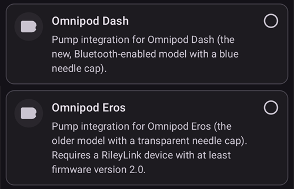

If you are not sure yet, you can select **Virtual Pump** for now and select **Omnipod Dash** later, after setting up **AAPS** (see Option 2).

(omnipod-dash-option-2-config-builder)=
### Option 2: The Configuration screen

On an existing installation you can select the **Omnipod Dash** pump from the **Configuration** screen:

1. Open the **menu** (☰) in the top-left corner of the main screen and select **Configuration**.
2. Tap **Pump** and select the radio button of **Omnipod Dash** (*"Pump integration for Omnipod Dash (the new, Bluetooth-enabled model with a blue needle cap)"*).

3. Once it is selected, the **Omnipod Dash** card shows two buttons:
   - **Settings** opens the [Dash settings](#omnipod-dash-settings).
   - **Open plugin** opens the [DASH pump screen](#omnipod-dash-tab).

   

### Überprüfung der Omnipod-Treiberauswahl

To check that **Omnipod Dash** is selected, open **Manage** (bottom navigation of the main screen) and tap **Pump**. The DASH pump screen opens, as shown in the next section.

(omnipod-dash-tab)=

## The DASH pump screen

The DASH pump screen is where you manage your pods: activate and deactivate them, refresh the pod status, silence alerts and look at the pod history. Open it with **Manage** > **Pump**, or with **Open plugin** on the **Omnipod Dash** card in **Configuration** > **Pump**.

This is the screen without an active pod:


And this is the screen with an active pod:


The **Settings** (gear) icon in the top-right corner opens the [Dash settings](#omnipod-dash-settings).

***NOTE:** If a field on the pump screen shows (uncertain), press **Refresh** to update the pod status.*

### Felder

- **Bluetooth Address:** The Bluetooth address of the pod.

- **Connection quality:** How reliably **AAPS** connects to the pod, shown as *successful connections / all connection attempts :: success rate*, for example `412/420 :: 98.10 %`. After more than 50 successful connections, the value turns yellow below 90 % and red below 70 %. A low value points to a Bluetooth problem (see [Bluetooth related issues](#omnipod-dash-bluetooth-related-issues)).

- **Delivery Status:** The raw delivery status reported by the pod. This field is shown only in engineering mode builds.

- **Unique ID:** The unique ID **AAPS** gave to the pod during activation.

- **LOT Number:** The production lot number of the pod.

- **Sequence Number:** The sequence number of the pod.

- **Firmware Version:** The firmware and Bluetooth versions of the pod.

- **Time on Pod:** The current time on the pod, with its time zone. The text turns red when the time zone of the pod is different from the time zone of the phone, and yellow when the pod time is more than 10 minutes off.

- **Pod Expires:** The date and time when the pod expires (72 hours after activation). The text turns yellow in the last 4 hours before this time. It never turns red, because the pod keeps delivering insulin after it.

- **Pod Hard End:** The end of the pod's grace period (8 hours after **Pod Expires**, for a maximum pod life of 80 hours). The text turns yellow when the grace period starts (at **Pod Expires**) and red in the last 4 hours before the hard end. During the grace period it also shows the time left, for example *(17m remaining)*. The pod stops delivering insulin at the hard end and must be changed.

- **Pod Status:** The state of the pod: **No Active Pod**, **Setup in progress**, **Running**, **Suspended** or, after a pod fault, **ALARM**.

- **Last Connection:** How long ago **AAPS** last communicated with the pod.

  - *Moments ago* - less than 10 seconds ago.

  - *Less than a minute ago* - between 10 and 60 seconds ago.

  - *XX minutes ago* - more than 1 minute ago (and *X hours and XX minutes ago* after an hour).

- **Last bolus:** The amount of the last bolus sent to the pod and how long ago it was given. An unconfirmed bolus is marked (uncertain).

- **Base Basal Rate:** The basal rate programmed for the current time in your basal **Profile**.

- **Temp Basal Rate:** The temporary basal rate (TBR) that is currently running, with its start time and duration. This field is only shown while a TBR is running.

- **Reservoir:** Shows *Over 50 U left* when more than 50 units are left in the reservoir. Below 50 units, the exact amount is shown. The value turns red below 20 units.

- **Total Delivered:** The total amount of insulin delivered from the reservoir. This includes the insulin used for priming.

- **Active Pod Alerts:** Alerts that are currently active on the pod, for example *Pod will expire soon* or *Low Reservoir*.

- **Errors:** The pod fault, if the pod has failed, shown in red as *Pod Fault:* followed by the fault code and name, for example *Pod Fault: 020 ALARM_OCCLUDED*. Review the [Pod History](#omnipod-dash-view-pod-history) and the log files for past errors and more detailed information. See [Pod Failures](#omnipod-dash-pod-failures).

- **PDM Notification:** Shown only after a pod fault. It shows the fault the way the Omnipod PDM would have shown it: a title (for example *Occlusion Detected*, *Empty Reservoir* or *Pod Expired*), what happened (for example *Insulin delivery stopped. Change Pod now.*) and a *Ref:* code.

### Schaltflächen

The buttons at the bottom of the pump screen change with the state of the pod. Only the buttons that make sense at that moment are shown.

- **Refresh:** Asks the pod for its current status.
  - *Use it to update the pod status and to clear fields that show (uncertain).*
  - *See the [Troubleshooting](#omnipod-dash-troubleshooting) section below for more information.*

- **Silence Alerts:** Stops the pod alert beeps (for example pod expiry or low reservoir). Shown only while the pod has an active alert. See [Silencing Pod Alerts](#omnipod-dash-silencing-pod-alerts).

- **Resume Delivery:** Resumes insulin delivery on a suspended pod. Shown only when delivery is suspended. See [Resuming Insulin Delivery](#omnipod-dash-resuming-insulin-delivery).

- **Set time:** Updates the pod to the time zone of your phone by sending your basal **Profile** again. Shown only when the time zone of the pod differs from the time zone of your phone.

- [**Pod aktivieren**](#omnipod-dash-activate-pod): Füllt und aktiviert einen neuen Pod. Shown when no pod is active.

- [**Deactivate Pod**](#omnipod-dash-deactivate-pod): Deactivates the active pod. Shown as soon as a pod is paired with **AAPS**, also when an activation stopped part-way (for example because the pod failed during activation). **AAPS** asks you to confirm before it deactivates the pod.

- **Play Test Beep:** Makes the pod play a single test beep.

- [**Pod History**](#omnipod-dash-view-pod-history): Shows the activity history of the active pod.

- **Discard Pod:** Removes an unfinished pod from **AAPS**. Shown only when a pod activation stopped part-way. **AAPS** asks you to confirm. After discarding, **AAPS** can no longer communicate with that pod: remove it from your body.

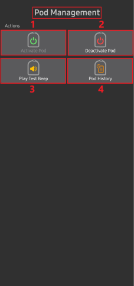

```{admonition} Older screenshot
:class: note
The screenshot above is from an earlier **AAPS** version, which had a separate **Pod Management** menu. In **AAPS** 4 all these actions, including **Activate Pod**, **Deactivate Pod**, **Play Test Beep** and **Pod History**, are buttons with text labels directly on the pump screen.
```

(omnipod-dash-activate-pod)=

## Pod aktivieren

1. Open the DASH pump screen (**Manage** > **Pump**) and press **Activate Pod**. The activation wizard opens.

   

   ```{admonition} Older screenshot
   :class: note
   The screenshot above is from an earlier **AAPS** version. In **AAPS** 4 **Activate Pod** is a button directly on the DASH pump screen instead of in the **Pod Management** menu.
   ```

   If you have never activated a **Profile** in **AAPS** before, the wizard first shows the **Profile required** step: select the profile to apply on activation and continue.

2. The **Fill Pod** step is shown. Fill a new pod with enough insulin for 3 days, **at least 80 units**. Listen for two beeps from the pod: they mean the minimum amount of 80 units has been filled. Empty the fill syringe completely, even after hearing the two beeps. Do not remove the pod's needle cap yet.

   ***NOTE:** When you calculate the amount of insulin you need for 3 days, remember that priming the pod uses about 3-10 units.*

   

   

   Make sure that the new pod and the phone running **AAPS** are close to each other and press **Next**.

3. If you use more than one insulin in **AAPS**, the **Select Insulin** step is shown. It shows the **Currently active** insulin. If you filled the pod with a different insulin, press **Change** and select it. **AAPS** applies a **Profile Switch** with this insulin when the activation is finished. Press **Next**.

   

4. On the **Initialize Pod** step, **AAPS** pairs with the new pod and primes it. You hear a click followed by a series of ticking sounds as the pod primes itself. When this has finished successfully, the **Next** button appears. Press **Next**.

   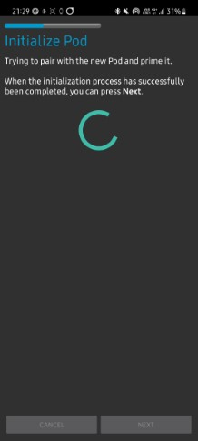    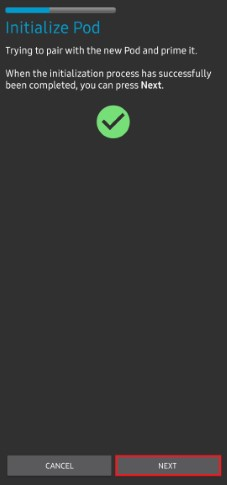

   ***NOTE**: If an error message such as _Scan failed_ or _'Could not find an available pod for activation'_ appears (this can happen), do not panic. Press **Retry**. In most cases the activation then continues successfully.*

   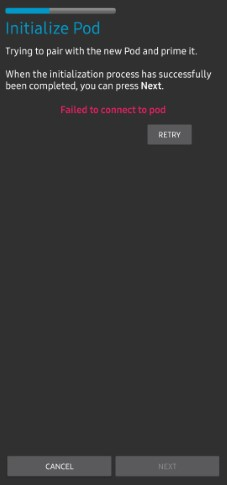

   If the pod has failed (for example because its activation time was exceeded), **Deactivate Pod** is shown instead of **Retry**. Use it and start again with a new pod.

   If you press **Cancel** before the activation is finished, **AAPS** asks you to confirm that you want to exit. Press **OK** to leave the wizard, or **Cancel** to stay.

   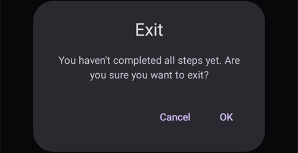

5. If you manage pump site rotation in **AAPS** (**Manage pump site rotation** in the [Site Rotation](#Aapsscreens-site-rotation) settings), the **Site location** step is shown. Select where you are going to place the pod on the body diagram and press **Next**, or press **Skip**.

   

6. Next, prepare the infusion site for the new pod. Wash your hands to avoid any risk of infection. Clean the infusion site with soap and water or an alcohol wipe, and let the skin air dry completely before you continue. If the adhesive irritates your skin, consider using a barrier wipe or barrier spray.

   On the **Attach Pod** step, remove the pod's blue plastic needle cap. If the cannula or anything else sticks out of the pod, or it looks unusual, **STOP**: press **Cancel** and start again with a new pod. If everything looks **OK**, take off the white paper backing from the adhesive and stick the pod to the chosen site on your body.

   When finished, press **Next**.

   

7. A confirmation dialog appears: *When you press OK, the cannula will be inserted.* **Press OK ONLY if you are ready to insert the cannula!**

   

8. On the **Insert Cannula** step, **AAPS** sets your basal schedule and the pod inserts the cannula. This can take some time (1-2 minutes maximum). Wechsele zur Registerkarte **DASH**.

   ***NOTE:** It is good practice to pinch the skin near the cannula insertion point before the cannula is inserted. This helps the needle go in smoothly and lowers your chance of occlusions (blockages).*

   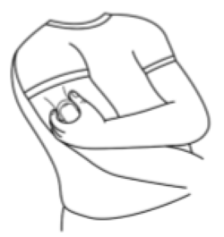    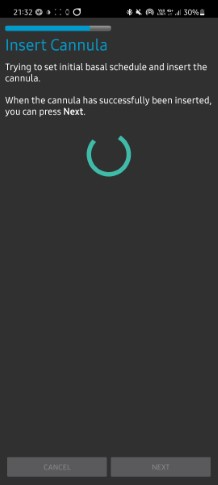

9. When the cannula has been inserted successfully, the **Next** button appears. Press **Next**.

   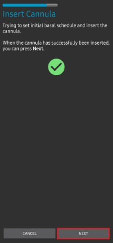

10. The **Pod Activated** step is shown. Check that the cannula has been inserted correctly, and change the pod if you think it has not.

    Press **Finish**.

    Glückwunsch! Du hast jetzt eine neue Pod-Sitzung gestartet.

    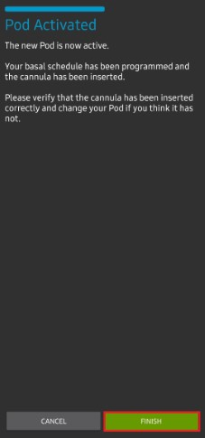

11. You are back on the DASH pump screen. It now shows the information of your active pod, including the current basal rate, reservoir level, insulin delivered, pod errors and alerts. **Activate Pod** is replaced by **Deactivate Pod**: you cannot activate another pod without deactivating the active pod first.

    ***NOTE:** For more details on the information shown, see [The DASH pump screen](#omnipod-dash-tab).*

    

    ***NOTE:** It is good practice to export your settings AFTER activating the pod. Export your settings after each pod change and once a month. Copy the exported settings file to a cloud storage location (for example Google Drive) or somewhere off your phone in case you lose your phone (see [**Export settings**](../Maintenance/ExportImportSettings.md)).*

If an earlier activation stopped after the pod was primed, pressing **Activate Pod** continues from the **Attach Pod** step.

(omnipod-dash-deactivate-pod)=

## Pod deaktivieren

Under normal circumstances, a pod lasts three days (72 hours), plus a grace period of 8 hours after the pod expiry warning: 80 hours in total.

To deactivate a pod (either because it expired or because it failed):

1. Open the DASH pump screen (**Manage** > **Pump**) and press **Deactivate Pod**.

   

2. On the **Deactivate Pod** step, press **Next**. A dialog asks *A deactivated Pod can not be used again. Deactivate this Pod now?* Press **OK** to start deactivating the pod, or **Cancel** to keep it. Deactivation suspends all insulin delivery and cannot be undone.

   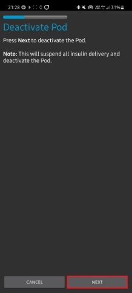

3. The **Deactivating Pod** step is shown while **AAPS** deactivates the pod. The pod beeps to confirm that deactivation was successful.

   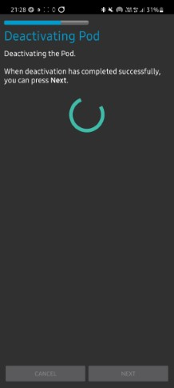

   ```{admonition} Older screenshot
   :class: note
   The screenshot above is from an earlier **AAPS** version. In **AAPS** 4 the wizard shows its progress as a row of dots at the top instead of a progress bar.
   ```

   When deactivation has finished successfully, the **Next** button appears. Press **Next**.

   

   If deactivation fails, an error message and a **Discard Pod** button are shown. See [Discarding a pod](#omnipod-dash-discard-pod) below before you use it. You can also press **Cancel** and try **Deactivate Pod** again later.

4. The **Pod Deactivated** step is shown. Remove the pod from your body and press **Finish**.

   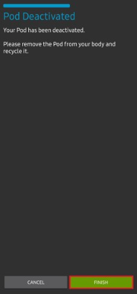

5. You are back on the DASH pump screen. Check that the **Pod Status** field shows **No Active Pod** and that the **Activate Pod** button is shown again.

   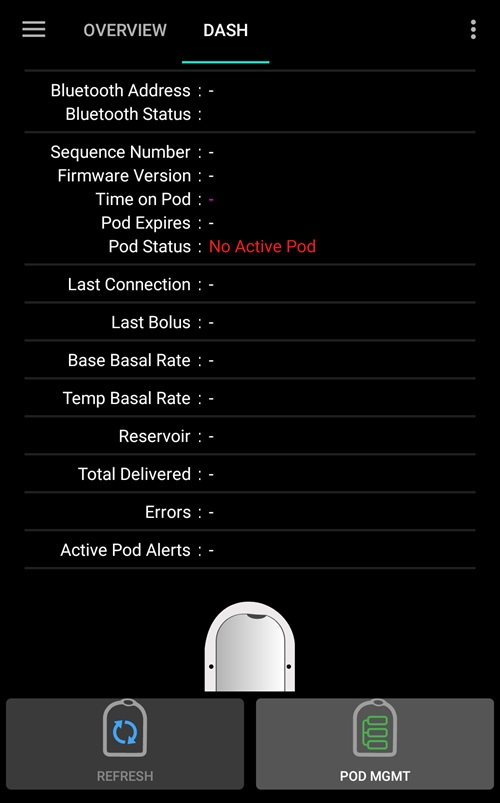

(omnipod-dash-discard-pod)=

### Discarding a pod

Only discard a pod when all communication with it keeps failing. If **AAPS** can still communicate with the pod, use **Deactivate Pod** instead.

- **AAPS** asks you to confirm before it discards the pod.
- After that, **AAPS** can no longer communicate with that pod.
- **Insulin delivery has NOT been suspended**, because the pod was not deactivated properly. **Remove the pod from your body!**
- The **Pod Discarded** step confirms that the pod state has been discarded. Press **Finish**. You can now activate a new pod.

(omnipod-dash-resuming-insulin-delivery)=

## Insulinabgabe fortsetzen

**NOTE**: During **Profile Switches**, like when using the PDM, **AAPS** must suspend delivery on the pod before setting the new basal **Profile**. If communication fails between the suspend and resume commands, delivery can stay suspended. Read [**Delivery suspended**](#omnipod-dash-delivery-suspended) in the troubleshooting section for more details.

When insulin delivery is suspended, you need to tell the pod to resume insulin delivery. When the command has been processed successfully, the pod delivers insulin again using the basal rate for the current time from your active basal **Profile**. The pod again accepts commands for bolus, **TBR** and **SMB**.

1. Open the DASH pump screen and check that the **Pod Status** field shows **Suspended**. Press **Resume Delivery** to tell the pod to resume normal insulin delivery.

   

2. When the command was successful, the **Pod Status** field shows **Running** and the **Resume Delivery** button disappears.

   

   

   ```{admonition} Older screenshot
   :class: note
   The screenshots above are from an earlier **AAPS** version, which showed a confirmation dialog. In **AAPS** 4 you confirm the result on the DASH pump screen: the **Pod Status** field shows **Running** and the **Resume Delivery** button is gone.
   ```

   If the command fails, **AAPS** shows a warning dialog starting with *Failed to resume delivery*. Press **Refresh** and try again.

   

(omnipod-dash-silencing-pod-alerts)=

## Pod Alarme stummschalten

This section explains how to stop the pod beeps when the pod approaches the end of its life. When these beeps start depends on the **Alerts** settings (see [Dash Settings](#omnipod-dash-settings)):

- **Reminder at hours before expiry (72 Hours):** how many hours before the 72-hour expiry the pod starts to beep.
- **Alert at hours before shutdown (80 Hours):** how many hours before the 80-hour shutdown the pod beeps again.

The maximum life of a pod is 80 hours (3 days 8 hours). However, the pod manufacturer recommends not going beyond 72 hours (3 days).

***NOTE**: The **Silence Alerts** button is only shown on the DASH pump screen while the pod has an active alert, for example pod expiry or low reservoir. If the **Silence Alerts** button is not shown but you hear the pod beeping, press **Refresh**.*

1. When the reminder time is reached, the pod beeps to tell you that it will expire soon and that you need to change it. On the DASH pump screen, the **Pod Expires (1)** field shows the exact time the pod will expire (72 hours after activation). The text turns yellow 4 hours before this time. After it, **Pod Hard End** turns yellow and shows the time left until the pod stops delivering insulin. The **Active Pod Alerts (2)** field shows **Pod will expire soon**, and the **Silence Alerts (3)** button is shown.

   

2. Press **Silence Alerts**. **AAPS** sends the command to the pod to stop the expiry beeps.

   

   ```{admonition} Older screenshot
   :class: note
   The screenshot above is from an earlier **AAPS** version, where this screen was the **DASH** tab. In **AAPS** 4 the **Silence Alerts** button is on the DASH pump screen (**Manage** > **Pump**).
   ```

3. When the alerts have been silenced, the alert is no longer shown in the **Active Pod Alerts** field, the **Silence Alerts** button disappears, and the pod stops its expiry beeps.

   

   ```{admonition} Older screenshot
   :class: note
   The screenshot above is from an earlier **AAPS** version, which showed a confirmation dialog. In **AAPS** 4 you confirm the result on the DASH pump screen: the alert is gone from the **Active Pod Alerts** field.
   ```

   If the command fails, **AAPS** shows a warning dialog starting with *Failed to silence alerts*. Press **Refresh** and try again.

The low reservoir alert works the same way. When the insulin left in the pod drops to the **Number of units** set in the **Alerts** settings, the pod beeps. The **Reservoir** field shows the amount left, the **Active Pod Alerts** field shows **Low Reservoir**, and the **Silence Alerts** button is shown. Press **Silence Alerts** to stop the beeps, and plan your next pod change.


(omnipod-dash-view-pod-history)=

## Anzeige Pod-Historie

This section explains how to look at the history of your active pod and filter it by type of action. The pod history shows the commands sent to your active pod and their results during its three-day (72 - 80 hours) life.

It is useful to check the boluses, TBRs and basal commands that were sent to the pod. The other categories help with troubleshooting and show the order of events that led up to a failure.

***HINWEIS:** ** Nur der letzte Befehl kann unsicher sein**. New commands *are not sent* until the **last 'uncertain' command becomes 'confirmed' or 'denied'**. To 'fix' an uncertain command, press **Refresh** on the DASH pump screen.*

1. Open the DASH pump screen and press **Pod History**.

   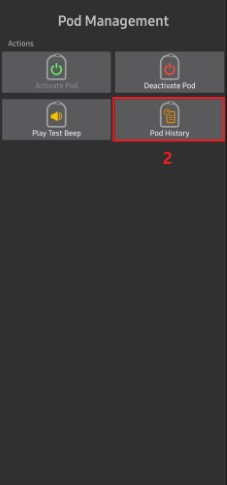

   ```{admonition} Older screenshot
   :class: note
   The screenshot above is from an earlier **AAPS** version. In **AAPS** 4 **Pod History** is a button directly on the DASH pump screen instead of in the **Pod Management** menu.
   ```

2. The **Pod History** screen opens with the **All** filter selected. It lists every command with its time and result, newest first, grouped by day. Use the filter buttons at the top (for example **Boluses** or **Basals**) to show only one type of command. Press the back arrow to return to the DASH pump screen.

    

   ```{admonition} Older screenshot
   :class: note
   The second screenshot above is from an earlier **AAPS** version, where you picked the type of command from a **Type** list. In **AAPS** 4 you use the filter buttons shown in the first screenshot.
   ```

   For boluses, the amount is followed by the bolus type when it is not a normal bolus, for example *0.05 U (SMB)* or *0.05 U (Basal correction)*. A basal correction is a very small bolus (one pod pulse, 0.05 U) that the driver sends by itself; you did not request it.

   ```{admonition} Why basal corrections happen
   :class: note
   The pod delivers basal insulin in pulses of 0.05 U, timed by an internal clock. Each time the basal rate changes (for example when the loop sets a new **TBR**), the pod restarts this clock, and the pulse it was counting towards is lost. Because the loop changes the basal rate often, especially overnight, the pod can end up delivering less basal insulin than expected.

   **AAPS** compares the basal insulin the pod reports as delivered with what it should have delivered. When the shortfall reaches half a pulse or more, the driver delivers one extra pulse as a basal correction, so you still get the basal insulin your profile and the loop asked for. No correction is sent while the pod is suspended, or while a zero **TBR** is running.
   ```

(omnipod-dash-settings)=

## DASH-Einstellungen

There are two ways to open the Dash driver settings:

- Press the **Settings** (gear) icon in the top-right corner of the [DASH pump screen](#omnipod-dash-tab).
- Open the **menu** (☰) in the top-left corner of the main screen and select **Configuration** > **Pump**. On the **Omnipod Dash** card, press **Settings**.

The settings are grouped into four expandable sections: **Confirmation Beeps**, **Alerts**, **Notifications** and **Advanced Settings**. Tap a section to open it:


Most settings are on/off switches.

### Confirmation Beeps


Confirmation beeps from the pod for bolus, basal, SMB and TBR delivery and changes.

**Bolus beeps enabled:**    The pod beeps when a bolus is delivered. On by default.

**Basal beeps enabled:**    The pod beeps when a new basal rate is set, or when the active basal rate is canceled or changed. Off by default.

**SMB beeps enabled:**  The pod beeps when an SMB is delivered. On by default.

**TBR beeps enabled:**  The pod beeps when a TBR is set or canceled. Off by default.

### Alarme


```{admonition} Older screenshot
:class: note
The screenshot above is from an earlier **AAPS** version. In **AAPS** 4 these settings are in the expandable **Alerts** section.
```

Pod alerts for pod expiry, shutdown and low reservoir. When you change these settings while a pod is active, **AAPS** sends the new alert settings to the pod.

***NOTE:** An **AAPS** notification is ALWAYS shown for any alert once **AAPS** has communicated with the pod after the alert was triggered. Dismissing the notification does NOT stop the pod alert. To stop the alert, open the DASH pump screen and press **Silence Alerts**.*

**Expiration reminder enabled:**    When this is on, the pod beeps when the reminder time is reached. On by default.

**Reminder at hours before expiry (72 Hours):** How many hours before the 72-hour pod expiry the reminder starts (1 to 24 hours; default 4).

**Expiration alert enabled:**   When this is on, the pod beeps when the alert time is reached, and again 1 hour before shutdown. On by default.

**Alert at hours before shutdown (80 Hours):**  How many hours before the 80-hour pod shutdown the alert starts (1 to 8 hours; default 8).

**Low reservoir alert enabled:**    The pod alerts you when the insulin left in the reservoir drops to the value in **Number of units**. On by default.

**Number of units:**    The number of units at which the low reservoir alert is triggered (5 to 50 units; default 20).

### Benachrichtigungen

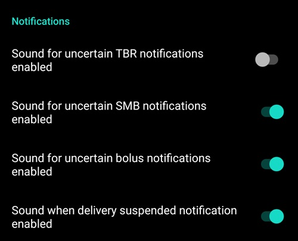

Choose whether **AAPS** plays a sound with its notifications when it is uncertain whether a TBR, SMB or bolus was delivered, and when delivery is suspended.

***NOTE:** These are phone notifications only; the pod itself does not beep.*

**Sound for uncertain TBR notifications enabled:**  Plays a sound with the notification when **AAPS** is uncertain whether a TBR was set.

**Sound for uncertain SMB notifications enabled:**  Plays a sound with the notification when **AAPS** is uncertain whether an SMB was delivered.

**Sound for uncertain bolus notifications enabled:**    Plays a sound with the notification when **AAPS** is uncertain whether a bolus was delivered.

**Sound when delivery suspended notification enabled:**     Plays a sound with the notification when insulin delivery is suspended.

(omnipod-dash-advanced-settings)=

### Erweiterte Einstellungen


**Bluetooth bonding:**  Bonds the pod with the phone over Bluetooth. Try it only if the pod cannot keep a stable connection, for example on Android 15 (see [Omnipod DASH known AAPS constraints/issues](#omnipod-dash-constraints)). When it is on, the phone shows pairing requests that you must accept. Leave it off if the pod connects fine. It has no effect below Android 15. Off by default.

## Insulin and cannula age

The [status row](#screens-sensor-level-battery) on the main screen shows the age of your insulin and cannula. With Omnipod, these work a little differently than with tube-based pumps.

**AAPS** records a cannula change and an insulin change automatically each time you activate a pod. This resets the **Insulin** and **Cannula** ages to zero after every pod change. You do not need to record them yourself with **Prime/Fill**. This is because the pod inserts the cannula directly into the skin where it is attached: Omnipod does not use a tube.

**Pump battery** age is not reported: the battery and the insulin reservoir are built into each pod, and the battery always lasts longer than the pod itself (maximum 80 hours).


```{admonition} Older screenshot
:class: note
The screenshot above is from an earlier **AAPS** version, where these ages were shown in the **Careportal** section of the **Actions** tab. In **AAPS** 4 they are shown in the status row on the main screen.
```

### Level

**Insulin Level**

The insulin level shown is the amount reported by the pod. However, the pod only reports the actual reservoir level when it is below 50 units. Until then, *Over 50 U left* is shown. The amount reported is not exact: when the pod reports 'empty', in most cases the reservoir still has a few units of insulin left.

The DASH pump screen shows the level as follows:

  * **Over 50 U left** - The pod reports more than 50 units in the reservoir.
  * **Below 50 units** - The exact amount of insulin left in the reservoir, as reported by the pod.

Sonstiges
  * **SMS** - Returns the value, or 50+U when over 50 units, in SMS responses.
  * **Nightscout** - Uploads a value of 50 when over 50 units to Nightscout (version 14.07 and older). Newer versions report a value of 50+ when over 50 units.

(omnipod-dash-troubleshooting)=

## Problembehandlung

Dieser Abschnitt behandelt bekannte Probleme und Lösungen für den Einsatz des Omnipod DASH mit AAPS. Es gibt in der Dokumentation auch einen Abschnitt [Allgemeine Fehlerbehebung](../GettingHelp/GeneralTroubleshooting.md), den Du lesen solltest, da dort auch relevante Pod-Themen abgedeckt werden.

---

(omnipod-dash-bluetooth-related-issues)=

## Bluetooth-Probleme

Bei bekannten Problemen mit Bluetooth-Verbindungen, Pumpen/Pods oder Aktivierungs- und Verbindungsproblemen schau im Abschnitt [Bluetooth-Fehlerbehebung](../GettingHelp/BluetoothTroubleshooting.md) nach.

---

(omnipod-dash-delivery-suspended)=

### Insulinabgabe unterbrochen

  - Es gibt keine Unterbrechen-Taste mehr. Wenn Du die Insulinabgabe unterbrechen möchtest, kannst Du eine Null-**TBR** für x Minuten setzen.
  - Während eines **Profilwechsels** muss der DASH die Insulinabgabe unterbrechen, bevor das neue Basal-**Profil** gesetzt wird. Wenn die Kommunikation zwischen den beiden Befehlen fehlschlägt, kann die Insulinabgabe unterbrochen bleiben. Wenn das passiert:
     - Es gibt dann keine Insulinabgabe; dies schließt Basal, SMB, manuelle Boli usw. ein.
     - Es kann eine Benachrichtigung geben, dass einer der Befehle unbestätigt blieb: Dies hängt davon ab, wann der Fehler aufgetreten ist.
     - **AAPS** wird alle 15 Minuten versuchen, das neue Basalprofil zu setzen.
     - **AAPS** wird alle 15 Minuten darüber benachrichtigen, dass die Insulinabgabe unterbrochen ist, sofern die Abgabe noch immer unterbrochen ist (Insulinabgabe konnte nicht gestartet werden).
     - The [**Resume Delivery**](#omnipod-dash-resuming-insulin-delivery) button is shown on the DASH pump screen if you want to resume delivery manually.
     - Wenn **AAPS** die Abgabe nicht alleine fortsetzen kann (dies geschieht, wenn der Pod nicht erreichbar ist, der Ton stumm geschaltet ist, etc.), beginnt der Pod für 3 Minuten jede Minute viermal zu piepen. Das wird, wenn die Abgabe für mehr als 20 Minuten ausgesetzt ist, alle 15 Minuten wiederholt.
  - For unconfirmed commands, press **Refresh** on the DASH pump screen to confirm or deny them.

*****HINWEIS:** Wenn Du Pieptöne vom Pod hörst, kannst Du nicht davon ausgehen, dass die Insulinabgabe ohne Überprüfung im Smartphone fortgesetzt wird. Die Abgabe könnte weiterhin ausgesetzt bleiben, ***also musst Du prüfen, was los ist!******

---
(omnipod-dash-pod-failures)=

### Pod Fehler

- Pods fallen gelegentlich aus unterschiedlichen Gründen aus, u. a. wegen Hardwareproblemen mit dem Pod selbst.
- Da AAPS offiziell nicht für die Interaktion mit Pods zugelassen ist, sollten keine Support-Tickets für Ersatz-Pods bei Insulet aufgemacht werden.
- Um die Ursache zu ermitteln, kannst Du in [**dieser Liste**](https://github.com/openaps/openomni/wiki/Fault-event-codes) die Fehlercodes nachschlagen.

When a pod fails, it stops delivering insulin and beeps continuously. **AAPS** shows a notification on the main screen with the fault code and name, and the *Ref:* code, for example *Pod Fault: 020 ALARM_OCCLUDED*. Press **Dismiss** to close the notification. This does not stop the pod beeping.


On the DASH pump screen, the **Pod Status** field shows **ALARM**, the **Errors** field shows the pod fault, and the **PDM Notification** field explains it, for example *Occlusion Detected. Insulin delivery stopped. Change Pod now. Check your BG*.


A failed pod cannot be used again. Check your blood glucose, then [deactivate the pod](#omnipod-dash-deactivate-pod) and activate a new one.

---
### Verhindere Pod Fehler 49

Dieser Fehler hängt mit einem fehlerhaften Pod-Status für einen Befehl oder einem Fehler während der Insulinabgabe zusammen. Dies ist der Fall, wenn der AAPS-Treiber und der Pod unterschiedliche Angaben zum aktuellen Status haben. Der Pod reagiert (aufgrund einer eingebauten Sicherheitsfunktion) dann mit einem nicht auflösbaren Fehlercode 49 (0x31) und verabschiedet sich mit einem so genannten „Heuler“: dem langen, irritierenden Piepton, der nur gestoppt werden kann, indem mit einer Büroklammer in ein Loch am richtigen Ort auf der Rückseite des Pods gedrückt wird. Der genaue Ursprung eines „Pod Fehlers 49“ ist oft schwer zu ermitteln. Situationen, die für das Auftreten dieses Fehlers vermutet werden (z.B. bei einem Absturz der Anwendung, beim Ausführen einer Entwicklungsversion oder bei einer Neuinstallation).

---

### Pumpe nicht erreichbar Alarme

Wenn für eine voreingestellte Zeitspanne keine Kommunikation mit dem Pod hergestellt werden kann, wird eine „Pumpe nicht erreichbar“ Alarmmeldung angezeigt. Pump unreachable alerts can be configured by pressing the **Settings** (gear) icon on the top right of the main screen, then selecting **Local Alerts** ➜ **Pump unreachable threshold**. Eine Alarmierung nach **120** Minuten wird als Wert empfohlen.

---
(omnipod-dash-export-import)=
### Export and import settings

Exporting **AAPS** settings lets you restore all your settings and Objectives, for example after reinstalling **AAPS** or on a new phone. **Export your settings right after each Pod activation** and copy the file to a safe place off your phone (for example Google Drive), so the active Pod can be restored too. See [Creating and restoring back-ups](#ExportImportSettings-Settings-Export).

```{admonition} Importing settings can end your active Pod
:class: warning
On the phone that is already running the Pod, leave **Also replace pump settings** unticked: the Pod session is kept and only the other settings are imported. Tick it only on a new phone, with a file exported during the Pod you are wearing now. See [Tubeless pumps](#ExportImportSettings-tubeless-pumps).
```

If the imported settings contain a Pod that is no longer active, see the next section.

---
### Importieren von Einstellungen, die den Pod-Status von einem inaktiven Pod enthalten

Wenn Du Einstellungen für einen mittlerweile inaktiven Pod importierst, wird AAPS versuchen sich mit diesem Pod zu verbinden. Dies wird logischerweise scheitern. You cannot activate a new Pod in this situation.

Um die alte Pod-Sitzung zu löschen:
1. On the DASH pump screen, press **Deactivate Pod**. The deactivation will most likely fail.
2. When it fails, press **Discard Pod** and confirm (see [Discarding a pod](#omnipod-dash-discard-pod)).
3. Once the old pod is removed, you can activate a new pod.

### Generic error: java.lan.illegalStateException: Trying to set a Bluetooth Address to ***, but it is already set to ***.

Wenn Du beim Initialisieren eines neuen Pods diese Fehlermeldung erhältst, liegt es daran, dass **AAPS** noch die Einstellungen des alten Pods in der Konfiguration gespeichert hat.


Das kann passieren, wenn Du ein Backup wieder einspielst oder die Deaktivierung eines Pods nicht funktioniert hat.

To resolve it, press **Cancel** to leave the activation. On the DASH pump screen, press **Discard Pod** if it is shown. Otherwise press **Deactivate Pod**, and when the deactivation fails, press **Discard Pod** (see [Discarding a pod](#omnipod-dash-discard-pod)).

Du solltest jetzt einen neuen Pod aktivieren können.

---
### Neuinstallation von AAPS

Beim Deinstallieren von **AAPS** verlierst Du alle Einstellungen, Objectives (Ziele) und die laufende Pod-Sitzung. **Um diese wiederherzustellen, stelle sicher, dass Du eine kürzlich exportierte Einstellungsdatei zur Verfügung hast!**

When on an active Pod, use an export made during the current Pod session (see [Export and import settings](#omnipod-dash-export-import)).

1. Exportiere Deine Einstellungen und speichere eine Kopie an einem sicheren Ort (z. B. Google Drive).
2. Deinstalliere **AAPS** und starte Dein Smartphone neu.
3. Installiere die neue **AAPS**-Version.
4. Einstellungen importieren
5. Überprüfe alle Einstellungen (optional Einstellungen erneut importieren).
6. Aktiviere einen neuen Pod.
7. Anschließend: Aktuelle Einstellungen exportieren.

---
### AAPS auf eine neuere Version aktualisieren

In den meisten Fällen ist eine Deinstallation nicht erforderlich. Du kannst eine „in-place“ Installation durchführen, indem Du die Installation für die neue Version startest. Dies ist auch möglich, wenn ein Pod aktiv ist.

1. Exportiere Deine Einstellungen.
2. Installiere die neue **AAPS**-Version.
3. Überprüfe, ob die Installation erfolgreich war.
4. Verbinde den Pod wieder oder aktiviere einen neuen Pod.
5. Anschließend: Aktuelle Einstellungen exportieren.

---
### Omnipod-Treiberwarnungen

The Omnipod Dash driver presents a variety of unique alerts on the **main screen**, most of them are informational and can be dismissed while some provide the user with an action requiring their input to resolve the cause of the triggered alert.

Im Folgenden findest du eine Zusammenfassung der wichtigsten Warnmeldungen, die dir begegnen können:

- *Pod Fault: XXX NAME*, followed by *Ref: ...*: the pod has failed and stopped delivering insulin. Change the pod. See [Pod Failures](#omnipod-dash-pod-failures).
- *No Active Pod*: no pod session was found. This notification keeps coming back until you activate a new pod. Once a pod is activated, it disappears automatically.
- *Insulin delivery suspended*: the pod has suspended insulin delivery. See [Resuming Insulin Delivery](#omnipod-dash-resuming-insulin-delivery).
- *Setting basal profile might have failed. Die Abgabe könnte ausgesetzt sein! Please manually refresh the Pod status from the Omnipod tab and resume delivery if needed.* Setting the basal **Profile** on the pod may have failed. Press **Refresh** on the DASH pump screen (the message still says "Omnipod tab"), and press **Resume Delivery** if it is shown.
- *Unable to verify whether SMB bolus (X U) succeeded. Refresh pod status to confirm or deny this command.* **AAPS** could not confirm that the **SMB** was delivered. Press **Refresh** on the DASH pump screen and check the **Last bolus** field.
- *Bolus delivery status uncertain. Refresh pod status to confirm or deny.* The same for a normal bolus: press **Refresh** on the DASH pump screen.
- *Timezone on pod is different from the timezone on phone. Basal rate is incorrect. Switch profile to fix* See the DST and timezone note in [Omnipod DASH known AAPS constraints/issues](#omnipod-dash-constraints).

(omnipod-dash-where-to-get-help-for-dash)=

## Wo ich Hilfe bekomme

Die gesamte Entwicklungsarbeit für den DASH wird von der Community durch **Freiwillige** geleistet; bitte berücksichtige das und gehe durch die folgenden Schritte bevor Du um Hilfe bittest:

-  **Level 0:** Lies den entsprechenden Abschnitt dieser Dokumentation um sicherzustellen, dass du verstehst, wie die Funktion, mit der Du Schwierigkeiten hast, funktionieren soll.
-  **Level 1:** Wenn Du immer noch Probleme, die Du mit diesem Dokument nicht lösen kannst, haben solltest, gehe **Discord-**Kanal *#AAPS*. Nutze dazu [diesen Einladungslink <https://discord.gg/4fQUWHZ4Mw>](https://discord.gg/4fQUWHZ4Mw). Es gibt auch zahlreiche Facebook- und andere Gruppen, in denen Du Fragen stellen kannst (siehe [**Wo kann ich Hilfe erhalten?**](../GettingHelp/WhereCanIGetHelp.md))
-  **Level 2:** Durchsuche bereits bestehende 'Issues', um zu sehen, ob Dein Problem bereits in den [Issues](https://github.com/nightscout/AndroidAPS/issues) gemeldet wurde. Falls es bereits vorhanden ist, bestätige/kommentiere/ergänze bitte Informationen zu Deinem Problem. Wenn nicht, erstelle bitte ein [neues Issue](https://github.com/nightscout/AndroidAPS/issues) und füge [Deine Protokolldateien](../GettingHelp/AccessingLogFiles.md) (Logs) hinzu.
-  **Sei geduldig - die meisten Mitglieder unserer Community sind gutmütige Freiwillige und die Lösung von Problemen erfordert oft Zeit und Geduld von Nutzern und Entwicklern.**

Wenn Du nach Hilfe fragst, solltest Du die folgenden Informationen parat haben, damit in der Community mit spezifischen Fragen und Problemen geholfen werden kann:
- Hersteller und Modell des Android-Smartphones
- Android-Version (z. B. 15 oder 16)
  - Hast Du vor Kurzem ein Android-Update durchgeführt?
- Die von Dir genutzte **AAPS**-Version
- Eine einfache englische Beschreibung Deines Problems, die die folgenden Dinge bereits berücksichtigt hat
   - Hat es bisher funktioniert?
   - Wann hat es funktioniert oder wann hat es nicht funktioniert?
   - Hast Du Änderungen an der Konfiguration oder den Profileinstellungen vorgenommen?
   - Did you pair a new Bluetooth device?
   - Hast Du eine neue App installiert oder aktualisiert?
   - Wie lange hat es funktioniert, bevor es nicht mehr funktionierte?
