# Omnipod DASH

Diese Anleitung beschreibt die Konfiguration der Pumpe der Generation **Omnipod DASH** **(NICHT Omnipod Eros)**. Der DASH-Treiber ist ein bewährter Weg, mit Omnipod zu loopen.

```{contents} Table of contents
:depth: 1
:local: true
```

## Omnipod DASH Spezifikationen

Wichtige Merkmale des **Omnipod DASH** („DASH“):

- DASH-Pods erkennst Du an der **blauen Nadelkappe** (der ältere EROS-Pod hat eine farblose Nadelkappe). Die Pods sind ansonsten in Bezug auf deren Abmessungen identisch.
- DASH benötigt keinen BLE-Link ein sog. Bridge Device (es wird KEIN RileyLink, OrangeLink oder EmaLink gebraucht).
- Die Bluetooth-Verbindung des DASH wird nur genutzt, wenn ein Befehl (z. B. ein Bolus) gesendet wird. Die Verbindung wird unmittelbar danach wieder getrennt.
- **AAPS** wartet zum Senden der Befehle bis der Pod erreichbar ist.
- Bei Aktivierung des Pods wird **AAPS** den neuen DASH-Pod finden und sich mit ihm verbinden.
- Erwartete Reichweite zum Smartphone: 5-10 Meter (kann individuell verschieden sein; „YMMV“).

(omnipod-dash-constraints)=

## Bekannte Omnipod DASH AAPS-Einschränkungen/Probleme
- Generell wird empfohlen, **AAPS** auf Android 14 oder 16 auszuführen. Die Community hat im Zusammenhang mit Android 15 viele [Probleme](https://github.com/nightscout/AndroidAPS/issues/3471) gemeldet. Läuft Dein Smartphone aber mit Android 15, musst Du wahrscheinlich die **Bluetooth-Bindung** einschalten (im Bereich **Erweiterte Einstellungen** der [DASH-Einstellungen](#omnipod-dash-advanced-settings)), damit Du Pods aktivieren und nutzen kannst. Mehr zu den Einstellungen der Bindung findest Du unter [Allgemeine Fehlerbehebung](../GettingHelp/GeneralTroubleshooting.md).
- Sommerzeit- und Zeitzonenwechsel werden nicht automatisch übernommen. Nach einer Zeitumstellung musst Du den Pod manuell anpassen: Tippe auf dem DASH-Pumpenbildschirm auf **Aktualisieren** und dann auf **Zeit einstellen** (wird angezeigt, wenn sich die Zeitzonen von Pod und Smartphone unterscheiden) oder führe einen **Profilwechsel** durch (siehe [Zeitzonenwechsel beim Omnipod DASH](#timezone-traveling-with-pumps)).
- Dash unterstützt nur Basalraten in 0,05 IE/h Schritten. Solltest Du versuchen in Deinem **AAPS-Profil** Basalraten mit 0,01 Schritten zu hinterlegen, wirst Du keine Warnmeldung von AAPS erhalten. Der Pod wird die Basalrate auf 0,05 Schritte aufrunden. Wenn Du auf dem DASH-Pumpenbildschirm die **Pod-Historie** öffnest, wird angezeigt, dass eine Basalrate von 0,05 gesetzt wurde. Dies bedeutet auch, dass die kleinst mögliche Basalrate des DASH in **AAPS** 0,05 IE/h beträgt.
- Die Einstellungsdatei enthält die aktive Pod-Sitzung. Exportiere Deine Einstellungen nach jeder Pod-Aktivierung und lies [Einstellungen exportieren und importieren](#omnipod-dash-export-import), bevor Du Einstellungen importierst.
- Beim Setzen eines neuen Basalprofils unterbricht der DASH die Insulinabgabe, bevor das neue Basalprofil **Profil** gesetzt wird. Wenn es eine Kommunikationsstörung oder einen Fehler gibt, wird das Basalprofil nicht automatisch neu gestartet. Mehr Details hierzu findest Du im Abschnitt [Insulinabgabe fortsetzen](#omnipod-dash-resuming-insulin-delivery).
- Wenn Alarme konfiguriert sind und der Pod bald ablaufen wird, wird der Pod solange piepen, bis die Alarme stumm geschaltet werden. Der Abschnitt [Pod-Alarme stummschalten](#omnipod-dash-silencing-pod-alerts) enthält detailliertere Informationen.
- Es gibt eine Reihe von bekannten Bluetooth-Auffälligkeiten, die Probleme mit der Pod-Aktivierung verursachen können. Lies im Abschnitt [Bluetooth-Fehlerbehebung](../GettingHelp/BluetoothTroubleshooting.md) nach, um mehr über die Lösungsmöglichkeiten zu diesen Problemen zu erfahren.

(hardware-software-requirements)=

(omnipod-dash-hardware-software-requirements)=
## Hardware- und Softwareanforderungen

- Omnipod DASH kann an der blauen Nadelkappe erkannt werden.


- **Ein kompatibles Android-Smartphone** mit Bluetooth Low Energy (BLE) (mehr dazu unter [Smartphones](../Getting-Started/Phones.md)). Außerdem helfen Dir die folgenden Informationen bei weiteren wichtigen Punkten, damit Du den DASH auf einem kompatiblen Smartphone erfolgreich aktivieren und nutzen kannst:
    -  Der **AAPS** Omnipod Dash „Treiber“ verbindet sich über Bluetooth mit dem DASH Pod.  
      **AAPS** baut zum Senden eines Kommandos (z. B. eines Bolus) eine Bluetooth-Verbindung auf. Nach dem Senden wird die Bluetooth-Verbindung sofort wieder getrennt.
       - **HINWEIS:**
         - Die Bluetooth-Verbindung kann durch andere mit dem Smartphone, auf dem **AAPS** läuft, verbundene Bluetooth-Geräte (z. B. Ear Buds) gestört oder sogar unterbrochen werden. Derartige Geräte können Verbindungsfehler oder Pod-Aktivierungsprobleme auf einigen Smartphone-Modellen verursachen. Wenn Du ein Smartphone für den Omnipod DASH auswählst, lohnt sich ein Blick in die Liste der [getesteten Hardware-Setups](https://docs.google.com/spreadsheets/u/1/d/e/2PACX-1vScCNaIguEZVTVFAgpv1kXHdsHl3fs6xT6RB2Z1CeVJ561AvvqGwxMhlmSHk4J056gMCAQE02sAWJvT/pubhtml?gid=683363241&single=true) mit bewährten Konfigurationen.
         - Es gibt eine Reihe von bekannten Bluetooth-Auffälligkeiten, die Probleme mit der Pod-Aktivierung verursachen können. Im Abschnitt [Fehlerbehebung](#omnipod-dash-troubleshooting) findest Du einige Hinweise zu Bluetooth-Problemen, mit einer dedizierten Sektion zu den [Bluetooth-Problemen](#omnipod-dash-bluetooth-related-issues).
    - Auf dem Smartphone muss **Android 12 oder neuer** laufen, und **AAPS** muss nach der Anleitung [**APK erstellen**](../SettingUpAaps/BuildingAaps.md) erstellt und installiert sein. Nutze immer die neueste veröffentlichte Version.
- Ein unterstützter [**Kontinuierlicher Glucose Monitor (CGM)**](../Getting-Started/CompatiblesCgms.md)

In den nachfolgenden Anweisungen wird erläutert, wie man eine neue Pod-Sitzung mit **AAPS** aktiviert. Warte, bis Dein aktueller Pod kurz vor dem Ablauf steht, denn Du musst mit **AAPS** einen neuen Pod aktivieren. Sobald ein Pod deaktiviert ist, kann er nicht wieder verwendet oder wieder aktiviert werden. Die Deaktivierung ist endgültig.

## Bevor du startest

Stelle sicher, dass Du die vorliegende Anleitung vollständig gelesen und verstanden hast, Du den Abschnitt **Bevor Du anfängst** gelesen und verstanden hast, sowie  **[Omnipod und AAPS Einschränkungen und Probleme](#omnipod-dash-constraints)** gelesen hast, um nicht in bekannte Problem zu laufen.

### **SAFETY FIRST** - Du **SOLLTEST NICHT** versuchen, **AAPS** mit einem Pod zu verbinden, bevor Du nicht die folgenden Dinge zusammenhast:
1. Zusätzliche Pods (3 oder mehr als Ersatz)
2. Ersatz-Insulin und Pen-Equipment
3. Einen funktionierenden Omnipod PDM (falls **AAPS** Probleme macht)
4. Unterstütztes Smartphone sind ein Muss! (Siehe [Hardware- und Software-Anforderungen](#hardware-software-requirements))
5. Korrekte Version von AAPS (erstellt und installiert)

### Sobald der AAPS-Dash-Treiber Deinen Pod aktiviert hat, wird Dein Omnipod Dash PDM überflüssig.
- Vor dem Umstieg auf **AAPS** hätte zum Senden eines Befehls an den Pod (z. B. Abgabe eines Bolus), das zugehörige Omnipod PDM (oder in einigen Regionen die Smartphone-App) genutzt werden müssen.
- Der DASH lässt für das Pod-Management und Senden von Befehlen, maximal eine Bluetooth-Verbindung (z. B. PDM oder Smartphone) zu.
- Das Gerät, das den Pod erfolgreich aktiviert hat, ist das einzige Gerät, das von diesem Zeitpunkt an mit ihm kommunizieren darf. Das bedeutet, dass, sobald Du einen DASH mit Deinem Android-Smartphone mit **AAPS** aktiviert hast, **kannst Du Deinen PDM nicht mehr mit diesem Pod benutzen!** Für die Zeit, in der Pod aktiv ist, ist der **AAPS** Dash-Treiber, der auf Deinem Android-Telefon läuft, jetzt der neue PDM für Deinen Pod.
- **Wirf Deinen PDM NICHT weg!** Es wird empfohlen, ihn als Backup und für Notfälle zu behalten. Das hilft insbesondere dann, wenn Dein Smartphone verloren geht oder **AAPS** nicht korrekt funktioniert.

### Dein Pod **WIRD die Insulinabgabe NICHT** stoppen, wenn er nicht mit AAPS verbunden ist.
Die Basalraten werden, wie sie im aktuell aktiven [**Profil**](../SettingUpAaps/YourAapsProfile.md) festgelegt sind, mit der Aktivierung im Pod gespeichert.  
Solange **AAPS** funktioniert, wird es Basalraten-Anpassungen mit einer maxmalen Gültigkeit von 120 Minuten senden.  
Sollte der Pod aus irgendeinem Grund keine neuen Befehle erhalten (wenn z. B. die Verbindung aufgrund der Entfernung zum Smartphone abbricht), wird der Pod auf die in Deinem [**Profil**](../SettingUpAaps/YourAapsProfile.md) hinterlegte Standard-Basalrate zurückfallen.

### AAPS Profil(e) unterstützen keine halbstündlichen Basalraten
Wenn Du noch unerfahren mit **AAPS** sein solltest und erstmalig Deine Basalraten in Dein [**Profil**](../SettingUpAaps/YourAapsProfile.md) einpflegst, beachte, dass Basalraten nur zur vollen Stunde beginnen dürfen. Ein Start zur halben Stunde wird nicht unterstützt. Beispiel: Wenn Du auf Deinem Omnipod PDM eine Basalrate von 1,1 IE, die um 09.30h für 2h startet und um 11:30h zu Ende ist hinterlegt hast, wird es nicht möglich sein, diese Basalrate exakt so im Basal-**Profil** für **AAPS** abzubilden.  
Du wirst die Basalrate von 1,1 IE entweder auf das Zeitfenster von 9:00-11:00 oder 10:00-12:00 verschieben müssen. Auch wenn die DASH-Hardware 30-minütige-Segmente im Basalraten-**Profil** managen kann, unterstützt **AAPS** dieses Feature NICHT.

### 0 IE/h im Basalraten-Profil werden in AAPS NICHT unterstützt
Auch wenn der DASH „Null-Basalraten“ unterstützt, nutzt **AAPS** Vielfache Deiner im **Profile** hinterlegten Basalrate, um festzulegen mit wieviel Insulin automatisch behandelt werden soll. Das funktioniert mit einer „Nul-Basalrate“ jedoch nicht.  
Eine temporäre Basalrate mit 0 IE/h kann mit Hilfe der „Pumpe trennen“-Funktion oder durch eine Kombination von „Loop/temporäre Basalrate stoppen“ oder „Loop/temporäre Basalrate aussetzen“ nachgebildet werden.  
**HINWEIS:** Die kleinste zulässige Basalrate des DASH in **AAPS** beträgt 0,05 IE/h.

## DASH in AAPS auswählen

Es gibt **zwei** Wege, den Omnipod-DASH-Treiber in **AAPS** auszuwählen:

### Option 1: Neue Installation

Bei der **AAPS**-Erstinstallation führt Dich der **Einrichtungsassistent** durch die wichtigsten Funktionen und Installationsvoraussetzungen von **AAPS**. Wähle im Schritt **Pumpe** die Option **Omnipod Dash**.


Wenn Du Dir noch nicht sicher bist, kannst Du vorerst **Virtuelle Pumpe** wählen und **Omnipod Dash** später nach der Einrichtung von **AAPS** auswählen (siehe Option 2).

(omnipod-dash-option-2-config-builder)=
### Option 2: Der Konfigurationsbildschirm

Bei einer bestehenden Installation kannst Du die Pumpe **Omnipod Dash** im Bildschirm **Konfiguration** auswählen:

1. Öffne oben links auf dem Startbildschirm das **Menü** (☰) und wähle **Konfiguration**.
2. Tippe auf **Pumpe** und wähle das Optionsfeld von **Omnipod Dash** (*„Pumpen-Integration für Omnipod Dash (das neue, bluetooth-fähige Modell mit blauer Nadelkappe)“*).

3. Sobald es ausgewählt ist, zeigt die Karte **Omnipod Dash** zwei Schaltflächen:
   - **Einstellungen** öffnet die [DASH-Einstellungen](#omnipod-dash-settings).
   - **Plugin öffnen** öffnet den [DASH-Pumpenbildschirm](#omnipod-dash-tab).

   

### Überprüfung der Omnipod-Treiberauswahl

Um zu prüfen, ob **Omnipod Dash** ausgewählt ist, öffne **Bearbeiten** (Navigationsleiste unten auf dem Startbildschirm) und tippe auf **Pumpe**. Der DASH-Pumpenbildschirm öffnet sich, wie im nächsten Abschnitt gezeigt.

(omnipod-dash-tab)=

## The DASH pump screen

Auf dem DASH-Pumpenbildschirm verwaltest Du Deine Pods: Du aktivierst und deaktivierst sie, aktualisierst den Pod-Status, schaltest Alarme stumm und siehst Dir die Pod-Historie an. Du öffnest ihn über **Bearbeiten** > **Pumpe** oder über **Plugin öffnen** auf der Karte **Omnipod Dash** unter **Konfiguration** > **Pumpe**.

So sieht der Bildschirm ohne aktiven Pod aus:


Und so mit aktivem Pod:

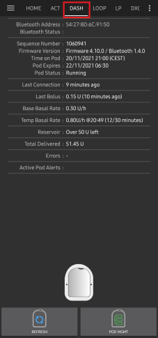

Das Symbol **Einstellungen** (Zahnrad) oben rechts öffnet die [DASH-Einstellungen](#omnipod-dash-settings).

***HINWEIS:** Zeigt ein Feld auf dem Pumpenbildschirm „(unsicher)“, tippe auf **Aktualisieren**, um den Pod-Status zu aktualisieren.*

### Felder

- **Bluetooth-Adresse:** Die Bluetooth-Adresse des Pods.

- **Verbindungsqualität:** Wie zuverlässig sich **AAPS** mit dem Pod verbindet, angezeigt als *erfolgreiche Verbindungen / alle Verbindungsversuche :: Erfolgsquote*, zum Beispiel `412/420 :: 98.10 %`. Nach mehr als 50 erfolgreichen Verbindungen wird der Wert unter 90 % gelb und unter 70 % rot. Ein niedriger Wert deutet auf ein Bluetooth-Problem hin (siehe [Probleme mit Bluetooth](#omnipod-dash-bluetooth-related-issues)).

- **Abgabestatus:** Der vom Pod gemeldete Rohstatus der Abgabe. Dieses Feld wird nur in Builds mit Entwickler-Modus angezeigt.

- **Eindeutige ID:** Die eindeutige ID, die **AAPS** dem Pod bei der Aktivierung gegeben hat.

- **LOT-Nummer:** Die Produktions-Chargennummer (LOT) des Pods.

- **Laufende Nummer:** Die laufende Nummer des Pods.

- **Firmware-Version:** Die Firmware- und Bluetooth-Version des Pods.

- **Zeit auf dem Pod:** Die aktuelle Uhrzeit auf dem Pod mit seiner Zeitzone. Der Text wird rot, wenn sich die Zeitzone des Pods von der des Smartphones unterscheidet, und gelb, wenn die Pod-Zeit mehr als 10 Minuten abweicht.

- **Pod läuft ab:** Datum und Uhrzeit, zu der der Pod abläuft (72 Stunden nach der Aktivierung). In den letzten 4 Stunden vor diesem Zeitpunkt wird der Text gelb. Er wird nie rot, weil der Pod danach weiter Insulin abgibt.

- **Enddatum des Pods:** Das Ende der Kulanzzeit des Pods (8 Stunden nach **Pod läuft ab**, also eine maximale Pod-Laufzeit von 80 Stunden). Der Text wird gelb, wenn die Kulanzzeit beginnt (bei **Pod läuft ab**), und rot in den letzten 4 Stunden vor dem endgültigen Ende. Während der Kulanzzeit wird außerdem die verbleibende Zeit angezeigt, zum Beispiel *(17m remaining)*. Zum endgültigen Ende stoppt der Pod die Insulinabgabe und muss gewechselt werden.

- **Pod Status:** Der Zustand des Pods: **Kein aktiver Pod**, **Einrichtung im Gange**, **In Betrieb**, **Angehalten** oder nach einem Pod-Fehler **ALARM**.

- **Letzte Verbindung:** Wie lange es her ist, dass **AAPS** zuletzt mit dem Pod kommuniziert hat.

  - *gerade eben* vor weniger als 10 Sekunden.

  - *vor weniger als einer Minute* – vor 10 bis 60 Sekunden.

  - *vor XX Minuten* – vor mehr als 1 Minute (und nach einer Stunde *vor X Stunden und XX Minuten*).

- **Letzter Bolus:** Die Menge des letzten an den Pod gesendeten Bolus und wie lange die Abgabe her ist. Ein unbestätigter Bolus wird mit „(unsicher)“ markiert.

- **Basis-Basalrate:** Die Basalrate, die in Deinem Basal-**Profil** für die aktuelle Uhrzeit hinterlegt ist.

- **Temporäre Basalrate:** Die gerade laufende temporäre Basalrate (TBR) mit Startzeit und Dauer. Dieses Feld wird nur angezeigt, solange eine TBR läuft.

- **Reservoir:** Zeigt *Noch mehr als 50 IE vorhanden*, wenn mehr als 50 Einheiten im Reservoir sind. Unter 50 Einheiten wird die genaue Menge angezeigt. Unter 20 Einheiten wird der Wert rot.

- **Insgesamt abgegeben:** Die gesamte aus dem Reservoir abgegebene Insulinmenge. Darin ist auch das Insulin für die Entlüftung enthalten.

- **Aktive Pod-Warnungen:** Warnungen, die gerade auf dem Pod aktiv sind, zum Beispiel *Pod läuft in Kürze ab* oder *Niedriger Reservoirstand*.

- **Fehler:** Der Pod-Fehler, falls der Pod ausgefallen ist, rot angezeigt als *Pod-Fehler:* gefolgt von Fehlercode und -name, zum Beispiel *Pod-Fehler: 020 ALARM_OCCLUDED*. Prüfe die [Pod-Historie](#omnipod-dash-view-pod-history) und die Protokolldateien auf frühere Fehler und genauere Informationen. Siehe [Pod-Ausfälle](#omnipod-dash-pod-failures).

- **PDM Benachrichtigung:** Wird nur nach einem Pod-Fehler angezeigt. Sie zeigt den Fehler so, wie ihn der Omnipod-PDM angezeigt hätte: einen Titel (zum Beispiel *Verschluss erkannt*, *Leeres Reservoir* oder *Pod ist abgelaufen*), was passiert ist (zum Beispiel *Insulinabgabe gestoppt. Tausche jetzt den Pod.*) und einen Code *Ref:*.

### Schaltflächen

Die Schaltflächen unten auf dem Pumpenbildschirm ändern sich je nach Zustand des Pods. Es werden nur die Schaltflächen angezeigt, die gerade sinnvoll sind.

- **Aktualisieren:** Fragt den aktuellen Status beim Pod ab.
  - *Nutze diese Schaltfläche, um den Pod-Status zu aktualisieren und Felder mit „(unsicher)“ zu bereinigen.*
  - *Weitere Informationen findest Du unten im Abschnitt [Fehlerbehebung](#omnipod-dash-troubleshooting).*

- **Alarme stummschalten:** Stoppt die Signaltöne der Pod-Warnungen (zum Beispiel bei Pod-Ablauf oder niedrigem Reservoir). Wird nur angezeigt, solange der Pod eine aktive Warnung hat. Siehe [Pod-Warnungen stummschalten](#omnipod-dash-silencing-pod-alerts).

- **Abgabe fortsetzen:** Setzt die Insulinabgabe eines unterbrochenen Pods fort. Wird nur angezeigt, wenn die Abgabe unterbrochen ist. Siehe [Insulinabgabe fortsetzen](#omnipod-dash-resuming-insulin-delivery).

- **Zeit einstellen:** Stellt den Pod auf die Zeitzone Deines Smartphones um, indem Dein Basal-**Profil** erneut gesendet wird. Wird nur angezeigt, wenn sich die Zeitzone des Pods von der Deines Smartphones unterscheidet.

- [**Pod aktivieren**](#omnipod-dash-activate-pod): Füllt und aktiviert einen neuen Pod. Wird angezeigt, wenn kein Pod aktiv ist.

- [**Pod deaktivieren**](#omnipod-dash-deactivate-pod): Deaktiviert den aktiven Pod. Wird angezeigt, sobald ein Pod mit **AAPS** gekoppelt ist, auch wenn eine Aktivierung mittendrin abgebrochen ist (zum Beispiel, weil der Pod während der Aktivierung ausgefallen ist). **AAPS** fragt nach einer Bestätigung, bevor der Pod deaktiviert wird.

- **Testton abspielen:** Lässt den Pod einen einzelnen Testton abspielen.

- [**Pod-Historie**](#omnipod-dash-view-pod-history): Zeigt den Aktivitätsverlauf des aktiven Pods.

- **Pod verwerfen:** Entfernt einen nicht fertig eingerichteten Pod aus **AAPS**. Wird nur angezeigt, wenn eine Pod-Aktivierung mittendrin abgebrochen ist. **AAPS** fragt nach einer Bestätigung. Nach dem Verwerfen kann **AAPS** nicht mehr mit diesem Pod kommunizieren: Entferne ihn von Deinem Körper.

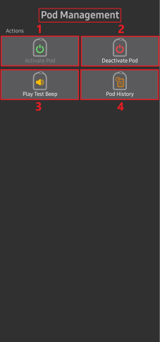

```{admonition} Older screenshot
:class: note
Der Screenshot oben stammt aus einer früheren **AAPS**-Version, die noch ein eigenes Menü **Pod-Verwaltung** hatte. In **AAPS** 4 sind alle diese Aktionen, darunter **Pod aktivieren**, **Pod deaktivieren**, **Testton abspielen** und **Pod-Historie**, beschriftete Schaltflächen direkt auf dem Pumpenbildschirm.
```

(omnipod-dash-activate-pod)=

## Pod aktivieren

1. Öffne den DASH-Pumpenbildschirm (**Bearbeiten** > **Pumpe**) und tippe auf **Pod aktivieren**. Der Aktivierungsassistent öffnet sich.

   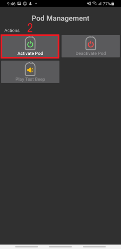

   ```{admonition} Older screenshot
   :class: note
   Der Screenshot oben stammt aus einer früheren **AAPS**-Version. In **AAPS** 4 ist **Pod aktivieren** eine Schaltfläche direkt auf dem DASH-Pumpenbildschirm statt im Menü **Pod-Verwaltung**.
   ```

   Hast Du in **AAPS** noch nie ein **Profil** aktiviert, zeigt der Assistent zuerst den Schritt **Profil erforderlich**: Wähle das Profil, das bei der Aktivierung angewendet werden soll, und fahre fort.

2. Der Schritt **Pod füllen** wird angezeigt. Fülle einen neuen Pod mit genug Insulin für 3 Tage, **mindestens 80 Einheiten**. Achte auf zwei Signaltöne des Pods: Sie bedeuten, dass die Mindestmenge von 80 Einheiten eingefüllt ist. Entleere die Füllspritze vollständig, auch wenn Du die zwei Signaltöne schon gehört hast. Entferne die Nadelkappe des Pods noch nicht.

   ***HINWEIS:** Denk bei der Berechnung der Insulinmenge für 3 Tage daran, dass die Entlüftung des Pods etwa 3–10 Einheiten verbraucht.*

   

   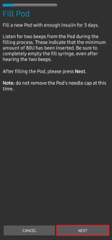

   Achte darauf, dass der neue Pod und das Smartphone mit **AAPS** nah beieinander sind, und tippe auf **Weiter**.

3. Wenn Du in **AAPS** mehr als ein Insulin verwendest, wird der Schritt **Insulin auswählen** angezeigt. Er zeigt das Insulin unter **Derzeit aktiviert**. Hast Du den Pod mit einem anderen Insulin gefüllt, tippe auf **Wechseln** und wähle es aus. **AAPS** führt nach Abschluss der Aktivierung einen **Profilwechsel** mit diesem Insulin durch. Tippe auf **Weiter**.

   

4. Im Schritt **Pod initialisieren** koppelt sich **AAPS** mit dem neuen Pod und entlüftet ihn. Du hörst ein Klicken und danach eine Reihe von Tickgeräuschen, während sich der Pod entlüftet. Ist das erfolgreich abgeschlossen, erscheint die Schaltfläche **Weiter**. Tippe auf **Weiter**.

   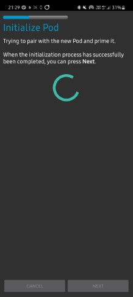    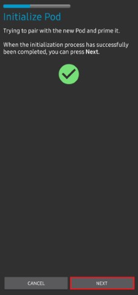

   ***HINWEIS**: Erscheint eine Fehlermeldung wie _Scan fehlgeschlagen_ oder _„Could not find an available pod for activation“_ (das kann vorkommen), keine Panik. Tippe auf **Erneut versuchen**. Meist läuft die Aktivierung dann erfolgreich weiter.*

   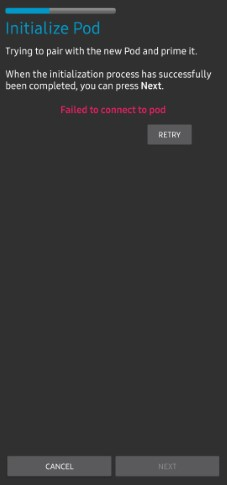

   Ist der Pod ausgefallen (zum Beispiel, weil seine Aktivierungszeit überschritten wurde), wird statt **Erneut versuchen** die Schaltfläche **Pod deaktivieren** angezeigt. Nutze sie und beginne mit einem neuen Pod von vorn.

   Tippst Du vor dem Ende der Aktivierung auf **Abbrechen**, fragt **AAPS**, ob Du den Assistenten wirklich verlassen möchtest. Tippe auf **OK**, um den Assistenten zu verlassen, oder auf **Abbrechen**, um zu bleiben.

   

5. Wenn Du den Wechsel der Setzstellen in **AAPS** verwaltest (**Wechsel der Pumpen-Einstichstellen verwalten** in den Einstellungen [Wechsel der Setzstellen](#Aapsscreens-site-rotation)), wird der Schritt **Setzstelle** angezeigt. Wähle auf der Körperabbildung aus, wo Du den Pod setzen wirst, und tippe auf **Weiter** oder auf **Überspringen**.

   

6. Bereite anschließend die Infusionsstelle für den neuen Pod vor. Wasche Dir die Hände, um jedes Infektionsrisiko zu vermeiden. Reinige die Infusionsstelle mit Wasser und Seife oder einem Alkoholtupfer und lass die Haut vollständig an der Luft trocknen, bevor Du weitermachst. Wenn der Kleber Deine Haut reizt, kannst Du ein Hautschutztuch oder Hautschutzspray verwenden.

   Entferne im Schritt **Pod anlegen** die blaue Nadelkappe aus Kunststoff vom Pod. Ragt die Kanüle oder etwas anderes aus dem Pod heraus oder sieht er ungewöhnlich aus, dann **STOPP**: Tippe auf **Abbrechen** und beginne mit einem neuen Pod von vorn. Wenn alles **in Ordnung** ist, ziehe die weiße Papierschutzfolie vom Klebepolster ab und klebe den Pod auf die ausgewählte Stelle an Deinem Körper.

   Tippe danach auf **Weiter**.

   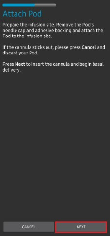

7. Ein Bestätigungsdialog erscheint: *Nachdem Du OK gedrückt hast, wird die Kanüle eingeführt.* **Tippe NUR auf OK, wenn Du bereit bist, die Kanüle einzuführen!**

   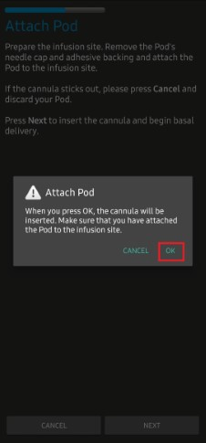

8. Im Schritt **Kanüle setzen** überträgt **AAPS** Deine Basalraten, und der Pod führt die Kanüle ein. Das kann etwas dauern (maximal 1–2 Minuten). Wechsele zur Registerkarte **DASH**.

   ***HINWEIS:** Es hat sich bewährt, die Haut in der Nähe der Einstichstelle zusammenzudrücken, bevor die Kanüle eingeführt wird. So gleitet die Nadel leichter hinein, und das Risiko eines Verschlusses (Okklusion) sinkt.*

   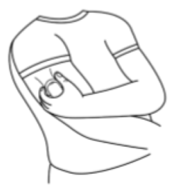    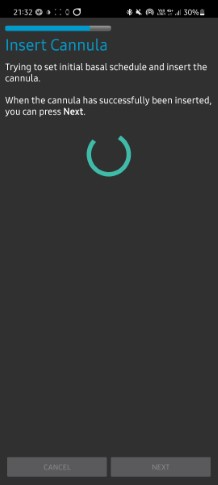

9. Ist die Kanüle erfolgreich eingeführt, erscheint die Schaltfläche **Weiter**. Tippe auf **Weiter**.

   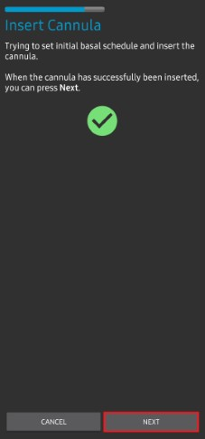

10. Der Schritt **Pod aktiviert** wird angezeigt. Prüfe, ob die Kanüle richtig eingeführt wurde, und wechsle den Pod, wenn Du daran zweifelst.

    Tippe auf **Abschließen**.

    Glückwunsch! Du hast jetzt eine neue Pod-Sitzung gestartet.

    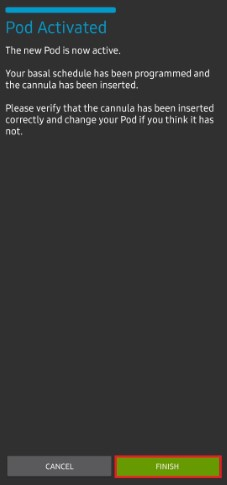

11. Du bist wieder auf dem DASH-Pumpenbildschirm. Er zeigt jetzt die Informationen Deines aktiven Pods, darunter aktuelle Basalrate, Reservoirstand, abgegebenes Insulin, Pod-Fehler und Warnungen. **Pod aktivieren** wird durch **Pod deaktivieren** ersetzt: Du kannst keinen weiteren Pod aktivieren, ohne zuerst den aktiven Pod zu deaktivieren.

    ***HINWEIS:** Mehr zu den angezeigten Informationen findest Du unter [Der DASH-Pumpenbildschirm](#omnipod-dash-tab).*

    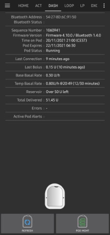

    ***HINWEIS:** Es hat sich bewährt, die Einstellungen NACH der Aktivierung des Pods zu exportieren. Exportiere Deine Einstellungen nach jedem Pod-Wechsel und einmal im Monat. Kopiere die exportierte Einstellungsdatei in einen Cloud-Speicher (zum Beispiel Google Drive) oder an einen anderen Ort außerhalb Deines Smartphones, falls Du es verlierst (siehe [**Einstellungen exportieren**](../Maintenance/ExportImportSettings.md)).*

Ist eine frühere Aktivierung nach dem Entlüften des Pods abgebrochen, geht es nach Tippen auf **Pod aktivieren** mit dem Schritt **Pod anlegen** weiter.

(omnipod-dash-deactivate-pod)=

## Pod deaktivieren

Normalerweise hält ein Pod drei Tage (72 Stunden) plus eine Kulanzzeit von 8 Stunden nach der Ablaufwarnung, insgesamt also 80 Stunden.

So deaktivierst Du einen Pod (weil er abgelaufen oder ausgefallen ist):

1. Öffne den DASH-Pumpenbildschirm (**Bearbeiten** > **Pumpe**) und tippe auf **Pod deaktivieren**.

   

2. Tippe im Schritt **Pod deaktivieren** auf **Weiter**. Ein Dialog fragt: *Ein deaktivierter Pod kann nicht mehr verwendet werden. Diesen Pod jetzt deaktivieren?* Tippe auf **OK**, um die Deaktivierung zu starten, oder auf **Abbrechen**, um den Pod zu behalten. Die Deaktivierung stoppt jede Insulinabgabe und kann nicht rückgängig gemacht werden.

   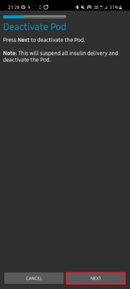

3. Während **AAPS** den Pod deaktiviert, wird der Schritt **Deaktiviere den Pod...** angezeigt. Der Pod piept, um die erfolgreiche Deaktivierung zu bestätigen.

   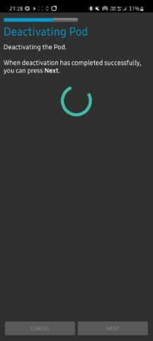

   ```{admonition} Older screenshot
   :class: note
   Der Screenshot oben stammt aus einer früheren **AAPS**-Version. In **AAPS** 4 zeigt der Assistent seinen Fortschritt oben als Punktreihe statt als Fortschrittsbalken.
   ```

   Ist die Deaktivierung erfolgreich abgeschlossen, erscheint die Schaltfläche **Weiter**. Tippe auf **Weiter**.

   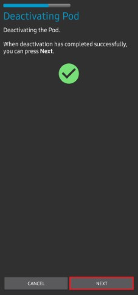

   Schlägt die Deaktivierung fehl, werden eine Fehlermeldung und die Schaltfläche **Pod verwerfen** angezeigt. Lies unten [Pod verwerfen](#omnipod-dash-discard-pod), bevor Du sie benutzt. Du kannst auch auf **Abbrechen** tippen und **Pod deaktivieren** später noch einmal versuchen.

4. Der Schritt **Pod deaktiviert** wird angezeigt. Entferne den Pod von Deinem Körper und tippe auf **Abschließen**.

   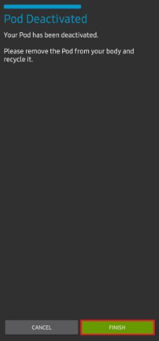

5. Du bist wieder auf dem DASH-Pumpenbildschirm. Prüfe, ob das Feld **Pod Status** **Kein aktiver Pod** zeigt und die Schaltfläche **Pod aktivieren** wieder angezeigt wird.

   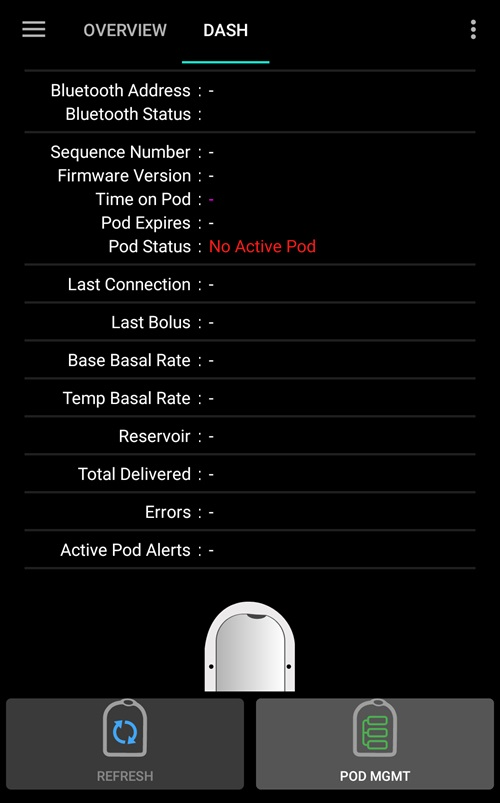

(omnipod-dash-discard-pod)=

### Pod verwerfen

Verwirf einen Pod nur, wenn die Kommunikation mit ihm dauerhaft fehlschlägt. Kann **AAPS** noch mit dem Pod kommunizieren, nutze stattdessen **Pod deaktivieren**.

- **AAPS** fragt nach einer Bestätigung, bevor der Pod verworfen wird.
- Danach kann **AAPS** nicht mehr mit diesem Pod kommunizieren.
- **Die Insulinabgabe wurde NICHT unterbrochen**, weil der Pod nicht ordnungsgemäß deaktiviert wurde. **Entferne den Pod von Deinem Körper!**
- Der Schritt **Pod verworfen** bestätigt, dass der Pod-Zustand verworfen wurde. Tippe auf **Abschließen**. Du kannst jetzt einen neuen Pod aktivieren.

(omnipod-dash-resuming-insulin-delivery)=

## Insulinabgabe fortsetzen

**HINWEIS**: Bei **Profilwechseln** muss **AAPS** (wie auch der PDM) die Abgabe am Pod unterbrechen, bevor das neue Basal-**Profil** gesetzt wird. Schlägt die Kommunikation zwischen dem Befehl zum Unterbrechen und dem zum Fortsetzen fehl, kann die Abgabe unterbrochen bleiben. Lies [**Insulinabgabe unterbrochen**](#omnipod-dash-delivery-suspended) im Abschnitt Problembehandlung für weitere Details.

Ist die Insulinabgabe unterbrochen, musst Du den Pod anweisen, die Insulinabgabe fortzusetzen. Wurde der Befehl erfolgreich verarbeitet, gibt der Pod wieder Insulin ab, mit der Basalrate, die in Deinem aktiven Basal-**Profil** für die aktuelle Uhrzeit gilt. Der Pod nimmt wieder Befehle für Bolus, **TBR** und **SMB** an.

1. Öffne den DASH-Pumpenbildschirm und prüfe, ob das Feld **Pod Status** **Angehalten** zeigt. Tippe auf **Abgabe fortsetzen**, damit der Pod die normale Insulinabgabe fortsetzt.

   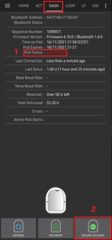

2. War der Befehl erfolgreich, zeigt das Feld **Pod Status** **In Betrieb**, und die Schaltfläche **Abgabe fortsetzen** verschwindet.

   

   

   ```{admonition} Older screenshot
   :class: note
   Die Screenshots oben stammen aus einer früheren **AAPS**-Version, die einen Bestätigungsdialog angezeigt hat. In **AAPS** 4 siehst Du das Ergebnis auf dem DASH-Pumpenbildschirm: Das Feld **Pod Status** zeigt **In Betrieb**, und die Schaltfläche **Abgabe fortsetzen** ist verschwunden.
   ```

   Schlägt der Befehl fehl, zeigt **AAPS** einen Warndialog, der mit *Insulinabgabe konnte nicht gestartet werden* beginnt. Tippe auf **Aktualisieren** und versuche es noch einmal.

   

(omnipod-dash-silencing-pod-alerts)=

## Pod Alarme stummschalten

Dieser Abschnitt erklärt, wie Du die Signaltöne des Pods stoppst, wenn sich der Pod dem Ende seiner Laufzeit nähert. Wann diese Signaltöne beginnen, hängt von den Einstellungen unter **Alarme** ab (siehe [DASH-Einstellungen](#omnipod-dash-settings)):

- **Erinnerung bei Stunden vor Ablauf (72 Stunden):** wie viele Stunden vor dem Ablauf nach 72 Stunden der Pod zu piepen beginnt.
- **Warnung vor dem Herunterfahren (80 Stunden):** wie viele Stunden vor dem Abschalten nach 80 Stunden der Pod erneut piept.

Die maximale Laufzeit eines Pods beträgt 80 Stunden (3 Tage und 8 Stunden). Der Hersteller empfiehlt jedoch, 72 Stunden (3 Tage) nicht zu überschreiten.

***HINWEIS**: Die Schaltfläche **Alarme stummschalten** wird auf dem DASH-Pumpenbildschirm nur angezeigt, solange der Pod eine aktive Warnung hat, zum Beispiel bei Pod-Ablauf oder niedrigem Reservoir. Wird die Schaltfläche **Alarme stummschalten** nicht angezeigt, Du hörst den Pod aber piepen, tippe auf **Aktualisieren**.*

1. Ist die Erinnerungszeit erreicht, piept der Pod, um Dir zu sagen, dass er bald abläuft und gewechselt werden muss. Auf dem DASH-Pumpenbildschirm zeigt das Feld **Pod läuft ab (1)** den genauen Zeitpunkt, zu dem der Pod abläuft (72 Stunden nach der Aktivierung). 4 Stunden vor diesem Zeitpunkt wird der Text gelb. Danach wird **Enddatum des Pods** gelb und zeigt die verbleibende Zeit, bis der Pod die Insulinabgabe stoppt. Das Feld **Aktive Pod-Warnungen (2)** zeigt **Pod läuft in Kürze ab**, und die Schaltfläche **Alarme stummschalten (3)** wird angezeigt.

   

2. Tippe auf **Alarme stummschalten**. **AAPS** sendet den Befehl an den Pod, die Ablauf-Signaltöne zu stoppen.

   

   ```{admonition} Older screenshot
   :class: note
   Der Screenshot oben stammt aus einer früheren **AAPS**-Version, in der dieser Bildschirm der Reiter **DASH** war. In **AAPS** 4 befindet sich die Schaltfläche **Alarme stummschalten** auf dem DASH-Pumpenbildschirm (**Bearbeiten** > **Pumpe**).
   ```

3. Sind die Warnungen stummgeschaltet, wird die Warnung im Feld **Aktive Pod-Warnungen** nicht mehr angezeigt, die Schaltfläche **Alarme stummschalten** verschwindet, und der Pod hört mit den Ablauf-Signaltönen auf.

   

   ```{admonition} Older screenshot
   :class: note
   Der Screenshot oben stammt aus einer früheren **AAPS**-Version, die einen Bestätigungsdialog angezeigt hat. In **AAPS** 4 siehst Du das Ergebnis auf dem DASH-Pumpenbildschirm: Die Warnung ist aus dem Feld **Aktive Pod-Warnungen** verschwunden.
   ```

   Schlägt der Befehl fehl, zeigt **AAPS** einen Warndialog, der mit *Alarme können nicht stumm geschaltet werden* beginnt. Tippe auf **Aktualisieren** und versuche es noch einmal.

Die Warnung bei niedrigem Reservoir funktioniert genauso. Sinkt die Restmenge Insulin im Pod auf die **Anzahl der Einheiten**, die in den Einstellungen unter **Alarme** festgelegt ist, piept der Pod. Das Feld **Reservoir** zeigt die Restmenge, das Feld **Aktive Pod-Warnungen** zeigt **Niedriger Reservoirstand**, und die Schaltfläche **Alarme stummschalten** wird angezeigt. Tippe auf **Alarme stummschalten**, um die Signaltöne zu stoppen, und plane Deinen nächsten Pod-Wechsel.


(omnipod-dash-view-pod-history)=

## Anzeige Pod-Historie

Dieser Abschnitt erklärt, wie Du Dir die Historie Deines aktiven Pods ansiehst und sie nach Art der Aktion filterst. Die Pod-Historie zeigt die an Deinen aktiven Pod gesendeten Befehle und deren Ergebnisse während seiner dreitägigen Laufzeit (72–80 Stunden).

Sie ist nützlich, um die an den Pod gesendeten Boli, TBRs und Basalbefehle zu prüfen. Die anderen Kategorien helfen bei der Fehlersuche und zeigen die Abfolge der Ereignisse, die zu einem Ausfall geführt haben.

**HINWEIS:** **Nur der letzte Befehl kann unsicher sein**. Neue Befehle *werden nicht gesendet*, bis der **letzte „unsichere“ Befehl bestätigt oder abgelehnt wurde**. Um einen unsicheren Befehl zu „reparieren“, tippe auf dem DASH-Pumpenbildschirm auf **Aktualisieren**.

1. Öffne den DASH-Pumpenbildschirm und tippe auf **Pod-Historie**.

   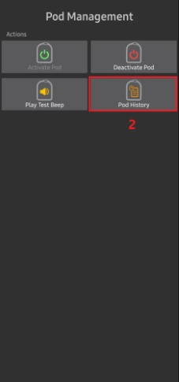

   ```{admonition} Older screenshot
   :class: note
   Der Screenshot oben stammt aus einer früheren **AAPS**-Version. In **AAPS** 4 ist **Pod-Historie** eine Schaltfläche direkt auf dem DASH-Pumpenbildschirm statt im Menü **Pod-Verwaltung**.
   ```

2. Der Bildschirm **Pod-Historie** öffnet sich mit dem Filter **Alle**. Er listet jeden Befehl mit Uhrzeit und Ergebnis auf, die neuesten zuerst, nach Tagen gruppiert. Mit den Filterschaltflächen oben (zum Beispiel **Boli** oder **Basal**) zeigst Du nur eine Art von Befehlen an. Tippe auf den Zurück-Pfeil, um zum DASH-Pumpenbildschirm zurückzukehren.

   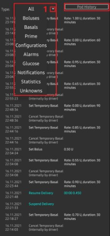 

   ```{admonition} Older screenshot
   :class: note
   Der zweite Screenshot oben stammt aus einer früheren **AAPS**-Version, in der Du die Art des Befehls aus einer Liste **Typ** ausgewählt hast. In **AAPS** 4 nutzt Du die Filterschaltflächen aus dem ersten Screenshot.
   ```

   Bei Boli folgt auf die Menge die Bolusart, wenn es kein normaler Bolus ist, zum Beispiel *0,05 IE (SMB)* oder *0,05 IE (Basal Korrektur)*. Eine Basalkorrektur ist ein sehr kleiner Bolus (ein Pod-Puls, 0,05 IE), den der Treiber von sich aus sendet; Du hast ihn nicht angefordert.

   ```{admonition} Why basal corrections happen
   :class: note
   Der Pod gibt Basalinsulin in Pulsen von 0,05 IE ab, gesteuert von einer internen Uhr. Bei jeder Änderung der Basalrate (zum Beispiel wenn der Loop eine neue **TBR** setzt) startet der Pod diese Uhr neu, und der Puls, auf den er gerade hingezählt hat, geht verloren. Da der Loop die Basalrate oft ändert, besonders nachts, kann der Pod am Ende weniger Basalinsulin abgeben als erwartet.

   **AAPS** vergleicht das Basalinsulin, das der Pod als abgegeben meldet, mit dem, das er hätte abgeben sollen. Erreicht die Fehlmenge einen halben Puls oder mehr, gibt der Treiber einen zusätzlichen Puls als Basalkorrektur ab, sodass Du trotzdem das Basalinsulin bekommst, das Dein Profil und der Loop angefordert haben. Solange der Pod unterbrochen ist oder eine **TBR** von null läuft, wird keine Korrektur gesendet.
   ```

(omnipod-dash-settings)=

## DASH-Einstellungen

Es gibt zwei Wege, die Einstellungen des DASH-Treibers zu öffnen:

- Tippe oben rechts auf dem [DASH-Pumpenbildschirm](#omnipod-dash-tab) auf das Symbol **Einstellungen** (Zahnrad).
- Öffne oben links auf dem Startbildschirm das **Menü** (☰) und wähle **Konfiguration** > **Pumpe**. Tippe auf der Karte **Omnipod Dash** auf **Einstellungen**.

Die Einstellungen sind in vier aufklappbare Bereiche gegliedert: **Bestätigungstöne**, **Alarme**, **Benachrichtigungen** und **Erweiterte Einstellungen**. Tippe auf einen Bereich, um ihn zu öffnen:


Die meisten Einstellungen sind Ein/Aus-Schalter.

### Bestätigungstöne

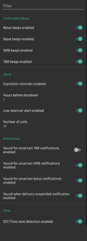

Bestätigungs-Signaltöne des Pods bei Abgabe und Änderung von Bolus, Basalrate, SMB und TBR.

**Bolus-Piep aktiviert:** Der Pod piept, wenn ein Bolus abgegeben wird. Standardmäßig eingeschaltet.

**Basal-Piep aktiviert:** Der Pod piept, wenn eine neue Basalrate gesetzt oder die aktive Basalrate abgebrochen oder geändert wird. Standardmäßig ausgeschaltet.

**SMB-Piep aktiviert:** Der Pod piept, wenn ein SMB abgegeben wird. Standardmäßig eingeschaltet.

**TBR-Piep aktiviert:** Der Pod piept, wenn eine TBR gesetzt oder abgebrochen wird. Standardmäßig ausgeschaltet.

### Alarme


```{admonition} Older screenshot
:class: note
Der Screenshot oben stammt aus einer früheren **AAPS**-Version. In **AAPS** 4 befinden sich diese Einstellungen im aufklappbaren Bereich **Alarme**.
```

Pod-Warnungen für Pod-Ablauf, Abschaltung und niedriges Reservoir. Änderst Du diese Einstellungen, während ein Pod aktiv ist, sendet **AAPS** die neuen Warnungseinstellungen an den Pod.

***HINWEIS:** Für jede Warnung wird IMMER eine **AAPS**-Benachrichtigung angezeigt, sobald **AAPS** nach dem Auslösen der Warnung mit dem Pod kommuniziert hat. Das Wegwischen der Benachrichtigung stoppt die Pod-Warnung NICHT. Um die Warnung zu stoppen, öffne den DASH-Pumpenbildschirm und tippe auf **Alarme stummschalten**.*

**Ablauferinnerung aktiviert:** Ist das eingeschaltet, piept der Pod, wenn die Erinnerungszeit erreicht ist. Standardmäßig eingeschaltet.

**Erinnerung bei Stunden vor Ablauf (72 Stunden):** Wie viele Stunden vor dem Pod-Ablauf nach 72 Stunden die Erinnerung beginnt (1 bis 24 Stunden; Standard 4).

**Ablaufbenachrichtigung aktiviert:** Ist das eingeschaltet, piept der Pod, wenn die Warnzeit erreicht ist, und noch einmal 1 Stunde vor dem Abschalten. Standardmäßig eingeschaltet.

**Warnung vor dem Herunterfahren (80 Stunden):** Wie viele Stunden vor dem Abschalten des Pods nach 80 Stunden die Warnung beginnt (1 bis 8 Stunden; Standard 8).

**Warnung niedriger Reservoirstand aktiviert:** Der Pod warnt Dich, wenn die Restmenge Insulin im Reservoir auf den Wert unter **Anzahl der Einheiten** sinkt. Standardmäßig eingeschaltet.

**Anzahl der Einheiten:** Die Anzahl der Einheiten, bei der die Warnung bei niedrigem Reservoir ausgelöst wird (5 bis 50 Einheiten; Standard 20).

### Benachrichtigungen

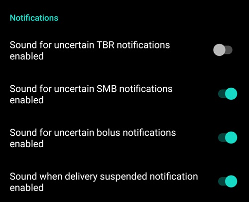

Lege fest, ob **AAPS** zu seinen Benachrichtigungen einen Ton abspielt, wenn unsicher ist, ob eine TBR, ein SMB oder ein Bolus abgegeben wurde, und wenn die Abgabe unterbrochen ist.

***HINWEIS:** Das sind nur Benachrichtigungen auf dem Smartphone; der Pod selbst piept nicht.*

**Ton für unsichere TBR-Benachrichtigungen aktiviert:** Spielt zur Benachrichtigung einen Ton ab, wenn **AAPS** nicht sicher ist, ob eine TBR gesetzt wurde.

**Ton für unsichere SMB Benachrichtigungen aktiviert:** Spielt zur Benachrichtigung einen Ton ab, wenn **AAPS** nicht sicher ist, ob ein SMB abgegeben wurde.

**Ton für unsichere Bolus-Benachrichtigungen aktiviert:** Spielt zur Benachrichtigung einen Ton ab, wenn **AAPS** nicht sicher ist, ob ein Bolus abgegeben wurde.

**Ton bei unterbrochener Insulinabgabe aktiviert:** Spielt zur Benachrichtigung einen Ton ab, wenn die Insulinabgabe unterbrochen ist.

(omnipod-dash-advanced-settings)=

### Erweiterte Einstellungen


**Bluetooth-Bindung:** Bindet den Pod per Bluetooth an das Smartphone. Probiere das nur aus, wenn der Pod keine stabile Verbindung halten kann, zum Beispiel unter Android 15 (siehe [Bekannte Einschränkungen und Probleme von AAPS mit dem Omnipod DASH](#omnipod-dash-constraints)). Ist sie eingeschaltet, zeigt das Smartphone Kopplungsanfragen an, die Du annehmen musst. Lass sie ausgeschaltet, wenn sich der Pod problemlos verbindet. Unter Android 15 hat sie keine Wirkung. Standardmäßig ausgeschaltet.

## Alter von Insulin und Kanüle

Die [Statuszeile](#screens-sensor-level-battery) auf dem Startbildschirm zeigt das Alter Deines Insulins und Deiner Kanüle. Beim Omnipod funktioniert das etwas anders als bei Pumpen mit Schlauch.

**AAPS** erfasst bei jeder Pod-Aktivierung automatisch einen Kanülen- und einen Insulinwechsel. Dadurch werden das Alter von **Insulin** und **Kanüle** nach jedem Pod-Wechsel auf null gesetzt. Du musst sie nicht selbst über **Nadelwechsel/Füllen** erfassen. Das liegt daran, dass der Pod die Kanüle direkt an der Stelle in die Haut einführt, an der er klebt: Der Omnipod hat keinen Schlauch.

Das Alter der **Pumpenbatterie** wird nicht angezeigt: Batterie und Insulinreservoir sind in jeden Pod eingebaut, und die Batterie hält immer länger als der Pod selbst (maximal 80 Stunden).


```{admonition} Older screenshot
:class: note
Der Screenshot oben stammt aus einer früheren **AAPS**-Version, in der dieses Alter im Bereich **Careportal** des Reiters **Aktionen** angezeigt wurde. In **AAPS** 4 wird es in der Statuszeile auf dem Startbildschirm angezeigt.
```

### Level

**Insulin Level**

Der angezeigte Insulinstand ist die vom Pod gemeldete Menge. Der Pod meldet den tatsächlichen Reservoirstand allerdings erst, wenn er unter 50 Einheiten liegt. Bis dahin wird *Noch mehr als 50 IE vorhanden* angezeigt. Die gemeldete Menge ist nicht genau: Wenn der Pod „leer“ meldet, sind meist noch ein paar Einheiten Insulin im Reservoir.

Der DASH-Pumpenbildschirm zeigt den Stand so an:

  * **Noch mehr als 50 IE vorhanden** – Der Pod meldet mehr als 50 Einheiten im Reservoir.
  * **Unter 50 Einheiten** – Die genaue Restmenge Insulin im Reservoir, wie vom Pod gemeldet.

Sonstiges
  * **SMS** – Gibt in SMS-Antworten den Wert zurück, bzw. 50+IE bei mehr als 50 Einheiten.
  * **Nightscout** – Lädt bei mehr als 50 Einheiten den Wert 50 zu Nightscout hoch (Version 14.07 und älter). Neuere Versionen melden bei mehr als 50 Einheiten den Wert 50+.

(omnipod-dash-troubleshooting)=

## Problembehandlung

Dieser Abschnitt behandelt bekannte Probleme und Lösungen für den Einsatz des Omnipod DASH mit AAPS. Es gibt in der Dokumentation auch einen Abschnitt [Allgemeine Fehlerbehebung](../GettingHelp/GeneralTroubleshooting.md), den Du lesen solltest, da dort auch relevante Pod-Themen abgedeckt werden.

---

(omnipod-dash-bluetooth-related-issues)=

## Bluetooth-Probleme

Bei bekannten Problemen mit Bluetooth-Verbindungen, Pumpen/Pods oder Aktivierungs- und Verbindungsproblemen schau im Abschnitt [Bluetooth-Fehlerbehebung](../GettingHelp/BluetoothTroubleshooting.md) nach.

---

(omnipod-dash-delivery-suspended)=

### Insulinabgabe unterbrochen

  - Es gibt keine Unterbrechen-Taste mehr. Wenn Du die Insulinabgabe unterbrechen möchtest, kannst Du eine Null-**TBR** für x Minuten setzen.
  - Während eines **Profilwechsels** muss der DASH die Insulinabgabe unterbrechen, bevor das neue Basal-**Profil** gesetzt wird. Wenn die Kommunikation zwischen den beiden Befehlen fehlschlägt, kann die Insulinabgabe unterbrochen bleiben. Wenn das passiert:
     - Es gibt dann keine Insulinabgabe; dies schließt Basal, SMB, manuelle Boli usw. ein.
     - Es kann eine Benachrichtigung geben, dass einer der Befehle unbestätigt blieb: Dies hängt davon ab, wann der Fehler aufgetreten ist.
     - **AAPS** wird alle 15 Minuten versuchen, das neue Basalprofil zu setzen.
     - **AAPS** wird alle 15 Minuten darüber benachrichtigen, dass die Insulinabgabe unterbrochen ist, sofern die Abgabe noch immer unterbrochen ist (Insulinabgabe konnte nicht gestartet werden).
     - Die Schaltfläche [**Abgabe fortsetzen**](#omnipod-dash-resuming-insulin-delivery) wird auf dem DASH-Pumpenbildschirm angezeigt, falls Du die Abgabe manuell fortsetzen möchtest.
     - Wenn **AAPS** die Abgabe nicht alleine fortsetzen kann (dies geschieht, wenn der Pod nicht erreichbar ist, der Ton stumm geschaltet ist, etc.), beginnt der Pod für 3 Minuten jede Minute viermal zu piepen. Das wird, wenn die Abgabe für mehr als 20 Minuten ausgesetzt ist, alle 15 Minuten wiederholt.
  - Bei unbestätigten Befehlen tippe auf dem DASH-Pumpenbildschirm auf **Aktualisieren**, um sie bestätigen oder ablehnen zu lassen.

*****HINWEIS:** Wenn Du Pieptöne vom Pod hörst, kannst Du nicht davon ausgehen, dass die Insulinabgabe ohne Überprüfung im Smartphone fortgesetzt wird. Die Abgabe könnte weiterhin ausgesetzt bleiben, ***also musst Du prüfen, was los ist!******

---
(omnipod-dash-pod-failures)=

### Pod Fehler

- Pods fallen gelegentlich aus unterschiedlichen Gründen aus, u. a. wegen Hardwareproblemen mit dem Pod selbst.
- Da AAPS offiziell nicht für die Interaktion mit Pods zugelassen ist, sollten keine Support-Tickets für Ersatz-Pods bei Insulet aufgemacht werden.
- Um die Ursache zu ermitteln, kannst Du in [**dieser Liste**](https://github.com/openaps/openomni/wiki/Fault-event-codes) die Fehlercodes nachschlagen.

Fällt ein Pod aus, stoppt er die Insulinabgabe und piept dauerhaft. **AAPS** zeigt auf dem Startbildschirm eine Benachrichtigung mit Fehlercode und -name sowie dem Code *Ref:*, zum Beispiel *Pod-Fehler: 020 ALARM_OCCLUDED*. Tippe auf **Schließen**, um die Benachrichtigung zu schließen. Das stoppt das Piepen des Pods nicht.


Auf dem DASH-Pumpenbildschirm zeigt das Feld **Pod Status** **ALARM**, das Feld **Fehler** den Pod-Fehler, und das Feld **PDM Benachrichtigung** erklärt ihn, zum Beispiel *Verschluss erkannt. Insulinabgabe gestoppt. Tausche jetzt den Pod. Prüfe Deinen Glukosewert*.


Ein ausgefallener Pod kann nicht wieder verwendet werden. Prüfe Deinen Glukosewert, [deaktiviere den Pod](#omnipod-dash-deactivate-pod) und aktiviere einen neuen.

---
### Verhindere Pod Fehler 49

Dieser Fehler hängt mit einem fehlerhaften Pod-Status für einen Befehl oder einem Fehler während der Insulinabgabe zusammen. Dies ist der Fall, wenn der AAPS-Treiber und der Pod unterschiedliche Angaben zum aktuellen Status haben. Der Pod reagiert (aufgrund einer eingebauten Sicherheitsfunktion) dann mit einem nicht auflösbaren Fehlercode 49 (0x31) und verabschiedet sich mit einem so genannten „Heuler“: dem langen, irritierenden Piepton, der nur gestoppt werden kann, indem mit einer Büroklammer in ein Loch am richtigen Ort auf der Rückseite des Pods gedrückt wird. Der genaue Ursprung eines „Pod Fehlers 49“ ist oft schwer zu ermitteln. Das kann zum Beispiel nach Abstürzen der App, beim Betrieb einer Entwicklungsversion oder nach einer Neuinstallation passieren.

---

### Pumpe nicht erreichbar Alarme

Wenn für eine voreingestellte Zeitspanne keine Kommunikation mit dem Pod hergestellt werden kann, wird eine „Pumpe nicht erreichbar“ Alarmmeldung angezeigt. Warnungen bei nicht erreichbarer Pumpe kannst Du einstellen, indem Du oben rechts auf dem Startbildschirm auf das Symbol **Einstellungen** (Zahnrad) tippst und dann **Lokale Alarme** ➜ **Grenzwert für Pumpe ist nicht erreichbar** wählst. Eine Alarmierung nach **120** Minuten wird als Wert empfohlen.

---
(omnipod-dash-export-import)=
### Einstellungen exportieren und importieren

Mit dem Export der **AAPS**-Einstellungen kannst Du alle Einstellungen und Ziele wiederherstellen, zum Beispiel nach einer Neuinstallation von **AAPS** oder auf einem neuen Smartphone. **Exportiere Deine Einstellungen direkt nach jeder Pod-Aktivierung** und kopiere die Datei an einen sicheren Ort außerhalb Deines Smartphones (zum Beispiel Google Drive), damit auch der aktive Pod wiederhergestellt werden kann. Siehe [Sicherungen erstellen und wiederherstellen](#ExportImportSettings-Settings-Export).

```{admonition} Importing settings can end your active Pod
:class: warning
Lass auf dem Smartphone, auf dem der Pod bereits läuft, **Pumpeneinstellungen auch ersetzen** nicht angehakt: Die Pod-Sitzung bleibt erhalten, und nur die übrigen Einstellungen werden importiert. Hake es nur auf einem neuen Smartphone an, mit einer Datei, die während des Pods exportiert wurde, den Du gerade trägst. Siehe [Schlauchlose Pumpen](#ExportImportSettings-tubeless-pumps).
```

Enthalten die importierten Einstellungen einen Pod, der nicht mehr aktiv ist, lies den nächsten Abschnitt.

---
### Importieren von Einstellungen, die den Pod-Status von einem inaktiven Pod enthalten

Wenn Du Einstellungen für einen mittlerweile inaktiven Pod importierst, wird AAPS versuchen sich mit diesem Pod zu verbinden. Dies wird logischerweise scheitern. In dieser Situation kannst Du keinen neuen Pod aktivieren.

Um die alte Pod-Sitzung zu löschen:
1. Tippe auf dem DASH-Pumpenbildschirm auf **Pod deaktivieren**. Die Deaktivierung wird höchstwahrscheinlich fehlschlagen.
2. Schlägt sie fehl, tippe auf **Pod verwerfen** und bestätige (siehe [Pod verwerfen](#omnipod-dash-discard-pod)).
3. Sobald der alte Pod entfernt ist, kannst Du einen neuen Pod aktivieren.

### Generic error: java.lang.IllegalStateException: Trying to set a Bluetooth Address to ***, but it is already set to ***.

Wenn Du beim Initialisieren eines neuen Pods diese Fehlermeldung erhältst, liegt es daran, dass **AAPS** noch die Einstellungen des alten Pods in der Konfiguration gespeichert hat.


Das kann passieren, wenn Du ein Backup wieder einspielst oder die Deaktivierung eines Pods nicht funktioniert hat.

Um das zu lösen, tippe auf **Abbrechen**, um die Aktivierung zu verlassen. Tippe auf dem DASH-Pumpenbildschirm auf **Pod verwerfen**, falls die Schaltfläche angezeigt wird. Andernfalls tippe auf **Pod deaktivieren** und, wenn die Deaktivierung fehlschlägt, auf **Pod verwerfen** (siehe [Pod verwerfen](#omnipod-dash-discard-pod)).

Du solltest jetzt einen neuen Pod aktivieren können.

---
### Neuinstallation von AAPS

Beim Deinstallieren von **AAPS** verlierst Du alle Einstellungen, Objectives (Ziele) und die laufende Pod-Sitzung. **Um diese wiederherzustellen, stelle sicher, dass Du eine kürzlich exportierte Einstellungsdatei zur Verfügung hast!**

Bei einem aktiven Pod nutze einen Export, der während der aktuellen Pod-Sitzung erstellt wurde (siehe [Einstellungen exportieren und importieren](#omnipod-dash-export-import)).

1. Exportiere Deine Einstellungen und speichere eine Kopie an einem sicheren Ort (z. B. Google Drive).
2. Deinstalliere **AAPS** und starte Dein Smartphone neu.
3. Installiere die neue **AAPS**-Version.
4. Einstellungen importieren
5. Überprüfe alle Einstellungen (optional Einstellungen erneut importieren).
6. Aktiviere einen neuen Pod.
7. Anschließend: Aktuelle Einstellungen exportieren.

---
### AAPS auf eine neuere Version aktualisieren

In den meisten Fällen ist eine Deinstallation nicht erforderlich. Du kannst eine „in-place“ Installation durchführen, indem Du die Installation für die neue Version startest. Dies ist auch möglich, wenn ein Pod aktiv ist.

1. Exportiere Deine Einstellungen.
2. Installiere die neue **AAPS**-Version.
3. Überprüfe, ob die Installation erfolgreich war.
4. Verbinde den Pod wieder oder aktiviere einen neuen Pod.
5. Anschließend: Aktuelle Einstellungen exportieren.

---
### Omnipod-Treiberwarnungen

Der Omnipod-DASH-Treiber zeigt auf dem **Startbildschirm** eine Reihe eigener Warnungen an. Die meisten dienen nur zur Information und können geschlossen werden, bei einigen musst Du jedoch etwas tun, um die Ursache der Warnung zu beheben.

Im Folgenden findest du eine Zusammenfassung der wichtigsten Warnmeldungen, die dir begegnen können:

- *Pod-Fehler: XXX NAME*, gefolgt von *Ref: ...*: Der Pod ist ausgefallen und gibt kein Insulin mehr ab. Wechsle den Pod. Siehe [Pod-Ausfälle](#omnipod-dash-pod-failures).
- *Kein aktiver Pod*: Es wurde keine Pod-Sitzung gefunden. Diese Benachrichtigung erscheint immer wieder, bis Du einen neuen Pod aktivierst. Sobald ein Pod aktiviert ist, verschwindet sie automatisch.
- *Insulinabgabe ist unterbrochen*: Der Pod hat die Insulinabgabe unterbrochen. Siehe [Insulinabgabe fortsetzen](#omnipod-dash-resuming-insulin-delivery).
- *Das Einstellen des Basalprofils ist möglicherweise fehlgeschlagen. Die Abgabe könnte ausgesetzt sein! Bitte aktualisiere den Pod-Status manuell auf dem Pumpenbildschirm und setze die Abgabe bei Bedarf fort.* Das Setzen des Basal-**Profils** auf dem Pod ist möglicherweise fehlgeschlagen. Tippe auf dem DASH-Pumpenbildschirm auf **Aktualisieren** und, falls angezeigt, auf **Abgabe fortsetzen**.
- *Es konnte nicht überprüft werden, ob SMB (X IE) erfolgreich war. Aktualisiere den Pod-Status, um diesen Befehl zu bestätigen oder abzulehnen.* **AAPS** konnte nicht bestätigen, dass der **SMB** abgegeben wurde. Tippe auf dem DASH-Pumpenbildschirm auf **Aktualisieren** und prüfe das Feld **Letzter Bolus**.
- *Bolus Lieferstatus unklar. Aktualisiere den Pod Status, um ihn zu kontrollieren.* Dasselbe gilt für einen normalen Bolus: Tippe auf dem DASH-Pumpenbildschirm auf **Aktualisieren**.
- *Die Zeitzone auf dem Pod unterscheidet sich von der Zeitzone auf dem Telefon. Die Basalrate ist falsch. Wechsele das Profil, um dies zu beheben* Siehe den Hinweis zu Sommerzeit und Zeitzonen unter [Bekannte Einschränkungen und Probleme von AAPS mit dem Omnipod DASH](#omnipod-dash-constraints).

(omnipod-dash-where-to-get-help-for-dash)=

## Wo ich Hilfe bekomme

Die gesamte Entwicklungsarbeit für den DASH wird von der Community durch **Freiwillige** geleistet; bitte berücksichtige das und gehe durch die folgenden Schritte bevor Du um Hilfe bittest:

-  **Level 0:** Lies den entsprechenden Abschnitt dieser Dokumentation um sicherzustellen, dass du verstehst, wie die Funktion, mit der Du Schwierigkeiten hast, funktionieren soll.
-  **Level 1:** Wenn Du immer noch Probleme, die Du mit diesem Dokument nicht lösen kannst, haben solltest, gehe **Discord-**Kanal *#AAPS*. Nutze dazu [diesen Einladungslink <https://discord.gg/4fQUWHZ4Mw>](https://discord.gg/4fQUWHZ4Mw). Es gibt auch zahlreiche Facebook- und andere Gruppen, in denen Du Fragen stellen kannst (siehe [**Wo kann ich Hilfe erhalten?**](../GettingHelp/WhereCanIGetHelp.md))
-  **Level 2:** Suche unter [Issues](https://github.com/nightscout/AndroidAPS/issues), ob Dein Problem bereits gemeldet wurde. Falls ja, bestätige oder kommentiere es bitte bzw. ergänze Informationen zu Deinem Problem. Wenn nicht, erstelle bitte ein [neues Issue](https://github.com/nightscout/AndroidAPS/issues) und füge [Deine Protokolldateien](../GettingHelp/AccessingLogFiles.md) (Logs) hinzu.
-  **Sei geduldig - die meisten Mitglieder unserer Community sind gutmütige Freiwillige und die Lösung von Problemen erfordert oft Zeit und Geduld von Nutzern und Entwicklern.**

Wenn Du nach Hilfe fragst, solltest Du die folgenden Informationen parat haben, damit in der Community mit spezifischen Fragen und Problemen geholfen werden kann:
- Hersteller und Modell des Android-Smartphones
- Android-Version (z. B. 15 oder 16)
  - Hast Du vor Kurzem ein Android-Update durchgeführt?
- Die von Dir genutzte **AAPS**-Version
- Eine einfache englische Beschreibung Deines Problems, die die folgenden Dinge bereits berücksichtigt hat
   - Hat es bisher funktioniert?
   - Wann hat es funktioniert oder wann hat es nicht funktioniert?
   - Hast Du Änderungen an der Konfiguration oder den Profileinstellungen vorgenommen?
   - Hast Du ein neues Bluetooth-Gerät gekoppelt?
   - Hast Du eine neue App installiert oder aktualisiert?
   - Wie lange hat es funktioniert, bevor es nicht mehr funktionierte?
