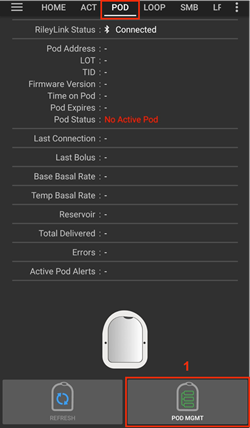
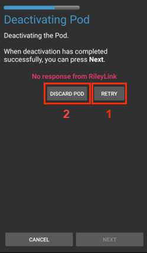
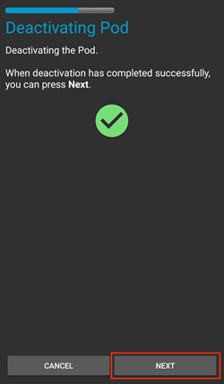
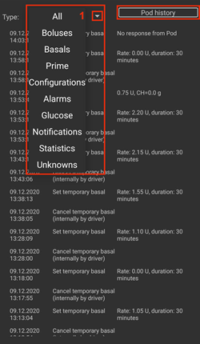
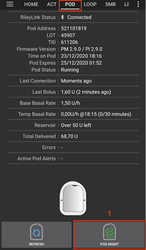
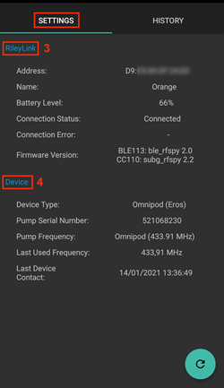

# Omnipod Eros

These instructions are for configuring the Omnipod Eros generation pump (**NOT Omnipod Dash**).

```{admonition} Omnipod Eros is being phased out
:class: note

The [Omnipod System](https://www.omnipod.com/current-podders/resources/omnipod-system) (the original Omnipod, comprising both the Personal Diabetes Manager (PDM) and the Pod) is being discontinued, and the end date varies by country. For example, it will no longer be available in Canada after 30 June 2026. If you rely on the Eros pump, plan ahead for a transition to a supported pump.
```

**Diese Software ist Teil einer DIY-Lösung (Do It Yourself = Eigenbau) und kein kommerzielles Produkt. Daher bist DU gefordert. DU musst lesen, lernen und verstehen, was das System macht und wie du es bedienst. Du bist ganz alleine dafür verantwortlich, was Du mit dem System machst.**

```{contents} Table of contents
:depth: 1
:local: true
```

## Hardware- und Softwareanforderungen

- **Pod-Kommunikationsgerät**

> Komponente, die die Kommunikation von deinem AAPS-Gerät zu Deinen Pods der Eros Generation ermöglicht.
> 
> > -   [OrangeLink Website](https://getrileylink.org/product/orangelink)
> > -  [433MHz RileyLink](https://getrileylink.org/product/rileylink433)
> > -   [Emalink Website](https://github.com/sks01/EmaLink) - [Kontakt:](mailto:getemalink@gmail.com)
> > -   DiaLink - [Kontakt:](mailto:Boshetyn@ukr.net)
> > -   [LoopLink Website](https://www.getlooplink.org/) - [Kontakt:](https://jameswedding.substack.com/) - nicht getestet

-   **Smartphone**

> Komponente, die AAPS betreibt und Steuerbefehle an das Pod-Kommunikationsgerät sendet.
> 
> > - Supported [Android phone](#Phones-list-of-tested-phones) with **AAPS** and related components set up.

-   **Insulin-Pumpe**

> Komponente, die vom Pod-Kommunikationsgerät empfangene Befehle interpretiert, die von Deinem Smartphone mit aktiviertem AAPS stammen.
> 
> > - Ein neuer Omnipod-Pod (Eros-Generation - **NICHT DASH**)

These instructions assume that you are starting a new pod session. If this is not the case, please be patient and start this process at your next pod change.

In this page, **RileyLink** means any of the pod communication devices listed above.

## Bevor du startest

**Sicherheit geht vor** - Stelle sicher, dass Du auf eventuell auftretende Fehler reagieren kannst, bevor Du diesen Prozess beginnst: zusätzliche Pods, Insulin, geladener RileyLink und Smartphone mit vollem Akku sind unbedingt notwendig.

**Dein Omnipod PDM funktioniert nicht mehr, wenn der AAPS Omnipod Treiber Deinen Pod aktiviert hat**. Bisher hast Du Deinen Omnipod PDM verwendet, um Befehle an Deinen Omnipod Eros Pod zu senden. Ein Omnipod Eros Pod kann sich nur mit einem einzigen Gerät verbinden. Das Gerät, das den Pod erfolgreich aktiviert, ist das einzige Gerät, das von diesem Zeitpunkt an mit ihm kommunizieren darf. Dies bedeutet, dass, sobald Du einen Omnipod Eros Pod mit Deinem RileyLink über den AAPS Omnipod Treiber aktiviert hast, **wirst Du Deinen PDM nicht mehr mit diesem Pod** verwenden können. Der AAPS Omnipod Treiber mit dem RileyLink ist dann Dein aktiver PDM. *Dies bedeutet NICHT, dass Du Deinen PDM wegwerfen solltest. Es wird empfohlen, ihn als Backup zu behalten und für Notfälle, falls AAPS nicht korrekt funktioniert.*

**Only one RileyLink at a time can communicate with a pod.** **AAPS** remembers one paired RileyLink. If you pair a different one, it replaces the previous one.

**Dein Pod wird nicht abgeschaltet, wenn der RileyLink außerhalb der Reichweite liegt.** Dein Pod wird weiterhin Basal-Insulin liefern, wenn Dein RileyLink außerhalb der Reichweite ist oder die Kommunikation mit dem aktiven Pod geblockt wird. Beim Aktivieren eines Pods wird das in AAPS definierte Profil in den neuen Pod programmiert. Wenn du den Kontakt zum Pod verlierst, wird er auf dieses zurückgesetzt. Du kannst keine neuen Befehle senden, solange der RileyLink nicht wieder in Reichweite kommt und die Verbindung wiedergeherstellt ist.

**Basalraten-Profile mit 30-Minuten-Schritten werden in AAPS NICHT unterstützt.** Wenn Du neu bei AAPS bist und zum ersten Mal Dein Basalprofil einrichtest, beachte bitte, dass Basalprofile, die mit einer halben Stunde beginnen, nicht unterstützt werden und Du Dein Basalprofil anpassen musst. Wenn Du zum Beispiel eine Basalrate von 1,1 Einheiten hast, die um 9:30 Uhr startet und zwei Stunden bis 11:30 Uhr läuft, wird dies nicht funktionieren.  Du muss diese 1,1 IE Basalrate auf einen Zeitraum von entweder 9:00 - 11:00 Uhr oder 10:00 - 12:00 Uhr einstellen.  Obwohl die Omnipod-Hardware selbst Basalratenwechsel zur halben Stunde unterstützt, ist AAPS derzeit nicht in der Lage, dies mit seinen Algorithmen zu berücksichtigen.

## Aktivieren des Omnipod-Treibers in AAPS

Du kannst den Omnipod-Treiber in AAPS auf **zwei Wegen** aktivieren:

### Option 1: Der Einrichtungsassistent

After installing a new version of AAPS, the **Setup Wizard** starts automatically. If you have already exported your settings from a previous installation, you can import them in the wizard. For new installations, continue below.

Go through the [Setup Wizard](../SettingUpAaps/SetupWizard.md) until you reach the **Pump** step, then select **Omnipod Eros** (the description reads "Pump integration for Omnipod Eros").


The Setup Wizard does not pair your RileyLink. After finishing the wizard, open the Omnipod pump screen and pair it as described in the [RileyLink Setup section](#OmnipodEros-rileylink-setup).

**ODER**

### Option 2: The Configuration screen

Open the top-left **menu** (☰) > **Configuration** > **Pump** and select the **radio button** of **Omnipod Eros**.

Once it is selected, the **Omnipod Eros** card shows two buttons, **Settings** and **Open plugin**:


**Settings** opens the settings of the Omnipod driver (see [Omnipod Settings](#OmnipodEros-omnipod-settings)):


**Open plugin** opens the Omnipod pump screen. You can also open it at any time from the main screen with **Manage** > **Pump**. This page calls it the **Omnipod pump screen**. Before a RileyLink is paired and a pod is activated, it looks like this:


### Überprüfung der Omnipod-Treiberauswahl

To verify that you have enabled the Omnipod driver, open **Manage** > **Pump** from the main screen. You should see the **Omnipod Eros** pump screen shown above. If you have not paired a RileyLink yet, **RileyLink Status** shows **Not Started** and **Pod Status** shows **No Active Pod**.

## Omnipod-Konfiguration

All pod and RileyLink functions are buttons on the [Omnipod pump screen](#OmnipodEros-omnipod-pod-tab) (**Manage** > **Pump**). Some buttons only appear in certain situations, for example when a pod is active.

>  Aktualisiere Pod-Verbindung und Status
> 
>  Pod-Management (Aktivieren, Deaktivieren, Testsignal, RileyLink Statistik und Pod-Historie)

```{admonition} Older screenshot
:class: note
The screenshots above are from an earlier **AAPS** version. In **AAPS** 4 there is no **POD MGMT** button or Pod Management menu: **Refresh** and all pod management actions are buttons on the Omnipod pump screen.
```

(OmnipodEros-rileylink-setup)=

### RileyLink-Setup

If you have already paired your RileyLink, continue to the [Activating a Pod section](#OmnipodEros-activating-a-pod) below.

*Note: A good visual indicator that the RileyLink is not connected is that the treatment buttons (QuickLaunch toolbar) on the main screen will be missing. Dies passiert auch in den ersten 30 Sekunden nach dem Start von AAPS, da AAPS sich erst mit dem RileyLink verbinden muss.*

1. Make sure that your RileyLink is fully charged and powered on.

2. Place the RileyLink [close to your phone](#OmnipodEros-optimal-omnipod-and-rileylink-positioning) (~30 cm away or less).

3. Open the Omnipod pump screen (**Manage** > **Pump**) and press **Pair RileyLink**.

4. The **Pair RileyLink** screen starts scanning for Bluetooth devices right away. Tap your RileyLink in the list of found devices.

   

5. When **RileyLink paired successfully** is shown with the name and address of your device, press **OK**.

6. Back on the Omnipod pump screen, check that **RileyLink Status** changes to **Connected**. **Pod Status** should show **No Active Pod**. If the RileyLink does not connect, press **Reset RileyLink**, or restart **AAPS**.

 

 


```{admonition} Older screenshot
:class: note
The six screenshots above (after step 6) are from an earlier **AAPS** version. In **AAPS** 4 you pair the RileyLink with the **Pair RileyLink** button on the Omnipod pump screen instead of **RileyLink Configuration** in the Omnipod settings, and scanning starts automatically.
```

```{note}
To switch to another RileyLink (for example a backup device), press **Pair RileyLink** again and select the new device. It replaces the one paired before. You do not need to remove the old device first.
```

(OmnipodEros-activating-a-pod)=

### Einen Pod aktivieren

Before you can activate a pod, make sure your RileyLink is paired and **RileyLink Status** shows **Connected**. The **Activate Pod** button stays disabled until the RileyLink is ready.

*HINWEIS: Für die Verbindung mit dem Pod steht aus Sicherheitsgründen nur ein kleinerer Kommunikationsbereich zur Verfügung. Vor dem Pairing des Pods ist das Funksignal schwächer, aber nachdem es verbunden wurde, wird es mit voller Signalleistung funktionieren. During these procedures, make sure that your pod is* [within close proximity](#OmnipodEros-optimal-omnipod-and-rileylink-positioning) *(~30 cm away or less) but not on top of or right next to the RileyLink.*

01. Open the Omnipod pump screen (**Manage** > **Pump**) and press **Activate Pod**.

    If you have never activated a profile, a **Profile required** step appears first. Select the profile to apply on activation.

    >   
    > 
    > ```{admonition} Older screenshot
    >     :class: note
    >     The screenshots above are from an earlier **AAPS** version. In **AAPS** 4 **Activate Pod** is a button on the Omnipod pump screen instead of in the **POD MGMT** menu.
    > ```

02. Der **Pod füllen** Bildschirm wird angezeigt. Fill a new pod with enough insulin for 3 days and listen for two beeps. They mean that the minimum amount of 80 units has been filled. Empty the fill syringe completely, even after hearing the two beeps. Beachte bei der Berechnung der gesamt Insulinmenge, welche Du in 3 Tagen benötigst, dass zum Füllen des Pod 12 bis 15 IE benötigt werden. Do not remove the pod's needle cap yet.

    > 
    > 
    > Ensure the new pod and RileyLink are within close proximity of each other (~30cm or less) and press **Next**.

03. **Select Insulin** (only shown if you have more than one insulin configured): select the insulin you are filling the pod with and press **Next**. A profile switch with this insulin is applied after activation.

04. Der Bildschirm **Initialisiere Pod** wird angezeigt und der Pod beginnt zu entlüften. (Du wirst ein Klicken hören, gefolgt von einer Reihe tickender Sounds, der Pod entlüftet sich selbst). Wenn RileyLink außerhalb des zulässigen Bereichs des aktiven Pods aktiviert wurde, erhälst Du eine Fehlermeldung **Keine Antwort von Pod**. If this occurs, [move the RileyLink closer](#OmnipodEros-optimal-omnipod-and-rileylink-positioning) (~30 cm away or less) to but not on top of or right next to the Pod and press **Retry**.

    >  

05. When priming is successful, a green checkmark is shown and the **Next** button becomes enabled. Press **Next**.

    > 

06. **Site location** (only shown if **Manage pump site rotation** is enabled in [Site Rotation](#Aapsscreens-site-rotation)): select where you place the pod on your body and press **Next**.

07. The **Attach Pod** screen is displayed. Prepare the infusion site of the new pod. Remove the pod's plastic needle cap and white paper backing from the adhesive and apply the pod to your chosen site on your body. If the cannula sticks out, press **Cancel** and discard the pod. When finished, press **Next**.

    > 

08. A confirmation dialog appears: "When you press OK, the cannula will be inserted". **ONLY press OK if you are ready to deploy the cannula**.

    > 

09. On the **Insert Cannula** screen, it may take some time before the Omnipod responds and inserts the cannula (1-2 minutes maximum), so be patient.

    > Wenn RileyLink außerhalb des zulässigen Bereichs des aktiven Pods aktiviert wurde, erhälst Du eine Fehlermeldung **Keine Antwort von Pod**. If this occurs, move the RileyLink closer (~30 cm away or less) to but not on top of or right next to the Pod and press **Retry**.
    > 
    > Wenn der RileyLink sich außerhalb der Bluetoothreichweite befindert oder keine aktive Verbindung zum Smartphone hat, bekommst Du eine Fehlermeldung **Keine Antwort von RileyLink**. If this occurs, move the RileyLink closer to the phone and press **Retry**.
    > 
    > *HINWEIS: Bevor die Kanüle eingesetzt wird, ist es ratsam, die Haut in der Nähe des Kanülensetzpunktes etwas zusammenzukneifen. Dies sorgt für eine sanfte Einführung der Nadel und verringert die Gefahr einer Verstopfung.*
    > 
    > 
    > 
    >  

10. Es wird ein grünes Häkchen angezeigt, und der Button **Weiter** wird bei erfolgreicher Kanüleneinführung aktiviert. Press **Next**.

    > 

11. The **Pod Activated** screen is displayed. Check that the cannula has been inserted correctly, and change your pod if you think it has not. Press **Finish**. Glückwunsch! Du hast jetzt eine neuen Pod aktiviert.

    >  
    > 
    > ```{admonition} Older screenshot
    >     :class: note
    >     The screenshots in steps 2 to 11 are from an earlier **AAPS** version and may look different in **AAPS** 4. The **Select Insulin** and **Site location** steps are not pictured.
    > ```

12. You are returned to the Omnipod pump screen. The **Activate Pod** button is replaced by **Deactivate Pod**, because you cannot activate another pod without deactivating the active one first.

    The pump screen now shows information about your active pod, including the current basal rate, reservoir level, insulin delivered, pod errors and alerts. For more details, see the [Omnipod pump screen](#OmnipodEros-omnipod-pod-tab) section.

     

    ```{admonition} Older screenshot
    :class: note
    The screenshots above are from an earlier **AAPS** version. In **AAPS** 4 there is no Pod Management menu: you return directly to the Omnipod pump screen, where **Deactivate Pod** replaces **Activate Pod**.
    ```

```{note}
If activation was interrupted after priming (for example the app was closed), press **Activate Pod** again. The wizard continues from the cannula insertion steps.
```

### Deaktiviere einen Pod

Unter normalen Umständen beträgt die Lebensdauer eines Pods drei Tage (72 Stunden) und zusätzlich 8 Stunden nach der Pod-Ablaufwarnung und somit insgesamt 80 Stunden.

Gehe wie folgt vor, um einen Pod zu deaktivieren (entweder vor dem Ablaufen der Nutzungsdauer oder wegen eines Pod-Fehlers):

1. Open the Omnipod pump screen (**Manage** > **Pump**) and press **Deactivate Pod**.

   >   
   > 
   > ```{admonition} Older screenshot
   >    :class: note
   >    The screenshots above are from an earlier **AAPS** version. In **AAPS** 4 **Deactivate Pod** is a button on the Omnipod pump screen instead of in the **POD MGMT** menu.
   > ```

2. On the **Deactivate Pod** screen, first make sure the RileyLink is in close proximity to the pod but not on top of or right next to the pod. Then press **Next**. A dialog asks *A deactivated Pod can not be used again. Deactivate this Pod now?* Press **OK** to start deactivating the pod, or **Cancel** to keep it. Deactivation suspends all insulin delivery and cannot be undone.

   > 

3. The **Deactivating Pod** screen appears, and you will receive a confirmation beep from the pod that deactivation was successful.

   > 
   > 
   > **IF deactivation fails** and you do not receive a confirmation beep, you may receive a **No response from RileyLink** or **No response from Pod** message. Press **Retry** to attempt deactivation again. If deactivation keeps failing, press **Discard Pod** and confirm. **AAPS** then forgets the pod. Insulin delivery has **not** been suspended, so remove the pod from your body. If your pod has a screaming alarm, you may need to silence it manually (using a pin or a paperclip), because **Discard Pod** does not silence it.
   > 
   > >   

4. A green checkmark appears when deactivation is successful. Press **Next** to display the **Pod Deactivated** screen. Du kannst nun deinen Pod entfernen, da die aktive Sitzung beendet wurde.

   > 

5. Press **Finish** to return to the Omnipod pump screen.

   >  
   > 
   > ```{admonition} Older screenshot
   >    :class: note
   >    The screenshots in steps 2 to 5 are from an earlier **AAPS** version and may look different in **AAPS** 4.
   > ```

6. On the Omnipod pump screen, check that **RileyLink Status** shows **Connected** and **Pod Status** shows **No Active Pod**.

   >    
   > 
   > ```{admonition} Older screenshot
   >    :class: note
   >    The screenshots above are from an earlier **AAPS** version. In **AAPS** 4 **Finish** returns you directly to the Omnipod pump screen; there is no Pod Management menu or **Omnipod (POD)** tab.
   > ```

### Insulinlieferung stoppen und fortsetzen

The process below shows you how to suspend and resume insulin delivery.

*NOTE - if you do not see a **Suspend** button*, it is hidden by default. Enable **Show Suspend Delivery button in Omnipod tab** in the [Omnipod settings](#OmnipodEros-omnipod-settings) under **Other**.

#### Insulinabgabe unterbrechen

Verwende diesen Befehl, um den aktiven Pod in den Status 'unterbrochen' zu versetzen. In diesem suspendiertem Zustand wird der Pod kein Insulin mehr liefern. Dieser Befehl ahmt die Suspend-Funktion nach, die der originale Omnipod PDM an einen aktiven Pod sendet.

1. Open the Omnipod pump screen (**Manage** > **Pump**) and press **Suspend**. The suspend command is sent through the RileyLink to the active pod.

2. When the pod has suspended all insulin delivery, **Pod Status** shows **Suspended** and the **Suspend** button is replaced by **Resume Delivery**.

   >  
   > 
   > 
   > 
   >  
   > 
   > ```{admonition} Older screenshot
   >    :class: note
   >    The screenshots above are from an earlier **AAPS** version. In **AAPS** 4 these steps take place on the Omnipod pump screen instead of the **Omnipod (POD)** tab, and the result is shown in **Pod Status**.
   > ```

If the command fails, a **Warning** dialog shows "Failed to suspend delivery" with the reason. Check the RileyLink connection and try again.

#### Insulinabgabe fortsetzen

Benutze diesen Befehl, um den aktiven, derzeit pausierten Pod anzuweisen, die Insulinabgabe fortzusetzen. Nachdem der Befehl erfolgreich verarbeitet wurde, wird die normale Insulinabgabe mit der aktuellen Basalrate fortgesetzt. Grundlage dafür ist das aktive Basalprofil zur aktuellen Uhrzeit. Der Pod akzeptiert wieder Befehle für Bolus, TBR und SMB.

1. Open the Omnipod pump screen and check that **Pod Status** shows **Suspended**. Press **Resume Delivery**.

2. When the command succeeds, **Pod Status** shows **Running** again and the **Resume Delivery** button disappears (the **Suspend** button is shown again if you have enabled it).

   >  
   > 
   > 
   > 
   >  
   > 
   > ```{admonition} Older screenshot
   >    :class: note
   >    The screenshots above are from an earlier **AAPS** version. In **AAPS** 4 these steps take place on the Omnipod pump screen instead of the **Omnipod (POD)** tab, and the result is shown in **Pod Status**.
   > ```

If the command fails, a **Warning** dialog shows "Failed to resume delivery" with the reason. Check the RileyLink connection and try again.

### Pod Alarme stummschalten

*NOTE - The **Silence Alerts** button is only shown on the Omnipod pump screen while the pod has an active alert (for example the pod expiration or low reservoir alert), and only if **Automatically silence Pod alerts** is disabled.*

The process below shows you how to silence pod beeps that start when the pod reaches the warning time before it expires. This warning time is set with **Alert at hours before shutdown (80 Hours)** in the Omnipod **Alerts** settings. Die maximale Nutzungsdauer eines Pods beträgt 80 Stunden (3 Tage und 8 Stunden), dennoch empfiehlt der Hersteller, 72 Stunden (3 Tage) nicht zu überschreiten.

*NOTE - If you have enabled **Automatically silence Pod alerts** in the Omnipod **Alerts** settings, **AAPS** silences the alert automatically at the next communication with the pod, and you do NOT need to do it manually.*

1. When the warning time is reached, the pod beeps to tell you that it will soon expire and needs to be changed. On the Omnipod pump screen, **Pod Expires** shows the exact time the pod expires (72 hours after activation); it turns **yellow** 4 hours before. **Pod Hard End** shows when the pod stops delivering insulin. **Active Pod Alerts** shows **Pod will expire soon**, and the **Silence Alerts** button appears. **AAPS** also shows a notification about the upcoming pod expiration.

   >   
   > 
   > ```{admonition} Older screenshot
   >    :class: note
   >    The screenshots above are from an earlier **AAPS** version. In **AAPS** 4 the **ACK ALERTS** button is called **Silence Alerts** and is on the Omnipod pump screen.
   > ```

2. Press **Silence Alerts**. The RileyLink sends the command to the pod to stop the expiration warning beeps.

   >  
   > 
   > ```{admonition} Older screenshot
   >    :class: note
   >    The screenshot above is from an earlier **AAPS** version. In **AAPS** 4 the button is called **Silence Alerts**.
   > ```

3. When the alerts are silenced, the pod beeps twice. **Active Pod Alerts** no longer shows the warning, the **Silence Alerts** button disappears and the pod stops its expiration warning beeps.

   >  
   > 
   > ```{admonition} Older screenshot
   >    :class: note
   >    The screenshot above is from an earlier **AAPS** version. In **AAPS** 4 the result is shown on the Omnipod pump screen: the warning disappears from **Active Pod Alerts**.
   > ```

If the command fails (for example the RileyLink is out of range of the pod), a **Warning** dialog shows "Failed to silence alerts" with the reason. Move the RileyLink closer to the pod and try again.


```{admonition} Older screenshot
:class: note
The screenshot above is from an earlier **AAPS** version. In **AAPS** 4 the **Warning** dialog shows "Failed to silence alerts" with the reason.
```

(OmnipodEros-view-pod-history)=

### Anzeige Pod-Historie

In diesem Abschnitt wird gezeigt, wie Du Deine Pod-Historie überprüfen und nach verschiedenen Aktionskategorien filtern kannst. Das Podhistory-Werkzeug erlaubt es, die Aktionen und Ergebnisse Ihres aktuell aktiven Pods während seines dreitägigen Lebens (72 - 80 Stunden) anzusehen.

Diese Funktion ist hilfreich bei der Überprüfung von Boli, Temporären Basalraten (TBRs) und Basaländerungen, die erfolgt sind, bei denen Du aber nicht sicher bist, ob sie abgeschlossen wurden. Die übrigen Kategorien sind im Allgemeinen hilfreich bei der Problembehebung und zur Bestimmung der Reihenfolge von Ereignissen, die zu einem Fehler geführt haben.

*HINWEIS:* **Unsichere** Befehle erscheinen in der Pod-Historie, aber für deren Genauigkeit gibt es aufgrund deren natürlichen Unsicherheit keine Garantie.

1. Open the Omnipod pump screen (**Manage** > **Pump**) and press **Pod History**.

   >   
   > 
   > ```{admonition} Older screenshot
   >    :class: note
   >    The screenshots above are from an earlier **AAPS** version. In **AAPS** 4 **Pod History** is a button on the Omnipod pump screen instead of in the **POD MGMT** menu.
   > ```

2. The **Pod History** screen lists all pod actions and their results, newest first, grouped by day. By default **All** is selected. Tap one of the filter buttons at the top to show only one category. Use the back arrow at the top left to return to the Omnipod pump screen.

   > 

   >  
   > 
   > ```{admonition} Older screenshot
   >    :class: note
   >    The second screenshot is from an earlier **AAPS** version and may look different in **AAPS** 4.
   > ```

### Zeige RileyLink Einstellungen und Historie an

The **RileyLink Stats** screen shows the settings of your RileyLink and active pod, and the communication history of both. It has two tabs: **Settings** and **History**.

The **RileyLink Stats** button is hidden by default. To show it on the Omnipod pump screen, enable **Show RileyLink Stats button in Pod Management menu** in the [Omnipod settings](#OmnipodEros-omnipod-settings) under **Other**.

#### Bluetooth-Kommunikation für Pod-Kommunikationsgerät manuell wiederherstellen

If your pod communication device was out of Bluetooth range of your phone for a while, **RileyLink Status** may report **RileyLink unreachable** on the Omnipod pump screen. **AAPS** normally reconnects by itself when the device is back in range. If it does not:

1. Make sure the RileyLink is powered on, charged and close to your phone.

2. On the Omnipod pump screen, press **Reset RileyLink**. A message confirms **RileyLink configuration reset**. See the [Reset RileyLink notes](#OmnipodEros-reset-rileylink-config-notes) below.

3. Wenn die **Bluetooth-Verbindung** nicht wieder hergestellt wird, dann versuche die Bluetooth-Funktion auf deinem Smartphone manuell **aus-** und dann wieder **anzuschalten**.

4. If it still does not reconnect, press **Pair RileyLink** and select your RileyLink again.

5. After a successful reconnection, **RileyLink Status** shows **Connected**. You can also check **Connection Status** on the **Settings** tab of the **RileyLink Stats** screen. Herzlichen Glückwunsch, Du hast jetzt erneut Deinen konfigurierten RileyLink mit AAPS verbunden!

 


```{admonition} Older screenshot
:class: note
The screenshots above are from an earlier **AAPS** version. In **AAPS** 4 you reconnect with **Reset RileyLink** or **Pair RileyLink** on the Omnipod pump screen instead of the refresh button on the RileyLink Settings screen.
```

#### Pod-Kommunikationsgerät und Aktive Pod-Einstellungen

This screen shows information and status for both the currently paired pod communication device and the currently active Omnipod Eros pod. The information refreshes automatically.

1. Open the Omnipod pump screen (**Manage** > **Pump**) and press **RileyLink Stats**. The **Settings** tab shows your currently paired **RileyLink** and the active pod (**Device**).

   >   
   > 
   > ```{admonition} Older screenshot
   >    :class: note
   >    The screenshots above are from an earlier **AAPS** version. In **AAPS** 4 **RileyLink Stats** is a button on the Omnipod pump screen instead of in the **POD MGMT** menu.
   > ```

   > 

##### RileyLink fields

> - **Address:** MAC address of the paired pod communication device.
> - **Name:** Bluetooth name of the paired pod communication device.
> - **Battery Level:** The current battery level of the connected pod communication device. Only shown when **Show battery level reported by OrangeLink/EmaLink/DiaLink** is enabled.
> - **Verbindungsstatus:**: Der aktuelle Status der Bluetooth-Verbindung zwischen dem Pod-Kommunikationsgerät und dem Smartphone, auf dem AAPS läuft.
> - **Connection Error:** If there is an error with the pod communication device Bluetooth connection, details are displayed here.
> - **Firmware-Version:** Aktuelle Firmware-Version, die auf dem aktiv verbundenen Pod-Kommunikationsgerät installiert ist.

##### Device fields - With an Active Pod

> - **Device Type:** The type of device communicating with the pod communication device (Omnipod (Eros)).
> - **Configured Device Model:** The model of the device configured to communicate with the pod communication device.
> - **Connected Device Model:** The model of the device currently communicating with the pod communication device.
> - **Pump Serial Number:** Serial number of the currently activated pod.
> - **Pump Frequency:** Radio frequency used to communicate with the pod.
> - **Last Used Frequency:** Last known radio frequency the pod used to communicate with the pod communication device.
> - **Letzter Gerätekontakt:** Datum und Uhrzeit des letzten Kontakts vom Pod mit dem Pod-Kommunikationsgerät.

(omnipod-eros-rileylink-and-active-pod-history)=
#### Historie des RileyLink und aktiven Pods

This tab lists, newest first, each state or action of the RileyLink or the currently connected pod. The history is only available for the currently active pod. After a pod change, this history is erased and only events from the newly activated pod are recorded and shown.

1. Open the Omnipod pump screen (**Manage** > **Pump**), press **RileyLink Stats** and then tap the **History** tab.

   >   
   > 
   > ```{admonition} Older screenshot
   >    :class: note
   >    The screenshots above are from an earlier **AAPS** version. In **AAPS** 4 **RileyLink Stats** is a button on the Omnipod pump screen instead of in the **POD MGMT** menu.
   > ```

   > 

##### Felder

Each entry shows:

> - **Device:** The device to which the action or state refers.
> - **Time:** The time of the event.
> - **State or Action:** The state of the device or the action it performed.

(OmnipodEros-omnipod-pod-tab)=

## Omnipod pump screen

Below is an explanation of the status fields and buttons on the **Omnipod pump screen** (**Manage** > **Pump**, or **Configuration** > **Pump** > **Open plugin**).

The gear icon at the top right opens the [Omnipod settings](#OmnipodEros-omnipod-settings).

*NOTE: If any status field shows (uncertain), press **Refresh** to refresh the pod status and clear it.*


```{admonition} Older screenshot
:class: note
The screenshot above is from an earlier **AAPS** version, where this screen was the **Omnipod (POD)** tab. In **AAPS** 4 it is the Omnipod pump screen, and some field names and buttons differ.
```

### Felder

- **RileyLink Status:** Displays the current connection status of the RileyLink. Errors are shown in red.

- *Not Started* - no RileyLink is paired yet, or the connection has not started.
- *RileyLink unreachable* - pod communication device is either not within Bluetooth range of the phone, powered off or has a failure preventing Bluetooth communication.
- *RileyLink ready* - pod communication device is powered on and actively initializing the Bluetooth connection.
- *Verbunden* - Das Pod-Kommunikationsgerät ist eingeschaltet, verbunden und aktiv in der Lage, über Bluetooth zu kommunizieren.

- **Unique ID:** Displays the address of the active pod.

- **LOT Number:** Displays the LOT number of the active pod.

- **Sequence Number:** Displays the serial number (TID) of the pod.

- **Firmware-Version:** Zeigt die Firmware-Version des aktiven Pods an.

- **Zeit auf dem Pod:** Zeigt die aktuelle Uhrzeit auf dem aktiven Pod an. It is highlighted when it differs from the phone time by more than 5 minutes.

- **Pod Expires:** Displays the date and time when the active pod will expire. The text turns yellow in the last 4 hours before this time. It never turns red, because the pod keeps delivering insulin after it.

- **Pod Hard End:** Displays the end of the pod's grace period (8 hours after **Pod Expires**, for a maximum pod life of 80 hours). The text turns yellow when the grace period starts (at **Pod Expires**) and red in the last 4 hours before the hard end. During the grace period it also shows the time left, for example *(17m remaining)*. The pod stops delivering insulin at the hard end and must be changed.

- **Pod Status:** Displays the status of the active pod (for example **No Active Pod**, **Running** or **Suspended**).

- **Last Connection:** Displays the last time communication with the active pod was achieved. The text turns red when the [pump unreachable threshold](#OmnipodEros-troubleshooting) is exceeded.

- *gerade eben* vor weniger als 20 Sekunden.
- *vor weniger als einer Minute* vor mehr als 20 Sekunden, aber weniger als 60 Sekunden.
- *vor 1 Minute* vor mehr als 60 Sekunden, aber weniger als 120 Sekunden (2 min).
- *vor XX Minuten* vor mehr als 2 Minuten, definiert durch den Wert von XX.

- **Last Bolus:** Displays the dosage of the last bolus sent to the active pod and how long ago it was issued in parenthesis.

- **Base Basal Rate:** Displays the basal rate programmed for the current time from the basal rate profile.

- **Temp Basal Rate:** Only shown while a Temporary Basal Rate is running. Displays it in the following format:

- Einheiten / Stunde zum Zeitpunkt der Erstellung der TBR (gelaufene Minuten / Gesamtminuten, in denen die TBR läuft)
- *Beispiel:* 0,00 IE/h @18:25 ( 90/120 min.)

- **Reservoir:** Displays **Over 50 U left** when more than 50 units are left in the reservoir. Below this value the approximate number of units is displayed. The text turns red below the low reservoir threshold set in the [Alerts settings](#OmnipodEros-omnipod-settings).

- **Total Delivered:** Displays the total number of units of insulin delivered from the reservoir. *Beachte, dass es sich hierbei um einen Näherungswert handelt, da das Befüllen des Pods nicht absolut exakt geschieht.*

- **Active Pod Alerts:** Reserved for currently running alerts on the active pod. Wird normalerweise verwendet, wenn das Pod-Ablaufdatum nach 72 Stunden erreicht ist und native Pieptöne vom Pod ausgegeben werden.

- **Errors:** Displays the last error encountered (shown in red). Überprüfe die [Pod Historie](#OmnipodEros-view-pod-history), [RileyLink Historie](#omnipod-eros-rileylink-and-active-pod-history) und die Protokolldateien auf aufgetretene Fehler und Detailinformationen.

### Schaltflächen

The buttons at the bottom of the pump screen change depending on the situation. Buttons that cannot be used right now are greyed out, for example while the RileyLink is not connected.

**Pod status buttons** (shown when a pod is active):

- **Refresh:** Sends a refresh command to the active pod to update its status. Use it to refresh the pod status and clear status fields that contain the text (uncertain). Weitere Informationen zur [Problembehandlung](#OmnipodEros-troubleshooting) findest Du im Abschnitt unten.

  

  ```{admonition} Older screenshot
  :class: note
  The screenshot above is from an earlier **AAPS** version. In **AAPS** 4 this is a text button named **Refresh** on the Omnipod pump screen.
  ```

- **Silence Alerts:** Silences the pod expiration and low reservoir beeps and notifications. Only shown when the pod has an active alert and **Automatically silence Pod alerts** is disabled. After the alerts are silenced, the button disappears.

  

  ```{admonition} Older screenshot
  :class: note
  The screenshot above is from an earlier **AAPS** version. In **AAPS** 4 this button is called **Silence Alerts**.
  ```

- **Set time:** Updates the time on the pod with the current time on your phone. Only shown when the time on the pod differs from the phone time by more than 5 minutes.

  

  ```{admonition} Older screenshot
  :class: note
  The screenshot above is from an earlier **AAPS** version. In **AAPS** 4 this is a text button named **Set time** on the Omnipod pump screen.
  ```

- **Suspend:** Suspends insulin delivery on the active pod. Only shown if enabled in the settings (**Show Suspend Delivery button in Omnipod tab**).

  

  ```{admonition} Older screenshot
  :class: note
  The screenshot above is from an earlier **AAPS** version. In **AAPS** 4 this is a text button named **Suspend** on the Omnipod pump screen.
  ```

- **Resume Delivery:** Resumes insulin delivery on the currently suspended, active pod. Only shown while the pod is suspended.

  

  ```{admonition} Older screenshot
  :class: note
  The screenshot above is from an earlier **AAPS** version. In **AAPS** 4 this is a text button named **Resume Delivery** on the Omnipod pump screen.
  ```

**Pod and RileyLink management buttons:**


```{admonition} Older screenshot
:class: note
The screenshot above is from an earlier **AAPS** version. In **AAPS** 4 there is no Pod Management menu: these actions are buttons directly on the Omnipod pump screen.
```

- **Activate Pod:** Primes and activates a new pod. Shown when no pod is active. It is enabled only when the RileyLink is connected.

  

  ```{admonition} Older screenshot
  :class: note
  The screenshot above is from an earlier **AAPS** version. In **AAPS** 4 **Activate Pod** is a button on the Omnipod pump screen instead of in the Pod Management menu.
  ```

- **Deactivate Pod:** Deactivates the currently active pod. Shown as soon as a pod is paired, also when an activation stopped part-way (for example because the pod failed during activation). It is enabled only when the RileyLink is connected. **AAPS** asks you to confirm before it deactivates the pod.

- * Verwende diesen Befehl, um einen heulenden Pod zu deaktivieren (Fehler 49).
- If deactivation fails, the deactivation wizard offers a **Discard Pod** option.

  

  ```{admonition} Older screenshot
  :class: note
  The screenshot above is from an earlier **AAPS** version. In **AAPS** 4 **Deactivate Pod** is a button on the Omnipod pump screen instead of in the Pod Management menu.
  ```

- **Play Test Beep:** Plays a single test beep on the pod when pressed. Shown when a pod is paired.

  

  ```{admonition} Older screenshot
  :class: note
  The screenshot above is from an earlier **AAPS** version. In **AAPS** 4 **Play Test Beep** is a button on the Omnipod pump screen instead of in the Pod Management menu.
  ```

- **Pod History:** Displays the active pod activity history. See [View Pod History](#OmnipodEros-view-pod-history).

  

  ```{admonition} Older screenshot
  :class: note
  The screenshot above is from an earlier **AAPS** version. In **AAPS** 4 **Pod History** is a button on the Omnipod pump screen instead of in the Pod Management menu.
  ```

- **Pair RileyLink:** Scans for your pod communication device and pairs it. See [RileyLink Setup](#OmnipodEros-rileylink-setup).

- **RileyLink Stats:** Opens the RileyLink Stats screen with two tabs. Only shown if enabled in the settings (**Show RileyLink Stats button in Pod Management menu**).

- **Einstellungen** - zeigt Informationen zum RileyLink und aktive Pod-Einstellungen an
- **Historie** - zeigt den Verlauf der RileyLink- und Pod-Kommunikation an

  

  ```{admonition} Older screenshot
  :class: note
  The screenshot above is from an earlier **AAPS** version. In **AAPS** 4 **RileyLink Stats** is a button on the Omnipod pump screen instead of in the Pod Management menu.
  ```

- **Reset RileyLink:** Resets the configuration of the currently connected pod communication device. When communication is started, specific data is sent to and set in the RileyLink:

- Memory Registers are set
- Communication Protocols are set
- Tuned Radio Frequency is set
  > 
  > See [additional notes](#OmnipodEros-reset-rileylink-config-notes) below.

  

  ```{admonition} Older screenshot
  :class: note
  The screenshot above is from an earlier **AAPS** version. In **AAPS** 4 this button is called **Reset RileyLink** and is on the Omnipod pump screen.
  ```

- **Discard Pod:** Discards the pod state of an unresponsive pod, after a confirmation. Only shown when a pod has been started but not fully paired, as proper deactivation is no longer possible:

- Ein **Pod ist nicht vollständig verbunden** und ignoriert daher die Befehle zum Deaktivieren.
- A **pod is stuck** during the pairing process between steps.
- Ein **Pod lässt sich überhaupt nicht verbinden.**
  > 
  > After you discard a pod, **AAPS** can no longer communicate with it. Remove the pod from your body.

  

  ```{admonition} Older screenshot
  :class: note
  The screenshot above is from an earlier **AAPS** version. In **AAPS** 4 **Discard Pod** is a button on the Omnipod pump screen instead of in the Pod Management menu.
  ```

(OmnipodEros-reset-rileylink-config-notes)=

#### *Reset RileyLink Notes*

- Diese Funktion wird in erster Linie verwendet, wenn das derzeit aktive Pod-Kommunikationsgerät nicht antwortet und die Kommunikation in einem festgefahrenen Zustand ist.
- If the pod communication device is turned off and then back on, press **Reset RileyLink** so that these communication parameters are set again in the pod communication device.
- Wird dies NICHT getan, muss AAPS neu gestartet werden, nachdem das Pod-Kommunikationsgerät aus- und wieder eingeschaltet wurde.
- This button **DOES NOT** need to be pressed when switching between different pod communication devices.

(OmnipodEros-omnipod-settings)=

## Omnipod-Einstellungen

To open the Omnipod driver settings, either:

- press the gear icon at the top right of the Omnipod pump screen (**Manage** > **Pump**), or
- open the top-left **menu** (☰) > **Configuration** > **Pump** and press **Settings** on the **Omnipod Eros** card.


```{admonition} Older screenshot
:class: note
The screenshot above is from an earlier **AAPS** version. In **AAPS** 4 you open the settings with **Settings** on the **Omnipod Eros** card or the gear icon on the Omnipod pump screen, instead of the settings gear in **Configuration** or the 3-dot menu.
```

The settings are grouped as listed below. Tap a group to expand it. Most entries are switches you can enable or disable:


*HINWEIS: Ein Sternchen (\*) bedeutet, dass "aktiviert" der Standardwert für eine Einstellung ist.*

### RileyLink

Settings for the pod communication device. You pair the device itself with the **Pair RileyLink** button on the pump screen (see [RileyLink Setup](#OmnipodEros-rileylink-setup)).

- **Use Scanning:** Scans before connecting to the OrangeLink. This can improve connections. It can also be used with other RileyLink clones if needed.

- **Show battery level reported by OrangeLink/EmaLink/DiaLink:** Reports the actual battery level of the OrangeLink/EmaLink/DiaLink. Es wird **dringend empfohlen**, dass alle OrangeLink/EmaLink/DiaLink-Benutzer diese Einstellung aktivieren.

- Funktioniert NICHT mit dem originalen RileyLink.
- Funktioniert möglicherweise nicht mit RileyLink-Alternativen.
- Aktiviert - Meldet den aktuellen Batteriestand für unterstützte Pod-Kommunikationsgeräte.
- Deaktiviert - Meldet einen Wert von n/a.

- **Enable battery change logging in Actions:** Only available when the battery reporting setting above is enabled. Some pod communication devices can use regular batteries that you can change. With this setting enabled, you can record a **Pump Battery Change** [careportal entry](#aaps-screens-careportal) to note the change and reset the battery age.

### Confirmation Beeps

Bestätigt mit Signaltönen des Pods die Abgabe und Änderung von Bolus, Basalrate, SMB und TBR.

- **\*Bolus-Töne aktiviert:** Aktiviert oder deaktiviert Bestätigungstöne, wenn ein Bolus abgegeben wird.
- **Basal beeps enabled:** Enable or disable confirmation beeps when a new basal rate is set, active basal rate is canceled or current basal rate is changed.
- **\*SMB-Töne aktiviert:** Aktiviert oder deaktiviert Bestätigungstöne, wenn ein SMB abgegeben wird.
- **TBR-Piep aktiviert:** Aktiviert oder deaktiviert Bestätigungstöne, bei Setzen oder Abbruch einer TBR.

### Alarme

Bietet AAPS-Warnungen und Nightscout-Ankündigungen für den Ablauf eines Pods, die Abschaltung oder einen niedrigen Füllstand basierend auf den definierten Schwellenwerten.

*Beachte, dass eine AAPS-Benachrichtigung IMMER für jeden Alarm nach der ersten Kommunikation mit dem Pod ausgegeben wird, da der Alarm ausgelöst wurde. Dismissing the notification will NOT silence the alert UNLESS **Automatically silence Pod alerts** is enabled. To silence the alert MANUALLY, open the Omnipod pump screen and press **Silence Alerts**.*

- **\*Expiration reminder enabled:** When enabled, the pod beeps when the time set below is reached.
- **Alert at hours before shutdown (80 Hours):** The number of hours before the pod shuts down (80 hours after activation) at which the expiration reminder is triggered (1 to 8 hours, default 8).
- **\*Niedrige Reservoir-Alarm aktiviert:** Aktivieren oder deaktivieren Sie eine Warnung, wenn die verbleibenden Einheiten niedriger Reservoir-Limit erreicht ist, wie im Feld Anzahl der Einheiten definiert.
- **Number of units:** The number of units at which to trigger the pod low reservoir alert (5 to 50, default 20).
- **Automatically silence Pod alerts:** When enabled, a notification is still issued, but the alert is silenced automatically at the next communication with the pod after the alert started.

### Benachrichtigungen

Meldet AAPS-Benachrichtigungen und akustische Telefonwarnungen, wenn unsicher ist, ob TBR-, SMB- oder Bolus-Ereignisse erfolgreich waren.

*HINWEIS: Dies sind nur Benachrichtigungen, es werden keine akustischen Signale ausgegeben.*

- **\*Sound for uncertain TBR notifications enabled:** Enable or disable this setting to trigger an audible alert and visual notification when AAPS is uncertain if a TBR was successfully set.
- **\*Ton für Benachrichtigung bei unsicheren SMB-Ereignis aktiviert:** Aktiviere oder deaktiviere diese Einstellung, um einen akustischen Alarm und eine visuelle Benachrichtigung auszulösen, wenn AAPS unsicher ist, ob eine SMB erfolgreich zugestellt wurde.
- **\*Ton für Benachrichtigung bei unsicheren Bolus-Ereignis aktiviert:** Aktiviere oder deaktiviere diese Einstellung, um einen akustischen Alarm und eine visuelle Benachrichtigung auszulösen, wenn AAPS unsicher ist, ob ein Bolus erfolgreich abgegeben wurde.

### Andere

Bietet erweiterte Einstellungen zur Unterstützung bei der Fehlersuche.

- **Show Suspend Delivery button in Omnipod tab:** Hide or display the **Suspend** button on the Omnipod pump screen.
- **Show Pulse Log button in Pod Management menu:** This setting is still listed, but the current version of the pump screen has no **Pulse Log** button.

- **Show RileyLink Stats button in Pod Management menu:** Hide or display the **RileyLink Stats** button on the Omnipod pump screen.
- **\*DST/Time zone detection enabled:** Allows time zone changes to be automatically detected if the phone is used in an area where DST is observed.

### Wechseln oder Entfernen eines aktiven Pod-Kommunikationsgeräts (RileyLink)

With many alternative models to the original RileyLink available (such as OrangeLink or EmaLink), or the need to have multiple or backup versions of the same pod communication device, you may need to switch to another device.

To switch, open the Omnipod pump screen (**Manage** > **Pump**), press **Pair RileyLink** and select the new device, as described in [RileyLink Setup](#OmnipodEros-rileylink-setup). The new device replaces the previously paired one.

 


 

```{admonition} Older screenshot
:class: note
The screenshots above are from an earlier **AAPS** version. In **AAPS** 4 you add a device with **Pair RileyLink** on the Omnipod pump screen instead of **RileyLink Configuration** in the Omnipod settings, and scanning starts automatically.
```

There is no separate button to remove a paired device. If you stop using a RileyLink, simply pair the new one when you need it.


```{admonition} Older screenshot
:class: note
The screenshots above are from an earlier **AAPS** version. In **AAPS** 4 there is no **Remove** button: pairing a new RileyLink replaces the previous one.
```

## Status row and careportal

There are a few items that are specific to how the Omnipod pod differs from tube based pumps, especially after applying a new pod.

The **insulin** and **cannula** ages in the [status row](#screens-sensor-level-battery) of the main screen are **reset** to 0 days and 0 hours **after each pod change**. Das liegt daran, wie die Omnipod-Pumpe gebaut ist und funktioniert. Die **Pumpenbatterie** und das **Insulinreservoir ** sind immer im Pod enthalten. Da der Pod die Kanüle direkt in die Haut am Ort der Pod-Anwendung einführt, wird bei Omnipod-Pumpen kein herkömmlicher Schlauch verwendet. *Nach einem Podwechsel wird das Alter jedes dieser Werte daher automatisch auf Null zurückgesetzt.* **Das Alter der Pumpenbatterie** wird nicht angegeben, da die Batterie im Pod immer länger hält, als die Lebensdauer des Pods (maximal 80 Stunden).


```{admonition} Older screenshot
:class: note
The screenshot above is from an earlier **AAPS** version, where these ages were shown in the **Careportal** section of the **Actions (ACT)** tab. In **AAPS** 4 they are shown in the status row of the main screen.
```

### Füllstände

**Insulin Level**

Die Angabe der Insulinmenge im Omnipod Eros Pod ist nicht genau. This is because it is not known exactly how much insulin was put in the pod, only that when the 2 beeps are triggered while filling the pod at least 80 units have been filled. Ein Pod kann maximal 200 Einheiten aufnehmen. Priming can also introduce variance as it is not an exact process. Mit diesen beiden Faktoren wurde der Omnipod-Treiber so geschrieben, dass er die beste Annäherung an das im Reservoir verbleibende Insulin liefert.

> - **Über 50 Einheiten** - Meldet einen Wert von 50+U, wenn sich mehr als 50 Einheiten im Reservoir befinden.
> - **Unter 50 Einheiten** - Meldet einen ungefähren berechneten Wert des im Reservoir verbleibenden Insulins.
> - **SMS** - Aus dem Pod übernommener Wert oder 50+ IE für SMS-Antworten
> - **Nightscout** - Lädt den Wert 50 hoch, wenn mehr als 50 Einheiten angezeigt werden (Nightscout Version 14.07 und älter).  Neuere Versionen melden einen Wert von 50+, wenn sich mehr als 50 Einheiten im Reservoir befinden.

**Akkustand**

Die Batteriestandsmeldung ist eine Einstellung, die aktiviert werden kann, um den aktuellen Batteriestand von Pod-Kommunikationsgeräten wie dem OrangeLink, EmaLink oder DiaLink anzuzeigen.  Die RileyLink-Hardware ist nicht in der Lage, ihren Batteriestand zu melden.  Der Batteriestand wird nach jeder Kommunikation mit dem Pod gemeldet, so dass beim Aufladen möglicherweise kein linearer Anstieg zu beobachten ist.  Durch eine manuelle Aktualisierung wird der aktuelle Batteriestand aktualisiert.  Wenn ein unterstütztes Pod-Kommunikationsgerät nicht angeschlossen ist, wird ein Wert von 0% gemeldet.

> - **Die RileyLink-Hardware ist NICHT in der Lage ihren Batteriestand zu melden**
> - **"Zeige den von OrangeLink/EmaLink/DiaLink gemeldeten Akkustand" MUSS in den Omnipod-Einstellungen aktiviert werden, um den Akkustand zu melden**
> - **Batteriestandsmeldung funktioniert NUR für OrangeLink-, EmaLink- und DiaLink-Geräte**
> - **Batteriestandsmeldung KANN für andere Geräte funktionieren (außer RileyLink)**
> - **SMS** - Gibt den aktuellen Akkustand als Antwort zurück, wenn ein aktueller Wert existiert, ein Wert von n/a wird nicht zurückgegeben
> - **Nightscout** - Akkustand wird gemeldet, wenn ein aktueller Wert existiert, ein Wert von n/a wird nicht gemeldet

(OmnipodEros-troubleshooting)=

## Problembehandlung

### Pod Fehler

Pods fallen gelegentlich aus unterschiedlichen Gründen aus, u. a. wegen Hardwareproblemen mit dem Pod selbst. Am besten ist es, diese nicht bei Insulet anzugeben, da AAPS kein zugelassener Anwendungsfall ist. Eine Liste an Fehlercodes findest du [hier](https://github.com/openaps/openomni/wiki/Fault-event-codes), um die Ursache zu ermitteln.

### Verhindere Pod Fehler 49

Dieser Fehler hängt mit einem fehlerhaften Pod-Status für einen Befehl oder einem Fehler während der Insulinabgabe zusammen. We recommend that you set Nightscout synchronization to *upload only*: keep all the "Receive ... from NS" options disabled in the synchronization settings of the Nightscout client (see [Nightscout](../SettingUpAaps/Nightscout.md)) to prevent possible failures.

### Pumpe nicht erreichbar Alarme

We recommend setting pump unreachable alerts to **120 minutes**. Press the **Settings** (gear) icon at the top right of the main screen, select **Local alerts** > **Pump unreachable threshold** and set it to **120**.

(OmnipodEros-import-settings-from-previous-aaps)=
### Importieren von Einstellungen aus früherem AAPS

```{admonition} Importing settings can end your active Pod
:class: warning
On the phone that is already running the Pod, leave **Also replace pump settings** unticked: the Pod session is kept and only the other settings are imported. Tick it only with a file exported during the Pod you are wearing now. See [Tubeless pumps](#ExportImportSettings-tubeless-pumps).
```

The safest way to reinstall **AAPS** is between two Pods:

1. Deaktiviere deine Pod-Sitzung. Stelle sicher, dass keine aktive Pod-Sitzung läuft.
2. Exportiere deine Einstellungen und bewahre eine Kopie an einem sicheren Ort auf.
3. Deinstalliere die vorherige Version von AAPS und starte dein Smartphone neu.
4. Installiere die neue Version von AAPS und stelle sicher, dass Du keine aktive Pod-Sitzung hast.
5. Importiere deine Einstellungen und aktiviere einen neuen Pod.

### Omnipod-Treiberwarnungen

Please note that the Omnipod driver presents a variety of unique alerts on the **main screen**, most of them are informational and can be dismissed while some provide the user with an action to take to resolve the cause of the triggered alert. Im Folgenden findest du eine Zusammenfassung der wichtigsten Warnmeldungen, die dir begegnen können:

#### Kein aktiver Pod

Keine aktive Pod-Sitzung erkannt. Dieser Alarm kann vorübergehend durch Drücken von **Schlummern** deaktiviert werden, wird aber weiterhin ausgelöst, solange kein neuer Pod aktiviert wurde. Einmal aktiviert, wird dieser Alarm automatisch ausgeschaltet.

#### Pod angehalten

Hinweis, dass der Pod ausgesetzt wurde.

#### Setzen des Basal-Profils fehlgeschlagen. Die Abgabe könnte ausgesetzt sein! Please manually refresh the Pod status from the Omnipod tab and resume delivery if needed.

Informational alert that the Pod basal profile setting has failed. Open the Omnipod pump screen and press **Refresh**, then **Resume Delivery** if needed.

#### Es kann nicht überprüft werden, ob der SMB-Bolus erfolgreich war. Wenn du sicher bist, dass der Bolus nicht erfolgreich war, solltest du den SMB-Eintrag manuell auf der Registerkarte Behandlungen entfernen.

Alert that the SMB bolus success could not be verified. Check the **Last Bolus** field on the Omnipod pump screen to see if the SMB succeeded. If it did not, remove the entry from the treatments.

#### Unsicher, ob die "Ereignis Bolus/TBR/SMB" abgeschlossen wurde. Bitte überprüfe manuell, ob sie erfolgreich war.

Aufgrund der Art und Weise, wie RileyLink und Omnipod miteinander kommunizieren, kann es zu Situationen kommen, in denen es *unsicher* ist, ob ein Befehl erfolgreich verarbeitet wurde. Es war notwendig, den Nutzer über diese Unsicherheit zu informieren.

Im Folgenden findest du einige Beispiele dafür, wann eine unsichere Meldung auftreten kann.

- **Bolus** - Unsichere Boli können nicht automatisch überprüft werden. Die Benachrichtigung bleibt bis zum nächsten Bolus bestehen, aber eine manuelle Pod-Aktualisierung löscht die Meldung. *Standardmäßig sind bei dieser Benachrichtigungsart die Warntöne aktiviert, da der/die Nutzer/in sie manuell bestätigen muss.*
- **TBRs, Pod-Status, Profilwechsel, Zeitänderungen** - eine manuelle Pod-Aktualisierung löscht die Meldung.
- **Pod Time Deviation -** When the time on the pod and the time on your phone differ too much, it is difficult for the AAPS loop to function and make accurate predictions and dosage recommendations. If the time difference between the pod and the phone is more than 5 minutes, a **Set time** button appears on the Omnipod pump screen. Press **Set time** to synchronize the time on the pod with the time on the phone. If **Pod Status** shows **Suspended** afterwards, press **Resume Delivery** to continue normal pod operations.

## Best Practices

(OmnipodEros-optimal-omnipod-and-rileylink-positioning)=

### Optimale Positionierung von Omnipod und RileyLink

Die Antenne, die auf dem RileyLink zur Kommunikation mit einem Omnipod-Pod verwendet wird, ist eine 433 MHz-Wendelspiralantenne. Aufgrund seiner Konstruktion strahlt er ein omnidirektionales Signal wie ein dreidimensionaler Donut ab, wobei die Z-Achse die vertikal stehende Antenne darstellt. Das bedeutet, dass es optimale Positionen für die Platzierung des RileyLink gibt, insbesondere bei der Pod-Aktivierung und Deaktivierung.


> *(Bild 1. Graphische Darstellung einer Wendelspiralantenne in einem Rundstrahldiagramm*)

Aus Sicherheitsgründen muss die *Aktivierung* des Pods in einem *geringeren Abstand (~30 cm oder weniger)* als andere Vorgänge erfolgen, wie z. B. die Verabreichung eines Bolus, das Setzen eines TBR oder das einfache Aktualisieren des Pod-Status. Aufgrund der Art und Weise der Signalübertragung der RileyLink-Antenne ist es NICHT empfehlenswert, den Pod direkt auf oder neben dem RileyLink zu platzieren.

Die Abbildung unten zeigt die optimale Positionierung des RileyLink während der Pod-Aktivierung und Deaktivierung. Der Pod kann zwar auch in anderen Positionen aktiviert werden, jedoch wirst Du mit der unten gezeigten Position den größten Erfolg haben.

*Hinweis: Wenn trotz optimaler Positionierung des Pods die Kommunikation mit dem RileyLink fehlschlägt, kann dies an einer schwachen Batterie liegen, da diese den Sendebereich der RileyLink-Antenne verringert. Um dieses Problem zu vermeiden, stelle sicher, dass der RileyLink während dieses Vorgangs ordnungsgemäß geladen oder direkt an ein Ladekabel angeschlossen ist.*


## Wo ich Hilfe bekomme

Die gesamte Entwicklungsarbeit für den Omnipod-Treiber wird von der Community auf freiwilliger Basis geleistet. Wir bitten dich, rücksichtsvoll zu sein und die folgenden Richtlinien zu befolgen, wenn du um Unterstützung bittest:

- **Level 0:** Lies den entsprechenden Abschnitt dieser Dokumentation um sicherzustellen, dass du verstehst, wie die Funktion, mit der Du Schwierigkeiten hast, funktionieren soll.
- **Level 1:** Wenn Du immer noch Probleme hast, die du mit diesem Dokument nicht lösen kannst, dann gehe bitte in den *#androidaps* Channel auf **Discord**, indem du [diesen Einladungslink <https://discord.gg/4fQUWHZ4Mw>](https://discord.gg/4fQUWHZ4Mw) benutzt.
- **Stufe 2:** Gehe durch die bestehenden Probleme, um zu sehen, ob Dein Problem bereits bekannt ist; Falls nicht, eröffne ein neues [Issue](https://github.com/nightscout/AndroidAPS/issues) und hänge Deine [Protokolldateien](../GettingHelp/AccessingLogFiles.md) (engl. logs) an.
- **Sei geduldig - die meisten Mitglieder unserer Community sind gutmütige Freiwillige und die Lösung von Problemen erfordert oft Zeit und Geduld von Nutzern und Entwicklern.**
