# Omnipod Eros

Diese Anleitung ist für die Konfiguration der Omnipod Eros Pumpe (**NICHT Omnipod Dash**).

```{admonition} Omnipod Eros is being phased out
:class: note

Das [Omnipod System](https://www.omnipod.com/current-podders/resources/omnipod-system) (der ursprüngliche Omnipod mit Personal Diabetes Manager (PDM) und Pod) wird eingestellt; das Enddatum ist von Land zu Land verschieden. In Kanada ist es zum Beispiel ab dem 30. Juni 2026 nicht mehr erhältlich. Wenn Du auf die Eros-Pumpe angewiesen bist, plane rechtzeitig den Umstieg auf eine unterstützte Pumpe.
```

**Diese Software ist Teil einer DIY-Lösung (Do It Yourself = Eigenbau) und kein kommerzielles Produkt. Daher bist DU gefordert. DU musst lesen, lernen und verstehen, was das System macht und wie du es bedienst. Du bist ganz alleine dafür verantwortlich, was Du mit dem System machst.**

```{contents} Table of contents
:depth: 1
:local: true
```

## Hardware- und Softwareanforderungen

- **Pod-Kommunikationsgerät**

> Komponente, die die Kommunikation von deinem AAPS-Gerät zu Deinen Pods der Eros Generation ermöglicht.
> 
> > - 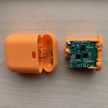  [OrangeLink Website](https://getrileylink.org/product/orangelink)
> > -  [433MHz RileyLink](https://getrileylink.org/product/rileylink433)
> > -   [Emalink Website](https://github.com/sks01/EmaLink) - [Kontakt:](mailto:getemalink@gmail.com)
> > -   DiaLink - [Kontakt:](mailto:Boshetyn@ukr.net)
> > -   [LoopLink Website](https://www.getlooplink.org/) - [Kontakt:](https://jameswedding.substack.com/) - nicht getestet

-   **Smartphone**

> Komponente, die AAPS betreibt und Steuerbefehle an das Pod-Kommunikationsgerät sendet.
> 
> > - Ein unterstütztes [Android-Smartphone](#Phones-list-of-tested-phones) mit eingerichtetem **AAPS** und den zugehörigen Komponenten.

-   **Insulin-Pumpe**

> Komponente, die die vom Pod-Kommunikationsgerät empfangenen Befehle interpretiert, die von Deinem Smartphone mit AAPS stammen.
> 
> > - Ein neuer Omnipod-Pod (Eros-Generation - **NICHT DASH**)

Diese Anleitung geht davon aus, dass Du eine neue Pod-Sitzung beginnst. Ist das nicht der Fall, hab bitte Geduld und beginne mit diesem Vorgang beim nächsten Pod-Wechsel.

Auf dieser Seite steht **RileyLink** für jedes der oben genannten Geräte zur Pod-Kommunikation.

## Bevor du startest

**Sicherheit geht vor** - Stelle sicher, dass Du auf eventuell auftretende Fehler reagieren kannst, bevor Du diesen Prozess beginnst: zusätzliche Pods, Insulin, geladener RileyLink und Smartphone mit vollem Akku sind unbedingt notwendig.

**Dein Omnipod PDM funktioniert nicht mehr, wenn der AAPS Omnipod Treiber Deinen Pod aktiviert hat**. Bisher hast Du Deinen Omnipod PDM verwendet, um Befehle an Deinen Omnipod Eros Pod zu senden. Ein Omnipod Eros Pod kann sich nur mit einem einzigen Gerät verbinden. Das Gerät, das den Pod erfolgreich aktiviert, ist das einzige Gerät, das von diesem Zeitpunkt an mit ihm kommunizieren darf. Dies bedeutet, dass, sobald Du einen Omnipod Eros Pod mit Deinem RileyLink über den AAPS Omnipod Treiber aktiviert hast, **wirst Du Deinen PDM nicht mehr mit diesem Pod** verwenden können. Der AAPS Omnipod Treiber mit dem RileyLink ist dann Dein aktiver PDM. *Das bedeutet NICHT, dass Du Deinen PDM wegwerfen sollst; es wird empfohlen, ihn als Ersatz und für Notfälle aufzubewahren, wenn AAPS nicht richtig funktioniert.*

**Es kann immer nur ein RileyLink mit einem Pod kommunizieren.** **AAPS** merkt sich einen gekoppelten RileyLink. Koppelst Du einen anderen, ersetzt er den bisherigen.

**Dein Pod wird nicht abgeschaltet, wenn der RileyLink außerhalb der Reichweite liegt.** Dein Pod wird weiterhin Basal-Insulin liefern, wenn Dein RileyLink außerhalb der Reichweite ist oder die Kommunikation mit dem aktiven Pod geblockt wird. Beim Aktivieren eines Pods wird das in AAPS definierte Profil in den neuen Pod programmiert. Wenn du den Kontakt zum Pod verlierst, wird er auf dieses zurückgesetzt. Du kannst keine neuen Befehle senden, solange der RileyLink nicht wieder in Reichweite kommt und die Verbindung wiedergeherstellt ist.

**Basalraten-Profile mit 30-Minuten-Schritten werden in AAPS NICHT unterstützt.** Wenn Du neu bei AAPS bist und zum ersten Mal Dein Basalprofil einrichtest, beachte bitte, dass Basalprofile, die mit einer halben Stunde beginnen, nicht unterstützt werden und Du Dein Basalprofil anpassen musst. Wenn Du zum Beispiel eine Basalrate von 1,1 Einheiten hast, die um 9:30 Uhr startet und zwei Stunden bis 11:30 Uhr läuft, wird dies nicht funktionieren.  Du muss diese 1,1 IE Basalrate auf einen Zeitraum von entweder 9:00 - 11:00 Uhr oder 10:00 - 12:00 Uhr einstellen.  Obwohl die Omnipod-Hardware selbst Basalratenwechsel zur halben Stunde unterstützt, ist AAPS derzeit nicht in der Lage, dies mit seinen Algorithmen zu berücksichtigen.

## Aktivieren des Omnipod-Treibers in AAPS

Du kannst den Omnipod-Treiber in AAPS auf **zwei Wegen** aktivieren:

### Option 1: Der Einrichtungsassistent

Nach der Installation einer neuen Version von AAPS startet der **Einrichtungsassistent** automatisch. Hast Du Deine Einstellungen aus einer früheren Installation bereits exportiert, kannst Du sie im Assistenten importieren. Bei Neuinstallationen geht es unten weiter.

Gehe durch den [Einrichtungsassistenten](../SettingUpAaps/SetupWizard.md), bis Du den Schritt **Pumpe** erreichst, und wähle dann **Omnipod Eros** (die Beschreibung lautet „Pumpen-Integration für Omnipod Eros“).


Der Einrichtungsassistent koppelt Deinen RileyLink nicht. Öffne nach Abschluss des Assistenten den Omnipod-Pumpenbildschirm und kopple ihn wie im Abschnitt [RileyLink einrichten](#OmnipodEros-rileylink-setup) beschrieben.

**ODER**

### Option 2: Der Konfigurationsbildschirm

Öffne oben links das **Menü** (☰) > **Konfiguration** > **Pumpe** und wähle das **Optionsfeld** von **Omnipod Eros**.

Sobald sie ausgewählt ist, zeigt die Karte **Omnipod Eros** zwei Schaltflächen: **Einstellungen** und **Plugin öffnen**:


**Einstellungen** öffnet die Einstellungen des Omnipod-Treibers (siehe [Omnipod-Einstellungen](#OmnipodEros-omnipod-settings)):


**Plugin öffnen** öffnet den Omnipod-Pumpenbildschirm. Du kannst ihn auch jederzeit vom Startbildschirm aus über **Bearbeiten** > **Pumpe** öffnen. Auf dieser Seite heißt er **Omnipod-Pumpenbildschirm**. Bevor ein RileyLink gekoppelt und ein Pod aktiviert ist, sieht er so aus:


### Überprüfung der Omnipod-Treiberauswahl

Um zu prüfen, ob Du den Omnipod-Treiber aktiviert hast, öffne vom Startbildschirm aus **Bearbeiten** > **Pumpe**. Du solltest den oben gezeigten Pumpenbildschirm **Omnipod Eros** sehen. Hast Du noch keinen RileyLink gekoppelt, zeigt **RileyLink Status** **Nicht gestartet** und **Pod Status** **Kein aktiver Pod**.

## Omnipod-Konfiguration

Alle Pod- und RileyLink-Funktionen sind Schaltflächen auf dem [Omnipod-Pumpenbildschirm](#OmnipodEros-omnipod-pod-tab) (**Bearbeiten** > **Pumpe**). Manche Schaltflächen erscheinen nur in bestimmten Situationen, zum Beispiel wenn ein Pod aktiv ist.

>  Aktualisiere Pod-Verbindung und Status
> 
>  Pod-Management (Aktivieren, Deaktivieren, Testsignal, RileyLink Statistik und Pod-Historie)

```{admonition} Older screenshot
:class: note
Die Screenshots oben stammen aus einer früheren **AAPS**-Version. In **AAPS** 4 gibt es keine Schaltfläche **POD MGMT** und kein Menü Pod-Verwaltung mehr: **Aktualisieren** und alle Aktionen zur Pod-Verwaltung sind Schaltflächen auf dem Omnipod-Pumpenbildschirm.
```

(OmnipodEros-rileylink-setup)=

### RileyLink-Setup

Hast Du Deinen RileyLink bereits gekoppelt, mach unten im Abschnitt [Pod aktivieren](#OmnipodEros-activating-a-pod) weiter.

*Hinweis: Ein gutes sichtbares Zeichen dafür, dass der RileyLink nicht verbunden ist, sind fehlende Behandlungsschaltflächen (Schnellstart-Leiste) auf dem Startbildschirm. Dies passiert auch in den ersten 30 Sekunden nach dem Start von AAPS, da AAPS sich erst mit dem RileyLink verbinden muss.*

1. Stelle sicher, dass Dein RileyLink voll geladen und eingeschaltet ist.

2. Lege den RileyLink [nah an Dein Smartphone](#OmnipodEros-optimal-omnipod-and-rileylink-positioning) (höchstens ca. 30 cm entfernt).

3. Öffne den Omnipod-Pumpenbildschirm (**Bearbeiten** > **Pumpe**) und tippe auf **RileyLink verbinden**.

4. Der Bildschirm **RileyLink verbinden** beginnt sofort mit der Suche nach Bluetooth-Geräten. Tippe in der Liste der gefundenen Geräte auf Deinen RileyLink.

   

5. Wird **RileyLink erfolgreich verbunden** mit Name und Adresse Deines Geräts angezeigt, tippe auf **OK**.

6. Prüfe auf dem Omnipod-Pumpenbildschirm, ob **RileyLink Status** auf **Verbunden** wechselt. **Pod Status** sollte **Kein aktiver Pod** zeigen. Verbindet sich der RileyLink nicht, tippe auf **RileyLink zurücksetzen** oder starte **AAPS** neu.

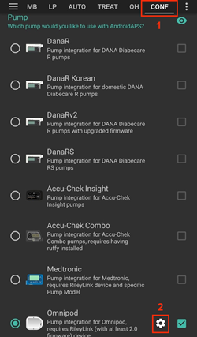 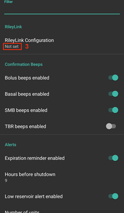

 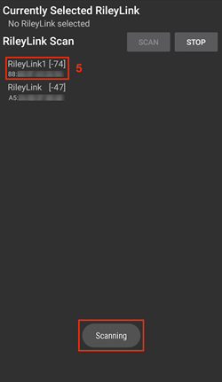

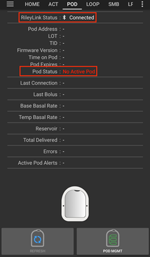


```{admonition} Older screenshot
:class: note
Die sechs Screenshots oben (nach Schritt 6) stammen aus einer früheren **AAPS**-Version. In **AAPS** 4 koppelst Du den RileyLink über die Schaltfläche **RileyLink verbinden** auf dem Omnipod-Pumpenbildschirm statt über **RileyLink Configuration** in den Omnipod-Einstellungen, und die Suche startet automatisch.
```

```{note}
Um zu einem anderen RileyLink zu wechseln (zum Beispiel einem Ersatzgerät), tippe erneut auf **RileyLink verbinden** und wähle das neue Gerät aus. Es ersetzt das bisher gekoppelte. Das alte Gerät musst Du vorher nicht entfernen.
```

(OmnipodEros-activating-a-pod)=

### Einen Pod aktivieren

Bevor Du einen Pod aktivieren kannst, stelle sicher, dass Dein RileyLink gekoppelt ist und **RileyLink Status** **Verbunden** zeigt. Die Schaltfläche **Pod aktivieren** bleibt deaktiviert, bis der RileyLink bereit ist.

*HINWEIS: Für die Verbindung mit dem Pod steht aus Sicherheitsgründen nur ein kleinerer Kommunikationsbereich zur Verfügung. Vor dem Pairing des Pods ist das Funksignal schwächer, aber nachdem es verbunden wurde, wird es mit voller Signalleistung funktionieren. Achte während dieser Vorgänge darauf, dass Dein Pod* [ganz in der Nähe](#OmnipodEros-optimal-omnipod-and-rileylink-positioning) *(höchstens ca. 30 cm entfernt) ist, aber nicht auf oder direkt neben dem RileyLink liegt.*

01. Öffne den Omnipod-Pumpenbildschirm (**Bearbeiten** > **Pumpe**) und tippe auf **Pod aktivieren**.

    Hast Du noch nie ein Profil aktiviert, erscheint zuerst der Schritt **Profil erforderlich**. Wähle das Profil aus, das bei der Aktivierung angewendet werden soll.

    >   
    > 
    > ```{admonition} Older screenshot
    >     :class: note
    >     Die Screenshots oben stammen aus einer früheren **AAPS**-Version. In **AAPS** 4 ist **Pod aktivieren** eine Schaltfläche auf dem Omnipod-Pumpenbildschirm statt im Menü **POD MGMT**.
    > ```

02. Der **Pod füllen** Bildschirm wird angezeigt. Fülle einen neuen Pod mit genug Insulin für 3 Tage und achte auf zwei Signaltöne. Sie bedeuten, dass die Mindestmenge von 80 Einheiten eingefüllt ist. Entleere die Füllspritze vollständig, auch wenn Du die zwei Signaltöne schon gehört hast. Beachte bei der Berechnung der gesamt Insulinmenge, welche Du in 3 Tagen benötigst, dass zum Füllen des Pod 12 bis 15 IE benötigt werden. Entferne die Nadelkappe des Pods noch nicht.

    > 
    > 
    > Stelle sicher, dass der neue Pod und der RileyLink nah beieinander liegen (höchstens ca. 30 cm), und tippe auf **Weiter**.

03. **Insulin auswählen** (nur angezeigt, wenn Du mehr als ein Insulin eingerichtet hast): Wähle das Insulin, mit dem Du den Pod füllst, und tippe auf **Weiter**. Nach der Aktivierung wird ein Profilwechsel mit diesem Insulin durchgeführt.

04. Der Bildschirm **Initialisiere Pod** wird angezeigt und der Pod beginnt zu entlüften. (Du wirst ein Klicken hören, gefolgt von einer Reihe tickender Sounds, der Pod entlüftet sich selbst). Wenn RileyLink außerhalb des zulässigen Bereichs des aktiven Pods aktiviert wurde, erhälst Du eine Fehlermeldung **Keine Antwort von Pod**. Passiert das, [bring den RileyLink näher](#OmnipodEros-optimal-omnipod-and-rileylink-positioning) (höchstens ca. 30 cm) an den Pod, aber nicht auf ihn oder direkt daneben, und tippe auf **Erneut versuchen**.

    >  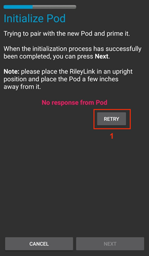

05. War die Entlüftung erfolgreich, wird ein grünes Häkchen angezeigt, und die Schaltfläche **Weiter** wird aktiv. Tippe auf **Weiter**.

    > 

06. **Setzstelle** (nur angezeigt, wenn **Wechsel der Pumpen-Einstichstellen verwalten** unter [Wechsel der Setzstellen](#Aapsscreens-site-rotation) aktiviert ist): Wähle, wo Du den Pod an Deinem Körper anbringst, und tippe auf **Weiter**.

07. Der Bildschirm **Pod anlegen** wird angezeigt. Bereite die Infusionsstelle für den neuen Pod vor. Entferne die Nadelkappe aus Kunststoff und die weiße Papierschutzfolie vom Klebepolster und klebe den Pod auf die ausgewählte Stelle an Deinem Körper. Ragt die Kanüle heraus, tippe auf **Abbrechen** und entsorge den Pod. Tippe danach auf **Weiter**.

    > 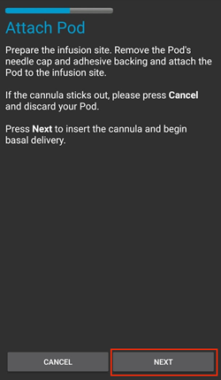

08. Ein Bestätigungsdialog erscheint: „Nachdem Du OK gedrückt hast, wird die Kanüle eingeführt“. **Tippe NUR auf OK, wenn Du bereit bist, die Kanüle einzuführen**.

    > 

09. Auf dem Bildschirm **Kanüle setzen** kann es etwas dauern, bis der Omnipod antwortet und die Kanüle einführt (maximal 1–2 Minuten), hab also Geduld.

    > Wenn RileyLink außerhalb des zulässigen Bereichs des aktiven Pods aktiviert wurde, erhälst Du eine Fehlermeldung **Keine Antwort von Pod**. Passiert das, bring den RileyLink näher (höchstens ca. 30 cm) an den Pod, aber nicht auf ihn oder direkt daneben, und tippe auf **Erneut versuchen**.
    > 
    > Wenn der RileyLink sich außerhalb der Bluetoothreichweite befindert oder keine aktive Verbindung zum Smartphone hat, bekommst Du eine Fehlermeldung **Keine Antwort von RileyLink**. Passiert das, bring den RileyLink näher an das Smartphone und tippe auf **Erneut versuchen**.
    > 
    > *HINWEIS: Bevor die Kanüle eingesetzt wird, ist es ratsam, die Haut in der Nähe des Kanülensetzpunktes etwas zusammenzukneifen. Dies sorgt für eine sanfte Einführung der Nadel und verringert die Gefahr einer Verstopfung.*
    > 
    > 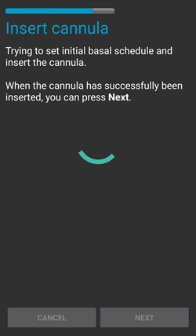
    > 
    >  

10. Es wird ein grünes Häkchen angezeigt, und der Button **Weiter** wird bei erfolgreicher Kanüleneinführung aktiviert. Tippe auf **Weiter**.

    > 

11. Der Bildschirm **Pod aktiviert** wird angezeigt. Prüfe, ob die Kanüle richtig eingeführt wurde, und wechsle den Pod, wenn Du daran zweifelst. Tippe auf **Abschließen**. Glückwunsch! Du hast jetzt eine neuen Pod aktiviert.

    >  
    > 
    > ```{admonition} Older screenshot
    >     :class: note
    >     Die Screenshots in den Schritten 2 bis 11 stammen aus einer früheren **AAPS**-Version und können in **AAPS** 4 anders aussehen. Die Schritte **Insulin auswählen** und **Setzstelle** sind nicht abgebildet.
    > ```

12. Du kehrst zum Omnipod-Pumpenbildschirm zurück. Die Schaltfläche **Pod aktivieren** wird durch **Pod deaktivieren** ersetzt, weil Du keinen weiteren Pod aktivieren kannst, ohne zuerst den aktiven zu deaktivieren.

    Der Pumpenbildschirm zeigt jetzt Informationen zu Deinem aktiven Pod, darunter aktuelle Basalrate, Reservoirstand, abgegebenes Insulin, Pod-Fehler und Warnungen. Mehr dazu im Abschnitt [Omnipod-Pumpenbildschirm](#OmnipodEros-omnipod-pod-tab).

     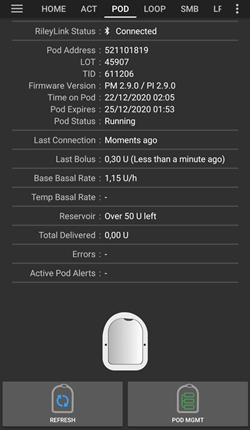

    ```{admonition} Older screenshot
    :class: note
    Die Screenshots oben stammen aus einer früheren **AAPS**-Version. In **AAPS** 4 gibt es kein Menü Pod-Verwaltung: Du kehrst direkt zum Omnipod-Pumpenbildschirm zurück, wo **Pod deaktivieren** an die Stelle von **Pod aktivieren** tritt.
    ```

```{note}
Wurde die Aktivierung nach dem Entlüften unterbrochen (zum Beispiel, weil die App geschlossen wurde), tippe erneut auf **Pod aktivieren**. Der Assistent macht mit den Schritten zum Einführen der Kanüle weiter.
```

### Deaktiviere einen Pod

Unter normalen Umständen beträgt die Lebensdauer eines Pods drei Tage (72 Stunden) und zusätzlich 8 Stunden nach der Pod-Ablaufwarnung und somit insgesamt 80 Stunden.

Gehe wie folgt vor, um einen Pod zu deaktivieren (entweder vor dem Ablaufen der Nutzungsdauer oder wegen eines Pod-Fehlers):

1. Öffne den Omnipod-Pumpenbildschirm (**Bearbeiten** > **Pumpe**) und tippe auf **Pod deaktivieren**.

   >  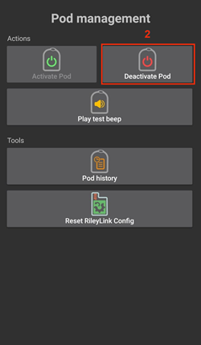 
   > 
   > ```{admonition} Older screenshot
   >    :class: note
   >    Die Screenshots oben stammen aus einer früheren **AAPS**-Version. In **AAPS** 4 ist **Pod deaktivieren** eine Schaltfläche auf dem Omnipod-Pumpenbildschirm statt im Menü **POD MGMT**.
   > ```

2. Stelle auf dem Bildschirm **Pod deaktivieren** zuerst sicher, dass der RileyLink ganz in der Nähe des Pods liegt, aber nicht auf ihm oder direkt daneben. Tippe dann auf **Weiter**. Ein Dialog fragt: *Ein deaktivierter Pod kann nicht mehr verwendet werden. Diesen Pod jetzt deaktivieren?* Tippe auf **OK**, um die Deaktivierung zu starten, oder auf **Abbrechen**, um den Pod zu behalten. Die Deaktivierung stoppt jede Insulinabgabe und kann nicht rückgängig gemacht werden.

   > 

3. Der Bildschirm **Deaktiviere den Pod...** erscheint, und der Pod bestätigt die erfolgreiche Deaktivierung mit einem Signalton.

   > 
   > 
   > **FALLS die Deaktivierung fehlschlägt** und Du keinen Bestätigungston hörst, erhältst Du möglicherweise die Meldung **Keine Antwort vom RileyLink** oder **Keine Rückmeldung vom Pod**. Tippe auf **Erneut versuchen**, um die Deaktivierung noch einmal zu versuchen. Schlägt die Deaktivierung weiterhin fehl, tippe auf **Pod verwerfen** und bestätige. **AAPS** vergisst den Pod dann. Die Insulinabgabe wurde **nicht** unterbrochen, entferne den Pod also von Deinem Körper. Gibt Dein Pod einen schrillen Alarm aus, musst Du ihn eventuell manuell stummschalten (mit einer Nadel oder Büroklammer), denn **Pod verwerfen** schaltet ihn nicht stumm.
   > 
   > >   

4. Ist die Deaktivierung erfolgreich, erscheint ein grünes Häkchen. Tippe auf **Weiter**, um den Bildschirm **Pod deaktiviert** anzuzeigen. Du kannst nun deinen Pod entfernen, da die aktive Sitzung beendet wurde.

   > 

5. Tippe auf **Abschließen**, um zum Omnipod-Pumpenbildschirm zurückzukehren.

   >  
   > 
   > ```{admonition} Older screenshot
   >    :class: note
   >    Die Screenshots in den Schritten 2 bis 5 stammen aus einer früheren **AAPS**-Version und können in **AAPS** 4 anders aussehen.
   > ```

6. Prüfe auf dem Omnipod-Pumpenbildschirm, ob **RileyLink Status** **Verbunden** und **Pod Status** **Kein aktiver Pod** zeigt.

   >    
   > 
   > ```{admonition} Older screenshot
   >    :class: note
   >    Die Screenshots oben stammen aus einer früheren **AAPS**-Version. In **AAPS** 4 bringt Dich **Abschließen** direkt zum Omnipod-Pumpenbildschirm zurück; ein Menü Pod-Verwaltung oder einen Reiter **Omnipod (POD)** gibt es nicht.
   > ```

### Insulinlieferung stoppen und fortsetzen

Die folgenden Schritte zeigen Dir, wie Du die Insulinabgabe unterbrichst und fortsetzt.

*HINWEIS – siehst Du keine Schaltfläche **Unterbrechen***, ist sie standardmäßig ausgeblendet. Aktiviere in den [Omnipod-Einstellungen](#OmnipodEros-omnipod-settings) unter **Andere** die Option **Schaltfläche „Insulinabgabe unterbrechen“ in der Pumpenansicht anzeigen**.

#### Insulinabgabe unterbrechen

Verwende diesen Befehl, um den aktiven Pod in den Status 'unterbrochen' zu versetzen. In diesem suspendiertem Zustand wird der Pod kein Insulin mehr liefern. Dieser Befehl ahmt die Suspend-Funktion nach, die der originale Omnipod PDM an einen aktiven Pod sendet.

1. Öffne den Omnipod-Pumpenbildschirm (**Bearbeiten** > **Pumpe**) und tippe auf **Unterbrechen**. Der Befehl zum Unterbrechen wird über den RileyLink an den aktiven Pod gesendet.

2. Hat der Pod die gesamte Insulinabgabe unterbrochen, zeigt **Pod Status** **Angehalten**, und die Schaltfläche **Unterbrechen** wird durch **Abgabe fortsetzen** ersetzt.

   >  
   > 
   > 
   > 
   > 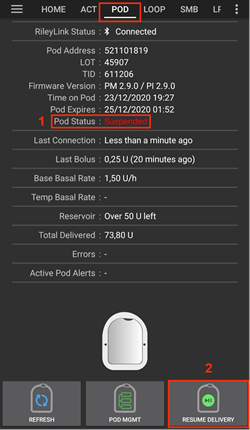 
   > 
   > ```{admonition} Older screenshot
   >    :class: note
   >    Die Screenshots oben stammen aus einer früheren **AAPS**-Version. In **AAPS** 4 finden diese Schritte auf dem Omnipod-Pumpenbildschirm statt statt im Reiter **Omnipod (POD)**, und das Ergebnis wird unter **Pod Status** angezeigt.
   > ```

Schlägt der Befehl fehl, zeigt ein Dialog **Warnung** „Insulinabgabe konnte nicht unterbrochen werden.“ mit dem Grund. Prüfe die Verbindung zum RileyLink und versuche es erneut.

#### Insulinabgabe fortsetzen

Benutze diesen Befehl, um den aktiven, derzeit pausierten Pod anzuweisen, die Insulinabgabe fortzusetzen. Nachdem der Befehl erfolgreich verarbeitet wurde, wird die normale Insulinabgabe mit der aktuellen Basalrate fortgesetzt. Grundlage dafür ist das aktive Basalprofil zur aktuellen Uhrzeit. Der Pod akzeptiert wieder Befehle für Bolus, TBR und SMB.

1. Öffne den Omnipod-Pumpenbildschirm und prüfe, ob **Pod Status** **Angehalten** zeigt. Tippe auf **Abgabe fortsetzen**.

2. Ist der Befehl erfolgreich, zeigt **Pod Status** wieder **In Betrieb**, und die Schaltfläche **Abgabe fortsetzen** verschwindet (die Schaltfläche **Unterbrechen** erscheint wieder, wenn Du sie aktiviert hast).

   >  
   > 
   > 
   > 
   >  
   > 
   > ```{admonition} Older screenshot
   >    :class: note
   >    Die Screenshots oben stammen aus einer früheren **AAPS**-Version. In **AAPS** 4 finden diese Schritte auf dem Omnipod-Pumpenbildschirm statt statt im Reiter **Omnipod (POD)**, und das Ergebnis wird unter **Pod Status** angezeigt.
   > ```

Schlägt der Befehl fehl, zeigt ein Dialog **Warnung** „Insulinabgabe konnte nicht gestartet werden.“ mit dem Grund. Prüfe die Verbindung zum RileyLink und versuche es erneut.

### Pod Alarme stummschalten

*HINWEIS – Die Schaltfläche **Alarme stummschalten** wird auf dem Omnipod-Pumpenbildschirm nur angezeigt, solange der Pod eine aktive Warnung hat (zum Beispiel die Warnung zum Pod-Ablauf oder zum niedrigen Reservoir), und nur, wenn **Pod-Alarme automatisch stummschalten** deaktiviert ist.*

Die folgenden Schritte zeigen Dir, wie Du die Signaltöne des Pods stummschaltest, die beginnen, wenn der Pod die Warnzeit vor seinem Ablauf erreicht. Diese Warnzeit legst Du mit **Warnung vor dem Herunterfahren (80 Stunden)** in den Omnipod-Einstellungen unter **Alarme** fest. Die maximale Nutzungsdauer eines Pods beträgt 80 Stunden (3 Tage und 8 Stunden), dennoch empfiehlt der Hersteller, 72 Stunden (3 Tage) nicht zu überschreiten.

*HINWEIS – Hast Du **Pod-Alarme automatisch stummschalten** in den Omnipod-Einstellungen unter **Alarme** aktiviert, schaltet **AAPS** die Warnung bei der nächsten Kommunikation mit dem Pod automatisch stumm, und Du musst das NICHT manuell tun.*

1. Ist die Warnzeit erreicht, piept der Pod, um Dir zu sagen, dass er bald abläuft und gewechselt werden muss. Auf dem Omnipod-Pumpenbildschirm zeigt **Pod läuft ab** den genauen Ablaufzeitpunkt des Pods (72 Stunden nach der Aktivierung); 4 Stunden vorher wird der Wert **gelb**. **Enddatum des Pods** zeigt, wann der Pod die Insulinabgabe stoppt. **Aktive Pod-Warnungen** zeigt **Pod läuft in Kürze ab**, und die Schaltfläche **Alarme stummschalten** erscheint. **AAPS** zeigt außerdem eine Benachrichtigung zum bevorstehenden Pod-Ablauf an.

   >   
   > 
   > ```{admonition} Older screenshot
   >    :class: note
   >    Die Screenshots oben stammen aus einer früheren **AAPS**-Version. In **AAPS** 4 heißt die Schaltfläche **ACK ALERTS** jetzt **Alarme stummschalten** und befindet sich auf dem Omnipod-Pumpenbildschirm.
   > ```

2. Tippe auf **Alarme stummschalten**. Der RileyLink sendet den Befehl an den Pod, die Signaltöne der Ablaufwarnung zu stoppen.

   >  
   > 
   > ```{admonition} Older screenshot
   >    :class: note
   >    Der Screenshot oben stammt aus einer früheren **AAPS**-Version. In **AAPS** 4 heißt die Schaltfläche **Alarme stummschalten**.
   > ```

3. Sind die Warnungen stummgeschaltet, piept der Pod zweimal. **Aktive Pod-Warnungen** zeigt die Warnung nicht mehr an, die Schaltfläche **Alarme stummschalten** verschwindet, und der Pod hört mit den Signaltönen der Ablaufwarnung auf.

   > 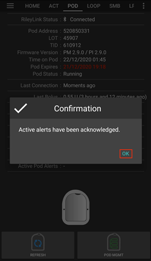 
   > 
   > ```{admonition} Older screenshot
   >    :class: note
   >    Der Screenshot oben stammt aus einer früheren **AAPS**-Version. In **AAPS** 4 wird das Ergebnis auf dem Omnipod-Pumpenbildschirm angezeigt: Die Warnung verschwindet aus **Aktive Pod-Warnungen**.
   > ```

Schlägt der Befehl fehl (zum Beispiel, weil der RileyLink außer Reichweite des Pods ist), zeigt ein Dialog **Warnung** „Alarme können nicht stumm geschaltet werden“ mit dem Grund. Bring den RileyLink näher an den Pod und versuche es erneut.


```{admonition} Older screenshot
:class: note
Der Screenshot oben stammt aus einer früheren **AAPS**-Version. In **AAPS** 4 zeigt der Dialog **Warnung** „Alarme können nicht stumm geschaltet werden“ mit dem Grund.
```

(OmnipodEros-view-pod-history)=

### Anzeige Pod-Historie

In diesem Abschnitt wird gezeigt, wie Du Deine Pod-Historie überprüfen und nach verschiedenen Aktionskategorien filtern kannst. Das Podhistory-Werkzeug erlaubt es, die Aktionen und Ergebnisse Ihres aktuell aktiven Pods während seines dreitägigen Lebens (72 - 80 Stunden) anzusehen.

Diese Funktion ist hilfreich bei der Überprüfung von Boli, Temporären Basalraten (TBRs) und Basaländerungen, die erfolgt sind, bei denen Du aber nicht sicher bist, ob sie abgeschlossen wurden. Die übrigen Kategorien sind im Allgemeinen hilfreich bei der Problembehebung und zur Bestimmung der Reihenfolge von Ereignissen, die zu einem Fehler geführt haben.

*HINWEIS:* **Unsichere** Befehle erscheinen in der Pod-Historie, aber für deren Genauigkeit gibt es aufgrund deren natürlichen Unsicherheit keine Garantie.

1. Öffne den Omnipod-Pumpenbildschirm (**Bearbeiten** > **Pumpe**) und tippe auf **Pod-Historie**.

   >   
   > 
   > ```{admonition} Older screenshot
   >    :class: note
   >    Die Screenshots oben stammen aus einer früheren **AAPS**-Version. In **AAPS** 4 ist **Pod-Historie** eine Schaltfläche auf dem Omnipod-Pumpenbildschirm statt im Menü **POD MGMT**.
   > ```

2. Der Bildschirm **Pod-Historie** listet alle Pod-Aktionen und ihre Ergebnisse auf, die neuesten zuerst, nach Tagen gruppiert. Standardmäßig ist **Alle** ausgewählt. Tippe oben auf eine der Filterschaltflächen, um nur eine Kategorie anzuzeigen. Mit dem Zurück-Pfeil oben links kehrst Du zum Omnipod-Pumpenbildschirm zurück.

   > 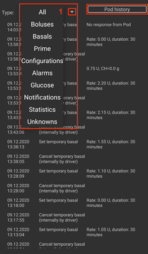

   >  
   > 
   > ```{admonition} Older screenshot
   >    :class: note
   >    Der zweite Screenshot stammt aus einer früheren **AAPS**-Version und kann in **AAPS** 4 anders aussehen.
   > ```

### Zeige RileyLink Einstellungen und Historie an

Der Bildschirm **RileyLink Status** zeigt die Einstellungen Deines RileyLinks und des aktiven Pods sowie den Kommunikationsverlauf beider. Er hat zwei Reiter: **Einstellungen** und **Verlauf**.

Die Schaltfläche **RileyLink Status** ist standardmäßig ausgeblendet. Um sie auf dem Omnipod-Pumpenbildschirm anzuzeigen, aktiviere in den [Omnipod-Einstellungen](#OmnipodEros-omnipod-settings) unter **Andere** die Option **Button 'RileyLink Status' im Menü Pod Mgmt. anzeigen**.

#### Bluetooth-Kommunikation für Pod-Kommunikationsgerät manuell wiederherstellen

War Dein Gerät zur Pod-Kommunikation eine Weile außerhalb der Bluetooth-Reichweite Deines Smartphones, meldet **RileyLink Status** auf dem Omnipod-Pumpenbildschirm möglicherweise **RileyLink nicht erreichbar**. Normalerweise verbindet sich **AAPS** von selbst wieder, sobald das Gerät wieder in Reichweite ist. Falls nicht:

1. Stelle sicher, dass der RileyLink eingeschaltet, geladen und nah an Deinem Smartphone ist.

2. Tippe auf dem Omnipod-Pumpenbildschirm auf **RileyLink zurücksetzen**. Eine Meldung bestätigt **Zurücksetzen der RileyLink-Konfiguration**. Siehe unten [Hinweise zu RileyLink zurücksetzen](#OmnipodEros-reset-rileylink-config-notes).

3. Wenn die **Bluetooth-Verbindung** nicht wieder hergestellt wird, dann versuche die Bluetooth-Funktion auf deinem Smartphone manuell **aus-** und dann wieder **anzuschalten**.

4. Verbindet er sich immer noch nicht, tippe auf **RileyLink verbinden** und wähle Deinen RileyLink erneut aus.

5. Nach einer erfolgreichen Wiederverbindung zeigt **RileyLink Status** **Verbunden**. Du kannst auch den **Verbindungsstatus** im Reiter **Einstellungen** des Bildschirms **RileyLink Status** prüfen. Herzlichen Glückwunsch, Du hast jetzt erneut Deinen konfigurierten RileyLink mit AAPS verbunden!

 

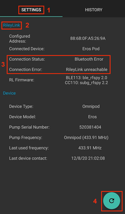


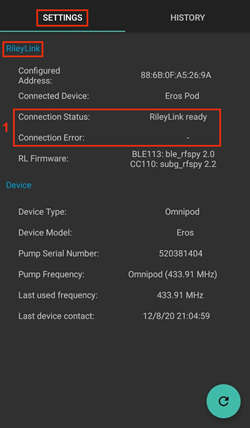

```{admonition} Older screenshot
:class: note
Die Screenshots oben stammen aus einer früheren **AAPS**-Version. In **AAPS** 4 verbindest Du Dich mit **RileyLink zurücksetzen** oder **RileyLink verbinden** auf dem Omnipod-Pumpenbildschirm neu statt mit der Aktualisieren-Schaltfläche auf dem Bildschirm RileyLink Settings.
```

#### Pod-Kommunikationsgerät und Aktive Pod-Einstellungen

Dieser Bildschirm zeigt Informationen und Status sowohl des aktuell gekoppelten Pod-Kommunikationsgeräts als auch des aktuell aktiven Omnipod-Eros-Pods. Die Informationen werden automatisch aktualisiert.

1. Öffne den Omnipod-Pumpenbildschirm (**Bearbeiten** > **Pumpe**) und tippe auf **RileyLink Status**. Der Reiter **Einstellungen** zeigt Deinen aktuell gekoppelten **RileyLink** und den aktiven Pod (**Gerät**).

   > 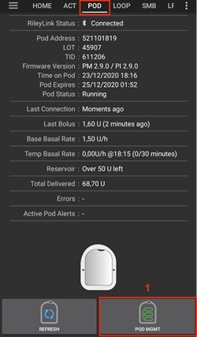 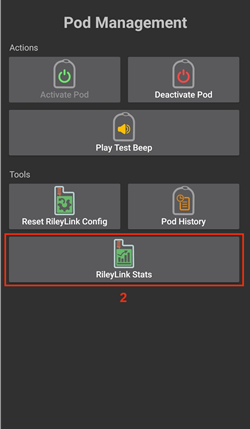 
   > 
   > ```{admonition} Older screenshot
   >    :class: note
   >    Die Screenshots oben stammen aus einer früheren **AAPS**-Version. In **AAPS** 4 ist **RileyLink Status** eine Schaltfläche auf dem Omnipod-Pumpenbildschirm statt im Menü **POD MGMT**.
   > ```

   > 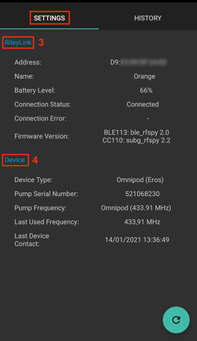

##### RileyLink-Felder

> - **Adresse:** MAC-Adresse des gekoppelten Pod-Kommunikationsgeräts.
> - **Name:** Bluetooth-Name des gekoppelten Pod-Kommunikationsgeräts.
> - **Akkustand:** Der aktuelle Batteriestand des verbundenen Pod-Kommunikationsgeräts. Wird nur angezeigt, wenn **Akkustand von OrangeLink/EmaLink/DiaLink anzeigen** aktiviert ist.
> - **Verbindungsstatus:**: Der aktuelle Status der Bluetooth-Verbindung zwischen dem Pod-Kommunikationsgerät und dem Smartphone, auf dem AAPS läuft.
> - **Verbindungsfehler:** Gibt es einen Fehler bei der Bluetooth-Verbindung des Pod-Kommunikationsgeräts, werden hier Details angezeigt.
> - **Firmware-Version:** Aktuelle Firmware-Version, die auf dem aktiv verbundenen Pod-Kommunikationsgerät installiert ist.

##### Geräte-Felder – mit aktivem Pod

> - **Geräte-Typ:** Der Typ des Geräts, das mit dem Pod-Kommunikationsgerät kommuniziert (Omnipod (Eros)).
> - **Eingerichtetes Gerätemodell:** Das Modell des Geräts, das für die Kommunikation mit dem Pod-Kommunikationsgerät eingerichtet ist.
> - **Verbundenes Gerätemodell:** Das Modell des Geräts, das gerade mit dem Pod-Kommunikationsgerät kommuniziert.
> - **Seriennummer der Pumpe:** Seriennummer des aktuell aktivierten Pods.
> - **Pumpenfrequenz:** Funkfrequenz für die Kommunikation mit dem Pod.
> - **Zuletzt verwendete Frequenz:** Letzte bekannte Funkfrequenz, die der Pod für die Kommunikation mit dem Pod-Kommunikationsgerät verwendet hat.
> - **Letzter Gerätekontakt:** Datum und Uhrzeit des letzten Kontakts vom Pod mit dem Pod-Kommunikationsgerät.

(omnipod-eros-rileylink-and-active-pod-history)=
#### Historie des RileyLink und aktiven Pods

Dieser Reiter listet, die neuesten zuerst, jeden Zustand und jede Aktion des RileyLinks oder des aktuell verbundenen Pods auf. Der Verlauf ist nur für den aktuell aktiven Pod verfügbar. Nach einem Pod-Wechsel wird dieser Verlauf gelöscht, und es werden nur Ereignisse des neu aktivierten Pods erfasst und angezeigt.

1. Öffne den Omnipod-Pumpenbildschirm (**Bearbeiten** > **Pumpe**), tippe auf **RileyLink Status** und dann auf den Reiter **Verlauf**.

   >  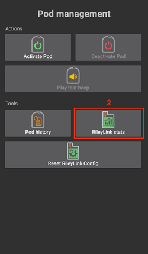 
   > 
   > ```{admonition} Older screenshot
   >    :class: note
   >    Die Screenshots oben stammen aus einer früheren **AAPS**-Version. In **AAPS** 4 ist **RileyLink Status** eine Schaltfläche auf dem Omnipod-Pumpenbildschirm statt im Menü **POD MGMT**.
   > ```

   > 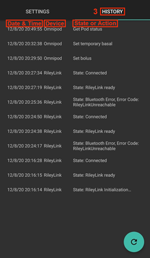

##### Felder

Jeder Eintrag zeigt:

> - **Gerät:** Das Gerät, auf das sich die Aktion oder der Zustand bezieht.
> - **Zeit:** Der Zeitpunkt des Ereignisses.
> - **Zustand oder Aktion:** Der Zustand des Geräts oder die ausgeführte Aktion.

(OmnipodEros-omnipod-pod-tab)=

## Omnipod-Pumpenbildschirm

Im Folgenden werden die Statusfelder und Schaltflächen auf dem **Omnipod-Pumpenbildschirm** erklärt (**Bearbeiten** > **Pumpe** oder **Konfiguration** > **Pumpe** > **Plugin öffnen**).

Das Zahnrad-Symbol oben rechts öffnet die [Omnipod-Einstellungen](#OmnipodEros-omnipod-settings).

*HINWEIS: Zeigt ein Statusfeld „(unsicher)“, tippe auf **Aktualisieren**, um den Pod-Status zu aktualisieren und das Feld zu bereinigen.*


```{admonition} Older screenshot
:class: note
Der Screenshot oben stammt aus einer früheren **AAPS**-Version, in der dieser Bildschirm der Reiter **Omnipod (POD)** war. In **AAPS** 4 ist es der Omnipod-Pumpenbildschirm, und einige Feldnamen und Schaltflächen sind anders.
```

### Felder

- **RileyLink Status:** Zeigt den aktuellen Verbindungsstatus des RileyLink an. Fehler werden rot angezeigt.

- *Nicht gestartet* - Es ist noch kein RileyLink gekoppelt, oder die Verbindung wurde noch nicht gestartet.
- *RileyLink nicht erreichbar* - Das Pod-Kommunikationsgerät ist entweder nicht in Bluetooth-Reichweite des Smartphones, ausgeschaltet oder hat einen Defekt, der die Bluetooth-Kommunikation verhindert.
- *RileyLink bereit* - Das Pod-Kommunikationsgerät ist eingeschaltet und initialisiert gerade die Bluetooth-Verbindung.
- *Verbunden* - Das Pod-Kommunikationsgerät ist eingeschaltet, verbunden und aktiv in der Lage, über Bluetooth zu kommunizieren.

- **Eindeutige ID:** Zeigt die Adresse des aktiven Pods.

- **LOT-Nummer:** Zeigt die LOT-Nummer des aktiven Pods.

- **Laufende Nummer:** Zeigt die Seriennummer (TID) des Pods.

- **Firmware-Version:** Zeigt die Firmware-Version des aktiven Pods an.

- **Zeit auf dem Pod:** Zeigt die aktuelle Uhrzeit auf dem aktiven Pod an. Sie wird hervorgehoben, wenn sie mehr als 5 Minuten von der Uhrzeit des Smartphones abweicht.

- **Pod läuft ab:** Zeigt Datum und Uhrzeit, zu der der aktive Pod abläuft. In den letzten 4 Stunden vor diesem Zeitpunkt wird der Text gelb. Er wird nie rot, weil der Pod danach weiter Insulin abgibt.

- **Enddatum des Pods:** Zeigt das Ende der Kulanzzeit des Pods (8 Stunden nach **Pod läuft ab**, also eine maximale Pod-Laufzeit von 80 Stunden). Der Text wird gelb, wenn die Kulanzzeit beginnt (bei **Pod läuft ab**), und rot in den letzten 4 Stunden vor dem endgültigen Ende. Während der Kulanzzeit wird außerdem die verbleibende Zeit angezeigt, zum Beispiel *(17m remaining)*. Zum endgültigen Ende stoppt der Pod die Insulinabgabe und muss gewechselt werden.

- **Pod Status:** Zeigt den Status des aktiven Pods (zum Beispiel **Kein aktiver Pod**, **In Betrieb** oder **Angehalten**).

- **Letzte Verbindung:** Zeigt, wann zuletzt eine Kommunikation mit dem aktiven Pod stattgefunden hat. Der Text wird rot, wenn der [Grenzwert für Pumpe ist nicht erreichbar](#OmnipodEros-troubleshooting) überschritten ist.

- *gerade eben* vor weniger als 20 Sekunden.
- *vor weniger als einer Minute* vor mehr als 20 Sekunden, aber weniger als 60 Sekunden.
- *vor 1 Minute* vor mehr als 60 Sekunden, aber weniger als 120 Sekunden (2 min).
- *vor XX Minuten* vor mehr als 2 Minuten, definiert durch den Wert von XX.

- **Letzter Bolus:** Zeigt die Menge des letzten an den aktiven Pod gesendeten Bolus und in Klammern, wie lange das her ist.

- **Basis-Basalrate:** Zeigt die Basalrate, die im Basalratenprofil für die aktuelle Uhrzeit hinterlegt ist.

- **Temporäre Basalrate:** Wird nur angezeigt, solange eine temporäre Basalrate läuft. Sie wird in folgendem Format angezeigt:

- Einheiten / Stunde zum Zeitpunkt der Erstellung der TBR (gelaufene Minuten / Gesamtminuten, in denen die TBR läuft)
- *Beispiel:* 0,00 IE/h @18:25 ( 90/120 min.)

- **Reservoir:** Zeigt **Noch mehr als 50 IE vorhanden**, wenn mehr als 50 Einheiten im Reservoir sind. Darunter wird die ungefähre Anzahl Einheiten angezeigt. Der Text wird rot, wenn der in den [Alarm-Einstellungen](#OmnipodEros-omnipod-settings) festgelegte Grenzwert für niedriges Reservoir unterschritten ist.

- **Insgesamt abgegeben:** Zeigt die gesamte aus dem Reservoir abgegebene Insulinmenge in Einheiten. *Beachte, dass es sich hierbei um einen Näherungswert handelt, da das Befüllen des Pods nicht absolut exakt geschieht.*

- **Aktive Pod-Warnungen:** Zeigt die gerade laufenden Warnungen des aktiven Pods. Wird normalerweise verwendet, wenn das Pod-Ablaufdatum nach 72 Stunden erreicht ist und native Pieptöne vom Pod ausgegeben werden.

- **Fehler:** Zeigt den letzten aufgetretenen Fehler (rot). Überprüfe die [Pod Historie](#OmnipodEros-view-pod-history), [RileyLink Historie](#omnipod-eros-rileylink-and-active-pod-history) und die Protokolldateien auf aufgetretene Fehler und Detailinformationen.

### Schaltflächen

Die Schaltflächen unten auf dem Pumpenbildschirm ändern sich je nach Situation. Schaltflächen, die gerade nicht benutzt werden können, sind ausgegraut, zum Beispiel solange der RileyLink nicht verbunden ist.

**Schaltflächen für den Pod-Status** (angezeigt, wenn ein Pod aktiv ist):

- **Aktualisieren:** Sendet einen Aktualisierungsbefehl an den aktiven Pod, um seinen Status zu aktualisieren. Nutze sie, um den Pod-Status zu aktualisieren und Statusfelder mit dem Text „(unsicher)“ zu bereinigen. Weitere Informationen zur [Problembehandlung](#OmnipodEros-troubleshooting) findest Du im Abschnitt unten.

  

  ```{admonition} Older screenshot
  :class: note
  Der Screenshot oben stammt aus einer früheren **AAPS**-Version. In **AAPS** 4 ist das eine Textschaltfläche **Aktualisieren** auf dem Omnipod-Pumpenbildschirm.
  ```

- **Alarme stummschalten:** Schaltet die Signaltöne und Benachrichtigungen zu Pod-Ablauf und niedrigem Reservoir stumm. Wird nur angezeigt, wenn der Pod eine aktive Warnung hat und **Pod-Alarme automatisch stummschalten** deaktiviert ist. Nach dem Stummschalten der Warnungen verschwindet die Schaltfläche.

  

  ```{admonition} Older screenshot
  :class: note
  Der Screenshot oben stammt aus einer früheren **AAPS**-Version. In **AAPS** 4 heißt diese Schaltfläche **Alarme stummschalten**.
  ```

- **Zeit einstellen:** Stellt die Uhrzeit auf dem Pod auf die aktuelle Uhrzeit Deines Smartphones. Wird nur angezeigt, wenn die Uhrzeit auf dem Pod mehr als 5 Minuten von der Smartphone-Zeit abweicht.

  

  ```{admonition} Older screenshot
  :class: note
  Der Screenshot oben stammt aus einer früheren **AAPS**-Version. In **AAPS** 4 ist das eine Textschaltfläche **Zeit einstellen** auf dem Omnipod-Pumpenbildschirm.
  ```

- **Unterbrechen:** Unterbricht die Insulinabgabe des aktiven Pods. Wird nur angezeigt, wenn es in den Einstellungen aktiviert ist (**Schaltfläche „Insulinabgabe unterbrechen“ in der Pumpenansicht anzeigen**).

  

  ```{admonition} Older screenshot
  :class: note
  Der Screenshot oben stammt aus einer früheren **AAPS**-Version. In **AAPS** 4 ist das eine Textschaltfläche **Unterbrechen** auf dem Omnipod-Pumpenbildschirm.
  ```

- **Abgabe fortsetzen:** Setzt die Insulinabgabe des aktuell unterbrochenen, aktiven Pods fort. Wird nur angezeigt, solange der Pod unterbrochen ist.

  

  ```{admonition} Older screenshot
  :class: note
  Der Screenshot oben stammt aus einer früheren **AAPS**-Version. In **AAPS** 4 ist das eine Textschaltfläche **Abgabe fortsetzen** auf dem Omnipod-Pumpenbildschirm.
  ```

**Schaltflächen zur Verwaltung von Pod und RileyLink:**


```{admonition} Older screenshot
:class: note
Der Screenshot oben stammt aus einer früheren **AAPS**-Version. In **AAPS** 4 gibt es kein Menü Pod-Verwaltung: Diese Aktionen sind Schaltflächen direkt auf dem Omnipod-Pumpenbildschirm.
```

- **Pod aktivieren:** Entlüftet und aktiviert einen neuen Pod. Wird angezeigt, wenn kein Pod aktiv ist. Sie ist nur aktiv, wenn der RileyLink verbunden ist.

  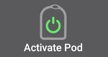

  ```{admonition} Older screenshot
  :class: note
  Der Screenshot oben stammt aus einer früheren **AAPS**-Version. In **AAPS** 4 ist **Pod aktivieren** eine Schaltfläche auf dem Omnipod-Pumpenbildschirm statt im Menü Pod-Verwaltung.
  ```

- **Pod deaktivieren:** Deaktiviert den aktuell aktiven Pod. Wird angezeigt, sobald ein Pod gekoppelt ist, auch wenn eine Aktivierung mittendrin abgebrochen ist (zum Beispiel, weil der Pod während der Aktivierung ausgefallen ist). Sie ist nur aktiv, wenn der RileyLink verbunden ist. **AAPS** fragt nach einer Bestätigung, bevor der Pod deaktiviert wird.

- * Verwende diesen Befehl, um einen heulenden Pod zu deaktivieren (Fehler 49).
- Schlägt die Deaktivierung fehl, bietet der Deaktivierungsassistent die Option **Pod verwerfen** an.

  

  ```{admonition} Older screenshot
  :class: note
  Der Screenshot oben stammt aus einer früheren **AAPS**-Version. In **AAPS** 4 ist **Pod deaktivieren** eine Schaltfläche auf dem Omnipod-Pumpenbildschirm statt im Menü Pod-Verwaltung.
  ```

- **Testton abspielen:** Spielt beim Antippen einen einzelnen Testton auf dem Pod ab. Wird angezeigt, wenn ein Pod gekoppelt ist.

  

  ```{admonition} Older screenshot
  :class: note
  Der Screenshot oben stammt aus einer früheren **AAPS**-Version. In **AAPS** 4 ist **Testton abspielen** eine Schaltfläche auf dem Omnipod-Pumpenbildschirm statt im Menü Pod-Verwaltung.
  ```

- **Pod-Historie:** Zeigt den Aktivitätsverlauf des aktiven Pods. Siehe [Anzeige Pod-Historie](#OmnipodEros-view-pod-history).

  

  ```{admonition} Older screenshot
  :class: note
  Der Screenshot oben stammt aus einer früheren **AAPS**-Version. In **AAPS** 4 ist **Pod-Historie** eine Schaltfläche auf dem Omnipod-Pumpenbildschirm statt im Menü Pod-Verwaltung.
  ```

- **RileyLink verbinden:** Sucht Dein Pod-Kommunikationsgerät und koppelt es. Siehe [RileyLink einrichten](#OmnipodEros-rileylink-setup).

- **RileyLink Status:** Öffnet den Bildschirm RileyLink Status mit zwei Reitern. Wird nur angezeigt, wenn es in den Einstellungen aktiviert ist (**Button 'RileyLink Status' im Menü Pod Mgmt. anzeigen**).

- **Einstellungen** - zeigt Informationen zum RileyLink und aktive Pod-Einstellungen an
- **Historie** - zeigt den Verlauf der RileyLink- und Pod-Kommunikation an

  

  ```{admonition} Older screenshot
  :class: note
  Der Screenshot oben stammt aus einer früheren **AAPS**-Version. In **AAPS** 4 ist **RileyLink Status** eine Schaltfläche auf dem Omnipod-Pumpenbildschirm statt im Menü Pod-Verwaltung.
  ```

- **RileyLink zurücksetzen:** Setzt die Konfiguration des aktuell verbundenen Pod-Kommunikationsgeräts zurück. Wenn die Kommunikation gestartet wird, werden bestimmte Daten an das Pod-Kommunikationsgerät gesendet und dort eingestellt:

- Speicherregister werden gesetzt
- Kommunikationsprotokolle werden eingestellt
- Eingestellte Funkfrequenz wird gesetzt
  > 
  > Siehe unten [weitere Hinweise](#OmnipodEros-reset-rileylink-config-notes).

  

  ```{admonition} Older screenshot
  :class: note
  Der Screenshot oben stammt aus einer früheren **AAPS**-Version. In **AAPS** 4 heißt diese Schaltfläche **RileyLink zurücksetzen** und befindet sich auf dem Omnipod-Pumpenbildschirm.
  ```

- **Pod verwerfen:** Verwirft nach einer Bestätigung den Pod-Zustand eines nicht mehr reagierenden Pods. Wird nur angezeigt, wenn ein Pod gestartet, aber nicht vollständig gekoppelt wurde, da eine ordnungsgemäße Deaktivierung dann nicht mehr möglich ist:

- Ein **Pod ist nicht vollständig verbunden** und ignoriert daher die Befehle zum Deaktivieren.
- Ein **Pod hängt** während des Kopplungsvorgangs zwischen den Schritten fest.
- Ein **Pod lässt sich überhaupt nicht verbinden.**
  > 
  > Nach dem Verwerfen eines Pods kann **AAPS** nicht mehr mit ihm kommunizieren. Entferne den Pod von Deinem Körper.

  

  ```{admonition} Older screenshot
  :class: note
  Der Screenshot oben stammt aus einer früheren **AAPS**-Version. In **AAPS** 4 ist **Pod verwerfen** eine Schaltfläche auf dem Omnipod-Pumpenbildschirm statt im Menü Pod-Verwaltung.
  ```

(OmnipodEros-reset-rileylink-config-notes)=

#### *Hinweise zu RileyLink zurücksetzen*

- Diese Funktion wird in erster Linie verwendet, wenn das derzeit aktive Pod-Kommunikationsgerät nicht antwortet und die Kommunikation in einem festgefahrenen Zustand ist.
- Wurde das Pod-Kommunikationsgerät aus- und wieder eingeschaltet, tippe auf **RileyLink zurücksetzen**, damit diese Kommunikationsparameter im Pod-Kommunikationsgerät neu gesetzt werden.
- Wird dies NICHT getan, muss AAPS neu gestartet werden, nachdem das Pod-Kommunikationsgerät aus- und wieder eingeschaltet wurde.
- Diese Schaltfläche **muss NICHT** gedrückt werden, wenn zwischen verschiedenen Pod-Kommunikationsgeräten gewechselt wird.

(OmnipodEros-omnipod-settings)=

## Omnipod-Einstellungen

Die Einstellungen des Omnipod-Treibers öffnest Du so:

- Tippe oben rechts auf dem Omnipod-Pumpenbildschirm (**Bearbeiten** > **Pumpe**) auf das Zahnrad-Symbol oder
- öffne oben links das **Menü** (☰) > **Konfiguration** > **Pumpe** und tippe auf der Karte **Omnipod Eros** auf **Einstellungen**.

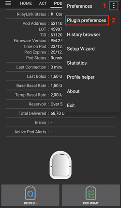

```{admonition} Older screenshot
:class: note
Der Screenshot oben stammt aus einer früheren **AAPS**-Version. In **AAPS** 4 öffnest Du die Einstellungen über **Einstellungen** auf der Karte **Omnipod Eros** oder das Zahnrad-Symbol auf dem Omnipod-Pumpenbildschirm statt über das Zahnrad in der **Konfiguration** oder das Drei-Punkte-Menü.
```

Die Einstellungen sind wie unten aufgeführt gruppiert. Tippe auf eine Gruppe, um sie aufzuklappen. Die meisten Einträge sind Schalter, die Du ein- oder ausschalten kannst:


*HINWEIS: Ein Sternchen (\*) bedeutet, dass "aktiviert" der Standardwert für eine Einstellung ist.*

### RileyLink

Einstellungen für das Pod-Kommunikationsgerät. Das Gerät selbst koppelst Du mit der Schaltfläche **RileyLink verbinden** auf dem Pumpenbildschirm (siehe [RileyLink einrichten](#OmnipodEros-rileylink-setup)).

- **Verwende Scannen:** Sucht vor dem Verbinden nach dem OrangeLink. Das kann die Verbindung verbessern. Bei Bedarf kann es auch mit anderen RileyLink-Nachbauten verwendet werden.

- **Akkustand von OrangeLink/EmaLink/DiaLink anzeigen:** Meldet den tatsächlichen Batteriestand des OrangeLink/EmaLink/DiaLink. Es wird **dringend empfohlen**, dass alle OrangeLink/EmaLink/DiaLink-Benutzer diese Einstellung aktivieren.

- Funktioniert NICHT mit dem originalen RileyLink.
- Funktioniert möglicherweise nicht mit RileyLink-Alternativen.
- Aktiviert - Meldet den aktuellen Batteriestand für unterstützte Pod-Kommunikationsgeräte.
- Deaktiviert - Meldet einen Wert von n/a.

- **Aktiviere die Protokollierung des Akkuwechsels im Aktionen-Tab/Menü:** Nur verfügbar, wenn die Einstellung zur Batterieanzeige oben aktiviert ist. Manche Pod-Kommunikationsgeräte können normale, wechselbare Batterien verwenden. Ist diese Einstellung aktiviert, kannst Du einen [Careportal-Eintrag](#aaps-screens-careportal) **Pumpenbatterie-Wechsel** erfassen, um den Wechsel zu vermerken und das Batteriealter zurückzusetzen.

### Bestätigungstöne

Bestätigt mit Signaltönen des Pods die Abgabe und Änderung von Bolus, Basalrate, SMB und TBR.

- **\*Bolus-Töne aktiviert:** Aktiviert oder deaktiviert Bestätigungstöne, wenn ein Bolus abgegeben wird.
- **Basal-Piep aktiviert:** Aktiviert oder deaktiviert Bestätigungstöne bei Einstellung einer neuen, Abbruch der aktiven oder Änderung der aktuellen Basalrate.
- **\*SMB-Töne aktiviert:** Aktiviert oder deaktiviert Bestätigungstöne, wenn ein SMB abgegeben wird.
- **TBR-Piep aktiviert:** Aktiviert oder deaktiviert Bestätigungstöne, bei Setzen oder Abbruch einer TBR.

### Alarme

Bietet AAPS-Warnungen und Nightscout-Ankündigungen für den Ablauf eines Pods, die Abschaltung oder einen niedrigen Füllstand basierend auf den definierten Schwellenwerten.

*Beachte, dass eine AAPS-Benachrichtigung IMMER für jeden Alarm nach der ersten Kommunikation mit dem Pod ausgegeben wird, da der Alarm ausgelöst wurde. Das Wegwischen der Benachrichtigung schaltet die Warnung NICHT stumm, AUSSER **Pod-Alarme automatisch stummschalten** ist aktiviert. Um die Warnung MANUELL stummzuschalten, öffne den Omnipod-Pumpenbildschirm und tippe auf **Alarme stummschalten**.*

- **\*Ablauferinnerung aktiviert:** Ist das aktiviert, piept der Pod, wenn die unten eingestellte Zeit erreicht ist.
- **Warnung vor dem Herunterfahren (80 Stunden):** Wie viele Stunden vor dem Abschalten des Pods (80 Stunden nach der Aktivierung) die Ablauferinnerung ausgelöst wird (1 bis 8 Stunden, Standard 8).
- **\*Niedrige Reservoir-Alarm aktiviert:** Aktivieren oder deaktivieren Sie eine Warnung, wenn die verbleibenden Einheiten niedriger Reservoir-Limit erreicht ist, wie im Feld Anzahl der Einheiten definiert.
- **Anzahl der Einheiten:** Die Anzahl der Einheiten, bei der die Warnung bei niedrigem Reservoir ausgelöst wird (5 bis 50, Standard 20).
- **Pod-Alarme automatisch stummschalten:** Ist das aktiviert, wird zwar weiterhin eine Benachrichtigung angezeigt, die Warnung wird aber bei der nächsten Kommunikation mit dem Pod nach Beginn der Warnung automatisch stummgeschaltet.

### Benachrichtigungen

Meldet AAPS-Benachrichtigungen und akustische Telefonwarnungen, wenn unsicher ist, ob TBR-, SMB- oder Bolus-Ereignisse erfolgreich waren.

*HINWEIS: Dies sind nur Benachrichtigungen, es werden keine akustischen Signale ausgegeben.*

- **\*Ton für unsichere TBR-Benachrichtigungen aktiviert:** Schaltet einen hörbaren Alarm und eine sichtbare Benachrichtigung ein oder aus, wenn AAPS unsicher ist, ob eine TBR erfolgreich gesetzt wurde.
- **\*Ton für Benachrichtigung bei unsicheren SMB-Ereignis aktiviert:** Aktiviere oder deaktiviere diese Einstellung, um einen akustischen Alarm und eine visuelle Benachrichtigung auszulösen, wenn AAPS unsicher ist, ob eine SMB erfolgreich zugestellt wurde.
- **\*Ton für Benachrichtigung bei unsicheren Bolus-Ereignis aktiviert:** Aktiviere oder deaktiviere diese Einstellung, um einen akustischen Alarm und eine visuelle Benachrichtigung auszulösen, wenn AAPS unsicher ist, ob ein Bolus erfolgreich abgegeben wurde.

### Andere

Bietet erweiterte Einstellungen zur Unterstützung bei der Fehlersuche.

- **Schaltfläche „Insulinabgabe unterbrechen“ in der Pumpenansicht anzeigen:** Blendet die Schaltfläche **Unterbrechen** auf dem Omnipod-Pumpenbildschirm aus oder ein.
- **Button 'Pulse Log' im Menü Pod Mgmt. anzeigen:** Diese Einstellung wird noch aufgeführt, der aktuelle Pumpenbildschirm hat aber keine Schaltfläche **Pulse Log**.

- **Button 'RileyLink Status' im Menü Pod Mgmt. anzeigen:** Blendet die Schaltfläche **RileyLink Status** auf dem Omnipod-Pumpenbildschirm aus oder ein.
- **\*Sommerzeit/Zeitzonen-Erkennung aktiviert:** Ermöglicht die automatische Erkennung von Zeitzonenwechseln, wenn das Smartphone in einer Region mit Sommerzeit verwendet wird.

### Wechseln oder Entfernen eines aktiven Pod-Kommunikationsgeräts (RileyLink)

Da es viele Alternativen zum ursprünglichen RileyLink gibt (etwa OrangeLink oder EmaLink) oder Du mehrere bzw. Ersatzgeräte desselben Pod-Kommunikationsgeräts haben möchtest, musst Du eventuell auf ein anderes Gerät wechseln.

Öffne dazu den Omnipod-Pumpenbildschirm (**Bearbeiten** > **Pumpe**), tippe auf **RileyLink verbinden** und wähle das neue Gerät aus, wie unter [RileyLink einrichten](#OmnipodEros-rileylink-setup) beschrieben. Das neue Gerät ersetzt das bisher gekoppelte.

 


 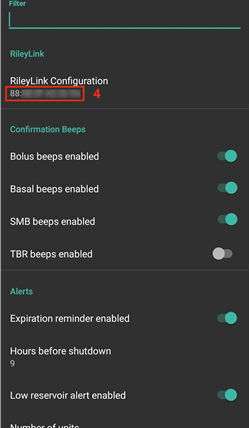

```{admonition} Older screenshot
:class: note
Die Screenshots oben stammen aus einer früheren **AAPS**-Version. In **AAPS** 4 fügst Du ein Gerät mit **RileyLink verbinden** auf dem Omnipod-Pumpenbildschirm hinzu statt über **RileyLink Configuration** in den Omnipod-Einstellungen, und die Suche startet automatisch.
```

Eine eigene Schaltfläche zum Entfernen eines gekoppelten Geräts gibt es nicht. Nutzt Du einen RileyLink nicht mehr, koppelst Du einfach den neuen, wenn Du ihn brauchst.


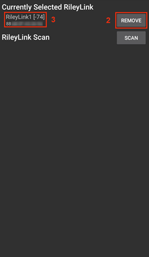

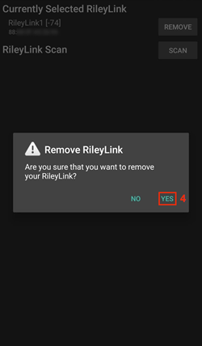


```{admonition} Older screenshot
:class: note
Die Screenshots oben stammen aus einer früheren **AAPS**-Version. In **AAPS** 4 gibt es keine Schaltfläche **Remove**: Das Koppeln eines neuen RileyLinks ersetzt den bisherigen.
```

## Statuszeile und Careportal

Einige Punkte ergeben sich daraus, dass sich der Omnipod-Pod von Pumpen mit Schlauch unterscheidet, besonders nach dem Anlegen eines neuen Pods.

Das Alter von **Insulin** und **Kanüle** in der [Statuszeile](#screens-sensor-level-battery) des Startbildschirms wird **nach jedem Pod-Wechsel** auf 0 Tage und 0 Stunden **zurückgesetzt**. Das liegt daran, wie die Omnipod-Pumpe gebaut ist und funktioniert. Die **Pumpenbatterie** und das **Insulinreservoir ** sind immer im Pod enthalten. Da der Pod die Kanüle direkt in die Haut am Ort der Pod-Anwendung einführt, wird bei Omnipod-Pumpen kein herkömmlicher Schlauch verwendet. *Nach einem Podwechsel wird das Alter jedes dieser Werte daher automatisch auf Null zurückgesetzt.* **Das Alter der Pumpenbatterie** wird nicht angegeben, da die Batterie im Pod immer länger hält, als die Lebensdauer des Pods (maximal 80 Stunden).

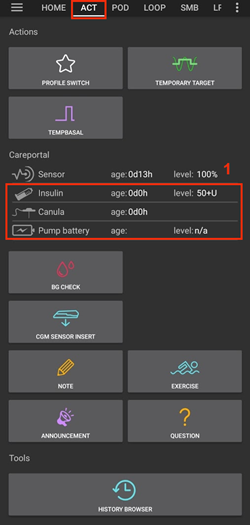

### Füllstände

**Insulin Level**

Die Angabe der Insulinmenge im Omnipod Eros Pod ist nicht genau. Das liegt daran, dass nicht genau bekannt ist, wie viel Insulin in den Pod gefüllt wurde, sondern nur, dass beim Ertönen der 2 Signaltöne während des Füllens mindestens 80 Einheiten eingefüllt sind. Ein Pod kann maximal 200 Einheiten aufnehmen. Auch die Entlüftung kann Abweichungen verursachen, da sie kein exakter Vorgang ist. Mit diesen beiden Faktoren wurde der Omnipod-Treiber so geschrieben, dass er die beste Annäherung an das im Reservoir verbleibende Insulin liefert.

> - **Über 50 Einheiten** - Meldet einen Wert von 50+U, wenn sich mehr als 50 Einheiten im Reservoir befinden.
> - **Unter 50 Einheiten** - Meldet einen ungefähren berechneten Wert des im Reservoir verbleibenden Insulins.
> - **SMS** - Aus dem Pod übernommener Wert oder 50+ IE für SMS-Antworten
> - **Nightscout** - Lädt den Wert 50 hoch, wenn mehr als 50 Einheiten angezeigt werden (Nightscout Version 14.07 und älter).  Neuere Versionen melden einen Wert von 50+, wenn sich mehr als 50 Einheiten im Reservoir befinden.

**Akkustand**

Die Batteriestandsmeldung ist eine Einstellung, die aktiviert werden kann, um den aktuellen Batteriestand von Pod-Kommunikationsgeräten wie dem OrangeLink, EmaLink oder DiaLink anzuzeigen.  Die RileyLink-Hardware ist nicht in der Lage, ihren Batteriestand zu melden.  Der Batteriestand wird nach jeder Kommunikation mit dem Pod gemeldet, so dass beim Aufladen möglicherweise kein linearer Anstieg zu beobachten ist.  Durch eine manuelle Aktualisierung wird der aktuelle Batteriestand aktualisiert.  Wenn ein unterstütztes Pod-Kommunikationsgerät nicht angeschlossen ist, wird ein Wert von 0% gemeldet.

> - **Die RileyLink-Hardware ist NICHT in der Lage ihren Batteriestand zu melden**
> - **"Zeige den von OrangeLink/EmaLink/DiaLink gemeldeten Akkustand" MUSS in den Omnipod-Einstellungen aktiviert werden, um den Akkustand zu melden**
> - **Batteriestandsmeldung funktioniert NUR für OrangeLink-, EmaLink- und DiaLink-Geräte**
> - **Batteriestandsmeldung KANN für andere Geräte funktionieren (außer RileyLink)**
> - **SMS** - Gibt den aktuellen Akkustand als Antwort zurück, wenn ein aktueller Wert existiert, ein Wert von n/a wird nicht zurückgegeben
> - **Nightscout** - Akkustand wird gemeldet, wenn ein aktueller Wert existiert, ein Wert von n/a wird nicht gemeldet

(OmnipodEros-troubleshooting)=

## Problembehandlung

### Pod Fehler

Pods fallen gelegentlich aus unterschiedlichen Gründen aus, u. a. wegen Hardwareproblemen mit dem Pod selbst. Am besten ist es, diese nicht bei Insulet anzugeben, da AAPS kein zugelassener Anwendungsfall ist. Eine Liste an Fehlercodes findest du [hier](https://github.com/openaps/openomni/wiki/Fault-event-codes), um die Ursache zu ermitteln.

### Verhindere Pod Fehler 49

Dieser Fehler hängt mit einem fehlerhaften Pod-Status für einen Befehl oder einem Fehler während der Insulinabgabe zusammen. Wir empfehlen, die Nightscout-Synchronisierung auf *nur hochladen* zu stellen: Lass in den Synchronisierungseinstellungen des Nightscout-Clients alle Optionen „… von NS empfangen“ deaktiviert (siehe [Nightscout](../SettingUpAaps/Nightscout.md)), um mögliche Fehler zu vermeiden.

### Pumpe nicht erreichbar Alarme

Wir empfehlen, Warnungen bei nicht erreichbarer Pumpe auf **120 Minuten** zu setzen. Tippe oben rechts auf dem Startbildschirm auf das Symbol **Einstellungen** (Zahnrad), wähle **Lokale Alarme** > **Grenzwert für Pumpe ist nicht erreichbar** und setze ihn auf **120**.

(OmnipodEros-import-settings-from-previous-aaps)=
### Importieren von Einstellungen aus früherem AAPS

```{admonition} Importing settings can end your active Pod
:class: warning
Lass auf dem Smartphone, auf dem der Pod bereits läuft, **Pumpeneinstellungen auch ersetzen** nicht angehakt: Die Pod-Sitzung bleibt erhalten, und nur die übrigen Einstellungen werden importiert. Hake es nur mit einer Datei an, die während des Pods exportiert wurde, den Du gerade trägst. Siehe [Schlauchlose Pumpen](#ExportImportSettings-tubeless-pumps).
```

Am sichersten installierst Du **AAPS** zwischen zwei Pods neu:

1. Deaktiviere deine Pod-Sitzung. Stelle sicher, dass keine aktive Pod-Sitzung läuft.
2. Exportiere deine Einstellungen und bewahre eine Kopie an einem sicheren Ort auf.
3. Deinstalliere die vorherige Version von AAPS und starte dein Smartphone neu.
4. Installiere die neue Version von AAPS und stelle sicher, dass Du keine aktive Pod-Sitzung hast.
5. Importiere deine Einstellungen und aktiviere einen neuen Pod.

### Omnipod-Treiberwarnungen

Bitte beachte, dass der Omnipod-Treiber auf dem **Startbildschirm** eine Reihe eigener Warnungen anzeigt. Die meisten dienen nur zur Information und können geschlossen werden, bei einigen musst Du jedoch etwas tun, um die Ursache der Warnung zu beheben. Im Folgenden findest du eine Zusammenfassung der wichtigsten Warnmeldungen, die dir begegnen können:

#### Kein aktiver Pod

Keine aktive Pod-Sitzung erkannt. Dieser Alarm kann vorübergehend durch Drücken von **Schlummern** deaktiviert werden, wird aber weiterhin ausgelöst, solange kein neuer Pod aktiviert wurde. Einmal aktiviert, wird dieser Alarm automatisch ausgeschaltet.

#### Pod angehalten

Hinweis, dass der Pod ausgesetzt wurde.

#### Setzen des Basal-Profils fehlgeschlagen. Die Abgabe könnte ausgesetzt sein! Bitte aktualisiere den Pod-Status manuell auf dem Pumpenbildschirm und setze die Abgabe bei Bedarf fort.

Information, dass das Setzen des Basalprofils auf dem Pod fehlgeschlagen ist. Öffne den Omnipod-Pumpenbildschirm und tippe auf **Aktualisieren**, dann bei Bedarf auf **Abgabe fortsetzen**.

#### Es kann nicht überprüft werden, ob der SMB-Bolus erfolgreich war. Wenn du sicher bist, dass der Bolus nicht erfolgreich war, solltest du den SMB-Eintrag manuell auf der Registerkarte Behandlungen entfernen.

Warnung, dass der Erfolg des SMB nicht bestätigt werden konnte. Prüfe im Feld **Letzter Bolus** auf dem Omnipod-Pumpenbildschirm, ob der SMB erfolgreich war. Falls nicht, entferne den Eintrag aus den Behandlungen.

#### Unsicher, ob die "Ereignis Bolus/TBR/SMB" abgeschlossen wurde. Bitte überprüfe manuell, ob sie erfolgreich war.

Aufgrund der Art und Weise, wie RileyLink und Omnipod miteinander kommunizieren, kann es zu Situationen kommen, in denen es *unsicher* ist, ob ein Befehl erfolgreich verarbeitet wurde. Es war notwendig, den Nutzer über diese Unsicherheit zu informieren.

Im Folgenden findest du einige Beispiele dafür, wann eine unsichere Meldung auftreten kann.

- **Bolus** - Unsichere Boli können nicht automatisch überprüft werden. Die Benachrichtigung bleibt bis zum nächsten Bolus bestehen, aber eine manuelle Pod-Aktualisierung löscht die Meldung. *Standardmäßig sind bei dieser Benachrichtigungsart die Warntöne aktiviert, da der/die Nutzer/in sie manuell bestätigen muss.*
- **TBRs, Pod-Status, Profilwechsel, Zeitänderungen** - eine manuelle Pod-Aktualisierung löscht die Meldung.
- **Zeitabweichung des Pods -** Weichen die Uhrzeit auf dem Pod und auf Deinem Smartphone zu stark voneinander ab, kann der AAPS-Loop nur schwer arbeiten und keine genauen Vorhersagen und Dosierungsempfehlungen machen. Beträgt die Zeitdifferenz zwischen Pod und Smartphone mehr als 5 Minuten, erscheint auf dem Omnipod-Pumpenbildschirm die Schaltfläche **Zeit einstellen**. Tippe auf **Zeit einstellen**, um die Uhrzeit des Pods mit der des Smartphones abzugleichen. Zeigt **Pod Status** danach **Angehalten**, tippe auf **Abgabe fortsetzen**, um den normalen Pod-Betrieb fortzusetzen.

## Best Practices

(OmnipodEros-optimal-omnipod-and-rileylink-positioning)=

### Optimale Positionierung von Omnipod und RileyLink

Die Antenne, die auf dem RileyLink zur Kommunikation mit einem Omnipod-Pod verwendet wird, ist eine 433 MHz-Wendelspiralantenne. Aufgrund seiner Konstruktion strahlt er ein omnidirektionales Signal wie ein dreidimensionaler Donut ab, wobei die Z-Achse die vertikal stehende Antenne darstellt. Das bedeutet, dass es optimale Positionen für die Platzierung des RileyLink gibt, insbesondere bei der Pod-Aktivierung und Deaktivierung.


> *(Bild 1. Graphische Darstellung einer Wendelspiralantenne in einem Rundstrahldiagramm*)

Aus Sicherheitsgründen muss die *Aktivierung* des Pods in einem *geringeren Abstand (~30 cm oder weniger)* als andere Vorgänge erfolgen, wie z. B. die Verabreichung eines Bolus, das Setzen eines TBR oder das einfache Aktualisieren des Pod-Status. Aufgrund der Art und Weise der Signalübertragung der RileyLink-Antenne ist es NICHT empfehlenswert, den Pod direkt auf oder neben dem RileyLink zu platzieren.

Die Abbildung unten zeigt die optimale Positionierung des RileyLink während der Pod-Aktivierung und Deaktivierung. Der Pod kann zwar auch in anderen Positionen aktiviert werden, jedoch wirst Du mit der unten gezeigten Position den größten Erfolg haben.

*Hinweis: Wenn trotz optimaler Positionierung des Pods die Kommunikation mit dem RileyLink fehlschlägt, kann dies an einer schwachen Batterie liegen, da diese den Sendebereich der RileyLink-Antenne verringert. Um dieses Problem zu vermeiden, stelle sicher, dass der RileyLink während dieses Vorgangs ordnungsgemäß geladen oder direkt an ein Ladekabel angeschlossen ist.*


## Wo ich Hilfe bekomme

Die gesamte Entwicklungsarbeit für den Omnipod-Treiber wird von der Community auf freiwilliger Basis geleistet. Wir bitten dich, rücksichtsvoll zu sein und die folgenden Richtlinien zu befolgen, wenn du um Unterstützung bittest:

- **Level 0:** Lies den entsprechenden Abschnitt dieser Dokumentation um sicherzustellen, dass du verstehst, wie die Funktion, mit der Du Schwierigkeiten hast, funktionieren soll.
- **Level 1:** Wenn Du immer noch Probleme hast, die du mit diesem Dokument nicht lösen kannst, dann gehe bitte in den *#androidaps* Channel auf **Discord**, indem du [diesen Einladungslink <https://discord.gg/4fQUWHZ4Mw>](https://discord.gg/4fQUWHZ4Mw) benutzt.
- **Stufe 2:** Gehe durch die bestehenden Probleme, um zu sehen, ob Dein Problem bereits bekannt ist; Falls nicht, eröffne ein neues [Issue](https://github.com/nightscout/AndroidAPS/issues) und hänge Deine [Protokolldateien](../GettingHelp/AccessingLogFiles.md) (engl. logs) an.
- **Sei geduldig - die meisten Mitglieder unserer Community sind gutmütige Freiwillige und die Lösung von Problemen erfordert oft Zeit und Geduld von Nutzern und Entwicklern.**
