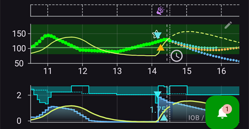

# AAPS-Bildschirme

```{contents}
:backlinks: entry
:depth: 2
```

(the-homescreen)= (AapsScreens-the-homescreen)=

## The main screen


Wenn Du **AAPS** öffnest, ist dies die erste Ansicht. Sie enthält die meisten der täglich benötigten Informationen.

### Abschnitt A - Obere Leiste

* Das **Menü** (☰) links öffnet die Navigationsleiste mit **Behandlungsverlauf**, **Historie**, **Statistiken**, **Profil-Helfer**, **Wartung**, **Einrichtungsassistent**, **Konfiguration** und mehr.
* Die **Suchleiste** findet Einstellungen, Dialoge und Dokumentation – fang einfach an zu tippen (siehe [Globale Suche](../DailyLifeWithAaps/GlobalSearch.md)).
* Das Symbol **Einstellungen** (Zahnrad) rechts öffnet alle [Einstellungen](../SettingUpAaps/Preferences.md).

(aaps-screens-profile--target)=

### Abschnitt B - Statusbereich

#### Aktueller Blutzucker

Der letzte Glukosewert Deines CGM wird im großen Kreis links angezeigt, zusammen mit der Differenz zum vorherigen Wert (Delta) und dem Alter des Werts.

Die Farbe des Glukosewertes zeigt wie sich der Wert zum definierten [Zielbereich](#Preferences-range-for-visualization) verhält.

* grün = innerhalb des Bereichs
* rot = unterhalb des Zielbereichs
* gelb = oberhalb des Zielbereichs

  

(loop-status)= (AapsScreens-loop-status)=

#### Loop Status


Neben dem BZ-Kreis zeigt ein Symbol den AAPS-Modus des Loops an (im Bild von oben nach unten):

1. Grüner Kreis = [Closed Loop](#KeyAapsFeatures-ClosedLoop), Loop läuft
2. Violetter Kreis mit gepunkteter Linie = [Low Glucose Suspend (LGS)](#KeyAapsFeatures-LGS) (dt. Abschalten vor Niedrig)
3. Blauer Kreis mit gepunkteter Linie = [Open Loop](#KeyAapsFeatures-OpenLoop)
4. Roter Kreis mit Kreuz = Loop deaktiviert (dauerhaft außer Betrieb)
5. Rotes Pause-Symbol = Loop pausiert (vorübergehend angehalten, Basalinsulin wird aber abgegeben) - die verbleibende Zeit wird neben dem Symbol angezeigt
6. Grauer Kreis mit Stecker = Pumpe getrennt (vorübergehend gar keine Insulinabgabe) - die verbleibende Zeit wird neben dem Symbol angezeigt

Tippe auf das Symbol, um den Loop-Dialog zu öffnen. Was der Dialog anbietet, hängt vom aktuellen Zustand ab:

* Solange der Loop **läuft** (Closed Loop, Open Loop oder LGS), kannst Du den AAPS-Modus wechseln (Closed Loop, Unterbrechung bei niedrigem BZ, Open Loop oder Loop deaktivieren), den Loop für eine gewählte Dauer **pausieren** oder die Pumpe **trennen**.
* Ist der Loop **deaktiviert**, kannst Du ihn wieder einschalten, indem Du einen AAPS-Modus wählst, oder die Pumpe trennen.
* Ist der Loop **pausiert**, kannst Du ihn **fortsetzen**, die Pumpe trennen oder unter **Loop pausieren** eine neue Dauer wählen, um die Pause zu verlängern.
* Ist die Pumpe **getrennt**, kannst Du sie **erneut verbinden** oder unter **Pumpe trennen** eine neue Dauer wählen, um die Trennung zu verlängern.

Verlängerst Du eine Pause oder eine Trennung, **beginnt die neue Dauer jetzt**: Sie ersetzt die verbleibende Zeit und wird nicht dazugezählt. Du musst vorher weder fortsetzen noch erneut verbinden.

Der Dialog, wenn der Loop als Closed Loop läuft:


Der Dialog bei pausiertem Loop, mit **Loop fortsetzen** und den Zeiten, um die Pause zu verlängern:


Der Dialog bei getrennter Pumpe, mit **Pumpe erneut verbinden** und den Zeiten, um die Trennung zu verlängern:


Bei Unterbrechung bei niedrigem BZ, im Open Loop und bei deaktiviertem Loop unterscheidet sich der Dialog nur in den angebotenen AAPS-Modi:


So sieht der Startbildschirm in jedem Modus aus. Das Farbband oben im Diagramm wechselt zum Zeitpunkt der Umschaltung.

Unterbrechung bei niedrigem BZ:


Open Loop:


Loop deaktiviert:


Loop pausiert – die verbleibende Zeit wird neben dem Symbol angezeigt:


Pumpe getrennt – die verbleibende Zeit wird neben dem Symbol angezeigt. Die Knöpfe für Behandlungen bleiben in der Schnellstart-Leiste. So kannst Du weiterhin mit einem Pen gegebenes Insulin oder Kohlenhydrate eintragen:


Nach jeder Auswahl ist eine Bestätigung nötig.

```{admonition} Alarm: Die Pumpe hat die temporäre Null-Basalrate nicht akzeptiert :class: warning Solange die Pumpe getrennt ist, behält **AAPS** eine temporäre Basalrate von null auf der Pumpe und setzt sie erneut, wenn sie fehlt. Klappt das nach 10 Minuten immer noch nicht, löst **AAPS** einen dringenden Alarm aus: *„Die Pumpe hat die temporäre Null-Basalrate nicht akzeptiert. Möglicherweise wird weiterhin Basalinsulin abgegeben. Überprüfe die Pumpe.“* Der Alarm wiederholt sich alle 15 Minuten, bis die temporäre Basalrate von null gesetzt ist oder die Trennung endet. Wenn Du ihn siehst, prüfe Deine Pumpe: Sie gibt möglicherweise Basalinsulin ab, obwohl **AAPS** sie als getrennt anzeigt.

    <br />Hinweis: Welche Modi angeboten werden, hängt von Deinem Fortschritt bei den [Zielen](../SettingUpAaps/CompletingTheObjectives.md) ab – Closed Loop und LGS werden erst verfügbar, wenn Du die entsprechenden Ziele abgeschlossen hast.
    
    (aaps-screens-bg-warning-sign)=
    #### BZ-Warnzeichen
    
    Erkennt **AAPS** ein Problem mit den empfangenen BZ-Werten, erscheint in der unteren Leiste des Startbildschirms eine Verknüpfung zu Deiner BZ-Quelle (nach ihr benannt, zum Beispiel **xDrip+ BG**) mit einem roten Warnzeichen. Tippe darauf, um den [Bildschirm der BZ-Quelle](#aaps-screens-bg-source) zu öffnen.
    
    ##### Doppelte BZ-Daten
    
    Das rote Warnzeichen bedeutet, dass Du sofort aktiv werden solltest: Du bekommst **doppelte BZ-Daten**, die den Loop daran hindern, seine Arbeit richtig zu machen. Aus doppelten Werten kann **AAPS** den BZ-Verlauf nicht zuverlässig berechnen und korrigiert deshalb nicht mehr.
    
    War Dein Loop geschlossen, schaltet **AAPS** ihn in den Modus [Unterbrechung bei niedrigem BZ (LGS)](#KeyAapsFeatures-LGS): Das Loop-Symbol wird lila.
    
      
    
    Tippe auf das Loop-Symbol: Die Karte **Beschränkungen** oben nennt den Grund: „BgQualityCheck: LGS-Modus wegen doppelter Werte in der BZ-Quelle“.
    
      
    
    ```{admonition} Dein Loop läuft im Modus Unterbrechung bei niedrigem BZ
    :class: note
    Dein Loop läuft weiter, aber nur, um Dich vor Unterzuckerungen zu schützen: **AAPS** kann Deine Basalrate weiterhin senken oder aussetzen, gibt aber kein Korrekturinsulin, bis Du das Problem behoben hast!
    

Du musst herausfinden, warum Du doppelte Glukosewert-Daten erhältst:

* Ist die Dexcom-Bridge auf Deiner Nightscout-Seite aktiviert? Deaktiviere die Bridge, indem Du in das Administrations-Menü Deiner Nightscout-Instanz gehst, bearbeite die „enable“-Variable und entferne dort den „bridge“-Teil. (Für Heroku [findest Du hier Details](https://nightscout.github.io/troubleshoot/troubleshoot/#heroku).)
* Laden mehrere Quellen Deine Glukosewerte zu Nightscout hoch? Wenn Du die BYODA-App verwendest, aktiviere den Upload in **AAPS**, aber nicht in xDrip+, falls Du xDrip+ nutzt.
* Hast Du Follower, die Deine Glukosewerte erhalten und sie erneut auf Deine Nightscout-Seite hochladen?
* Letzter Ausweg: Wähle in den [NSClient-Einstellungen](#Preferences-nsclient) die Synchronisierungseinstellungen und schalte die Option „CGM Daten von NS empfangen“ aus.

Um die Warnung sofort zu entfernen und Deinen Loop wieder korrigieren zu lassen, lösche die doppelten Einträge im Bildschirm der BZ-Quelle: Tippe auf die Verknüpfung in der unteren Leiste. Der doppelte Wert ist rot hervorgehoben. Drücke lange auf einen Wert, um die Auswahl zu starten, hake die doppelten Werte an und tippe oben rechts auf das Papierkorb-Symbol.


Wenn es jedoch viele Duplikate gibt, könnte es einfacher sein,

* [Sichere Deine Einstellungen](../Maintenance/ExportImportSettings.md),
* setze deine Datenbank im Wartungsmenü zurück und
* [importiere Deine Einstellungen](../Maintenance/ExportImportSettings.md) erneut

    {admonition} Schalte selbst zurück auf Closed Loop
    :class: important
    **AAPS** kehrt nicht von selbst zum **Closed Loop** zurück, wenn die doppelten Werte weg sind. Tippe auf dem Startbildschirm auf das Loop-Symbol und wähle wieder **Closed Loop**.

##### Gleichbleibende BZ-Daten

Bei manchen BZ-Quellen (Libre 1, AiDEX, Glutec, Medtronic und Quellen, die ihren Sensortyp nicht melden) prüft **AAPS** auch, ob sich die Werte nicht verändern: Hat sich Dein BZ 45 Minuten lang um weniger als 2 mg/dl (0,1 mmol/l) verändert, gelten die Daten als falsch. Die Verknüpfung zur BZ-Quelle zeigt dann ein rotes Symbol für einen flachen Verlauf. Der Loop beendet jede erhöhte temporäre Basalrate und gibt kein Korrekturinsulin, bis sich die Werte wieder ändern. Prüfe Deinen Sensor und die App, die die Werte sendet.

##### Unregelmäßige BZ-Daten

Kommen die Werte in unregelmäßigen Abständen oder fehlen einige, berechnet **AAPS** aus den vorhandenen Werten 5-Minuten-Werte neu. Das passiert zum Beispiel nach einem Sensorwechsel oder bei Libre-Sensoren, deren Zeitpunkt sich alle paar Stunden um ein bis zwei Minuten verschiebt. Der Loop arbeitet weiter, und Du musst nichts tun. **AAPS** 4 zeigt dafür kein gelbes Warnzeichen mehr an.

#### Aktuelles Profil

Das aktuelle Profil wird neben dem Stern-Symbol angezeigt.

Tippe auf den Profilnamen, um den [Profil-Bildschirm](#aaps-screens-profile) zu öffnen. Dort kannst Du die Details des Profils ansehen und [zwischen verschiedenen Profilen wechseln](../DailyLifeWithAaps/ProfileSwitch-ProfilePercentage.md).

Um **den Prozentsatz des Profils zu ändern** (und die Dauer), tippe auf den Profilnamen und dann unten rechts im Profil-Bildschirm auf den runden Knopf **▶** (Aktivieren). In **AAPS** 3.x öffnete sich dieser Bildschirm mit einem langen Druck auf den Profilnamen. In **AAPS** 4 bewirkt ein langer Druck nichts. Schritt für Schritt: [Den Prozentsatz des Profils ändern](#ProfileSwitch-change-percentage).


1. Normale Anzeige mit einer Standardprofil-Aktivierung.
2. Profilwechsel mit einem Prozentsatz von 90 % und einer verbleibenden Dauer von 9 Minuten – der Profilname wird gelb, solange ein zeitlich begrenzter Profilwechsel läuft.
3. Profilwechsel mit einer Zeitverschiebung von 1 Stunde und einer verbleibenden Dauer von 9 Minuten.

#### Ziel


Der aktuelle BZ-Zielwert wird unter dem Profilnamen angezeigt.

Tippe kurz auf den Zielwert, um den Bildschirm **[Temporäres Ziel](../DailyLifeWithAaps/TempTargets.md)** zu öffnen.

1. Normale Anzeige: der in Deinem Profil festgelegte Zielbereich.
2. Ist ein temporäres Ziel gesetzt, wird der Zielwert gelb/orange mit dem Symbol der verwendeten Vorlage, und die verbleibende Zeit in Minuten steht in Klammern.

(AapsScreens-visualization-of-dynamic-target-adjustment)=

#### Anzeige der dynamischen Ziel-Anpassung

Wenn Du den [SMB-Algorithmus](#Config-Builder-aps) und [Autosens](#Open-APS-features-autosens) nutzt, kann **AAPS** Dein Ziel dynamisch auf Basis Deiner Insulin-Empfindlichkeit anpassen.

Aktiviere eine oder beide der folgenden Optionen in den [OpenAPS SMB-Einstellungen](#Preferences-openaps-smb-settings):

* „Sensibilität erhöht den Zielwert“ und/oder
* „Resistenz senkt den Zielwert“

Erkennt **AAPS** eine Resistenz oder Empfindlichkeit, weicht das Ziel von dem im Profil festgelegten Wert ab, und der angezeigte Zielwert ändert seine Farbe, um die Anpassung zu zeigen.

(aaps-screens-iob-cob-basal-sens)=

#### IOB, COB, Basal und Empfindlichkeit


1. **Spritze**: Insulin an Bord (IOB) - Menge an aktivem Insulin im Körper  
    Das Insulin an Bord wäre null, wenn nur Deine normale Basalrate liefe und kein Insulin aus früheren Boli mehr wirken würde. 
    * IOB kann negativ sein, wenn zuvor die Basalrate reduziert worden ist.
    * Tippe auf die Anzeige, um die Aufteilung in Bolus- und Basalinsulin zu sehen (erster Dialog im Bild – hier mit negativem IOB nach einer Zeit mit reduzierter Basalrate)
2. **Getreidekorn**: [Kohlenhydrate an Bord (COB)](../DailyLifeWithAaps/CobCalculation.md) - noch nicht resorbierte Kohlenhydrate, die Du vorher gegessen hast
3. Der blaugrüne Knopf rechts zeigt die **aktuelle Basalabgabe**: eine flache Linie, wenn die Basalrate des Profils läuft, ein anderes Symbol, während eine temporäre Basalrate aktiv ist
4. Die **Prozent-Zeile** zeigt die aktuelle Empfindlichkeit ([Autosens](#Open-APS-features-autosens) / [DynamicISF](../DailyLifeWithAaps/DynamicISF.md)). Wenn der Loop Deinen ISF ändert, zeigt die Zeile außerdem den ISF des Profils, einen Pfeil und den ISF, den der Loop gerade verwendet, zum Beispiel "80% 2.0 ↗ 2.5". Tippe darauf, um den Autosens-Wert und den wirksamen ISF zu sehen (zweiter Dialog im Bild). Arbeitet der Loop mit einem anderen Wert als dem letzten Autosens-Ergebnis (zum Beispiel, weil ein temporäres Ziel Deine Empfindlichkeit verändert), zeigt der Dialog diesen Wert zusätzlich als **Autosens im Algorithmus** an. Ist Autosens ausgeschaltet, behält der Loop den ISF Deines Profils bei, und es wird kein wirksamer ISF angezeigt.

Der IOB-Dialog, der sich beim Tippen auf die IOB-Anzeige öffnet:


Tippe auf den blaugrünen Knopf, um die laufende temporäre Basalrate zu sehen, wann sie begonnen hat und wie lange sie schon läuft:


(aaps-screens-carbs-required)=

#### Kohlenhydrat-Vorschlag


Wenn der Algorithmus erkennt, dass Du etwas essen solltest, damit Dein BZ nicht zu tief fällt, wird die Menge der empfohlenen Kohlenhydrate angezeigt.

Dies ist der Fall, wenn der Algorithmus davon ausgeht, dass ein Absenken der Basalrate auf Null nicht ausreicht und Du daher Kohlenhydrate zu Dir nehmen solltest.

Diese Benachrichtigungen des Kohlenhydrat-Vorschlags sind deutlich ausgeklügelter als die Berechnungen des Bolusrechners. Es kann sein, dass Dir hier Kohlenhydrate vorgeschlagen werden, obwohl der Bolus-Rechner keine fehlenden Kohlenhydrate anzeigt.

Auf Wunsch können die Kohlenhydrat-Vorschläge an Nightscout gesandt werden. In diesem Fall wird eine Ankündigung angezeigt und verteilt.

### Abschnitt C - Statuszeile


Die Statuszeile warnt optisch bei

* Kanülenalter
* Insulinalter (Tage, die das Reservoir in Gebrauch ist) und Füllstand des Reservoirs (Einheiten)
* Sensoralter
* Alter und Ladezustand der Pumpenbatterie (%)

Bei Überschreitung der Warnschwelle werden die Werte gelb angezeigt.

Wenn die kritische Schwelle überschritten wird, werden die Werte rot angezeigt.

Das Alter wird unabhängig von der Bildschirmgröße immer in Kurzform angezeigt: *4h* am ersten Tag, später *3d4h*.

Die Schwellwerte lassen sich über das kleine Symbol **Einstellungen** ändern, das erscheint, wenn die Statuszeile **aufgeklappt** ist (Pfeil rechts) – siehe [Statusanzeige](#Preferences-status-lights).

Im aufgeklappten Statusbereich gibt es am Ende mancher Zeilen außerdem einen Knopf, um einen Wechsel einzutragen. Damit wird das jeweilige Alter zurückgesetzt: **Hinzufügen** in der Zeile **Sensor** trägt einen Sensorwechsel ein. Wenn Deine Pumpe es unterstützt, erscheint **Nadelwechsel/Füllen** in den Zeilen **Kanüle** (oder **Patch-Pumpe**) und **Insulin** sowie **Hinzufügen** in der Zeile **Pumpenbatterie**.


Abhängig von der verwendeten Pumpe, kann es sein, dass Du nicht alle diese Symbole angezeigt bekommst.

(screens-sensor-level-battery)=

#### Sensor Level (Batterie)

Verfügbar für CGM-Systeme mit zusätzlichem Transmitter wie z.B. MiaoMiao 2. (Technisch gesehen muss der Sensor Informationen zum Batteriestand an xDrip+ senden.)

Die Schwellwerte können unter [Statusanzeige](#Preferences-status-lights) eingestellt werden.

(aaps-screens-main-graph)=

### Abschnitt D - Hauptdiagramm


Die Grafik zeigt Deinen Blutzucker (BZ), so wie er von Deinem Sensor (CGM) gemessen wurde.

Mit Wisch- und Zoom-Gesten auf dem Diagramm änderst Du den angezeigten Zeitraum.

Der grüne Bereich spiegelt den Zielbereich wider.

Diese Informationen werden auch in diesem Graph angezeigt:

* Manuelle Boli: blaues Dreieck knapp über der BZ-Kurve, das auf den Wert zu diesem Zeitpunkt nach unten zeigt, mit der Insulinmenge
* Kohlenhydrat-Einträge: oranges Dreieck knapp unter der BZ-Kurve, das nach oben auf den Wert zeigt, mit der Kohlenhydratmenge. Eine Mahlzeit, die zusammen mit ihrem Bolus eingegeben wurde, sieht wie eine Markierung aus, die durch den Wert geteilt wird.
* Die Dreiecke gibt es in drei Größen (klein, mittel, groß), je nach Menge im Vergleich zur größten des Tages. Gibt es zu diesem Zeitpunkt keinen BZ-Wert (Sensorlücke), wird das Dreieck unten im Diagramm gezeichnet.
* BZ-Tests und Kalibrierungen: an ihrem eigenen gemessenen Wert eingezeichnet, damit Du sie mit der Sensorkurve vergleichen kannst
* Ziel, entweder so wie es im Profil hinterlegt ist oder wie es durch temporäre Ziele angepasst wurde: grüne Linie
* Profilwechsel: Stern-Symbole oben im Diagramm
* Loop-Status: Farbband oben im Diagramm, wenn der [AAPS-Modus](#AapsScreens-loop-status) etwas anderes als Closed Loop ist: blau = Open Loop, lila = LGS, rot = Loop deaktiviert, gelb = Loop pausiert, grau = Pumpe getrennt, orange = Superbolus (im Screenshot: erst lila, dann gelb). Die Historie dieser Wechsel steht unter [AAPS-Modus](#AapsScreens-running-mode)
* [SMBs](#Open-APS-features-super-micro-bolus-smb) werden nicht im BZ-Diagramm eingezeichnet (dann wäre alle paar Minuten einer zu sehen), sondern im [IOB-Diagramm](#aaps-screens-iob).

Tippe im Diagramm auf einen **BZ-Test**, um seinen Wert und, falls Du eine geschrieben hast, seine Notiz zu sehen.

(aaps-screens-graph-press-and-hold)=

#### Die Werte zu einem bestimmten Zeitpunkt ansehen

**Halte** das BZ-Diagramm einen Moment gedrückt, um die Werte zu einem Messwert zu sehen. Ein Punkt markiert den nächstgelegenen Wert, in allen Diagrammen wird zu diesem Zeitpunkt eine gestrichelte Linie gezeichnet, und ein Fenster oben im Diagramm zeigt:

* die Uhrzeit und den BZ-Wert
* IOB, COB (nur wenn über 0 g) und die Basalrate zu diesem Zeitpunkt – das Basal-Symbol zeigt wie auf dem Startbildschirm, ob eine temporäre Basalrate lief
* jeden Bolus, SMB oder Kohlenhydrate zu diesem Zeitpunkt, mit denselben Dreiecken wie in den Diagrammen

Lass den Finger auf dem Bildschirm und bewege ihn nach links oder rechts, um von einem Wert zum nächsten zu gehen. Bei jedem Wert spürst Du ein leichtes Ticken, und das Diagramm scrollt dabei nicht. Das Fenster bleibt 2 Sekunden stehen, nachdem Du den Finger hebst.

Das funktioniert genauso bei den [zusätzlichen Diagrammen](#aaps-screens-additional-graphs) unter dem BZ-Diagramm (IOB, COB …): Halte einfach eines davon gedrückt.


(aaps-screens-graph-clock-change)=

#### Zeitumstellungen

Ist die Uhr des Smartphones gesprungen, bei einer Zeitumstellung oder in einer neuen Zeitzone, markiert eine gestrichelte senkrechte Linie diesen Moment im BZ-Diagramm, mit einem kleinen Uhr-Symbol an ihrem Fuß. Dieselbe gestrichelte Linie läuft durch die [zusätzlichen Diagramme](#aaps-screens-additional-graphs) darunter.



(AapsScreens-activate-optional-information)=

#### Aktiviere optionale Informationen

Tippe oben rechts im Diagramm auf das **Stift**-Symbol, um die Einstellungen des Diagramms zu öffnen:


* **Diagrammhöhe** stellt ein, wie hoch das Diagramm gezeichnet wird.
* **ACT** blendet die Kurve der Insulinaktivität ein: eine durchgezogene gelbgrüne Linie <span style="background:#141218;color:#D3F166;padding:0 0.3em;border:1px solid #141218;border-radius:4px">━━━━</span> (nicht zu verwechseln mit der gepunkteten gelben UAM-Vorhersage)
* **PRED** blendet die [Vorhersagelinien](#aaps-screens-prediction-lines) ein (siehe unten)

(aaps-screens-prediction-lines)=

#### Vorhersage Kurven

Ist **PRED** eingeschaltet, zeichnet AAPS seine Vorhersagen als **gepunktete Linien** rechts von der „Jetzt“-Linie. Jede Vorhersage hat ihre eigene Farbe. Das dunkle Design verwendet hellere Töne derselben Farben, und eine Linie im grünen Zielbereich kann etwas grüner wirken.

| Linie                  | Helles Design                                                                                                                     | Dunkles Design                                                                                                                     | Was sie vorhersagt                    |
| ---------------------- | --------------------------------------------------------------------------------------------------------------------------------- | ---------------------------------------------------------------------------------------------------------------------------------- | ------------------------------------- |
| **IOB** (blau)         | <span style="background:#FFFFFF;color:#1E88E5;padding:0 0.3em;border:1px solid #CCCCCC;border-radius:4px">●●●●</span>             | <span style="background:#141218;color:#64B5F6;padding:0 0.3em;border:1px solid #141218;border-radius:4px">●●●●</span>              | nur Insulin                           |
| **COB** (orange)       | <span style="background:#FFFFFF;color:#FB8C00;padding:0 0.3em;border:1px solid #CCCCCC;border-radius:4px">●●●●</span>             | <span style="background:#141218;color:#FFB74D;padding:0 0.3em;border:1px solid #141218;border-radius:4px">●●●●</span>              | carbs on board (aktive Kohlenhydrate) |
| **UAM** (gelb)         | <span style="background:#FFFFFF;color:#C9BD60;padding:0 0.3em;border:1px solid #CCCCCC;border-radius:4px">●●●●</span>             | <span style="background:#141218;color:#E6D39A;padding:0 0.3em;border:1px solid #141218;border-radius:4px">●●●●</span>              | nicht angekündigte Mahlzeit           |
| **ZT** (cyan)          | <span style="background:#FFFFFF;color:#00D2D2;padding:0 0.3em;border:1px solid #CCCCCC;border-radius:4px">●●●●</span>             | <span style="background:#141218;color:#4DD4D4;padding:0 0.3em;border:1px solid #141218;border-radius:4px">●●●●</span>              | Zero-Temp (Insulin gestoppt)          |
| **aCOB** (blassorange) | <span style="background:#FFFFFF;color:rgba(251,140,0,0.5);padding:0 0.3em;border:1px solid #CCCCCC;border-radius:4px">●●●●</span> | <span style="background:#141218;color:rgba(255,183,77,0.5);padding:0 0.3em;border:1px solid #141218;border-radius:4px">●●●●</span> | nur älterer AMA-Algorithmus           |

Ergeben zwei Vorhersagen dieselben Werte, überlagern sich ihre Punkte, und Du siehst nur eine der Farben (zum Beispiel UAM über IOB, wenn der BZ flach ist).

* **COB**-Linie (orange): [Kohlenhydrate an Bord](CobCalculation) (orange steht in AAPS durchgehend für COB und Kohlenhydrate)
    
    Die Prognosekurve zeigt, wohin sich der Glukosewert (nicht die COB selbst!) auf der Grundlage der aktuellen **Profil**-Einstellungen und unter der Annahme, dass die Abweichungen aufgrund der Kohlenhydratresorption konstant bleiben, entwickeln wird. Diese Linie erscheint nur, wenn es bekannte COB gibt.

* **IOB**-Linie (blau): Insulin an Bord (blau steht in AAPS durchgehend für IOB und Insulin)
    
    Die Prognoselinie zeigt, was passieren würde, wenn nur der Einfluss des Insulins berücksichtigt wird. Zum Beispiel, wenn Du Insulin abgegeben hast und dann keine Kohlenhydrate zu Dir genommen hast.

* **ZT**-Linie (cyan): Zero-Temp (BZ-Vorhersage, wenn eine temporäre Basalrate von 0 % gesetzt würde)
    
    Die Prognoselinie (Vorhersagelinie) zeigt, wie sich der Glukosewert-Verlauf ändern würde, wenn die Pumpe die Insulinabgabe komplett stoppen würde (0 % TBR). Die Linie endet, sobald sie über Deinen Zielwert steigt.
    
    *Diese Zeile ist nur zu sehen, wenn der [SMB](#Config-Builder-aps)-Algorithmus genutzt wird.*

* **UAM**-Linie (gelb): [nicht angekündigte Mahlzeiten](#SensitivityDetectionAndCob-sensitivity-oref1)
    
    Unannounced meals (nicht angekündigte Mahlzeiten) bedeutet, dass ein signifikanter Anstieg des Glukosespiegels durch Mahlzeiten, Adrenalin oder andere Einflüsse festgestellt wird. Die Prognoselinie ähnelt der **orangenen COB-Linie**, geht aber davon aus, dass die Abweichungen mit konstanter Rate abnehmen werden (durch Verlängerung der aktuellen Reduktionsrate).
    
    *Diese Linie erscheint nur, wenn der [SMB](#Config-Builder-aps)-Algorithmus verwendet wird, **UAM aktivieren** in den OpenAPS SMB-Einstellungen eingeschaltet ist und der BZ stärker steigt, als sich allein durch das Insulin erklären lässt.*

* **aCOB**-Linie (blasses, durchscheinendes Orange): beschleunigte Kohlenhydrat-Resorption
    
    Ähnlich wie COB, aber unter Annahme einer festen Kohlenhydrat-Resorptionsrate von 10 mg/dl/5 min (-0,555 mmol/l/5 min). Veraltet und nur begrenzt nützlich.
    
    *Diese Linie ist nur sichtbar, wenn der ältere [AMA](#Config-Builder-aps)-Algorithmus genutzt wird.*

Deine tatsächliche BZ-Kurve wird normalerweise in der Mitte dieser Prognoselinien oder in der Nähe der Linie, die Annahmen macht, die Deiner Situation am nächsten kommen, liegen.

(aaps-screens-how-predictions-become-a-dosing-decision)=

#### Wie AAPS aus Vorhersagen eine Dosierungsentscheidung macht

AAPS dosiert Insulin nicht nur anhand Deines aktuellen BZ – bei jedem Loop-Durchlauf (etwa alle 5 Minuten) betrachtet es alle oben genannten Vorhersagelinien zusammen und ermittelt das sicherste Vorgehen.

Die Grundregel lautet **Sicherheit zuerst**: Fällt *irgendeine* Vorhersagelinie zu irgendeinem Zeitpunkt unter Deine untere Sicherheitsschwelle, setzt AAPS eine Zero-Temp (temporäre Basalrate von 0 %) und hält weiteres Insulin zurück, selbst wenn Dein aktueller BZ hoch ist. Erst wenn jede Vorhersagelinie über dieser Schwelle bleibt, zieht AAPS in Betracht, mehr Insulin zu geben.

Ist mehr Insulin sicher, schaut AAPS, wo der BZ laut den kombinierten Vorhersagen am Ende landen wird (der **eventual BG**), und berechnet, wie viel Korrektur nötig ist, um diesen Wert zurück zum Ziel zu bringen – abgegeben entweder als erhöhte temporäre Basalrate oder (wenn der oref1/[SMB](#Open-APS-features-super-micro-bolus-smb)-Algorithmus eingeschaltet ist) als kleiner sofortiger Bolus. Ist der BZ jetzt hoch, fällt aber schon von selbst ausreichend, wartet AAPS ab oder senkt sogar die Basalrate, statt Insulin zu geben, das ein späteres Tief nur noch tiefer machen würde.

Ausgearbeitete Beispiele dieser Entscheidungslogik mit echten Screenshots findest Du in den [Dosierungsbeispielen im Leitfaden für Ärzte](#clinicianguide-dosing-scenarios) – sie wurden für Ärzte geschrieben, gelten aber für alle AAPS-Anwender.

*Die vollständige technische Beschreibung, wie diese Vorhersagen und die daraus folgende Dosierungsentscheidung berechnet werden, findest Du in der [determine-basal-Dokumentation von OpenAPS](https://openaps.readthedocs.io/en/latest/docs/While%20You%20Wait%20For%20Gear/Understand-determine-basal.html).*

#### Basal

Die **durchgezogene blaue** Kurve zeigt die Basalabgabe Deiner Pumpe an und spiegelt die tatsächliche Abgabe über die Zeit wider.

Die **gepunktete blaue** Kurve zeigt, was die Basalrate wäre, wenn es keine temporären basalen Anpassungen (TBRs) gäbe.

Die dunkelblaue Fläche unter der Kurve, zeigt, dass die Standard-Basalrate abgegeben wird. Wird die Basalrate vorübergehend angepasst (erhöht oder verringert), wird die Fläche unter der Kurve hellblau angezeigt.

#### Aktivität

Die **dünne gelbe** Linie zeigt die Insulinaktivität.

Sie basiert auf dem erwarteten Rückgang des BZ gemäß aktivem Insulin. Weitere Faktoren (wie z.B. Kohlenhydrate) werden NICHT berücksichtigt.

(AapsScreens-section-g-additional-graphs)= (aaps-screens-additional-graphs)=

### Abschnitt E - Zusätzliche Diagramme

Unter dem Hauptdiagramm kannst Du zusätzliche Diagramme einblenden. Im [Einfachen Modus](#preferences-simple-mode) sind die zusätzlichen Diagramme voreingestellt und können nicht geändert werden. Wenn Du eine eigene Konfiguration in den zusätzlichen Diagrammen nutzen möchtest, deaktiviere zuerst den **Einfachen Modus**.

Die zusätzlichen Diagramme folgen dem Hauptdiagramm: Wenn Du im BZ-Diagramm scrollst oder zoomst, bewegen sie sich mit. Ziehst Du seitlich über ein zusätzliches Diagramm, scrollen ebenfalls alle Diagramme. Sie haben keine eigene Zeitachse – lies die Uhrzeit am BZ-Diagramm ab.

Um ein zusätzliches Diagramm einzustellen, tippe oben rechts darin auf das **Stift**-Symbol:


Wähle die Anzeigen für die Daten, die Du in diesem Diagramm sehen möchtest. Der Knopf **Entfernen** löscht das Diagramm.

Für ein weiteres Diagramm tippe unter dem letzten Diagramm auf **Diagramm hinzufügen** und wähle die Anzeigen auf dieselbe Weise:


Das neue Diagramm wird unter den anderen eingefügt – hier ein zweites zusätzliches Diagramm mit **SENS%** und **DEV**:


Viele kommen mit der folgenden Konfiguration zusätzlicher Diagramme gut zurecht:

* Diagramm 1 mit „Aktives Insulin“, „Aktive Kohlenhydrate“, „Sensitivität“
* Diagramm 2 mit „Abweichungen“ und „Blutzuckerwirkung“.

#### Absolute Insulinmenge (ABS)

Aktives Insulin einschließlich Boli **und Basal**.

(aaps-screens-iob)=

#### Insulin on board (IOB)

Zeigt das Insulin, das an Bord ist (= aktives Insulin im Körper). Es enthält Insulin aus Bolus und temporärem Basal (** schließt aber Basalraten aus deinem Profil aus**).

Wenn es während der Insulinwirkdauer (DIA) keine [SMBs](#Open-APS-features-super-micro-bolus-smb), keine Boli und keine TBRs gäbe, wäre der Wert hier Null.

SMBs werden in diesem Diagramm als blaue Dreiecke angezeigt, in drei Größen je nach Menge im Vergleich zum größten SMB des Tages.

Wenn Du längere Zeit keinen verbleibenden Bolus und keine oder nur eine niedrige Basalrate hattest, kann IOB kann negativ sein.

Der Abbau hängt von Deinen [Einstellungen für DIA und Insulintyp](#Config-Builder-insulin-dia) ab.

#### Kohlenhydrate an Bord (COB)

Zeigt die Kohlenhydrate, die Du an Bord hast (= aktive, noch nicht resorbierte Kohlenhydrate in Deinem Körper).

Der Abbau hängt davon ab, was der [Algorithmus anhand der Glukosewert-Abweichungen](../DailyLifeWithAaps/CobCalculation.md) erkennt.

Falls der Kohlenhydratabbau höher ausfällt als erwartet, wird Insulin abgegeben und dies erhöht Dein IOB (je nach Deinen Sicherheitseinstellungen mehr oder weniger).

#### Änderung der Empfindlichkeit (SENS%)

Zeigt die Empfindlichkeit (Sensitivität) an, die [Autosens](#Open-APS-features-autosens) erkannt hat.

Die Sensitivität ist die Berechnung der Insulinempfindlichkeit, die auf Grund von Bewegung, Hormonen etc. schwankt.

Hinweis: Du musst im [Ziel 8](#objectives-objective8) sein, um durch die Empfindlichkeitserkennung [Autosens](#Open-APS-features-autosens) die abzugebende Insulinmenge automatisch anpassen zu lassen. Vor dem Erreichen dieses Ziels wird die Linie in Deiner Diagramm nur zur Information angezeigt.

### Variable Empfindlichkeit (VSENS)

Zeigt die Empfindlichkeit an, so wie sie der [dynamische ISF](../DailyLifeWithAaps/DynamicISF.md) berechnet hat. Sie wird nur angezeigt, wenn diese Funktion genutzt wird.

(screen-heart-rate-steps)=

#### Herzfrequenz (HR) & Schritte

Diese Informationen sind möglicherweise dann verfügbar, wenn Du eine [Wear Smartwatch](../WearOS/WearOsSmartwatch.md) verwendest. Aktiviere sie in der **AAPS**-Wear-App und erteile die Berechtigung für den Zugriff auf die Gesundheitsdaten.

Schritte werden als Säulen gezeichnet, die Herzfrequenz als geschwungene Linie, die dort unterbrochen ist, wo die Smartwatch keine Daten gesendet hat.

#### Abweichungen (DEV)

* **Graue** Balken zeigen eine Abweichung aufgrund von Kohlenhydraten.
* **Grüne** Balken zeigen, dass der Glukosewert höher ist, als der Algorithmus es erwartet. Grüne Balken werden genutzt, um die Resistenz in [Autosens](#Open-APS-features-autosens) zu erhöhen.
* **Rote** Balken zeigen, dass der Glukosewert niedriger ist, als der Algorithmus es erwartet. Rote Balken werden genutzt, um die Empfindlichkeit in [Autosens](#Open-APS-features-autosens) zu erhöhen.
* **Gelbe** Balken zeigen eine Abweichung aufgrund von UAM an.
* **Schwarze** Balken zeigen kleine Abweichungen, die bei der Berechnung der Sensitivität nicht berücksichtigt werden.

#### Auswirkung auf den Blutzucker (-BGI)

Diese Linie zeigt den Grad an, in dem der Glukosewert nur aufgrund der Insulinaktivität steigen oder fallen sollte.


Es ergibt eine gute Kombination diese Linie zusammen mit den Balken für Abweichungen anzuzeigen. Beide haben die gleiche Skala, die für die anderen optionalen Daten eine andere ist. Daher sollten sie, wie unten dargestellt, in einem separaten Diagramm gezeigt werden. Die Linie der Blutzuckerwirkung (BGI) mit den Balken der Abweichungen zu vergleichen, ist ein weiterer Weg zu verstehen, wie und warum **Glukosewerte** schwanken. Hier, zum Zeitpunkt **1**, liegen die Balken der Abweichung deutlich über der BGI-Linie: Der BZ steigt stärker, als sich allein durch die Insulinaktivität erklären lässt (zum Beispiel nach Kohlenhydraten). Zum Zeitpunkt **2** liegen die Balken der Abweichung unter null (rot): Der BZ ist niedriger, als der Algorithmus erwartet hat.

### Abschnitt F - Schnellstart-Leiste


Die schwebende Leiste unten auf dem Bildschirm enthält Deine **[Schnellstart](../DailyLifeWithAaps/QuickLaunch.md)**-Aktionen. Das kleine **Zahnrad** öffnet die Schnellstart-Konfiguration. Dort wählst Du, welche Knöpfe angezeigt werden (Behandlungen, Careportal-Einträge, CGM-Aktionen, die Bildschirme aus dem Fenster **Bearbeiten**, [QuickWizard](../DailyLifeWithAaps/QuickWizards.md)-Knöpfe, [Szenen](../DailyLifeWithAaps/Scenes.md) und mehr).

Oben ist eine typische Konfiguration zu sehen: **Insulin**, **Kohlenhydrate** und der **Bolus-Rechner**.

Solange die Pumpe **getrennt** ist, bleiben die Knöpfe für Behandlungen in der Leiste, zum Beispiel um mit einem Pen gegebenes Insulin einzutragen (siehe [Insulin](#aaps-screens-buttons-insulin) unten). Dieselben Aktionen gibt es auch im [Fenster Behandlungen](#aaps-screens-treatments-sheet) der unteren Navigationsleiste.

(aaps-screens-buttons-insulin)=

#### Insulin


Um einen Bolus abzugeben, ohne den [Bolus-Rechner](#aaps-screens-bolus-wizard) zu nutzen.

Mit **Starte Essens-TT** kannst Du automatisch Dein [temporäres Ziel „Bald essen“](#TempTargets-eating-soon-temp-target) starten.

Wenn Du keinen Bolus über die Pumpe abgeben, sondern nur eine Insulinmenge eintragen willst (z. B. mit dem Pen gegebenes Insulin), schalte „**Bolus wird nur aufgezeichnet**“ ein. Eine zusätzliche Zeile **Zeit**, eingestellt auf **Jetzt**, erlaubt es, eine frühere Insulingabe einzutragen: Ändere sie mit **-** / **+** oder tippe auf den Pfeil, um die Minuten einzutippen oder Datum und Uhrzeit auszuwählen.

 

Mit den Knöpfen **+0.5 / +1.0 / +2.0** kannst Du die Insulinmenge schnell erhöhen. Die Schritte lassen sich in den [Einstellungen des Bolus-Rechners](#Preferences-deliver-this-part-of-bolus-wizard-result) ändern.

Der Insulin-Dialog kann auch verwendet werden, wenn die Pumpe pausiert oder getrennt ist, z. B. um mit einem Pen gespritztes Insulin einzutragen. In diesem Fall ist „**Bolus wird nur aufgezeichnet**“ fest eingeschaltet (rot angezeigt), und es erscheinen zusätzliche Felder, um den Insulintyp und einen zeitlichen Versatz (**Zeit**) für eine frühere Gabe auszuwählen:


#### Kohlenhydrate


Kohlenhydrate ohne Bolus dokumentieren.

Bestimmte [vordefinierte temporäre Ziele](#TempTargets-hypo-temp-target) (Hypo, Bald essen, Aktivität) lassen sich direkt mit den Schaltern oben starten.

**Kohlenhydrat Zeit**: Wann wirst Du die Kohlenhydrate essen bzw. wann hast Du sie gegessen.

**Dauer**: Wird für [„eCarbs“](ExtendedCarbs) (dt. verzögerte Kohlenhydrate) genutzt. Diese Zeile ist eingeklappt, damit Du nicht versehentlich die Gramm hier eintippst: Ändere sie mit **-** / **+** oder tippe auf den Pfeil, um sie zu öffnen und einen Wert einzutippen.

Mit den Knöpfen **+5 / +10 / +20** kannst Du die Kohlenhydratmenge schnell erhöhen.

#### Quick Wizard

Gib die Kohlenhydratmenge ganz einfach ein und lege die Grundlagen der Berechnung mit einem einzigen, vorab eingerichteten Knopf fest.

Die Details werden unter [QuickWizard](../DailyLifeWithAaps/QuickWizards.md) eingerichtet.

(aaps-screens-treatments-sheet)=

### Abschnitt G - Untere Navigationsleiste

Die untere Navigationsleiste führt zu:

* **Behandlungen** – ein Fenster mit Schnellaktionen für Deine Behandlungen:
    
    

* **Szenen** – nur sichtbar, wenn Du mindestens eine [Szene](../DailyLifeWithAaps/Scenes.md) oder eine **Automatisierung**sregel hast, die als **Benutzeraktion** markiert ist. Es öffnet ein Fenster, aus dem Du sie starten kannst. Eine Markierung zeigt, wie viele Du gerade starten kannst. Der **Stift** oben im Fenster öffnet **Bearbeiten → Szenen**.

* **Bearbeiten** – die zentrale Stelle für alles, was Du in **AAPS** verwaltest: Profil, Insulineinstellungen, Temporäres Ziel, QuickWizard, Szenen, Automatisierung, Lebensmittel, Wechsel der Setzstellen, Pumpe und Autorisierte Clients. Darunter stehen Aktionen für Geräte und Basal wie Sensor gesetzt und Temporäre Basalrate. Manche Einträge erscheinen nur, wenn sie zu Deiner Ausstattung passen – zum Beispiel hängen Nadelwechsel/Füllen und Batteriewechsel von Deiner Pumpe ab, und Temporäre Basalrate, Verzögerter Bolus und die Careportal-Einträge sind im [Einfachen Modus](#preferences-simple-mode) ausgeblendet:
    
    

* **Ziele** – Dein Fortschritt bei den [Zielen](../SettingUpAaps/CompletingTheObjectives.md); eine Markierung zeigt, wie viele abgeschlossen sind. Dieser Eintrag verschwindet, sobald alle Ziele abgeschlossen sind, und fehlt in **AAPSClient**.

(aaps-screens-notifications)=

#### Benachrichtigungen

Über der unteren Leiste kann rechts eine **Benachrichtigungsblase** erscheinen. Sie sammelt die aktiven Benachrichtigungen von **AAPS**. Die kleine Zahl zeigt, wie viele es sind. Ihre Farbe richtet sich nach der wichtigsten: rot für eine dringende Meldung, grün für eine einfache Information.


Tippe auf die Blase, um das Fenster **Benachrichtigung** zu öffnen. Bei jeder Meldung steht, wann sie ausgelöst wurde. Tippe unter einer Meldung auf **Schließen**, um sie zu entfernen. Manche Meldungen haben stattdessen einen anderen Knopf, der Dich zu der Einstellung bringt, um die Du Dich kümmern musst.


(bolus-wizard)= (aaps-screens-bolus-wizard)=

## Bolus-Rechner


Ein Mahlzeiten-Bolus wird normalerweise über den Bolus-Rechner abgegeben.

### Abschnitt I

Die Überschrift **Berechnung** zeigt den berechneten Bolus. Falls IOB (Insulin on bord) den berechneten Bolus bereits übersteigt, wird nur die Menge der fehlenden Kohlenhydrate angezeigt.

Der Bolus-Rechner kann bei jedem aktuellen **BZ** verwendet werden, auch wenn er zu hoch oder zu niedrig ist. Liegt der **BZ** über dem Zielwert, wird dem Mahlzeitenbolus eine Korrektur hinzugefügt. Liegt der **BZ** unter dem Zielwert, wird der Bolus verringert. Ist schon mehr Insulin aktiv als nötig, zeigt der Rechner statt eines Insulinvorschlags an, wie viele Kohlenhydrate noch nötig sind.

Die Symbolzeile unter der Überschrift zeigt, welche Werte in die Berechnung eingehen (BZ, Trend, IOB, temporäres Ziel, COB). Tippe auf ein Symbol, um den Wert in die Berechnung aufzunehmen oder herauszunehmen. Das Symbol **(i)** zeigt die genauen Zahlen hinter der Berechnung.

#### Kombinationen von COB und IOB und deren Bedeutung

* Aus Sicherheitsgründen kann IOB nicht abgewählt werden, wenn COB ausgewählt ist. Es bestünde sonst das Risiko, dass bereits abgegebenes Insulin von **AAPS** nicht berücksichtigt und daher zu viel Insulin abgegeben würde.
* Wenn Du COB und IOB auswählst, werden noch nicht resorbierte Kohlenhydrate, die nicht bereits mit Insulin abgedeckt sind, sowie alles Insulin, das als TBR oder SMB abgegeben wurde, berücksichtigt.
* Wenn Du IOB ohne COB auswählst, berücksichtigt **AAPS** das bereits abgegebene Insulin, verrechnet es aber nicht mit Kohlenhydraten, die noch resorbiert werden. Das kann auch zur "Fehlend x g" (fehlende Kohlenhydrate führen).
* Wenn Du kurz nach einem Mahlzeitenbolus einen Bolus für **zusätzliches Essen** abgibst (z. B. einen zusätzlichen Nachtisch), kann es hilfreich sein, **alle Werte abzuwählen**. Dadurch wird die Insulinmenge nur auf Basis der neuen Kohlenhydrate berechnet.
* Aus Sicherheitsgründen geht ein **temporäres Ziel** nur in die Berechnung ein, wenn Du es selbst auswählst.

(AapsScreens-section-j)=

### Abschnitt J - Eingabefelder

Im Feld **Kohlenhydrate** gibst Du Deine Schätzung der Kohlenhydratmenge **in Gramm** ein, für die Du einen Bolus abgeben möchtest. Mit den Knöpfen **+** darunter fügst Du schnell Kohlenhydrate hinzu. **AAPS** rechnet nur in Gramm: Wenn Du in Broteinheiten oder Austauscheinheiten zählst (*z. B.* DAFNE-„CHO“-Einheiten), rechne sie vor der Eingabe in Gramm um. Siehe den [Hinweis zu Broteinheiten](#your-aaps-profile-insulin-to-carbs-ratio) auf der Profil-Seite.

#### Art der Kohlenhydrate: Brot, Kuchen oder Pizza

Unter dem Feld **Kohlenhydrate** sagen die Knöpfe **Brot**, **Kuchen** und **Pizza** **AAPS**, wie schnell die Mahlzeit resorbiert wird. Mit **Kuchen** und **Pizza** deckt der Bolus jetzt nur einen Teil der Kohlenhydrate ab, der Rest wird später als eCarbs hinzugefügt. Die Prozentsätze und Zeiten findest Du unter [Art der Kohlenhydrate: Brot, Kuchen oder Pizza](#AapsScreens-carbs-type) auf der Seite zu den verzögerten Kohlenhydraten.

Die Zeile **Korrektur** ist dafür da, die endgültige Dosis aus irgendeinem Grund zu ändern.

Nur das Feld **Kohlenhydrate** ist immer offen. Die anderen Zeilen (**Korrektur**, **Kohlenhydrat Zeit**, **BZ** und **Prozentsatz verwenden**) sind eingeklappt: Sie zeigen ihren Wert mit den Knöpfen **-** / **+**, sodass Du ihn in kleinen Schritten ändern kannst. Tippe auf den Pfeil, um eine Zeile zu öffnen und einen Wert einzutippen, und tippe erneut darauf, um sie zu schließen. So tippst Du nicht versehentlich Gramm in das Feld **Korrektur** ein.


Tippe irgendwo auf die Zeile **Profil**, um die Liste Deiner Profile zu öffnen, und tippe dann auf einen Namen, um dieses Profil für diese Berechnung zu verwenden.


Das Feld „**KH-Zeit**“ ist für einen Spritz-Ess-Abstand gedacht, so dass Du dem System mitteilen kannst, dass die Kohlenhydrate erst später gegessen werden. Gib einen negativen Wert ein, wenn Du nach dem Essen spritzt, die Kohelnhydrate also schon zu Dir genommen hast.

**Erinnerung einstellen** (Essenserinnerung): Wenn ein Zeitpunkt für Kohlenhydrate in der Zukunft eingegeben wird, erscheint ein Schalter „**Erinnerung einstellen**“, damit Du zur angegebenen Zeit daran erinnert wirst, die in **AAPS** eingegebenen Kohlenhydrate zu essen:


Die Erinnerung startet, wenn der Bolus abgegeben wurde. Solange sie läuft, zählt auf dem Startbildschirm eine Leiste **Zeit zum Essen** herunter, mit **Stopp** und **+5 Min.**. **+5 Min.** verschiebt das Ende der Wartezeit um fünf Minuten nach hinten, und die Leiste zeigt die gesamte Wartezeit. Ist es so weit, klingelt die Erinnerung mit einem eigenen Ton, einer sanften Küchenuhr. Neben **Alarm stummschalten** (der Bildschirm bleibt offen) und **Stummschalten und schließen** bietet der Alarm-Bildschirm **+5 Min.** an, womit eine neue Wartezeit von fünf Minuten beginnt. Hat sie geklingelt, zeigt die Leiste *Die Wartezeit ist abgelaufen* mit **+5 Min.** und **Schließen**. **Stummschalten und schließen** entfernt auch die Leiste. Die Leiste und der Alarm werden auch in **AAPSClient** und auf der [Smartwatch](#WearOsSmartwatch-wizard-carb-time) angezeigt. Die Erinnerung legt keinen Timer in der Uhr-App Deines Smartphones an. Wenn Android **AAPS** keine Alarme erlaubt, bittet Dich der Assistent, für **AAPS** in den Android-Einstellungen *Alarme und Erinnerungen* zu erlauben. Für einen Kohlenhydrat-Zeitpunkt in der Vergangenheit wird die Glocke nicht angeboten.


Das Feld **BZ** ist normalerweise schon mit dem letzten Wert Deines CGM ausgefüllt. Falls Du keine aktuellen CGM-Werte hast, ist das Feld leer. Ist der Wert aktuell, bleibt die Zeile **BZ** eingeklappt. Das Feld übernimmt neue Werte, solange der Rechner geöffnet ist, bis Du es selbst änderst.

Der Ergebnis-Knopf unten zeigt den vorgeschlagenen Bolus. Tippst Du darauf, wirst Du um Bestätigung gebeten, bevor Insulin abgegeben wird. Solange die Bestätigung offen ist, gibt der Loop keinen SMB ab. Der Bolus, den Du bestätigst, stimmt also noch. Wird in diesem Moment ein SMB abgegeben, wartet **OK**, bis er abgeschlossen ist.

Good to know:

* Liegt der berechnete Bolus über Deinem **[maximalen Bolus](#Preferences-maximum-bolus)**, wird er auf den maximalen Bolus verringert, und die Bestätigung zeigt die Warnung „Bolus Einschränkung angewendet“. Ein [QuickWizard](../DailyLifeWithAaps/QuickWizards.md) wird stattdessen abgelehnt.
* Wird der Bolus nur aufgezeichnet (zum Beispiel, während die Pumpe getrennt ist), bleibt die Warnung „**Bolus wird nur aufgezeichnet**“ oben im Dialog stehen, auch wenn Du scrollst.
* Ein Bolus, den Du selbst abgibst, hat Vorrang vor einem [SMB](#Open-APS-features-super-micro-bolus-smb), der noch auf die Abgabe wartet: Der SMB wird verworfen, und der Loop rechnet neu. Wird gerade ein SMB abgegeben, wird Dein Bolus mit der Meldung „Ein SMB wird gerade abgegeben. Versuche es erneut, sobald die Abgabe abgeschlossen ist.“ abgelehnt. Es wird kein Insulin abgegeben, und mit diesem Bolus eingegebene Kohlenhydrate werden nicht gespeichert: Warte einen Moment und gib sie erneut ein.

(AapsScreens-wrong-cob-detection)=

#### Fehlerhafte Erkennung der aktiven Kohlenhydrate (COB)


Wenn Du nach Verwendung des Bolus-Rechners, die oben gezeigte Warnung siehst, hat **AAPS** erkannt, dass die aktiven Kohlenhydrate (COB) möglicherweise falsch berechnet wurden. Wenn Du kurz nach einer vorangegangenen Mahlzeit (mit noch aktiven Kohlenhydraten) erneut einen Bolus abgeben willst, solltest Du Dir der Gefahr einer Überdosierung bewusst sein!

Für mehr Details, schaue bitte in den Hinweisen auf der Seite [Berechnung der aktiven Kohlenhydrate (COB)](#CobCalculation-detection-of-wrong-cob-values) nach.

Du suchst den Reiter **Aktionen** aus **AAPS** 3.x? Seine Funktionen sind auf den Startbildschirm, in das Fenster **Bearbeiten** und in die Schnellstart-Leiste umgezogen: siehe [Wo ist der Reiter Aktionen geblieben?](#screens-action-tab).

(aaps-screens-careportal)=

## Careportal-Einträge

Die Alter und Füllstände in der [Statuszeile](#screens-sensor-level-battery) (Sensor, Insulin, Kanüle, Pumpenbatterie) beruhen auf Careportal-Einträgen: **Nadelwechsel/Füllen** (erfasst Wechsel von Setzstelle und Insulinpatrone), **Sensor gesetzt** und **Pumpenbatterie-Wechsel**.

Du kannst sie im aufgeklappten Statusbereich auf dem Startbildschirm, im Fenster **Bearbeiten** oder mit [Schnellstart](../DailyLifeWithAaps/QuickLaunch.md)-Knöpfen eintragen.

**Nadelwechsel/Füllen** erfasst einen Wechsel der Setzstelle und/oder der Insulinpatrone und kann eine Füllmenge abgeben:


**Sensor gesetzt** und **Pumpenbatterie-Wechsel** fragen nur nach dem Zeitpunkt des Ereignisses:


 Die Einträge Bewegung, Ankündigung, Frage und Notiz entsprechen dem Careportal von Nightscout und sind besondere Formen von Notizen.

Scrolle im Fenster **Bearbeiten** nach unten und tippe auf **Careportal**, um diese Einträge anzuzeigen: **BZ-Test**, **Notiz**, **Bewegung**, **Frage** und **Ankündigung**.


Bei **BZ-Test**, **Frage** und **Ankündigung** kannst Du einen Glukosewert (vom Messgerät, vom Sensor oder aus einer anderen Quelle), eine Notiz und den Zeitpunkt des Ereignisses eingeben. Bei **Frage** und **Ankündigung** ist die Glukose-Zeile eingeklappt und zeigt neben dem Wert die Art der Messung: Änderst Du den Wert, wechselt die Art von **Sensor** zu **Messgerät**.


Bei **Notiz** und **Bewegung** kannst Du eine Dauer (eingeklappte Zeile: **-** / **+** verwenden oder auf den Pfeil tippen, um sie einzutippen), eine Notiz und den Zeitpunkt des Ereignisses eingeben:


In allen diesen Dialogen (**Nadelwechsel/Füllen**, **Sensor gesetzt**, **Pumpenbatterie-Wechsel** und die Careportal-Einträge) verwendet der Zeitpunkt des Ereignisses dieselbe Zeile **Zeit** wie der [Insulin-Dialog](#aaps-screens-buttons-insulin) und der Bolus-Rechner: Verschiebe die Zeit mit **-** / **+** in 5-Minuten-Schritten (bis zu einer Woche zurück und 12 Stunden voraus) oder tippe auf den Pfeil, um ein beliebiges Datum und eine Uhrzeit auszuwählen.

## Wechsel der Setzstellen (Site Rotation)

**Bearbeiten → Wechsel der Setzstellen** erfasst auf einer Körperkarte, wo jede Kanüle und jeder Sensor gesetzt wurde, damit Du die Setzstellen wechseln kannst: siehe [Wechsel der Setzstellen](#Aapsscreens-site-rotation) auf der Seite Pumpen und Kanülen.

**TDD** (Tagesgesamtdosis) und die Faustregel für das Verhältnis von Basal zu Bolus werden beim [Reiter Insulin der Statistiken](#reviewing-tdd) erklärt.

(AapsScreens-insulin-profile)=

## Insulin


**Bearbeiten → Insulineinstellungen** zeigt und verwaltet Deine Insulinkonfigurationen. Jede Konfiguration wird auf einer Karte mit ihrem **Wirkmaximum** und der **[DIA](#Config-Builder-insulin-dia)** angezeigt; die verwendete ist mit **AKTIV** markiert. Unter der Karte siehst Du die Aktivitätskurve. Kurzbezeichnung, Wirkmaximum und DIA kannst Du bei jeder Konfiguration außer der aktiven bearbeiten. Um das verwendete Insulin zu wechseln, [füge eine neue Konfiguration hinzu und aktiviere sie](#Config-Builder-insulin-change-active).

Unter [Insulinwirkdauer](#Config-Builder-insulin-dia) erfährst Du mehr darüber, was sie ist und wie Du sie einstellst.

## Status der Pumpe


**Bearbeiten → Pumpe** (oder **Konfiguration → Pumpe → Modul öffnen**) zeigt den Status Deiner Pumpe: letzte Verbindung, Basis-Basalrate, Batterie, Reservoir …

* Die angezeigten Informationen hängen von Deinem Pumpenmodell ab.
* Zu den Details schaue bitte auf die [Pumpen-Seite](../Getting-Started/CompatiblePumps.md).

## Loop, AMA / SMB

**Konfiguration → Loop → Modul öffnen** (und **Konfiguration → APS → Modul öffnen**) zeigen Details zu den Berechnungen des Algorithmus und warum **AAPS** so handelt, wie es handelt: letzter Lauf, die daraus folgende Anforderung und die Beschränkungen. Der Bildschirm **Loop** listet nur die Beschränkungen auf, die die abgegebene temporäre Basalrate oder den SMB tatsächlich begrenzt haben (und, falls das so ist, warum Closed Loop nicht erlaubt ist). Der Bildschirm **APS** listet jede Beschränkung auf, die in die Berechnung eingegangen ist.

Die Berechnung erfolgt jedes Mal, wenn das System einen neuen CGM-Wert erhält.

Weitere Details findest Du im [APS-Abschnitt der Seite Konfiguration](#Config-Builder-aps).

(aaps-screens-profile)=

## Profil


**Bearbeiten → Profil** (oder ein Tippen auf den Profilnamen auf dem Startbildschirm) öffnet den Profil-Bildschirm: Deine Profile als Karten zum Durchwischen, mit Knöpfen zum Hinzufügen, Bearbeiten, Klonen, Löschen und **Aktivieren** eines Profils.

Das Profil enthält Informationen zu Deinen individuellen Diabetes-Einstellungen. Die eigene Seite zum Thema **[Profil](../SettingUpAaps/YourAapsProfile.md)** enthält tiefergehende Informationen dazu.

## Automatisierung


**Bearbeiten → Automatisierung** listet Deine Automatisierungsregeln auf. Schaue Dir die [eigene Seite](../DailyLifeWithAaps/Automations.md) hierzu an.

## Nightscout-Client


**Konfiguration → Kommunikation → NSClientV3 → Modul öffnen** zeigt den Status der Verbindung zu Deiner Nightscout-Seite: URL, Websocket-Status, Warteschlange und ein Protokoll der Synchronisierung.

Einstellungen können in den [NSClient-Einstellungen](#Preferences-nsclient) geändert werden.

Für die Fehlerbehebung schlage auf der [dieser Seite](../GettingHelp/TroubleshootingNsClient.md) nach.

(aaps-screens-bg-source)=

## BZ-Quelle - xDrip+, BYODA …


**Konfiguration → BZ-Quelle → Modul öffnen** zeigt die Historie der CGM-Werte und bietet die Möglichkeit, Werte bei Fehlern (z. B. Kompressionstief) oder doppelte Werte zu entfernen.

## Behandlungsverlauf

Öffne das **Menü** (☰) und wähle **Behandlungsverlauf**, um alles anzusehen, zu prüfen und zu korrigieren, was **AAPS** aufgezeichnet hat: Kohlenhydrate und Boli, temporäre Basalraten, temporäre Ziele, Profilwechsel, Careportal-Einträge, Wechsel des Loop-Modus und Benutzereinträge. Siehe [Behandlungsverlauf](#aaps-screens-treatments) auf der Seite zur Auswertung Deiner Daten.

## Historie


Öffne das **Menü** (☰) und wähle **Historie**.

Zeigt die **AAPS**-Historie (d. h. die historischen Verläufe) an. Siehe dazu auch [Deine Daten reviewen > AAPS-Historie](../Maintenance/Reviewing.md).

(aaps-screens-statistics)=

## Statistiken


Öffne das **Menü** (☰) und wähle **Statistiken**.

Zeigt Dir auf vier Reitern Statistiken zu Deiner Tagesgesamtdosis, zur Zeit im Zielbereich, zu Deinem Glukoseprofil über den Tag (AGP) und zu Deinem Insulinzyklus. Siehe dazu auch [Deine Daten reviewen > AAPS-Statistiken](#reviewing-statistics).

(aaps-screens-profile-helper)=

## Profile Helper

Öffne das **Menü** (☰) und wähle **Profil-Helfer**.


Mit dem Profil-Helfer kannst Du Profile vergleichen und Startprofile für Kinder erstellen. Siehe [Dein AAPS-Profil](../SettingUpAaps/YourAapsProfile.md) – Abschnitte [Ein Profil für ein Kind neu erstellen](#your-aaps-profile-profile-from-scratch-for-a-kid) und [Zwei Profile vergleichen](#your-aaps-profile-compare-profiles).

(aaps-screens-widgets)=

## Widgets für den Startbildschirm

**AAPS** bietet fünf Widgets, die Du auf dem Startbildschirm Deines Smartphones einfügen kannst, um Deine Daten zu sehen, ohne die App zu öffnen. Siehe die eigene Seite [Widgets für den Startbildschirm](../DailyLifeWithAaps/Widgets.md).

