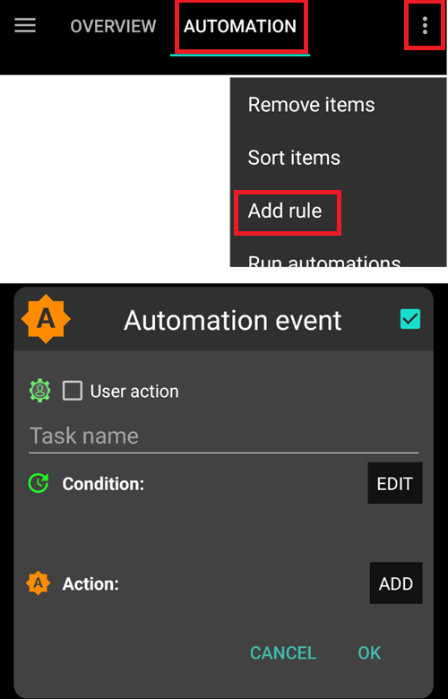
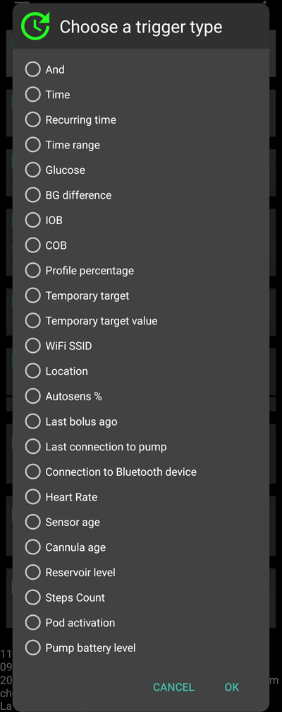
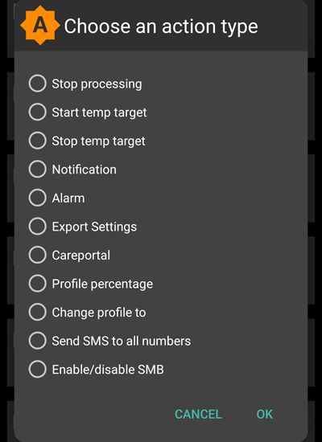
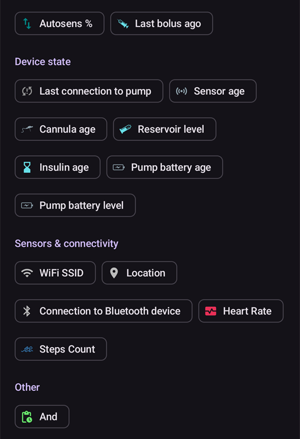

# Automatisierung

```{contents} In this page
:backlinks: entry
:depth: 2
```

## Was ist eine Automatisierung?

"**Automation**" is a feature which can automate tasks in AAPS.

Automation performs specific actions based on one or more conditions or triggers. Auslöser können weniger häufige Situationen wie niedrige oder hohe Glukosewerte (BZ) oder eine bestimmte Menge negativen aktiven Insulins (Insulin on Bord - IOB) beinhalten. Automations can also handle recurring events, such as meals or exercise at certain times of day, or when the user is within a specific distance of a GPS location or a Wi-Fi SSID area. Eine Automatisierung kann die Sicherung der AAPS-Einstellungen nach einem bestimmten Zeitplan oder mit jedem Pod-Wechsel ausführen.

Automation rules are created and modified from the **Automation** screen (**Manage → Automation**). Jede Regel wird durch zwei Eigenschaften definiert:

- Eine oder mehrere Bedingungen oder „Auslöser“, die eine Aktion starten.

    Denke dabei an einen bestimmten Zeitplan, ein Ereignis oder den Wert einer AAPS-Variable

- Eine oder mehrere durchzuführende Aktionen.

    So wie z. B. ein Alarm oder das Setzen eines prozentualen Profils oder den Export der AAPS-Einstellungen bei einem Pod-Wechsel.


Es gibt eine Vielzahl von Automatisierungsmöglichkeiten und Du solltest Dich mit ihnen in der AAPS-App im Abschnitt „Automatisierung“ vertraut machen. Einige Automatisierungsbeispiele findest Du auch in den AAPS-Gruppen auf [**Facebook**](https://www.facebook.com/groups/AndroidAPSUsers) und [**Discord**](https://discord.gg/4fQUWHZ4Mw).

## Wie Automatisierung helfen kann

1. **Automate recurring tasks:** Automatically executing programmed actions without user interaction.

1. **Entscheidungsmüdigkeit verringern:** Der Hauptvorteil von **Automatisierungen** ist, den Nutzenden von der Last manueller **AAPS**-Eingriffe zu befreien. Die [Forschung](https://www.ncbi.nlm.nih.gov/pmc/articles/PMC6286423/#ref4) schätzt, dass Menschen mit Diabetes Typ 1 täglich durchschnittlich 180 zusätzliche Entscheidungen treffen müssen. **Automatisierungen** können diese mentale Belastung verringern und so Freiräume für andere Dinge des Lebens schaffen können.

1. **Potentiell verbesserte glykämische Kontrolle:** **Automatisierungen** können zum Beispiel dabei helfen, dass auch bei vollen Terminkalendern oder Vergesslichkeitsphasen, **temporäre Ziele** trotzdem gesetzt werden, wo es notwendig ist. Ein Kind mit Diabetes hat z.B. dienstags um 10.00 Uhr und donnerstags um 14.00 Uhr Sport, der ein hohes Temp Target („TT“) von 30 Minuten vor der sportlichen Aktivität aktiv notwendig macht. Dieses **Temp Target** kann über eine **Automatisierung** aktiviert werden.

1. **Enabling AAPS to be highly customized** to be more or less aggressive in specific situations, according to a user's preference. Wenn sich beispielsweise eine längere Phase mit negativem **IOB** mitten in der Nacht, als Zeichen für ein zu starkes **Profil**, abzeichnet, kann automatisiert ein temporäres schwächeres **Profil** (in %) gesetzt werden.

Im Beispiel unten wird gezeigt, wie mit einer **Automatisierung** einzelne manuelle Schritte überflüssig gemacht werden.

Du machst jeden Morgen um 6 Uhr Sport: Du musst um 5 Uhr daran denken, in AAPS manuell ein temporäres Ziel „Aktivität“ zu setzen, bevor Du mit dem Sport beginnst.


Du hast eine **Automatisierung** erstellt, die um 5.00 Uhr am Morgen ein „temporäres Ziel für Aktivität“ setzt, um mit optimalem **Glukosewert** und **IOB** in das um 6.00 Uhr beginnende Training gehen zu können:


## Wichtige Vorüberlegungen, bevor mit Automatisierung gestartet wird

1. Bevor Du mit Automatisierungen beginnst, solltest Du bereits eine gute und stabile **Blutzucker**-Kontrolle mit **AAPS** haben. Automatisierungen sollten nicht dazu verwendet werden schiefe/schlechte Einstellungen (Basalraten, Korrekturfaktoren (**ISF**) oder Mahlzeitenfaktoren (**CR**)) auszugleichen (wird in Tiefe weiter unten beschrieben). Vermeide automatisierte **Profilwechsel**, um einen **Glukosewert**-Anstieg durch _z.B._ Mahlzeiten abzufangen. Diese Anstiege sind durch bestehende AAPS-Funktionen (SMBs etc.) besser abgedeckt.

1. So wie bei jeder Technik: **CGMs**, **Pumpen** und Smartphones können versagen: Technische Probleme oder Sensorfehler können eine laufende **Automatisierung** stören und müssen eventuell durch manuelles Eingreifen behoben werden.

1. Der **Automatisierungsbedarf** wird sich mit ändernden Tagesabläufen über die Zeit verändern**. Wenn zwischen Arbeits-, Schul- und Urlaubsphasen gewechselt wird, macht eine Kalendererinnerung zur Überprüfung der laufenden **Automatisierungen** Sinn (Automatisierungen lassen sich leicht aktivieren und de-aktiveren). For example, if you go on holiday, and no longer need an Automation set up for school sports or daily exercise, or need to adjust the timings.

1. **Automatisierungen** können miteinander in Konflikt stehen. Daher sollten neue **Automatisierungen** in einer gesicherten Umgebung sehr genau geprüft werden. Wichtig ist zu verstehen, warum eine bestimmte **Automatisierung** ggf. nicht, wie Du es erwartet hast, ausgelöst wurde.

1. Wenn Du die Autosens-Funktionalität nutzt, versuche, anstelle von **Profilwechseln** **temporäre Ziele** zu nutzen. **Temporäre Ziele** setzen Autosens nicht auf 0 zurück. **Profilwechsel** setzen Autosens zurück (reset).

1. Die meisten **Automatisierungen** sollten nur für einen **beschränkten Zeitraum** laufen. Danach kann **AAPS** die Situation erneut bewerten und die **Automatisierung** erneut starten, sofern das notwendig ist und die Startbedingungen weiterhin erreicht sind. For example, "start temp target of 7.0 mmol/L for 30 min" or "start **Profile** 110% for 10 min" _and_ "start temp target of 5.0 mmol/L for 10 min". **Automatisierungen** zu nutzen, um dauerhafte Änderungen (z.B. das Profil prozentual anzuheben), kann Hypoglykämien zur Folge haben.

## Wann kann ich mit Automatisierungen beginnen?

**Automatisierungen** können im **Ziel 10** gestartet werden.

## Wo finden sich die Automatisierungen in AAPS?

Open **Manage** in the bottom navigation of the main screen and select **Automation**.

## Wie kann ich eine Automatisierung einrichten?

To set up an **Automation**, press the **+** button on the Automation screen to create a ‘rule’:



* give your ‘rule’ a title (Task name);
* press "**EDIT**" under **Condition**. On the **Condition** screen, choose how the triggers are combined (**And**, **Or**, **Exclusive or**) and press "**Add trigger**":


* add at least one trigger:



* press "**ADD**" under **Action** and select one action:



* save the rule with the **Save** button, and make sure the checkbox left of the rule name is ‘ticked’ to activate the **Automation**:


Um eine **Automatisierungsregel** zu deaktivieren, deaktiviere das Kästchen links neben dem Namen der **Automatisierung**. The example below shows an **Automation** as either activated (‘ticked') or deactivated (‘unticked’):


Beim Einrichten einer **Automatisierung** kannst Du sie zuerst dadurch testen, dass Du unter „Aktion“ die Option „Benachrichtigung“ aktivierst. **AAPS** löst damit zunächst nur eine Benachrichtigung aus und nicht eine tatsächliche automatisierte Aktion. Wenn Du dann sicher bist, dass die Benachrichtigung zur richtigen Zeit bzw. Bedingung ausgelöst worden ist, kannst Du die **Automatisierungsregel** anpassen und die 'Benachrichtigung' durch die tatsächlich gewünschte 'Aktion' ersetzen.


```{admonition} Important note
:class: note

**Automatisierungen** sind auch dann aktiv, wenn der Loop deaktiviert ist!
```


## When rules are checked

**AAPS** checks all **Automation** rules each time a new glucose reading has been processed, so rules are evaluated at the pace of your CGM, also while the phone screen is off. Rules are also checked when the phone starts charging, when the network or location changes, and when a Bluetooth device connects. Only one check runs at a time, so a rule whose actions take a while (for example a pump command) cannot be executed twice.

## Sicherheitsbeschränkungen

Es gibt Sicherheitsbeschränkungen für **Automatisierungen**:

* A **Temp Target** set by an **Automation** has to be between 72 and 180 mg/dL (or 4 and 10 mmol/L).
* The **Profile Percentage** has to be between 50% and 130%.
* Es müssen 5 Minuten zwischen der Ausführung der einzelnen **Automatisierungen** (und der erstmaligen Ausführung) liegen.

## Negative Werte richtig nutzen

```{admonition} Warning
:class: warning

Vorsicht bei der Auswahl eines negativen Wertes in der **Automatisierung**
```

Besonderer Vorsicht bedarf es, wenn in einer **Automatisierung** ein 'negativer Wert' innerhalb einer "kleiner als"-Bedingung genutzt werden soll. Zum Beispiel:


**Example 1:** Creating a Condition **"is lesser than"** "-0.1mmol/L" (or "-2mg/dL") will:

eine **Automatisierung** für jeden Wert, der **kleiner als** -0,1 (bzw. -2) ist, auslösen. Das sind dann die Zahlen wie -0,2, -0,3, -0,4 (bzw. -4, -6, -8) usw. Der Wert -0,1 (bzw. -2) selber **ist in der Bedingung nicht enthalten**. (The condition "is equal or lesser than -0.1mmol/L (-2 mg/dL)" _would_ include -0.1 mmol/L or -2 mg/dL).

**Example 2:** Creating a Condition "is greater than" -0.1mmol/L (-2mg/dL) will:

Trigger an **Automation** for any number which is **greater than** -0.1mmol/L (-2mg/dL). This includes numbers like 0, 0.2, 0.4mmol/L, (0, 4, 8mg/dL) and any other positive number.

Bei der Auswahl Deiner **Automatisierung** und der Wahl der Bedingungen und Werte, ist es wichtig genau zu wissen, welches Ziel damit erreicht werden soll.

(automations-automation-triggers)=
## Automatisierungsauslöser


Scroll down to see the rest of the list:



Es gibt eine Reihe von „Bedingungen“, die ausgewählt werden können. Auslöser sind die Bedingungen, die erfüllt werden müssen, damit die Automatisierung ausgeführt wird. Die folgende Liste ist nicht vollständig:

**Auslöser:** Verbindungsbedingungen (Letzte Verbindung zur Pumpe)

**Optionen:**

Mehrere Auslöser können mit den folgenden Bedingungen miteinander verknüpft werden
* „Und“
* „Oder“
* „Entweder oder“ (d. h. eine (und nur eine) der Bedingungen muss zutreffen, damit die Aktion ausgeführt wird)

**Auslöser:** Zeit vs. Wiederholungszeit

**Optionen:**

* Zeit = einmaliges Ereignis
* Wiederholungszeit = etwas, das regelmäßig passiert (z. B. einmal pro Woche, jeden Werktag etc.)

**Bedingung:** Standort

**Optionen:**

* in [Settings > Automation](#preferences-maintenance-settings), the user can select their required location service.

**Bedingung:** Standortdienst

**Optionen:**

* Passiven Standort verwenden: **AAPS** nutzt nur die Standorte, wenn sie von anderen Apps angefordert werden.
* Netzwerkstandort: Standort Deines WLAN.
* GPS-Standort (Achtung! Kann zu übermäßigem Akkuverbrauch führen!)

**Bedingung**: Pumpen- und Sensordaten

* Kanülenalter: Für alle Pumpen verfügbar
* Insulinalter: Für alle unterstützten Pumpen verfügbar
* Batteriealter: Für alle unterstützten Pumpen verfügbar
* Sensoralter: Immer verfügbar
* Pod-Aktivierung: Für Patchpumpen verfügbar

Beachte, dass für alle altersbezogenen Bedingungen der Vergleich auf Gleichheit sehr unwahrscheinlich zum Auslösen führt. In diesem Fall werden zwei Bedingungen benötigt, um damit einen Bereich zu definieren

* Reservoirstand: Für alle Pumpen verfügbar, der Vergleich „NOT\_AVAILABLE“ funktioniert für diesen Auslöser nicht, da der Wert in **AAPS** immer gefüllt ist
* Pumpenbatterie-Stand: Für alle unterstützen Pumpen verfügbar, der Vergleich „NOT\_AVAILABLE“ funktioniert für diesen Auslöser nicht, da der Wert in **AAPS** immer gefüllt ist

(automations-automation-action)=
## Aktion


Scroll down to see the rest of the list:


**Aktion:** **Temporäres Ziel** (TT) starten

**Optionen:**

* **BG** must be between 72 mg/dL and 180 mg/dL (4 mmol/L and 10 mmol/L)
* **TT** works only if there is no previous Temp Target — **AAPS** adds this automatically as a "**Preconditions: Temp target not exists**" line to the rule

**Aktion:** **Temporäres Ziel** (TT) stoppen

**Optionen:**

kein(e)

**Aktionen:** **Profil Prozentsatz**

**Optionen:**

* **Profile** must be between 50% and 130%
* funktioniert nur, wenn das Profil zu dem Zeitpunkt mit 100% läuft

**Actions:** **Change smoothing**

**Optionen:**

* select the [smoothing method](../CompatibleCgms/SmoothingBloodGlucoseData.md) to switch to
* runs only if that smoothing method is not already active — **AAPS** adds this automatically as a "**Preconditions: Smoothing … is not active**" line to the rule. Once the selected smoothing is active, the rule is skipped silently.
* Example: combined with the **Sensor age** trigger, switch to **Average smoothing** during the first day of a new sensor and back to **No smoothing** afterwards.

**Actions:** **Note** (in the **Alerts** group of the list)

**Optionen:**

* select the event to record: **Note**, **Exercise**, **Question**, **Announcement** or **Pump Site Change**, and an optional note. The name of the action changes to the event you select.
* **Duration**: used for **Note**, **Exercise** and **Pump Site Change**. **Question** and **Announcement** have no duration: they record your current BG instead.
* **Pump Site Change** resets the cannula age, as if you had recorded a site change by hand. Example: some pumps (like the Combo) record a reservoir change by themselves, but not the site change. If you always change both together, a rule with **Insulin age** less than 1 hour and **Cannula age** more than 24 hours can record the site change for you.

 

**Actions:** **Send SMS** (in the **Alerts** group)

**Optionen:**

* enter the text of the message. It is sent to all the phone numbers allowed in the [SMS Communicator](../RemoteFeatures/SMSCommands.md) settings. The SMS Communicator plugin must be enabled.

**Actions:** **Change profile to** (in the **Profile** group)

**Optionen:**

* select the **Profile** to activate. It is activated at 100%, without timeshift. If this profile is already active, the action does nothing.

**Actions:** **Enable/disable SMB** (in the **Loop & insulin** group)

**Optionen:**

* choose **On** or **Off**. This changes the **Enable SMB** setting of OpenAPS SMB, exactly as if you had changed it in **Settings**, and stays until you or another rule change it back.

**Actions:** **Autotune profile** (in the **Loop & insulin** group)

**Optionen:**

* select the profile to tune and the number of days: see [Run Autotune with an automation rule](#autotune-run-autotune-with-an-automation-rule).

**Actions:** **Stop processing** (in the **Loop & insulin** group)

**Optionen:**

* none. When a rule with this action runs, **AAPS** does not check the rules below it in the list during that run. Add it to a rule that must take priority over the rules below it (see [the order of the Automations](#Automations-the-order-of-the-automations-in-the-list-matters)).

**Actions:** **Run scene**, **Enable scene**, **Disable scene** (in the **Scenes** group)

**Optionen:**

* select the [scene](Scenes.md) to run, enable or disable.

Sobald die Aktion hinzugefügt wurde, müssen die voreingestellten Werte durch Klicken auf Deine Wünsche angepasst werden.


(Automations-the-order-of-the-automations-in-the-list-matters)=
## Die Reihenfolge innerhalb der Liste der **Automatisierungen** ist entscheidend
 **AAPS** ordnet die Regeln in der Reihenfolge, wie sie erstellt wurden und beginnt bei der oberen Automatisierung mit dem Abarbeiten der **Automatisierungsliste**. Wenn beispielsweise **Automatisierung** „Low“ (dt. Hypobehandlung) unter allen **Automatisierungsregeln** die wichtigste **Automatisierung** ist, sollte diese ganz oben auf der Liste Deiner **Automatisierungen** erscheinen:


To reprioritize the **Automation** rules, touch and hold the **=** handle on the right side of the rule. Sortiere die  **Automatisierungen** neu, indem Du die entsprechende Regel nach oben oder unten verschiebst.


## Löschen von Automatisierungsregeln

Klicke auf das Papierkorbsymbol, um eine **Automatisierungsregel** zu löschen.


## Beispiele für Automatisierungen

Es folgen nun einige Beispiele für **Automatisierungen**. Weiterführende und tiefere Diskussionen über **Automatisierungen** im allgemeinen und einige Praxisbeispiele findest Du entweder in den Facebook-Gruppen oder auf Discord. Die folgenden Beispiele sollten nicht blind übernommenen werden. Wichtig ist, die genaue Funktionsweise der jeweiligen </strong>Automatisierung** zu verstehen, bevor sie genutzt wird.</p>

(automations-low-glucose-temp-target)=
### Temporäres Ziel bei niedrigem Blutzucker

This **Automation** triggers an automatic **Temp Target** when **BG** falls below a certain threshold — here, when glucose is lesser than 70 mg/dL, a target of 110 mg/dL is started for 30 minutes:


### Temporäres Ziel zur Mittagszeit (abhängig vom 'Standort')


Diese **Automatisierung** wurde für eine Person erstellt, die das Mittagessen an Werktagen (Mo - Fr) ungefähr zur gleichen Zeit auf der Arbeit isst, und nur ausgeführt wird, wenn die Person an einem bestimmten 'Standort' ist.  So if the user is not at work one day, this **Automation** will not activate.

This **Automation** will set a low **Temp Target** (Eating Soon) at 13:00 to drive BG to 90 mg/dL (or 5 mmol/L) in preparation for lunch.

The ‘Trigger’ location has a name, a position (tap **Pick from map**, or use your current location) and a radius in metres, and fires when you are inside (or outside) the area:


Aufgrund der ‘Und’-Verknüpfung wird die **Automatisierung** nur dann ausgeführt, wenn die Person sich zum gewählten Zeitpunkt am hinterlegten Standort aufhält.

The **Automation** will not be triggered on any other time at this location or at this time outside the 50-metre radius around the chosen position.

### Wi-Fi SSID Location Automation

Using a Wi-Fi SSID is a good option to trigger an **Automation** while within range of a specific Wi-Fi network (compared with GPS): it is fairly precise, uses less battery, and works in enclosed spaces where GPS and other location services might not be available.

Hier nun ein weiteres Beispiel für das frühzeitige Setzen eines **temporären Ziels** an Werktagen für das Frühstück (1).


The **Automation** will trigger at 05:30am only on Monday-Friday(2)  
and while being connected to a home Wi-Fi network (3).


It will then set a **Temp Target** of 75 mg/dL for 30 minutes (4). One of the advantages of including the location is that it will not trigger if the user is traveling on vacation, for instance.


Scroll down to see the action: a **Temp Target** of 75 mg/dL for 30 minutes (4).


Der Screenshot zeigt die detaillierten Auslöser der **Automatisierung**:

1) Under the main “AND” (both conditions need to be met to trigger) 1) Recurring time = M,T,W,T,F At 5:30am  
1) Wi-Fi SSID = My_Home_WiFi_Name


(automating-preference-settings-export)=

## Automatischer Export der Einstellungen

### Täglicher automatischer Export der Einstellungen

Screenshots, die die Auslöser für diese Automatisierung im Detail zeigen:

1) Bedingung: Wiederholungszeit = Mo, Di, Mi, Do, Fr um 8:00 Uhr 1) Aktion: Einstellungen exportieren (Für „Text in Behandlungen“ gib „Täglich“ ein)


Hinweis: Der Export wird im Careportal protokolliert

### Automatischer Export der Einstellungen bei Pod-Aktivierung (nur für Patchpumpen)

Screenshots, die die Auslöser für diese Automatisierung im Detail zeigen:

1) Bedingung: Pod-Aktivierung 1) Aktion: Export der Einstellungen (Als „Text in Behandlungen" gib "Pod-Aktivierung: Einstellungen exportieren" ein)


Hinweis: Der Export wird im Careportal protokolliert. Hinweis: Automatisierungen werden **nur dann** ausgeführt, wenn Du vorher einen manuellen Export der Einstellungen gemacht hast. See [Settings → Maintenance](#preferences-maintenance-settings) for proper activation of unattended settings export.


## Automatisierungsprotokolle (Logs)

**AAPS** shows a log of the most recent **Automation** events at the bottom of the **Automation** screen, below the rules. Use it to verify that your rules triggered when you expected them to.

In the example below, the **Low glucose temp target** rule (1) (see [Low Glucose Temp Target](#automations-low-glucose-temp-target) above) is enabled. The log (2) shows that at 03:09 PM, glucose fell below 70 mg/dL and the rule triggered:
* the action was "Start temp target: 110mg/dL@30 min": a **Temp Target** of 110 mg/dL for 30 minutes;
* **OK** at the end means that the action was carried out successfully.


(automations-troubleshooting)=

## Problembehandlung

* Problem: __Meine Automatisierungen werden durch AAPS nicht gestartet__

Check that the box left of the **Automation** name is ‘ticked’ to ensure the rule is activated:


* Problem: __Meine Automatisierungen werden in der falschen Reihenfolge gestartet.__

Check your rule prioritization order as discussed above here.

* Problem: __A condition shows "Unknown trigger … - never true".__

The rule contains a trigger that this version of **AAPS** cannot read, for example after you went back to an older version or imported settings from a newer one. Such a trigger is never true, so the rule does not run. It is kept unchanged, so a newer version can still use it. Edit the rule and replace the trigger, or update **AAPS**.

## Alternativen zu einer Automatisierung

Für fortgeschrittene Benutzer gibt es andere Möglichkeiten, Aufgaben mit IFTTT oder einer Drittanbieter-Android-App namens Automate zu automatisieren. 
