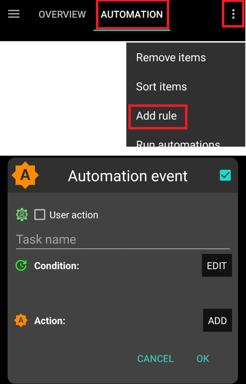
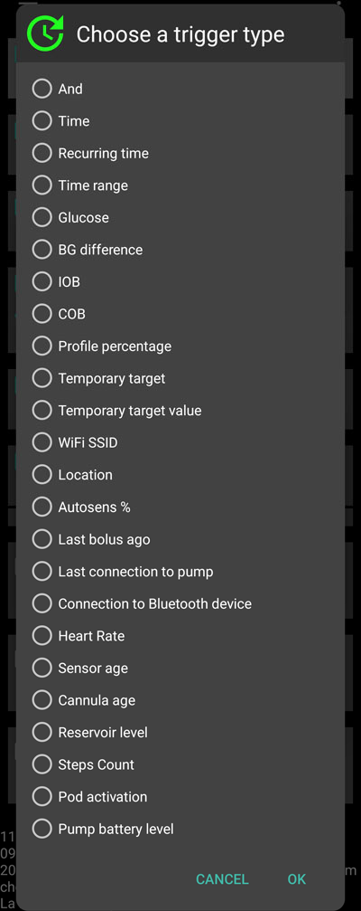
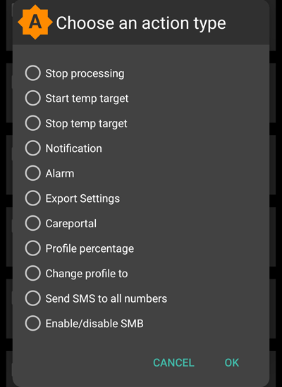
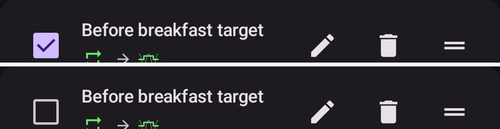
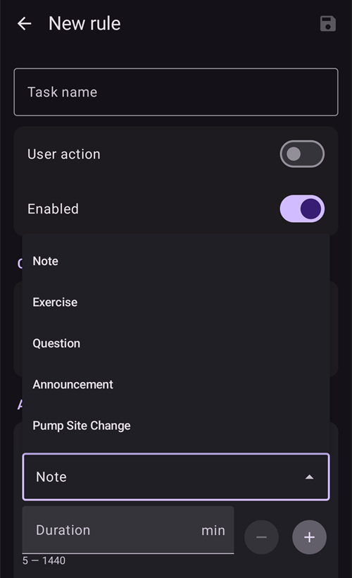

# Automatisierung

```{contents} In this page
:backlinks: entry
:depth: 2
```

## Was ist eine Automatisierung?

„**Automatisierung**“ ist eine Funktion, mit der sich Aufgaben in AAPS automatisieren lassen.

Eine Automatisierung führt bestimmte Aktionen aus, wenn eine oder mehrere Bedingungen oder Auslöser erfüllt sind. Auslöser können weniger häufige Situationen wie niedrige oder hohe Glukosewerte (BZ) oder eine bestimmte Menge negativen aktiven Insulins (Insulin on Bord - IOB) beinhalten. Automatisierungen können auch wiederkehrende Ereignisse abdecken, etwa Mahlzeiten oder Sport zu bestimmten Tageszeiten, oder wenn Du Dich innerhalb einer bestimmten Entfernung zu einem GPS-Standort oder im Bereich einer WLAN-SSID befindest. Eine Automatisierung kann die Sicherung der AAPS-Einstellungen nach einem bestimmten Zeitplan oder mit jedem Pod-Wechsel ausführen.

Automatisierungsregeln legst Du im Bildschirm **Automatisierung** (**Verwalten → Automatisierung**) an und änderst sie dort. Jede Regel wird durch zwei Eigenschaften definiert:

- Eine oder mehrere Bedingungen oder „Auslöser“, die eine Aktion starten.

    Denke dabei an einen bestimmten Zeitplan, ein Ereignis oder den Wert einer AAPS-Variable

- Eine oder mehrere durchzuführende Aktionen.

    Zum Beispiel ein Alarm, das Setzen eines Prozentsatzes des Profils oder der Export der AAPS-Einstellungen bei einem Pod-Wechsel.


Es gibt eine Vielzahl von Automatisierungsmöglichkeiten und Du solltest Dich mit ihnen in der AAPS-App im Abschnitt „Automatisierung“ vertraut machen. Einige Automatisierungsbeispiele findest Du auch in den AAPS-Gruppen auf [**Facebook**](https://www.facebook.com/groups/AndroidAPSUsers) und [**Discord**](https://discord.gg/4fQUWHZ4Mw).

## Wie Automatisierung helfen kann

1. **Wiederkehrende Aufgaben automatisieren:** Programmierte Aktionen werden automatisch ohne Dein Zutun ausgeführt.

1. **Entscheidungsmüdigkeit verringern:** Der Hauptvorteil von **Automatisierungen** ist, den Nutzenden von der Last manueller **AAPS**-Eingriffe zu befreien. Die [Forschung](https://www.ncbi.nlm.nih.gov/pmc/articles/PMC6286423/#ref4) schätzt, dass Menschen mit Diabetes Typ 1 täglich durchschnittlich 180 zusätzliche Entscheidungen treffen müssen. **Automatisierungen** können diese mentale Belastung verringern und so Freiräume für andere Dinge des Lebens schaffen können.

1. **Potentiell verbesserte glykämische Kontrolle:** **Automatisierungen** können zum Beispiel dabei helfen, dass auch bei vollen Terminkalendern oder Vergesslichkeitsphasen, **temporäre Ziele** trotzdem gesetzt werden, wo es notwendig ist. Ein Kind mit Diabetes hat z.B. dienstags um 10.00 Uhr und donnerstags um 14.00 Uhr Sport, der ein hohes Temp Target („TT“) von 30 Minuten vor der sportlichen Aktivität aktiv notwendig macht. Dieses **Temp Target** kann über eine **Automatisierung** aktiviert werden.

1. **AAPS stark individuell anpassen**, damit es in bestimmten Situationen nach Deinen Vorstellungen mehr oder weniger aggressiv arbeitet. Wenn sich beispielsweise eine längere Phase mit negativem **IOB** mitten in der Nacht, als Zeichen für ein zu starkes **Profil**, abzeichnet, kann automatisiert ein temporäres schwächeres **Profil** (in %) gesetzt werden.

Im Beispiel unten wird gezeigt, wie mit einer **Automatisierung** einzelne manuelle Schritte überflüssig gemacht werden.

Du machst jeden Morgen um 6 Uhr Sport: Du musst um 5 Uhr daran denken, in AAPS manuell ein temporäres Ziel „Aktivität“ zu setzen, bevor Du mit dem Sport beginnst.


Du hast eine **Automatisierung** erstellt, die um 5.00 Uhr am Morgen ein „temporäres Ziel für Aktivität“ setzt, um mit optimalem **Glukosewert** und **IOB** in das um 6.00 Uhr beginnende Training gehen zu können:


## Wichtige Vorüberlegungen, bevor mit Automatisierung gestartet wird

1. Bevor Du mit Automatisierungen beginnst, solltest Du bereits eine gute und stabile **Blutzucker**-Kontrolle mit **AAPS** haben. Automatisierungen sollten nicht dazu verwendet werden schiefe/schlechte Einstellungen (Basalraten, Korrekturfaktoren (**ISF**) oder Mahlzeitenfaktoren (**CR**)) auszugleichen (wird in Tiefe weiter unten beschrieben). Vermeide automatisierte **Profilwechsel**, um einen **Glukosewert**-Anstieg durch _z.B._ Mahlzeiten abzufangen. Diese Anstiege sind durch bestehende AAPS-Funktionen (SMBs etc.) besser abgedeckt.

1. So wie bei jeder Technik: **CGMs**, **Pumpen** und Smartphones können versagen: Technische Probleme oder Sensorfehler können eine laufende **Automatisierung** stören und müssen eventuell durch manuelles Eingreifen behoben werden.

1. **Der Bedarf an Automatisierungen ändert sich wahrscheinlich, wenn sich Deine Abläufe ändern**. Wenn zwischen Arbeits-, Schul- und Urlaubsphasen gewechselt wird, macht eine Kalendererinnerung zur Überprüfung der laufenden **Automatisierungen** Sinn (Automatisierungen lassen sich leicht aktivieren und de-aktiveren). Zum Beispiel, wenn Du in den Urlaub fährst und eine Automatisierung für Schulsport oder tägliches Training nicht mehr brauchst oder die Zeiten anpassen musst.

1. **Automatisierungen** können miteinander in Konflikt stehen. Daher sollten neue **Automatisierungen** in einer gesicherten Umgebung sehr genau geprüft werden. Wichtig ist zu verstehen, warum eine bestimmte **Automatisierung** ggf. nicht, wie Du es erwartet hast, ausgelöst wurde.

1. Wenn Du die Autosens-Funktionalität nutzt, versuche, anstelle von **Profilwechseln** **temporäre Ziele** zu nutzen. **Temporäre Ziele** setzen Autosens nicht auf 0 zurück. **Profilwechsel** setzen Autosens zurück (reset).

1. Die meisten **Automatisierungen** sollten nur für einen **beschränkten Zeitraum** laufen. Danach kann **AAPS** die Situation erneut bewerten und die **Automatisierung** erneut starten, sofern das notwendig ist und die Startbedingungen weiterhin erreicht sind. Zum Beispiel „temporäres Ziel von 7,0 mmol/l für 30 min starten“ oder „**Profil** mit 110 % für 10 min starten“ _und_ „temporäres Ziel von 5,0 mmol/l für 10 min starten“. **Automatisierungen** zu nutzen, um dauerhafte Änderungen (z.B. das Profil prozentual anzuheben), kann Hypoglykämien zur Folge haben.

## Wann kann ich mit Automatisierungen beginnen?

**Automatisierungen** können im **Ziel 10** gestartet werden.

## Wo finden sich die Automatisierungen in AAPS?

Öffne in der unteren Navigationsleiste des Startbildschirms **Verwalten** und wähle **Automatisierung**.

## Wie kann ich eine Automatisierung einrichten?

Um eine **Automatisierung** einzurichten, tippe im Bildschirm Automatisierung auf den Knopf **+**, um eine „Regel“ anzulegen:



* gib Deiner „Regel“ einen Titel (Name der Aufgabe);
* tippe unter **Bedingung** auf „**BEARBEITEN**“. Wähle im Bildschirm **Bedingung**, wie die Auslöser verknüpft werden (**Und**, **Oder**, **Entweder oder**), und tippe auf „**Trigger (Auslöser) hinzufügen**“:


* füge mindestens einen Auslöser hinzu:



* tippe unter **Aktion** auf „**HINZUFÜGEN**“ und wähle eine Aktion aus:



* speichere die Regel mit dem Knopf **Speichern** und achte darauf, dass das Kästchen links neben dem Regelnamen einen Haken hat, damit die **Automatisierung** aktiv ist:


Um eine **Automatisierungsregel** zu deaktivieren, deaktiviere das Kästchen links neben dem Namen der **Automatisierung**. Das Beispiel unten zeigt eine **Automatisierung** einmal aktiviert (mit Haken) und einmal deaktiviert (ohne Haken):




Beim Einrichten einer **Automatisierung** kannst Du sie zuerst dadurch testen, dass Du unter „Aktion“ die Option „Benachrichtigung“ aktivierst. **AAPS** löst damit zunächst nur eine Benachrichtigung aus und nicht eine tatsächliche automatisierte Aktion. Wenn Du dann sicher bist, dass die Benachrichtigung zur richtigen Zeit bzw. Bedingung ausgelöst worden ist, kannst Du die **Automatisierungsregel** anpassen und die 'Benachrichtigung' durch die tatsächlich gewünschte 'Aktion' ersetzen.


```{admonition} Important note
:class: note

**Automatisierungen** sind auch dann aktiv, wenn der Loop deaktiviert ist!
```


## Wann Regeln geprüft werden

**AAPS** prüft alle **Automatisierungsregeln** jedes Mal, wenn ein neuer Glukosewert verarbeitet wurde. Die Regeln werden also im Takt Deines CGM ausgewertet, auch bei ausgeschaltetem Bildschirm. Regeln werden außerdem geprüft, wenn das Smartphone zu laden beginnt, wenn sich Netzwerk oder Standort ändern und wenn sich ein Bluetooth-Gerät verbindet. Es läuft immer nur eine Prüfung gleichzeitig, sodass eine Regel, deren Aktionen etwas dauern (zum Beispiel ein Pumpenbefehl), nicht doppelt ausgeführt werden kann.

## Sicherheitsbeschränkungen

Es gibt Sicherheitsbeschränkungen für **Automatisierungen**:

* Ein **temporäres Ziel**, das von einer **Automatisierung** gesetzt wird, muss zwischen 72 und 180 mg/dl (bzw. 4 und 10 mmol/l) liegen.
* Der **Prozentsatz des Profils** muss zwischen 50% und 130% liegen.
* Zwischen zwei Ausführungen einer **Automatisierung** (und bis zur ersten Ausführung) liegen mindestens 5 Minuten.

## Negative Werte richtig nutzen

```{admonition} Warning
:class: warning

Vorsicht bei der Auswahl eines negativen Wertes in der **Automatisierung**
```

Besonderer Vorsicht bedarf es, wenn in einer **Automatisierung** ein 'negativer Wert' innerhalb einer "kleiner als"-Bedingung genutzt werden soll. Zum Beispiel:


**Beispiel 1:** Eine Bedingung **„ist kleiner als“** „-0,1 mmol/l“ (oder „-2 mg/dl“) wird:

eine **Automatisierung** für jeden Wert, der **kleiner als** -0,1 (bzw. -2) ist, auslösen. Das sind dann die Zahlen wie -0,2, -0,3, -0,4 (bzw. -4, -6, -8) usw. Der Wert -0,1 (bzw. -2) selber **ist in der Bedingung nicht enthalten**. (Die Bedingung „ist kleiner oder gleich -0,1 mmol/l (-2 mg/dl)“ _würde_ -0,1 mmol/l bzw. -2 mg/dl mit einschließen.)

**Beispiel 2:** Eine Bedingung „ist größer als“ -0,1 mmol/l (-2 mg/dl) wird:

eine **Automatisierung** für jeden Wert auslösen, der **größer als** -0,1 mmol/l (-2 mg/dl) ist. Das schließt Werte wie 0, 0,2, 0,4 mmol/l (0, 4, 8 mg/dl) und jede andere positive Zahl ein.

Bei der Auswahl Deiner **Automatisierung** und der Wahl der Bedingungen und Werte, ist es wichtig genau zu wissen, welches Ziel damit erreicht werden soll.

(automations-automation-triggers)=
## Automatisierungsauslöser


Scrolle nach unten, um den Rest der Liste zu sehen:


Es gibt eine Reihe von „Bedingungen“, die ausgewählt werden können. Auslöser sind die Bedingungen, die erfüllt werden müssen, damit die Automatisierung ausgeführt wird. Die folgende Liste ist nicht vollständig:

**Auslöser:** Verbindungsbedingungen (Letzte Verbindung zur Pumpe)

**Optionen:**

Mehrere Auslöser können mit den folgenden Bedingungen miteinander verknüpft werden
* „Und“
* „Oder“
* „Entweder oder“ (d. h. eine (und nur eine) der Bedingungen muss zutreffen, damit die Aktion ausgeführt wird)

**Auslöser:** Zeit vs. Wiederholungszeit

**Optionen:**

* Zeit = einmaliges Ereignis
* Wiederholungszeit = etwas, das regelmäßig passiert (z. B. einmal pro Woche, jeden Werktag etc.)

**Bedingung:** Standort

**Optionen:**

* unter [Einstellungen > Automatisierung](#preferences-maintenance-settings) kannst Du den gewünschten Standortdienst auswählen.

**Bedingung:** Standortdienst

**Optionen:**

* Passiven Standort verwenden: **AAPS** nutzt nur die Standorte, wenn sie von anderen Apps angefordert werden.
* Netzwerkstandort: Standort Deines WLAN.
* GPS-Standort (Achtung! Kann zu übermäßigem Akkuverbrauch führen!)

**Bedingung**: Pumpen- und Sensordaten

* Kanülenalter: Für alle Pumpen verfügbar
* Insulinalter: Für alle unterstützten Pumpen verfügbar
* Batteriealter: Für alle unterstützten Pumpen verfügbar
* Sensoralter: Immer verfügbar
* Pod-Aktivierung: Für Patchpumpen verfügbar

Beachte, dass für alle altersbezogenen Bedingungen der Vergleich auf Gleichheit sehr unwahrscheinlich zum Auslösen führt. In diesem Fall werden zwei Bedingungen benötigt, um damit einen Bereich zu definieren

* Reservoirstand: Für alle Pumpen verfügbar, der Vergleich „NOT\_AVAILABLE“ funktioniert für diesen Auslöser nicht, da der Wert in **AAPS** immer gefüllt ist
* Pumpenbatterie-Stand: Für alle unterstützen Pumpen verfügbar, der Vergleich „NOT\_AVAILABLE“ funktioniert für diesen Auslöser nicht, da der Wert in **AAPS** immer gefüllt ist

(automations-automation-action)=
## Aktion


Scrolle nach unten, um den Rest der Liste zu sehen:


**Aktion:** **Temporäres Ziel** (TT) starten

**Optionen:**

* Der **Glukosewert** muss zwischen 72 mg/dl und 180 mg/dl (4 mmol/l und 10 mmol/l) liegen
* **Temporäres Ziel** funktioniert nur, wenn kein vorheriges temporäres Ziel läuft – **AAPS** ergänzt die Regel dafür automatisch um die Zeile „**Voraussetzung: Kein temporäres Ziel vorhanden**“

**Aktion:** **Temporäres Ziel** (TT) stoppen

**Optionen:**

kein(e)

**Aktionen:** **Profil Prozentsatz**

**Optionen:**

* **Prozentsatz** muss zwischen 50% und 130% liegen
* funktioniert nur, wenn das Profil zu dem Zeitpunkt mit 100% läuft

**Aktionen:** **Glättung ändern** (in der Gruppe **Loop & Insulin**)

**Optionen:**

* wähle die [Glättungsmethode](../CompatibleCgms/SmoothingBloodGlucoseData.md), zu der gewechselt werden soll. Die Liste ist dieselbe wie unter **Konfiguration** > **Glättung**, und die Aktion bewirkt genau das, was eine Änderung dort bewirkt: Die neue Methode wird gespeichert, mit gekoppelten Clients synchronisiert, und die Glukosedaten werden sofort neu geglättet.
* wird nur ausgeführt, wenn diese Glättungsmethode nicht bereits aktiv ist – **AAPS** ergänzt die Regel dafür automatisch um die Zeile „**Voraussetzung: Glättung … ist nicht aktiv**“. Ist die gewählte Glättung aktiv, wird die Regel stillschweigend übersprungen.
* Beispiel: Ein neuer Sensor ist am ersten Tag oft unruhig. Zwei Regeln mit dem Auslöser **Sensoralter** sorgen für eine stärkere Filterung, solange sich der Sensor einpendelt, und danach für eine Glättung ohne Verzögerung:
  * **Sensoralter** unter 24 h: **Glättung ändern** auf **Unscented Kalman Filter**
  * **Sensoralter** über 24 h: **Glättung ändern** auf **Durchschnittliche Glättung**

**Aktionen:** **Notiz** (in der Gruppe **Warnungen** der Liste)

**Optionen:**

* wähle das zu erfassende Ereignis aus: **Notiz**, **Bewegung**, **Frage**, **Ankündigung** oder **Pumpenkatheter-Wechsel**, sowie optional eine Notiz. Der Name der Aktion ändert sich in das ausgewählte Ereignis.
* **Dauer**: wird für **Notiz**, **Bewegung** und **Pumpenkatheter-Wechsel** verwendet. **Frage** und **Ankündigung** haben keine Dauer: Sie erfassen stattdessen Deinen aktuellen Glukosewert.
* **Pumpenkatheter-Wechsel** setzt das Kanülenalter zurück, als hättest Du einen Wechsel von Hand erfasst. Beispiel: Manche Pumpen (wie die Combo) erfassen einen Reservoirwechsel selbst, aber nicht den Katheterwechsel. Wechselst Du immer beides zusammen, kann eine Regel mit **Insulinalter** unter 1 Stunde und **Kanülenalter** über 24 Stunden den Katheterwechsel für Dich erfassen.

 

**Aktionen:** **SMS an alle Nummern senden** (in der Gruppe **Warnungen**)

**Optionen:**

* gib den Text der Nachricht ein. Sie wird an alle Telefonnummern gesendet, die in den Einstellungen des [SMS-Kommunikators](../RemoteFeatures/SMSCommands.md) erlaubt sind. Das Modul SMS-Kommunikator muss aktiviert sein.

**Aktionen:** **Profil wechseln zu** (in der Gruppe **Profil**)

**Optionen:**

* wähle das **Profil** aus, das aktiviert werden soll. Es wird mit 100 % ohne Zeitverschiebung aktiviert. Ist dieses Profil bereits aktiv, bewirkt die Aktion nichts.

**Aktionen:** **SMB aktivieren/deaktivieren** (in der Gruppe **Loop & Insulin**)

**Optionen:**

* wähle **Ein** oder **Aus**. Das ändert die Einstellung **SMB aktivieren** von OpenAPS SMB, genau so, als hättest Du sie in den **Einstellungen** geändert, und bleibt so, bis Du oder eine andere Regel sie wieder zurückstellt.

**Aktionen:** **Autotune ausführen** (in der Gruppe **Loop & Insulin**)

**Optionen:**

* wähle das anzupassende Profil und die Anzahl der Tage aus: siehe [Autotune mit einer Automatisierungsregel ausführen](#autotune-run-autotune-with-an-automation-rule).

**Aktionen:** **Verarbeitung beenden** (in der Gruppe **Loop & Insulin**)

**Optionen:**

* keine. Solange die Bedingungen einer Regel mit dieser Aktion erfüllt sind, prüft **AAPS** die Regeln darunter in der Liste nicht. Sobald ihre Bedingungen nicht mehr erfüllt sind, werden die Regeln darunter wie gewohnt geprüft. Füge sie einer Regel hinzu, die Vorrang vor den Regeln darunter haben soll (siehe [die Reihenfolge der Automatisierungen](#Automations-the-order-of-the-automations-in-the-list-matters)).

**Aktionen:** **Szene starten**, **Szene einschalten**, **Szene ausschalten** (in der Gruppe **Szenen**)

**Optionen:**

* wähle die [Szene](Scenes.md) aus, die gestartet, eingeschaltet oder ausgeschaltet werden soll.

Sobald die Aktion hinzugefügt wurde, müssen die voreingestellten Werte durch Klicken auf Deine Wünsche angepasst werden.


(Automations-the-order-of-the-automations-in-the-list-matters)=
## Die Reihenfolge innerhalb der Liste der **Automatisierungen** ist entscheidend
 **AAPS** ordnet die Regeln in der Reihenfolge, wie sie erstellt wurden und beginnt bei der oberen Automatisierung mit dem Abarbeiten der **Automatisierungsliste**. Ist zum Beispiel die **Automatisierung** „Low“ die wichtigste **Automatisierung** vor allen anderen Regeln, sollte diese **Automatisierung** ganz oben in Deiner **Automatisierungs**-Liste stehen, wie unten gezeigt:


Um die Priorität der **Automatisierungsregeln** zu ändern, halte den Griff **=** rechts an der Regel gedrückt. Sortiere die **Automatisierungen** neu, indem Du die Regeln nach oben oder unten verschiebst.


## Löschen von Automatisierungsregeln

Klicke auf das Papierkorbsymbol, um eine **Automatisierungsregel** zu löschen.


## Beispiele für Automatisierungen

Es folgen nun einige Beispiele für **Automatisierungen**. Weitere Diskussionen über **Automatisierungen** und wie andere ihre **Automatisierung** individuell angepasst haben, findest Du in den Facebook-Gruppen oder auf Discord. Die folgenden Beispiele sollten nicht blind übernommenen werden. Wichtig ist, die genaue Funktionsweise der jeweiligen </strong>Automatisierung** zu verstehen, bevor sie genutzt wird.</p>

(automations-low-glucose-temp-target)=
### Temporäres Ziel bei niedrigem Blutzucker

Diese **Automatisierung** löst automatisch ein **temporäres Ziel** aus, wenn der **Glukosewert** unter einen bestimmten Schwellenwert fällt – hier wird bei einem Glukosewert unter 70 mg/dl für 30 Minuten ein Zielwert von 110 mg/dl gestartet:


### Temporäres Ziel zur Mittagszeit (abhängig vom 'Standort')


Diese **Automatisierung** wurde für eine Person erstellt, die das Mittagessen an Werktagen (Mo - Fr) ungefähr zur gleichen Zeit auf der Arbeit isst, und nur ausgeführt wird, wenn die Person an einem bestimmten 'Standort' ist.  Ist die Person an einem Tag nicht bei der Arbeit, wird diese **Automatisierung** also nicht ausgelöst.

Diese **Automatisierung** setzt um 13:00 Uhr ein niedriges **temporäres Ziel** (Bald essen), um den Glukosewert zur Vorbereitung auf das Mittagessen auf 90 mg/dl (bzw. 5 mmol/l) zu bringen.

Der Auslöser „Standort“ hat einen Namen, eine Position (tippe auf **Von Karte auswählen** oder verwende Deinen aktuellen Standort) und einen Radius in Metern und löst aus, wenn Du Dich innerhalb (oder außerhalb) des Bereichs befindest:


Aufgrund der ‘Und’-Verknüpfung wird die **Automatisierung** nur dann ausgeführt, wenn die Person sich zum gewählten Zeitpunkt am hinterlegten Standort aufhält.

Zu jeder anderen Zeit an diesem Ort und zu dieser Zeit außerhalb des 50-Meter-Radius um die gewählte Position wird die **Automatisierung** nicht ausgelöst.

### Automatisierung mit WLAN-SSID als Standort

Eine WLAN-SSID ist eine gute Möglichkeit, eine **Automatisierung** auszulösen, solange Du in Reichweite eines bestimmten WLANs bist (im Vergleich zu GPS): Sie ist recht genau, braucht weniger Akku und funktioniert auch in geschlossenen Räumen, in denen GPS und andere Standortdienste eventuell nicht verfügbar sind.

Hier noch ein Beispiel für ein **temporäres Ziel**, das nur an Werktagen vor dem Frühstück gesetzt wird (1).


Die **Automatisierung** löst nur montags bis freitags (2) um 05:30 Uhr aus  
und nur, wenn das Smartphone mit dem heimischen WLAN verbunden ist (3).


Sie setzt dann für 30 Minuten ein **temporäres Ziel** von 75 mg/dl (4). Ein Vorteil des Standorts ist, dass die Regel zum Beispiel im Urlaub nicht auslöst.


Scrolle nach unten, um die Aktion zu sehen: ein **temporäres Ziel** von 75 mg/dl für 30 Minuten (4).


Der Screenshot zeigt die detaillierten Auslöser der **Automatisierung**:

1) Im Hauptrahmen „UND“ (beide Bedingungen müssen erfüllt sein, damit ausgelöst wird) 1) Wiederkehrende Zeit = Mo, Di, Mi, Do, Fr um 5:30 Uhr  
1) WLAN-SSID = My_Home_WiFi_Name


(automating-preference-settings-export)=

## Automatischer Export der Einstellungen

### Täglicher automatischer Export der Einstellungen

Screenshots, die die Auslöser für diese Automatisierung im Detail zeigen:

1) Bedingung: Wiederholungszeit = Mo, Di, Mi, Do, Fr um 8:00 Uhr 1) Aktion: Einstellungen exportieren (Für „Text in Behandlungen“ gib „Täglich“ ein)


Hinweis: Der Export wird im Careportal protokolliert

### Automatischer Export der Einstellungen bei Pod-Aktivierung (nur für Patchpumpen)

Screenshots, die die Auslöser für diese Automatisierung im Detail zeigen:

1) Bedingung: Pod-Aktivierung 1) Aktion: Export der Einstellungen (Als „Text in Behandlungen" gib "Pod-Aktivierung: Einstellungen exportieren" ein)


Hinweis: Der Export wird im Careportal protokolliert. Hinweis: Automatisierungen werden **nur dann** ausgeführt, wenn Du vorher einen manuellen Export der Einstellungen gemacht hast. Wie Du den automatischen Export der Einstellungen richtig aktivierst, steht unter [Einstellungen → Wartung](#preferences-maintenance-settings).


## Automatisierungsprotokolle (Logs)

**AAPS** zeigt unten im Bildschirm **Automatisierung**, unter den Regeln, ein Log der letzten **Automatisierungs**-Ereignisse. Damit kannst Du prüfen, ob Deine Regeln dann ausgelöst haben, wann Du es erwartet hast.

Im Beispiel unten ist die Regel **Low glucose temp target** (1) (siehe [temporäres Ziel bei niedrigem Glukosewert](#automations-low-glucose-temp-target) oben) aktiviert. Das Log (2) zeigt, dass der Glukosewert um 15:09 Uhr unter 70 mg/dl gefallen ist und die Regel ausgelöst hat:
* Die Aktion war „Start temp target: 110mg/dL@30 min“: ein **temporäres Ziel** von 110 mg/dl für 30 Minuten;
* **OK** am Ende bedeutet, dass die Aktion erfolgreich ausgeführt wurde.


(automations-troubleshooting)=

## Fehlerbehebung

* Problem: __Meine Automatisierungen werden durch AAPS nicht gestartet__

Prüfe, ob das Kästchen links neben dem Namen der **Automatisierung** einen Haken hat, damit die Regel aktiv ist:


* Problem: __Meine Automatisierungen werden in der falschen Reihenfolge gestartet.__

Prüfe die Reihenfolge Deiner Regeln, wie oben beschrieben.

* Problem: __Eine Bedingung zeigt „Unbekannter Auslöser … - niemals wahr“.__

Die Regel enthält einen Auslöser, den diese Version von **AAPS** nicht lesen kann, zum Beispiel nachdem Du zu einer älteren Version zurückgekehrt bist oder Einstellungen aus einer neueren Version importiert hast. Ein solcher Auslöser ist nie wahr, deshalb wird die Regel nicht ausgeführt. Er bleibt unverändert erhalten, damit eine neuere Version ihn weiterhin verwenden kann. Bearbeite die Regel und ersetze den Auslöser oder aktualisiere **AAPS**.

## Alternativen zu einer Automatisierung

Für fortgeschrittene Benutzer gibt es andere Möglichkeiten, Aufgaben mit IFTTT oder einer Drittanbieter-Android-App namens Automate zu automatisieren. 
