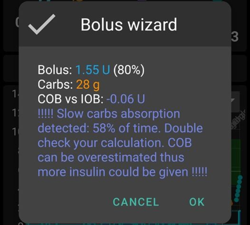
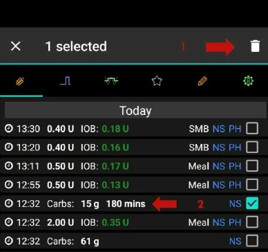

# Berechnung der aktiven Kohlenhydrate (COB)

## Wie berechnet AAPS die aktiven Kohlenhydrate?

Wenn Kohlenhydrate im Rahmen einer Mahlzeit oder als Kohlenhydrat-Korrektur eingegeben werden, wird **AAPS** diese Kohlenhydrate zu den aktiven Kohlenhydraten (**COB**) hinzurechnen und bei den Berechnungen berücksichtigen. **AAPS** berechnet dann die Kohlenhydrat-Aufnahme (Absorption) des Nutzenden anhand der zu den **Glukosewerten** beobachteten Abweichungen. Die Absorptionsrate hängt vom Faktor der Kohlenhydrat-Empfindlichkeit (**CSF**) ab. Das ist keine Einstellung im **Profil** des Nutzers, sondern wird von **AAPS** aus den Einstellungen für **ISF/I:C** berechnet. Er gibt an, um wie viel mg/dl 1 g Kohlenhydrate den **Glukosewert** des Nutzers erhöht.

## Faktor der Kohlenhydrat-Empfindlichkeit (Carb Sensitivity Factor)

Die in **AAPS** genutzte Formel ist:

- Aufgenommene KH = Abweichung * IC / ISF.

Der Effekt auf das **Profil** ist:

- _Erhöhe_ **IC**: Dadurch steigen die alle 5 Minuten aufgenommenen Kohlenhydrate, und die gesamte Absorptionszeit wird kürzer;

- _Erhöhung_ **ISF** - Durch das Reduzieren des Wertes der in 5 Minuten aufgenommenen Kohlenhydrate verlängert sich die Gesamtzeit der KH-Absorption; und

- _Ändere_ den **Prozentsatz des Profils**: Beide Werte steigen oder sinken, das hat also keinen Einfluss auf die Absorptionszeit der Kohlenhydrate.

Ist zum Beispiel im **Profil** der **ISF** 100 und das **I:C** 5,0 dann beträgt der Faktor der Kohlenhydrat-Empfindlichkeit des Nutzers 20. Für alle 20 mg/dl, die der **Glukosewert** des Nutzers steigt, rechnet **AAPS** 1 g Kohlenhydrate als aufgenommen. Eine positiver **IOB**-Wert beinflusst damit auch die **COB**-Berechnung. Wenn **AAPS** also wegen des **IOB** einen Rückgang des **Glukosewerts** um 20 mg/dl vorhersagt und dieser stattdessen gleich bleibt, rechnet **AAPS** ebenfalls 1 g Kohlenhydrate als aufgenommen.

In Abhängigkeit vom von Dir in **AAPS** gewählten Empfindlichkeits-Algorithmus, werden auch Kohlenhydrate nach dem unten beschriebenen Verfahren aufgenommen (absorbiert).

## Kohlenhydrat-Empfindlichkeit (Carb Sensitivity) - Oref1

Nicht absorbierte Kohlenhydrate werden nach der eingestellten Zeit verworfen, werden also bei Berechnungen nicht mehr berücksichtigt:


```{admonition} Older screenshot
:class: note
Der Screenshot oben stammt aus einer älteren **AAPS**-Version. In **AAPS** 4 sehen die Diagramme etwas anders aus, das **COB**-Diagramm enthält aber dieselben Informationen.
```


## Kohlenhydrat-Empfindlichkeit - Gewichteter Mittelwert

Die Kohlenhydrat-Aufnahme wird so berechnet, dass nach einer vorgegebener Zeit COB = 0 ist:


In der **COB**-Kurve wird ein orangener Punkt angezeigt, wenn die minimale Kohlenhydrat-Aufnahme (min_5m_carbimpact) anstelle eines aus den Entwicklungen des **Glukosewertes** berechneten Wertes verwendet wird.

(CobCalculation-detection-of-wrong-cob-values)=
## Erkennung Fehlerhafter COB-Werte

**AAPS** warnt den Nutzer, wenn er mit **COB** aus einer vorherigen Mahlzeit einen Bolus abgeben will und der Algorithmus die aktuelle **COB**-Berechnung für falsch hält. In dieser Situation gibt es beim Nutzen des Bolus-Rechners einen zusätzlichen Hinweis im Bestätigungsfenster.

### Wie erkennt AAPS falsche COB-Werte?

Normalerweise erkennt __AAPS__ eine Kohlenhydrat-Aufnahme anhand von **Glukosewert**-Veränderungen. Für den Fall, dass Du Kohlenhydrate eingegeben hast, aber **AAPS** die erwartete Absorption nicht durch **Glukosewert**-Veränderungen erkennen kann, wird als sog. Fallback zur Berechnung der Absorption die [min_5m_carbimpact](#Preferences-min_5m_carbimpact)-Methode verwendet. Da dieses Verfahren nur die minimale Kohlenhydrat-Aufnahme ohne Berücksichtigung von Glukosewert-Änderungen berechnet, kann dies zu falschen COB-Werten führen.



In der Abbildung oben wurde 66% der Kohlenhydrat-Resorption durch min_5m_carbimpact statt des Wertes, der bei Abweichungen festgestellt wurde, mathematisch berechnet. Das deutet darauf hin, dass weniger Kohlenhydrate aktiv sind (**COB**), als es vom Algorithmus berechnet wurde.

### Wie kann man mit dieser Warnung umgehen?

- Denke darüber nach die Insulinabgabe abzubrechen - drücke 'Abbrechen' statt OK.
- Berechne die Mahlzeit mit dem Bolus-Rechner erneut, nimm aber den Haken bei **COB** heraus.
- Solltest Du einen Korrekturbolus brauchen, gib ihn manuell ein.
- Achte darauf, nicht zu viel Insulin zu geben oder Insulin zu stapeln!


### Warum erkennt der Algorithmus COB nicht richtig?

Das kann folgende Gründe haben:
- Die Kohlenhydratmenge wurde bei der Eingabe potenziell überschätzt.
- Sportliche Aktivität oder Bewegung nach der vorangegangenen Mahlzeit.
- Dein IC-Wert (dt. KH-Faktor) muss angepasst werden.
- Dein Wert für min_5m_carbimpact ist falsch (für SMB wird 8 empfohlen, 3 für AMA).


## Manuelle Korrektur der eingegebenen Kohlenhydrate

Wurden Kohlenhydrate über- oder unterschätzt, kannst Du das wie [hier](#screens-bolus-carbs) beschrieben im Bildschirm **Behandlungsverlauf** korrigieren.


## Kohlenhydrate korrigieren - wie KH-Einträge aus den Behandlungen gelöscht werden


Im Bildschirm **Behandlungsverlauf** kannst Du einen falschen Kohlenhydrat-Eintrag korrigieren, indem Du ihn löschst. Dies kann dann notwendig sein, wenn die Kohlenhydratmenge über- oder unterschätzt wurde:



1. Prüfe und merke Dir die aktuellen Werte für **COB** und **IOB** auf dem **AAPS**-Startbildschirm.
2. Öffne den **Behandlungsverlauf** (Menü → *Behandlungsverlauf*), Reiter **Kohlenhydrate & Bolus**. Je nach Pumpe werden die Kohlenhydrate zusammen mit dem Insulin in einer Zeile oder als eigener Eintrag angezeigt (z. B. bei der Dana RS).
3. **Tippe lange** auf den falschen Kohlenhydrat-Eintrag. Die Liste wechselt in den **Auswahlmodus** mit einem Kontrollkästchen in jeder Zeile, und der Eintrag ist angehakt (oben mit **1** markiert). Hake alle weiteren Einträge an, die Du ebenfalls entfernen möchtest.
4. Tippe oben in der Leiste auf das Symbol **🗑 Löschen** (mit **2** markiert) und bestätige. Der Bestätigungsdialog listet genau auf, was entfernt wird.
5. Prüfe erneut den **COB**-Wert auf dem **AAPS**-Startbildschirm, um sicherzugehen, dass die Kohlenhydrate entfernt wurden.
6. Mache dasselbe für das **IOB**, wenn es nur eine Zeile mit Kohlenhydraten und Insulin gibt.
7. Wenn die KH nicht wie vorgesehen entfernt wurden und zusätzliche KH hinzugefügt werden, ist der **COB**-Eintrag zu hoch. Das kann dazu führen, dass **AAPS** zu viel Insulin abgibt.
8. Gib die richtige Kohlenhydratmenge über den Dialog **Kohlenhydrate** (**Behandlungen** → **Kohlenhydrate**) ein und stelle den richtigen Zeitpunkt ein.
9. Gab es nur eine Zeile mit Kohlenhydraten und Insulin, sollte der Nutzer auch die Insulinmenge erneut eingeben. Stelle den richtigen Zeitpunkt ein und prüfe nach dem Bestätigen des neuen Eintrags das **IOB** auf dem Startbildschirm.

